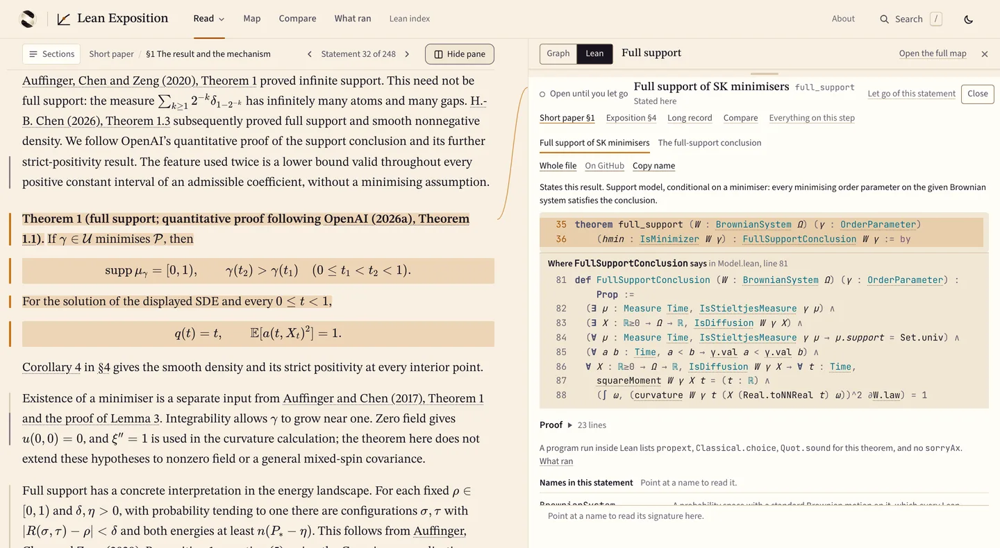

# Lean Exposition

lean-exposition is a Python command-line tool and four written methods for turning a Lean proof and its sources into three linked papers: a detailed record, a short research paper and an exposition. The papers for its worked example sit beside their Lean on a public website.

**Try it without installing anything:** [open Theorem 1 with its Lean beside it](https://wcook04.github.io/lean-exposition-site/read/short/?l=b5970-6319&n=full_support#main-result). Click any statement with a dark tick to open its Lean at the exact lines. The [website](https://wcook04.github.io/lean-exposition-site/) also has a [map of the argument](https://wcook04.github.io/lean-exposition-site/map/), a [table comparing the Lean with each paper](https://wcook04.github.io/lean-exposition-site/compare/) and a [page of what ran](https://wcook04.github.io/lean-exposition-site/checks/).

**Run the tool** (Python 3.11 or newer; Lean is not needed):

```sh
git clone https://github.com/wcook04/lean-exposition
cd lean-exposition
python3 -m venv .venv
. .venv/bin/activate
python -m pip install .
lean-exposition validate examples/minimal/evidence-graph.json
```

The last command reads a saved extraction of a small Lean proof and prints its result, helper lemma and external declarations as JSON. To inspect the real theorem, go to [Inspect one result](#inspect-one-result).

[](https://wcook04.github.io/lean-exposition-site/read/short/?l=b5970-6319&n=full_support#main-result)

## The worked example

The worked example explains a theorem from [OpenAI's mathematics release](https://github.com/openai/math/blob/adc7f1241b42e322a6451854ab7e4b4c146bf78a/lean/docs/281.md). For the pure, zero-field Sherrington–Kirkpatrick (SK) model at zero temperature, the Stieltjes measure of every integrable minimiser of the Parisi functional has full support on [0,1). OpenAI supplied the manuscripts and the Lean proof. This repository adds three papers explaining the result, the links from their statements to the Lean, and the tools.

| Paper | For | Read |
| --- | --- | --- |
| Exposition | Readers with calculus, expectations and elementary linear algebra. It begins with a two-spin calculation. | [On the website](https://wcook04.github.io/lean-exposition-site/read/expository/) · [Markdown](papers/qaoa-sk/expository/main.md) · [PDF](papers/qaoa-sk/expository/main.pdf) |
| Short paper | Specialists in stochastic calculus and variational arguments. It gives the full-support argument and its scalar consequence. | [On the website](https://wcook04.github.io/lean-exposition-site/read/short/) · [Markdown](papers/qaoa-sk/short/paper.md) · [PDF](papers/qaoa-sk/short/paper.pdf) |
| Long reasoning record | Readers examining a step. It holds the derivations, source references and the further steps the broader QAOA claim needs. | [On the website](https://wcook04.github.io/lean-exposition-site/read/long/) · [Markdown](papers/qaoa-sk/long/reasoning-record.md) · [PDF](papers/qaoa-sk/long/reasoning-record.pdf) |

These are drafts of explanations of existing results; mathematical and reader review remain open. Will Cook directs the project and is not a mathematician. AI agents did most of the research and drafting.

The Lean covers the full-support and scalar-value statements, and only the full-support tree has a successful build on record. Neither Lean theorem asserts that Quantum Approximate Optimization Algorithm (QAOA) circuit energies converge, which is a claim of OpenAI's separate manuscript. The [source guide](examples/qaoa-sk/README.md) gives the exact scope.

## Inspect one result

Take Theorem 1 of the short paper.

| Question | Answer |
| --- | --- |
| Where is the statement? | [Theorem 1 of the short paper](papers/qaoa-sk/short/paper.md#model-and-result), following OpenAI's Theorem 1.1 |
| Where is the Lean? | `OAI.ZeroTemperatureSK.full_support` in [Main.lean, line 35](examples/qaoa-sk/upstream/lean/OAI/Probability/SKSupport/Main.lean#L35). The theorem takes a minimiser as a hypothesis, and that a minimiser exists is a separate input. |
| What did Lean establish? | `lake build OAI.Probability.SKSupport.Main` exited 0 on Lean v4.34.1 at OpenAI's pinned commit, recorded on 26 October 2026. Cached dependencies may have been reused. A program run inside Lean lists `propext`, `Classical.choice` and `Quot.sound` for this theorem and no `sorryAx`. See the [saved record](examples/qaoa-sk/verification/full-support-build-extraction-observation-20261026.json). |
| What did Comparator establish? | Comparator has no accepted run. It has neither accepted nor rejected either theorem, and the [What ran](https://wcook04.github.io/lean-exposition-site/checks/) page lists each attempt. |
| What do those tools leave open? | Lean checks the exact formal statement. Neither tool establishes novelty, significance or that the Lean says what the English says. |
| Who has reviewed it? | AI agents made the links between the papers and the Lean. No independent mathematician has reviewed those links, mathematical review of the papers remains open, and no program tests whether a sentence and its Lean say the same thing. The website says so beside each link. |

To query the same result from the command line, run these after the [install commands](#lean-exposition) above:

```sh
lean-exposition assemble examples/qaoa-sk/evidence-graph.json \
  --long papers/qaoa-sk/long/reasoning-record.md papers/qaoa-sk/long/reasoning-record.json \
  --short papers/qaoa-sk/short/paper.md papers/qaoa-sk/short/correspondence.json \
  --expository papers/qaoa-sk/expository/main.md papers/qaoa-sk/expository/correspondence.json \
  --out build/qaoa-sk-authored
lean-exposition query-papers build/qaoa-sk-authored \
  --paper short --passage main-result --format text
```

`assemble` writes the papers and their links into one folder and prints its manifest. `query-papers` then prints the claims and assumptions linked to the theorem, their prerequisites, the review state of the passage and the recorded test runs, including the failed and unavailable ones. `lean-exposition audit-sources examples/qaoa-sk/source-lock.json --root examples/qaoa-sk` compares the 387 vendored OpenAI files with their recorded hashes.

## What you can run, and what is private

| In this repository | What it does |
| --- | --- |
| [Command-line tool](src/lean_exposition/) | Pins source versions and hashes, extracts dependencies from Lean projects, validates the graph linking claims to their support, and packages and serves finished papers. Run `lean-exposition --help` for the commands. |
| [Writing methods](skills/README.md) | Four sets of written instructions, for a person or an AI assistant, covering each step from sources to the three papers. The tool does not load or run them. |
| [Papers and sources](papers/README.md) | The three drafts, their links and the pinned OpenAI files. |
| [Website source](site/README.md) | The code for the reading website. |

No command writes mathematics or prose. A human or an AI assistant supplies both: `scaffold` creates empty templates and `assemble` packages documents already written. The larger environment in which Will Cook runs AI agents on these methods is private and is not in this repository. You can follow the methods and run the tool without it.

The [workflow guide](docs/workflow.md) explains how to apply the tool and methods to another result, and how to package and serve the papers.

## Sources and verification

The [examples guide](examples/README.md) covers three starting points:
a local Lean project, a pinned collection of manuscripts and formal sources,
or a public theorem on [Prove2Me](docs/prove2me.md).

The Prove2Me adapter preserves public theorem identifiers, decomposition links
and platform status. Its intake is partial: it does not download proof bodies
or turn a platform's “Proved” label into a local proof run.

For local sources, the [verification guide](docs/verification.md) explains Lean
builds, dependency extraction and the optional Comparator tool. The saved minimal
example has an actual build and extraction. The larger QAOA / SK graph is curated
from source. It retains planned runs and a separate startup-unavailable attempt;
later invocations built and exported the full-support and scalar-value
challenges before their solution builds failed. No accepted research replay or elaborated research extraction
is established by those records. A source hash,
a successful build and a mathematical review answer different questions; the
records preserve those distinctions.

## Repository map

| Location | What you will find |
| --- | --- |
| [papers/](papers/) · [reading guide](papers/README.md) | The three papers and a separate [paper on the design](papers/architecture/README.md) |
| [examples/](examples/) · [example guide](examples/README.md) | The small Lean proof, the pinned OpenAI sources, a Prove2Me intake and a standalone bundle reader |
| [skills/](skills/) · [writing methods](skills/README.md) | The four writing methods |
| [src/lean_exposition/](src/lean_exposition/) | The Python command-line tool, read-only [web backend](src/lean_exposition/web.py), schemas and templates |
| [site/](site/) · [site guide](site/README.md) | The reading website's source |
| [docs/](docs/) · [documentation guide](docs/README.md) | Guides to authoring, verification, the file formats and research references |
| [lean/](lean/) | A guide to the Lean extractor |
| [tests/](tests/) | The Python test suite |
| [scripts/](scripts/) | Layout and link tests, a [web benchmark](scripts/benchmark_web.py) and a [paper bookmark filter](scripts/paper_anchors.lua) |
| [.github/](.github/) | Continuous integration |

## Videos

The website and the commands above need no video. In [How different can two nearly best answers be?](https://www.youtube.com/watch?v=IUAhxUriDVw), Will Cook starts with four magnets and explains the mathematical question. In [Read a maths paper beside its argument map](https://www.youtube.com/watch?v=sYMDcT7vyng), he goes through the website. In [Introduction V3](https://www.youtube.com/watch?v=MBmVMMogXTA), he explains how his projects fit together.

## Development and licence

The [contribution guide](CONTRIBUTING.md) covers setup and validation, the [architecture and contracts](docs/contracts.md) describe the software's boundaries, and agents start at [AGENTS.md](AGENTS.md). After a change, run `python scripts/check_layout.py`, `python scripts/check_links.py` and `python -m unittest discover -s tests -v`. Run `python scripts/check_layout.py --index` on the staged tree before committing.

The [publishing workflow](.github/workflows/pages.yml) builds the website from this repository and sends the generated files to [lean-exposition-site](https://github.com/wcook04/lean-exposition-site), which GitHub Pages serves. Make source changes here.

Will Cook made this project for [Plectis](https://wcook04.github.io/practical-formal-verification/), his projects on researching mathematics with AI and on tools that help people follow what AI produces. All his websites, code and videos are on [his home page](https://wcook04.github.io/).

Original code and documentation are Apache-2.0; see [LICENSE](LICENSE) and
[NOTICE](NOTICE). Included upstream sources retain their own licences and credit.
The [source lock](examples/qaoa-sk/source-lock.json) identifies exact revisions
and content hashes. [Research references](docs/literature.md) and the
[licensed readings](docs/annex/README.md) provide the supporting literature.
