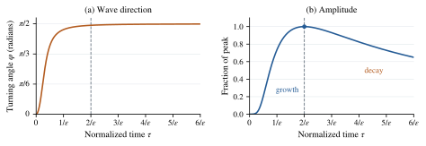
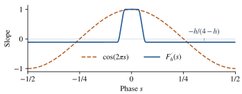
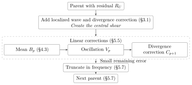
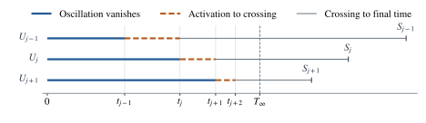

<!-- passage:front -->
<header class="front">
<!-- /passage:front -->

# Finite-Time Singularity Formation for the Three-Dimensional Euler Equations

<!-- passage:sec-finite-time-singularity-formation-for-the-three-dimensional-euler-equations -->

<ul class="authors">
<li>Levent Alpöge</li>
<li>Tristan Buckmaster</li>
<li>Matei P. Coiculescu</li>
</ul>

</header>

<section class="abstract">

We construct smooth periodic initial data for the three-dimensional incompressible Euler equations whose solution blows up in finite time. The velocity remains bounded, while the vorticity magnitude at the origin tends to infinity. Away from the origin, the velocity and its time derivative have smooth spatial limits at the singular time. The construction uses localized Craik–Criminale waves as building blocks of a multi-scale construction.

</section>

*An adapted edition of Alpöge, Buckmaster and Coiculescu’s paper, prepared by Will Cook with AI assistance. The mathematics and the original text are the authors’. Every change is marked, and no change has been reviewed by the authors.*

<!-- /passage:sec-finite-time-singularity-formation-for-the-three-dimensional-euler-equations -->

## 1 Introduction

<!-- passage:sec-1 -->

The incompressible Euler equations are among the earliest partial differential equations derived in mathematical physics. Euler presented them in 1755, less than a decade after d’Alembert derived the wave equation for the vibrating string \[[41](#cite-DAlembert1747), [42](#cite-Euler1757)\].

We construct smooth initial data for the unforced incompressible Euler equations on the three-dimensional torus. The resulting velocity stays bounded up to a finite time $T_*$. At the origin the magnitude of its vorticity (the curl of the velocity) tends to infinity as $t\uparrow T_*$. We represent $\mathbb T^3$ by the cube $[-1/2,1/2]^3$ with opposite faces identified. The velocity $u$ and pressure $p$ satisfy $$\begin{equation}
 \partial_tu+(u\cdot\nabla)u+\nabla p=0,
 \qquad \operatorname{div}u=0
 \quad\hbox{on }\mathbb T^3\times[0,T_*). \tag{1.1}
\end{equation}$$ Local existence and uniqueness for sufficiently regular data go back to Lichtenstein and Günther in the 1920s \[[43](#cite-Lichtenstein1925), [44](#cite-Gunther1926)\]. On $\mathbb T^3$, smooth divergence-free data give a unique smooth solution on its maximal interval by the local existence, uniqueness and regularity results of Ebin and Marsden \[[13](#cite-EbinMarsden), §15.2(i),(iii), pp. 150–151\]. For background on the Euler initial value problem see Bedrossian and Vicol \[[10](#cite-BedrossianVicol)\]. By the Beale–Kato–Majda criterion \[[9](#cite-BKM), p. 62, Theorem and Corollary\], in its periodic form \[[11](#cite-GGPP), Theorem 1\], a smooth solution on $[0,T)$ continues smoothly through $T<\infty$ if $\int_0^T\|\operatorname{curl}u(t)\|_{L^\infty}\,\,\mathrm dt<\infty$.

In two dimensions the scalar vorticity is transported, so its $L^\infty$ norm is conserved, and smooth solutions exist for all time \[[45](#cite-Wolibner1933)\]. Yudovich \[[46](#cite-Yudovich1963)\] proved global existence and uniqueness for bounded, possibly nonsmooth initial vorticity. In three dimensions, Fefferman’s description of the Navier–Stokes Millennium Problem stated that the global regularity question was also open for the Euler equations on $\mathbb R^3$ and on $\mathbb T^3$ \[[47](#cite-Fefferman2006)\].

Numerical searches for blow-up include the Taylor–Green vortex study of Morf, Orszag and Frisch \[[48](#cite-MorfOrszagFrisch1980)\] and Kerr’s computations for antiparallel vortex tubes \[[49](#cite-Kerr1993)\]. In a later computation, Hou and Li \[[50](#cite-HouLi2006)\] observed at most double-exponential growth of the maximum vorticity past Kerr’s predicted singular time. Luo and Hou \[[51](#cite-LuoHou2014)\] found numerical evidence for axisymmetric blow-up at the wall of an axially periodic cylinder. Childress, Gilbert and Valiant \[[52](#cite-ChildressGilbertValiant2016)\] studied, analytically and numerically, eroding vortex dipoles in axisymmetric flow without swirl, whose maximal vorticity grows like $t^{4/3}$, and Childress and Gilbert \[[53](#cite-ChildressGilbert2018)\] proposed, by formal asymptotic analysis, the hairpin geometry as a model for finite-time blow-up. The $t^{4/3}$ law of Childress, Gilbert and Valiant comes from an asymptotic model that neglects certain higher-order effects, supported by numerical calculations \[[52](#cite-ChildressGilbertValiant2016), Abstract and Section 1, p. 1; Section 2, p. 4\].

On $\mathbb R^3$, Elgindi \[[15](#cite-ElgindiSingularity)\] constructed finite-time blow-up from $C^{1,\alpha_0}$ initial data for some $\alpha_0>0$. Elgindi, Ghoul and Masmoudi \[[16](#cite-ElgindiGhoulMasmoudi), Theorems 1 and 2\] obtained stable, locally self-similar blow-up for finite-energy data in this regularity class; the stability in their Theorem 2 is with respect to small axisymmetric perturbations, which may have swirl, in their weighted Sobolev spaces. Chen and Hou \[[28](#cite-ChenHouSmoothI), Theorem 5\] prove nearly self-similar blow-up from smooth axisymmetric data in a periodic cylinder with boundary, using computer-assisted estimates \[[29](#cite-ChenHouSmoothII)\]. Here the initial velocity is smooth on the whole torus, which has no boundary. Oddness keeps the velocity zero at the origin even as its curl there grows without bound.

**Theorem 1.1.** There is an odd divergence-free $u_0\in C^\infty(\mathbb T^3;\mathbb R^3)$ whose maximal classical solution $u$ of (1.1) is smooth and odd on $\mathbb T^3\times[0,T_*)$ for a finite $T_*>0$, and satisfies $$\begin{equation}
 \int_0^{T_*}\|\nabla u(t)\|_{L^\infty}\,\mathrm dt=\infty,
 \qquad
 \int_0^{T_*}\|\operatorname{curl}u(t)\|_{L^\infty}\,\mathrm dt=\infty. \tag{1.2}
\end{equation}$$ Moreover, $$\begin{equation}
 \sup_{0\le t<T_*}\|u(t)\|_{L^\infty}<\infty,
 \qquad \lim_{t\uparrow T_*}|\operatorname{curl}u(t,0)|=\infty. \tag{1.3}
\end{equation}$$ For every compact $K\subset\mathbb T^3\setminus\{0\}$ and every integer $m\ge0$, both $u(t)$ and $\partial_tu(t)$ converge in $C^m(K)$ as $t\uparrow T_*$.

**Remark 1.2.** The solution in Theorem 1.1 may be chosen so that it extends as a smooth field in space and time through $T_*$ away from the origin. A proof is given in the auxiliary note \[[31](#cite-TerminalSmoothness), Theorem 1.1\], where the Euler equations are imposed only for $0\le t<T_*$.

We construct smooth approximate flows whose residuals, the errors in the Euler momentum equation, tend to zero. On each compact time interval before $T_*$ the velocities converge in every spatial $C^m$ norm to an Euler solution. As $t\uparrow T_*$, the theorem gives spatial limits of both $u$ and $\partial_tu$ on compact sets away from the origin. For the solution chosen in the remark, smooth extension also gives limits there for every mixed space-time derivative.

We build the solution one scale at a time. Each new oscillation is supported in a ball about the origin whose radius shrinks with the step. Its velocity is initially small, but its short wavelength allows a large velocity gradient. The gradient from the preceding scales amplifies this oscillation until its own gradient can amplify the next one. The successive growth intervals fit into a finite time. This multiscale construction follows the approach of Córdoba and Martínez-Zoroa for the Euler equations with forcing \[[18](#cite-CMZForcedEuler), Section 1.2\] and for forced IPM \[[19](#cite-CMZForcedIPM), Sections 1.2.1–1.2.4\]. Córdoba, Martínez-Zoroa and Zheng \[[17](#cite-CMZUnforcedEuler), Theorem 2\] used a cascade of vorticity layers to obtain blow-up for the unforced Euler equations on $\mathbb R^3$ from $C^{1,\alpha}$ data smooth away from the origin. Related constructions give blow-up with forcing for the inviscid Boussinesq equations \[[20](#cite-CLMZForcedBoussinesq), Theorem 1\], the variable-density Euler equations \[[21](#cite-CLMZNonhomogeneousEuler), Theorem 1\] and the hypodissipative Navier–Stokes equations \[[22](#cite-CMZHypodissipativeNS), Theorem 1\]. Our companion papers proving singularity formation for forced IPM \[[3](#cite-AlpogeBuckmasterCoiculescuIPM), Theorem 2.1\], the forced Boussinesq equations \[[1](#cite-AlpogeBuckmasterBoussinesq), Theorem 1.1\], and the forced Euler equations \[[2](#cite-AlpogeBuckmasterForcedEuler), Theorem 1.1\] use forces smooth in space and time up to the singular time. In the present construction we use Craik–Criminale waves as building blocks and choose the initial velocity at each step so that the limiting solution is unforced.

Convex integration constructions of nonunique weak solutions of the Euler equations also use oscillations at successive frequency scales. Below the Onsager exponent, this method yields solutions with nonconstant kinetic energy \[[23](#cite-IsettOnsager), [6](#cite-BDLSVOnsager)\]. For the unforced Euler equations in the plane, Coiculescu \[[24](#cite-CoiculescuEulerI), [25](#cite-CoiculescuEulerII)\] uses nested vortex rings at different scales. An instability propagates from the inner rings outward, yielding distinct renormalized weak solutions with the same initial vorticity. See also Choi \[[26](#cite-ChoiEulerNonuniqueness)\] and Hou, Qin, Song and Zhang \[[27](#cite-HouQinSongZhangEulerNonuniqueness)\]. For the three-dimensional Navier–Stokes equations, Jia and Šverák \[[54](#cite-JiaSverak2015)\] gave a conditional construction of nonunique Leray–Hopf solutions based on spectral assumptions about forward self-similar flows. Nonuniqueness was shown for finite-energy weak solutions by Buckmaster and Vicol \[[7](#cite-BuckmasterVicolNS)\], and in the Leray–Hopf class with a common force by Albritton, Brué and Colombo \[[4](#cite-AlbrittonBrueColombo)\]. In a recent preprint, Buckmaster, Coiculescu and Li \[[8](#cite-BuckmasterCoiculescuLiNS)\] obtain nonuniqueness of unforced Leray–Hopf solutions.

### 1.1 Waves and successive amplification

We first describe the wave construction of Craik and Criminale \[[12](#cite-CraikCriminale), Section 2, equations (2.4)–(2.10)\]. Let $D(t)$ be a smooth matrix with $\operatorname{tr}D=0$ and $D'+D^2$ symmetric. These conditions ensure that $U(t,x)=D(t)x$, linear in space, solves the Euler equations on $\mathbb R^3$, with pressure $p_D(t,x)=-x\cdot(D'+D^2)x/2$. We add to this linear background a velocity $$w(t,x)=\mathbf a(t)F(k(t)\cdot x),\qquad \mathbf a\cdot k=0,$$ where $F$ is smooth, odd and $1$-periodic, for instance $F(s)=\sin(2\pi s)$. At a fixed time, the wave has the same velocity everywhere on each plane $k\cdot x=s$. The nonzero vector $k$ is normal to these planes. A displacement of $1/|k|$ in direction $k/|k|$ advances the phase by one period, so $|k|$ measures spatial frequency. The amplitude vector $\mathbf a$ is tangent to the phase planes. The signed factor $F(s)$ gives the velocity on each plane, with maximum speed $|\mathbf a|\|F\|_\infty$.

The sum $u=Dx+w$ is an exact solution of the Euler equations if $k$ and $\mathbf a$ solve $$\begin{equation}
 k'=-D^Tk,\qquad
 \mathbf a'=-D\mathbf a+p_{\rm w} k,\qquad
 p_{\rm w}=\frac{2k\cdot D\mathbf a}{|k|^2}. \tag{1.4}
\end{equation}$$ Its pressure is $p=p_D-p_{\rm w} P(k\cdot x)$, where $P'=F$. Indeed, $\mathbf a\cdot k=0$ gives $(w\cdot\nabla)w=0$, the first ordinary differential equation transports the phase by $Dx$, and the second cancels the remaining acceleration with the gradient of the wave pressure $-p_{\rm w}P(k\cdot x)$. The displayed value of $p_{\rm w}$ preserves $\mathbf a\cdot k=0$. We call (1.4) the Craik–Criminale equations for the wave vector and the amplitude vector. Normalizing $F'(0)=1$ gives $\nabla w(t,0)=\mathbf a\otimes k$. Related short-wave instabilities of planar vortices were studied by Pierrehumbert \[[35](#cite-Pierrehumbert1986)\] and Bayly \[[36](#cite-Bayly1986)\].

To describe amplification of a new wave, write $k_p$ and $\mathbf a_p$ for the nonzero wave vector and amplitude vector of the preceding wave, and set $$E_1=\frac{k_p}{|k_p|},\qquad
 E_2=\frac{\mathbf a_p}{|\mathbf a_p|},\qquad E_3=E_1\times E_2,
 \qquad \sigma=|\mathbf a_p|\,|k_p|.$$ For the preceding wave, $E_1$ points across its phase planes and $E_2$ points along its amplitude vector. At the origin its velocity gradient is $\mathbf a_p\otimes k_p=\sigma E_2\otimes E_1$. Applied to a vector $v$, this matrix gives $\sigma(E_1\cdot v)E_2$. Thus moving in the $E_1$ direction changes the velocity in the $E_2$ direction. The new wave evolves under the sum $D=B+\sigma E_2\otimes E_1$ of this shear and the older background gradient $B$. To model the wave equations at the origin, take $B$ with just two nonzero entries in this moving frame, both constant, $$E_1\cdot BE_2=\nu>0,\qquad E_3\cdot BE_2=\eta>0,
 \qquad \varepsilon=\eta/\nu\ll1.$$ Start the new wave at time $t=0$ with $k=\lambda E_3$, where $\lambda>0$ is its initial frequency, and write $a_i=\mathbf a\cdot E_i$. The preceding wave evolves by (1.4) with $D=B$. Differentiating its normalized vectors gives, in this case, $E_1'=-\nu E_2$, $E_2'=\nu E_1-\eta E_3$ and $E_3'=\eta E_2$. Combining these frame equations with (1.4) for the new wave gives, at $t=0$, $$\dot a_1=-2\nu a_2,\qquad
 \dot a_2=-(\sigma-\nu)a_1.$$ Freezing these coefficients gives a growing mode with rate $\sqrt{2\nu(\sigma-\nu)}$ when $\sigma>\nu$. We choose the initial direction of the amplitude along $E_2-\sqrt{2\nu/\sigma}\,E_1$, the growing direction to leading order for $\sigma\gg\nu$.

The new wave vector starts along $E_3$, perpendicular to both the preceding wave vector and its amplitude. As it turns, follow its projection on the $(E_1,E_3)$-plane. The angle $\varphi$ is measured from $E_3$ towards $E_1$. In these coordinates $$\tan\varphi=\frac{k\cdot E_1}{k\cdot E_3},$$ so $\varphi=0$ initially. The coupling $\eta$ tilts $k$ toward $-E_2$, and the shear carries this tilt into $E_1$, so $\varphi$ increases; while $\eta t$ is small, $\tan\varphi$ grows like $(\sigma+\nu)\eta t^2$. In the strong-shear limit $\sigma/\nu\to\infty$, the wave pressure multiplies the driving coefficient $2\nu$ in the equation for $a_1$ by $\cos^2\varphi\,(1-\varepsilon\tan\varphi)$ (Lemma 2.3). This factor changes sign at $\tan\varphi=1/\varepsilon$, and in the strong-shear limit the amplitude $|\mathbf a|$ reaches its peak after this sign change, as shown in Figure 1. For the perturbed wave with this initial direction, Proposition 2.8 gives a *gain* of at least a fixed multiple of $\exp(\varepsilon^{-1/2})$ on its prescribed interval. The gain is the ratio of the maximum of $|\mathbf a|$ on that interval to its initial value.

**Figure 1.** Turning and growth in the case of two nonzero entries, in the limit of a strong shear. Left: the angle $\varphi$ of the wave vector from $E_3$ toward $E_1$. Right: amplitude as a fraction of its peak. The dashed line marks the amplitude peak, by which time $\varphi$ is close to $\pi/2$.

Size alone does not determine the successor wave. The new wave must supply both a large shear and a suitable frame for the next step of the iteration. In its frame (the subscript $+$ denotes the frame of the newly added wave), $$E_{1,+}=k/|k|,\qquad E_{2,+}=\mathbf a/|\mathbf a|,\qquad
 E_{3,+}=E_{1,+}\times E_{2,+},$$ its shear is $\sigma_+E_{2,+}\otimes E_{1,+}$, with $\sigma_+=|\mathbf a|\,|k|$. The older gradient $D$, expressed in this new frame, must again have positive couplings $$\nu_+=E_{1,+}\cdot D E_{2,+},\qquad
 \eta_+=E_{3,+}\cdot D E_{2,+}.$$ The pressure coefficient of the wave just added is $p_{\rm w}=2\nu_+|\mathbf a|/|k|$ by (1.4), so $\nu_+>0$ gives $p_{\rm w}>0$. For the successor we prescribe a smaller ratio $\eta_+/\nu_+=\varepsilon_+<\varepsilon$ to obtain the gain needed to control its errors. In the strong-shear limit, $\nu_+$ starts at $\varepsilon\nu$ and $\eta_+$ stays within a factor $1+O(\varepsilon)$ of $\nu\cos\varphi$. In particular, at late times this results from a cancellation between terms much larger than $\nu\cos\varphi$. For the perturbed wave, Lemma 2.7 gives $\nu_+$ close to $\nu$ and $\eta_+/\nu_+$ comparable to $\cos\varphi$ at late times, with the reference angle of (2.4). Under the comparison hypotheses, Proposition 2.8 finds a crossing at or after the peak of the *reference* amplitude. There $\eta_+/\nu_+=\varepsilon_+$ and $|k|$ is comparable to $\lambda/\varepsilon_+$. This length compensates for the decline from peak amplitude. The shear $\sigma_+=|\mathbf a||k|$ is still large enough to launch the successor.

The periodic construction starts from the stationary shear flow $$U_0(x)=\sin(2\pi x_2)(e_1+\rho e_3),$$ where $e_i$ are the coordinate vectors and $\rho>0$ is small. It solves the Euler equations with zero pressure. In the initial coordinate frame its central gradient has $\nu=2\pi$ and $\eta=2\pi\rho$, so that $\varepsilon=\rho$. Its explicit flow supplies the first wave; subsequent waves use the successive gradients they create.

The affine wave lives on $\mathbb R^3$. To use it on the torus we first multiply its profile by a smooth cutoff in the particle labels. The cutoff vanishes near the faces of a fundamental cell, so copies of the localized wave fit together smoothly on opposite faces for any initial wave vector, including nonintegral ones. The preceding periodic velocity transports both the phase and the cutoff. For this transport of phase in geometric optics see \[[37](#cite-LifschitzHameiri1991), Section II, equations (7), (9) and (17)\] and \[[38](#cite-FriedlanderVishik1991), equations (5)–(7)\]. For the broader theory of asymptotic waves, see the foundational work of Lax \[[39](#cite-Lax1957)\] and Choquet-Bruhat’s construction near a given solution of a quasilinear system \[[40](#cite-ChoquetBruhat1969), §§2–3, pp. 3–6\]. Spatial variation of the background and differentiation of the cutoff now leave errors. The corrections below reduce these errors at each step until they vanish in the limit.

### 1.2 Controlling corrections in an amplifying flow

A small error introduced early can grow along with the wave. To correct it we choose the initial velocity so that the first-order change in each particle’s final position vanishes.

Let $u,p$ be a smooth solution of the Euler equations on $\mathbb T^3\times[0,T]$, with $T>0$. The flow $X(t,a)$ of $u$ gives the position at time $t$ of the particle that starts at $a$. It satisfies $$\partial_tX(t,a)=u(t,X(t,a)),\qquad X(0,a)=a.$$ For a smooth divergence-free velocity correction $b$, let $X_\delta$ be the flow of $u+\delta b$ with the same initial positions, so that $$\partial_tX_\delta(t,a)
       =(u+\delta b)(t,X_\delta(t,a)),\qquad X_\delta(0,a)=a.$$ The first-order change $\xi$ in the particle trajectories is defined by $$X_\delta(t,a)=X(t,a)+\delta\xi(t,a)+O(\delta^2).$$ Differentiating the flow equation at $\delta=0$ gives $$\begin{equation}
 \partial_t\xi(t,a)=\nabla u(t,X(t,a))\xi(t,a)+b(t,X(t,a)),
 \qquad \xi(0,a)=0. \tag{1.5}
\end{equation}$$ Every perturbation starts the particle at the same label $a$, so $\xi(0,a)=0$. Its initial *velocity* can vary. Indeed, (1.5) gives $\partial_t\xi(0,a)=b(0,a)$. At the other end we impose $\xi(T,a)=0$, or equivalently $X_\delta(T,a)=X(T,a)+O(\delta^2)$. Thus a particle may move away from its reference path in the intervening time. For a prescribed source in the linearized Euler equations (1.6), the final position condition determines which initial correction $b(0)$ to use, under the bounds $H\le\operatorname{Id}$ and $T\le1$ below.

Let $f$ be a prescribed smooth momentum source. In the iteration this source is chosen to cancel errors left by the approximate flow and the new wave. We seek $b$ and $q$ satisfying the linearized Euler equations $$\begin{equation}
 \partial_t b+(u\cdot\nabla)b+(b\cdot\nabla)u+\nabla q=f,
 \qquad \operatorname{div}b=0. \tag{1.6}
\end{equation}$$ Here $q$ is the pressure variation, and the displacement induced by $b$ must satisfy $\xi(0)=\xi(T)=0$. Differentiating (1.5) in time and using (1.6) gives $$\begin{equation}
 \begin{gathered}
 \xi_{tt}+H\xi+(\nabla q)\circ X=f\circ X,
 \qquad H=(D_x^2p)\circ X,\\
 \operatorname{div}_x(\xi\circ X^{-1})=0,\qquad \xi(0)=\xi(T)=0.
 \end{gathered} \tag{1.7}
\end{equation}$$ At each label $a$, $H$ is the pressure Hessian at the particle’s current position. The bound $H\le\operatorname{Id}$ means $z\cdot H(t,a)z\le|z|^2$ for every vector $z$ and every $(t,a)$. The divergence constraint expresses volume preservation to first order. It applies to $\xi\circ X^{-1}$ because this is the displacement written as a function of the particle’s current position. With $f=0$ the equation is the Jacobi equation for the geodesic in Arnold’s description of Euler flow \[[5](#cite-Arnold1966), Section 10\].

For a solution of (1.7), testing with $-\xi$ and integrating by parts gives the identity $$\begin{equation}
 \underbrace{\int_0^T\!\int_{\mathbb T^3}
   \bigl(|\xi_t|^2-\xi\cdot H\xi\bigr)\,\,\mathrm da\,\,\mathrm dt}_{\mathcal Q(\xi)}
 =-\int_0^T\!\int_{\mathbb T^3}(f\circ X)\cdot\xi\,\,\mathrm da\,\,\mathrm dt. \tag{1.8}
\end{equation}$$ Volume preservation and the divergence constraint remove the pressure variation. The quadratic form $\mathcal Q$ is the fixed-endpoint second variation of the action. If $H\le\operatorname{Id}$ and $T\le1$, then $|\xi(t,a)|^2\le(T-t)\int_t^T|\xi_\tau(\tau,a)|^2\,\,\mathrm d\tau$ gives $$\begin{equation}
 \mathcal Q(\xi)\ge\Bigl(1-\frac{T^2}{2}\Bigr)\|\xi_t\|_{L^2_{t,a}}^2
 \ge\frac12\|\xi_t\|_{L^2_{t,a}}^2 . \tag{1.9}
\end{equation}$$ Only a positive value of $\xi\cdot H\xi$ can reduce the energy. A large negative eigenvalue of $H$ increases the contribution from displacements in its eigendirection. Thus the upper bound on $H$ suffices for (1.9). With $f=0$ the energy identity gives $\mathcal Q(\xi)=0$, so the estimate forces $\xi_t=0$. Starting from $\xi(0)=0$ we get $\xi=0$, and then $b=0$ by (1.5). This proves injectivity of the homogeneous endpoint map $b(0)\mapsto\xi(T)$ and hence uniqueness whenever the forced problem has a solution. Upper bounds on the pressure Hessian also enter Brenier’s fixed-endpoint action-minimization criterion \[[32](#cite-Brenier1989)\]; see, in particular, \[[33](#cite-Brenier1999), Theorem 2.4, author version\].

The velocity $U$ produced at a finite step is only approximate. Its Euler equation has residual $R_U$, so differentiating that equation along the particle flow replaces $H$ by $H^\#=(D_x^2p_U-\nabla R_U)\circ X$ (Subsection 5.1). The Jacobian $\nabla R_U$ can be nonsymmetric. The same energy estimate still applies when $z\cdot H^\#z\le |z|^2$ for all vectors, times and labels. Only the symmetric part contributes to this quadratic form. The construction also needs existence for each prescribed force and a bound on the resulting correction. Theorem 4.2 in Subsection 4.3 supplies both, using the coercivity estimate and the Hölder theory in Appendix A. Its bound depends on the parent. It holds throughout every interval $[0,T]$ with $0<T\le1$ on which $H^\#\le\operatorname{Id}$.

In the affine wave of Subsection 1.1, the Hessian of $-p_{\rm w}P(k\cdot x)$ is $-p_{\rm w}F'(k\cdot x)k\otimes k$. We seek an odd periodic profile $F_h$ satisfying $$\begin{equation}
 F_h'(0)=1,\qquad -Ch\le F_h'(s)\le1 . \tag{1.10}
\end{equation}$$ At the origin the unit slope gives exactly the shear $\mathbf a\otimes k$ that amplifies the next wave. Elsewhere it is the *negative* slope of $F_h$ that needs control. Indeed, in a direction perpendicular to $k$ the wave pressure has zero curvature. In the direction of $k$ its curvature is $-p_{\rm w}|k|^2F_h'(k\cdot x)$, where $P_h'=F_h$. Thus on any interval where $p_{\rm w}>0$, the positive curvature obeys $$\begin{equation}
 p_{\rm w}|k|^2\bigl(-F_h'(k\cdot x)\bigr)_+
 \le Ch\,p_{\rm w}|k|^2, \tag{1.11}
\end{equation}$$ where $(r)_+=\max\{r,0\}$. For fixed wave coefficients this upper bound tends to zero with $h$. In the localized wave the coefficient multiplying $-F_h'$ in the leading pressure curvature is nonnegative and bounded by a parent-dependent multiple of $\lambda^{1/4}$, where $\lambda$ is the initial frequency. Taking $h=\lambda^{-1/2}$ therefore bounds the positive curvature from this term by a parent-dependent multiple of $\lambda^{-1/4}$ (Lemma 5.9). The velocity of the wave is then $O(h|\mathbf a|)$, while the slope at the origin remains one. Section 7 sums the upper bounds for the pressure curvature added at successive steps and controls $\|\nabla R_U\|_\infty$. Together these estimates give $H^\#\le\operatorname{Id}$ as a quadratic form.

Periodicity forces the derivative to have mean zero over one period. For the sine wave, $F'(1/2)/F'(0)=-1$, so normalizing its slope to one at the origin would also give a slope of minus one half a period away. Instead we concentrate the positive slope in a narrow interval. Its integral can then be balanced by a shallow negative slope over the rest of the period, as in Figure 2 and Subsection 3.2.

**Figure 2.** The sine slope divided by its value at the origin (dashed) and the slope $F_h'$ of the modified profile (solid). Both curves equal one at the origin.

### 1.3 Correcting a localized wave

At the end of each step we apply a smooth Fourier cutoff to the velocity. Once its frequencies have an upper bound, Bernstein’s inequality bounds spatial derivatives in terms of that frequency and the velocity norm. This is the role of mollification in convex integration \[[6](#cite-BDLSVOnsager), Section 2.4, Proposition 2.2\]. Write $U$ for the velocity left by the cutoff. Its Euler residual $R_U$ includes the small error from discarding the high frequencies (Subsection 5.7) and enters the next step.

We add the localized wave described in Subsection 1.1, using $F_h$ and a divergence correction. Let $X$ be the flow of $U$ from time zero, and fix a nonzero vector $k_*$. The phase $\theta$ of the localized wave is defined by $$\theta(t,X(t,a))=k_*\cdot a$$ for labels $a$ in the fundamental cell. A moving particle therefore keeps its initial phase, although the surfaces of constant phase deform with the flow. Their normal is $\kappa=\nabla_x\theta$, the local wave vector. For a linear flow this gives $\theta=\kappa\cdot x$, as in Subsection 1.1. After the first wave we choose $k_*$ so that, at activation, $\kappa=\lambda E_3$ at the origin. The leading wave velocity is $A_1(t,x,\theta(t,x))$. To differentiate it, first treat $s$ as an independent variable in $A_1(t,x,s)$. The spatial chain rule gives a derivative at fixed $s$ and a phase derivative with the large factor $\kappa$, both evaluated at $s=\theta(t,x)$. A wave after the first is multiplied by a cutoff $\widetilde\chi(t)$ in time that vanishes before its amplification interval; for the first wave $\widetilde\chi=1$. The derivative of the cutoff leaves an error of the size of the wave at the start of that interval, also carried to the next step.

The velocity added to $U$ is a finite expansion $$\sum_{p=1}^PZ_p+C_{P+1},\qquad Z_p=V_p+C_p+B_p,$$ with the profiles evaluated at $s=\theta(t,x)$. The transverse velocity $V_p$ lies in $\kappa^\perp$ and has zero phase average. It has its own divergence correction $C_{p+1}$. The mean $B_p$ is independent of phase. At level one, $Z_1=V_1=\widetilde\chi A_1$ and $C_1=B_1=0$. Each successive level gains a factor $\lambda^{-2/3}$ in the bound relative to the wave, up to powers of the parent bound. Section 7 fixes the final level $P$. The leading wave and $C_2$ together leave an error $H_2(t,x,s)$ of level two. We split $H_2$ into its phase average $\langle H_2\rangle_s$ and its oscillatory part $H_2-\langle H_2\rangle_s$, as in the expansions of Cheverry \[[34](#cite-Cheverry2006), Section 4.1, equations (4.19) and (4.21)\].

The mean correction $B_2$ cancels the phase average of $H_2$ together with the parent residual. With $D_t=\partial_t+U\cdot\nabla_x$, the linearized Euler equation (1.6) gives $D_t B_2+(\nabla U)B_2+\nabla q=-\langle H_2\rangle_s-R_U$ with $\operatorname{div}B_2=0$. The Jacobi inverse selects $B_2(0)$ so that the correction leaves the truncated parent’s final particle positions fixed to first order.

With $B_2$ determined, the oscillatory correction $V_2$ and its pressure $\pi_2$ solve $$\begin{equation}
 \begin{split}
 D_tV_2+(\nabla U)V_2+\kappa\partial_s\pi_2
   &=-(H_2-\langle H_2\rangle_s)-(B_2\cdot\kappa)\partial_s(\widetilde\chi A_1),\\
 \kappa\cdot V_2&=0,\qquad \langle V_2\rangle_s=0.
 \end{split} \tag{1.12}
\end{equation}$$ The mean $B_2$ transports the leading wave’s fast phase. This term has zero phase average because it differentiates a periodic profile in $s$. At fixed phase along each trajectory, (1.12) is a forced Craik–Criminale amplitude equation. Every wave uses zero initial data for this correction. For label $a$ and phase $s$ its solution gives the velocity correction $V_2(t,X(t,a),s)$. Perpendicularity to $\kappa$ cancels the fast part of the divergence, leaving the spatial derivatives at fixed phase. The curl construction of Subsection 3.1 gives the divergence correction $C_3$ of $V_2$, so that $V_2+C_3$ is exactly divergence free. The term $C_3$ belongs to level three, where we solve for the mean and oscillatory corrections again.

We stop the expansion at the depth $P$, keeping the divergence correction $C_{P+1}$ of $V_P$. The remainder then has a small factor $\lambda^{-2P/3}$, once $\lambda$ is larger than a fixed power of a number that bounds the parent (Theorem 5.6). The truncated parent, localized wave and linear corrections give an approximate solution $V$ of the Euler equations. We truncate $V$ in frequency. Three choices make the three errors of the step smaller than a fixed negative power of the frequency of the next wave. The depth $P$ controls the remainder of the expansion. The frequency cutoff controls the truncation error. The ratio $\varepsilon$ of Subsection 1.1 sets the gain, which controls the error of the cutoff in time. This cutoff acts while the wave’s amplitude is at most a fixed multiple of $\exp(-\varepsilon^{-1/2})$ times its peak. These three errors make up the residual of the truncated velocity, which is the parent of the next step (Proposition 5.11). The pressure and residual-gradient estimates give coercivity for the mean equation of the next step. The leading wave and oscillatory corrections stay in the transported cutoff region. The mean corrections and the truncation difference may extend over the torus. Figure 3 summarizes the step.

**Figure 3.** One step of the construction.

### 1.4 Comparison with blow-up constructions with forcing

The construction of blow-up for the forced Boussinesq equations by Alpöge and Buckmaster \[[1](#cite-AlpogeBuckmasterBoussinesq), Section 1.2\] also uses coupled wave amplitudes to amplify a gradient and prepare the next wave. There the temperature gradient grows together with a vorticity amplitude. The accompanying shear would obstruct the next growth stage, so an external force rotates the temperature gradient and wave direction together. This preserves the coupling that drives the temperature amplitude while changing the horizontal component of the wave vector, and hence the sign of vorticity production. A scalar shooting parameter selects a rotation pulse that returns the vorticity amplitude and that horizontal component to zero, retaining the temperature gain. Keeping the wave vector vertical then holds both amplitudes fixed while the next wave grows.

The construction of blow-up for the forced Euler equations by Alpöge and Buckmaster \[[2](#cite-AlpogeBuckmasterForcedEuler), Section 1.2\] builds on this mechanism for axisymmetric flow with swirl. Circulation replaces temperature and couples to azimuthal vorticity. The angular control returns the principal azimuthal-vorticity amplitude at the material center to zero while retaining the circulation-gradient gain. The radial dependence of the elliptic operator and of this coupling requires amplitudes that vary across the transported support, with transport by the preceding velocity, including its corrections.

In the present unforced construction, the amplified shear itself drives the successor. Its orientation is obtained from the Craik–Criminale wave evolution; the pressure coefficient is determined by incompressibility and is not a rotation control. The next wave is activated at the start of its amplification interval, with its amplitude in the growing direction (Subsection 6.2).

Localization presents a further difference. In the construction for the Boussinesq equations the profiles are linear near zero, so each layer’s velocity and temperature are exactly linear on a region containing the later layers. The streamfunction corrections vanish there, preserving this region. In both forced constructions, the remaining errors are absorbed by a force smooth through the singular time. To solve the unforced Euler equations, we must remove those errors. The pressure and velocity corrections need not preserve a neighborhood on which the velocity is linear; the next wave uses the central gradient and estimates on its spatial variation.

The organization of this paper is as follows: Section 2 proves amplification and its stability, Sections 3–5 localize the waves and construct the linear corrections, Sections 6 and 7 start and iterate the construction, and Section 8 passes to the limit.

The public repository <https://github.com/mcoiculescu/EulerBlowupPublic> contains a Lean formalization of the proof and the latest version of this manuscript.

### Conventions

A time supremum is indicated by $C_t$ or by the time interval. The Leray projection is $\mathbb P=I-\nabla\Delta^{-1}\operatorname{div}$, where $\Delta^{-1}$ acts on zero-mean scalars. The periodic velocities constructed below are odd and hence have zero spatial mean. Pressure is normalized to have zero spatial mean. Spatial differences use the periodic metric, and flows are lifted so that their displacements are periodic. We use $(\nabla U)_{ij}=\partial_jU_i$, and for a matrix field $A$, $(\operatorname{div}A)_i=\sum_j\partial_jA_{ij}$. A matrix acts on vectors by $(Av)_i=\sum_jA_{ij}v_j$. For vectors $a,b$ we write $a\otimes b=ab^T$, so that $(a\otimes b)_{ij}=a_ib_j$ and $(a\otimes b)v=(b\cdot v)a$. For an orthonormal basis $(E_1,E_2,E_3)$, the entries of $A$ in this basis are $A_{ij}=E_i\cdot AE_j$; then $AE_j=\sum_iA_{ij}E_i$, $A^TE_i=\sum_jA_{ij}E_j$ and $Av=\sum_{i,j}A_{ij}(E_j\cdot v)E_i$.

### 1.5 Choice of parameters

The frequencies and orders are chosen so that the truncation and correction errors are summable. The gains also make each new wave small at its activation time. We fix the scales here; Appendix C proves Lemma 1.3.

Fix the smooth profiles used in the construction. The integer $b\ge1$ is the fixed integer specified in Subsection 5.6. For integers $s\ge1$ put $K(s)=320b(s+1)$. The exponent $K$ separates successive frequencies.

The estimates of Sections 3, 5, 6 and 7 and of Lemma B.1 contain constants that depend only on an order of differentiation, the depth of the expansion and the fixed profiles. We call them the fixed-order constants. Choose a nondecreasing function $\mathcal B$ on the positive integers such that $\mathcal B(s)$ bounds the fixed-order constants at all orders and depths at most $7K(s)$, and $$\begin{equation}
 \log\mathcal B(s)\ge4K(s+1)^3\qquad(s\ge1). \tag{1.13}
\end{equation}$$

Let $N\ge\mathcal B(1)$ be the initial frequency parameter. The integer $q_j$ specifies the spatial derivative order through which step $j$ makes only a small change to the velocity on earlier time intervals. We define the frequencies and $q_j$ together, starting from $q_1=1$. Put $$\begin{equation}
 \begin{gathered}
 K_j=K(q_j),\qquad
 \lambda_0=N,\qquad \lambda_j=\lambda_{j-1}^{K_j}\quad(j\ge1),\qquad
 \Lambda_j=\lambda_j^5\quad(j\ge0),\\
 q_{j+1}=\max\{1\le s\le q_j+1:\ \mathcal B(s)\le\lambda_{j-1}\}\quad(j\ge1),\\
 L_j=4\log\lambda_{j+1},\qquad
 \varepsilon_{j-1}=L_j^{-2}
 \quad(j\ge2).
 \end{gathered} \tag{1.14}
\end{equation}$$ Here $\lambda_j$, $j\ge1$, is the frequency of wave $j$, and $L_j$ is the prescribed logarithmic gain. For $j\ge1$, $\Lambda_j$ is the Fourier cutoff applied to the velocity constructed at step $j$, and $\Lambda_0$ bounds the frequencies of the shear from which the construction starts.

The orders $q_j$ must tend to infinity for the limit to be smooth; however fast $\mathcal B$ grows, it only slows their growth. They must also grow slowly: the amplification estimates of Section 7 lose fixed powers of the logarithmic gain $L_{j+1}$, which grows with the orders through the exponents $K_j$, and these losses must stay below small powers of $\lambda_{j-1}$. The lower bound (1.13) is imposed for this purpose.

**Lemma 1.3.** The integers $q_j$ satisfy $q_j\le q_{j+1}\le q_j+1$ and tend to infinity, and $$\begin{equation}
 L_{j+1}\le(\log\lambda_{j-1})^2\qquad(j\ge1). \tag{1.15}
\end{equation}$$

### 1.6 Provenance

Before OpenAI released its paper on the unforced Euler equations, the first and second authors had completed a second proof of blow-up for the Euler equations with smooth forcing. Unlike their public proof \[[2](#cite-AlpogeBuckmasterForcedEuler)\], which uses axisymmetric flow with swirl, this unreleased proof uses the same Craik–Criminale amplification mechanism as OpenAI’s paper, including the same reduced equations for the amplitude of a wave, the system (2.5) below. In our unpublished work on the hypodissipative Navier–Stokes equations, much of the argument for removing the force was developed, with human prompts guiding that work. This is consistent with the second author’s statement of September 7 that the hypodissipative work pointed toward a blow-up construction for the unforced Euler equations \[[30](#cite-BuckmasterSeptemberStatement)\].

The second author’s account of his communications with OpenAI about these results is given in \[[30](#cite-BuckmasterSeptemberStatement)\].

### 1.7 AI statement

We used Claude and Codex throughout this work. The first proof without force was written by Anthropic models from the drafts on the Euler equations with forcing and on the hypodissipative Navier–Stokes equations described in Subsection 1.6. Like the first writeups of our proofs for the Boussinesq and Euler equations, it was long and hard to read. We then rewrote it with Claude and Codex under our direction, iterating with the models on the structure of the argument, isolating the key ideas, and simplifying it over successive revisions. In the course of this we replaced parts of the argument by ideas of our own, which the models implemented. Together with our own editing, this led to the present text.
<!-- /passage:sec-1 -->

## 2 The wave and its amplification

<!-- passage:sec-2 -->

### 2.1 Exact waves over a linear background

We first work on $\mathbb R^3$, where linear velocity fields give local models for the periodic construction. Let $D(t)$ be smooth and trace free, with $D'+D^2$ symmetric. Then $Dx$ solves the Euler equations with pressure $-x\cdot(D'+D^2)x/2$. Choose a smooth odd $1$-periodic profile $F$ with $F'(0)=1$, and let $P'=F$, $\langle P\rangle_s=0$. Here $\langle H\rangle_s=\int_0^1H(s)\,\mathrm ds$ is the phase average.

**Lemma 2.1.** Let the wave vector $k(t)\ne0$ and the amplitude vector $\mathbf a(t)$, functions of time alone, satisfy $$\begin{equation}
 k'=-D^Tk,\qquad
 \mathbf a'=-D\mathbf a+p_{\rm w} k,\qquad
 p_{\rm w}=\frac{2k\cdot D\mathbf a}{|k|^2},\qquad
 k\cdot\mathbf a=0. \tag{2.1}
\end{equation}$$ Then $Dx+\mathbf aF(k\cdot x)$ is divergence free and solves the Euler equations on $\mathbb R^3$ with pressure $-x\cdot(D'+D^2)x/2-p_{\rm w} P(k\cdot x)$. If $k(t_0)\ne0$, $\mathbf a(t_0)\ne0$ and $k(t_0)\cdot\mathbf a(t_0)=0$, then both vectors remain nonzero and perpendicular for every $t\ge t_0$ in the interval of existence of $D$.

*Proof.* Write $w=\mathbf aF(k\cdot x)$ and $u=Dx+w$. Since $k'=-D^Tk$, $$(\partial_t+Dx\cdot\nabla)(k\cdot x)=(k'+D^Tk)\cdot x=0,
 \qquad (\partial_t+Dx\cdot\nabla)w=\mathbf a'F.$$ Also $(w\cdot\nabla)Dx=D\mathbf aF$, and perpendicularity cancels the self-advection, $$(w\cdot\nabla)w=(k\cdot\mathbf a)FF'\mathbf a=0.$$ Consequently $$\partial_tu+(u\cdot\nabla)u=(D'+D^2)x+(\mathbf a'+D\mathbf a)F.$$ The first term is minus the gradient of the background pressure, and the second equals $p_{\rm w}kF$, which is minus the gradient of the wave pressure $-p_{\rm w}P(k\cdot x)$. Moreover $\operatorname{div}u=\operatorname{tr}D+(k\cdot\mathbf a)F'=0$. The choice of $p_{\rm w}$ gives $(k\cdot\mathbf a)'=-2k\cdot D\mathbf a+p_{\rm w}|k|^2=0$. For a given $D$, the equation for $k$ is linear and has an invertible fundamental matrix. Hence $k(t_0)\ne0$ implies $k(t)\ne0$. With this $k$, the equation $\mathbf a'=-(\operatorname{Id}-2\frac{k}{|k|}\frac{k^T}{|k|})D\mathbf a$ is also linear with an invertible fundamental matrix, so $\mathbf a(t_0)\ne0$ implies $\mathbf a(t)\ne0$. $\square$

For a single profile, the condition $\mathbf a\cdot k=0$ has a geometric consequence. Motion in the direction $\mathbf a$ stays in one plane of constant phase, so the wave does not advect its own velocity. This is the cancellation in the inviscid construction of Craik and Criminale \[[12](#cite-CraikCriminale), Section 2, equations (2.4)–(2.10)\].

#### 2.1.1 The preceding frame

A wave evolving over a background matrix $B$ becomes part of the background for the next wave. At the origin, its contribution to the velocity gradient is $\mathbf a\otimes k$, and its unit wave vector and velocity direction provide a moving orthonormal frame. We express the older gradient $B$ in this frame to identify the couplings that drive the next wave. The following calculation uses only $\operatorname{tr}B=0$; it requires no symmetry of $B'+B^2$.

**Lemma 2.2.** Let $B(t)$ be a smooth trace-free matrix, and let $k\ne0$ and $\mathbf a\ne0$ satisfy (2.1) with $D$ replaced by $B$. Put $E_1=\frac{k}{|k|}$, $E_2=\frac{\mathbf a}{|\mathbf a|}$ and $E_3=E_1\times E_2$, write $B_{ij}=E_i\cdot BE_j$ $(i,j=1,2,3)$ for the entries of $B$ in this orthonormal frame, and let $\sigma=|k|\,|\mathbf a|$, $\nu=B_{12}$ and $\eta=B_{32}$. Then $$\begin{equation}
 E_1'=-\nu E_2-B_{13}E_3,\quad
 E_2'=\nu E_1-\eta E_3,\quad
 E_3'=B_{13}E_1+\eta E_2,
 \qquad(\log\sigma)'=B_{33}. \tag{2.2}
\end{equation}$$

*Proof.* For an arbitrary nonzero vector $v(t)$ depending on time, put $\widehat v=v/|v|$. In this proof primes denote derivatives in $t$. Then $$\widehat v'=(\operatorname{Id}-\widehat v\widehat v^T)\frac{v'}{|v|},\qquad
 (\log|v|)'=\widehat v\cdot\frac{v'}{|v|}.$$ Since $B^TE_1=\sum_jB_{1j}E_j$ and $k'=-B^Tk$, this gives $$E_1'=-(\operatorname{Id}-E_1E_1^T)B^TE_1=-B_{12}E_2-B_{13}E_3,\qquad
 (\log|k|)'=-B_{11}.$$ Similarly $BE_2=\sum_iB_{i2}E_i$ and $p_{\rm w}|k|=2|\mathbf a|B_{12}$, so $$E_2'=(\operatorname{Id}-E_2E_2^T)(-BE_2+2B_{12}E_1)=B_{12}E_1-B_{32}E_3,
 \qquad (\log|\mathbf a|)'=-B_{22}.$$ Using $E_3\times E_2=-E_1$ and $E_1\times E_3=-E_2$ gives $$E_3'=E_1'\times E_2+E_1\times E_2'=B_{13}E_1+B_{32}E_2.$$ Finally, $(\log\sigma)'=-B_{11}-B_{22}=B_{33}$ because $\operatorname{tr}B=0$. $\square$

### 2.2 Amplification on a prescribed interval

Of the two entries $\nu=E_1\cdot BE_2$ and $\eta=E_3\cdot BE_2$ of the older gradient introduced in Lemma 2.2, the coupling $\nu$ helps the preceding shear amplify a new wave, while $\eta$ changes its direction and eventually ends the growth. A small ratio $\eta/\nu$ therefore allows a large gain before decay. In the model case of Subsection 1.1 and the limit of an infinitely strong preceding shear, the amplitude of a new wave solves a linear system of two equations with explicit coefficients (Lemma 2.3). Up to errors measured by one number $\delta$, the amplitude of a general new wave solves the same system (Lemma 2.4). Its solution with growing initial data peaks after a large gain (Lemma 2.5), and the wave follows this solution with relative errors that grow only polynomially in the length of the interval (Lemma 2.6). The couplings of the new wave are estimated in Lemma 2.7, and Proposition 2.8 locates the ratio prescribed for its successor after the amplitude peaks in the strong-shear limit.

#### 2.2.1 The new wave in the preceding frame

Let $B(t)$ be a smooth trace-free matrix, and let the preceding wave $(k_p,\mathbf a_p)$, with $k_p\ne0$ and $\mathbf a_p\ne0$, satisfy (2.1) with $D$ replaced by $B$. Let $(E_1,E_2,E_3)$ be its frame, $B_{ij}=E_i\cdot BE_j$ the entries of $B$ in this frame, and $\sigma_p=|k_p|\,|\mathbf a_p|$ its strength, as in Lemma 2.2. Thus (2.2) holds with the functions $B_{12}$, $B_{32}$ and $\sigma_p$ in the places of $\nu$, $\eta$ and $\sigma$. The new wave evolves over $$M=B+\mathbf a_p\otimes k_p+E_c=B+\sigma_p E_2\otimes E_1+E_c,$$ the sum of the older gradient, the gradient of the preceding wave at the origin, and a continuous matrix $E_c(t)$ of errors. Its wave vector $k$ solves the first equation of (2.1) with $D=M$ and equals $\lambda E_3$, with $\lambda>0$, at the activation time $t_0$. For this $k$, an *amplitude vector* is a solution $\mathbf a$ of the second equation in (2.1) with $D=M$ satisfying $\mathbf a(t)\cdot k(t)=0$. Only these ordinary differential equations enter this subsection: the matrices $B$ and $E_c$ are prescribed, and no equation is assumed for them. Subsection 6.2 applies the results below with $M$ the velocity gradient of the parent at the origin, which is a fixed point of the flow.

Freeze the strength and the two couplings at the activation time, $$\sigma=\sigma_p(t_0),\qquad \nu=B_{12}(t_0)>0,\qquad
 \eta=B_{32}(t_0)>0,$$ and put $$r=\sqrt{2\sigma\nu},\qquad S=\frac\sigma r=\sqrt{\frac{\sigma}{2\nu}},\qquad
 \varepsilon=\frac\eta\nu,\qquad \tau=r(t-t_0).$$ Since $\nu/\sigma=1/(2S^2)$, the growth rate $\sqrt{2\nu(\sigma-\nu)}$ found in Subsection 1.1 equals $r(1-1/(2S^2))^{1/2}$; thus $r$ is this rate up to a factor close to one when $S$ is large. The variable $\tau$ measures time in units of the growth time $r^{-1}$, and $S$ is the ratio of the preceding shear rate to the growth rate. We work on the interval $0\le\tau\le T$, or $t_0\le t\le t_0+T/r$, with $T\ge2$. In (2.1) and (2.2) primes denote derivatives in $t$. From now on in this subsection they denote derivatives in $\tau$, so that $d/d\tau=r^{-1}d/dt$. All suprema are over $0\le\tau\le T$, and $b_{ij}=B_{ij}/r$.

Define the scaled components $\zeta=(\zeta_1,\zeta_2,\zeta_3)$ and $\alpha=(\alpha_1,\alpha_2,\alpha_3)$ of the wave vector and an amplitude vector by $$\begin{equation}
 k=\lambda\left(\zeta_1E_1+\frac{\zeta_2}{S}E_2+\zeta_3E_3\right),
 \qquad
 \mathbf a=\frac{\alpha_1}{S}E_1+\alpha_2E_2+\frac{\alpha_3}{S}E_3. \tag{2.3}
\end{equation}$$ Then $\zeta(0)=(0,0,1)$ and $$|k|^2=\lambda^2m,\qquad
 m=\zeta_1^2+\zeta_2^2/S^2+\zeta_3^2.$$ Transversality is $\zeta\cdot\alpha=0$, so where $\zeta_3\ne0$, $$\alpha_3=-\frac{\zeta_1\alpha_1+\zeta_2\alpha_2}{\zeta_3}.$$ The two components $\alpha_1,\alpha_2$ therefore determine the amplitude vector. The factor $S^{-1}$ in the $E_2$ coordinate of $k$ makes the contribution of $B$ to the coefficient of $\zeta_3$ in the equation for $\zeta_2$ equal to $-B_{32}/\nu$, which equals $-\varepsilon$ at $\tau=0$. In the growing mode of Subsection 1.1, the components of the amplitude along $E_1$ and $E_2$ have opposite signs, and the first is $S^{-1}(1-\nu/\sigma)^{-1/2}$ times the second in absolute value. With the scaling in (2.3), this mode is $\alpha_1=-\alpha_2$ to leading order. In Subsection 2.2.2 the components $(\alpha_1,\alpha_2)$ are divided further by the amplitude in the strong-shear limit, which gives the normalized coordinates (2.15).

In the model case of Subsection 1.1, the entries of $B$ in the frame are the constants $B_{12}=\nu$ and $B_{32}=\eta$, all other entries vanish, and $E_c=0$. Put $$\begin{equation}
 \tan\varphi=\tfrac12\varepsilon\tau^2,\qquad
 0\le\varphi<\tfrac\pi2,\qquad
 \zeta_0=(\tan\varphi,-\varepsilon\tau,1). \tag{2.4}
\end{equation}$$ As the strength of the preceding shear tends to infinity with $\varepsilon$ and $T$ fixed, the new wave vector tends, in the moving frame, to $\lambda(\tan\varphi E_1+E_3)$. This vector lies in the $(E_1,E_3)$-plane, at angle $\varphi$ from $E_3$ toward $E_1$. We use the same explicit $\varphi$ as a reference at finite shear. The wave vector can then have an $E_2$ component, and its projection can turn through a different angle. Lemma 2.4 bounds the difference in scaled components.

**Lemma 2.3.** Suppose that on $0\le\tau\le T$ the entries of $B$ in the frame are $B_{12}=\nu$, $B_{32}=\eta$ and $B_{ij}=0$ otherwise, and that $E_c=0$. Then $\sigma_p=\sigma$, and the scaled components of the wave vector satisfy $$\zeta_1'=-\Bigl(1+\frac1{2S^2}\Bigr)\zeta_2,\qquad
 \zeta_2'=-\varepsilon\zeta_3,\qquad
 \zeta_3'=\frac{\varepsilon}{2S^2}\zeta_2 .$$ Where $\zeta_3\ne0$, the components $\alpha_1,\alpha_2$ of every amplitude vector satisfy $$\begin{aligned}
 \alpha_1'&=-\alpha_2+\zeta_1\Pi,\\
 \alpha_2'&=-\Bigl(1-\frac1{2S^2}\Bigr)\alpha_1
   +\frac{\varepsilon}{2S^2}\,\frac{\zeta_1\alpha_1+\zeta_2\alpha_2}{\zeta_3}
   +\frac{\zeta_2}{S^2}\,\Pi,
 \end{aligned}
 \qquad
 \Pi=\frac{2\zeta_2\alpha_1+(\zeta_1+\varepsilon\zeta_3)\alpha_2}m .$$ As $S\to\infty$ with $\varepsilon$ and $T$ fixed, $\zeta\to\zeta_0$ uniformly on $[0,T]$, and the coefficients of this system for $(\alpha_1,\alpha_2)$ converge uniformly on $[0,T]$ to those of $$\begin{equation}
 \alpha_1'=-\cos^2\varphi(1-\varepsilon\tan\varphi)\alpha_2
                 -\varepsilon\tau\sin2\varphi\,\alpha_1,
 \qquad \alpha_2'=-\alpha_1 . \tag{2.5}
\end{equation}$$

*Proof.* In this proof write $k_i=k\cdot E_i$ and $a_i=\mathbf a\cdot E_i$, and let a dot denote the derivative in $t$. The frame equations (2.2) read $\dot E_1=-\nu E_2$, $\dot E_2=\nu E_1-\eta E_3$ and $\dot E_3=\eta E_2$, and their last equation gives $d(\log\sigma_p)/dt=B_{33}=0$, so $\sigma_p=\sigma$. Thus $M=\nu E_1\otimes E_2+\eta E_3\otimes E_2+\sigma E_2\otimes E_1$, and $ME_1=\sigma E_2$, $ME_2=\nu E_1+\eta E_3$, $ME_3=0$. Since $\dot k=-M^Tk$, we have $\dot k_i=-k\cdot ME_i+k\cdot\dot E_i$, hence $$\dot k_1=-(\sigma+\nu)k_2,\qquad \dot k_2=-2\eta k_3,\qquad
 \dot k_3=\eta k_2 .$$ Since $\dot{\mathbf a}=-M\mathbf a+p_{\rm w}k$ and $M\mathbf a=\nu a_2E_1+\sigma a_1E_2+\eta a_2E_3$, also $\dot a_i=-E_i\cdot M\mathbf a+p_{\rm w}k_i+\mathbf a\cdot\dot E_i$, hence $$\dot a_1=-2\nu a_2+p_{\rm w}k_1,\qquad
 \dot a_2=-(\sigma-\nu)a_1-\eta a_3+p_{\rm w}k_2,\qquad
 p_{\rm w}=\frac{2(\nu k_1a_2+\sigma k_2a_1+\eta k_3a_2)}{|k|^2}.$$ Substitute (2.3), divide by $r$ to pass to the time $\tau$, and use $$rS=\sigma,\qquad \frac{\nu}{\sigma}=\frac1{2S^2},\qquad
 \frac{\nu S}r=\frac12,\qquad \frac{\eta S}r=\frac\varepsilon2,\qquad
 \frac\eta\sigma=\frac{\varepsilon}{2S^2}.$$ The equations for $k_i$ give those for $\zeta$, and $\lambda Sp_{\rm w}/r=\Pi$. The equations for $a_1$ and $a_2$ then give those for $\alpha_1=Sa_1$ and $\alpha_2=a_2$, after substituting $\alpha_3=-(\zeta_1\alpha_1+\zeta_2\alpha_2)/\zeta_3$.

As $S\to\infty$, the coefficients of the system for $\zeta$ converge to those of $\zeta_1'=-\zeta_2$, $\zeta_2'=-\varepsilon\zeta_3$, $\zeta_3'=0$, whose solution with $\zeta(0)=(0,0,1)$ is $\zeta_0$. Both systems are linear with bounded coefficients on $[0,T]$, so $\zeta\to\zeta_0$ uniformly there by Gronwall’s inequality. In particular $\zeta_3\to1$ and $m\to1+\tan^2\varphi=\cos^{-2}\varphi$. In the equation for $\alpha_1$ the coefficients of $\alpha_1$ and $\alpha_2$ therefore converge to $$\frac{2\zeta_1\zeta_2}m\to-2\varepsilon\tau\tan\varphi\cos^2\varphi
   =-\varepsilon\tau\sin2\varphi,\qquad
 -1+\frac{\zeta_1(\zeta_1+\varepsilon\zeta_3)}m
 \to-\cos^2\varphi(1-\varepsilon\tan\varphi),$$ since $(\tan\varphi+\varepsilon)\tan\varphi\cos^2\varphi
=\sin^2\varphi+\varepsilon\sin\varphi\cos\varphi$. In the equation for $\alpha_2$ every term except $-\alpha_1$ has a factor $S^{-2}$ and a bounded coefficient, so the two coefficients converge to $-1$ and $0$. $\square$

We call (2.5) the *reference system*. The vector $\zeta_0$ solves the limiting system $\zeta_1'=-\zeta_2$, $\zeta_2'=-\varepsilon\zeta_3$, $\zeta_3'=0$ for the wave vector.

The errors of the comparison are measured by $$\begin{equation}
 \delta=\left\|\frac{B_{12}}{\nu}-1\right\|_\infty
       +\left\|\frac{B_{32}}{\eta}-1\right\|_\infty
       +\frac{\|B\|_\infty}{r}+\frac{\|E_c\|_\infty}{\nu}. \tag{2.6}
\end{equation}$$ All matrix norms here are Euclidean operator norms. The first two terms measure how far the two couplings drift from their launch values. The third compares the older gradient to the growth rate $r$. Since it is at least $\nu/r=1/(2S)$, a small $\delta$ requires strong preceding shear. The scale for the error $E_c$ is finer. The change of variables multiplies the $E_2$ component of $k$ and the $E_1,E_3$ components of $\mathbf a$ by $S$. Changing time to $\tau$ divides their rates by $r$. An entry of $E_c$ can therefore carry a factor as large as $S/r=1/(2\nu)$ in the scaled equations. This accounts for the denominator $\nu$ in the final term (Lemma 2.4).

Fix an absolute constant $C_0$, sufficiently large for the finitely many estimates of this subsection, and assume $$\begin{equation}
 C_0\varepsilon\le1,\qquad C_0T^{C_0}\delta\le\varepsilon . \tag{2.7}
\end{equation}$$ All other constants and exponents $C,c$ in this subsection are absolute and do not depend on $C_0$; they may change from one estimate to the next. The errors below have the form $CT^C\delta$, and by (2.7) such an error is at most $\varepsilon$ times any prescribed negative power of $T$ once $C_0$ is large.

Condition (2.7) forces the preceding shear to be strong. Indeed, $|B|\ge|E_1\cdot BE_2|$, and at $\tau=0$ this entry is $B_{12}(t_0)=\nu$. Since $\nu/r=\sqrt{\nu/(2\sigma)}=1/(2S)$, the third term of (2.6) gives $\delta\ge\nu/r=1/(2S)$. On the other hand, (2.7) gives $\delta\le\varepsilon C_0^{-1}T^{-C_0}\le C_0^{-2}T^{-C_0}$. For $C_0\ge2$ and $T\ge2$ it follows that $$\begin{equation}
 S\ge\frac1{2\delta}\ge\frac{C_0^2T^{C_0}}2\ge T^2,\qquad
 S^{-2}\le4\delta^2\le\delta, \tag{2.8}
\end{equation}$$ where the last inequality uses $\delta\le1/4$.

In the applications in Subsection 6.2 and Section 7, the parameter choice (1.14) prescribes $\varepsilon$, and $\varepsilon^{-1}$ and $T$ are bounded by powers of the logarithm of the frequency of the preceding wave, while $\delta$ is at most a negative power of that frequency times a power of its logarithm. Item 2 of the proof of Theorem 7.1 verifies (2.7) in this way.

For a general background and $E_c=0$, each coefficient in the proof of the next lemma is a polynomial in $\zeta$, $1/\zeta_3$, $1/m$ and the quantities $$\begin{equation}
 b_{11},\ b_{22},\ b_{33},\ b_{13},\ b_{31},\
 \frac{b_{21}}S,\ \frac{b_{12}}S,\ \frac{b_{23}}S,\ \frac{b_{32}}S,\
 2Sb_{12},\ 2Sb_{32},\ \frac{\sigma_p}\sigma,\ S^{-2}. \tag{2.9}
\end{equation}$$ The *reference value* of such an expression is its value at $\zeta=\zeta_0$, $2Sb_{12}=1$, $2Sb_{32}=\varepsilon$ and $\sigma_p/\sigma=1$, with all other quantities in (2.9) equal to zero. By Lemma 2.3, it is the limit of the expression in the model case as $S\to\infty$.

**Lemma 2.4.** Assume (2.7). The scaled components of the wave vector satisfy $$\begin{equation}
 \sup|\zeta-\zeta_0|\le CT^C\delta\le\tfrac12,\qquad
 \sup\left|\frac{|k|^2\cos^2\varphi}{\lambda^2}-1\right|
       \le CT^C\delta\le\tfrac12. \tag{2.10}
\end{equation}$$ In particular $$\begin{equation}
 \tfrac12\le\zeta_3\le\tfrac32,\qquad |\zeta|\le3T^2 . \tag{2.11}
\end{equation}$$ The components $\alpha_1,\alpha_2$ of every amplitude vector satisfy $$\frac{d}{d\tau}\binom{\alpha_1}{\alpha_2}
 =\left\{-\begin{pmatrix}
 \varepsilon\tau\sin2\varphi&\cos^2\varphi(1-\varepsilon\tan\varphi)\\
 1&0
 \end{pmatrix}+\mathcal E(\tau)\right\}\binom{\alpha_1}{\alpha_2},
 \qquad \sup|\mathcal E|\le CT^C\delta,$$ where $\mathcal E$ is the same for all amplitude vectors.

*Proof.* The equations (2.1) and (2.2) are in the time $t$, and every coefficient in them is a rate of change in $t$. In this proof primes denote derivatives in $\tau$. Since $d/d\tau=r^{-1}d/dt$, each coefficient is divided by $r$, which turns $B_{ij}$ into $b_{ij}$ and $\sigma_p$ into $S\sigma_p/\sigma$. By (2.6) and $r/S=2\nu$, $$|b_{ij}|\le\delta,\qquad
 |2Sb_{12}-1|=\left|\frac{B_{12}}{\nu}-1\right|\le\delta,\qquad
 |2Sb_{32}-\varepsilon|
 =\varepsilon\left|\frac{B_{32}}{\eta}-1\right|\le\delta .$$ In the time $\tau$ the last equation of (2.2) reads $(\log\sigma_p)'=b_{33}$, and $\sigma_p=\sigma$ at $\tau=0$. Hence $$\frac{\sigma_p(\tau)}{\sigma}
 =\exp\left(\int_0^\tau b_{33}(\tau')\,d\tau'\right),$$ and $\sup|\sigma_p/\sigma-1|\le2T\delta$, because the integral is at most $T\delta\le1$ in absolute value.

When $E_c=0$, the equation for $k$ and (2.2) give $$\zeta_2'=-b_{22}\zeta_2-2Sb_{32}\zeta_3,\qquad
 \zeta_3'=-b_{33}\zeta_3-(b_{23}-b_{32})\zeta_2/S,$$ $$\zeta_1'=-b_{11}\zeta_1
  -(\sigma_p/\sigma+b_{21}/S+b_{12}/S)\zeta_2
  -(b_{31}+b_{13})\zeta_3.$$ In the model case these are the equations of Lemma 2.3. When $E_c\ne0$, the term $-E_c^Tk$ is added to the equation for $k$, and the frame still evolves over $B$. In the time $\tau$, the additional coefficient matrix for $\zeta$ is $$-r^{-1}\operatorname{diag}(1,S,1)\,E_c^T
                      \operatorname{diag}(1,S^{-1},1),$$ where $E_c^T$ is the transpose of $E_c$ written in the frame $(E_i)$ of the preceding wave, the matrix with entries $E_j\cdot E_cE_i$. Since $S\ge1$, its norm is at most $(S/r)|E_c|=|E_c|/(2\nu)\le\delta$.

Write $\zeta'=(A_0+A_1)\zeta$, where $A_0$ is the matrix of the limiting system $\zeta_1'=-\zeta_2$, $\zeta_2'=-\varepsilon\zeta_3$, $\zeta_3'=0$, and $A_1$ collects the remaining coefficients. The bounds above give $\sup|A_1|\le CT\delta$. The vector $\zeta_0$ solves $\zeta_0'=A_0\zeta_0$ with the same initial value as $\zeta$, and $|\zeta_0|\le2T^2$. Since $A_0^3=0$, its propagator is $\exp(uA_0)=\operatorname{Id}+uA_0+u^2A_0^2/2$, of norm at most $2T^2$ for $0\le u\le T$. Therefore $$\zeta(\tau)-\zeta_0(\tau)
 =\int_0^\tau e^{(\tau-\tau')A_0}A_1(\tau')\zeta(\tau')\,d\tau',$$ so $$\sup|\zeta-\zeta_0|
 \le CT^C\delta\,\bigl(1+\sup|\zeta-\zeta_0|\bigr).$$ Condition (2.7) gives the first bound of (2.10), hence (2.11) and $m\ge1/4$. Since $m=\zeta_1^2+S^{-2}\zeta_2^2+\zeta_3^2$ and $S^{-2}\le\delta$ by (2.8), it also gives $|m-\cos^{-2}\varphi|\le CT^C\delta$. Multiplication by $\cos^2\varphi\le1$ proves the second bound.

To express the pressure coefficient in the amplitude equation for $E_c=0$, put $$\begin{align*}
 F_1={}&\zeta_1(b_{11}-b_{13}\zeta_1/\zeta_3)
       +\zeta_2(\sigma_p/\sigma+b_{21}/S-(b_{23}/S)\zeta_1/\zeta_3)\\
      &+\zeta_3(b_{31}-b_{33}\zeta_1/\zeta_3),\\
 F_2={}&\zeta_1(Sb_{12}-b_{13}\zeta_2/\zeta_3)
       +\zeta_2(b_{22}-(b_{23}/S)\zeta_2/\zeta_3)\\
      &+\zeta_3(Sb_{32}-b_{33}\zeta_2/\zeta_3).
\end{align*}$$ Then the pressure coefficient of (2.1) satisfies $$\frac{\lambda S}{r}p_{\rm w}
   =\frac{2(F_1\alpha_1+F_2\alpha_2)}m.$$ Substituting for $\alpha_3$ in the first two amplitude equations gives a system for $(\alpha_1,\alpha_2)^T$ whose coefficient matrix $N$ has entries $$\begin{align*}
 N_{11}&=-b_{11}+2b_{13}\zeta_1/\zeta_3+\boxed{2\zeta_1F_1/m},\\
 N_{12}&=\boxed{-2Sb_{12}}+2b_{13}\zeta_2/\zeta_3+\boxed{2\zeta_1F_2/m},\\
 N_{21}&=\boxed{-\sigma_p/\sigma}-(b_{21}-b_{12})/S
       +((b_{23}+b_{32})/S)\zeta_1/\zeta_3+2\zeta_2F_1/(S^2m),\\
 N_{22}&=-b_{22}+((b_{23}+b_{32})/S)\zeta_2/\zeta_3
                                      +2\zeta_2F_2/(S^2m).
\end{align*}$$ Only the boxed terms have nonzero reference values. Every other term has one of $b_{11}$, $b_{22}$, $b_{13}$, the quotients $b_{ij}/S$ or $S^{-2}$ as a factor, so its reference value is zero. In $F_1$ only the term $\zeta_2\sigma_p/\sigma$, and in $F_2$ only $\zeta_1Sb_{12}$ and $\zeta_3Sb_{32}$, have nonzero reference values. Hence the reference values of $F_1$, $F_2$ and $m$ are $-\varepsilon\tau$, $(\tan\varphi+\varepsilon)/2$ and $\cos^{-2}\varphi$. Thus the reference entries of $N$ are $$-\varepsilon\tau\sin2\varphi,\qquad
 -1+\tan\varphi(\tan\varphi+\varepsilon)\cos^2\varphi
     =-\cos^2\varphi(1-\varepsilon\tan\varphi),\qquad -1,\qquad 0,$$ which are the coefficients of (2.5).

Each entry of $N$ is a polynomial of bounded degree in $\zeta_1$, $\zeta_2$, $\zeta_3$, $1/\zeta_3$, $1/m$ and the quantities (2.9). These are at most $CT^2$. Each differs from its reference value by at most $CT^C\delta$: the coordinates by (2.10), the reciprocals by a multiple of $|m-\cos^{-2}\varphi|+|\zeta_3-1|$, the coefficients by the bounds at the beginning of the proof, and $S^{-2}$ by (2.8). Hence each entry of $N$ differs from its reference value by at most $CT^C\delta$.

For $E_c\ne0$, the amplitude equation contains the additional term $-(\operatorname{Id}-2\frac{k}{|k|}\otimes\frac{k}{|k|})E_c\mathbf a$, of norm at most $|E_c|\,|\mathbf a|$. By (2.3), (2.11) and (2.8), $|\mathbf a|\le C|(\alpha_1,\alpha_2)|$, while $\alpha_1=S\mathbf a\cdot E_1$ and $\alpha_2=\mathbf a\cdot E_2$. In the time $\tau$ this adds a coefficient matrix of norm at most $C(S/r)|E_c|\le C\delta$ to the reduced amplitude system. $\square$

#### 2.2.2 The reference solution

At $\tau=0$, the reference system (2.5) is $\alpha_1'=-\alpha_2$, $\alpha_2'=-\alpha_1$. Its growing solutions have $\alpha_1=-\alpha_2$, the direction $-E_1/S+E_2$ of the amplitude in (2.3). As $\varphi$ increases, the pressure reduces the coefficient driving $\alpha_1$ from one to $\cos^2\varphi(1-\varepsilon\tan\varphi)$ and introduces the term $-\varepsilon\tau\sin2\varphi\,\alpha_1$. The driving coefficient becomes negative when $\varepsilon\tan\varphi>1$.

The *reference solution* is the solution of the reference system with $(\alpha_1,\alpha_2)(0)=(-1,1)$, shown in Figure 1. A later wave is started with these data in Subsection 6.2. The second equation of (2.5), $\alpha_2'=-\alpha_1$, holds at every $\tau$. Hence, wherever $\alpha_2>0$, the logarithmic derivative of $\alpha_2$ is $$Y=\frac{\alpha_2'}{\alpha_2}=-\frac{\alpha_1}{\alpha_2},$$ and the first equation of (2.5) gives the Riccati equation $$\begin{equation}
 Y'=\cos^2\varphi(1-\varepsilon\tan\varphi)
           -\varepsilon\tau\sin2\varphi\,Y-Y^2,\qquad Y(0)=1. \tag{2.12}
\end{equation}$$ Conversely, if $Y$ solves (2.12), then $(-Ya_{\rm ref},a_{\rm ref})$ is the reference solution, where $$a_{\rm ref}(\tau)=\exp\left(\int_0^\tau Y(\tau')\,d\tau'\right).$$ We call $a_{\rm ref}$ the *reference amplitude*.

**Lemma 2.5.** Let $0<\varepsilon\le1$. The solution $Y$ of (2.12) exists for all $\tau\ge0$, satisfies $|Y|\le1$, and has the form $$\begin{equation}
 Y=(1+e)\cos\varphi-\tfrac14\varepsilon\tau\sin2\varphi,
 \qquad 0\le e\le\tfrac18\varepsilon. \tag{2.13}
\end{equation}$$ The reference amplitude satisfies $$\begin{equation}
 a_{\rm ref}(\tau)=\sqrt{\cos\varphi(\tau)}
       \exp\left(\int_0^\tau(1+e)\cos\varphi\,d\tau'\right). \tag{2.14}
\end{equation}$$ The function $Y$ has exactly one zero $\tau_m$, with $2\le\varepsilon\tau_m\le3$. It is positive before this zero and negative afterwards, so $a_{\rm ref}$ is largest at $\tau_m$, and $$\log a_{\rm ref}(\tau_m)\ge\varepsilon^{-1/2}-1.$$

*Proof.* Since $\tan\varphi=\varepsilon\tau^2/2$, $$\varphi'=\varepsilon\tau\cos^2\varphi,\qquad
 (\log\cos\varphi)'=-\tfrac12\varepsilon\tau\sin2\varphi.$$ We look for $Y$ in the form (2.13), an ansatz with an unknown function $e$. To motivate it, write $Y=\cos\varphi+w$, where $\cos\varphi$ is the positive equilibrium of the equation $Y'=\cos^2\varphi-Y^2$ with $\varphi$ frozen. Neglecting $w'$, $w^2$, $\varepsilon\tau w\sin2\varphi$ and the term $-\varepsilon\sin\varphi\cos\varphi$ of order $\varepsilon$, (2.12) reduces to $2w\cos\varphi=-\varepsilon\tau\sin\varphi\cos^2\varphi$, that is, $w=-\tfrac14\varepsilon\tau\sin2\varphi=\tfrac12(\log\cos\varphi)'$. The factor $1+e$ absorbs the neglected terms.

Integrating (2.13) and using the formula for $(\log\cos\varphi)'$ gives (2.14). Substituting (2.13) into (2.12) gives $$e'=\cos\varphi\bigl(-2e-e^2
                 +\tfrac12\varepsilon\sin\varphi\cos\varphi\bigr),
 \qquad e(0)=0.$$ The right-hand side is nonnegative at $e=0$ and nonpositive at $e=\varepsilon/8$, because $\sin\varphi\cos\varphi\le1/2$. Hence $e$ remains in $[0,\varepsilon/8]$ and exists for all $\tau\ge0$. This constructs the global solution $Y$.

Wherever $Y\ge0$, (2.12) gives $Y'\le1-Y^2$, because $\cos^2\varphi(1-\varepsilon\tan\varphi)\le1$. Since $Y(0)=1$, $Y(\tau)$ never exceeds one. Also $\sin\varphi\cos\varphi\le\min\{1/2,\cot\varphi\}$, so for $\tau>0$, $$\tfrac14\varepsilon\tau\sin2\varphi
 \le\min\{\varepsilon\tau/4,1/\tau\}\le\tfrac12.$$ Equation (2.13) therefore gives $Y\ge-1/2$.

Write $Y=\cos\varphi(1+e-\tfrac12\varepsilon\tau\sin\varphi)$. It is positive for $\varepsilon\tau\le2$, because $e\ge0$ and $\sin\varphi<1$. For $\varepsilon\tau=3$, we have $\tan\varphi=9/(2\varepsilon)\ge9/2$, hence $\sin\varphi>3/4$ and $\tfrac12\varepsilon\tau\sin\varphi>9/8\ge1+e$. Thus $Y$ is negative there. At any zero with $\varepsilon\tau\ge2$, $$Y'=\cos^2\varphi(1-\varepsilon\tan\varphi)
    =\cos^2\varphi\bigl(1-(\varepsilon\tau)^2/2\bigr)<0.$$ Consequently $Y$ has exactly one zero $\tau_m$, with $2\le\varepsilon\tau_m\le3$, and has the stated signs on its two sides.

For $0\le\tau\le(2/\varepsilon)^{1/2}$, we have $\tan\varphi\le1$, hence $\cos\varphi\ge2^{-1/2}$. This interval ends before $\tau_m\ge2/\varepsilon$, where $a_{\rm ref}$ is largest. By (2.14) and $e\ge0$, $$\log a_{\rm ref}(\tau_m)
 \ge\log a_{\rm ref}\bigl((2/\varepsilon)^{1/2}\bigr)
 \ge2^{-1/2}(2/\varepsilon)^{1/2}-\tfrac14\log2
 \ge\varepsilon^{-1/2}-1.$$ $\square$

Relative to the reference solution, the reference system is triangular. To compare a solution $(\alpha_1,\alpha_2)$ of (2.5) with the reference solution $(-Ya_{\rm ref},a_{\rm ref})$, we divide by the reference amplitude, which removes the exponential growth common to the growing solutions, and we separate the size of $\alpha_2$ from the deviation of the ratio $\alpha_1/\alpha_2$ from its reference value $-Y$. We call $$\begin{equation}
 h=\frac{\alpha_2}{a_{\rm ref}},\qquad
 l=-\frac{\alpha_1+Y\alpha_2}{a_{\rm ref}\cos\varphi} \tag{2.15}
\end{equation}$$ the *normalized coordinates* of $(\alpha_1,\alpha_2)$. The factor $1/\cos\varphi$ in $l$ gives the equations for $h$ and $l$ below the same factor $\cos\varphi$, which yields a propagator bound uniform in $\varepsilon$ and in the length of the interval. By the second equation of (2.5) and $a_{\rm ref}'=Ya_{\rm ref}$, we have $h'=l\cos\varphi$. The trace of the reference coefficient matrix is $-\varepsilon\tau\sin2\varphi=2(\log\cos\varphi)'$. By Liouville’s formula, the determinant $$\det\begin{pmatrix}\alpha_1&-Ya_{\rm ref}\\
                      \alpha_2&a_{\rm ref}\end{pmatrix}
 =a_{\rm ref}(\alpha_1+Y\alpha_2)=-a_{\rm ref}^2l\cos\varphi$$ is a constant multiple of $\cos^2\varphi$. Formula (2.14) thus gives $$l(\tau)=l(0)\exp\left(-2\int_0^\tau(1+e)\cos\varphi\,d\tau'\right).$$ The reference system becomes $$\begin{equation}
 h'=l\cos\varphi,\qquad l'=-2(1+e)l\cos\varphi, \tag{2.16}
\end{equation}$$ and the reference solution is $(h,l)=(1,0)$. The second equation shows that $|l|$ does not increase. Since $e\ge0$, for $\tau_1\le\tau_2$, $$|h(\tau_2)-h(\tau_1)|\le\int_{\tau_1}^{\tau_2}|l|\cos\varphi
 \le\int_{\tau_1}^{\tau_2}(1+e)|l|\cos\varphi
 =\tfrac12\bigl(|l(\tau_1)|-|l(\tau_2)|\bigr).$$ The triangle inequality and $|l(\tau_2)|\le|l(\tau_1)|$ give $$|h(\tau_2)|+|l(\tau_2)|\le|h(\tau_1)|+|l(\tau_1)|.$$ Since $|(h,l)|\le|h|+|l|\le\sqrt2\,|(h,l)|$, the propagator $\Psi_0(\tau_2,\tau_1)$ of (2.16) has norm at most $2$ for $\tau_1\le\tau_2$, uniformly in both times and in $\varepsilon$.

#### 2.2.3 Comparison with the reference solution

The next lemma shows that the wave follows the reference solution on $0\le\tau\le T$. Dividing by $a_{\rm ref}$ removes the exponential growth, and the bound for $\Psi_0$ gives errors polynomial in $T$. A direct Gronwall estimate for $(\alpha_1,\alpha_2)$ would introduce $\exp(CT)$, while (2.7) controls polynomial losses in $T$. The relative bounds give $|\mathbf a|$ up to a factor $\exp(\pm\varepsilon)$, so the wave inherits the reference gain. Recovering the normalized coordinates from an amplitude vector costs a factor $S$, because its $E_1$ component is scaled by $S^{-1}$.

**Lemma 2.6.** Assume (2.7), and let $\mathbf a$ be the amplitude vector with $\mathbf a(t_0)=-E_1(t_0)/S+E_2(t_0)$, that is, with $(\alpha_1,\alpha_2)(0)=(-1,1)$ in (2.3), the initial data of the reference solution. Then $\alpha_2>0$ on $0\le\tau\le T$, and $$\begin{equation}
 \left|\frac{\alpha_1}{\alpha_2}+Y\right|\le CT^C\delta,\qquad
 \alpha_2\le|\mathbf a|\le(1+CT^C\delta)\alpha_2. \tag{2.17}
\end{equation}$$ Moreover, $$\begin{equation}
 \left|\log\frac{|\mathbf a|}{a_{\rm ref}}\right|\le\varepsilon. \tag{2.18}
\end{equation}$$ For $0\le\tau_1\le\tau_2\le T$, let $\Phi(\tau_2,\tau_1)$ map $\mathbf b(\tau_1)$ to $\mathbf b(\tau_2)$ for every amplitude vector $\mathbf b$. It maps the plane perpendicular to $k(\tau_1)$ onto the plane perpendicular to $k(\tau_2)$, and $$\|\Phi(\tau_2,\tau_1)\|
 \le CS\,\frac{|\mathbf a(\tau_2)|}{|\mathbf a(\tau_1)|}.$$

*Proof.* For an amplitude vector $\mathbf b$, let $\beta=(\beta_1,\beta_2,\beta_3)$ be its scaled components, defined as those of $\mathbf a$ in (2.3): $$\mathbf b=\frac{\beta_1}SE_1+\beta_2E_2+\frac{\beta_3}SE_3 .$$ Its normalized coordinates are given by (2.15) with $(\beta_1,\beta_2)$ in place of $(\alpha_1,\alpha_2)$, that is, $$\binom hl=\frac1{a_{\rm ref}}R\binom{\beta_1}{\beta_2},\qquad
 R=\begin{pmatrix}0&1\\-(\cos\varphi)^{-1}&-Y(\cos\varphi)^{-1}\end{pmatrix},
 \qquad R^{-1}=\begin{pmatrix}-Y&-\cos\varphi\\1&0\end{pmatrix}.$$ By Lemma 2.4, $(h,l)$ solves (2.16) with the additional coefficient matrix $R\mathcal ER^{-1}$. Since $|Y|\le1$ and $(\cos\varphi)^{-1}\le T^2$, we have $|R|\le CT^2$, $|R^{-1}|\le C$ and $|R\mathcal ER^{-1}|\le CT^C\delta$.

Let $\Psi(\tau_2,\tau_1)$ be the propagator of this perturbed system. Variation of constants gives $$\Psi(\tau_2,\tau_1)=\Psi_0(\tau_2,\tau_1)
 +\int_{\tau_1}^{\tau_2}\Psi_0(\tau_2,\tau')
       (R\mathcal ER^{-1})(\tau')\Psi(\tau',\tau_1)\,d\tau'.$$ Consequently $\sup|\Psi|\le2+2T\cdot CT^C\delta\sup|\Psi|$, and (2.7) gives $|\Psi(\tau_2,\tau_1)|\le4$.

For the prescribed initial amplitude $\mathbf a(t_0)$ the normalized coordinates at $\tau=0$ are $(h,l)(0)=(1,0)$, a constant solution of the reference system. Applying the preceding formula to this vector gives $$\sup|(h-1,l)|\le2T\cdot CT^C\delta\cdot4\le CT^C\delta\le\tfrac12.$$ In particular $h\ge1/2$, and the coordinate identities give $$\alpha_2=a_{\rm ref}h>0,\qquad
 \frac{\alpha_1}{\alpha_2}+Y=-\frac{l\cos\varphi}{h},\qquad
 \left|\frac{\alpha_1}{\alpha_2}+Y\right|\le2|l|\le CT^C\delta.$$ This is the first bound of (2.17), and $|Y|\le1$ gives $|\alpha_1|\le2\alpha_2$. Since $\alpha_3=-(\zeta_1\alpha_1+\zeta_2\alpha_2)/\zeta_3$, the bounds (2.11) give $|\alpha_3|\le18T^2\alpha_2$. By (2.3), $$|\mathbf a|^2=\alpha_2^2+S^{-2}(\alpha_1^2+\alpha_3^2).$$ Since $S^{-2}\le\delta$ by (2.8), this proves the second bound of (2.17). Thus $\log(|\mathbf a|/a_{\rm ref})=\log h+\log(|\mathbf a|/\alpha_2)$ is at most $CT^C\delta$ in absolute value, and (2.7) gives (2.18).

To bound $\Phi(\tau_2,\tau_1)$, note that for an arbitrary amplitude vector $\mathbf b$, $\beta_1=-a_{\rm ref}(Yh+l\cos\varphi)$, $\beta_2=a_{\rm ref}h$ and $\beta_3=-(\zeta_1\beta_1+\zeta_2\beta_2)/\zeta_3$. Hence $\mathbf b/a_{\rm ref}=hL_h+lL_l$, where $$L_h=-\frac YSE_1+E_2+\frac{\zeta_1Y-\zeta_2}{S\zeta_3}E_3,\qquad
 L_l=\frac{\cos\varphi}{S}\left(-E_1+\frac{\zeta_1}{\zeta_3}E_3\right).$$ By (2.11) and $S\ge T^2$, $|L_h|+|L_l|\le C$. Conversely, $h=(\mathbf b/a_{\rm ref})\cdot E_2$, and $lL_l=\mathbf b/a_{\rm ref}-hL_h$. By (2.10), $$|L_l|=\frac{\cos\varphi}{S}
          \sqrt{1+\zeta_1^2/\zeta_3^2}\ge\frac cS,
 \qquad |h|+|l|\le CS|\mathbf b|/a_{\rm ref}.$$ Together with $|\Psi|\le4$, these two coordinate bounds give $$\|\Phi(\tau_2,\tau_1)\|
 \le CS\,\frac{a_{\rm ref}(\tau_2)}{a_{\rm ref}(\tau_1)}
 \le CS\,\frac{|\mathbf a(\tau_2)|}{|\mathbf a(\tau_1)|},$$ where the last step uses (2.18). $\square$

#### 2.2.4 The couplings of the new wave

Recall that the new wave evolves over the gradient $M=B+\sigma_pE_2\otimes E_1+E_c$ of Subsection 2.2.1. The couplings $\nu_+,\eta_+$ of $M$ in the frame of the new wave drive its successor. The first controls the sign of the pressure coefficient, since $$p_{\rm w}=\frac{2k\cdot M\mathbf a}{|k|^2}
          =2\nu_+\frac{|\mathbf a|}{|k|}.$$ Subsection 5.1 uses this positivity throughout the amplification interval.

**Lemma 2.7.** Assume (2.7), and let $\mathbf a$ be the amplitude vector of Lemma 2.6. Put $E_{1,+}=k/|k|$, $E_{2,+}=\mathbf a/|\mathbf a|$ and $E_{3,+}=E_{1,+}\times E_{2,+}$, and define $$\nu_+=E_{1,+}\cdot ME_{2,+},\qquad
 \eta_+=E_{3,+}\cdot ME_{2,+}.$$ Then $\nu_+\ge\varepsilon\nu/2$ on $0\le\tau\le T$. Where $\varepsilon\tan\varphi\ge1$, that is, for $\sqrt2/\varepsilon\le\tau\le T$, $$\begin{equation}
 \left|\frac{\nu_+}{\nu}-1\right|\le\varepsilon,\qquad
 \left|\frac{\eta_+/\nu_+}{\cos\varphi}-1\right|\le\frac12. \tag{2.19}
\end{equation}$$

*Proof.* Put $$q=\frac{\alpha_1}{\alpha_2},\qquad
 z=\frac{\alpha_3}{\alpha_2}
   =-\frac{\zeta_1q+\zeta_2}{\zeta_3},\qquad n=\frac{|\mathbf a|}{\alpha_2}.$$ Then $$\frac{\mathbf a}{\alpha_2}=\frac qSE_1+E_2+\frac zSE_3,\qquad
 n^2=1+\frac{q^2+z^2}{S^2}.$$ For $E_c=0$, the components of $M\mathbf a/(r\alpha_2)$ in the frame $(E_1,E_2,E_3)$ of the preceding wave are $(f_1/S,f_2,f_3/S)$, where $$f_1=b_{11}q+Sb_{12}+b_{13}z,\qquad
 f_2=(\sigma_p/\sigma+b_{21}/S)q+b_{22}+(b_{23}/S)z,\qquad
 f_3=b_{31}q+Sb_{32}+b_{33}z.$$ In the same frame, the components of $(k/\lambda)\times(\mathbf a/\alpha_2)$ are $$\left(\frac{\zeta_2z}{S^2}-\zeta_3,
       \frac{\zeta_3q-\zeta_1z}{S},
       \zeta_1-\frac{\zeta_2q}{S^2}\right).$$ Since $E_{1,+}=k/|k|$, $E_{2,+}=\mathbf a/|\mathbf a|$ and $E_{3,+}=(k\times\mathbf a)/(|k||\mathbf a|)$, $$\nu_+=\frac{k\cdot M\mathbf a}{|k||\mathbf a|},\qquad
 \eta_+=\frac{(k\times\mathbf a)\cdot M\mathbf a}{|k||\mathbf a|^2}.$$ We compute these scalar products in the frame of the preceding wave, pairing $k/\lambda$ and $(k/\lambda)\times(\mathbf a/\alpha_2)$ with $M\mathbf a/(r\alpha_2)$. With $|k|=\lambda\sqrt m$, $|\mathbf a|=n\alpha_2$ and $r/S=2\nu$ this gives $$\begin{align}
 \nu_+/\nu&=\frac{2(\zeta_1f_1+\zeta_2f_2+\zeta_3f_3)}{\sqrt m\,n}, \tag{2.20}\\
 \eta_+/\nu&=\frac{2}{\sqrt m\,n^2}
  \left\{\left(-\zeta_3+\frac{\zeta_2z}{S^2}\right)f_1
       +(\zeta_3q-\zeta_1z)f_2
       +\left(\zeta_1-\frac{\zeta_2q}{S^2}\right)f_3\right\}. \tag{2.21}
\end{align}$$ The matrix $E_c$ adds $E_{1,+}\cdot E_cE_{2,+}/\nu$ to $\nu_+/\nu$ and $E_{3,+}\cdot E_cE_{2,+}/\nu$ to $\eta_+/\nu$. Each is at most $\delta$ in absolute value.

At the reference values, $$\zeta=(\tan\varphi,-\varepsilon\tau,1),\qquad
 q=-Y,\qquad z=Y\tan\varphi+\varepsilon\tau,$$ and $f_1=1/2$, $f_2=-Y$, $f_3=\varepsilon/2$, $n=1$ and $m=\cos^{-2}\varphi$. The two expressions in (2.20)–(2.21) are therefore, respectively, $$\sin\varphi+\varepsilon\cos\varphi+2\varepsilon\tau Y\cos\varphi,
 \qquad
 (\varepsilon\tan\varphi-1)\cos\varphi
    +\frac{2Y^2}{\cos\varphi}+2\varepsilon\tau Y\sin\varphi.$$ In the second expression the terms $\varepsilon\tan\varphi\cos\varphi$, $2Y^2/\cos\varphi$ and $2\varepsilon\tau Y\sin\varphi$ are large compared with $\cos\varphi$ when $\varepsilon\tan\varphi$ is large, and $\varepsilon\tan\varphi=\tfrac12(\varepsilon\tau)^2$ grows with $\tau$. Their large parts cancel. To see this, write $Y=(1+e-u)\cos\varphi$ by (2.13), with $u=\tfrac12\varepsilon\tau\sin\varphi$, so that $2\varepsilon\tau\sin\varphi=4u$ and $2u^2=\varepsilon\tan\varphi\sin^2\varphi$. Dividing the second expression by $\cos\varphi$ gives $$\begin{align*}
 &(\varepsilon\tan\varphi-1)+2(1+e-u)^2+4u(1+e-u)\\
 &\qquad=\varepsilon\tan\varphi-1
   +\bigl[2(1+e)^2-4u(1+e)+2u^2\bigr]+\bigl[4u(1+e)-4u^2\bigr]\\
 &\qquad=1+4e+2e^2+\bigl(\varepsilon\tan\varphi-2u^2\bigr).
\end{align*}$$ The terms $\pm4u(1+e)$ cancel, and the large parts of $\varepsilon\tan\varphi$ and $2u^2$ cancel: $$\varepsilon\tan\varphi-2u^2=\varepsilon\tan\varphi\,(1-\sin^2\varphi)
 =\varepsilon\sin\varphi\cos\varphi\le\tfrac12\varepsilon .$$ Similarly, $2\varepsilon\tau Y\cos\varphi
=2(1+e)\varepsilon\tau\cos^2\varphi
 -2\varepsilon\sin^2\varphi\cos\varphi$. Thus the reference values of $\nu_+/\nu$ and $\eta_+/\nu$ are $$\begin{equation}
 \begin{gathered}
 \sin\varphi+\varepsilon\cos\varphi\cos2\varphi
                   +2(1+e)\varepsilon\tau\cos^2\varphi,\\
 (1+4e+2e^2+\varepsilon\sin\varphi\cos\varphi)\cos\varphi.
 \end{gathered} \tag{2.22}
\end{equation}$$

Where $\varepsilon\tan\varphi\ge1$, we have $\cos\varphi\le\cot\varphi\le\varepsilon$, so $1-\varepsilon^2\le\sin\varphi\le1$. Also $0\le e\le\varepsilon/8$ and $$\varepsilon\tau\cos^2\varphi
 \le\varepsilon\tau\cot^2\varphi
 =\frac4{\varepsilon\tau^3}\le\sqrt2\,\varepsilon^2.$$ The two reference values in (2.22) are $1+O(\varepsilon^2)$ and $(1+O(\varepsilon))\cos\varphi$.

Where $\varepsilon\tan\varphi\le1$, we have $\varepsilon\tau\le\sqrt2$, hence $Y>0$ by Lemma 2.5. The unsimplified reference value of $\nu_+/\nu$ is at least $\sin\varphi+\varepsilon\cos\varphi
\ge\varepsilon$.

For the wave, in (2.20)–(2.21), the coefficients differ from their reference values by at most $CT\delta$; $\zeta$ differs from $\zeta_0$ by at most $CT^C\delta$; the terms with $S^{-2}$ in those formulas, in $m$ and in $n$, are at most $CT^C\delta$; and $q$ differs from $-Y$ by at most $CT^C\delta$, by (2.17). The formula for $z$ and the bound $\zeta_3\ge1/2$ give the same bound for its change. The numerators are polynomials of bounded degree in these quantities and $1/\zeta_3$, which are at most $CT^2$, while the denominators $\sqrt m\,n$ and $\sqrt m\,n^2$ are at least $1/2$. Together with the contribution of $E_c$, the two ratios therefore differ from their reference values by at most $CT^C\delta$, which is at most $\varepsilon T^{-2}/8$ by (2.7).

In both ranges the reference value of $\nu_+/\nu$ is at least $\varepsilon$; in the late range this uses $C_0\varepsilon\le1$. Hence $\nu_+/\nu\ge\varepsilon/2$ on the whole interval. In the late range, $\cos\varphi\ge T^{-2}$. Combining the perturbation bounds with (2.22) gives $$\left|\frac{\nu_+}{\nu}-1\right|\le\varepsilon,\qquad
 \frac{\eta_+}{\nu_+}=(1+O(\varepsilon))\cos\varphi.$$ The latter gives (2.19) for $C_0$ sufficiently large. $\square$

#### 2.2.5 The crossing

After the peak of the reference solution at $\tau_m$, the new wave becomes the shear for the next wave, whose coupling ratio $\varepsilon_+$ is prescribed in advance. By (2.19), the coupling ratio $\eta_+/\nu_+$ of the new wave is comparable to $\cos\varphi$. It therefore reaches $\varepsilon_+$ when $\cos\varphi$ is comparable to $\varepsilon_+$, that is, when $\tan\varphi$ is comparable to $1/\varepsilon_+$, or $\tau$ to $(\varepsilon\varepsilon_+)^{-1/2}$. We call a time $\tau$ at which $\eta_+/\nu_+=\varepsilon_+$ a *crossing*: there the ratio reaches the threshold $\varepsilon_+$ prescribed for the next wave. The next wave is activated at a crossing. The reference amplitude decreases after $\tau_m$, and the wave-vector length is comparable to $\lambda/\cos\varphi$. The next proposition bounds their product for the actual wave at a crossing, and shows that its amplitude is small compared with its maximum during the first unit of normalized time. The strength $\sigma_+=|\mathbf a||k|$ at the crossing and the coupling $\nu_+$ supply the frozen parameters $\sigma,\nu$ for the next wave.

**Proposition 2.8.** Assume (2.7), let $\mathbf a$ be the amplitude vector of Lemma 2.6, with the couplings of Lemma 2.7, and suppose that $0<\varepsilon_+\le\varepsilon/32$ and $T\ge2(\varepsilon\varepsilon_+)^{-1/2}$. Then the interval $\tau_m\le\tau\le2(\varepsilon\varepsilon_+)^{-1/2}$, where $\tau_m\ge2/\varepsilon$ is the zero of $Y$ (Lemma 2.5), contains a crossing. At every crossing in this interval the strength $\sigma_+=|\mathbf a(\tau)||k(\tau)|$ satisfies $$\begin{equation}
 C^{-1}(\varepsilon\varepsilon_+)^{-1/2}
 \le\frac{\sigma_+}{\lambda\max_{[0,T]}|\mathbf a|}
 \le C(\varepsilon\varepsilon_+)^{-1/2}. \tag{2.23}
\end{equation}$$ Moreover $$\begin{equation}
 |\mathbf a(\tau)|\le\exp\bigl(3-\varepsilon^{-1/2}\bigr)
 \max_{[0,T]}|\mathbf a|\qquad(0\le\tau\le1). \tag{2.24}
\end{equation}$$

*Proof.* By Lemma 2.5, $2/\varepsilon\le\tau_m\le3/\varepsilon$. Since $\varepsilon_+\le\varepsilon/32$, we have $(\varepsilon\varepsilon_+)^{-1/2}\ge4/\varepsilon$. Thus $\tau_m<2(\varepsilon\varepsilon_+)^{-1/2}\le T$, and $[\tau_m,T]$ lies in the range $\tau\ge\sqrt2/\varepsilon$ of (2.19).

For $\tau_m\le\tau\le T$, we have $\tan\varphi=\varepsilon\tau^2/2\ge2/\varepsilon\ge1$, hence $$\frac1{2\tan\varphi}\le\cos\varphi\le\frac1{\tan\varphi},\qquad
 \frac1{4\tan\varphi}\le\frac{\eta_+}{\nu_+}\le\frac3{2\tan\varphi},$$ by (2.19). At $\tau_m$, $\tan\varphi\le9/(2\varepsilon)$, so $\eta_+/\nu_+\ge\varepsilon/18>\varepsilon_+$. At $\tau=2(\varepsilon\varepsilon_+)^{-1/2}$, we have $\tan\varphi=2/\varepsilon_+$, so $\eta_+/\nu_+\le3\varepsilon_+/4<\varepsilon_+$. Continuity therefore gives a crossing in this interval. At every crossing in $[\tau_m,T]$ the displayed bounds give $1/(4\varepsilon_+)\le\tan\varphi\le3/(2\varepsilon_+)$, so $\cos\varphi$ is comparable to $\varepsilon_+$.

To estimate the strength at a crossing, we compare the amplitude there with its maximum on $[0,T]$. By (2.18), $|\mathbf a|$ lies between $\exp(-\varepsilon)a_{\rm ref}$ and $\exp(\varepsilon)a_{\rm ref}$. The maximum of $a_{\rm ref}$ on $[0,T]$ is attained at $\tau_m$, so for $\tau_m\le\tau\le T$, $|\mathbf a(\tau)|/\max_{[0,T]}|\mathbf a|$ is bounded above and below by absolute multiples of $a_{\rm ref}(\tau)/a_{\rm ref}(\tau_m)$. Formula (2.14) gives $$\frac{a_{\rm ref}(\tau)}{a_{\rm ref}(\tau_m)}
 =\left(\frac{\cos\varphi(\tau)}{\cos\varphi(\tau_m)}\right)^{1/2}
   \exp\left(\int_{\tau_m}^{\tau}(1+e)\cos\varphi\,d\tau'\right).$$ The integral lies between zero and two, since $\int_{\tau_m}^\infty\cos\varphi\,d\tau\le2/(\varepsilon\tau_m)\le1$. Also $|k|$ is comparable to $\lambda/\cos\varphi$, by (2.10). Thus $\sigma_+/(\lambda\max_{[0,T]}|\mathbf a|)$ is comparable to $(\cos\varphi(\tau)\cos\varphi(\tau_m))^{-1/2}$. Here $\cos\varphi(\tau_m)$ is comparable to $\varepsilon$, because $2/\varepsilon\le\tan\varphi(\tau_m)\le9/(2\varepsilon)$, and at a crossing $\cos\varphi$ is comparable to $\varepsilon_+$. This proves (2.23).

For $0\le\tau\le1$, the bound $Y\le1$ gives $a_{\rm ref}(\tau)\le\exp(\tau)\le\exp(1)$, while $\log a_{\rm ref}(\tau_m)\ge\varepsilon^{-1/2}-1$ by Lemma 2.5. By (2.18) at such $\tau$ and at $\tau_m$, $|\mathbf a(\tau)|\le\exp(1+\varepsilon)$ and $|\mathbf a(\tau_m)|\ge\exp(\varepsilon^{-1/2}-1-\varepsilon)$. Since $2\varepsilon\le1$, this gives (2.24). $\square$
<!-- /passage:sec-2 -->

## 3 Localized waves over a smooth parent

<!-- passage:sec-3 -->

We transport the phase and envelope of a Craik–Criminale wave by the parent flow. The amplitude evolves along each particle path as in the affine model. Its variation from particle to particle, together with the spatial cutoff, requires a correction to keep the velocity divergence free.

### 3.1 Lagrangian coordinates and the leading wave

Let $I=[0,T]$, $T>0$, and let $U$ be a smooth odd divergence-free velocity on $I\times\mathbb T^3$. We need only its flow $X$ and its velocity gradient. Write $a$ for a particle’s position at time zero and $x=X(t,a)$ for its position at time $t$. Set $$X(0,a)=a,\qquad M=(D_xU)\circ X,\qquad
 \mathbf d=(D_aX)^{-T}\nabla_a .$$ Time derivatives in these coordinates hold $a$ fixed. On the lift to $\mathbb R^3$, $X(t,a+n)=X(t,a)+n$ for $n\in\mathbb Z^3$.

Fix the time-zero wave vector $k_*\in\mathbb R^3\setminus\{0\}$ and give the particle with label $a$ the phase $\phi(a)=k_*\cdot a$. The transported phase $\phi\circ X(t,\cdot)^{-1}$ has Eulerian gradient $\kappa=\mathbf d\phi=(D_aX)^{-T}k_*$ at $X(t,a)$. For a flow linear in $a$ the transported phase is $\kappa\cdot x$, as in Lemma 2.1. A spatial derivative of a wave can fall on its amplitude or on its oscillatory factor. To distinguish the two, write a profile as $f(t,a,s)$ with an independent phase $s\in\mathbb R/\mathbb Z$, measured in cycles, and set $$f^\natural(t,X(t,a))=f(t,a,\phi(a)),\qquad
 \widetilde{\mathbf d}=\mathbf d+\kappa\partial_s .$$ Here $\mathbf d$ differentiates at fixed $s$, and $\kappa\partial_s$ differentiates through the phase. Along the parent flow the phase is constant, so the two chain rules are $$\begin{equation}
 \nabla_x f^\natural=(\widetilde{\mathbf d}f)^\natural,\qquad
 (\partial_t+U\cdot\nabla_x)f^\natural=(f_t)^\natural. \tag{3.1}
\end{equation}$$ The phase modulo one is periodic in $a$ exactly when $k_*\in\mathbb Z^3$. To allow arbitrary $k_*$, we evaluate the oscillatory profiles on the lifted label cell $[-1/2,1/2]^3$ and extend periodically. They vanish near the cell boundary, so the extension is smooth. Phase-independent profiles are already periodic in $a$.

Along each particle path the local velocity gradient $M$ plays the role of the matrix $D$ in (2.1). Indeed, differentiating $\kappa=(D_aX)^{-T}k_*$ and using $\partial_tD_aX=MD_aX$ gives $\kappa_t=-M^T\kappa$. Choose a smooth envelope $g(a)$ supported in the interior of the label cell and an *activation time* $t_0\in[0,T)$. On a neighborhood of $\operatorname{supp}g$ the amplitude, called the *seed*, solves the other Craik–Criminale equation, $$\begin{equation}
 \mathbf a_t=-M\mathbf a+2\kappa\frac{\kappa\cdot M\mathbf a}{|\kappa|^2},
 \qquad \mathbf a(t_0,a)=\mathbf a_*(a),\qquad
 \kappa(t_0,a)\cdot\mathbf a_*(a)=0 . \tag{3.2}
\end{equation}$$ The initial amplitude is smooth and may depend on $a$. For the first wave it is constant and $t_0=0$. By (2.1), the seed remains perpendicular to $\kappa$ for $t_0\le t\le T$.

Let $F_0$ be a smooth odd $1$-periodic profile and $P_0$ its zero-mean periodic primitive. The *leading oscillation* and its pressure are $$\begin{equation}
 A_1=g\mathbf a F_0,\qquad \mathsf p[A_1]=-p_{\rm w}gP_0,\qquad
 p_{\rm w}=2\frac{\kappa\cdot M\mathbf a}{|\kappa|^2}. \tag{3.3}
\end{equation}$$ Along the particle with label $a$ the leading oscillation is $A_1^\natural(t,X(t,a))=g(a)\mathbf a(t,a)F_0(\phi(a))$. The pressure balances the acceleration along $\kappa$. Multiplying (3.2) by $gF_0$ gives $A_{1,t}+MA_1=p_{\rm w}\kappa gF_0$, and $P_0'=F_0$ gives $$\begin{equation}
 A_{1,t}+MA_1+\kappa\partial_s\mathsf p[A_1]=0 . \tag{3.4}
\end{equation}$$

The seed is transverse, so the phase derivative contributes zero to $\nabla_x\cdot A_1^\natural$. Differentiating $g\mathbf a$ still leaves $(\mathbf d\cdot A_1)^\natural$. To cancel this divergence while keeping the wave localized, we look for a potential whose curl has fast part $A_1$. By (3.1), the Eulerian curl of $Q^\natural$ is $(\widetilde{\mathbf d}\times Q)^\natural$. We need the same correction for each later oscillation. For a profile $V$ with $\kappa\cdot V=0$ and phase mean $\langle V\rangle_s=0$, the fast part of the curl is $\kappa\times\partial_s Q$. To make it equal to $V$, take $$\begin{equation}
 Q[V]=-\partial_s^{-1}\frac{\kappa\times V}{|\kappa|^2},
 \qquad C[V]=\mathbf d\times Q[V], \tag{3.5}
\end{equation}$$ where $\partial_s^{-1}$ is the zero-mean periodic primitive in $s$. Since $\kappa\cdot V=0$, the vector triple product gives $\kappa\times\partial_s Q[V]=V$. The other part of the curl is $C[V]$, the *divergence correction*. Its component along $\kappa$ determines how it differentiates the phase of another oscillation. The identities for the completed velocity and for this component are $$\begin{equation}
 V+C[V]=\widetilde{\mathbf d}\times Q[V],\qquad
 \kappa\cdot C[V]=-\partial_s^{-1}(\mathbf d\cdot V). \tag{3.6}
\end{equation}$$ For the second identity, apply $\widetilde{\mathbf d}\cdot$ to the first. The $\mathbf d_i$ commute as pulled-back coordinate derivatives. Since $\kappa_j=\mathbf d_j\phi$ and $\kappa$ is independent of $s$, the $\widetilde{\mathbf d}_i$ commute as well. Thus both $\widetilde{\mathbf d}\cdot(\widetilde{\mathbf d}\times Q[V])$ and $\mathbf d\cdot C[V]$ vanish. Transversality leaves $\partial_s(\kappa\cdot C[V])=-\mathbf d\cdot V$. Taking the zero-mean primitive gives (3.6), since $Q[V]$ and $C[V]$ have zero phase mean.

For the leading oscillation the potential is $$Q[A_1]=gP_0\,\frac{\mathbf a\times\kappa}{|\kappa|^2}.$$ The potential supplies a factor $|\kappa|^{-1}$, and its curl at fixed phase costs one label derivative, as quantified in (5.31). Both $Q[V]$ and $C[V]$ vanish outside the label support of $V$ at each time, since the primitive acts at fixed label and the curl is local in $a$. Thus the corrected velocity $(A_1+C[A_1])^\natural$ is a curl supported in $X(t,\operatorname{supp}g)$. The leading pressure $\mathsf p[A_1]^\natural$ also vanishes outside this set. In the construction $g$ is even and equals one near zero, and $\mathbf a_*$ is even in $a$. The odd flow gives even $M$ and $\kappa$, so the seed is even in $a$. Since $F_0$ is odd and $P_0$ is even, the completed Eulerian velocity is odd.

A later wave must switch on at its activation time. Take a smooth time cutoff $0\le\widetilde\chi\le1$ on $[0,T]$ vanishing for $t<t_0$, with $\widetilde\chi\equiv1$ for the first wave. Set $$\begin{equation}
 V_1=\widetilde\chi A_1,\qquad
 \mathsf p_1=\widetilde\chi\mathsf p[A_1],\qquad
 C_2=\widetilde\chi C[A_1]=C[V_1]. \tag{3.7}
\end{equation}$$ For $t_0>0$ these products extend smoothly by zero across $t_0$ because the cutoff is flat there. Multiplication by a time cutoff preserves the spatial divergence cancellation. Its derivative along the parent flow contributes the term $$\begin{equation}
 R_{\widetilde\chi}=\widetilde\chi'\,(A_1+C[A_1]) \tag{3.8}
\end{equation}$$ to the residual, so the cutoff error depends on the size of the wave while it is being switched on.

### 3.2 The profile

The value and the slope of the profile play different roles. At the origin $g(0)=1$ and $F_h(0)=0$, so differentiating the envelope makes no contribution there. A unit slope $F_h'(0)=1$ then leaves the central gradient of $A_1^\natural$ equal to $\mathbf a\otimes\kappa$. For the pressure we use the whole range of slopes. In the affine model the pressure Hessian is $-p_{\rm w}F_h'(k\cdot x)k\otimes k$. When $p_{\rm w}>0$, its largest eigenvalue is at most $Chp_{\rm w}|k|^2$ provided $F_h'\ge-Ch$, as in (1.11). We take $F_0=F_h$ in what follows.

**Lemma 3.1.** There are odd smooth $1$-periodic functions $F_h$, $0<h\le1$, with zero-mean periodic primitives $P_h$, such that $$F_h'(0)=1,\qquad -Ch\le F_h'\le1,\qquad
 \left\lVert F_h\right\rVert_\infty\le Ch,\qquad
 \left\lVert\partial_s^jF_h\right\rVert_\infty\le C_jh^{1-j}\quad(j\ge2).$$ Here $j$ is an integer, and the constants $C>0$ and $C_j>0$ are independent of $h$.

*Proof.* Fix an even $\psi\in C_c^\infty((-1/4,1/4))$ with $0\le\psi\le1$ and $\psi(0)=1$. The bump $\psi(s/h)$ has integral $c_h=h\int_{\mathbb R}\psi<h/2$ over one period. Subtract its mean to obtain a periodic primitive, and normalize the slope at zero by setting $$F_h'(s)=\frac{\psi(s/h)-c_h}{1-c_h}\quad(|s|\le1/2),\qquad F_h(0)=0.$$ The derivative is even with mean zero, so $F_h$ is odd and periodic and has a zero-mean periodic primitive $P_h$. Since $c_h<1/2$, the slope equals one at zero and lies between $-2c_h$ and one. Integrating the lower bound from $0$ to $s$ and from $s$ to $1$, using $F_h(0)=F_h(1)=0$, gives $\left\lVert F_h\right\rVert_\infty\le 2c_h$. Differentiating $\psi(s/h)$ another $j-1$ times gives the bound $C_jh^{1-j}$. $\square$
<!-- /passage:sec-3 -->

## 4 Selecting initial data by the endpoint problem

<!-- passage:sec-4 -->

For a prescribed force $f$ in the linearized Euler equation (1.6), we choose the initial value $b(0)$ of the phase-independent correction to preserve each particle’s final position to first order. The first-order displacement $\xi$ induced by $b$ vanishes initially because the starting positions are fixed. We impose $\xi(T)=0$ to select $b(0)$.

Fix $0<T\le1$ and $I=[0,T]$. Let the parent $u$ be a smooth divergence-free field on $I\times\mathbb T^3$, not assumed to solve any equation, and let $X(t,a)$, $X(0,a)=a$, be its volume-preserving flow. Set $$\begin{equation}
 M=(\nabla u)\circ X,\quad
 H^\#=-(M_t+M^2),\quad
 K=(D_aX)^TD_aX,\quad \Omega=(D_aX)^T(M^T-M)D_aX. \tag{4.1}
\end{equation}$$ Time derivatives keep $a$ fixed. Choose $D_-\ge\max\{1,\sup_{I,a}|(D_aX)^{-1}|\}$. The flow equation gives $$\begin{equation}
 \partial_t D_aX=MD_aX,\qquad
 K_t-\Omega=2(D_aX)^T\partial_t D_aX. \tag{4.2}
\end{equation}$$ Let $p$ be a smooth function and write $R=u_t+u\cdot\nabla u+\nabla p$. The gradient of this identity is $(\partial_t+u\cdot\nabla)\nabla u+(\nabla u)^2+D^2p=\nabla R$, with $(\nabla u)_{ij}=\partial_ju_i$. Along trajectories the material derivative becomes $\partial_t$, so $$\begin{equation}
 H^\#=(D^2p-\nabla R)\circ X. \tag{4.3}
\end{equation}$$ For a solution of the Euler equations, $H^\#$ is the pressure Hessian along the flow: it is what prevents the velocity gradient from evolving by the Riccati equation $M_t=-M^2$, and it is symmetric; for a linear flow $Dx$ this is the condition that $D'+D^2$ be symmetric in Subsection 2.1. In general $H^\#$ need not be symmetric. The matrix $M^T-M$ is the vorticity of $u$ along the flow: $(M^T-M)y=-(\operatorname{curl}u\circ X)\times y$. Thus $\Omega$ is the vorticity pulled back to labels. When $H^\#\le\operatorname{Id}$ as quadratic forms, the displacement energy is coercive and the inverse in Appendix A gives a unique correction with a Hölder bound.

### 4.1 Displacement and the two end conditions

Here $H^1_0(I;\mathbb R^3)$ is the space of $z\in H^1(I;\mathbb R^3)$ with $z(0)=z(T)=0$, the closure of $C^\infty_c((0,T);\mathbb R^3)$ in $H^1$. Fix a label $a$, let $z\in H^1_0(I;\mathbb R^3)$, and put $\xi=D_aX(\cdot,a)z$. Since $\partial_t D_aX=MD_aX$, $$\begin{equation}
 \xi_t=(\partial_t D_aX)z+D_aX z_t=M\xi+D_aX z_t,\qquad
 z_t=(D_aX)^{-1}(\xi_t-M\xi). \tag{4.4}
\end{equation}$$

By the first variation formula (1.5), the displacement induced by $b$ satisfies $\xi_t=M\xi+b\circ X$. Thus (4.4) identifies $D_aX z_t=b\circ X$. Since $D_aX$ is invertible, the prescribed final displacement $\xi(T)=0$ is equivalent to $z(T)=0$.

Cauchy–Schwarz in $z(t)=-\int_t^T z_t(s)\,\mathrm ds$ gives $$\begin{equation}
 |z(t)|^2\le(T-t)\int_I|z_t|^2\,\mathrm ds,\qquad
 \int_I|z|^2\,\mathrm dt\le\frac{T^2}{2}\int_I|z_t|^2\,\mathrm dt. \tag{4.5}
\end{equation}$$ Since $D_aX$ is smooth, $\xi\in H^1_0(I;\mathbb R^3)$ as well, so (4.5) also holds for $\xi$; in particular $\|\xi\|_{L^2(I)}\le\|\xi_t\|_{L^2(I)}$, since $T\le1$. By (4.4) and $|(D_aX)^{-1}|\le D_-$, $$\|z_t\|_{L^2(I)}
 \le D_-\bigl(\|\xi_t\|_{L^2(I)}+\|M\|_\infty\|\xi\|_{L^2(I)}\bigr)
 \le D_-(1+\|M\|_\infty)\|\xi_t\|_{L^2(I)}.$$ Squaring gives $$\begin{equation}
 \int_I|z_t|^2\,\mathrm dt\le D_-^2(1+\|M\|_\infty)^2\int_I|\xi_t|^2\,\mathrm dt. \tag{4.6}
\end{equation}$$

### 4.2 Coercivity

The inverse in Appendix A requires the label form $\int_I(Kz_t\cdot z_t+\Omega z_t\cdot z)\,\mathrm dt$ to control $\int_I|z_t|^2\,\mathrm dt$. In the displacement variable $\xi$, the integrand contains $H^\#$ and a total derivative that integrates to zero because $\xi$ vanishes at both ends. We can then use the upper bound on $H^\#$ and (4.6) to obtain the required estimate.

Substitute $D_aX z_t=\xi_t-M\xi$ and $D_aX z=\xi$ in the two terms. First, $Kz_t\cdot z_t=|D_aX z_t|^2=|\xi_t|^2-2\xi_t\cdot M\xi+|M\xi|^2$. Second, $\Omega z_t\cdot z=(M^T-M)(\xi_t-M\xi)\cdot\xi
=\xi_t\cdot M\xi-\xi_t\cdot M^T\xi-|M\xi|^2+M^2\xi\cdot\xi$. Adding, and using $\partial_t(\xi\cdot M\xi)=\xi_t\cdot M\xi+\xi_t\cdot M^T\xi+M_t\xi\cdot\xi$ and $M_t+M^2=-H^\#$, we obtain $$Kz_t\cdot z_t+\Omega z_t\cdot z
 =|\xi_t|^2-H^\#\xi\cdot\xi-\partial_t(\xi\cdot M\xi).$$ Since $\xi$ vanishes at both ends, integration and density give $$\begin{equation}
 \int_I(Kz_t\cdot z_t+\Omega z_t\cdot z)\,\mathrm dt
 =\int_I(|\xi_t|^2-H^\#\xi\cdot\xi)\,\mathrm dt. \tag{4.7}
\end{equation}$$

**Lemma 4.1.** Assume $H^\#\le\operatorname{Id}$ on $I\times\mathbb T^3$ as quadratic forms. Then for every $a\in\mathbb T^3$, $z\in H^1_0(I;\mathbb R^3)$ and $\xi=D_aX(\cdot,a)z$, one has $\int_I H^\#\xi\cdot\xi\,\mathrm dt\le\frac12\int_I|\xi_t|^2\,\mathrm dt$. Hence $$\begin{equation}
 \int_I(Kz_t\cdot z_t+\Omega z_t\cdot z)\,\mathrm dt
 \ge\frac12\int_I|\xi_t|^2\,\mathrm dt. \tag{4.8}
\end{equation}$$

*Proof.* The assumption $H^\#\le\operatorname{Id}$, the second inequality of (4.5) for $\xi$ and $T\le1$ give $$\int_I H^\#\xi\cdot\xi\,\mathrm dt
 \le\int_I|\xi|^2\,\mathrm dt
 \le\frac{T^2}2\int_I|\xi_t|^2\,\mathrm dt
 \le\frac12\int_I|\xi_t|^2\,\mathrm dt.$$ Equation (4.7) gives (4.8). $\square$

### 4.3 The inverse and its pressure

Given a source $L(t,a)$, we solve the system $$\begin{equation}
 K(t)v(t)-\int_0^t(\Omega v)(s)\,\mathrm ds+L(t)=c+\nabla_a\phi,
 \qquad v=z_t,\quad z(0)=z(T)=0,\quad\operatorname{div}_a z=0, \tag{4.9}
\end{equation}$$ for the displacement $z$, a time-independent divergence-free field $c$ and a label pressure gradient $\nabla_a\phi$. For the force sources of Theorem 4.2, (4.9) is the linearized momentum equation (4.11) integrated once in time. For these sources $L(0)=0$. Since $K(0)=\operatorname{Id}$, the equation at time zero reads $v(0)=c+\nabla_a\phi(0)$. Projecting onto divergence-free fields gives $c=v(0)$. Since $b\circ X=D_aXv$ and $X(0,a)=a$, the constant $c$ is the initial correction $b(0)$.

**Theorem 4.2.** Assume $H^\#\le\operatorname{Id}$ on $I\times\mathbb T^3$ as quadratic forms. For every $L\in C(I;C^{0,1/2})$ the system (4.9) has a unique solution with $z\in C^1(I;C^{0,1/2})$, $c\in C^{0,1/2}$ divergence free and $\nabla_a\phi\in C(I;C^{0,1/2})$. There are absolute $C,p$ such that, with $$\begin{equation}
 A=C\bigl(D_-+\|M\|_\infty+\left\lVert K\right\rVert_{C_tC^{1,1/2}}
   +\left\lVert\Omega\right\rVert_{C_tC^{1,1/2}}\bigr)^p, \tag{4.10}
\end{equation}$$ one has $\left\lVert v\right\rVert_{C_tC^{0,1/2}}\le A\left\lVert L\right\rVert_{C_tC^{0,1/2}}$.

Let $f$ be a smooth field on $I\times\mathbb T^3$, and let $L=-\int_0^tg(s)\,\mathrm ds$ with $g=(D_aX)^T(f\circ X)$. Then $z$ is smooth. Put $B=D_aX v$ and $\mathcal D=2(D_aX)^T\partial_t D_aX$. There is a smooth zero-mean label pressure $\mathsf q$ such that $$\begin{equation}
 Kv_t+\nabla_a\mathsf q=g-\mathcal Dv. \tag{4.11}
\end{equation}$$ Thus $b=B\circ X^{-1}$ and $q=\mathsf q\circ X^{-1}$ are smooth and solve $$\begin{equation}
 \operatorname{div}b=0,\qquad
 b_t+u\cdot\nabla b+b\cdot\nabla u+\nabla q=f. \tag{4.12}
\end{equation}$$ The endpoint conditions select the initial velocity $b(0)$.

The number $A$ also bounds, uniformly in $t$, the operator norm on $C^{0,1/2}$ of the fixed-time inverse $(\mathbb PK(t))^{-1}\mathbb P$, where $(\mathbb PK(t))^{-1}$ inverts the map $v\mapsto\mathbb P(K(t)v)$ on the divergence-free fields of $C^{0,1/2}$.

*Proof.* The two inverses answer different questions. To choose the initial velocity we solve for the whole path, since its time integral in label coordinates must vanish. Once we know the path, the fixed-time inverse recovers the velocity at each time in the spatial Hölder norm. Rescale time by $\tau=t/T$ and put $Z(\tau)=z(t)/T$, so $Z_\tau=v$. Theorem A.1 applies with coefficients $K,T\Omega$, ellipticity $D_-^{-2}$ and source $L$. Its coercivity constant is $1/\bigl(2D_-^2(1+\|M\|_\infty)^2\bigr)$, by Lemma 4.1 and (4.6). It gives the unique solution. Since $D_-\ge1$ and $T\le1$, the quantity $Q$ of Appendix A is at most an absolute constant times a fixed power of the sum in parentheses in (4.10), so the estimate (A.3) gives the asserted bound. For a smooth $f$ the source $L$ is smooth, and so is the solution, by the last assertion of Theorem A.1. Differentiating (4.9), using $K_t-\Omega=\mathcal D$ from (4.2), and setting $\mathsf q=-\phi_t$, where $\phi$ has zero spatial mean by the pressure convention of Section 1, gives (4.11). Then $B_t+MB=D_aX v_t+2(\partial_t D_aX)v$ and the Piola identity $\operatorname{div}_x(B\circ X^{-1})=(\operatorname{div}_a v)\circ X^{-1}$ give (4.12). Finally, by Lemma A.2 with $H=\mathbb R^3$, $\mathcal R=\mathbb P$ and $B=K(t)$, whose coercivity is $D_-^{-2}$, the fixed-time inverse is bounded by a fixed power of $2+D_-^2+\|K(t)\|_{C^1}$. Since $D_-\ge1$, this number is also at most an absolute constant times a fixed power of the sum in parentheses in (4.10), so $A$ bounds the fixed-time inverse once $C$ and $p$ are enlarged. $\square$
<!-- /passage:sec-4 -->

## 5 From a localized wave to an approximate solution

<!-- passage:sec-5 -->

We correct the localized wave of Section 3 to obtain the parent velocity for the next wave. The corrections must preserve the leading wave’s rank-one contribution to the velocity gradient at the origin, where the next wave is amplified. The new parent must also have controlled flow deformation and satisfy the pressure and residual bound (5.2) for the next endpoint problem.

At each level of the expansion we first remove the phase average of the error using Theorem 4.2. The first mean correction also cancels the residual of the parent. Transport of the leading wave by the new mean then enters the equation for the oscillatory correction. The residual of the new parent has three sources. The depth controls the remainder of the expansion. The wave is small compared with its peak while it is switched on, so its gain controls the error from the time cutoff. The final Fourier cutoff contributes the error estimated in (5.56). Section 7 chooses the parameters to make all three errors small on the scale of the next wave.

### 5.1 A step over a truncated parent

Throughout this section the parent is the truncated velocity to which we add the new wave. We prescribe the wave vector and seed at the origin and extend the seed to the labels in the envelope. Section 6 verifies the two assumptions (5.5) on the central pair for the first wave and for each later wave.

We use the Fourier modes $e^{2\pi i\xi\cdot x}$ for $\xi\in\mathbb Z^3$. A field is *supported on frequencies at most $\Lambda$* if its Fourier coefficients vanish for $|\xi|>\Lambda$. Let the parent $U$ be a smooth odd divergence-free field on $[0,T]\times\mathbb T^3$, $T\le1$, and use its flow $X$, the matrix $M$ and the operators $\mathbf d$, $\widetilde{\mathbf d}$ of Subsection 3.1. Let $\mathsf D\ge2$ be a number such that $U$ is supported on frequencies at most $2\mathsf D$ and $$\begin{equation}
 \left\lVert\nabla U\right\rVert_\infty\le\mathsf D,\qquad
 \sup|(D_aX)^{\pm1}|\le\mathsf D . \tag{5.1}
\end{equation}$$ Since $U$ is odd, the flow fixes the origin, and $D_aX$ and $M$ are even in $a$. Let $p_U$ be the function of zero mean with $\Delta p_U=-\operatorname{tr}((\nabla U)^2)$, and let $R_U=U_t+U\cdot\nabla U+\nabla p_U$ be the residual of the parent; no other equation is assumed. Thus $R_U=U_t+\mathbb P\operatorname{div}(U\otimes U)$ is odd, divergence free and supported on frequencies at most $4\mathsf D$. To apply the endpoint inverse of Theorem 4.2 to the mean correction over $U$, assume that $$\begin{equation}
 D^2p_U-\nabla R_U\le\operatorname{Id}\qquad\hbox{on }[0,T]\times\mathbb T^3 \tag{5.2}
\end{equation}$$ as quadratic forms. By (4.3) this is the hypothesis $H^\#\le\operatorname{Id}$ of that theorem.

The wave is that of Subsection 3.1 over $U$, with its constant vector $k_*\ne0$ and transported field $\kappa=(D_aX)^{-T}k_*$, its activation time $t_0\in[0,T)$ and its cutoff in time $\widetilde\chi$. Let $\lambda\ge1$ be the frequency of the wave: its wave vector at the origin has length $|\kappa(t_0,0)|=\lambda$ at the activation time. Since $k_*=(D_aX)^T\kappa$ at every time and label, the bound (5.1) for the deformation gives $$\begin{equation}
 \mathsf D^{-1}\lambda\le|k_*|\le\mathsf D\lambda,\qquad
 \mathsf D^{-2}\lambda\le|\kappa|\le\mathsf D^2\lambda . \tag{5.3}
\end{equation}$$ The profile is $F_0=F_h$ of Lemma 3.1, with $h=\lambda^{-1/2}$. At the origin the seed $\mathbf a(t,0)$, $t_0\le t\le T$, is a solution of the seed equation (3.2) at the label $a=0$, perpendicular to $\kappa(t,0)$ and normalized by $\max_{t_0\le t\le T}|\mathbf a(t,0)|=\lambda^{-3/4}$. It does not vanish, because it is a nonzero solution of a linear ordinary differential equation. Put $$\gamma(t)=\lambda^{3/4}|\mathbf a(t,0)|,\qquad
 \nu(t,0)=\Bigl(\frac{\kappa}{|\kappa|}\cdot
          M\frac{\mathbf a}{|\mathbf a|}\Bigr)(t,0)
 \qquad(t_0\le t\le T).$$ As in Lemma 2.2, $\nu(t,0)$ is the first coupling of the pair $(\kappa,\mathbf a)$ at the origin over the parent, and $|\mathbf a(t,0)||\kappa(t,0)|$ is its strength. At the other labels the seed is the solution of (3.2) on $[t_0,T]$ with $$\begin{equation}
 \mathbf a(t_0,a)=\bigl(\operatorname{Id}-P_{\kappa(t_0,a)}\bigr)\mathbf a(t_0,0),
 \qquad P_\kappa=\frac{\kappa\otimes\kappa}{|\kappa|^2}, \tag{5.4}
\end{equation}$$ the projection of the vector at the origin onto the plane perpendicular to $\kappa(t_0,a)$. It is even in $a$.

Fix a smooth function $\chi$ on $[0,\infty)$ with $0\le\chi\le1$, $\chi=1$ on $[0,1]$ and $\chi=0$ on $[2,\infty)$, and take the even envelope $g(a)=\chi(|a|/\ell_*)$, equal to one on the ball of radius $\ell_*$ specified below. The leading oscillation is the field $A_1=g\mathbf aF_h$ of (3.3), and it enters through $V_1=\widetilde\chi A_1$ of (3.7).

At the origin, assume that for $t_0\le t'\le t\le T$, $$\begin{equation}
 \frac{|\mathbf b(t)|}{\gamma(t)}
 \le\mathsf D\,\frac{|\mathbf b(t')|}{\gamma(t')},\qquad
 \nu(t,0)\ge\mathsf D^{-1}, \tag{5.5}
\end{equation}$$ the first for every solution $\mathbf b$ of the seed equation at the origin that is perpendicular to $\kappa(\cdot,0)$. The first inequality bounds the growth of every transverse solution by that of the seed, up to the factor $\mathsf D$. On a sufficiently small envelope this gives the weighted estimate for the transverse corrections, and the second inequality keeps $\kappa\cdot M\mathbf a$ positive there (Lemma 5.3). With this sign, the lower bound $F_h'\ge-Ch$ controls the leading pressure tensor in (5.51) from above. Both inequalities can be imposed before choosing the frequency and the depth of the expansion.

On the envelope, (5.19) bounds the seed by twice its size at the origin. Since $\|F_h\|_\infty\le Ch$, the leading velocity has size at most $C\lambda^{-3/4}h=C\lambda^{-5/4}$. The first mean equation removes both the quadratic wave forcing and $R_U$, so we require the parent residual to be at most the square of this scale, $$\begin{equation}
 \left\lVert R_U\right\rVert_{C_tL^\infty}\le\lambda^{-5/2}. \tag{5.6}
\end{equation}$$ The radius of the envelope is a negative power of $\mathsf D$ with an absolute exponent, $\ell_*\le\mathsf D^{-3}$. The exponent is fixed sufficiently large for the finitely many estimates of Subsections 5.2–5.4. In particular the support of $g$ lies in the interior of $[-1/2,1/2]^3$.

Constants and exponents written $C$ are absolute: they do not depend on the parent, the wave, an order of differentiation or the depth of the expansion. A constant written $C_n$ depends only on the order $n$, on the fixed profiles, and on the constants of the same kind in the hypotheses of the statement in which it appears; $C_{n,p}$ and $C_{m,P}$ depend also on a level $p$ or on the depth $P$. These constants may change from one estimate to the next, and no bound on their growth in $n$ is used. In the iteration these constants and the powers of $\mathsf D$ are at most a small power of $\lambda$; see (7.8).

### 5.2 Coefficient bounds for the parent

The coefficients of the two linear problems are built from the deformation $D_aX$ of the parent, its velocity gradient $M$ and the wave vector $\kappa$. Bernstein’s inequality (B.1) for the truncated parent and the differentiated flow equation bound each label derivative of these coefficients at the cost of a fixed power of $\mathsf D$. The norm $\|\cdot\|_{[n]}$ of (D.1) weights each label derivative by the radius $\ell_*$ and each phase derivative by the width $h$. For a coefficient $c(t,a)$ it is $\sum_{m\le n}\ell_*^m|c|_m$, where $|c|_m$ sums the suprema of its label derivatives of order $m$. Taking $\ell_*$ sufficiently small absorbs the cost of each derivative, so the exponent of $\mathsf D$ in (5.8) is independent of $n$.

**Proposition 5.1.** There is an absolute exponent $C$ such that each coefficient $c$ among $$(D_aX)^{\pm1},\qquad M,\qquad
 \kappa/\lambda,\qquad \lambda^2/|\kappa|^2,\qquad P_\kappa$$ satisfies (D.6). Let $f(t,x)$ be a field, smooth in $x$ and with values in a normed space, such that $|f|_m\le C_m'A_f\mathsf D^m$ for every $m\ge0$ and a number $A_f\ge0$. Then $$\begin{equation}
 |f\circ X|_m\le C_mA_f\mathsf D^{Cm}\qquad(m\ge0). \tag{5.7}
\end{equation}$$ Consequently, for every $n\ge0$, $$\begin{equation}
 \|c\|_{[n]}\le C_n\mathsf D^C,\qquad
 \|f\circ X\|_{[n]}\le C_nA_f . \tag{5.8}
\end{equation}$$

*Proof.* For $n\ge1$ let $\upsilon_n=\max_i|X_i|_n$, so $\upsilon_1\le3\mathsf D$. By (B.1) for $\nabla U$, with values in the continuous functions of time, and (5.1), $|U|_k\le C_k\mathsf D^{k-1}\left\lVert\nabla U\right\rVert_\infty\le C_k\mathsf D^k$ for $k\ge1$. For $|\beta|=n\ge2$, the chain rule gives $$\partial_t\partial^\beta X=(\nabla U\circ X)\partial^\beta X+N_\beta,$$ where $N_\beta$ is a sum, with coefficients that depend only on $\beta$, of the terms $$\bigl((\partial^{\beta'}U)\circ X\bigr)
 \prod_{j=1}^k\partial^{\beta_j}X_{l_j},\qquad
 2\le k=|\beta'|\le n,\quad \beta_1+\dots+\beta_k=\beta,\quad|\beta_j|\ge1.$$ Since $\partial_t D_aX=(\nabla U\circ X)D_aX$ and $\partial^\beta X(0)=0$, $$\partial^\beta X(t)
 =\int_0^tD_aX(t)(D_aX(\sigma))^{-1}N_\beta(\sigma)\,\mathrm d\sigma.$$ By (5.1) the propagator has norm at most $\mathsf D^2$, and $T\le1$. Hence, for $n\ge2$, $$\begin{equation}
 \upsilon_n\le C_n\mathsf D^2\sum_{k=2}^n\mathsf D^k
 \sum_{n_1+\dots+n_k=n}\upsilon_{n_1}\cdots\upsilon_{n_k}, \tag{5.9}
\end{equation}$$ with every $n_i\ge1$. Induction on $n$ gives $\upsilon_n\le C_n\mathsf D^{5n-4}$: by the bounds at the orders $n_i<n$, a term of (5.9) with $k$ factors is at most $C_n$ times $$\mathsf D^{2+k}\,\mathsf D^{5n-4k}
 =\mathsf D^{5n-4-3(k-2)}\le\mathsf D^{5n-4} .$$ Thus $|D_aX|_m\le C_m\mathsf D^{5m+1}$ for every $m\ge0$. For $f$ as in the statement, the chain rule bounds $|f\circ X|_n$, $n\ge1$, by $C_n$ times the terms $A_f\mathsf D^k\mathsf D^{5n-4k}$ with $1\le k\le n$, which proves (5.7). By (B.1), $f=\nabla U$ satisfies the hypothesis with $A_f=\left\lVert\nabla U\right\rVert_\infty\le\mathsf D$, which bounds $M$.

The product and inverse rules of Lemma D.2(a),(b) now apply successively to $(D_aX)^{-1}$, $\kappa/\lambda=(D_aX)^{-T}k_*/\lambda$, $|\kappa/\lambda|^{-2}$ and $P_\kappa$. Indeed, (5.1) bounds the inverse deformation, and (5.3) gives $|k_*|/\lambda\le\mathsf D$ and $|\kappa|/\lambda\ge\mathsf D^{-2}$. Finally, $\ell_*$ is at most the power $\mathsf D^{-C}$ that occurs here. So part (c) gives the first bound of (5.8), and $\ell_*^m|f\circ X|_m\le C_mA_f(\mathsf D^C\ell_*)^m\le C_mA_f$ gives the second. $\square$

Apply the composition estimate to the residual $R_U$ itself. Its frequencies are at most $4\mathsf D$, so Bernstein’s inequality (B.1) gives the derivative bounds required in (5.7), with $A_f=\left\lVert R_U\right\rVert_{C_tL^\infty}$. Thus the smallness assumed in (5.6) survives the passage to particle labels at each fixed derivative order $n$ when the derivatives carry the length weights of $\|\cdot\|_{[n]}$. For every $n\ge0$ we have $$\begin{equation}
 \|R_U\circ X\|_{[n]}\le C_n\lambda^{-5/2}. \tag{5.10}
\end{equation}$$

### 5.3 Finite-order estimates for the mean

The phase-independent corrections of the expansion solve the linearized Euler equations over the parent, with zero displacement at both ends of $[0,T]$. For a smooth phase-independent source $\bar f(t,a)$, periodic in $a$, Theorem 4.2 over $U$ gives $(B,\bar q)$ with $$\begin{equation}
 B_t+MB+\mathbf d\bar q=\bar f,\qquad \mathbf d\cdot B=0,\qquad
 z(0)=z(T)=0,\quad B=D_aX z_t. \tag{5.11}
\end{equation}$$ In the notation of that theorem, $\bar f=f\circ X$, $g=(D_aX)^T\bar f$, $v=z_t$, and $\bar q$ is the pressure $\mathsf q$ of (4.11). We call (5.11) the *mean equation*. The terminal condition determines $B(0)$. Even a force that starts late can require an earlier velocity correction to make the total displacement zero. We therefore estimate the mean on all of $[0,T]$. The inverse preserves order in the scaled Hölder norms. By (D.2), bounding the source in those norms by supremum estimates costs one source derivative. The lower levels supply this derivative since they have estimates of every order.

**Proposition 5.2.** There is an absolute exponent $C$ such that, for every $n\ge0$, every solution of the mean equation (5.11) satisfies $$\begin{equation}
 \left\lVert B\right\rVert_{[n]}\le C_n\mathsf D^C\left\lVert\bar f\right\rVert_{[n+1]}. \tag{5.12}
\end{equation}$$

*Proof.* By Proposition 5.1 and Lemma D.2(a), the coefficients $K$ and $\Omega$ of (4.1), which enter (4.9), satisfy (D.6). Theorem 4.2 applies over $U$ with $D_-=\mathsf D$, by (5.1). Its constant $A$ of (4.10) contains $D_-$, $\|M\|_\infty\le\mathsf D$ and the norms of $K$ and $\Omega$ in $C_tC^{1,1/2}$, so it is at most $\mathsf D^C$. Since $\ell_*$ is a sufficiently large negative power of $\mathsf D$, the first bound of (D.2) and Lemma D.2(c) give $$\begin{equation}
 \ell_*^m\bigl(|K|_{m,1/2}+|\Omega|_{m,1/2}\bigr)
 \le C_m\mathsf D^C\ell_*^{1/2}\le C_m/A\qquad(m\ge1). \tag{5.13}
\end{equation}$$ Label derivatives preserve the endpoint and divergence constraints, the time independence of the divergence-free field, and the class of label gradients in (4.9). Theorem 4.2 bounds the map $L\mapsto v$ by $A$ in $C_tC^{0,1/2}$. The term $Kv$ enters directly, and $\Omega v$ enters through time integration, an operator of norm at most $T\le1$. Thus (5.13) gives the coefficient bounds for Lemma D.3 with $C_{\rm low}=A$. Applying its Hölder estimate to the source $L=-\int_0^tg(t')\,\mathrm dt'$ of (4.9) gives $$\begin{equation}
 \left\lVert v\right\rVert_{[n],1/2}\le C_n\mathsf D^C\left\lVert g\right\rVert_{[n],1/2}. \tag{5.14}
\end{equation}$$ By (D.2) and (5.8), $\|D_aX\|_{[n],1/2}\le C_n\ell_*^{-1/2}\mathsf D^C\le C_n\mathsf D^{C'}$, with $C'$ absolute. Using $B=D_aXv$ and $g=(D_aX)^T\bar f$ in (5.14), the product estimate (D.4) gives $\|B\|_{[n],1/2}\le C_n\mathsf D^C\|\bar f\|_{[n],1/2}$. The comparison (D.2) now gives (5.12). $\square$

### 5.4 The transverse equation

For an oscillatory correction we prescribe zero initial velocity and solve forward at each label and phase. Until the forcing starts, the solution stays zero. Thereafter the seed itself may grow rapidly. We divide by its normalized amplitude $\gamma$ at the origin to measure the correction relative to the seed. At each level we first find the mean from the lower levels. This mean transports the leading wave and therefore enters the forcing of the new oscillatory correction. Unless another time domain is indicated, $\|\cdot\|_{[n],\gamma}$ is taken on $[t_0,T]$ and $\|\cdot\|_{[n]}$ on $[0,T]$, as in (D.1).

We call $$\begin{equation}
 V_t+MV+\kappa\partial_s\mathsf p=f,\qquad
 \kappa\cdot V=0,\qquad \langle V\rangle_s=\langle f\rangle_s=0, \tag{5.15}
\end{equation}$$ the *transverse equation*, because its unknown $V$ is perpendicular to the wave vector $\kappa$. The pressure term keeps $V$ perpendicular to $\kappa$: differentiating $\kappa\cdot V=0$ and using $\kappa_t=-M^T\kappa$ in (5.15) gives $$\begin{equation}
 |\kappa|^2\partial_s\mathsf p=\kappa\cdot f-2\kappa\cdot MV. \tag{5.16}
\end{equation}$$ The transverse equation is therefore the linear ordinary differential equation $$\begin{equation}
 V_t=-(\operatorname{Id}-2P_\kappa)MV+(\operatorname{Id}-P_\kappa)f \tag{5.17}
\end{equation}$$ at each fixed $(a,s)$; for $f=0$ it is the seed equation (3.2). For every source we take its solution with $V(0,a,s)=0$, and $\mathsf p$ is the zero-mean primitive in $s$ of (5.16). For smooth $f$ the solution is unique and smooth, and $V$ satisfies the two constraints in (5.15). Both $V$ and $\mathsf p$ vanish at every label where $f$ vanishes for all $(t,s)$. If $f$ vanishes for $t<t_0$, then $V=0$ for $t\le t_0$.

The plane $\kappa^\perp$ varies with the label. To compare the equation on the envelope with the one at the origin and to differentiate it in the labels, we express $V$ in coordinates in a fixed $\mathbb R^2$. Choose a constant $3\times2$ matrix with orthonormal columns spanning $k_*^\perp$, let $A_\perp$ be $D_aX$ times this matrix, and let $A_\perp^\dagger=(A_\perp^TA_\perp)^{-1}A_\perp^T$. The columns of $A_\perp$ span $\kappa^\perp$, since $\kappa=(D_aX)^{-T}k_*$, and $A_\perp^\dagger$ takes a vector to its coordinates in those columns after orthogonal projection onto their span: $A_\perp^\dagger A_\perp=\operatorname{Id}_{\mathbb R^2}$ and $A_\perp A_\perp^\dagger=\operatorname{Id}-P_\kappa$. Write $V=A_\perp v$ for a transverse velocity. Since $\partial_tA_\perp=MA_\perp$, the equation (5.17) becomes $$\begin{equation}
 v_t+\mathcal M_\perp v=\psi,\qquad
 \mathcal M_\perp=2A_\perp^\dagger MA_\perp,\qquad
 \psi=A_\perp^\dagger f. \tag{5.18}
\end{equation}$$

**Lemma 5.3.** For $t_0\le t\le T$ and $|a|\le2\ell_*$, the seed satisfies $$\begin{equation}
 |\mathbf a(t,a)|\le2|\mathbf a(t,0)|,\qquad
 (\kappa\cdot M\mathbf a)(t,a)>0 . \tag{5.19}
\end{equation}$$ There is an absolute exponent $C$ such that the following holds at every order $n\ge0$.

1.  Let $V$ and $f$ be smooth fields on $[t_0,T]$ that satisfy (5.17), with $V$ perpendicular to $\kappa$, and suppose that $V(t_0)$ and $f$ vanish at the labels outside $\operatorname{supp}g$. Then $$\begin{equation}
     \|V\|_{[n],\gamma}\le C_n\mathsf D^C
     \bigl(\gamma(t_0)^{-1}\|V(t_0)\|_{[n]}+\|f\|_{[n],\gamma}\bigr). \tag{5.20}
    \end{equation}$$

2.  Let $f$ be smooth on $[0,T]$ with zero phase mean, and suppose that $f$ vanishes for $t<t_0$ and at the labels outside $\operatorname{supp}g$. The solution of (5.15) with $V(0)=0$ and its pressure satisfy $$\begin{equation}
     \|V\|_{[n],\gamma}+\lambda\|\mathsf p\|_{[n],\gamma}
     \le C_n\mathsf D^C\|f\|_{[n],\gamma}. \tag{5.21}
    \end{equation}$$

3.  On $[t_0,T]$ the leading oscillation and its pressure satisfy $$\begin{equation}
     \|A_1\|_{[n],\gamma}+\lambda\|\mathsf p[A_1]\|_{[n],\gamma}
     \le C_n\mathsf D^C\lambda^{-5/4}. \tag{5.22}
    \end{equation}$$

*Proof.* By (5.1), $\mathsf D^{-1}|w|\le|A_\perp w|\le\mathsf D|w|$ for $w\in\mathbb R^2$. Hence $|A_\perp|\le\mathsf D$ and $|A_\perp^\dagger|\le\mathsf D$, and the matrix $K_\perp=A_\perp^TA_\perp$ satisfies $\sup|K_\perp^{-1}|\le\mathsf D^2$. By Proposition 5.1 and Lemma D.2(a),(b), the coefficients $A_\perp$, $A_\perp^\dagger=K_\perp^{-1}A_\perp^T$ and $\mathcal M_\perp$ satisfy (D.6).

In the coordinates $V=A_\perp v$, the seed equation at the label $a$ is $v_t+\mathcal M_\perp(t,a)v=0$. With the bounds for $A_\perp$ and $A_\perp^\dagger$, the first condition in (5.5) gives $|v(t)|/\gamma(t)\le\mathsf D^3|v(t')|/\gamma(t')$ for its solutions at $a=0$. By the bound for the first label derivatives of $\mathcal M_\perp$ and the choice of $\ell_*$, $$\sup_{t_0\le t\le T}
 |\mathcal M_\perp(t,a)-\mathcal M_\perp(t,0)|
 \le C\mathsf D^C|a|\le\mathsf D^{-3}\qquad(|a|\le2\ell_*).$$ Let $v$ solve the equation at such a label $a$ on $[t',T]$. It solves the equation at the origin with the source $-(\mathcal M_\perp(\cdot,a)-\mathcal M_\perp(\cdot,0))v$, so variation of constants gives $$\frac{|v(t)|}{\gamma(t)}
 \le\mathsf D^3\frac{|v(t')|}{\gamma(t')}
 +\int_{t'}^t\frac{|v(t'')|}{\gamma(t'')}\,\mathrm dt''.$$ The weights cancel because the bound at the origin is a ratio of values of $\gamma$. Since $t-t'\le T\le1$, Gronwall’s inequality gives $|v(t)|/\gamma(t)\le e\mathsf D^3|v(t')|/\gamma(t')$. For a solution of (5.18) on $[t_0,T]$, variation of constants therefore gives, at each phase and each label with $|a|\le2\ell_*$, $$\begin{equation}
 \frac{|v(t,a)|}{\gamma(t)}
 \le e\mathsf D^3\left(
 \frac{|v(t_0,a)|}{\gamma(t_0)}
 +\int_{t_0}^t\frac{|\psi(t',a)|}{\gamma(t')}\,dt'\right). \tag{5.23}
\end{equation}$$

To compare the seed at $a$ with its value at the origin, write $\mathbf a=A_\perp v_a$, with $v_a=A_\perp^\dagger\mathbf a$ at $a$. The difference $v_a-v_0$ solves the equation at the origin with the source $-(\mathcal M_\perp(\cdot,a)-\mathcal M_\perp(\cdot,0))v_a$. Its value at $t_0$ is $(A_\perp^\dagger(t_0,a)-A_\perp^\dagger(t_0,0))\mathbf a(t_0,0)$, by (5.4) and $A_\perp^\dagger P_\kappa=0$, and $|\mathbf a(t_0,0)|=\gamma(t_0)\lambda^{-3/4}$. With the bound just proved for $v_a$, variation of constants gives $|v_a(t)-v_0(t)|\le C\mathsf D^C|a|\gamma(t)\lambda^{-3/4}$. Since $\gamma(t)\lambda^{-3/4}=|\mathbf a(t,0)|$, it follows that $$|\mathbf a(t,a)-\mathbf a(t,0)|
 \le C\mathsf D^C|a|\,|\mathbf a(t,0)|,
 \qquad t_0\le t\le T.$$ The label derivatives also give $|\kappa(t,a)-\kappa(t,0)|\le C\mathsf D^C|a||\kappa(t,0)|$ and $|M(t,a)-M(t,0)|\le C\mathsf D^C|a|$. Since $|M|\le\mathsf D$, the three bounds give $$\bigl|(\kappa\cdot M\mathbf a)(t,a)-(\kappa\cdot M\mathbf a)(t,0)\bigr|
 \le C\mathsf D^C|a|\,|\kappa(t,0)|\,|\mathbf a(t,0)| ,$$ while $(\kappa\cdot M\mathbf a)(t,0)
=\nu(t,0)|\kappa(t,0)||\mathbf a(t,0)|
\ge\mathsf D^{-1}|\kappa(t,0)||\mathbf a(t,0)|$, by the second condition in (5.5). None of these exponents depends on the exponent of $\ell_*$, so the choice of $\ell_*$ proves (5.19).

Let $V$ and $f$ be as in (i). The solution vanishes at the labels outside $\operatorname{supp}g$, where its initial value and source vanish, and $\operatorname{supp}g$ lies in $\{|a|\le2\ell_*\}$. Taking the supremum in (5.23) gives, because $t-t_0\le T\le1$, $$\|v\|_{[0],\gamma}\le e\mathsf D^3\bigl(\gamma(t_0)^{-1}\|v(t_0)\|_{[0]}
       +\|\psi\|_{[0],\gamma}\bigr).$$ Since $\operatorname{supp}g$ is closed, the label and phase derivatives of $v$ and $\psi$ also vanish outside it. So this is the zero-order estimate of Lemma D.3 on $[t_0,T]$, for the initial value and the source together, with the one coefficient $\mathcal M_\perp$, which enters through the identity. By the choice of $\ell_*$, condition (D.7) holds, and the lemma gives $\|v\|_{[n],\gamma}\le C_n\mathsf D^3(\gamma(t_0)^{-1}\|v(t_0)\|_{[n]}
+\|\psi\|_{[n],\gamma})$. The estimate divides by $\gamma$ after differentiation in label and phase. Since $V=A_\perp v$, $v=A_\perp^\dagger V$ and $\psi=A_\perp^\dagger f$, the product estimate (D.4) and Lemma D.2(c) for $A_\perp$ and $A_\perp^\dagger$ give (5.20).

In (ii) the forcing vanishes for $t<t_0$, so $V(t_0)=0$. Applying (5.20) to (5.17) bounds $V$. By (5.16), $\lambda\mathsf p$ is the phase primitive of a product of the coefficients $\kappa/\lambda$ and $\lambda^2/|\kappa|^2$ with $f-2MV$, so (D.5), (D.4) and (5.8) give $$\begin{equation}
 \lambda\|\mathsf p\|_{[n],\gamma}
 \le C_n\mathsf D^C\bigl(\|f\|_{[n],\gamma}+\|V\|_{[n],\gamma}\bigr), \tag{5.24}
\end{equation}$$ which proves (5.21).

For (iii), the time independence of the envelope implies that $g\mathbf a$ solves the seed equation on $[t_0,T]$ at every label. It is perpendicular to $\kappa$ and vanishes outside $\operatorname{supp}g$. By (5.4), its value at the time $t_0$ is $g(\operatorname{Id}-P_\kappa)\mathbf a(t_0,0)$. The chain rule gives $|g|_m\le C_m\ell_*^{-m}$, so $\|g\|_{[n]}\le C_n$. With (5.8) for $P_\kappa$ and (D.4), this gives $\|g\mathbf a(t_0,\cdot)\|_{[n]}
\le C_n\mathsf D^C|\mathbf a(t_0,0)|=C_n\mathsf D^C\gamma(t_0)\lambda^{-3/4}$. Hence (5.20) with $f=0$ gives $\|g\mathbf a\|_{[n],\gamma}\le C_n\mathsf D^C\lambda^{-3/4}$. For a function of the phase alone, $\|F\|_{[n]}=\sum_{j\le n}h^j\|\partial_s^jF\|_\infty$, so Lemma 3.1 gives $\|F_h\|_{[n]}\le C_nh$. By (D.4), $\|A_1\|_{[n],\gamma}\le C_n\mathsf D^C h\lambda^{-3/4}
=C_n\mathsf D^C\lambda^{-5/4}$. By (3.4), on $[t_0,T]$ the leading oscillation solves (5.15) with $f=0$ and $\mathsf p=\mathsf p[A_1]$, so (5.24) gives (5.22). $\square$

### 5.5 The finite expansion

At depth $P$ we seek a perturbation $$W=\sum_{p=1}^P Z_p+C_{P+1},\qquad
 Z_p=Y_p+B_p,\qquad Y_p=V_p+C_p,\qquad C_1=0,$$ where $V_p$ is perpendicular to $\kappa$ and $B_p$ is independent of phase. The divergence correction $C_{p+1}=C[V_p]$ makes $V_p+C_{p+1}=\widetilde{\mathbf d}\times Q[V_p]$ divergence free by (3.6), which accounts for the last term $C_{P+1}$. We call $p$ the *level* of $Z_p$ and of $Y_p$, $V_p$, $C_p$ and $B_p$. The factor $|\kappa|^{-1}$ in the vector potential gives the divergence correction $C_p$ of $V_{p-1}$ the bound of a term of level $p$, so we group it with $V_p$.

#### 5.5.1 The equations at each level

Start from $V_1,\mathsf p_1,C_2$ in (3.7) and put $B_1=0$, so that $Y_1=Z_1=V_1$. Set aside the activation error $R_{\widetilde\chi}$ of (3.8). The terms left by the leading wave at level two are $$\begin{equation}
 H_2=\widetilde\chi\bigl[(\partial_t+M)C[A_1]+\mathbf d\mathsf p[A_1]\bigr]
   +(V_1\cdot\mathbf d)V_1+(C_2\cdot\kappa)\partial_sV_1 . \tag{5.25}
\end{equation}$$ The linear term has zero phase average because $C[A_1]$ and $\mathsf p[A_1]$ do. In the phase average of the last term, (3.6) and integration by parts over a period give $$\langle (C_2\cdot\kappa)\partial_sV_1\rangle_s
 =-\langle \partial_s(C_2\cdot\kappa)V_1\rangle_s
 =\langle (\mathbf d\cdot V_1)V_1\rangle_s.$$ Thus both quadratic terms in $\langle H_2\rangle_s$ have a single label derivative and two factors of $V_1$. Each factor has size $C_n\mathsf D^C\lambda^{-5/4}$ by (5.22), and the label derivative costs a power of $\mathsf D$ by (D.3). Hence $\|\langle H_2\rangle_s\|_{[n]}\le C_n\mathsf D^C\lambda^{-5/2}$. The parent residual $R_U\circ X$ satisfies a bound of this same order by (5.10), so it can be included in the first mean equation.

In general, a product $(Z_i\cdot\mathbf d)Z_j$ has level $i+j$. The fast derivative costs one level, so $(Z_i\cdot\kappa)\partial_sY_j$ has level $i+j-1$. Since $V_i\cdot\kappa=0$, only $C_i$ and $B_i$ can differentiate the phase. We collect the terms involving $(B_i\cdot\kappa)\partial_sY_j$ after the mean solve. The other terms at level $p\ge3$ give $$\begin{align}
 H_p={}&(\partial_t+M)C_p+\mathbf d\mathsf p_{p-1}\\
 &+\sum_{i+j=p}(Z_i\cdot\mathbf d)Z_j
   +\sum_{\substack{i+j=p+1\\i\ge2}}
                  (C_i\cdot\kappa)\partial_sY_j, \tag{5.26}
\end{align}$$ where all summation indices are positive integers. For every $p\ge2$ put $$\begin{equation}
 f_p=-(H_p-\langle H_p\rangle_s),\qquad \bar f_p=-\langle H_p\rangle_s\quad(p\ge3),\qquad
 \bar f_2=-\langle H_2\rangle_s-R_U\circ X. \tag{5.27}
\end{equation}$$ Every profile in $H_p$ is determined by the fields $V_i$, $\mathsf p_i$ and $B_i$ with $i<p$. Apply (5.11) to $\bar f_p$, obtaining $B_p,\bar q_p$. Then put $$\begin{equation}
 f_p^S=-\sum_{i=2}^p(B_i\cdot\kappa)\partial_sY_{p+1-i}, \tag{5.28}
\end{equation}$$ and apply (5.15) to $f_p+f_p^S$, obtaining $V_p,\mathsf p_p$. Finally set $Q_p=Q[V_p]$ and $C_{p+1}=C[V_p]$. The term $-(B_p\cdot\kappa)\partial_sV_1$ in (5.28) accounts for the transport of the leading wave by the new mean, so $B_p$ must be found before $V_p$. Every term in (5.28) has zero phase average since $B_i$ and $\kappa$ are phase independent.

Since $D_aX$, $M$ and $\kappa$ are even in $a$, $R_U\circ X$ is odd in $a$ and $A_1=g\mathbf aF_h$ changes sign under the reflection $(a,s)\mapsto(-a,-s)$, the construction is symmetric under this reflection: every $V_p$, $C_p$ and $B_p$ changes sign under it, and $W^\natural$ is odd because $X$ is odd.

**Proposition 5.4.** For every integer $P\ge2$, the profiles obtained from (5.11), (5.27) and (5.28) are well defined, and $$W=\sum_{p=1}^PZ_p+C_{P+1}=\sum_{p=1}^P(V_p+C_{p+1}+B_p),\qquad
 \mathsf P=\sum_{p=1}^P(\mathsf p_p+\bar q_p),\quad \bar q_1=0,$$ satisfy $\widetilde {\mathbf d}\cdot W=0$ and $$\begin{equation}
 W_t+MW+(W\cdot\widetilde {\mathbf d})W+\widetilde {\mathbf d}\mathsf P
       +R_U\circ X=R_P+R_{\widetilde\chi}. \tag{5.29}
\end{equation}$$ Since $\langle V_p\rangle_s=\langle C_p\rangle_s=0$, the oscillatory part $W_{\rm osc}=W-\langle W\rangle_s=\sum_{p=1}^P(V_p+C_{p+1})$ is supported in $\operatorname{supp}g$, and so are the sources $f_p+f_p^S$. The fields $V_p$, $C_p$, $\mathsf p_p$ and $f_p+f_p^S$ vanish for $t<t_0$. Set $V_{P+1}=B_{P+1}=0$, so that $Y_{P+1}=Z_{P+1}=C_{P+1}$. The remainder of the expansion is $$\begin{align}
 R_P={}&(\partial_t+M)C_{P+1}+\mathbf d\mathsf p_P \tag{5.30}\\
 &+\sum_{\substack{i,j\le P+1\\i+j\ge P+1}}
                  (Z_i\cdot \mathbf d)Z_j
 +\sum_{\substack{i,j\le P+1\\i+j\ge P+2}}
                  (Z_i\cdot\kappa)\partial_sY_j.
\end{align}$$ At the labels outside $\operatorname{supp}g$ it is independent of the phase. The construction is jointly smooth.

*Proof.* By (3.6) and (5.11), $$\widetilde{\mathbf d}\cdot W
 =\sum_{p=1}^P\bigl[\widetilde{\mathbf d}\cdot
   (\widetilde{\mathbf d}\times Q_p)+\mathbf d\cdot B_p\bigr]=0.$$ With $W=\sum_{i=1}^{P+1}Z_i$, the quadratic term is $$(W\cdot\widetilde{\mathbf d})W
 =\sum_{i,j}(Z_i\cdot\mathbf d)Z_j
  +\sum_{i,j}((C_i+B_i)\cdot\kappa)\partial_sY_j$$ with $1\le i,j\le P+1$. For $2\le p\le P$, the terms to be canceled at level $p$ sum to $H_p-f_p^S$, together with $R_U\circ X$ at $p=2$. The new linear terms $$(\partial_t+M)(V_p+B_p)+\kappa\partial_s\mathsf p_p
    +\mathbf d\bar q_p=f_p+f_p^S+\bar f_p$$ cancel them, since the right side is $-H_p+f_p^S$ for $p\ge3$ and $-H_2+f_2^S-R_U\circ X$ for $p=2$. For $V_1$, (3.4) and (3.7) give $$V_{1,t}+MV_1+\kappa\partial_s\mathsf p_1=\widetilde\chi'A_1,\qquad
 (\partial_t+M)C_2+\mathbf d\mathsf p_1
 =\widetilde\chi\bigl[(\partial_t+M)C[A_1]+\mathbf d\mathsf p[A_1]\bigr]
  +\widetilde\chi'C[A_1].$$ The two terms with $\widetilde\chi'$ sum to $R_{\widetilde\chi}$, and the remaining term is canceled in $H_2$. The surviving products have $i+j>P$ for $\mathbf d$ and $i+j-1>P$ for $\kappa\partial_s$. Together with the two linear terms left at level $P+1$, these give (5.30).

The sources at each level are smooth when the preceding profiles are. The transverse equation is a linear ordinary differential equation at fixed $(a,s)$ with smooth coefficients, the mean equation has smooth solutions by Theorem 4.2, and taking the curl preserves smoothness. By induction on the level, the profiles are well defined and jointly smooth.

For the supports, let $\mathcal O$ be the open set of pairs $(t,a)$ with $t<t_0$ or $a\notin\operatorname{supp}g$. The fields $V_1=\widetilde\chi g\mathbf a F_h$, $C_2$ and $\mathsf p_1$ vanish on $\mathcal O$, and so does the first term of $H_2$. If $V_i$, $C_{i+1}$ and $\mathsf p_i$ vanish on $\mathcal O$ for every $i<p$, then on $\mathcal O$ the field $H_p$ contains only the phase-independent products $(B_i\cdot\mathbf d)B_j$, and $f_p=f_p^S=0$ there. The solution of (5.15) then vanishes on $\mathcal O$, by the two properties recorded after (5.17), and so do $C_{p+1}=\mathbf d\times Q[V_p]$ and, by (5.16), $\mathsf p_p$, the zero-mean primitive of a function that vanishes on $\mathcal O$. This proves the assertions on the supports. On $\mathcal O$ the remainder (5.30) therefore consists of the products $(B_i\cdot\mathbf d)B_j$, which are independent of the phase. The means $B_p$ do not vanish before $t_0$ in general. $\square$

#### 5.5.2 Bounds at every order

To bound the linear terms in (5.25) and (5.26), we use the transverse equation to evaluate the time derivative of the curl correction.

**Lemma 5.5.** There is an absolute exponent $C$ such that, for every $n\ge0$ and every field $V$ with $\langle V\rangle_s=0$ and $\kappa\cdot V=0$, $$\begin{equation}
 \|C[V]\|_{[n],\gamma}\le C_n\mathsf D^C\lambda^{-1}\|V\|_{[n+1],\gamma}. \tag{5.31}
\end{equation}$$ If moreover $V_t+MV+\kappa\partial_s\mathsf p=f$ with $\langle f\rangle_s=0$ and $\langle \mathsf p\rangle_s=0$, then $$\begin{equation}
 \|(\partial_t+M)C[V]+\mathbf d\mathsf p\|_{[n],\gamma}
 \le C_n\mathsf D^C\lambda^{-1}
             \bigl(\|V\|_{[n+1],\gamma}+\|f\|_{[n+1],\gamma}\bigr). \tag{5.32}
\end{equation}$$ For the leading oscillation $V=A_1$ on $[t_0,T]$, the source in this estimate is $f=0$.

*Proof.* By (3.5), $Q[V]$ is $\lambda^{-1}$ times the phase primitive of $V$, multiplied by the coefficients $\kappa/\lambda$ and $\lambda^2/|\kappa|^2$, and $C[V]=\mathbf d\times Q[V]$. Since $\ell_*^{-1}$ is a power of $\mathsf D$, (D.4), (D.3), (D.5) and (5.8) give (5.31).

For (5.32) use $\kappa_t=-M^T\kappa$, $(|\kappa|^{-2})_t=2(\kappa\cdot M\kappa)|\kappa|^{-4}$, and $[\partial_t,\mathbf d_j]=-M_{\ell j}\mathbf d_\ell$. Differentiating $Q[V]$ in time and inserting the equation for $V_t$, in which the term $\kappa\times\kappa\,\partial_s\mathsf p$ vanishes, gives $$\begin{equation}
 \partial_tQ[V]=\partial_s^{-1}\left[
  \frac{(M^T\kappa)\times V+\kappa\times MV-\kappa\times f}
       {|\kappa|^2}
  -2\frac{(\kappa\times V)(\kappa\cdot M\kappa)}
             {|\kappa|^4}\right]. \tag{5.33}
\end{equation}$$ Commuting $\partial_t$ past the curl gives $(\partial_t+M)C[V]=\mathbf d\times\partial_tQ[V]
+[\partial_t,\mathbf d\times]Q[V]+MC[V]$. By (5.33) and the formula for $\partial_s\mathsf p$ in (5.16), each term, including $\mathbf d\mathsf p$, carries a factor $\lambda^{-1}$ and at most one label derivative. The product and primitive estimates therefore give (5.32) without a time derivative of $M$, $f$ or a mean. The weight $\gamma$ is applied after the time differentiation. $\square$

Up to fixed powers of $\mathsf D$, the leading oscillation has size $\lambda^{-5/4}$ by (5.22), its divergence correction has size $\lambda^{-9/4}$ by (5.31), and the first mean has size $\lambda^{-5/2}$ by the calculation after (5.25) and (5.12). A label derivative costs a power of $\mathsf D$, while a phase derivative in Eulerian advection costs $|\kappa|h^{-1}\le\mathsf D^2\lambda^{3/2}$. The smallest gain in frequency comes from advection of the phase by the divergence correction, which contributes $\lambda^{-9/4}\lambda^{3/2}=\lambda^{-3/4}$. Advection of the phase by the mean gives $\lambda^{-1}$, as does taking a divergence correction. Advection in the labels gives $\lambda^{-5/4}$. Allowing $\lambda^{-2/3}$ per level leaves a factor $\lambda^{-1/12}$ to absorb the parent bounds.

We induct on the level at all derivative orders at once. When a source requires a higher derivative of a previously computed profile, that order is already available. The new mean $B_p$ enters the transverse source (5.28) undifferentiated.

**Theorem 5.6.** There is an absolute exponent $C$ such that the following holds if $\mathsf D^C\lambda^{-1/12}\le1$. For all integers $n\ge0$ and $p\ge2$, the construction satisfies $$\begin{align}
 \|V_p\|_{[n],\gamma}+\|f_p+f_p^S\|_{[n],\gamma}
        +\lambda\|\mathsf p_p\|_{[n],\gamma}
 &\le C_{n,p}\mathsf D^C\lambda^{-5/4}\lambda^{-2(p-1)/3}, \tag{5.34}\\
 \|B_p\|_{[n]}+\|\bar f_p\|_{[n]}
 &\le C_{n,p}\mathsf D^C\lambda^{-5/2}\lambda^{-2(p-2)/3}, \tag{5.35}\\
 \|C_{p+1}\|_{[n],\gamma}
 &\le C_{n,p}\mathsf D^C\lambda^{-9/4}\lambda^{-2(p-1)/3}. \tag{5.36}
\end{align}$$ The bounds (5.34) and (5.36) also hold for $p=1$, with $f_1=f_1^S=0$. For all integers $P\ge2$ and $m\ge0$, the expansion of Proposition 5.4 at the depth $P$ satisfies $$\begin{equation}
 \|W_{\rm osc}\|_{[m],\gamma}\le C_{m,P}\mathsf D^C\lambda^{-5/4},\qquad
 \Big\|\sum_{p=2}^PB_p\Big\|_{[m]}+\Big\|\sum_{p=2}^P\bar f_p\Big\|_{[m]}
 \le C_{m,P}\mathsf D^C\lambda^{-5/2}, \tag{5.37}
\end{equation}$$ and its remainder satisfies $$\begin{equation}
 \|R_P\|_{[m]}\le C_{m,P}\lambda^{-5/4}\lambda^{-2P/3}. \tag{5.38}
\end{equation}$$

*Proof.* By (D.4), (D.3) and (5.8), since $\ell_*^{-1}$ is a power of $\mathsf D$ and $\kappa\partial_s$ costs $|\kappa|h^{-1}\le\mathsf D^2\lambda^{3/2}$ by (5.3), fields $Z$, $Z'$, $Y$ satisfy, with the weight on either factor of a product or on neither, $$\begin{equation}
 \begin{aligned}
 \|(Z\cdot\mathbf d)Z'\|_{[n],\gamma}+\|(\mathbf d\cdot Z)Z'\|_{[n],\gamma}
 &\le C_n\mathsf D^C\|Z\|_{[n+1]}\|Z'\|_{[n+1],\gamma},\\
 \|(Z\cdot\kappa)\partial_sY\|_{[n],\gamma}
 &\le C_n\mathsf D^C\lambda^{3/2}\|Z\|_{[n]}\|Y\|_{[n+1],\gamma}.
 \end{aligned} \tag{5.39}
\end{equation}$$ For $p=1$, (5.22) and (5.31) give (5.34) and (5.36) for $A_1$, $\mathsf p[A_1]$, $C[A_1]$ on $[t_0,T]$, and $0\le\widetilde\chi\le1$ gives them for $V_1$, $\mathsf p_1$, $C_2$.

To keep powers of $\mathsf D$ from accumulating with the depth, we propagate a bound for the transverse source and the mean that contains only powers of $\lambda$. For $p\ge2$ the induction claim at every order is $$\begin{equation}
 \|f_p+f_p^S\|_{[n],\gamma}+\lambda^{1/2}\|B_p\|_{[n]}
 \le C_{n,p}\lambda^{-5/4}\lambda^{-2(p-1)/3}. \tag{5.40}
\end{equation}$$ For $B_p$ this is (5.35) with $\lambda^{1/12}$ in place of $\mathsf D^C$. Since (5.40) contains no power of $\mathsf D$, every exponent of $\mathsf D$ below is a sum of a bounded number of the exponents of (5.12), (5.21), (5.22), (5.31), (5.32) and (5.39), and it depends neither on the level nor on the depth. The theorem holds with the largest of these exponents, since $\mathsf D\ge2$. In the rest of the proof every bound holds up to a factor $C_{n,p}$ or $C_{m,P}$, which we do not write.

The bound (5.40) at a level $i\ge2$ gives (5.34) and (5.36) for $V_i$, $\mathsf p_i$ and $C_{i+1}$. Indeed, by Proposition 5.4 the source $f_i+f_i^S$ vanishes for $t<t_0$ and outside $\operatorname{supp}g$, so (5.21) bounds $V_i$ and $\lambda\mathsf p_i$ by $\mathsf D^C$ times the right side of (5.40), and (5.31) then bounds $C_{i+1}$. For the bounds at each level it remains to prove (5.40) and (5.35).

Let $p\ge2$, and suppose that (5.40) holds at the levels $2\le i<p$ and at every order. Then (5.34) and (5.36) hold for $V_i$ and $C_{i+1}$, $1\le i<p$. Recall $Y_i=V_i+C_i$ and $Z_i=Y_i+B_i$. The right side of (5.36) for $C_i$ and the bound (5.40) for $B_i$ are at most the right side of (5.34) for $V_i$. Since $\gamma\le1$, it follows that, for $i<p$, $$\begin{equation}
 \|Y_i\|_{[n],\gamma}+\|Z_i\|_{[n]}
 \le\mathsf D^C\lambda^{-5/4}\lambda^{-2(i-1)/3}. \tag{5.41}
\end{equation}$$

The source $f_p$ in (5.27) uses only the fields $V_i$, $\mathsf p_i$ and $B_i$ with $i<p$, and the corrections $C_i$ with $i\le p$. Subtracting the phase mean of $(Z_i\cdot\mathbf d)Z_j$ removes $(B_i\cdot\mathbf d)B_j$, and every other product has a factor $Y_i$ or $Y_j$, to which we apply the $\gamma$ norm. By (5.32) and (5.34) for $V_{p-1}$, the linear term of $H_p$ is at most $\mathsf D^C\lambda^{-9/4}\lambda^{-2(p-2)/3}$; for $p=2$ this is the bound for $A_1$, with $f=0$ and $\widetilde\chi\le1$. By (5.39) and (5.41), a product $(Z_i\cdot\mathbf d)Z_j$ with $i+j=p$ is at most $\mathsf D^C\lambda^{-5/2}\lambda^{-2(p-2)/3}$. By (5.39), (5.41) and (5.36) for $C_i$, a product $(C_i\cdot\kappa)\partial_sY_j$ with $i+j=p+1$ is at most $\mathsf D^C\lambda^{3/2}\lambda^{-9/4}\lambda^{-5/4}\lambda^{-2(p-2)/3}
=\mathsf D^C\lambda^{-2}\lambda^{-2(p-2)/3}$. The right side of (5.40) is $\lambda^{-23/12}\lambda^{-2(p-2)/3}$, so the three bounds are this number times $$\mathsf D^C\lambda^{-1/3},\qquad
 \mathsf D^C\lambda^{-7/12},\qquad
 \mathsf D^C\lambda^{-1/12},$$ respectively. Thus $\|f_p\|_{[n],\gamma}$ is at most $\mathsf D^C\lambda^{-1/12}$ times the right side of (5.40).

In the mean source $\bar f_p$, integration by parts in $s$ removes the fast derivative just as at level two. By (3.6), for $i\ge2$ we have $$\begin{equation}
 \langle (C_i\cdot\kappa)\partial_sY_j\rangle_s
                 =\langle (\mathbf d\cdot V_{i-1})Y_j\rangle_s. \tag{5.42}
\end{equation}$$ The linear terms have zero phase average because $C_p$ and $\mathsf p_{p-1}$ do. Products of one mean and one oscillation also average to zero, since $B_i$ and $\kappa$ are phase independent and $\langle Y_j\rangle_s=0$. Thus, for $p\ge2$, the mean source is $$\begin{aligned}
 -\bar f_p={}&
 \sum_{i+j=p}\langle (Y_i\cdot\mathbf d)Y_j\rangle_s
 +\sum_{i+j=p}\langle (\mathbf d\cdot V_i)Y_j\rangle_s\\
 &+\sum_{i+j=p}(B_i\cdot\mathbf d)B_j
 +\mathbf1_{\{p=2\}}R_U\circ X,
 \end{aligned}$$ where the last term occurs only at $p=2$. By (5.39) and (5.41), the first two sums are at most $\mathsf D^C\lambda^{-5/2}\lambda^{-2(p-2)/3}$. By (5.39) and (5.40) at the lower levels, the third is at most $\mathsf D^C\lambda^{-7/2}\lambda^{-2(p-2)/3}$, which is smaller. The term $R_U\circ X$ is at most $C_n\lambda^{-5/2}$, by (5.10). Hence $\|\bar f_p\|_{[n]}\le\mathsf D^C\lambda^{-5/2}\lambda^{-2(p-2)/3}$ at every order. With this estimate at the order $n+1$, (5.12) bounds $\|B_p\|_{[n]}$ by $\mathsf D^C$ times as much. This proves (5.35) at the level $p$, and with the hypothesis $\mathsf D^C\le\lambda^{1/12}$ it gives (5.40) for $B_p$.

For $f_p^S$ in (5.28), the means $B_i$, $2\le i\le p$, are now bounded by (5.40), and $Y_{p+1-i}$ is bounded by (5.41). By (5.39), each product $(B_i\cdot\kappa)\partial_sY_{p+1-i}$ is therefore at most $\mathsf D^C\lambda^{-3/2}\lambda^{-2(p-1)/3}$, which is $\mathsf D^C\lambda^{-1/4}$ times the right side of (5.40). With the bound for $f_p$, $\|f_p+f_p^S\|_{[n],\gamma}$ is at most $\mathsf D^C\lambda^{-1/12}$ times that right side, and the hypothesis gives (5.40) at the level $p$. This completes the induction. The number of products in a level and the constants of the lower levels at higher orders enter $C_{n,p}$.

Since $\lambda\ge1$, summing (5.34)–(5.36) over $p\le P$ gives (5.37). For the remainder, recall $Y_{P+1}=Z_{P+1}=C_{P+1}$. By (5.36) for $C_{P+1}$, the bound (5.41) holds for $i\le P+1$. The products in (5.30) are therefore bounded as those of $H_p$ and $f_p^S$ were: the products $(Z_i\cdot\mathbf d)Z_j$ with $i+j=q$, and $(C_i\cdot\kappa)\partial_sY_j$ and $(B_i\cdot\kappa)\partial_sY_j$ with $i+j=q+1$, are at most $\mathsf D^C\lambda^{-1/12}$ times $\lambda^{-5/4}\lambda^{-2(q-1)/3}$, and in (5.30) they have $q\ge P+1$. By (5.32) and (5.34) for $V_P$, the linear term $(\partial_t+M)C_{P+1}+\mathbf d\mathsf p_P$ is at most $\mathsf D^C\lambda^{-1/3}$ times $\lambda^{-5/4}\lambda^{-2P/3}$. The products of two means are bounded in the unweighted norm, and every other term in the weighted norm, which dominates the unweighted one because $\gamma\le1$. These other terms vanish for $t<t_0$ by Proposition 5.4, so the comparison holds on all of $[0,T]$. With the hypothesis, this is (5.38). $\square$

### 5.6 The approximate solution

Fix an integer $P\ge2$. The profiles $W,\mathsf P$ of Proposition 5.4 at depth $P$ give the Eulerian velocity and pressure $$V=U+W^\natural,\qquad \Pi=p_U+\mathsf P^\natural,\qquad
 W=W_{\rm osc}+\bar W,\quad \bar W=\sum_{p=2}^PB_p .$$ Fix an absolute integer $b\ge1$, at least as large as the exponents $C$ of Theorem 5.6 and of Lemma 5.7, and sufficiently large for the finitely many estimates of this subsection and the next. Put $$C_{\rm step}=\Gamma_P\mathsf D^b,$$ where $\Gamma_P\ge1$ depends only on $P$ and the fixed profiles. We take it sufficiently large compared with every $C_{2,P}$ in this subsection and the next. The estimates of the residual, the pressure Hessian and the flow use the profile bounds through order two. The truncation uses the velocity bound in $C^{P,1/2}$ and the tail estimate (B.2). From here on we assume $$\begin{equation}
 C_{\rm step}\lambda^{-1/12}\le1 . \tag{5.43}
\end{equation}$$ Since $C_{\rm step}\ge\mathsf D^C$ for the exponent $C$ of Theorem 5.6, the hypothesis of that theorem holds.

To estimate the velocity and residual in Eulerian coordinates, we evaluate each profile at $a=X(t,\cdot)^{-1}(x)$ and $s=k_*\cdot a$.

**Lemma 5.7.** Let $g_0(t,a,s)$ be smooth and independent of the phase at the labels outside $\operatorname{supp}g$. Assume its phase average extends smoothly and periodically in $a$ across the cell faces. There is an absolute exponent $C$ such that, for every integer $m\ge0$ and every $t\in[t_0,T]$, $$\begin{align}
 \sum_{|\beta|=m}\|\partial_x^\beta g_0^\natural(t)\|_{L^\infty}
 &\le C_m(\mathsf D^C\lambda^{3/2})^m\gamma(t)
                  \|g_0\|_{[m],\gamma}, \tag{5.44}\\
 \|g_0^\natural(t)\|_{C^{m,1/2}}
 &\le C_m(\mathsf D^C\lambda^{3/2})^{m+1}\gamma(t)
                  \|g_0\|_{[m+1],\gamma}. \tag{5.45}
\end{align}$$ Both bounds also hold on $[0,T]$ with $\gamma$ replaced by one, and for a phase-independent field with $\mathsf D^C\lambda^{3/2}$ replaced by $\mathsf D^C$.

*Proof.* Since $\operatorname{supp}g$ lies in the interior of the cell, $g_0$ equals its phase average near every cell face, and the assumed smooth periodic continuation of that average continues $g_0(t,a,k_*\cdot a)$ across the faces for every $k_*$. The field $\widetilde{\mathbf d}_ig_0$ is again independent of the phase outside $\operatorname{supp}g$, so, after composition with the inverse flow, $g_0^\natural$ and its derivatives extend smoothly and periodically. The spatial chain rule in (3.1) and $\widetilde{\mathbf d}=(D_aX)^{-T}(\nabla_a+k_*\partial_s)$ give $$\sum_i\|\widetilde{\mathbf d}_ig_0\|_{[n],\gamma}
 \le C_n\mathsf D^C\lambda^{3/2}\|g_0\|_{[n+1],\gamma},\qquad n\ge0,$$ by Lemma D.1 and (5.8): a label derivative costs $\ell_*^{-1}$, a fixed power of $\mathsf D$, and $k_*\partial_s$ costs $|k_*|h^{-1}\le\mathsf D\lambda^{3/2}$, by (5.3). Iterate the displayed bound; at each time the supremum of a field is at most $\gamma(t)$ times its weighted norm of order zero. This proves (5.44). The bound $\|v\|_{C^{0,1/2}}\le C(\|v\|_\infty+\|\nabla v\|_\infty)$, applied to derivatives through order $m$, proves (5.45) with one additional derivative. A phase-independent field has $\widetilde{\mathbf d}g_0=\mathbf dg_0$, proving the last assertion. $\square$

In Section 7 the oscillations are summed in the supremum norm, while their higher derivatives control the Fourier tail in (7.12). The means can extend across the torus and back to time zero, so their sum must converge at every fixed derivative order.

**Lemma 5.8.** The field $V$ is smooth, odd and divergence free, $\Pi$ is smooth, and $$\begin{equation}
 V_t+V\cdot\nabla V+\nabla\Pi=R_V,\qquad
 R_V=R_P^\natural+R_{\widetilde\chi}^\natural . \tag{5.46}
\end{equation}$$ The oscillation satisfies $$\begin{equation}
 \|W_{\rm osc}^\natural\|_{C_tL^\infty}
 \le C_{0,P}\mathsf D^b\lambda^{-5/4}, \tag{5.47}
\end{equation}$$ and for every $m\ge0$, $$\begin{equation}
\begin{gathered}
 \|W_{\rm osc}^\natural\|_{C_tC^{m,1/2}}
 \le C_{m,P}\mathsf D^{b(m+2)}\lambda^{3(m+1)/2-5/4},\qquad
 \|\bar W^\natural\|_{C_tC^{m,1/2}}
 \le C_{m,P}\mathsf D^{b(m+2)}\lambda^{-5/2},\\
 \|R_V\|_{C_tC^{1,1/2}}
 \le C_{\rm step}\lambda^2
   \bigl(\lambda^{-2P/3}+\|\widetilde\chi'\gamma\|_\infty\bigr),
\end{gathered} \tag{5.48}
\end{equation}$$ where the last supremum is over $[t_0,T]$.

*Proof.* By (3.1), at $x=X(t,a)$ one has $(\partial_t+U\cdot\nabla)W^\natural=(W_t)^\natural$, $W^\natural\cdot\nabla U=(MW)^\natural$, $W^\natural\cdot\nabla W^\natural=((W\cdot\widetilde{\mathbf d})W)^\natural$ and $\nabla\mathsf P^\natural=(\widetilde{\mathbf d}\mathsf P)^\natural$. Adding the definition of $R_U$ and (5.29) gives (5.46), because $(R_U\circ X)^\natural=R_U$: the residual of the parent is canceled exactly. Also $\widetilde{\mathbf d}\cdot W=0$ gives $\operatorname{div}V=0$. Since $\operatorname{supp}g$ lies in the interior of the cell, the oscillatory terms in $W^\natural$ and $\mathsf P^\natural$ extend smoothly and periodically for every $k_*$. Proposition 5.4 gives the smoothness of $V$ and $\Pi$, and $W^\natural$ is odd by the symmetry of the construction of Subsection 5.5 under $(a,s)\mapsto(-a,-s)$.

Since $W_{\rm osc}=0$ for $t<t_0$ by Proposition 5.4, and $\gamma\le1$ on $[t_0,T]$, the supremum of $W_{\rm osc}^\natural$ is at most $\|W_{\rm osc}\|_{[0],\gamma}$, and (5.37) gives (5.47). The bound (5.45) of Lemma 5.7, applied to $W_{\rm osc}$ and $\bar W$ with (5.37) at the order $m+1$, proves the first two bounds of (5.48). By Proposition 5.4, $R_P$ is independent of the phase outside $\operatorname{supp}g$, so (5.45) at $m=1$, with $\gamma$ replaced by one, and (5.38) bound $R_P^\natural$ in $C_tC^{1,1/2}$ by $C_{2,P}\mathsf D^C\lambda^{7/4}\lambda^{-2P/3}$. By (5.22) and (5.31), $\|A_1+C[A_1]\|_{[2],\gamma}\le C\mathsf D^C\lambda^{-5/4}$. At each time $t$, $R_{\widetilde\chi}$ is $\widetilde\chi'(t)$ times this field, so (5.45) at that time bounds $R_{\widetilde\chi}^\natural(t)$ in $C^{1,1/2}$ by $C\mathsf D^C\lambda^{7/4}|\widetilde\chi'(t)|\gamma(t)$. This proves the last bound of (5.48). $\square$

In (5.48) the depth $P$ controls the expansion remainder. For a later wave, (6.8) bounds $\gamma$ on the interval where the time cutoff varies.

The next mean equation requires an upper bound on the added pressure Hessian, since the pressure Hessian enters the displacement form (4.7) with a minus sign. The next wave also needs the velocity gradient at the origin. Once $\widetilde\chi=1$, the rank-one term in (5.50) supplies the wave contribution to the gradient in (6.5).

**Lemma 5.9.** On $[0,T]\times\mathbb T^3$, in the sense of quadratic forms, $$\begin{equation}
 D_x^2\mathsf P^\natural\le C_{\rm step}\lambda^{-1/4}\operatorname{Id}. \tag{5.49}
\end{equation}$$ At $x=0$, for $t_0\le t\le T$, $$\begin{equation}
 \nabla V(t,0)=\nabla U(t,0)
   +\widetilde\chi(t)\,\mathbf a(t,0)\otimes\kappa(t,0)+E_c(t),
 \qquad
 |E_c|\le\lambda^{-1/3} . \tag{5.50}
\end{equation}$$

*Proof.* Write the leading pressure as $\mathsf p_1=-c_{\mathbf a}P_h$, with $c_{\mathbf a}=2\widetilde\chi g(\kappa\cdot M\mathbf a)/|\kappa|^2$. Since $D_x^2\mathsf p_1^\natural
=(\widetilde{\mathbf d}\,\widetilde{\mathbf d}\,\mathsf p_1)^\natural$ and $\mathbf d_i\kappa_j=\mathbf d_j\kappa_i$, with $a=X(t,\cdot)^{-1}(x)$ and $s=k_*\cdot a$ on the right, $$\begin{equation}
 D_x^2\mathsf p_1^\natural=
 -c_{\mathbf a}F_h'\kappa\otimes\kappa
 +(\mathbf d\partial_s\mathsf p_1)\otimes\kappa+
 \kappa\otimes(\mathbf d\partial_s\mathsf p_1)
 +(\partial_s\mathsf p_1)\mathbf d\kappa+\mathbf d^2\mathsf p_1 . \tag{5.51}
\end{equation}$$ The product $\widetilde\chi g$ takes values in $[0,1]$ and vanishes off $[t_0,T]\times\operatorname{supp}g$, where $\kappa\cdot M\mathbf a>0$ by (5.19). Hence $0\le c_{\mathbf a}|\kappa|^2\le2|\kappa||M||\mathbf a|$. With $F_h'\ge-Ch$, the first tensor on the right is therefore at most $Chc_{\mathbf a}|\kappa|^2\operatorname{Id}$. On $[t_0,T]\times\operatorname{supp}g$, (5.19) gives $|\mathbf a|\le2\lambda^{-3/4}$, while $|\kappa|\le\mathsf D^2\lambda$ and $|M|\le\mathsf D$ by (5.3) and (5.1). So $c_{\mathbf a}|\kappa|^2\le4\mathsf D^3\lambda^{1/4}$ and, since $h=\lambda^{-1/2}$, the first tensor is at most $C\mathsf D^3\lambda^{-1/4}\operatorname{Id}$. By (D.4), (D.3) and (5.8), the sum of the remaining tensors is at most $C\mathsf D^C\lambda^{3/2}\|\mathsf p_1\|_{[2]}$ in supremum norm, and $\lambda\|\mathsf p_1\|_{[2]}\le C\mathsf D^C\lambda^{-5/4}$ by (5.22). So their sum is at most $C\mathsf D^C\lambda^{-3/4}$.

For the higher oscillatory pressures, (5.34) gives the least decay in $\lambda$ at $p=2$, where it bounds $\mathsf p_2$ by $C_{2,P}\mathsf D^C\lambda^{-1-23/12}$. Two Eulerian derivatives in (5.44) would cost $\lambda^3$, leaving $\lambda^{1/12}$. To bound the first derivative, use the transverse equation (5.16). For $2\le p\le P$ it gives $$\nabla_x\mathsf p_p^\natural
   =(\mathbf d\mathsf p_p+\kappa\partial_s\mathsf p_p)^\natural,
 \qquad
 \kappa\partial_s\mathsf p_p=P_\kappa(f_p+f_p^S-2MV_p).$$ The label derivative costs a power of $\mathsf D$, and the phase term is bounded by the source and velocity in (5.34). The coefficient estimates therefore give $$\Big\|\widetilde{\mathbf d}\sum_{p=2}^P\mathsf p_p\Big\|_{[1],\gamma}
 \le C_{2,P}\mathsf D^C\lambda^{-23/12}.$$ The oscillatory pressures are supported in $\operatorname{supp}g$ in Lagrangian coordinates. One further Eulerian derivative costs $\lambda^{3/2}$ up to a power of $\mathsf D$, so (5.44) gives $$\begin{equation}
 \Big\|D_x^2\sum_{p=2}^P\mathsf p_p^\natural\Big\|_\infty
 \le C_{2,P}\mathsf D^C\lambda^{-5/12}. \tag{5.52}
\end{equation}$$ For the mean pressures, add the mean equations (5.11) of the levels $2\le p\le P$. In Eulerian coordinates the sum is the linearized Euler equation (4.12) for $\bar W^\natural$ over $U$, with the pressure $\sum_p\bar q_p^\natural$ and the source $(\sum_p\bar f_p)^\natural$, and its divergence is $$\Delta\sum_{p=2}^P\bar q_p^\natural
 =\operatorname{div}\Bigl(\sum_{p=2}^P\bar f_p\Bigr)^\natural
  -2\operatorname{tr}\bigl(\nabla U\,\nabla\bar W^\natural\bigr).$$ The operator $D^2\Delta^{-1}$ is bounded on $C^{0,1/2}$. By (5.45) for phase-independent fields and (5.37), the source and $\bar W^\natural$ are at most $C_{2,P}\mathsf D^C\lambda^{-5/2}$ in $C_tC^{1,1/2}$, and $\|\nabla U\|_{C_tC^{0,1/2}}\le C\mathsf D\left\lVert\nabla U\right\rVert_\infty
\le C\mathsf D^2$ by (B.1) and (5.1). Hence the Hessian of the sum of the mean pressures is at most $C_{2,P}\mathsf D^C\lambda^{-5/2}$ in supremum norm. Together with the bounds for the tensors of (5.51) and with (5.52), this proves (5.49).

To compute the velocity gradient at $x=0$, evaluate at $a=0$ and $s=0$, since the flow of $U$ fixes the origin. As $g(0)=F_h'(0)=1$ and $F_h(0)=0$, the chain rule (3.1) gives $D_xV_1^\natural(t,0)=\widetilde\chi(t)\mathbf a(t,0)\otimes\kappa(t,0)$. Hence $$E_c(t)=D_x(W_{\rm osc}-V_1)^\natural(t,0)+D_x\bar W^\natural(t,0).$$ The field $W_{\rm osc}-V_1=\sum_{p=2}^PV_p+\sum_{p=2}^{P+1}C_p$ is supported in $\operatorname{supp}g$. By (5.34) and (5.36), its norm $\|\cdot\|_{[1],\gamma}$ is at most $C_{2,P}\mathsf D^C\lambda^{-23/12}$, the bound for $V_2$, and $\|\bar W\|_{[1]}\le C_{2,P}\mathsf D^C\lambda^{-5/2}$ by (5.37). The bound (5.44) at $m=1$ therefore gives $|E_c|\le C_{2,P}\mathsf D^C\lambda^{-5/12}
=C_{2,P}\mathsf D^C\lambda^{-1/12}\cdot\lambda^{-1/3}$. Since $b$ is at least the exponent $C$ of this bound and $\Gamma_P\ge C_{2,P}$, (5.43) makes it at most $\lambda^{-1/3}$. This proves (5.50). $\square$

To allow for the difference introduced by frequency truncation, let $Y$ be the flow of $V+v$ for a small divergence-free field $v$. A direct Gronwall estimate for $D_aY$ puts the large velocity gradient in an exponential. Write $Y(t,a)=X(t,\mathcal A_t(a))$ and let the label and phase evolve as independent variables. Incompressibility expresses the oscillatory phase velocity through a label divergence, giving a small velocity gradient in the scaled variables. We then differentiate the change of label on the graph $s=k_*\cdot a$ to recover $D\mathcal A_t$.

**Lemma 5.10.** Let $v$ be a smooth divergence-free field on $[0,T]\times\mathbb T^3$ with $\left\lVert v\right\rVert_{C_tC^2}\le\lambda^{-5/2}$. The flow $Y$ of $V+v$ from time zero satisfies $$\begin{equation}
 \sup|(D_aY)^{\pm1}|\le C_{\rm step}\lambda^{1/4}. \tag{5.53}
\end{equation}$$

*Proof.* The field $v\circ X$ is independent of the phase, and $\mathbf d\cdot(v\circ X)=(\operatorname{div}v)\circ X=0$, so $\widetilde{\mathbf d}\cdot(W+v\circ X)=0$. By the chain rule and (5.8) for $D_aX$, $\|v\circ X\|_{[2]}\le C\mathsf D^C\left\lVert v\right\rVert_{C_tC^2}$. Put $c=(D_aX)^{-1}(W+v\circ X)$ and write $c=c_{\rm osc}+\bar c$ for its oscillatory and phase-independent parts, with $c_{\rm osc}$ repeated over the lattice by $(a,s)\mapsto(a+n,s+k_*\cdot n)$, $n\in\mathbb Z^3$. On the graph $s=k_*\cdot a$, the field $c$ is then $(D_aX)^{-1}((W^\natural+v)\circ X)$. The Piola identity turns the solenoidality of $W+v\circ X$ into $(\nabla_a+k_*\partial_s)\cdot c=0$, and the zero-mean phase primitive of its oscillatory part gives $k_*\cdot c_{\rm osc}=-\partial_s^{-1}\operatorname{div}_a c_{\rm osc}$. With (5.37) and (5.8), the norms without weight therefore satisfy $$\|c_{\rm osc}\|_{[2]}\le C_{2,P}\mathsf D^C\lambda^{-5/4},\qquad
 \|\bar c\|_{[2]}\le C_{2,P}\mathsf D^C\lambda^{-5/2},\qquad
 \|k_*\cdot c\|_{[1]}\le C_{2,P}\mathsf D^C\lambda^{-5/4};$$ in the last bound the oscillatory part costs one label derivative and the mean part the factor $|k_*|\le\mathsf D\lambda$ of (5.3). The flow estimate below uses only the order-one mean bound.

Let $\mathscr L_t$, with first component $a+\eta_a(t,a,s)$, be the flow from time zero of $$\begin{equation}
 \dot a=c(t,a,s),\qquad \dot s=k_*\cdot c(t,a,s). \tag{5.54}
\end{equation}$$ In the coordinates $(a/\ell_*,s/h)$ this vector field is $(c/\ell_*,k_*\cdot c/h)$, and its gradient is at most $C(\ell_*^{-1}\|c\|_{[1]}+h^{-1}\|k_*\cdot c\|_{[1]})
\le C_{2,P}\mathsf D^C\lambda^{-3/4}
\le C_{2,P}\mathsf D^C\lambda^{-1/12}$. Since $b$ is at least the exponent $C$ of this bound, (5.43) makes it at most $C_{2,P}/\Gamma_P$, a small absolute constant since $\Gamma_P$ is large. Since $t\le T\le1$, Gronwall’s inequality then bounds the gradients of $\mathscr L_t$ and of $\mathscr L_t^{-1}$ in these coordinates by $2$. The scaled gradient of $c$ is at most $\|c\|_{[1]}$, so integrating $\dot\eta_a=c$ along the flow gives $$\ell_*|\partial_a\eta_a|+h|\partial_s\eta_a|
 \le C\|c\|_{[1]}\le C_{2,P}\mathsf D^C\lambda^{-5/4},$$ and the displacement of $\mathscr L_t^{-1}$ satisfies the same bound.

Differentiating $Y=X(t,\mathcal A)$ gives $\partial_t\mathcal A=((D_aX)^{-1}((W^\natural+v)\circ X))(t,\mathcal A)$. Since $s-k_*\cdot a$ is preserved by (5.54), the graph $s=k_*\cdot a$ is invariant, so $\mathcal A_t(a)=a+\eta_a(t,a,k_*\cdot a)$, the first component of $\mathscr L_t$ on this graph. The same formula with the displacement of $\mathscr L_t^{-1}$ gives the inverse map. Thus $D\mathcal A_t-\operatorname{Id}=\partial_a\eta_a+\partial_s\eta_a\otimes k_*$, and with the corresponding identity for the inverse, $$|D\mathcal A_t^{\pm1}-\operatorname{Id}|
 \le\bigl(\ell_*^{-1}+|k_*|h^{-1}\bigr)C_{2,P}\mathsf D^C\lambda^{-5/4}
 \le C_{2,P}\mathsf D^C\lambda^{1/4}.$$ Then $D_aY=(D_aX\circ\mathcal A)D\mathcal A$ and $(D_aY)^{-1}=(D\mathcal A)^{-1}((D_aX)^{-1}\circ\mathcal A)$, with the bound (5.1) for the deformation of the parent, give (5.53). $\square$

### 5.7 Frequency truncation

The next wave needs bounds on derivatives of its parent. We take the parent to be $S_\Lambda V$, using the smooth Fourier cutoff of Appendix B as in the mollification step of \[[6](#cite-BDLSVOnsager), Section 2.4, Proposition 2.2\]. Its frequency bound gives estimates at every derivative order from its supremum by Lemma B.1. We choose the pressure $p$ so that the new residual is divergence free. Since the equation for $\Pi$ contains $\operatorname{div}R_V$ by (5.46), both $R_V$ and the discarded Fourier tail enter the estimate of $D^2(p-\Pi)$. The upper bound on $D^2(p-p_U)$ and the bound on the gradient of the new residual preserve (5.2) for the next mean equation.

**Proposition 5.11.** Let $\Lambda\ge1$, and with the depth $P$ of the expansion put $$\begin{equation}
 u=S_\Lambda V,\qquad v_\Lambda=u-V,\qquad
 \varepsilon_\Lambda=\Lambda^{2-P}
 \bigl(1+\left\lVert V\right\rVert_{C_tC^{P,1/2}}\bigr)^2 . \tag{5.55}
\end{equation}$$ Let $p$ be the function of zero mean with $\Delta p=-\operatorname{tr}((\nabla u)^2)$, and let $R_u=u_t+u\cdot\nabla u+\nabla p$. Then $u$ is smooth, odd, divergence free and supported on frequencies at most $2\Lambda$, its residual $R_u$ is odd, divergence free and supported on frequencies at most $4\Lambda$, and $$\begin{equation}
 \left\lVert v_\Lambda\right\rVert_{C_tC^{2,1/2}}\le C_{2,P}\varepsilon_\Lambda,\qquad
 \left\lVert R_u\right\rVert_{C_tC^{1,1/2}}+\left\lVert D^2(p-\Pi)\right\rVert_{C_tC^{0,1/2}}
 \le C\left\lVert R_V\right\rVert_{C_tC^{1,1/2}}+C_{2,P}\varepsilon_\Lambda . \tag{5.56}
\end{equation}$$ Moreover, on $[0,T]\times\mathbb T^3$, $$\begin{equation}
 D^2(p-p_U)\le\bigl(C_{\rm step}\lambda^{-1/4}
   +C\left\lVert R_V\right\rVert_{C_tC^{1,1/2}}+C_{2,P}\varepsilon_\Lambda\bigr)\operatorname{Id}. \tag{5.57}
\end{equation}$$

*Proof.* By Lemma B.1, $u$ and $v_\Lambda$ are odd and divergence free and $u$ is supported on frequencies at most $2\Lambda$. Since $\operatorname{div}(u\cdot\nabla u)=\operatorname{tr}((\nabla u)^2)$, the residual is $R_u=\partial_tu+\mathbb P\operatorname{div}(u\otimes u)$; it is odd, divergence free and supported on frequencies at most $4\Lambda$. Applying $S_\Lambda$ and then $\mathbb P$ to (5.46) gives $\partial_tu+\mathbb P\operatorname{div}S_\Lambda(V\otimes V)=\mathbb PS_\Lambda R_V$. Subtracting this from the formula for $R_u$ gives $$\begin{equation}
 R_u=\mathbb P\bigl[S_\Lambda R_V
   +\operatorname{div}\bigl(v_\Lambda\otimes u+V\otimes v_\Lambda
                +(\operatorname{Id}-S_\Lambda)(V\otimes V)\bigr)\bigr]. \tag{5.58}
\end{equation}$$ To bound $R_u$ in $C^{1,1/2}$ we need the three quadratic tensors in (5.58) in $C^{2,1/2}$. This accounts for the power $\Lambda^{2-P}$ and the square in $\varepsilon_\Lambda$. The tail bound (B.2) at the order $P$ gives $\left\lVert v_\Lambda\right\rVert_{C^{s,1/2}}
\le C_{2,P}\Lambda^{s-P}\left\lVert V\right\rVert_{C^{P,1/2}}$ for $s\le2$, and in particular the first bound of (5.56). By Leibniz’ rule and the algebra inequality for the norm of $C^{0,1/2}$, for every integer $m\ge0$, $$\begin{equation}
 \left\lVert fg\right\rVert_{C^{m,1/2}}\le C_m\left\lVert f\right\rVert_{C^{m,1/2}}\left\lVert g\right\rVert_{C^{m,1/2}}. \tag{5.59}
\end{equation}$$ Hence the three tensors on the right of (5.58) are at most $C_{2,P}\Lambda^{2-P}\left\lVert V\right\rVert_{C^{P,1/2}}^2\le C_{2,P}\varepsilon_\Lambda$ in $C^{2,1/2}$. The periodic multipliers $\mathbb P$ and $D^2\Delta^{-1}$ of order zero are bounded on $C^{0,1/2}$ and commute with derivatives, as does $S_\Lambda$; this bounds $R_u$ in $C^{1,1/2}$. For the pressure, the divergence of (5.46) is $\Delta\Pi=\operatorname{div}R_V-\operatorname{tr}((\nabla V)^2)$. Hence $$\Delta(p-\Pi)
 =-\operatorname{tr}(\nabla v_\Lambda\nabla V)-\operatorname{tr}(\nabla u\nabla v_\Lambda)
  -\operatorname{div}R_V,$$ and $\left\lVert D^2(p-\Pi)\right\rVert_{C^{0,1/2}}
\le C\left\lVert v_\Lambda\right\rVert_{C^{1,1/2}}(\left\lVert V\right\rVert_{C^{1,1/2}}+\left\lVert u\right\rVert_{C^{1,1/2}})
+C\left\lVert R_V\right\rVert_{C^{1,1/2}}$. Taking the time suprema of the residual and pressure estimates separately and enlarging the constants proves (5.56). Since $p-p_U=(p-\Pi)+\mathsf P^\natural$, Lemma 5.9 then gives (5.57). $\square$
<!-- /passage:sec-5 -->

## 6 The initial wave and the inductive step

<!-- passage:sec-6 -->

The bounds (5.5) in Section 5 require a seed whose growth controls every transverse amplitude at the origin and whose first coupling stays positive. The first wave supplies the shear for the second at time zero. Each later wave grows in the shear of its predecessor. Its gain allows us to switch it on while its amplitude is still small compared with its maximum.

### 6.1 The initial wave over a stationary shear

For $0<\rho\le1$ let $$\begin{equation}
 U_0(x)=\sin(2\pi x_2)(e_1+\rho e_3),\qquad B_\rho=2\pi(e_1+\rho e_3)\otimes e_2 \tag{6.1}
\end{equation}$$ be the stationary shear of Section 1 and its gradient at the origin. The field $U_0$ is smooth, odd, divergence free and supported on the Fourier modes $\pm e_2$. As it depends only on $x_2$ and has no second component, $U_0\cdot\nabla U_0=0$. Its pressure and residual therefore vanish. Each particle keeps its second coordinate, so the flow and its deformation are $$\begin{equation}
 X_0(t,a)=a+t\sin(2\pi a_2)(e_1+\rho e_3),\qquad
 (D_aX_0)^{\pm1}(t,a)=\operatorname{Id}\pm t\cos(2\pi a_2) B_\rho. \tag{6.2}
\end{equation}$$ The inverse formula uses $B_\rho^2=0$. The origin is a fixed particle and $|B_\rho|\le4\pi$.

For $\lambda\ge1$ and $T>0$, take the first wave over $U_0$ on $[0,T]$ with $$\begin{equation}
 k_*=\lambda e_1,\qquad \widetilde\chi\equiv1, \tag{6.3}
\end{equation}$$ so it is fully present at time zero. At the origin solve the seed equation (3.2) with initial direction $e_2$ and scale the solution by a positive constant so that $\max_{[0,T]}|\mathbf a(t,0)|=\lambda^{-3/4}$. At time zero $\kappa(0,a)=\lambda e_1$ at every label, so the projection in (5.4) leaves this initial amplitude unchanged. The initial frame at the origin is $(e_1,e_2,e_3)$, in which $$\begin{equation}
 e_1\cdot B_\rho e_2=2\pi,\qquad e_3\cdot B_\rho e_2=2\pi\rho . \tag{6.4}
\end{equation}$$ The first two waves both start at time zero. For the second wave the older background is the stationary flow, whose two entries displayed above give $\eta(0)/\nu(0)=\rho$. The large shear acting on that wave comes from the first wave. Its leading velocity gradient at the origin is $\mathbf a(0,0)\otimes\kappa(0,0)$ by (5.50).

**Lemma 6.1.** If $T|B_\rho|\le1/8$, the first wave satisfies the two conditions (5.5) for every $\mathsf D\ge2$, and its strength at the origin at time zero lies between $\lambda^{1/4}/2$ and $\lambda^{1/4}$.

*Proof.* At the origin the seed equation reads $\mathbf b_t=-(\operatorname{Id}-2P_\kappa)B_\rho\mathbf b$. Since $\operatorname{Id}-2P_\kappa$ is a reflection, every nonzero solution satisfies $\bigl|\partial_t\log|\mathbf b|\bigr|\le|B_\rho|$. Applying this estimate to $\mathbf b$ and to the seed $\mathbf a$, whose length is proportional to $\gamma$, gives $$\frac{|\mathbf b(t)|}{\gamma(t)}
 \le e^{2T|B_\rho|}\frac{|\mathbf b(t')|}{\gamma(t')}
 \le 2\frac{|\mathbf b(t')|}{\gamma(t')}\qquad(0\le t'\le t\le T).$$ The same estimate on the seed gives $e^{-T|B_\rho|}\lambda^{-3/4}\le|\mathbf a(0,0)|\le\lambda^{-3/4}$. Multiplying by $|\kappa(0,0)|=\lambda$ gives the initial strength.

For the sign of the coupling, the frame equations (2.2) give $|\partial_tE_1|,|\partial_tE_2|\le|B_\rho|$. Thus the first coupling can change by at most $2t|B_\rho|^2$ from its value in (6.4), and $$\nu(t,0)=E_1(t)\cdot B_\rho E_2(t)\ge 2\pi-2t|B_\rho|^2\ge\pi .$$ $\square$

### 6.2 Choosing the next wave

Let $U$ and its flow $X$ be as in Subsection 5.1. To launch a wave of frequency $\lambda$ at $t_0$, we use the shear left by its predecessor. The origin is a fixed particle, so both waves sample the gradient there. Once the preceding cutoff equals one, (5.50) gives its rank-one contribution and (5.56) bounds the change due to truncation. Suppose, accordingly, that on $[t_0,T]$ the central gradient $M=\nabla U(t,0)$ has the form $$\begin{equation}
 M=B+\mathbf a_p\otimes\kappa_p+E_c , \tag{6.5}
\end{equation}$$ where $B$ is the smooth trace-free gradient of the older velocity, $(\mathbf a_p,\kappa_p)$ is the preceding wave over $B$, with $\mathbf a_p\cdot\kappa_p=0$ and $|\mathbf a_p||\kappa_p|>0$ on $[t_0,T]$. The matrix $E_c$ contains the errors from its corrections and truncation. The preceding pair solves (2.1) with $D=B$. In its moving frame $(E_i)$ write $B_{ij}=E_i\cdot BE_j$. At $t_0$ freeze its strength $\sigma=|\mathbf a_p||\kappa_p|$ and its couplings $\nu=B_{12}>0$ and $\eta=B_{32}>0$. As in Subsection 2.2.1, put $r=\sqrt{2\sigma\nu}$, $S=\sigma/r$, $\varepsilon=\eta/\nu$ and $\tau=r(t-t_0)$.

Choose the wave vector at activation perpendicular to the preceding wave vector and amplitude. Since $\kappa=(D_aX)^{-T}k_*$, the time-zero vector that gives $\kappa(t_0,0)=\lambda E_3(t_0)$ is $$k_*=\lambda (D_aX(t_0,0))^TE_3(t_0).$$ For the amplitude take the growing direction $-E_1(t_0)/S+E_2(t_0)$. In the coordinates of (2.3) this is $(\alpha_1,\alpha_2)=(-1,1)$ at $\tau=0$. Scale the seed by a positive constant so that $\max_{[t_0,T]}|\mathbf a(t,0)|=\lambda^{-3/4}$, and write $\gamma(t)=\lambda^{3/4}|\mathbf a(t,0)|$ as in Subsection 5.1.

To apply the comparison of Subsection 2.2, we need to bound the variation of the two couplings of $B$ in the moving frame. When $\varepsilon\le1$, the comparison error (2.6) satisfies $$\begin{equation}
 \delta\le C\left[
 \frac{(T-t_0)\bigl(\left\lVert B\right\rVert_\infty^2+\left\lVert B_t\right\rVert_\infty\bigr)}{\eta}
 +\frac{\left\lVert B\right\rVert_\infty}{r}+\frac{\left\lVert E_c\right\rVert_\infty}{\nu}\right]. \tag{6.6}
\end{equation}$$ Here the suprema are over $[t_0,T]$. Indeed, the frame equations (2.2) give $|\partial_t E_i|\le2\left\lVert B\right\rVert_\infty$, so $|\partial_t B_{ij}|\le4\left\lVert B\right\rVert_\infty^2+\left\lVert B_t\right\rVert_\infty$. Integration from $t_0$ bounds the changes in $B_{12}$ and $B_{32}$. Dividing by their frozen values $\nu$ and $\eta$, with $\eta\le\nu$, gives the first term of (6.6). The other two terms occur directly in (2.6).

Suppose the normalized interval has length $r(T-t_0)\ge2$ and that (2.7) holds with this length in place of $T$: $C_0\varepsilon\le1$ and $C_0[r(T-t_0)]^{C_0}\delta\le\varepsilon$. These bounds let us use Lemmas 2.6 and 2.7 on this interval. Rescaling the seed by a positive constant changes its amplitude but preserves its frame and the ratio of its lengths at any two times. Write $\nu_+,\eta_+$ for the couplings of $M$ in the frame of the new wave. For $t_0\le t'\le t\le T$ and every transverse solution $\mathbf b$ of the seed equation at the origin, the two lemmas give $$\begin{equation}
 \frac{|\mathbf b(t)|}{\gamma(t)}
 \le CS\,\frac{|\mathbf b(t')|}{\gamma(t')},\qquad
 \nu_+(t)\ge\tfrac12\nu\varepsilon. \tag{6.7}
\end{equation}$$ These are the two estimates (5.5) when $\mathsf D$ bounds $CS$ and $2/(\nu\varepsilon)$.

We switch on the wave during the first unit of normalized time. With the function $\chi$ of Subsection 5.1, take $$\widetilde\chi(t)=1-\chi\bigl(1+r(t-t_0)\bigr)\quad(t\ge t_0),\qquad
 \widetilde\chi(t)=0\quad(t<t_0).$$ This cutoff is smooth, equals one for $\tau\ge1$ and satisfies $|\widetilde\chi'|\le Cr$. Prescribe the coupling ratio $0<\varepsilon_+\le\varepsilon/32$ for the following wave, and suppose $r(T-t_0)\ge2(\varepsilon\varepsilon_+)^{-1/2}$. By (2.24), $$\begin{equation}
 \gamma\le\exp\bigl(3-\varepsilon^{-1/2}\bigr)
 \qquad\hbox{on }[t_0,t_0+1/r]. \tag{6.8}
\end{equation}$$ Thus the factor $\|\widetilde\chi'\gamma\|_\infty$ in the residual estimate (5.48) is at most $Cr\exp(3-\varepsilon^{-1/2})$.

Proposition 2.8 also gives a time in $\tau_m\le\tau\le2(\varepsilon\varepsilon_+)^{-1/2}$ at which $\eta_+/\nu_+=\varepsilon_+$. We activate the following wave at the first such crossing in this interval. Since the reference amplitude peaks at $\tau_m\ge2/\varepsilon>1$, the cutoff already equals one there, and (2.23) gives the strength of the shear available to amplify that wave.
<!-- /passage:sec-6 -->

## 7 A common sequence of approximate solutions

<!-- passage:sec-7 -->

The same sequence of velocities must converge in every fixed derivative order before the singular time. We start from the stationary shear (6.1) with $\rho=\varepsilon_1$. At step $j$ we choose the wave over $U_{j-1}$ as in Section 6 and use Proposition 5.11 to obtain $U_j$. The schedule (1.14) fixes $L_j=4\log\lambda_{j+1}$ and $\varepsilon_j=L_{j+1}^{-2}$. It also fixes how accurately $U_j$ must solve Euler. Its residual serves as forcing when the next wave is added at frequency $\lambda_{j+1}$.

Write $X_j$ for the flow of $U_j$ from time zero, and $\pi_j$ and $R_j$ for its pressure and its residual, defined as $p_U$ and $R_U$ are for the parent in Subsection 5.1. At the center, let $\mathbf a_j,\kappa_j,\sigma_j$ be the seed, wave vector and strength of wave $j$, and let $$\begin{equation}
 \nu_j=\frac{\kappa_j}{|\kappa_j|}\cdot\nabla U_{j-1}(t,0)
        \frac{\mathbf a_j}{|\mathbf a_j|},\qquad
 \eta_j=\frac{\kappa_j\times\mathbf a_j}{|\kappa_j||\mathbf a_j|}
        \cdot\nabla U_{j-1}(t,0)\frac{\mathbf a_j}{|\mathbf a_j|} \tag{7.1}
\end{equation}$$ be the couplings of $\nabla U_{j-1}(t,0)$ in the frame of this pair. For $j\ge2$ these are $\nu_+,\eta_+$ of Subsection 6.2. Let $\widetilde\chi_j$ be the time cutoff of wave $j$ and $O_j=W_{\rm osc}^\natural$ its oscillatory velocity increment before truncation, as in Lemma 5.8.

The first two waves start at time zero. Given the activation time $t_j$, we fix the final time $S_j$ of the endpoint equations by $$t_1=t_2=0,\qquad
 \tau_j=\lambda_{j-1}^{-1/8}L_{j+1}^3,\qquad
 S_0=1,\qquad S_j=t_j+2\tau_j\quad(j\ge1).$$ For $j\ge2$ we normalize the seed on $[t_j,S_j]$. The central wave equations over $U_{j-1}$ then determine $t_{j+1}$ on that interval. We take the first crossing of $\eta_j/\nu_j=\varepsilon_j$ in the interval of Proposition 2.8. It will occur by $t_j+\tau_j$, leaving room before $S_j$ for the subsequent activation times. To make the remainder of the expansion small at frequency $\lambda_{j+1}$, we take the depth $$\begin{equation}
 P=6K_{j+1}. \tag{7.2}
\end{equation}$$

**Theorem 7.1.** For every sufficiently large $N$ there are fields $U_j$, $j\ge1$, and times $0=t_1=t_2<t_3<\cdots$ with the following properties, in which $U_0$ is the shear (6.1) at $\rho=\varepsilon_1$: (T1)–(T3) for $j\ge0$ and (T4) for $j\ge1$.

1.  $U_j$ is a smooth odd divergence-free field on $[0,S_j]\times\mathbb T^3$, supported on frequencies at most $2\Lambda_j$.

2.  $\left\lVert U_j\right\rVert_{C_tL^\infty}\le\lambda_j$, $\sup|(D_aX_j)^{\pm1}|\le\lambda_j$ and $\left\lVert R_j\right\rVert_{C_tL^\infty}\le\lambda_{j+1}^{-3}$.

3.  $D^2\pi_j\le\bigl(\sum_{i=1}^j\lambda_{i-1}^{-1}\bigr)\operatorname{Id}$ on $[0,S_j]\times\mathbb T^3$, as an upper bound of quadratic forms.

4.  At the center on $[t_j,S_j]$, $\nabla U_j=\nabla U_{j-1}
    +\widetilde\chi_j\,\mathbf a_j\otimes\kappa_j+E_{c,j}$ with $|E_{c,j}|\le\lambda_j^{-1/4}$. Moreover $0\le t_{j+1}-t_j\le\tau_j$ and $\widetilde\chi_j=1$ on $[t_{j+1},S_j]$, so that the gradient of $U_j$ has the splitting (6.5) there. At $t_{j+1}$, with an absolute constant $C\ge2$ for which (2.23) holds, $$\begin{equation}
     \frac{\eta_j}{\nu_j}=\varepsilon_j,\qquad
     \pi\le\nu_j\le4\pi,\qquad
     C^{-1}\lambda_j^{1/4}\le\sigma_j\le C\lambda_j^{1/4}L_{j+1}^2 . \tag{7.3}
    \end{equation}$$

The activation times converge to a limit $T_\infty\in(0,\infty)$, and $T_\infty<S_j$ for every $j$. For $j\ge1$ the oscillation $O_j$ is supported, at each time of $[0,S_j]$, in the ball of radius $\lambda_{j-1}^{-1}$ about the origin, and $$\begin{equation}
 \|O_j\|_{C([0,S_j];L^\infty)}\le\lambda_j^{-1},\qquad
 \|U_j-U_{j-1}-O_j\|_{C([0,S_j];C^{m,1/2})}\le\lambda_j^{-1}
 \quad(0\le m\le q_j). \tag{7.4}
\end{equation}$$ For $j\ge2$ the oscillation $O_j$ vanishes on $[0,t_j]$.

For each fixed $m$, the orders $q_j$ eventually exceed $m$. By (7.4), the increments $U_j-U_{j-1}-O_j$ are then summable in $C^{m,1/2}$ on the common interval $[0,T_\infty]$. On $[0,t_j]$ they give the entire velocity increment for $j\ge2$. This is the estimate used for convergence in Section 8. Figure 4 shows the intervals on which the oscillations are present.

**Figure 4.** Three successive approximate solutions for $j\ge4$. In each row the oscillation vanishes on the thick solid segment $[0,t_i]$. The dashed segment ends at the crossing $t_{i+1}$, when the next wave is activated. Each solution continues to its final time $S_i>T_\infty$.

### 7.1 The data of a step

At any index $j$ for which (T1) and (T2) hold, the frequency bound gives estimates for the gradient and its time derivative. As in Subsection 5.1, the residual is supported on frequencies at most $4\Lambda_j$ and $$\begin{equation}
 \partial_tU_j=-\mathbb P\operatorname{div}(U_j\otimes U_j)+R_j . \tag{7.5}
\end{equation}$$ By (B.1), $\|\nabla U_j\|_\infty\le C\Lambda_j\lambda_j$ and $\|\nabla R_j\|_\infty\le C\Lambda_j\lambda_{j+1}^{-3}$. For the time derivative of the gradient, apply (B.1) to $U_j\otimes U_j$ and use the boundedness of $\mathbb P$ on $C^{0,1/2}$ in (7.5). Two spatial derivatives of the product in $C^{0,1/2}$ cost at most $C\Lambda_j^3\lambda_j^2=C\lambda_j^{17}$. Thus for large $N$, $$\begin{equation}
 \|\nabla U_j\|_\infty\le\lambda_j^9,\qquad
 \|\partial_t\nabla U_j\|_\infty\le\lambda_j^{18}
 \quad\hbox{on }[0,S_j]. \tag{7.6}
\end{equation}$$ At step $j$ we apply Section 5 with $U=U_{j-1}$, $\lambda=\lambda_j$, activation time $t_j$ and final time $S_j$. Write $\mu=\lambda_{j-1}$ and $\widetilde\chi=\widetilde\chi_j$. By (7.6) at $j-1$ we can take $\mathsf D=\mu^9$ for the parent gradient. When $j\ge2$ we also use (7.6) at $j-2$ for the older gradient in the wave comparison. The final Fourier cutoff is $\Lambda_j=\lambda^5$.

To compare successive final times, observe that by (1.15), $\tau_j=\mu^{-1/8}L_{j+1}^3\le\mu^{-1/16}$ for large $N$. Applying this bound at $j+1$ and using $\lambda_j\ge\mu^4$ gives $4\tau_{j+1}\le4\mu^{-1/4}\le\mu^{-1/8}\le\tau_j$. Thus $$\begin{equation}
 \tau_j\le\lambda_{j-1}^{-1/16},\qquad 4\tau_{j+1}\le\tau_j , \tag{7.7}
\end{equation}$$ uniformly in $j$ for large $N$.

Finally the depth $P=6K_{j+1}$ in (7.2) requires estimates through order $P+1$. Since $P+1\le7K(q_{j+1})$, $\mathcal B(q_{j+1})$ bounds all the fixed-order constants used in Section 5 and Lemma B.1 at these orders and this depth. The choice of $q_{j+1}$ in (1.14) gives $\mathcal B(q_{j+1})\le\mu$. With $\mathsf D=\mu^9$ and $\lambda=\mu^{K_j}$, $K_j=320b(q_j+1)$, we obtain $$\begin{equation}
 \mathcal B(q_{j+1})\mathsf D^b\le\mu^{10b}\le\lambda^{1/32}. \tag{7.8}
\end{equation}$$

### 7.2 Proof of Theorem 7.1

For $j=0$, the shear $U_0$ has only the Fourier modes $\pm e_2$, $\|U_0\|_\infty\le2$, and its pressure and residual vanish. Its deformation and inverse have norm at most $1+4\pi$ on $[0,S_0]$ by (6.2). These give (T1)–(T3) for large $N$.

Suppose the construction has been carried out through step $j-1$. For $j=1$, (7.7) gives $S_1=2\tau_1\le S_0=1$. For $j\ge2$, the previous crossing occurred by $t_{j-1}+\tau_{j-1}$. Since $2\tau_j\le\tau_{j-1}/2$, $$S_j=t_j+2\tau_j\le t_{j-1}+\tfrac32\tau_{j-1}<S_{j-1}.$$ Thus $U_{j-1}$ is available on the entire interval $[0,S_j]$ of the endpoint problem.

1.  *Estimates for the parent.* On $[0,S_j]\subset[0,S_{j-1}]$, (T1) bounds the frequencies of $U=U_{j-1}$ by $2\Lambda_{j-1}=2\mu^5\le2\mathsf D$. By (T2) and (7.6), $\sup|(D_aX)^{\pm1}|\le\mu$ and $\|\nabla U\|_\infty\le\mu^9=\mathsf D$, as required in (5.1). The residual bound $\|R_{j-1}\|_{C_tL^\infty}\le\lambda^{-3}$ in (T2) gives (5.6). For the endpoint problem we also need (5.2). The derivative bound preceding (7.6) gives $\|\nabla R_{j-1}\|_\infty
    \le C\mu^5\lambda^{-3}$. In (T3) the sum is at most $2/N$, since $\lambda_0=N$ and $\lambda_i\ge2\lambda_{i-1}$. Thus $D^2\pi_{j-1}-\nabla R_{j-1}\le(2/N+C\mu^5\lambda^{-3})\operatorname{Id}$ as quadratic forms, which gives (5.2) for large $N$.

2.  *Choosing wave $j$.* For $j=1$ take the wave (6.3) of frequency $\lambda_1$ on $[0,S_1]$. Since $4\pi S_1\le1/8$ for large $N$, Lemma 6.1 gives (5.5) and the strength bounds in (7.3) at $t_2=t_1=0$. The couplings there are $\nu_1=2\pi$ and $\eta_1=2\pi\varepsilon_1$ by (6.4). The first wave has $\widetilde\chi_1\equiv1$.

    For $j\ge2$, (T4) at $j-1$ gives the splitting (6.5) on $[t_j,S_j]$ with $B=\nabla U_{j-2}(t,0)$, the preceding pair $(\mathbf a_{j-1},\kappa_{j-1})$ and $\|E_c\|_\infty\le\mu^{-1/4}$. The pair solves (2.1) over $B$ because the flow of $U_{j-2}$ fixes the origin. Freeze its couplings and strength at $t_j$. For $j=2$ these are the values of wave $1$ at time zero. For $j\ge3$ they are the values at the preceding crossing. In both cases (7.3) gives $$\varepsilon=\varepsilon_{j-1}=L_j^{-2},\qquad
     \pi\le\nu\le4\pi,\qquad
     c\mu^{1/4}\le\sigma\le C\mu^{1/4}L_j^2 .$$ Choose the wave of Subsection 6.2, whose wave vector has length $\lambda$ at $t_j$. Since $r=\sqrt{2\sigma\nu}$, $c\mu^{1/8}\le r\le C\mu^{1/8}L_j$. The normalized length $r(S_j-t_j)=2r\mu^{-1/8}L_{j+1}^3$ is therefore between $2$ and $CL_{j+1}^4$ for large $N$.

    To check the comparison on this interval, (7.6) at $j-2$ gives $\|B\|_\infty\le\lambda_{j-2}^9\le\mu^{1/32}$ and $\|B_t\|_\infty\le\mu^{1/16}$, since $\lambda_{j-2}=\mu^{1/K_{j-1}}$ and $K_{j-1}>288$. With $\eta=\nu\varepsilon$, the three terms in (6.6) give $$\delta\le C\bigl(\varepsilon^{-1}L_{j+1}^3\mu^{-1/16}
                       +\mu^{-3/32}+\mu^{-1/4}\bigr).$$ By (1.15), $L_j\le L_{j+1}\le(\log\mu)^2$. Thus, with $C_0$ fixed as in Subsection 2.2, $C_0(2r\tau_j)^{C_0}\delta/\varepsilon$ is bounded by $\mu^{-1/16}$ times a fixed power of $\log\mu$, and $C_0\varepsilon\le C_0(\log N)^{-2}$. For this fixed $C_0$, both conditions of (2.7) hold for every $j\ge2$ once $N$ is sufficiently large; the threshold is independent of $j$. In the resulting central estimates (6.7), $CS=Cr/(2\nu)\le C\mu^{1/8}L_j$ and $2/(\nu\varepsilon)\le 2L_j^2/\pi$. Both are at most $\mu\le\mathsf D$ for large $N$. This proves (5.5) for wave $j$.

3.  *The next activation time.* For $j\ge2$ we seek a crossing with $\eta_j/\nu_j=\varepsilon_j$ in the first half of $[t_j,S_j]$. Then $t_{j+1}\le t_j+\tau_j$ leaves room for the next interval, since $2\tau_{j+1}\le\tau_j/2$ by (7.7). The parameter choice (1.14) gives $L_{j+1}/L_j=K_{j+2}\ge640$, so $$\begin{equation}
     \varepsilon_j=(L_j/L_{j+1})^2\varepsilon_{j-1}\le\varepsilon_{j-1}/32, \tag{7.9}
    \end{equation}$$ and $(\varepsilon\varepsilon_j)^{-1/2}=L_jL_{j+1}\le L_{j+1}^2$. In physical time the upper endpoint of the bracket in Proposition 2.8 lies at most $\tau_j$ after $t_j$. Indeed, $$\frac{2(\varepsilon\varepsilon_j)^{-1/2}}{r}
     \le C\mu^{-1/8}L_{j+1}^2\le\tau_j ,$$ using $r\ge c\mu^{1/8}$ and $L_{j+1}\ge\log N$. Take $t_{j+1}$ to be the first crossing in that interval. Its normalized time is at least $\tau_m\ge2/\varepsilon>1$, so $0<t_{j+1}-t_j\le\tau_j$ and $\widetilde\chi=1$ on $[t_{j+1},S_j]$.

    At this crossing (2.23) bounds $\sigma_j(t_{j+1})$ above and below by absolute multiples of $\lambda^{1/4}L_jL_{j+1}$, since $\max_{[t_j,S_j]}|\mathbf a_j(t,0)|=\lambda^{-3/4}$. As $1\le L_jL_{j+1}\le L_{j+1}^2$, this gives the strength bounds in (7.3). Equation (2.19) applies at the same time and gives $$\bigl|\log\bigl(\nu_j(t_{j+1})/\nu_{j-1}(t_j)\bigr)\bigr|
     \le2\varepsilon_{j-1}.$$ Summing this inequality over the successive crossings from $\nu_1(t_2)=2\pi$ and using $\varepsilon_i\le32^{1-i}\varepsilon_1$ from (7.9) gives $|\log(\nu_j(t_{j+1})/(2\pi))|\le4\varepsilon_1\le4(\log N)^{-2}$. Thus $\pi\le\nu_j(t_{j+1})\le4\pi$ for large $N$, completing (7.3).

    On the interval where the cutoff changes, (6.8) gives $\gamma\le e^{3-L_j}=e^3\lambda_{j+1}^{-4}$. Since $|\widetilde\chi'|\le Cr$ and $Ce^3r\le\mu$ for large $N$ by item 2, $$\begin{equation}
     \|\widetilde\chi'\gamma\|_\infty\le\mu\lambda_{j+1}^{-4}. \tag{7.10}
    \end{equation}$$ The same estimate holds for the first wave since $\widetilde\chi_1'\equiv0$.

4.  *The expansion and its truncation.* Items 1 and 2 give the parent and wave assumptions of Subsection 5.1. By (7.8), $C_{\rm step}=\Gamma_P\mathsf D^b\le\mu^{10b}\le\lambda^{1/32}$, so (5.43) holds. We can therefore apply the expansion and truncation estimates of Section 5.

    The new residual must be small at the frequency $\lambda_{j+1}$ of the next wave. For the expansion remainder, the depth (7.2) gives $\lambda^{-2P/3}=\lambda^{-4K_{j+1}}=\lambda_{j+1}^{-4}$. For the time cutoff, item 3 gives the bound (7.10), with the same decay up to a factor $\mu$. Thus (5.48) and $C_{\rm step}\mu\le\lambda^{1/16}$ give $$\begin{equation}
     \left\lVert R_V\right\rVert_{C_tC^{1,1/2}}\le2\lambda^{2+1/16}\lambda_{j+1}^{-4}
     \le\lambda_{j+1}^{-7/2}. \tag{7.11}
    \end{equation}$$

    To estimate the Fourier tail in (5.55), we need $\left\lVert V\right\rVert_{C_tC^{P,1/2}}$. For the parent $U=U_{j-1}$, (T1), (T2) and the Bernstein bound (B.1) give $\left\lVert U\right\rVert_{C_tC^{P,1/2}}\le C_P\mu^{5(P+1)+1}\le\lambda^{P+2}$, since $C_P\le\mu$ and $\lambda=\mu^{K_j}$ with $K_j\ge6$. For the wave, (7.8) bounds the factor $C_{P,P}\mathsf D^{b(P+2)}$ in (5.48) by $\lambda^{(P+2)/32}$. The larger of the two resulting exponents for the oscillation and the mean is $3P/2+1/4+(P+2)/32$. This gives $\left\lVert W^\natural\right\rVert_{C_tC^{P,1/2}}\le\lambda^{2(P+1)}$ for large $N$. Hence $1+\left\lVert V\right\rVert_{C_tC^{P,1/2}}\le3\lambda^{2(P+1)}$. Inserting this with $\Lambda=\lambda^5$ and $9\mu\le\lambda$ gives $$\begin{equation}
     \mu\varepsilon_\Lambda\le9\mu\lambda^{5(2-P)+4(P+1)}
     \le\lambda^{15-P}
     =\lambda^{15}\lambda_{j+1}^{-6}\le\lambda_{j+1}^{-5}. \tag{7.12}
    \end{equation}$$ In particular $C_{2,P}\varepsilon_\Lambda\le\lambda_{j+1}^{-5}$.

5.  *The new velocity.* Take $U_j=S_{\Lambda_j}V$ in Proposition 5.11. The proposition gives (T1), and (5.56) with (7.11) and (7.12) gives $$\left\lVert R_j\right\rVert_{C_tL^\infty}\le C\lambda_{j+1}^{-7/2}+\lambda_{j+1}^{-5}
     \le\lambda_{j+1}^{-3},\qquad
     \left\lVert v_\Lambda\right\rVert_{C_tC^2}\le\lambda_{j+1}^{-5}.$$ Since $U_j=V+v_\Lambda$ and $\lambda_{j+1}^{-5}\le\lambda^{-5/2}$, the divergence-free field $v_\Lambda$ satisfies the hypothesis of Lemma 5.10. It follows that $\sup|(D_aX_j)^{\pm1}|\le C_{\rm step}\lambda^{1/4}\le\lambda$.

    By Proposition 5.4, $W_{\rm osc}$ is supported in $|a|\le2\ell_*$ in label coordinates. The support of $O_j=W_{\rm osc}^\natural$ lies in the image of this ball under the parent flow. The flow fixes the origin, so (5.1) and $\ell_*\le\mathsf D^{-3}$ place its Eulerian support in the ball of radius $2\mathsf D\ell_*\le2\mathsf D^{-2}\le\mu^{-1}$. For $j\ge2$, $O_j$ vanishes before $t_j$ by the same proposition. It vanishes also at $t_j$, since $\widetilde\chi(t_j)=0$ and the higher oscillatory profiles have zero data there by Subsection 5.4. By (5.47) and (7.8), $\left\lVert O_j\right\rVert_{C_tL^\infty}\le\lambda^{1/32}\lambda^{-5/4}\le\lambda^{-1}$.

    The rest of the velocity increment can extend across the torus. Since $V=U_{j-1}+W^\natural$, $$U_j-U_{j-1}-O_j=\bar W^\natural+v_\Lambda .$$ For $0\le m\le q_j$, the coefficient $C_{m,P}\mathsf D^{b(m+2)}$ in (5.48) is at most $\mu^{10b(m+2)}\le
    \lambda^{1/16}$, since $K_j=320b(q_j+1)$. Thus $\|\bar W^\natural\|_{C_tC^{m,1/2}}\le\lambda^{1/16-5/2}
    \le\lambda^{-3/2}$. For the Fourier tail, (B.2) at order $P$ and (7.12) give $$\|v_\Lambda\|_{C_tC^{m,1/2}}
     \le\mu\Lambda_j^{m-P}\left\lVert V\right\rVert_{C_tC^{P,1/2}}
     \le\Lambda_j^{m-2}\mu\varepsilon_\Lambda
     \le\lambda^{5q_j}\lambda_{j+1}^{-5}\le\lambda_{j+1}^{-4},$$ where $K_{j+1}\ge K_j\ge5q_j$. The sum of the mean and tail bounds is at most $\lambda^{-1}$, proving (7.4). In particular $\left\lVert U_j\right\rVert_{C_tL^\infty}\le\mu+2\lambda^{-1}\le\lambda$ by (T2) for the parent. This completes (T2) for $U_j$.

6.  *Pressure and the central velocity gradient.* For the pressure increment, the leading term in (5.57) satisfies $C_{\rm step}\lambda^{-1/4}\le\lambda^{-7/32}\le\mu^{-2}$. By (7.11) and (7.12), the other two terms are at most $C\lambda_{j+1}^{-7/2}+\lambda_{j+1}^{-5}$. Hence $D^2\pi_j\le D^2\pi_{j-1}+\mu^{-1}\operatorname{Id}$ on $[0,S_j]$ for large $N$. Since $\mu^{-1}=\lambda_{j-1}^{-1}$ and $S_j\le S_{j-1}$, adding this increment to (T3) for the parent proves (T3) at step $j$.

    At the origin truncation adds $\nabla v_\Lambda(t,0)$ to the gradient in (5.50). Thus the new error is $E_{c,j}=E_c+\nabla v_\Lambda(t,0)$ with $|E_{c,j}|\le\lambda^{-1/3}+\lambda_{j+1}^{-5}\le\lambda^{-1/4}$. From $t_{j+1}$ onward the cutoff equals one, so the full rank-one term is present for the next wave. With the coupling and strength bounds from items 2 and 3, this proves (T4) and closes the induction.

The activation times increase strictly from $t_2=0$ onward. By (T4) their successive differences are bounded by $\tau_j$, so (7.7) gives a finite limit $T_\infty\ge t_3>0$. For $j\ge1$, $$0<T_\infty-t_j\le\sum_{p\ge j}\tau_p\le\tfrac43\tau_j<S_j-t_j .$$ Thus $T_\infty<S_j$ for $j\ge1$, and $T_\infty<S_0$ since $S_1\le S_0$.
<!-- /passage:sec-7 -->

## 8 The limit and its terminal behavior

<!-- passage:sec-8 -->

The velocity increments are summable even at $T_\infty$. On the common interval of Theorem 7.1, (7.4) gives $\|U_j-U_{j-1}\|_{C_tL^\infty}
\le2\lambda_j^{-1}$, so the velocities converge uniformly to a continuous field $w$ on $[0,T_\infty]\times\mathbb T^3$. At each fixed derivative order, only the oscillation $O_j$ can be large in a late increment. On any fixed interval ending before $T_\infty$, all sufficiently late waves have yet to start. On any compact set away from the origin, their supports eventually miss the set even at $T_\infty$. In either case only a summable remainder survives at each fixed derivative order. Before $T_\infty$ we identify $w$ with the Euler solution $u$. To find the trace of $\partial_t u$ away from zero we must account for the pressure due to the velocity near the origin. A cutoff separates a local term, controlled by these spatial derivatives, from a far term with a smooth kernel. Uniform convergence of the velocity on the torus controls this far term.

### 8.1 Convergence before the accumulation time

**Proposition 8.1.** The data $U_j(0)$ converge in every $C^{m,1/2}$ to an odd divergence-free field $u_0$. In particular, $u_0\in C^\infty(\mathbb T^3;\mathbb R^3)$. Let $u$ be the maximal smooth solution of the Euler equations from $u_0$, with maximal time $T_*>0$, supplied by Section 1. Then $T_*\ge T_\infty$ and, for every $0\le T<T_\infty$ and integer $m\ge0$, $U_j\to u$ in $C([0,T];C^{m,1/2})$. The solution is smooth and odd on $[0,T_\infty)\times\mathbb T^3$.

*Proof.* Fix $0\le T<T_\infty$ and an integer $m\ge1$. Since $t_j\uparrow T_\infty$ and $q_j\uparrow\infty$, we can choose $j_0$ with $T\le t_{j_0}$ and $q_{j_0}\ge m$. For $j>j_0$ the oscillation $O_j$ vanishes on $[0,T]$. Thus (7.4) gives, for $\ell>n\ge j_0$, $$\|U_\ell-U_n\|_{C([0,T];C^{m,1/2})}
 \le\sum_{j>n}\lambda_j^{-1}\le2\lambda_{n+1}^{-1}.$$ The limit in each of these norms is $w$. In particular $u_0=w(0)$ is smooth, and $w$ is odd and divergence free on $[0,T]$.

We pass to the limit in the equation using the vanishing residual. Integrating (7.5) gives $$U_j(t)=U_j(0)-\int_0^t\mathbb P\operatorname{div}(U_j\otimes U_j)\,\mathrm dt'
        +\int_0^tR_j\,\mathrm dt'.$$ By (T2), the last integral has supremum norm at most $T\lambda_{j+1}^{-3}$. Convergence in $C([0,T];C^{1,1/2})$, the product estimate (5.59) and boundedness of $\mathbb P$ on $C^{0,1/2}$ give uniform convergence of the projected nonlinear term. Hence $\partial_t w=-\mathbb P\operatorname{div}(w\otimes w)$. The convergence holds in every spatial order, so the right-hand side is continuous in every spatial Hölder norm. Differentiating the equation then gives joint smoothness. Uniqueness identifies $w$ with $u$ wherever both exist. Since $w$ exists for every $T<T_\infty$, maximality gives $T_*\ge T_\infty$. $\square$

### 8.2 Velocity, central vorticity and the maximal time

**Proposition 8.2.** The solution has bounded velocity on $[0,T_\infty)$, and $|\operatorname{curl}u(t,0)|\longrightarrow\infty$ as $t\uparrow T_\infty$.

*Proof.* The continuous field $w$ on $[0,T_\infty]\times\mathbb T^3$ is bounded, and Proposition 8.1 identifies it with $u$ before $T_\infty$.

At the origin, project the curl along the newest wave vector. The new wave’s leading curl contributes zero in this direction. The projected curl of the preceding wave has a lower bound tending to infinity, uniform throughout each successive launch interval. The older gradient and the errors are too small to cancel it. This rules out a smooth continuation.

For the vorticity, fix a large $j$ and consider the whole interval $[t_j,t_{j+1}]$. The preceding wave is fully active there. Applying (T4) of Theorem 7.1 at steps $j-1$ and $j$ gives, at the origin, $$\nabla U_j=\nabla U_{j-2}
   +\mathbf a_{j-1}\otimes\kappa_{j-1}
   +\widetilde\chi_j\,\mathbf a_j\otimes\kappa_j+E_{c,j-1}+E_{c,j}.$$ A gradient $\mathbf a\otimes\kappa$ contributes $\kappa\times\mathbf a$ to vorticity. Projecting $\operatorname{curl}U_j$ along $\kappa_j$ therefore removes the leading curl of wave $j$. The preceding wave contributes $\kappa_{j-1}\times\mathbf a_{j-1}=\sigma_{j-1}E_3$ in its own frame. By (2.3) and Lemma 2.4, the $E_3$ component of $\kappa_j/\lambda_j$ is at least $1/2$ and its length is at most $C(1+\tau^2)$ at normalized time $\tau$. The normalized length of $[t_j,S_j]$ is at most $CL_{j+1}^4$ by item 2 of the proof of Theorem 7.1. Thus $$\begin{equation}
 \frac{\kappa_j}{|\kappa_j|}\cdot(\kappa_{j-1}\times\mathbf a_{j-1})
    \ge c\sigma_{j-1}L_{j+1}^{-8},\qquad
 \frac{\kappa_j}{|\kappa_j|}\cdot(\kappa_j\times\mathbf a_j)=0. \tag{8.1}
\end{equation}$$

The preceding wave retains its strength throughout $[t_j,t_{j+1}]$. Put $\mu=\lambda_{j-1}$. At $t_j$, (7.3) gives $\sigma_{j-1}\ge c\mu^{1/4}$. By (2.2), $|\partial_t\log\sigma_{j-1}|\le|\nabla U_{j-2}(t,0)|
\le\lambda_{j-2}^9\le\mu^{1/32}$, using (7.6) and item 2 above. Since the interval has length at most $\tau_j\le\mu^{-1/16}$ by (T4) and (7.7), $\log\sigma_{j-1}$ changes by at most one. Hence $\sigma_{j-1}\ge c\mu^{1/4}$ on the whole interval. Since $L_{j+1}^8\le(\log\mu)^{16}\le\mu^{1/8}$ for large $j$ by (1.15), the projected curl of the preceding wave in (8.1) is at least $c\mu^{1/8}$. The older gradient contributes at most $C\lambda_{j-2}^9$ to the curl and the two central errors are at most $2\mu^{-1/4}$ in norm. Consequently $$\begin{equation}
 |\operatorname{curl}U_j(t,0)|
 \ge c\lambda_{j-1}^{1/8}-C\lambda_{j-2}^9-C, \tag{8.2}
\end{equation}$$ which tends to infinity uniformly on $[t_j,t_{j+1}]$.

For $\ell>j$ the oscillation $O_\ell$ vanishes throughout $[t_j,t_{j+1}]$. Applying (7.4) to the remaining increments at order one and taking the limit by Proposition 8.1 gives $$\sup_{t_j\le t\le t_{j+1}}|\operatorname{curl}(u-U_j)(t,0)|
 \le C\sum_{\ell>j}\lambda_\ell^{-1}.$$ This tail tends to zero. The successive intervals cover $[t_j,T_\infty)$, so (8.2) gives $|\operatorname{curl}u(t,0)|\to\infty$ as $t\uparrow T_\infty$. $\square$

**Corollary 8.3.** The maximal existence time is $T_*=T_\infty\in(0,\infty)$, and both integrals in (1.2) diverge.

*Proof.* By Proposition 8.1, $T_*\ge T_\infty$. If $T_*>T_\infty$, then smoothness on the compact interval $[0,T_\infty]$ would bound $\operatorname{curl}u(t,0)$, contrary to Proposition 8.2. Hence $T_*=T_\infty$, which is positive and finite by Theorem 7.1. The initial data are smooth, so the periodic Beale–Kato–Majda criterion \[[9](#cite-BKM)\], in the formulation of \[[11](#cite-GGPP), Theorem 1\], implies $\int_0^{T_*}\|\operatorname{curl}u(t)\|_\infty\,\mathrm dt=\infty$. The gradient integral also diverges, since $\|\operatorname{curl}u\|_\infty\le C\|\nabla u\|_\infty$. $\square$

The proof above uses the periodic Beale–Kato–Majda criterion. The Lean proof obtains divergence of the curl integral directly from this construction. On each sufficiently late interval $[t_j,t_{j+1}]$, the magnitude of the curl at the origin is at least a fixed multiple of $\lambda_{j-1}^{1/8}$. The crossing estimate bounds the time between launches from below by a fixed multiple of $L_j\lambda_{j-1}^{-1/8}$. Thus one interval alone contributes at least a fixed multiple of $L_j$ to the curl integral, and $L_j\to\infty$.

### 8.3 The velocity away from the origin at the singular time

**Proposition 8.4.** For every compact $K\subset\mathbb T^3\setminus\{0\}$ and every integer $m\ge0$, both $u(t)$ and $\partial_tu(t)$ converge in $C^m(K)$ as $t\uparrow T_\infty$.

*Proof.* Fix $K$ and $m$ as in the statement. The support of $O_j$ lies in the ball of radius $\lambda_{j-1}^{-1}$ about the origin throughout $[0,T_\infty]$. For large $j$ the ball is disjoint from $K$ and $q_j\ge m$, so (7.4) gives $\|U_j-U_{j-1}\|_{C([0,T_\infty];C^m(K))}\le\lambda_j^{-1}$. The increments are summable in this norm, hence $u(t)\to w(T_\infty)$ in $C^m(K)$.

The time derivative also contains the pressure gradient, which depends on the velocity on the whole torus. Choose a smooth cutoff $\chi$ equal to one near $K$ and zero near the origin. On $[0,T_\infty)$ we have $$\partial_tu=-\mathbb P\operatorname{div}(\chi u\otimes u)-\mathbb P\operatorname{div}\bigl((1-\chi)u\otimes u\bigr).$$ Applying the spatial convergence just proved on $\operatorname{supp}\chi$ through order $m+2$ gives convergence of $\chi u\otimes u$ in $C^{m+1,1/2}$ on the torus. Since $\mathbb P\operatorname{div}$ maps $C^{m+1,1/2}$ boundedly to $C^{m,1/2}$, the first term converges in $C^m(K)$.

For the second term, $\operatorname{supp}(1-\chi)$ is a positive distance from $K$. Only the pressure part $-\nabla\Delta^{-1}\operatorname{div}\operatorname{div}$ acts across this distance. Its kernel is smooth off the diagonal, so for any bounded tensor field $A$, $$\|\mathbb P\operatorname{div}((1-\chi)A)\|_{C^m(K)}\le C_{m,K,\chi}\|A\|_{L^1}.$$ Since $u(t)\otimes u(t)\to w(T_\infty)\otimes w(T_\infty)$ uniformly on the torus, the difference tends to zero in $L^1$. The estimate therefore gives convergence of the second term in $C^m(K)$. $\square$

Propositions 8.1, 8.2 and 8.4 and Corollary 8.3 prove Theorem 1.1.
<!-- /passage:sec-8 -->

## Appendix A. The Hölder inverse

<!-- passage:sec-appendix-a-the-h-lder-inverse -->

Subsection 4.3 reduces the choice of initial velocity to the endpoint problem (4.9). We solve it on the normalized interval $I=[0,1]$ and estimate the velocity in Hölder norm. Write $\left\lVert f\right\rVert_k=\sup_{t\in I}\left\lVert f(t)\right\rVert_{C^{k,1/2}}$. Constants $C,p$ depend only on the dimension.

Let $K(t,a)$ be symmetric and $\Omega(t,a)$ skew-symmetric, continuous in time with values in $C^{1,1/2}$. Set $$(Jf)(t)=\int_0^t f(s)\,\mathrm ds.$$ Assume, for some $\kappa,\mu>0$, $$\begin{align}
 K&\ge\kappa I, \tag{A.1}\\
 \int_I\bigl(K(t,a)z_t\cdot z_t+\Omega(t,a)z_t\cdot z\bigr)\,\mathrm dt
 &\ge\mu\int_I|z_t|^2\,\mathrm dt
 \quad(a\in\mathbb T^3,\ z\in H^1_0(I;\mathbb R^3)). \tag{A.2}
\end{align}$$ Put $$Q=2+\kappa^{-1}+\mu^{-1}+\left\lVert K\right\rVert_1+\left\lVert\Omega\right\rVert_1.$$

**Theorem A.1.** Under (A.1)–(A.2), let $L\in C(I;C^{0,1/2})$. There are unique $z\in C^1(I;C^{0,1/2})$, $c\in C^{0,1/2}$ divergence free and $\nabla\phi\in C(I;C^{0,1/2})$ satisfying $$Kz_t-J(\Omega z_t)+L=c+\nabla\phi,
 \qquad \operatorname{div}z=0,\qquad z(0)=z(1)=0.$$ They obey $$\begin{equation}
 \left\lVert z_t\right\rVert_0\le CQ^p\left\lVert L\right\rVert_0. \tag{A.3}
\end{equation}$$ If $K$, $\Omega$ and $L$ are smooth on $I\times\mathbb T^3$, then so are $z$, $c$ and $\nabla\phi$.

Write $v=z_t$ and $z=Jv$. The terminal condition requires $v$ to have zero time mean at each label. Let $\mathcal Q$ subtract this mean. The spatial Leray projection $\mathbb P$ removes the pressure gradient, and $\mathcal Q$ then removes the time-independent field $c$. The two projections commute. With $\mathcal R=\mathbb P\mathcal Q$, the equation for the solenoidal velocity becomes $$\mathcal R Bv=-\mathcal R L,\qquad v=\mathcal Rv,\qquad
 Bv=Kv-J(\Omega v).$$ For a path of zero time mean $w\in H=L^2(I;\mathbb R^3)$, we have $Jw\in H^1_0(I;\mathbb R^3)$ and $J^*w(t)=\int_t^1 w(s)\,\mathrm ds=-Jw(t)$. Hence at each label $a$, $$\langle B(a)w,w\rangle_H
 =\int_I\bigl(Kw\cdot w+\Omega w\cdot Jw\bigr)\,\mathrm dt
 \ge\mu\left\lVert w\right\rVert_H^2$$ by (A.2) applied to $Jw$. This coercivity controls $v$ in $C^{0,1/2}_a(L^2_t)$. To obtain continuity in time and (A.3), we also invert $v\mapsto\mathbb P(K(t)v)$ at each time using (A.1).

### A.1 Spatial freezing

Both inversions have the form $\mathcal R(Bv)=f$ in the range of an orthogonal projection. Freezing $B$ at a label makes this equation diagonal in the spatial Fourier modes, even when $B$ acts on whole time paths.

**Lemma A.2.** Let either $H=\mathbb R^3$, $\mathcal R=\mathbb P$, or $H=L^2(I;\mathbb R^3)$, $\mathcal R=\mathbb P\mathcal Q$, where $\mathcal Qv=v-\int_0^1v(t)\,\mathrm dt$. Let $B\in C^{1,1/2}(\mathbb T^3;\mathcal L(H))$ and $\mu>0$. Suppose $$\begin{equation}
 \langle B(a)w,w\rangle_H\ge\mu\left\lVert w\right\rVert_H^2 \tag{A.4}
\end{equation}$$ for every $a\in\mathbb T^3$ and every $w\in H$, with $\mathcal Qw=w$ in the second case. Then $\mathcal RB$ is an isomorphism on $\mathcal RC^{0,1/2}(\mathbb T^3;H)$, and $$\begin{equation}
 \left\lVert v\right\rVert_{C^{0,1/2}_a(H)}
 \le C(2+\mu^{-1}+\left\lVert B\right\rVert_{C^1_a\mathcal L(H)})^{p}
            \left\lVert\mathcal RBv\right\rVert_{C^{0,1/2}_a(H)}. \tag{A.5}
\end{equation}$$ If moreover $B\in C^{k,1/2}(\mathbb T^3;\mathcal L(H))$ for an integer $k\ge1$, the same operator is an isomorphism on $\mathcal RC^{k,1/2}(\mathbb T^3;H)$.

*Proof.* We first prove the a priori estimate and then obtain existence by continuation. For $\mathcal Rv=v$, testing $f=\mathcal R(Bv)$ against $v$ and using (A.4) gives $$\mu\left\lVert v\right\rVert_{L^2_a(H)}^2
 \le \langle Bv,v\rangle_{L^2_a(H)}=\langle f,v\rangle_{L^2_a(H)} .$$ This bound will control the lower-order term in the Hölder estimate.

Freeze $B_0=B(a_0)$ and let $r(n)$ be the symbol of $\mathcal R$. For $n\ne0$ the Leray symbol projects onto $n^\perp$, and at zero it is the identity. In the time-dependent case $r(n)$ also includes $\mathcal Q$. Extend the frozen operator to all of $H$ by $$A_0(n)=r(n)B_0r(n)+I-r(n).$$ It acts as the identity on the orthogonal complement of $r(n)H$. Applying (A.4) to the real and imaginary parts of $r(n)w$ gives $$\operatorname{Re}\langle A_0(n)w,w\rangle_H
 \ge\mu\left\lVert r(n)w\right\rVert_H^2+\left\lVert(I-r(n))w\right\rVert_H^2
 \ge\min(1,\mu)\left\lVert w\right\rVert_H^2 .$$ Lax–Milgram, which does not require symmetry of $B_0$, gives $\|A_0(n)^{-1}\|\le\min(1,\mu)^{-1}$ \[[14](#cite-Evans), Section 6.2.1, Theorem 1\].

The theorem is stated for real Hilbert spaces; it applies here on the underlying real space with the bilinear form $(u,v)\mapsto\operatorname{Re}\langle A_0(n)u,v\rangle_H$, which the display above makes coercive with constant $\beta=\min(1,\mu)$, and the estimate $\beta\left\lVert u\right\rVert_H\le\left\lVert A_0(n)u\right\rVert_H$ from its proof gives the bound \[[14](#cite-Evans), Section 6.2.1, Theorem 1 and its proof, pp. 315–317\].

The projection $r$ is smooth on the unit sphere. The formula $D(A_0^{-1})=-A_0^{-1}(DA_0)A_0^{-1}$ bounds its first five angular derivatives by a fixed polynomial in $2+\mu^{-1}+\left\lVert B\right\rVert_\infty$. It follows that $$\begin{equation}
 \left\lVert A_0(D)^{-1}f\right\rVert_{C^{0,1/2}_a(H)}\le C_0\left\lVert f\right\rVert_{C^{0,1/2}_a(H)},
 \qquad C_0\le C(2+\mu^{-1}+\left\lVert B\right\rVert_\infty)^C. \tag{A.6}
\end{equation}$$ Indeed, localize either symbol $A_0^{-1}$ or $A_0^{-1}r$ to frequencies of size $2^j$. Five integrations by parts on the rescaled annulus give the Euclidean kernel estimate $$\|\nabla^dG_j(y)\|_{\mathcal L(H)}
 \le CC_0\,2^{(3+d)j}(1+2^j|y|)^{-5},\qquad d=0,1 .$$ For $d=0$ the uniform $L^1$ bound persists under periodization. Applying the kernel to a slightly enlarged input block bounds the output block by $CC_0\,2^{-j/2}\left\lVert f\right\rVert_{C^{0,1/2}_a(H)}$. Summing differences with one derivative on the low blocks and the supremum bound on the high blocks gives (A.6). The zero mode acts on the mean with norm at most $\min(1,\mu)^{-1}$.

Only near $a_0$ is the coefficient difference $B_0-B$ small. Choose a cutoff $\chi$ equal to one on the ball of radius $r$ about $a_0$, supported in the ball of radius $2r$, with $0\le\chi\le1$ and $|\nabla\chi|\le C/r$. Splitting the source $(B_0-B)v$ gives $$\begin{align}
 v={}&A_0(D)^{-1}f+A_0(D)^{-1}\mathcal R\{\chi(B_0-B)v\}\\
 &+A_0(D)^{-1}\mathcal R\{(1-\chi)(B_0-B)v\}. \tag{A.7}
\end{align}$$ The first term is controlled by (A.6). The coefficient $\chi(B_0-B)$ has supremum norm at most $Cr\left\lVert B\right\rVert_{C^1}$ and Lipschitz constant at most $C\left\lVert B\right\rVert_{C^1}$. Its $1/2$-Hölder norm is therefore at most $Cr^{1/2}\left\lVert B\right\rVert_{C^1}$. Put $Q_0=2+\mu^{-1}+\left\lVert B\right\rVert_{C^1}$. Choosing $r=Q_0^{-M}$ with $M$ sufficiently large bounds the second term in $C^{0,1/2}_a(H)$ by $\frac14\left\lVert v\right\rVert_{C^{0,1/2}_a(H)}$.

For the last term the source vanishes on the ball of radius $r$. The periodized bounds for $d=1$ sum to $CC_0(|y|^{-4}+1)$ away from zero. At points within $r/2$ of $a_0$, integrating over torus distances $|y|\ge r/2$ bounds the gradient by $CC_0r^{-1}\left\lVert B\right\rVert_\infty\left\lVert v\right\rVert_\infty$. For pairs of points at distance at most $r/2$, center the cutoff at one of them. The last term then contributes at most $CC_0r^{-1/2}\left\lVert B\right\rVert_\infty\left\lVert v\right\rVert_\infty$ to the Hölder quotient. For other pairs use $Cr^{-1/2}\left\lVert v\right\rVert_\infty$ for the quotient of $v$. Absorbing the second term of (A.7) gives $$\left\lVert v\right\rVert_{C^{0,1/2}_a(H)}\le C_1
       \bigl(\left\lVert f\right\rVert_{C^{0,1/2}_a(H)}+\left\lVert v\right\rVert_{L^\infty_a(H)}\bigr),
 \qquad 1\le C_1\le CQ_0^C.$$ For $0<\varepsilon\le1$, averaging on a ball of radius $\varepsilon^2$ gives $$\left\lVert v\right\rVert_\infty\le\varepsilon\left\lVert v\right\rVert_{C^{0,1/2}_a(H)}
       +C\varepsilon^{-3}\left\lVert v\right\rVert_{L^2_a(H)}.$$ Taking $\varepsilon=(2C_1)^{-1}$ and using $\left\lVert v\right\rVert_{L^2_a(H)}\le\mu^{-1}\left\lVert f\right\rVert_{L^2_a(H)}$ from coercivity proves (A.5).

To obtain existence from this estimate, set $B_s=(1-s)I+sB$. For $0\le s\le1$ its coercivity is at least $\min(1,\mu)$, so the estimate is uniform in $s$. When $B\in C^{k,1/2}$, apply it to $\partial^\nu v$ for $|\nu|\le k$. Spatial derivatives commute with $\mathcal R$, so $$\mathcal R B_s\partial^\nu v
 =\partial^\nu(\mathcal R B_s v)-\mathcal R[\partial^\nu,B_s]v .$$ Only lower derivatives of $v$ occur in the commutator. Induction therefore gives $\left\lVert v\right\rVert_{C^{k,1/2}}\le M_k\left\lVert\mathcal R B_s v\right\rVert_{C^{k,1/2}}$ uniformly in $s$. On $\mathcal RC^{k,1/2}$ the operator at $s=0$ is the identity. The uniform estimate and the Neumann series extend its inverse in finitely many steps to $s=1$, for $k=0$ and for every admissible $k\ge1$. $\square$

### A.2 Recovering the velocity at each time

*Proof of Theorem A.1.* For $z=Jv$ the endpoint condition says that $v$ has zero time mean. The first inversion gives such a path in $L^2_t$ at each label. To recover its value at a particular time we use the integrated equation once more, now as a spatial equation for $v(t)$. On $H=L^2(I;\mathbb R^3)$ the coefficient $B=K-J\Omega$ satisfies $\left\lVert B\right\rVert_{C^1_a\mathcal L(H)}\le C(\left\lVert K\right\rVert_1+\left\lVert\Omega\right\rVert_1)$. With the coercivity obtained from (A.2), Lemma A.2 gives a unique solution $v=\mathbb P\mathcal Qv$ of $\mathbb P\mathcal Q(Bv+L)=0$, with $$\begin{equation}
 \left\lVert v\right\rVert_{C^{0,1/2}_a(L^2_t)}\le C Q^{p}\left\lVert L\right\rVert_0. \tag{A.8}
\end{equation}$$ Taking the time mean recovers the field removed by $\mathcal Q$, $$c=\mathbb P\int_0^1(Bv+L)\,\mathrm dt .$$ Then $\mathbb P(Bv+L)=c$ in $L^2_t L^2_a$. In particular, for almost every time, $$\begin{equation}
 \mathbb P(Kv)=c+\mathbb PJ(\Omega v)-\mathbb PL. \tag{A.9}
\end{equation}$$ The right-hand side, denoted by $g(t)$, is already continuous in $C^{0,1/2}$. Indeed, (A.8) bounds $c$ in $C^{0,1/2}$, and Cauchy–Schwarz on $[s,t]$ bounds the time increment of $J(\Omega v)$ in the same norm by $|t-s|^{1/2}\left\lVert\Omega v\right\rVert_{C^{0,1/2}_a(L^2_t)}$. Together with the hypothesis on $L$, this gives $\left\lVert g\right\rVert_0\le CQ^p\left\lVert L\right\rVert_0$.

For every $t$ let $S(t)u=\mathbb P(K(t)u)$ on $\mathbb PC^{0,1/2}$. By (A.1), Lemma A.2 with $H=\mathbb R^3$ bounds $S(t)^{-1}$ uniformly by $CQ^p$. Since $K$ is continuous in time, the resolvent identity gives continuity of $S(t)^{-1}$ in operator norm. Thus $\widetilde v(t)=S(t)^{-1}g(t)$ is continuous in $C^{0,1/2}$ and satisfies (A.3). For almost every $t$, the difference $u=v(t)-\widetilde v(t)$ is solenoidal in $L^2_a$ and satisfies $\mathbb P(K(t)u)=0$ by (A.9). Testing against $u$ gives $$\kappa\left\lVert u\right\rVert_{L^2_a}^2\le\langle K(t)u,u\rangle_{L^2_a}
 =\langle \mathbb P(K(t)u),u\rangle_{L^2_a}=0 .$$ Thus $v$ has the continuous representative $\widetilde v$ with the same zero time mean, so $z=Jv$ satisfies both endpoint conditions. At every time $\mathbb P(Bv+L-c)=0$, hence $Bv+L-c$ is a periodic gradient $\nabla\phi\in C(I;C^{0,1/2})$. Uniqueness of the projected solution $v$ gives uniqueness of $z$, $c$ and $\nabla\phi$.

For smooth data the higher-order assertion of Lemma A.2 first gives $v\in C^{k,1/2}_a(L^2_t)$, hence $c\in C^{k,1/2}$ and $J(\Omega v)\in C(I;C^{k,1/2})$. The fixed-time inverse then gives $v\in C(I;C^{k,1/2})$ for each $k$. Since $K$ is smooth, $S(t)^{-1}$ is smooth in operator norm on $\mathbb PC^{k,1/2}$. In (A.9), $J(\Omega v)$ gains one time derivative from $v$. Induction gives all time derivatives of $v$ in every $C^{k,1/2}$ and thus smoothness of $z$ and $\nabla\phi$. $\square$
<!-- /passage:sec-appendix-a-the-h-lder-inverse -->

## Appendix B. The frequency cutoff

<!-- passage:sec-appendix-b-the-frequency-cutoff -->

Fix a radial $\psi\in C_c^\infty(\mathbb R^3)$ with $0\le\psi\le1$, $\psi=1$ on $|\zeta|\le1$ and $\operatorname{supp}\psi\subset\{|\zeta|\le2\}$. For $\Lambda\ge1$ let $S_\Lambda$ multiply the spatial Fourier mode $e^{2\pi i\xi\cdot x}$, $\xi\in\mathbb Z^3$, by $\psi(\xi/\Lambda)$. Subsection 5.7 takes $u=S_\Lambda V$ as the next parent. The frequencies of $u$ are at most $2\Lambda$, and those of $u\cdot\nabla u$ are at most $4\Lambda$. Thus (B.1) bounds derivatives of both $u$ and its residual, while (B.2) controls the error $u-V$.

**Lemma B.1.** With $\Lambda$ fixed in time, $S_\Lambda$ commutes with spatial and time derivatives of smooth fields, preserves parity and divergence freeness, and maps into fields supported on frequencies at most $2\Lambda$. Its operator norms on $L^\infty$ and on $C^{0,1/2}$ are bounded in terms of $\psi$ alone. For every integer $m\ge0$ and every normed-space-valued $f$ supported on frequencies at most $4\Lambda$, $$\begin{equation}
 \sum_{|\beta|=m}\left\lVert\partial^\beta f\right\rVert_\infty\le C_m\Lambda^m\left\lVert f\right\rVert_\infty . \tag{B.1}
\end{equation}$$ For all integers $0\le s\le M$ and every $f\in C^{M,1/2}$, $$\begin{equation}
 \left\lVert(\operatorname{Id}-S_\Lambda)f\right\rVert_{C^{s,1/2}}
 \le C_M\Lambda^{s-M}\left\lVert f\right\rVert_{C^{M,1/2}}. \tag{B.2}
\end{equation}$$ The constants $C_m$ and $C_M$ depend only on their index and on $\psi$.

*Proof.* The symbol is scalar, even and independent of time, so the cutoff preserves parity and divergence freeness and commutes with differentiation. Its support gives the frequency bound. For the norm estimates we use the convolution kernel as in the Euclidean Bernstein inequalities \[[55](#cite-TaoDispersive), Appendix A, (A.2)–(A.6)\]. Let $K=\check\psi$, a Schwartz function, real-valued because $\psi$ is real and even, and set $K_\Lambda(y)=\Lambda^3K(\Lambda y)$. To compute $S_\Lambda f$, convolve the periodic extension of $f$ to $\mathbb R^3$ with $K_\Lambda$. Since $\left\lVert K_\Lambda\right\rVert_{L^1}=\left\lVert K\right\rVert_{L^1}$, applying convolution to $f$ and to its spatial increments gives the two operator bounds. If $f$ has frequencies at most $4\Lambda$, then $f=S_{4\Lambda}f$. The identity $\left\lVert\partial^\beta K_{4\Lambda}\right\rVert_{L^1}
=(4\Lambda)^{|\beta|}\left\lVert\partial^\beta K\right\rVert_{L^1}$ gives (B.1) also for normed-space-valued $f$.

For (B.2) put $k=M-s$. When $k=0$, apply the $C^{0,1/2}$ bound to the derivatives of $f$ through order $s$. For $k\ge1$, the kernel has integral one and all its positive-order moments vanish because $\psi$ is constant near zero. Thus in $f-S_\Lambda f$ only the remainder after expanding $f(x-y)$ at $y=0$ through degree $k-1$ contributes. Its $C^{s,1/2}$ norm in $x$ is bounded by $C_M|y|^k\left\lVert f\right\rVert_{C^{M,1/2}}$, by Taylor’s formula for each derivative through order $s$ and its spatial increments. Integrating this bound against $|K_\Lambda(y)|$ gives (B.2), since $\int_{\mathbb R^3}|y|^k|K_\Lambda(y)|\,\mathrm dy
=\Lambda^{-k}\int_{\mathbb R^3}|y|^k|K(y)|\,\mathrm dy$. $\square$
<!-- /passage:sec-appendix-b-the-frequency-cutoff -->

## Appendix C. The parameter inequalities

<!-- passage:sec-appendix-c-the-parameter-inequalities -->

*Proof of Lemma 1.3.* The current order $q_j$ is always admissible in the maximum (1.14). Indeed, $\mathcal B(q_1)=\mathcal B(1)
\le N=\lambda_0$, and for $j\ge2$ the preceding choice gives $\mathcal B(q_j)\le\lambda_{j-2}\le\lambda_{j-1}$. Thus $q_{j+1}=q_j$ until $\lambda_{j-1}$ reaches $\mathcal B(q_j+1)$, at which point the order increases by one. Since $N>1$ and $K_j\ge2$, the frequencies tend to infinity. They eventually exceed every fixed threshold, so $q_j\to\infty$.

The gain $L_{j+1}$ involves three successive frequency steps. By (1.14), $$L_{j+1}=4\log\lambda_{j+2}
        =4K_jK_{j+1}K_{j+2}\log\lambda_{j-1}.$$ Each exponent is at most $K(q_{j+1}+1)$, since the orders increase by at most one. Thus (1.15) follows from (1.13) and the choice of $q_{j+1}$, which give $$4K_jK_{j+1}K_{j+2}\le4K(q_{j+1}+1)^3
 \le\log\mathcal B(q_{j+1})\le\log\lambda_{j-1}.$$ $\square$
<!-- /passage:sec-appendix-c-the-parameter-inequalities -->

## Appendix D. Finite norms and coefficient estimates

<!-- passage:sec-appendix-d-finite-norms-and-coefficient-estimates -->

Each label derivative can cost the inverse of the envelope radius $\ell_*$, and each phase derivative the inverse of the profile width $h$. The scaled norms below give each derivative its corresponding length factor. With $0<\ell_*\le1$ and $h>0$ chosen as in Subsection 5.1, Section 5 can then estimate the mean and oscillatory corrections at every order with a fixed power of the parent bound $\mathsf D$. The constants may still depend on the order.

Write $|f|_m=\sum_{|\beta|=m}\sup|\partial^\beta f|$ for the spatial derivatives of order $m$, taken in the label $a$ or the position $x$ as appropriate. The supremum includes all variables. For a field $f(t,a,s)$ of period one in $s$ and an integer $n\ge0$, set $$\begin{equation}
 \|f\|_{[n]}=
 \sum_{m+j\le n}\ell_*^mh^j|\partial_s^jf|_m,
 \qquad \|f\|_{[n],\gamma}=\|f/\gamma\|_{[n]}. \tag{D.1}
\end{equation}$$ The weighted norm is taken on $[t_0,T]$, where $\gamma(t)>0$ measures the amplitude of the seed at the origin. All norms may be restricted to a closed subinterval of their time domain.

For a phase-independent field $c(t,a)$, only the terms with $j=0$ occur in (D.1). The mean inverse of Theorem 4.2 uses spatial Hölder norms, so we put $$|c|_{m,1/2}=\sum_{|\beta|=m}\sup_t\left\lVert\partial_a^\beta c(t)\right\rVert_{C^{0,1/2}},
 \qquad
 \|c\|_{[n],1/2}=\sum_{m\le n}\ell_*^m|c|_{m,1/2}.$$ To pass from supremum bounds to this norm costs one derivative and a factor $\ell_*^{-1/2}$. Indeed, bounding $|v(x)-v(y)|$ by both $2\|v\|_\infty$ and $\|\nabla v\|_\infty|x-y|$ gives $[v]_{C^{0,1/2}}\le(2\|v\|_\infty\|\nabla v\|_\infty)^{1/2}$. Applying this to $\partial_a^\beta c$ and using $\ell_*\le1$ gives $$\begin{equation}
 \ell_*^m|c|_{m,1/2}
 \le C\ell_*^{-1/2}\bigl(\ell_*^m|c|_m+\ell_*^{m+1}|c|_{m+1}\bigr),
 \qquad\hbox{hence}\quad
 \|c\|_{[n]}\le\|c\|_{[n],1/2}\le C\ell_*^{-1/2}\|c\|_{[n+1]} . \tag{D.2}
\end{equation}$$

**Lemma D.1.** For every integer $n\ge0$ and fields $f,g$ smooth in label and phase, $$\begin{align}
 \sum_i\|\partial_{a_i}f\|_{[n],\gamma}
 &\le C\ell_*^{-1}\|f\|_{[n+1],\gamma},\qquad
 \|\partial_sf\|_{[n],\gamma}
 \le h^{-1}\|f\|_{[n+1],\gamma}, \tag{D.3}\\
 \|fg\|_{[n],\gamma}
 &\le C_n\|f\|_{[n]}\|g\|_{[n],\gamma}. \tag{D.4}
\end{align}$$ With $\langle f\rangle_s$ the phase average, $$\begin{equation}
 \|\langle f\rangle_s\|_{[n],\gamma}\le\|f\|_{[n],\gamma},\qquad
 \|f-\langle f\rangle_s\|_{[n],\gamma}\le2\|f\|_{[n],\gamma},\qquad
 \|\partial_s^{-1}f\|_{[n],\gamma}\le C\|f\|_{[n],\gamma}
 \quad(\langle f\rangle_s=0). \tag{D.5}
\end{equation}$$ For phase-independent fields, (D.4) also holds with $\|\cdot\|_{[n],1/2}$ in place of $\|\cdot\|_{[n]}$ and $\gamma\equiv1$.

*Proof.* Each label derivative of order $m+1$ occurs at most three times in the sum over $i$ in (D.3). The phase derivative shifts $j$ by one in (D.1). For (D.4), apply Leibniz’ rule to $f(g/\gamma)$, using that $\gamma$ depends only on time. For the Hölder version use the product inequality in $C^{0,1/2}$.

Phase averaging has supremum norm at most one. For a zero-mean $f$, subtracting the average of $\int_0^s f(t,a,\sigma)\,\mathrm d\sigma$ gives its zero-mean periodic primitive, of supremum norm at most $2\sup|f|$. The phase operators commute with label and phase derivatives, so these bounds give (D.5) at every order. $\square$

The coefficients in Subsections 5.3 and 5.4 are independent of the phase. Their label derivatives satisfy bounds of the form $$\begin{equation}
 |c|_m\le C_m\mathsf D^{C(m+1)}\qquad(m\ge0). \tag{D.6}
\end{equation}$$ The absolute exponent $C$ may depend on the coefficient. The next lemma allows us to multiply and invert such coefficients, and shows how much of the factor $\ell_*^m$ is available when at least one derivative falls on a coefficient.

**Lemma D.2.** Let $\mathsf D\ge1$ and let $c,d$ be smooth phase-independent matrix fields that satisfy (D.6).

1.  The product $cd$ satisfies (D.6).

2.  If $c$ is invertible and $\sup_{t,a}|c^{-1}|$ is at most a power of $\mathsf D$ with an absolute exponent, then $c^{-1}$ satisfies (D.6).

3.  If $\ell_*\le\mathsf D^{-C}$ with the exponent $C$ of (D.6) for $c$, then $\|c\|_{[n]}\le C_n\mathsf D^C$ for every $n\ge0$, and $\ell_*^m|c|_m\le C_m\mathsf D^{2C}\ell_*$ for every $m\ge1$.

*Proof.* For (a) and (b) take $C$ large enough for the bounds on $c,d$ and, in (b), on $\sup|c^{-1}|$. Leibniz’ rule gives $|cd|_m\le C_m\mathsf D^{C(m+2)}$, proving (a) with exponent $2C$. For $e=c^{-1}$, differentiating $ce=I$ gives $$|e|_m\le
 C_m\mathsf D^C\sum_{i=1}^m|c|_i|e|_{m-i}\qquad(m\ge1).$$ Starting from $|e|_0\le\mathsf D^C$, induction gives $|e|_m\le C_m\mathsf D^{C(3m+1)}$, proving (b) with exponent $3C$. For (c) use the exponent $C$ for $c$ in (D.6). Then $\ell_*^m|c|_m\le C_m\mathsf D^C(\ell_*\mathsf D^C)^m$. Since $\ell_*\mathsf D^C\le1$, summing gives the first bound, and retaining one factor $\ell_*\mathsf D^C$ for $m\ge1$ gives the second. $\square$

For the mean we differentiate the integrated equation (4.9) in the unweighted Hölder norm. For the oscillations we differentiate (5.18) in the $\gamma$-weighted norm. Its unknown takes values in a fixed $\mathbb R^2$, so label differentiation preserves the space of unknowns. In both equations a derivative falling on a coefficient leaves fewer derivatives on the solution. The following estimate uses this fact to retain just one factor of the zero-order inverse bound.

**Lemma D.3.** Consider a linear equation of the form $$\mathcal Lv=\mathcal L_0v+\sum_\nu T_\nu(c_\nu v)=F$$ with finitely many phase-independent coefficients $c_\nu(t,a)$. Assume that $\mathcal L_0$ and the linear operators $T_\nu$ commute with label and phase derivatives. The equation may hold modulo a fixed subspace, such as gradients. Assume that differentiation preserves this subspace and the linear constraints on $v$, and commutes with the maps giving any prescribed data. Write $f$ for the forcing $F$ together with these data, with the sum of their norms. Suppose that every admissible solution, with its own forcing and prescribed data, satisfies the estimate $$\|v\|_{[0],\gamma}\le C_{\rm low}\|f\|_{[0],\gamma}.$$ Let $b_\nu$ be the operator norm of $T_\nu$ from $\|\cdot\|_{[0],\gamma}$ to the forcing norm. If $$\begin{equation}
 C_{\rm low}\sum_\nu b_\nu\ell_*^m|c_\nu|_m\le C_m\qquad(m\ge1), \tag{D.7}
\end{equation}$$ then every smooth solution satisfies, for $n\ge0$, $$\|v\|_{[n],\gamma}\le C_n C_{\rm low}\|f\|_{[n],\gamma}.$$ Here $C_n$ depends only on $n$ and the bounds $C_m$ in (D.7) for $m\le n$. For phase-independent fields with $\gamma\equiv1$, the same assertion holds using $\|\cdot\|_{[n],1/2}$ and $|c_\nu|_{m,1/2}$ throughout, with $b_\nu$ taken in the corresponding zero-order norms.

*Proof.* Phase derivatives commute with the equation. For a label multi-index $\beta$ and phase order $j$, the differentiated forcing is $$\mathcal L(\partial_a^\beta\partial_s^j v)
 =\partial_a^\beta\partial_s^j F-
 \sum_{\nu}\sum_{0<\beta'\le\beta}\binom{\beta}{\beta'}
 T_\nu\bigl((\partial_a^{\beta'}c_\nu)
          \partial_a^{\beta-\beta'}\partial_s^j v\bigr).$$ The zero-order estimate applies with the differentiated data. Multiply by $\ell_*^{|\beta|}h^j$ and sum over $|\beta|+j\le n$. A term with $i=|\beta'|\ge1$ assigns $\ell_*^i$ to the coefficient and leaves a norm of order at most $n-i$ on $v$. Thus for $n\ge1$, $$\|v\|_{[n],\gamma}\le C_{\rm low}\|f\|_{[n],\gamma}
 +C_n\sum_{i=1}^n
 \Bigl(C_{\rm low}\sum_\nu b_\nu\ell_*^i|c_\nu|_i\Bigr)
 \|v\|_{[n-i],\gamma}.$$ By (D.7), the sum is bounded by $C_n\|v\|_{[n-1],\gamma}$. Induction from order zero gives the claim. For the Hölder norms the same argument uses the product inequality in $C^{0,1/2}$. $\square$

Apply Lemma D.3 with the zero-order inverse bounds from Theorem 4.2 and (5.23). When at least one derivative falls on a coefficient, Lemma D.2(c) leaves one factor $\ell_*$ in $\ell_*^m|c_\nu|_m$. In the Hölder estimate half a power remains by (D.2), as in (5.13). Either gain can absorb $C_{\rm low}\sum_\nu b_\nu$, which grows at most as a fixed power of $\mathsf D$. Fix the exponents in (D.6) first. Then one sufficiently large $A$ in $\ell_*=\mathsf D^{-A}$ gives (D.7) at every order, with constants $C_m$.
<!-- /passage:sec-appendix-d-finite-norms-and-coefficient-estimates -->

## Acknowledgments

<!-- passage:sec-acknowledgments -->

T. B. acknowledges support from the National Science Foundation under grants DMS-2243205 and DMS-2244879 and from the Simons Foundation through its Wave Turbulence collaboration. He thanks Diego Córdoba and Luis Martínez-Zoroa for many discussions of their work, which laid the foundation for this construction. M. P. C. acknowledges support at New York University through a Simons Society of Fellows Junior Fellowship. Simons Foundation International funds the fellowship, and the Simons Foundation administers it.

We thank Anthropic for supporting the collaboration from which this paper grew.
<!-- /passage:sec-acknowledgments -->

## References

<!-- passage:sec-references -->

\[1\] L. Alpöge and T. Buckmaster, *Blowup for the Boussinesq Equations with Smooth Forcing*, manuscript (2026). [Author manuscript](https://cims.nyu.edu/~tristanb/boussinesq.pdf).

\[2\] L. Alpöge and T. Buckmaster, *Blowup for the Euler Equations with Smooth Forcing*, manuscript (2026). [Author manuscript](https://cims.nyu.edu/~tristanb/euler.pdf).

\[3\] L. Alpöge, T. Buckmaster and M. P. Coiculescu, Extending the Córdoba–Martínez-Zoroa IPM blow-up to uniformly space-time smooth forcing, [arXiv:2609.16470](https://arxiv.org/abs/2609.16470) (2026).

\[4\] D. Albritton, E. Brué and M. Colombo, Non-uniqueness of Leray solutions of the forced Navier–Stokes equations, *Ann. of Math. (2)* **196** (2022), 415–455. [doi:10.4007/annals.2022.196.1.3](https://doi.org/10.4007/annals.2022.196.1.3).

\[5\] V. Arnold, Sur la géométrie différentielle des groupes de Lie de dimension infinie et ses applications à l’hydrodynamique des fluides parfaits, *Ann. Inst. Fourier (Grenoble)* **16** (1966), no. 1, 319–361. [doi:10.5802/aif.233](https://doi.org/10.5802/aif.233).

\[6\] T. Buckmaster, C. De Lellis, L. Székelyhidi Jr. and V. Vicol, Onsager’s conjecture for admissible weak solutions, *Comm. Pure Appl. Math.* **72** (2019), 229–274. [doi:10.1002/cpa.21781](https://doi.org/10.1002/cpa.21781).

\[7\] T. Buckmaster and V. Vicol, Nonuniqueness of weak solutions to the Navier–Stokes equation, *Ann. of Math. (2)* **189** (2019), 101–144. [doi:10.4007/annals.2019.189.1.3](https://doi.org/10.4007/annals.2019.189.1.3).

\[8\] T. Buckmaster, M. P. Coiculescu and C. Li, Non-uniqueness of Leray–Hopf solutions to the unforced three-dimensional Navier–Stokes equations, [Hexagon, version 1](https://hexagonmath.org/2611.00143v1) (2026).

\[9\] J. T. Beale, T. Kato and A. Majda, Remarks on the breakdown of smooth solutions for the 3-D Euler equations, *Comm. Math. Phys.* **94** (1984), 61–66. [doi:10.1007/BF01212349](https://doi.org/10.1007/BF01212349).

\[10\] J. Bedrossian and V. Vicol, *The Mathematical Analysis of the Incompressible Euler and Navier–Stokes Equations: An Introduction*, Graduate Studies in Mathematics **225**, American Mathematical Society, Providence, RI, 2022. [doi:10.1090/gsm/225](https://doi.org/10.1090/gsm/225).

\[11\] J. D. Gibbon, A. Gupta, N. Pal and R. Pandit, The role of BKM-type theorems in Euler, Navier–Stokes and Cahn–Hilliard–Navier–Stokes analysis, *Physica D* **376–377** (2018), 60–68. [doi:10.1016/j.physd.2017.11.007](https://doi.org/10.1016/j.physd.2017.11.007).

\[12\] A. D. D. Craik and W. O. Criminale, Evolution of wavelike disturbances in shear flows: a class of exact solutions of the Navier–Stokes equations, *Proc. Roy. Soc. London Ser. A* **406** (1986), 13–26. [doi:10.1098/rspa.1986.0061](https://doi.org/10.1098/rspa.1986.0061).

\[13\] D. G. Ebin and J. Marsden, Groups of diffeomorphisms and the motion of an incompressible fluid, *Ann. of Math. (2)* **92** (1970), 102–163. [doi:10.2307/1970699](https://doi.org/10.2307/1970699).

\[14\] L. C. Evans, *Partial Differential Equations*, 2nd ed., Graduate Studies in Mathematics **19**, American Mathematical Society, Providence, RI, 2010. [doi:10.1090/gsm/019](https://doi.org/10.1090/gsm/019).

\[15\] T. M. Elgindi, Finite-time singularity formation for $C^{1,\alpha}$ solutions to the incompressible Euler equations on $\mathbb R^3$, *Ann. of Math. (2)* **194** (2021), 647–727. [doi:10.4007/annals.2021.194.3.2](https://doi.org/10.4007/annals.2021.194.3.2).

\[16\] T. M. Elgindi, T.-E. Ghoul and N. Masmoudi, On the stability of self-similar blow-up for $C^{1,\alpha}$ solutions to the incompressible Euler equations on $\mathbb R^3$, *Camb. J. Math.* **9** (2021), 1035–1075. [doi:10.4310/CJM.2021.v9.n4.a4](https://doi.org/10.4310/CJM.2021.v9.n4.a4).

\[17\] D. Córdoba, L. Martínez-Zoroa and F. Zheng, Finite time singularities to the 3D incompressible Euler equations for solutions in $C^\infty(\mathbb R^3\setminus\{0\})\cap C^{1,\alpha}\cap L^2$, *Ann. PDE* **11** (2025), article 19. [doi:10.1007/s40818-025-00214-2](https://doi.org/10.1007/s40818-025-00214-2).

\[18\] D. Córdoba and L. Martínez-Zoroa, Blow-up for the incompressible 3D-Euler equations with uniform $C^{1,1/2-\varepsilon}\cap L^2$ force, [arXiv:2309.08495](https://arxiv.org/abs/2309.08495) (2023).

\[19\] D. Córdoba and L. Martínez-Zoroa, Finite time singularities of smooth solutions for the 2D incompressible porous media (IPM) equation with a smooth source, [arXiv:2410.22920](https://arxiv.org/abs/2410.22920) (2024).

\[20\] D. Córdoba, A. Laín-Sanclemente and L. Martínez-Zoroa, Finite-time singularity via multi-layer degenerate pendula for the 2D Boussinesq equation with uniform $C^{1,\sqrt{4/3}-1-\varepsilon}\cap L^2$ force, *Adv. Math.* **480** (2025), article 110480. [doi:10.1016/j.aim.2025.110480](https://doi.org/10.1016/j.aim.2025.110480).

\[21\] D. Córdoba, A. Laín-Sanclemente and L. Martínez-Zoroa, Vorticity blow-up for the 2D incompressible non-homogeneous Euler equations with uniform $C^{1,\sqrt{4/3}-1-\varepsilon}$ force, [arXiv:2605.29866](https://arxiv.org/abs/2605.29866) (2026).

\[22\] D. Córdoba, L. Martínez-Zoroa and F. Zheng, Finite time blow-up for the hypodissipative Navier Stokes equations with a force in $L_t^1 C_x^{1,\varepsilon}\cap L_t^\infty L_x^2$, *Arch. Ration. Mech. Anal.* **250** (2026), article 38. [doi:10.1007/s00205-026-02198-0](https://doi.org/10.1007/s00205-026-02198-0).

\[23\] P. Isett, A proof of Onsager’s conjecture, *Ann. of Math. (2)* **188** (2018), 871–963. [Publisher record](https://annals.math.princeton.edu/2018/188-3/p04).

\[24\] M. P. Coiculescu, Non-uniqueness of weak solutions to the unforced two-dimensional Euler equations with vorticity in $L^1\cap L^p$, Part I: A compactness criterion and the linear analysis, [arXiv:2610.30655](https://arxiv.org/abs/2610.30655) (2026).

\[25\] M. P. Coiculescu, Non-uniqueness of weak solutions to the unforced two-dimensional Euler equations with vorticity in $L^1\cap L^p$, Part II: The nonlinear construction, [arXiv:2611.10211](https://arxiv.org/abs/2611.10211) (2026).

\[26\] H. Choi, Nonuniqueness of Solutions to 2D Incompressible Euler Equations with Unbounded Vorticity, [arXiv:2610.37653](https://arxiv.org/abs/2610.37653) (2026).

\[27\] T. Y. Hou, X. Qin, P. Song and W. Zhang, Nonuniqueness of the 2D Euler Evolutions with $L^1\cap L^p$ Vorticity, [arXiv:2610.40553](https://arxiv.org/abs/2610.40553) (2026).

\[28\] J. Chen and T. Y. Hou, Stable nearly self-similar blowup of the 2D Boussinesq and 3D Euler equations with smooth data I: Analysis, arXiv:2210.07191 (2022). [arXiv:2210.07191](https://arxiv.org/abs/2210.07191v4).

\[29\] J. Chen and T. Y. Hou, Stable nearly self-similar blowup of the 2D Boussinesq and 3D Euler equations with smooth data II: Rigorous Numerics, *Multiscale Model. Simul.* **23** (2025), 25–130. [doi:10.1137/23M1580395](https://doi.org/10.1137/23M1580395).

\[30\] T. Buckmaster, Statement on the smooth-forcing blow-up results, September 7, 2026. [Author statement](https://cims.nyu.edu/~tristanb/statement.pdf).

\[31\] *Smooth terminal regularity away from the origin*, auxiliary note to this paper, `auxiliary/terminal_smoothness.tex`.

\[32\] Y. Brenier, The least action principle and the related concept of generalized flows for incompressible perfect fluids, *J. Amer. Math. Soc.* **2** (1989), 225–255. [doi:10.1090/S0894-0347-1989-0969419-8](https://doi.org/10.1090/S0894-0347-1989-0969419-8).

\[33\] Y. Brenier, Minimal geodesics on groups of volume-preserving maps and generalized solutions of the Euler equations, *Comm. Pure Appl. Math.* **52** (1999), 411–452. [Published version](https://doi.org/10.1002/(SICI)1097-0312(199904)52:4<411::AID-CPA1>3.0.CO;2-3).

\[34\] C. Cheverry, Cascade of phases in turbulent flows, *Bull. Soc. Math. France* **134** (2006), 33–82. [doi:`10.24033/bsmf.2501`](https://doi.org/10.24033/bsmf.2501).

\[35\] R. T. Pierrehumbert, Universal short-wave instability of two-dimensional eddies in an inviscid fluid, *Phys. Rev. Lett.* **57** (1986), 2157–2159. [doi:`10.1103/PhysRevLett.57.2157`](https://doi.org/10.1103/PhysRevLett.57.2157).

\[36\] B. J. Bayly, Three-dimensional instability of elliptical flow, *Phys. Rev. Lett.* **57** (1986), 2160–2163. [doi:`10.1103/PhysRevLett.57.2160`](https://doi.org/10.1103/PhysRevLett.57.2160).

\[37\] A. Lifschitz and E. Hameiri, Local stability conditions in fluid dynamics, *Phys. Fluids A* **3** (1991), 2644–2651. [doi:`10.1063/1.858153`](https://doi.org/10.1063/1.858153).

\[38\] S. Friedlander and M. M. Vishik, Instability criteria for the flow of an inviscid incompressible fluid, *Phys. Rev. Lett.* **66** (1991), 2204–2206. [doi:`10.1103/PhysRevLett.66.2204`](https://doi.org/10.1103/PhysRevLett.66.2204).

\[39\] P. D. Lax, Asymptotic solutions of oscillatory initial value problems, *Duke Math. J.* **24** (1957), 627–646. [doi:`10.1215/S0012-7094-57-02471-7`](https://doi.org/10.1215/S0012-7094-57-02471-7).

\[40\] Y. Choquet-Bruhat, Ondes asymptotiques et approchées pour un système d’équations aux dérivées partielles quasi-linéaire, *Séminaire Jean Leray. Sur les équations aux dérivées partielles*, no. 3 (1969), 1–10. [Published text](https://numdam.org/item/SJL_1969___3_1_0/).

\[41\] J. le Rond d’Alembert, Recherches sur la courbe que forme une corde tenduë mise en vibration, *Histoire de l’Académie royale des sciences et belles-lettres de Berlin* **3** (1747), 214–219. [Original text](https://webusers.imj-prg.fr/~david.aubin/cours/Textes/Dalembert-HAB-1747-cordes-vibrantes.pdf).

\[42\] L. Euler, Principes généraux du mouvement des fluides, *Mémoires de l’Académie royale des sciences et belles-lettres de Berlin* **11** (1755, published 1757), 274–315. [Euler Archive, E226](https://scholarlycommons.pacific.edu/euler-works/226/).

\[43\] L. Lichtenstein, Über einige Existenzprobleme der Hydrodynamik homogener, unzusammendrückbarer, reibungsloser Flüssigkeiten und die Helmholtzschen Wirbelsätze, *Math. Z.* **23** (1925), 89–154. [doi:`10.1007/BF01506223`](https://doi.org/10.1007/BF01506223).

\[44\] N. M. Günther, Über ein Hauptproblem der Hydrodynamik, *Math. Z.* **24** (1926), 448–499. [doi:`10.1007/BF01216794`](https://doi.org/10.1007/BF01216794).

\[45\] W. Wolibner, Un théorème sur l’existence du mouvement plan d’un fluide parfait, homogène, incompressible, pendant un temps infiniment long, *Math. Z.* **37** (1933), 698–726. [Original text](https://gdz.sub.uni-goettingen.de/id/PPN266833020_0037?tify=%7B%22pages%22%3A%5B702%5D%7D).

\[46\] V. I. Yudovich, Non-stationary flows of an ideal incompressible fluid, *Zh. Vychisl. Mat. Mat. Fiz.* **3** (1963), 1032–1066. [Math-Net.Ru](https://www.mathnet.ru/eng/zvmmf7821).

\[47\] C. L. Fefferman, Existence and smoothness of the Navier–Stokes equation, in *The Millennium Prize Problems*, J. Carlson, A. Jaffe and A. Wiles (eds.), Clay Mathematics Institute and American Mathematical Society, Providence, RI, 2006, 57–67. [Clay Mathematics Institute](https://www.claymath.org/wp-content/uploads/2022/06/navierstokes.pdf).

\[48\] R. H. Morf, S. A. Orszag and U. Frisch, Spontaneous singularity in three-dimensional inviscid, incompressible flow, *Phys. Rev. Lett.* **44** (1980), 572–575. [doi:`10.1103/PhysRevLett.44.572`](https://doi.org/10.1103/PhysRevLett.44.572).

\[49\] R. M. Kerr, Evidence for a singularity of the three-dimensional, incompressible Euler equations, *Phys. Fluids A* **5** (1993), 1725–1746. [doi:`10.1063/1.858849`](https://doi.org/10.1063/1.858849).

\[50\] T. Y. Hou and R. Li, Dynamic depletion of vortex stretching and non-blowup of the 3-D incompressible Euler equations, *J. Nonlinear Sci.* **16** (2006), 639–664. [doi:`10.1007/s00332-006-0800-3`](https://doi.org/10.1007/s00332-006-0800-3).

\[51\] G. Luo and T. Y. Hou, Toward the finite-time blowup of the 3D axisymmetric Euler equations: a numerical investigation, *Multiscale Model. Simul.* **12** (2014), 1722–1776. [doi:`10.1137/140966411`](https://doi.org/10.1137/140966411).

\[52\] S. Childress, A. D. Gilbert and P. Valiant, Eroding dipoles and vorticity growth for Euler flows in $\mathbb R^3$: axisymmetric flow without swirl, *J. Fluid Mech.* **805** (2016), 1–30. [doi:`10.1017/jfm.2016.573`](https://doi.org/10.1017/jfm.2016.573).

\[53\] S. Childress and A. D. Gilbert, Eroding dipoles and vorticity growth for Euler flows in $\mathbb R^3$: the hairpin geometry as a model for finite-time blowup, *Fluid Dyn. Res.* **50** (2018), 011418. [doi:`10.1088/1873-7005/aa9880`](https://doi.org/10.1088/1873-7005/aa9880).

\[54\] H. Jia and V. Šverák, Are the incompressible 3d Navier–Stokes equations locally ill-posed in the natural energy space? *J. Funct. Anal.* **268** (2015), 3734–3766. [doi:`10.1016/j.jfa.2015.04.006`](https://doi.org/10.1016/j.jfa.2015.04.006).

\[55\] T. Tao, *Nonlinear Dispersive Equations: Local and Global Analysis*, CBMS Regional Conference Series in Mathematics **106**, American Mathematical Society, Providence, RI, 2006.
<!-- /passage:sec-references -->

## Auxiliary note. Smooth terminal regularity away from the origin

<!-- passage:sec-auxiliary-note-smooth-terminal-regularity-away-from-the-origin -->

<section class="abstract">

The construction of Craik–Criminale waves on the torus can be chosen so that the velocity extends smoothly in space and time through the singular time away from the origin. We give the additional estimates for this strengthening of the terminal conclusion in the main paper.

</section>

### Note 1 Choice of $\mathcal B$ and the stronger conclusion

We use the notation and the construction of *Finite-Time Singularity Formation for the Three-Dimensional Euler Equations*. References with prefix M refer to that paper.

**Theorem 1.1.** The function $\mathcal B$ of Subsection M.1.5 may be chosen so that the restriction of the solution in Theorem M.1.1 to $[0,T_*)\times(\mathbb T^3\setminus\{0\})$ extends to a smooth field on an open space-time neighborhood of $\{T_*\}\times(\mathbb T^3\setminus\{0\})$. All other conclusions of that theorem remain unchanged. The Euler equations are imposed only for $0\le t<T_*$.

*Scope of the formal verification.* Lean proves that one can choose a threshold $\mathcal B$ before choosing $N$. For every sufficiently large $N$ it then gives one construction for which both lemmas below hold and the velocity has the smooth extension of Theorem 1.1.

The formalization also states a version for every admissible cutoff and, once its exponents and majorants are chosen, every threshold satisfying the resulting bounds. This version, the two lemmas for every construction satisfying their hypotheses, and the uniform induction steps for the time and mixed increment bounds have no Lean proof in that generality. Some formal deductions assume these wider statements. The proofs of the main theorem and of Remark M.1.2 are independent of those wider statements.

Subsection M.1.5 admits any nondecreasing function $\mathcal B$ that satisfies (M.1.13) and such that, for every integer $s\ge1$, $\mathcal B(s)$ bounds the fixed-order constants of the paper at orders and depths at most $7K(s)$. We choose one for which $\mathcal B(s)$ also bounds the constants in the time-derivative estimates below with all derivative orders and the depth at most $7K(s)$. These quantities depend only on the orders and the depth: the estimates below display dependence on the previous frequency parameter as fixed powers and contain no constant depending on the constructed solution. The function $\mathcal B$ is chosen before the initial frequency parameter $N$, and the orders $q_j$ and the frequencies are defined by (M.1.14) with it. Lemma M.1.3 applies to this choice, and the construction and the main theorem are obtained with it. Thus the orders satisfy $q_j\le q_{j+1}\le q_j+1$ and $q_j\to\infty$, and $$\begin{equation}
 \mathcal B(q_{j+1})\le\lambda_{j-1}. \tag{1.1}
\end{equation}$$ The additional estimates concern the fields $U_j$ of this construction.

As in Section M.7, $O_j$ is the oscillation of step $j$ and $R_j$ is the residual of $U_j$. The fields of step $j$ are defined on $[0,S_j]$, and $S_j>T_\infty=T_*$.

**Lemma 1.2.** For each fixed pair of integers $m,q\ge0$ there is an index $j_{m,q}$ such that, for every $j\ge j_{m,q}$, $$\begin{equation}
 \|\partial_t^q(U_j-U_{j-1}-O_j)\|_{C([0,S_j];C^{m,1/2})}
 \le\lambda_j^{-1}. \tag{1.2}
\end{equation}$$ The time derivatives are taken at fixed spatial point, from within $[0,S_j]$ at its endpoints. The index may also depend on the fixed construction.

By (M.7.5) the time derivatives of $U_j$ involve those of $R_j$; the next lemma bounds both. The residual of $U_j$ is built in step $j$ from the parent $U_{j-1}$, and at time order $q$ it uses the residual of that parent only to time order $q-1$. This is why the induction on the time order closes.

**Lemma 1.3.** For every integer $q\ge0$ there are an exponent $\psi_q$ and an index $j_q$, depending only on $q$ and the fixed construction, such that for $j\ge j_q$ and $0\le i\le q$, $$\begin{equation}
 \|\partial_t^iU_j\|_{C([0,S_j];L^\infty)}\le\lambda_j^{\psi_q},\qquad
 \|\partial_t^iR_j\|_{C([0,S_j];L^\infty)}\le\lambda_{j+1}^{-5/2}. \tag{1.3}
\end{equation}$$

The fields $\partial_t^iU_j$ and $\partial_t^iR_j$ are supported on frequencies at most $2\Lambda_j$ and $4\Lambda_j$. Thus (M.B.1) and (1.3) bound every spatial derivative of these fields: a derivative of order $m$ costs $C_m\Lambda_j^m=C_m\lambda_j^{5m}$.

### Note 2 Time derivatives of the increments

*Proof of Lemmas 1.2 and 1.3.* We argue by induction on $q$. For $q=0$, Lemma 1.2 is the second bound of (M.7.4), which holds as soon as $q_j\ge m$, and (1.3) follows from (T2) of Theorem M.7.1, with $\psi_0=1$ and $j_0=1$. Let $q\ge1$, and assume Lemma 1.3 with $q-1$ in place of $q$. We prove Lemma 1.2 for this $q$ and every $m$, and then Lemma 1.3 for $q$.

Let $j-1\ge j_{q-1}$, and write $\mu=\lambda_{j-1}$ and $\lambda=\lambda_j$. Put $T=S_j$, $U=U_{j-1}$, $R_U=R_{j-1}$, $\Lambda_U=\Lambda_{j-1}=\mu^5$ and $h=\lambda^{-1/2}$. Below, all exponents depend only on $q$, on $m$ once it enters, and on the fixed construction; constants $C_q$ may depend also on the label and phase order of the estimate in which they stand. An *old-parent polynomial* is a bound $C_q\mu^{a_q}$; here $a_q$ denotes an exponent of this kind, which, like $C_q$, may change from one estimate to the next. Each statement is for $j$ large in terms of these, which raises only the starting index, since $K_j$ tends to infinity. We use the step of Subsection M.5.1 as it is applied in Section M.7: the parent $U$, with flow $X$ and $M=(\nabla U)\circ X$; the depth $P$ of (M.7.2); and the norms of Appendix M.D, at the label length $\ell_*$ and the phase length $h$. There $\mathsf D=\mu^9$ and $T_\infty<T\le1$. Some constants below depend also on the depth $P$; they stand in estimates used at orders at most $P+q+2$, which is at most $7K(q_{j+1})$ for $j$ large. The value $\mathcal B(q_{j+1})$ in (1.1) bounds these and is at most $\mu$, so a bound with such a constant is again an old-parent polynomial. By the definitions of Section M.7, $T=S_j\ge2\tau_j\ge\mu^{-1/8}$. The numbers $T^{-1}$, $\ell_*^{-1}$ and every power of $\mathsf D$ with an absolute exponent are therefore old-parent polynomials.

*Time derivatives of the parent.* By the assumed bounds (1.3) for $U_{j-1}$, $$\|\partial_t^iU\|_\infty\le\mu^{\psi_{q-1}},\qquad
 \|\partial_t^iR_U\|_\infty\le\lambda^{-5/2}
 \qquad(0\le i\le q-1).$$ Differentiate (M.7.5) for $U$: $$\partial_t^qU
 =-\mathbb P\operatorname{div}\sum_{i=0}^{q-1}\binom{q-1}i
                 \partial_t^iU\otimes\partial_t^{q-1-i}U
  +\partial_t^{q-1}R_U .$$ The fields on the right are supported on frequencies at most $4\Lambda_U$ and involve time derivatives of order at most $q-1$. The periodic Leray projection is bounded on $C^{0,1/2}$, so (M.B.1) bounds $\|\partial_t^qU\|_\infty$ by an old-parent polynomial. By (M.B.1) again, for every $n\ge0$, $$\begin{equation}
 \begin{aligned}
 \sum_{|\beta|=n}\|\partial^\beta\partial_t^iU\|_{L^\infty}
   &\le C_{n,q}\mu^{a_q}\Lambda_U^n\qquad(0\le i\le q),\\
 \sum_{|\beta|=n}\|\partial^\beta\partial_t^iR_U\|_{L^\infty}
   &\le C_n\Lambda_U^n\lambda^{-5/2}\qquad(0\le i\le q-1).
 \end{aligned} \tag{2.1}
\end{equation}$$ No time derivative of $R_U$ of order $q$ is used below.

*Time derivatives of the coefficients.* With $D_t=\partial_t+U\cdot\nabla$, the $\ell$-fold material derivatives $D_t^\ell\nabla U$, $\ell\le q$, and $D_t^\ell R_U$, $\ell\le q-1$, are finite sums of products of at most $\ell+1$ of the fields in (2.1) and their spatial derivatives of order at most $\ell+1$, with exactly one factor from the second line in the case of $R_U$. They are supported on frequencies at most $4(q+1)\Lambda_U$. By (M.B.1), with $(q+1)\Lambda_U$ in place of $\Lambda$, their derivatives of order $m$ are at most $C_m(q+1)^m\Lambda_U^m$ times their suprema. Since $\Lambda_U=\mu^5\le\mathsf D$, this is the hypothesis of (M.5.7) with $C_m'=C_m(q+1)^m$. Since $\partial_t^\ell M=(D_t^\ell\nabla U)\circ X$, the composition estimates (M.5.7) and (M.5.8) of Proposition M.5.1 bound the norm $\|\partial_t^\ell M\|_{[n]}$, $\ell\le q$, at every order $n$ by an old-parent polynomial whose exponent depends on $q$, not on $n$. In the same way, since $\partial_t^\ell(R_U\circ X)=(D_t^\ell R_U)\circ X$, $$\begin{equation}
 \|\partial_t^\ell(R_U\circ X)\|_{[n]}\le C_q\mu^{a_q}\lambda^{-5/2}
 \qquad(0\le\ell\le q-1). \tag{2.2}
\end{equation}$$

The remaining time jets follow from $\partial_t D_aX=MD_aX$, $((D_aX)^{-1})_t=-(D_aX)^{-1}M$, $(\kappa/\lambda)_t=-M^T\kappa/\lambda$ and the differentiated inverse identities of reciprocal coefficients, by a number of operations depending only on $q$, with Proposition M.5.1 and the product estimate of Lemma M.D.1. Thus $\|\partial_t^\ell\mathsf C\|_{[n]}\le C_q\mu^{a_q}$ for $0\le\ell\le q$ and for $\mathsf C$ among $(D_aX)^{\pm1}$, $M$, $\kappa/\lambda$, $\lambda^2/|\kappa|^2$, $K=(D_aX)^TD_aX$ and $\mathcal D=2(D_aX)^T\partial_t D_aX$. These bounds hold at every order $n$, so no label derivative is spent on a time derivative, and their exponents depend neither on the order, the level, the depth nor the new frequency parameter. They use the time derivatives of $U$ through order $q$ only. The construction is jointly smooth by Proposition M.5.4, so no time regularity of an unknown is assumed.

*The two inverses with time derivatives.* At each order $n$, put $\mathcal J_l(f)=\sum_{i\le l}T^i\|\partial_t^if\|/i!$ with the norms $\|\cdot\|_{[n],\gamma}$ or $\|\cdot\|_{[n]}$. Time differentiation holds the label $a$ and the independent phase $s$ fixed; oscillations are divided by $\gamma$ afterwards, and means are unweighted. The time and phase suprema remain inside the sums over label multi-indices and phase orders. For $0\le\ell\le q$, extracting $\partial_t^\ell f$ from $\mathcal J_q(f)$ costs $\ell!T^{-\ell}$. By (M.3.1), $(\partial_t^\ell f)^\natural
=(\partial_t+U\cdot\nabla_x)^\ell f^\natural$. The factors $1/i!$ turn the time Leibniz rule into a convolution, so Lemma M.D.1 holds for $\mathcal J_q$ with the same costs, and coefficient multipliers cost old-parent polynomials.

A mean $B=D_aX v$ with source $f_{\rm m}$ satisfies, by (M.4.11) with $g=(D_aX)^Tf_{\rm m}$ and $\mathcal T=\mathbb PK$ on divergence-free label fields, $\mathcal Tv_t=\mathbb P(g-\mathcal Dv)$. Hence $$\mathcal T\partial_t^{l+1}v=\mathbb P\Big[\partial_t^l g
 -\sum_{i=0}^l\binom li(\partial_t^i\mathcal D)\partial_t^{l-i}v
 -\sum_{i=1}^l\binom li(\partial_t^iK)\partial_t^{l+1-i}v\Big],$$ whose right side contains $v$ and the source only to time order $l$. By the last assertion of Theorem M.4.2, the constant $A$ of (M.4.10) bounds the inverse of $\mathcal T$ on the divergence-free fields of $C^{0,1/2}$ at each time. Then (M.5.13) is condition (M.D.7) for the equation $\mathcal Tw=\mathbb PF$ with the coefficient $K$, and Lemma M.D.3 in its Hölder form inverts $\mathcal T$ in the norms $\|\cdot\|_{[n],1/2}$ at every order, with a constant that is an old-parent polynomial. Starting from the bound (M.5.14) for $v$, induction over $l\le q-1$ and (M.D.2) give, with the norms $\|\cdot\|_{[n]}$ on the left and $\|\cdot\|_{[n+1]}$ on the right, and independently of the depth, $$\begin{equation}
 \mathcal J_q(B)\le C_q\mu^{a_q}\mathcal J_{q-1}(f_{\rm m}). \tag{2.3}
\end{equation}$$ Thus the mean velocity at time order $q$ uses its source only to time order $q-1$, at the cost of one additional spatial derivative of the source. No boundary condition is imposed on time derivatives; the undifferentiated solution keeps its actual initial trace. A transverse solution satisfies $V_t=-(\operatorname{Id}-2P_\kappa)MV+(\operatorname{Id}-P_\kappa)f$; the same induction from (M.5.21) bounds its time derivatives in $\mathcal J_q$ by an old-parent polynomial times $\mathcal J_q(f)$, and (M.5.16) bounds its pressure. On $[t_0,T]$ the leading oscillation $A_1=g\mathbf aF_h$ solves this equation with $f=0$, and the cutoff of Subsection M.6.2 satisfies $|\widetilde\chi^{(l)}|\le C_lr^l$, with the rate $r$ of the comparison, and $r\le\mu$ by item 3 of the proof of Theorem M.7.1. With (M.5.20) and (M.5.22), the same induction bounds $A_1$, $V_1=\widetilde\chi A_1$, their pressures and $R_{\widetilde\chi}=\widetilde\chi'(A_1+C[A_1])$ of (M.3.8) in the weighted $\mathcal J_q$ by an old-parent polynomial times $\lambda^{-5/4}$.

*Sources and the expansion.* By (M.5.42), $\mathbf d\cdot B_i=\mathbf d\cdot C_i=0$ and the vanishing mixed phase means, the mean source is $$\bar f_p=-\operatorname{div}_{\mathbf d}\sum_{i+i'=p}
              (\langle Y_i\otimes Y_{i'}\rangle_s+B_i\otimes B_{i'})\qquad(p\ge3),$$ where $(\operatorname{div}_{\mathbf d}(\mathbf u\otimes \mathbf w))_\ell=\mathbf d_i(\mathbf u_i\mathbf w_\ell)$, and $\bar f_2$ is the same expression minus $R_U\circ X$, by (M.5.27). The time derivatives of the divergence term fall only on the fields and on the old coefficients in $\mathbf d$; no phase derivative or new wave vector appears. The mean sources are measured in $\mathcal J_{q-1}$, which (2.3) allows. The later sources contain the means $B_p$ themselves, and neither $\bar f_p$ nor a mean pressure. The oscillatory sources are differentiated in the expression for $(\partial_t+M)C[V]+\mathbf d\mathsf p$ in the proof of Lemma M.5.5, with (M.5.33), and in (M.5.28), which contain only coefficient multipliers, one label derivative, a normalized inverse wave vector, the existing factor $\kappa\partial_s$ and the fields; weights are carried as in Subsection M.5.5.

By (2.2) and $T\le1$, the norm $\mathcal J_{q-1}(R_U\circ X)$ is at most an old-parent polynomial times $\lambda^{-5/2}$, which is (M.5.10) for these norms with that polynomial as a factor. The proof of Theorem M.5.6 uses the parent and the wave only through the bounds (M.5.8), (M.5.12), (M.5.21), (M.5.22), (M.5.10), (M.5.31) and (M.5.32), and through Lemma M.D.1. By the preceding paragraphs these hold in the norms $\mathcal J_q$, with the mean sources and the residual of the parent measured in $\mathcal J_{q-1}$, when each power of $\mathsf D$ on their right sides is replaced by an old-parent polynomial and the constants depend also on $q$. The residual of the parent enters that proof only through the mean source at level two, whose bound has a power of $\mathsf D$; the polynomial that replaces this power is taken at least as large as the one in the bound for the residual. The proof uses the hypothesis $\mathsf D^C\lambda^{-1/12}\le1$ of the theorem only to absorb powers of $\mathsf D$. With an old-parent polynomial in their place the hypothesis reads $C_q\mu^{a_q}\lambda^{-1/12}\le1$, which holds for $j$ large, since $\lambda=\mu^{K_j}$. Since time convolution does not change the factor $\lambda^{-2/3}$ per level, that proof therefore applies in $\mathcal J_q$, at every order, to the profiles $V_p$, $C_p$, $B_p$, the oscillatory pressures and the sources $f_p+f_p^S$, and gives (M.5.34)–(M.5.36) with each power $\mathsf D^C$ replaced by an old-parent polynomial $C_q\mu^{a_q}$. The mean pressures are not used. At the depth $P$, at each order $n$ and with constants $C_{n,P}$ that depend also on $q$, the same proof bounds $W_{\rm osc}$ by $C_{n,P}\mu^{a_q}\lambda^{-5/4}$ in the weighted $\mathcal J_q$, the mean sum $\bar W$ by $C_{n,P}\mu^{a_q}\lambda^{-5/2}$ in the unweighted one, and the remainder $R_P$ in the unweighted $\mathcal J_q$ by $C_{n,P}\lambda^{-5/4}\lambda^{-2P/3}$. The term $R_{\widetilde\chi}$ is at most an old-parent polynomial times $\lambda^{-5/4}$ in the weighted $\mathcal J_q$, and it vanishes, with its time derivatives, outside $[t_0,t_0+1/r]$.

*Eulerian time derivatives.* By $\partial_t=(\partial_t+U\cdot\nabla_x)-U\cdot\nabla_x$, the Eulerian derivative $\partial_t^if^\natural$ of a profile $f$, for $i\le q$, is a finite sum of products of factors $\partial_t^l\partial^\beta U$, with $l\le q-1$ and $|\beta|\le q-1$, and one factor $\partial_x^{\beta'}(\partial_t^lf)^\natural$ with $l+|\beta'|\le q$. Lemma M.5.7 converts the bounds in $\mathcal J_q$ to Eulerian $C^{n,1/2}$ bounds of the last factor, spending $n+|\beta'|+1$ label and phase derivatives. Each of these derivatives costs $C\mathsf D^C\lambda^{3/2}\le\lambda^2$ for an oscillatory profile, and $C\mathsf D^C$, an old-parent polynomial, for a phase-independent one. The extraction costs $q!T^{-q}$, an old-parent polynomial, and the factors of $U$ cost $\Lambda_U=\mu^5$ for each derivative, by (2.1).

For the phase-independent mean sum and fixed $(m,q)$ the whole cost is an old-parent polynomial. This preserves $\lambda^{-5/2}$: with a constant and an exponent that depend also on $m$, and for $j$ large, $$\begin{equation}
 \|\partial_t^q\bar W^\natural\|_{C([0,S_j];C^{m,1/2})}
 \le C_q\mu^{a_q}\lambda^{-5/2}\le\tfrac12\lambda^{-1}, \tag{2.4}
\end{equation}$$ the last step because $\lambda=\mu^{K_j}$ and $K_j\to\infty$.

For the approximate solution $V=U+W^\natural$ of step $j$ and its residual $R_V=(R_P+R_{\widetilde\chi})^\natural$, the same conversion gives, for $0\le i\le q$ and $0\le n\le P$, $$\begin{equation}
 \|\partial_t^iV\|_{C_tC^{n,1/2}}\le\lambda^{2(n+1)+\psi'_q},\qquad
 \|\partial_t^iR_V\|_{C_tC^{1,1/2}}
 \le\lambda^{\psi'_q}\lambda_{j+1}^{-4}, \tag{2.5}
\end{equation}$$ with an exponent $\psi'_q\ge0$ independent of $j$ and $n$; the constants, which depend on $n$, $q$ and the depth, are bounded by $\mathcal B(q_{j+1})$. Indeed, the parent contributes at most $\lambda^{n+2}$ to the first bound, by (2.1) and $K_j\to\infty$. In the conversion, Leibniz’ rule distributes the $n$ derivatives over the factors of a product, and on a factor of $U$ each of them costs $\Lambda_U\le\lambda$. For the residual, the remainder $R_P$ carries $\lambda^{-2P/3}=\lambda_{j+1}^{-4}$, and on $[t_0,t_0+1/r]$ the conversion of Lemma M.5.7 carries the weight $\gamma\le Ce^{-L_j}=C\lambda_{j+1}^{-4}$, by (M.6.8) and (M.1.14).

*The truncation difference.* Let $v_\Lambda=(S_{\Lambda_j}-\operatorname{Id})V$ be the truncation difference of Proposition M.5.11 at step $j$. We have $\partial_t^qv_\Lambda=(S_{\Lambda_j}-\operatorname{Id})\partial_t^qV$. By the tail bound (M.B.2) at the order $P$, whose constant is at most $\mu$, and by $\Lambda_j=\lambda^5$ and (2.5), for fixed $m$, $$\|\partial_t^qv_\Lambda\|_{C_tC^{m,1/2}}
 \le\mu\Lambda_j^{m-P}\lambda^{2(P+1)+\psi'_q}
 =\mu\lambda^{-3P+5m+2+\psi'_q}.$$ Since $\mu\le\lambda$ and $P\to\infty$, this is at most $\frac12\lambda^{-1}$ for $j$ large. Since $V=U_{j-1}+W^\natural$, $W=W_{\rm osc}+\bar W$ and $U_j=S_{\Lambda_j}V$, we have $U_j-U_{j-1}-O_j=\bar W^\natural+v_\Lambda$, so this bound and (2.4) prove (1.2).

*The residual and the new velocity.* It remains to prove Lemma 1.3 for $q$. Since $U_j=S_{\Lambda_j}V$, Lemma M.B.1 and (2.5) at $n=0$ give $\|\partial_t^iU_j\|_\infty\le\lambda^{\psi'_q+3}$ for $i\le q$, which is the first bound of (1.3) with $\psi_q=\psi'_q+3$. By (M.5.58), with $v=v_\Lambda$ and $S=S_{\Lambda_j}$, $$R_j=\mathbb P\bigl[SR_V
 +\operatorname{div}\bigl(v\otimes U_j+V\otimes v+(\operatorname{Id}-S)(V\otimes V)\bigr)\bigr].$$ Differentiate $i\le q$ times in time; the derivatives distribute over the products. The first term is bounded by (2.5). Every other term contains the operator $\operatorname{Id}-S$ applied to $\partial_t^lV$ or to $\partial_t^l(V\otimes V)$ with $l\le q$. By (2.5), the tail bound at the order $P$ and (M.5.59), these terms are at most $$C_{q,P}\Lambda_j^{2-P}\lambda^{4(P+1)+2\psi'_q}
 \le\lambda^{15-P+2\psi'_q}
 =\lambda^{15+2\psi'_q}\lambda_{j+1}^{-6}$$ in $C^{1,1/2}$, because $\Lambda_j=\lambda^5$, $C_{q,P}\le\lambda$ and $P=6K_{j+1}$. Altogether $\|\partial_t^iR_j\|_\infty
\le\lambda^{15+2\psi'_q}\lambda_{j+1}^{-4}$ for $i\le q$, and $\lambda^{15+2\psi'_q}\le\lambda_{j+1}^{3/2}$ for $j$ large, since $K_{j+1}\to\infty$. This proves the second bound of (1.3) at the time order $q$, and the induction is complete. $\square$

### Note 3 Extension away from the origin

*Proof of Theorem 1.1.* By Theorem M.7.1, on $[0,S_j]$ the oscillation $O_j$ is supported in the ball of radius $\lambda_{j-1}^{-1}$ about the origin, and these radii tend to zero. Fix a compact set $K\subset\mathbb T^3\setminus\{0\}$. Only finitely many $O_j$ meet a neighborhood of $K$. For every fixed pair $(m,q)$, (1.2) and $\sum_j\lambda_j^{-1}<\infty$ give a summable bound for the remaining increments in $C^q([0,T_\infty];C^m(K))$. The finitely many earlier terms are smooth there because $S_j>T_\infty$. The sum therefore converges with every mixed derivative up to $T_\infty$ away from zero. Its limit equals $u$ before $T_\infty$ by Proposition M.8.1.

The convergence of all mixed derivatives gives smoothness up to $t=T_\infty$ on each compact subset away from the origin. Seeley’s extension theorem \[[1](#cite-Seeley), Theorem, p. 625\], applied componentwise in boundary charts with $T_\infty-t$ as the half-space coordinate and patched with a locally finite spatial partition of unity, extends the field smoothly through $T_\infty$ away from zero. This is an extension of the velocity as a smooth field; the Euler equations are required only for $0\le t<T_\infty$. The main paper identifies $T_*=T_\infty$, which proves the theorem. $\square$

### References of the note

\[1\] R. T. Seeley, Extension of $C^\infty$ functions defined in a half space, *Proc. Amer. Math. Soc.* **15** (1964), 625–626. [doi:10.1090/S0002-9939-1964-0165392-8](https://doi.org/10.1090/S0002-9939-1964-0165392-8).
<!-- /passage:sec-auxiliary-note-smooth-terminal-regularity-away-from-the-origin -->

