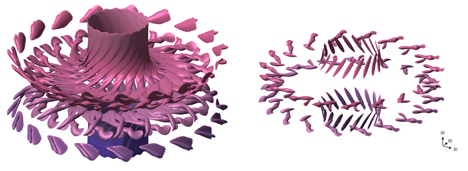
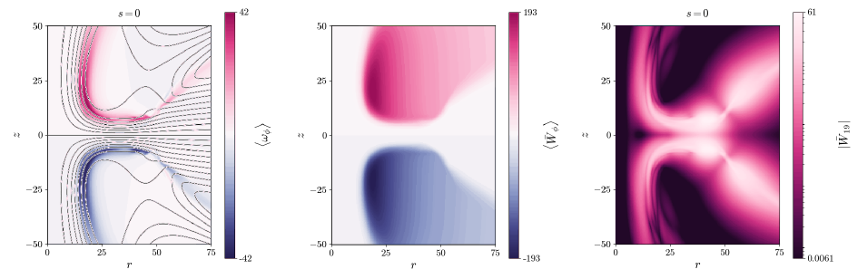
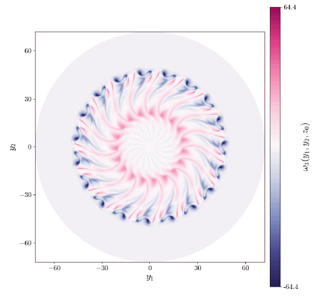
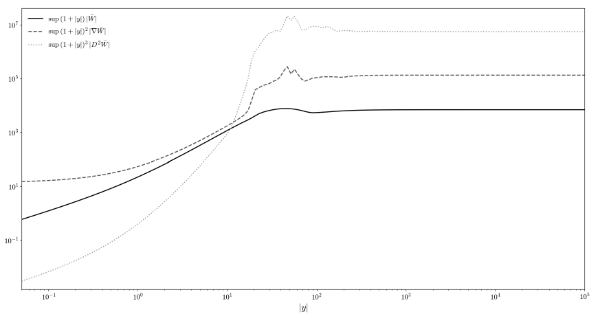

<!-- passage:front -->
<header class="front">
<!-- /passage:front -->

# Finite-time blow-up for the Navier–Stokes equations

<!-- passage:sec-finite-time-blow-up-for-the-navier-stokes-equations -->

<ul class="authors">
<li>Levent Alpöge</li>
<li>Tristan Buckmaster</li>
</ul>

</header>

<!-- source-page: 1 -->

*Adapted from the paper by Alpöge and Buckmaster. Prepared by Will Cook with AI assistance. Reading edition of 22 November 2026, based on the [manuscript of 20 November 2026](https://github.com/tristanbuckmaster/navier-stokes/blob/ad53419de079eb8f95f60313473374624a348546/paper/finite-time-blow-up-navier-stokes.pdf) (revision ad53419).*

<section class="abstract">

Given a nonzero smooth Navier–Stokes profile that repeats in logarithmic time up to an isometry and satisfies $|W(s,y)|\le C(1+|y|)^{-1}$, we construct finite-energy solutions of the unforced equations that blow up with this profile. On $\mathbb R^3$ we cut off a vector potential to obtain smooth, compactly supported solenoidal data, then adjust finitely many components of the datum to obtain the prescribed rate of approach. This requires no spectral stability assumption on the profile. The whole-space solution satisfies $\|\nabla u(t)\|_{L^2}\asymp(1-t)^{-1/4}$. For smooth data on $\mathbb T^3$ the corresponding rate is $\|u_{\mathrm{per}}(t)\|_{H^1}\asymp(T-t)^{-1/4}$. In similarity variables the gradients converge to the profile gradient in $L^2$, on $\mathbb R^3$ and on expanding balls, respectively. A second theorem constructs the required exact profile when an approximate family satisfies quantitative certificate conditions. Alpöge and Buckmaster report checking these conditions for a particular family by interval arithmetic. With that input, the two theorems give breakdown of global smooth existence on both domains with zero force. The certificate data and verification calculation do not accompany this edition (Subsection 1.5).

</section>
<!-- /passage:sec-finite-time-blow-up-for-the-navier-stokes-equations -->

## Contents

<!-- passage:sec-contents -->

| Section |
| --- |
| [1. Introduction](#1) |
| [2. Reduction of Theorem 1.1](#2) |
| [3. Preliminaries](#3) |
| [4. The equation linearized about $u^*$](#4) |
| [5. Blow-up on $\mathbb R^3$](#5) |
| [6. Blow-up on the torus](#6) |
| [7. From a certificate to a profile](#7) |
| [Appendix A. Proofs of the lemmas of Sections 2 and 3](#appendix-a) |
| [Appendix B. Certificates in the formalization](#appendix-b) |
| [Appendix C. The computation of the approximate profile](#appendix-c) |
| [Acknowledgments](#sec-acknowledgments) |
| [References](#sec-references) |
<!-- /passage:sec-contents -->

## 1 Introduction

<!-- passage:sec-1 -->

We consider the incompressible Navier–Stokes equations in $\mathbb R^3$ without external force, $$\begin{equation}
\partial_t u+(u\cdot\nabla)u=\Delta u-\nabla p,\qquad \operatorname{div}u=0.\tag{1.1}
\end{equation}$$ Here $u$ is the velocity and $p$ the pressure. Whether smooth solutions of (1.1) with finite energy, or smooth solutions on the torus $\mathbb T^3=\mathbb R^3/\mathbb Z^3$, can develop singularities in finite time is the regularity problem for the Navier–Stokes equations \[[53](#cite-ref53), pp. 1–2\]. We have set the viscosity to one. For any $\nu>0$ the change $(u,p)\mapsto(\nu\,u(\nu t,x),\nu^2 p(\nu t,x))$ gives the corresponding solution with viscosity $\nu$.

In Leray’s backward self-similar ansatz \[[70](#cite-ref70), §20, pp. 224–225\], $u(t,x)=(T-t)^{-1/2}U(x/\sqrt{T-t})$. At the shrinking spatial scale $\sqrt{T-t}$ a single velocity field $U$ describes every phase. Nečas, Růžička and Šverák \[[76](#cite-ref76), Theorem 1, p. 291\] exclude a nonzero such $U$ in $L^3$, and Tsai \[[86](#cite-ref86), Theorems 1–2, p. 31\] excludes it in particular in $L^6$, the space allowed by our decay bound. Consider instead a field $W$ that evolves in logarithmic time $s$ and returns after a fixed interval $S$, so that $W(s+S,y)=W(s,y)$. In physical variables the same motion then takes place on successively smaller scales. <!-- source-page: 2 --> More generally the return may include an orthogonal change of coordinates. For returns by rotations, Bradshaw and Tsai ask whether every such backward solution with $|u(t,x)|\le C/(|x|+\sqrt{T-t})$ stays bounded up to $T$ \[[13](#cite-ref13), Open Problem 5.1, preprint p. 22\]. The bound allows a critical $|x|^{-1}$ tail, and finite rotational symmetry leaves room for angular dependence. Subsection 1.3 gives the corresponding $L^3$, axisymmetry and small-period exclusions.

Theorem 1.1 starts from a nonzero solution of this kind. On $\mathbb R^3$ a correction in a fixed finite-dimensional space of initial velocities suffices to follow the profile into the singularity. We obtain solutions from compactly supported data on $\mathbb R^3$ and from periodic data on $\mathbb T^3$ whose rescaled velocities approach the profile. The construction requires no spectral hypothesis on the profile. Theorem 7.1 constructs the profile used in this argument. A family of approximate profiles, together with data satisfying the certificate conditions, yields the required exact profile. Corollary 7.2 composes the two implications. Its consequence for Fefferman’s alternatives \[[53](#cite-ref53), (A)–(D), pp. 1–2\] is given in Subsection 2.3.

### 1.1 Main results

Let $S>0$, and let $R\in O(3)$ be a linear isometry of $\mathbb R^3$. A *profile* with period $S$ and isometry $R$ is a pair $(W,q)$ of smooth functions $W:\mathbb R\times\mathbb R^3\to\mathbb R^3$, not identically zero, and $q:\mathbb R\times\mathbb R^3\to\mathbb R$ such that, on $\mathbb R\times\mathbb R^3$, $$\begin{equation}
\begin{gathered}
\partial_s W+\tfrac12 W+\tfrac12(y\cdot\nabla)W-\Delta W+(W\cdot\nabla)W+\nabla q=0,\qquad \operatorname{div}W=0,\\
W(s+S,y)=R\,W(s,R^{-1}y),
\end{gathered}\tag{1.2}
\end{equation}$$ and, for a constant $C_W$ and all $(s,y)\in\mathbb R\times\mathbb R^3$, $$\begin{equation}
|W(s,y)|\le C_W(1+|y|)^{-1},\qquad |\nabla W(s,y)|\le C_W(1+|y|)^{-2}.\tag{1.3}
\end{equation}$$ The variables $s$ and $y$ are the self-similar time and position. For $T>0$ we write $$\begin{equation}
u_T^*(t,x)=(T-t)^{-1/2}\,W\!\left(\log\frac{T}{T-t},\frac{x}{\sqrt{T-t}}\right)\qquad(t<T,\ x\in\mathbb R^3),\tag{1.4}
\end{equation}$$ so that $y=x/\sqrt{T-t}$ and $s=\log(T/(T-t))$. At successive returns to phase zero, put $t_n=T(1-e^{-nS})$ and $\ell_n=\sqrt{T-t_n}$. Iterating (1.2) in (1.4) gives $$
 u_T^*(t_n,\ell_n R^ny)=\ell_n^{-1}R^nW(0,y).
$$ From one return to the next, the remaining time shrinks by $e^{-S}$, lengths shrink by $e^{-S/2}$ and speeds grow by $e^{S/2}$. Thus a nonzero profile value recurs at points tending to the origin and at times tending to $T$. The first two equations of (1.2) say that $u_T^*$, with the pressure $(T-t)^{-1}\,q(s,y)$, solves (1.1) on $(-\infty,T)\times\mathbb R^3$, and the third says that $u_T^*$ is discretely self-similar up to the isometry $R$: with $\lambda=e^{-S}$, $$\begin{equation}
u_T^*\bigl(T-\lambda(T-t),x\bigr)=\lambda^{-1/2}R\,u_T^*\bigl(t,\lambda^{-1/2}R^{-1}x\bigr)\qquad(t<T,\ x\in\mathbb R^3).\tag{1.5}
\end{equation}$$ In the variables $(t,x)$, which we call Eulerian, the bounds (1.3) read $$
|u_T^*(t,x)|\le\frac{C_W}{|x|+\sqrt{T-t}},\qquad |\nabla u_T^*(t,x)|\le\frac{C_W}{\bigl(|x|+\sqrt{T-t}\bigr)^2}.
$$ In the terminology of Bradshaw and Tsai \[[13](#cite-ref13), (1.5)–(1.9), preprint pp. 2–3\], $u_T^*$ is a backward discretely self-similar solution when $R=I$ and a backward rotated discretely self-similar solution when $R$ is a rotation; when $R$ is not a rotation, $R^2$ is a rotation, and $u_T^*$ is of this kind for the period $2S$. The first of the two bounds is the bound of a Type I singularity at the point $(T,0)$, and the second follows from it (Remark 1.2).

Let $0<T\le\infty$. A *smooth solution* of (1.1) on $[0,T)\times\mathbb R^3$ with datum $u_0$ is a pair $(u,p)$ of functions that are smooth on $[0,T)\times\mathbb R^3$, up to the boundary, and satisfy (1.1) there, with $u(0,\cdot)=u_0$; we also call the velocity $u$ a smooth solution. For $T<\infty$ the smooth solutions on $[0,T]\times\mathbb R^3$ are defined in the same way. We write $u(t)=u(t,\cdot)$, and we say that $u$ has *finite energy* if $\|u(t)\|_{L^2}$ is bounded in $t$. We call a function on $\mathbb R^3$ periodic if it has period $1$ in each coordinate, and we identify the functions on $\mathbb T^3$ with the periodic functions on $\mathbb R^3$. Thus a smooth solution on $[0,T)\times\mathbb T^3$, or on $[0,T]\times\mathbb T^3$, is a smooth solution on $[0,T)\times\mathbb R^3$, or on $[0,T]\times\mathbb R^3$, for which $u(t)$ and $p(t)$ are periodic. We write $B_r$ for the open ball of radius $r$ about the origin of $\mathbb R^3$ and $\|u\|_{H^1(\mathbb T^3)}=\|u\|_{H^1([0,1]^3)}$ for the norm of $H^1$ on the torus. Our main result is the following theorem. <!-- source-page: 3 -->

**Theorem 1.1.** Let $S>0$, and let $R$ be a linear isometry of $\mathbb R^3$, that is, a rotation or a rotation composed with a reflection. Suppose that there exists a profile $(W,q)$ with period $S$ and isometry $R$, and let $u_T^*$ be the field (1.4). Then there exist a divergence-free $u_0\in C_c^\infty(\mathbb R^3;\mathbb R^3)$ and a smooth solution $u$ of (1.1) on $[0,1)\times\mathbb R^3$ with datum $u_0$ and finite energy which blows up at time $1$: there exist $\kappa\in(0,\tfrac14)$ and constants $0<c\le C$ such that $$\begin{equation}
\left.\begin{gathered}
c\,(1-t)^{-\frac14}\le\|\nabla u(t)\|_{L^2}\le C\,(1-t)^{-\frac14},\\
\|\nabla(u(t)-u_1^*(t))\|_{L^2}\le C\,(1-t)^{\kappa-\frac14}
\end{gathered}\quad\right.\qquad(0\le t<1).\tag{1.6}
\end{equation}$$ Moreover, there exist $T\in(0,1]$, a divergence-free datum in $C^\infty(\mathbb T^3;\mathbb R^3)$ and a smooth solution $u_{\mathrm{per}}$ of (1.1) on $[0,T)\times\mathbb T^3$ with this datum which blows up at time $T$ at the same rate: $$\begin{equation}
\left.\begin{gathered}
c\,(T-t)^{-\frac14}\le\|u_{\mathrm{per}}(t)\|_{H^1(\mathbb T^3)}\le C\,(T-t)^{-\frac14},\\
\|u_{\mathrm{per}}(t)-u_T^*(t)\|_{H^1(B_{1/16})}\le C\,(T-t)^{\kappa-\frac14}
\end{gathered}\quad\right.\qquad(0\le t<T).\tag{1.7}
\end{equation}$$

*The blow-up rate.* The change of variables gives $\|\nabla u_T^*(t)\|_{L^2}=(T-t)^{-1/4}\|\nabla W(s)\|_{L^2}$. The function $s\mapsto\|\nabla W(s)\|_{L^2}$ is continuous, positive and $S$-periodic (Lemma 4.2). In the whole space, (1.6) and the reverse triangle inequality therefore give $(1-t)^{1/4}\|\nabla u(t)\|_2=\|\nabla W(-\log(1-t))\|_2+O((1-t)^\kappa)$. The leading coefficient follows the phase of the orbit and may be constant. The power $-1/4$ is Leray’s lower-bound exponent \[[70](#cite-ref70), §21, p. 227\]. Its square is integrable at the singular time, since $\int_t^1(1-\tau)^{-1/2}\,d\tau=2\sqrt{1-t}$. Hence the divergence of the gradient norm is compatible with finite total viscous dissipation in the energy identity (Appendix A.2).

Write $u(t,x)=(1-t)^{-1/2}U(s,y)$ in the whole space. Then (1.6) gives $\|\nabla_y(U(s)-W(s))\|_{L^2(\mathbb R^3)}\le Ce^{-\kappa s}$. By (3.1) the velocities converge in $L^6$ at the same rate. In physical coordinates the upper bound on the gradient error can grow, but its ratio to $\|\nabla u_1^*(t)\|_2$ is $O((1-t)^\kappa)$. On the torus set $\delta=T-t$ and $U_{\mathrm{per}}(s,y)=\sqrt\delta\,u_{\mathrm{per}}(t,\sqrt\delta\,y)$ using the periodic lift. Multiplication of (1.7) by $\delta^{1/4}$ bounds $\|\nabla_y(U_{\mathrm{per}}(s)-W(s))\|_{L^2(B_{1/(16\sqrt\delta)})}$ by $C\delta^\kappa$. The ball expands in $y$ because its physical radius stays equal to $1/16$.

*Choice of initial data.* There exist $\varepsilon_0>0$ and a fixed finite-dimensional space $E$ of smooth, compactly supported, divergence-free fields with the following property. Given any divergence-free $w_0\in C_c^\infty(\mathbb R^3;\mathbb R^3)$ with $\|\nabla(w_0-W(0,\cdot))\|_{L^2}\le\varepsilon_0$, one can choose $\gamma\in E$ so that the datum $w_0+\gamma$ gives a smooth finite-energy solution on $[0,1)$ satisfying (1.6) (Proposition 2.1 and Lemma 2.3). The datum $u_0$ in the theorem is one such sum. This choice of $\gamma$ for each nearby $w_0$ is the sense of stability in finite codimension used here.

**Remark 1.2.** The bound on $\nabla W$ in (1.3) is a consequence of the bound on $W$ and of the first two equations of (1.2), with a constant that depends only on $C_W$, and so is the bound $|\nabla^2 W(s,y)|\le C\,(1+|y|)^{-3}$. This follows, as in \[[79](#cite-ref79), Lemma 9.2 and Corollary 9.3\], from the interior estimate for bounded smooth solutions of the Navier–Stokes equations \[[79](#cite-ref79), Lemma 9.1\], which requires no bound on the pressure, applied, for $t<T$ and $x\in\mathbb R^3$, on the backward parabolic cylinder of radius $r=\frac12\max\{|x|,\sqrt{T-t}\}$ about the point $(t,x)$, on which the field (1.4) is bounded by $C_W/r$. Thus the hypothesis of Theorem 1.1 is that of a nonzero smooth solution of (1.2) with the first bound of (1.3).

To obtain the profile assumed in Theorem 1.1, we start with a family of approximate profiles, each with its own period. A certificate (Subsection 7.3) specifies the family, auxiliary fields and constants, and bounds on them. Among its hypotheses are estimates for every admissible perturbation of each family member. Theorem 7.1 selects one parameter and corrects the corresponding member to an exact profile with its period and prescribed symmetries. This profile satisfies (1.2) with $R=I$. Theorem 1.1 then gives both blow-up solutions (Corollary 7.2). Appendix B reduces the perturbation estimates to conditions on finitely many represented fields and numbers. <!-- source-page: 4 --> Figure 1 shows the computed field $\bar W$ from which the approximate profiles are formed. Its vorticity concentrates in an axial column and in two layers, one on either side of $y_3=0$, each opening into nineteen spiral arms. Appendix C describes how continuation and Newton iteration on an adaptive discretization produce $\bar W$ in floating-point arithmetic. The authors continued several azimuthal wave numbers before selecting nineteen. Two families of harmonics turn about the column in opposite senses. Rotation by $\pi$ about the $y_1$ axis exchanges them. To see why both rotations enter the proof, label the time and angle harmonics by $\iota=(\iota_1,\iota_2)\in\mathbb Z^2$ as in (B.2). At the computed period $\bar S$ the frequencies in the two rotating frames are $4\pi\iota_2/\bar S$ and $4\pi(\iota_2-\iota_1)/\bar S$. A mode slow in both frames must satisfy $|\iota_2|\le j_*$ and $|\iota_2-\iota_1|\le j_*$ if the frequency cutoff is $4\pi j_*/\bar S$. Their intersection contains only finitely many lattice points, each still carrying a function of radius and height. Elsewhere a large frequency supplies a positive term in the multiplier estimate. Appendix B.2 bounds the transport and coupling errors against these gains at the actual periods $S(\alpha)$.

*Figure 1.* Vorticity of the computed approximate profile $\bar W$. Both panels show the same phase $s=0$, at the two surfaces $|\operatorname{curl}\bar W|=50$ (left) and $|\operatorname{curl}\bar W|=85$ (right) in the self-similar variable $y$. Colour records height $y_3$ in the column and its two layers. The two levels are about $0.30$ and $0.51$ of the largest value of $|\operatorname{curl}\bar W|$.

The period is $\bar S\approx0.36$. Rotation about the $y_3$ axis through $2\pi/19$ leaves $\bar W$ unchanged, and a rotation through $\pi/19$ gives the field half a period later. The certificate problem imposes these symmetries on the approximate family. The perturbations satisfy the same symmetry conditions. Hence the exact profile of Theorem 7.1 also returns after a half-period up to the smaller rotation (Remark 7.3).

The arms also explain a choice of coordinates at large radius. The oscillatory factors used for $\bar W$ in Appendix C.1 have a radial phase asymptotic to a multiple of $2\log|y|$ plus a constant. The time phase combines with it through $2\log|y|-s=2\log|x|-\log T$ for $x\ne0$, by (1.4). Thus this leading oscillation has fixed phase at a fixed physical point as $t$ approaches $T$.

### 1.2 Ideas of the proof

The field $u^*=u_1^*$ associated with a profile is an exact solution on $[0,1)$. Its datum need not have finite energy. The decay in (1.3) places $W(s)$ in $L^6$ and its gradient in $L^2$ uniformly in $s$. After radial integration the tails of $|W|^6$ and $|\nabla W|^2$ are bounded by multiples of $r^{-4}\,dr$ and $r^{-2}\,dr$, whereas the bound for $|W|^2$ gives only a constant times $dr$. We therefore perturb $u^*$ in $\dot H^1_{\mathrm{div}}(\mathbb R^3)$, realized by divergence-free $L^6$ fields with square-integrable gradient. Proposition 4.1 gives the integral equation in this space. Once a solution has compactly supported smooth data, local $H^1$ theory and the energy inequality give smoothness and finite energy (Lemma 2.3). On the torus the corresponding space consists of periodic fields of mean zero.

Write $u(t,x)=(1-t)^{-1/2}U(s,y)$ and $v=u-u^*$. We seek $U(s)$ whose distance from $W(s)$ in $\dot H^1$ decays like $e^{-\kappa s}$. In $\|\nabla v(t)\|_2$, velocity and one derivative contribute $(1-t)^{-1}$ together, and the square root of the volume element contributes $(1-t)^{3/4}$. Together these factors give the power $-1/4$. Decay of the rescaled error by $e^{-\kappa s}=(1-t)^\kappa$ gives the physical gradient error $O((1-t)^{\kappa-1/4})$.

Sample a scalar mode once per period. Suppose $x_{n+1}=a x_n+f_n$, $|f_n|\le C\Theta^n$ and $0<\Theta<\min(1,|a|)$. Summing backwards gives $$
 x_0=-\sum_{j\ge0}a^{-j-1}f_j,\qquad
 x_n=-\sum_{j\ge n}a^{n-j-1}f_j,\qquad
 |x_n|\le\frac{C\Theta^n}{|a|-\Theta}.
$$ Any other initial value leaves a nonzero multiple of $a^n$. Even when $|a|<1$, this part decays too slowly. In the nonlinear equation the contraction determines the inhomogeneous term and the trajectory together.

To see which perturbations can have this decay, evolve the linearized equation about $W$ through one similarity period and undo the isometry $R$. This gives the monodromy operator $\mathcal M$ on $\dot H^1_{\mathrm{div}}$. For the free equation the evolution from $0$ to $s>0$ consists of heat flow for time $1-e^{-s}$ followed by the dilation $f\mapsto\sqrt\mu\,f(\sqrt\mu\,\cdot)$ with $\mu=e^{-s}$. Heat flow is contractive, and this dilation multiplies the gradient norm by $\mu^{1/4}$. Thus the free period map has norm at most $e^{-S/4}$. Its difference from $\mathcal M$ is compact. At positive heat times the localized operators in the integral equation are compact (Lemma 3.2), and (3.7) controls the integrable singularity at the endpoint (Lemma 4.4). Outside the disk of radius $e^{-S/4}$ the spectrum therefore consists of isolated eigenvalues of finite multiplicity. Choose $\Theta\in(e^{-S/4},1)$ with no spectrum on its circle. Only finitely many eigenvalues lie outside that circle (Lemma 4.5). <!-- source-page: 8 --> Jia and Šverák \[[65](#cite-ref65), Lemma 2.7, preprint pp. 10–11\] use a compact perturbation of the free evolution for a forward self-similar background. The periodic forward construction of \[[17](#cite-ref17), §19, p. 74\] gives the same bound on the essential spectral radius.

Set $\Theta=e^{-\kappa S}$, so $0<\kappa<1/4$. An eigenvalue of modulus strictly between $\Theta$ and $1$ gives decay, but slower than the required $\Theta^n$ after $n$ periods. We impose no requirement on whether any eigenvalue grows. For a perturbation to decay at the chosen rate its physical-variable norm must satisfy $$
\sup_{0\le t<1}\,(1-t)^{\frac14-\kappa}\,\|v(t)\|_{\dot H^1}<\infty,
$$ On the spectral subspace inside the circle, forward summation of the inhomogeneous terms over past periods gives the required decay. On the finite-dimensional exterior subspace, decay fixes the initial component through a sum over all future periods. The inverse powers in (4.11) play the role of $a^{-1}$ in the scalar example, and the power bounds there give convergence of both sums. To realize the prescribed component by a compactly supported correction, we choose smooth solenoidal fields whose projections form a basis of the exterior subspace. Their span is $E$ (Subsection 4.4). Its dimension and the chosen $\kappa$ depend on the profile and the spectral circle. The resulting right inverse (4.8) and a nonlinear contraction give, for each $w_0$ near $u^*(0)=W(0)$ in $\dot H^1_{\mathrm{div}}$, an element $\gamma\in E$ and a solution with datum $w_0+\gamma$ satisfying the displayed bound for $v$. The center, blow-up time and phase of the profile stay fixed.

For $w_0$ we take the field $u^*(0)$, cut off far from the origin. The cutoff is applied to a vector potential, so that the field remains divergence-free: for $0\le t<1$ and a radius $r>0$ we let $\bar u(t)=\operatorname{curl}\bigl(\eta(\cdot/r)\,A(t)\bigr)$, where $A(t)$ is the vector potential of $u^*(t)$ given in (5.1) and $\eta$ is a smooth cutoff that equals $1$ on $B_{1/2}$ and vanishes outside $B_1$. The field $\bar u(t)$ equals $u^*(t)$ on $B_{r/2}$ and vanishes outside $B_r$, and by (1.3) its distance from $u^*(t)$ in $\dot H^1$ is at most a constant multiple of $r^{-1/2}$, uniformly in $t$ (Lemma 5.1). On $\mathbb R^3$ choose $r$ so that $Cr^{-1/2}\le\varepsilon_0$, the permitted distance from $W(0)$ in Proposition 2.1, and take $w_0=\bar u(0)$ (Subsection 5.2). Thus on $\mathbb R^3$ only the datum is cut off; the solution $u^*$ itself, which need not have finite energy, is not. In \[[17](#cite-ref17), §19, p. 75\] the datum is truncated in the same way, through the same potential. Jia and Šverák \[[65](#cite-ref65), §5, preprint pp. 20–21\], for the Navier–Stokes equations forward in time, and Elgindi, Ghoul and Masmoudi \[[48](#cite-ref48), Subsection 2.6\], for the Euler equations, pass likewise from self-similar solutions of infinite energy to data of finite energy, by a cutoff at a large radius which changes the datum little in the norm in which the solution is perturbed.

On $\mathbb T^3$ it is the entire reference field that has to be localized. We first work at blow-up time one on $\mathbb T_L^3=\mathbb R^3/L\mathbb Z^3$, with $L$ large. At each time cut off the potential of $u^*$ at radius $L/8$, take its curl $\bar u(t)$ and periodize it. The resulting field $u^{\mathrm a}$ equals $u^*$ on $B_{L/16}$. To bound the interaction with translated copies, Lemma 6.1 uses the $|x|^{-4}$ decay of the kernel of the projected heat flow on divergences. The resulting residual has order $L^{-1/2}$ in the weighted gradient norm (Subsection 6.2). <!-- source-page: 9 --> In the periodic linearization, the terms containing $u^{\mathrm a}$ need the perturbation only on $B_{L/8}$, the support ball of the cutoff. Apply the whole-space inverse (4.8) to this localized interaction. Its correction supplies initial data for periodic heat flow, which reconstructs the perturbation on $\mathbb T_L^3$. This gives an approximate right inverse with operator error $O(L^{-1/2})$ (Lemma 6.3). Increasing $L$ makes the norm of this error less than one, so the Neumann series gives an exact right inverse. The nonlinear contraction now removes the residual of $u^{\mathrm a}$. Finally $u_{\mathrm{per}}(t,x)=L\,u(L^2t,Lx)$ takes the solution on $\mathbb T_L^3$ to the unit torus, with blow-up time $T=L^{-2}$.

Albritton, Brué and Colombo \[[3](#cite-ref3), Theorem 1.1, p. 2\] glued the construction of \[[2](#cite-ref2)\] into the torus, where it gives non-unique Leray–Hopf solutions with a force, and Tao \[[84](#cite-ref84), proof of Theorem 12.2, preprint pp. 75–76\] embeds a solution on $\mathbb R^3$, cut off outside a ball, in a torus of large period, with a force that is defined so that the cut-off field is a solution. Here the error of the cutoff is removed by the contraction, and the equations on the torus hold without force.

The correction in Sections 4–6 changes the initial velocity. In Section 7 the unknown is the periodic orbit itself, including its period $S$. We set $\theta=s/S$ and give all trial orbits period one in $\theta$. A translate of an exact orbit is again an orbit, so differentiation with respect to the shift gives a null direction of the linearized equation. A phase condition fixes the time origin. To see the roles of the other constraints and forces, consider the linear map $L(x,y)=(x,0)$. The augmented equations $L(x,y)+(0,\beta)=(f_1,f_2)$ and $y=c$ determine $x=f_1$, $y=c$ and $\beta=f_2$. The constraint fixes the free coordinate, and the auxiliary force measures the mismatch in the second equation. If the data depend on a parameter, the original equation holds where that mismatch vanishes.

We add finitely many force coefficients and impose the same number of linear constraints. They can also be used for directions in which the linearized equation has a large response to small data. The certificate bounds the augmented inverse. Proposition 7.8 proves surjectivity by the Fredholm alternative. For a trial parameter $\alpha$ and a trial nonlinear term $g$, solve the augmented linear problem for a perturbation $v$ and force coefficients $\beta$. Proposition 7.10 updates $g$ to $(v\cdot\nabla)v$ and updates $\alpha$ by subtracting an invertible matrix times the total force $\beta^{\mathrm a}(\alpha)+\beta$, then projecting onto the parameter set. At a joint fixed point the equation is nonlinear because $g=(v\cdot\nabla)v$. Its adjoint estimates now put the *unprojected* update inside the set. The update must therefore equal $\alpha$, so the total force vanishes. Proposition 7.11 gives smoothness. The resulting unrotated recurrent velocity is continuous in time into $L^6$ by (3.1) and continuity of dilation, so the theorem of Chae and Wolf \[[26](#cite-ref26), Theorem 1.1, preprint p. 2\] gives the decay required in (1.3), with the derivative bound from Remark 1.2.

### 1.3 Background

*Restrictions on recurrent profiles.* A stationary solution of the similarity equation would give a self-similar solution in Leray’s sense. Nečas, Růžička and Šverák \[[76](#cite-ref76), Theorem 1, p. 291\] exclude nonzero stationary profiles in $L^3(\mathbb R^3)$. Tsai \[[86](#cite-ref86), Theorems 1–2, p. 31\] excludes them in $L^p(\mathbb R^3)$ for $3<p<\infty$, and under local energy estimates. By (1.3) every slice of $W$ lies in $L^6$. Tsai’s result with $p=6$ therefore forces any nonzero profile considered here to depend on $s$. Bradshaw and Tsai \[[13](#cite-ref13), Open Problem 5.1, preprint p. 22\] ask whether every backward discretely self-similar solution with the Type I bound, possibly up to rotation, stays bounded through $T$. Under (1.5), any nonzero value gives velocities of magnitude $\lambda^{-n/2}|u_T^*(t,x)|$ at a sequence of points approaching $(T,0)$. Thus boundedness through $T$ would force the field to vanish.

For unrotated discrete self-similarity ($R=I$), Chae and Wolf \[[26](#cite-ref26), Theorems 1.1 and 1.3, preprint pp. 2–3\] prove that a smooth backward solution continuous into $L^p(\mathbb R^3)$, $3\le p<\infty$, satisfies the Type I bound. Conversely, given the bound with constant $C_W$, they exclude nonzero solutions whose expanding spatial scale $e^{S/2}$ is sufficiently close to one. Pineau and Vicol \[[79](#cite-ref79), Theorems 1.6–1.7, pp. 6–7\] give a quantitative exclusion. For sufficiently small $S$ it also holds for rotations through angles $|\varphi|\le c S$, with both thresholds depending on $C_W$. The computed period alone therefore cannot decide applicability. A profile rotating continuously at a constant angular speed in $s$ would obey a rotated recurrence for every period. Bradshaw and Tsai record the question for such profiles as a problem of Perelman \[[13](#cite-ref13), Open Problem 5.2, preprint p. 22\]. For such steadily rotating profiles, \[[79](#cite-ref79), Theorem 1.4, p. 4\] excludes angular speeds of sufficiently small or sufficiently large magnitude at a fixed Type I bound. Forward self-similar and discretely self-similar solutions do exist \[[64](#cite-ref64), [87](#cite-ref87), [12](#cite-ref12), [27](#cite-ref27)\], including solutions with rotation \[[13](#cite-ref13)\].

The spatial bound in (1.3) puts $u_T^*(t)$ in weak $L^3(\mathbb R^3)$ uniformly in $t$. The envelope $|y|^{-1}$ alone gives only $\int_1^r\rho^{-1}\,d\rho$ as an upper bound up to a constant for the tail of the cubic integral. When $R=I$, Barker and Prange \[[98](#cite-ref98), Corollary 1.1, p. 720\] show how strong $L^3$ fails. Translate the singular time to zero and apply their result with $p=6$. Smoothness and (1.3) give continuity into $L^6$ by dominated convergence on compact time intervals. At physical radius $r\sqrt{T-t}$ the cubic velocity integral equals $\int_{|y|<r}|W(s,y)|^3\,dy$. Their two bounds give growth comparable to $\log r$ for all sufficiently large $r$, uniformly in $s$. Thus no slice belongs to $L^3$. For Leray–Hopf solutions, Escauriaza, Seregin and Šverák \[[52](#cite-ref52), Theorem 1.3, preprint p. 5\] exclude singularities under a uniform-in-time bound in strong spatial $L^3$.

Several criteria exclude axisymmetric Type I singularities \[[28](#cite-ref28), [29](#cite-ref29), [69](#cite-ref69), [81](#cite-ref81)\]. In particular, (1.3) bounds $u_T^*$ both by $C_W/\sqrt{T-t}$ and by $C_W/r$ for cylindrical distance $r>0$ from the axis. An axisymmetric $u_T^*$ would remain bounded through $T$ by Koch, Nadirashvili, Seregin and Šverák \[[69](#cite-ref69), Theorem 6.2, preprint p. 21\], and (1.5) would then force it to vanish. The finite rotation group prescribed for the certificate is compatible with this exclusion. Albritton and Barker \[[1](#cite-ref1), Theorem 1.1 and (1.5), preprint p. 2\] characterize the existence of a suitable weak solution with a Type I singular point by the existence of a nontrivial mild bounded ancient solution satisfying their bounds on rescaled energy, dissipation, velocity and pressure. They also show that a nontrivial mild ancient solution uniformly bounded in weak $L^3$ along times tending to $-\infty$ yields a singular weak Leray–Hopf solution with forcing \[[1](#cite-ref1), (4.2) and Remark 4.3, preprint pp. 10, 12\]. The unforced solutions here come from localizing a recurrent profile.

*Localization and selection of initial data.* The choice of initial data has precedents in compressible flow. Merle, Raphaël, Rodnianski and Szeftel \[[74](#cite-ref74), [75](#cite-ref75)\] constructed self-similar Euler profiles and smooth spherical data whose Euler and Navier–Stokes solutions implode near them. For three-dimensional isentropic Euler, Buckmaster, Cao-Labora and Gómez-Serrano \[[16](#cite-ref16)\] obtained smooth imploding profiles for all adiabatic exponents larger than one. At exponent $7/5$ they proved Navier–Stokes implosion for a finite-codimensional set of smooth radial data with density bounded away from zero and constant at infinity. Cao-Labora, Gómez-Serrano, Shi and Staffilani \[[24](#cite-ref24)\] removed the symmetry assumption for both systems on $\mathbb R^3$ and on the torus. <!-- source-page: 6 --> For two-dimensional compressible Euler, Chen, Cialdea, Shkoller and Vicol \[[31](#cite-ref31)\] obtained vorticity blow-up by an axisymmetric implosion, with finitely many conditions on radial data and an open set of swirl velocities. See \[[30](#cite-ref30)\] for dimensions $d\ge3$ and \[[36](#cite-ref36)\] for non-isentropic implosions whose ground state is stable up to finitely many conditions without symmetry. Buckmaster and Iyer \[[19](#cite-ref19)\] obtained two-dimensional compressible Euler shocks that approach an unstable Burgers profile, with stability modulo two directions.

The number of data to adjust depends on the linearized dynamics. For incompressible Euler on $\mathbb R^3$, the $C^{1,\alpha}$ self-similar blow-up of Elgindi \[[47](#cite-ref47)\] gives finite-energy blow-up after one condition on axisymmetric perturbations \[[48](#cite-ref48), Theorem 2\]. For the one-dimensional nonlinear heat equation, Bricmont and Kupiainen \[[15](#cite-ref15), Theorems 1–2\] choose a parameter for each unstable direction of the renormalization map. Collot, Raphaël and Szeftel \[[38](#cite-ref38), Theorem 1.2\] obtain a finite-codimensional Lipschitz manifold of nonsymmetric data near a cutoff profile for the energy-supercritical heat equation, up to scaling and translation. For complex-valued Navier–Stokes solutions, Li and Sinai \[[71](#cite-ref71)\] produce blow-up by choosing parameters in ten-parameter families.

Finite rotational symmetry imposes quite different restrictions in two and three dimensions. Elgindi and Jeong \[[49](#cite-ref49)\] proved global existence and uniqueness for two-dimensional Euler with bounded vorticity invariant under rotation by $2\pi/m$, $m\ge3$, even without decay at infinity. In three dimensions their octahedrally symmetric construction on $\mathbb R^3$ gives finite-time blow-up from bounded, piecewise smooth vorticity \[[50](#cite-ref50)\]. <!-- source-page: 5 --> Drivas and Elgindi \[[45](#cite-ref45), Problem 6\] ask whether scale-invariant Euler solutions can become singular within an admissible symmetry class. The rotating surface quasi-geostrophic solutions in \[[25](#cite-ref25)\] have threefold symmetry.

For nonlinear wave equations, Donninger and Schörkhuber \[[43](#cite-ref43)\], following \[[42](#cite-ref42)\] on wave maps, used the Lyapunov–Perron method to correct the unstable time-translation direction and then absorbed the correction by moving the blow-up time. This is the method that we use, except that we keep the modification of the data. Glogić, Hilditch and Wallauch \[[57](#cite-ref57)\] proved finite-codimensional stability of discretely self-similar blow-up for a wave maps type equation.

For Navier–Stokes, forward instability can separate two solutions with the same datum. Jia and Šverák \[[65](#cite-ref65)\] gave a spectral condition on a forward self-similar profile sufficient for nonuniqueness of Leray–Hopf solutions. Following Vishik’s work on two-dimensional Euler \[[91](#cite-ref91), [92](#cite-ref92), [4](#cite-ref4)\], Albritton, Brué and Colombo \[[2](#cite-ref2)\] proved forced Leray–Hopf nonuniqueness. In the unforced case Buckmaster, Coiculescu and Li \[[17](#cite-ref17)\] followed a growing Floquet mode of a forward discretely self-similar solution. Here we follow the stable directions toward the blow-up time, and the solution converges to the profile. Other mechanisms give nonunique finite-energy weak solutions by convex integration \[[20](#cite-ref20), [18](#cite-ref18), [21](#cite-ref21)\], or two global solutions on the torus, smooth at positive times, from one $BMO^{-1}$ datum \[[37](#cite-ref37)\].

*Computer-assisted construction of profiles.* Computer-assisted proofs first reduce a functional estimate to quantitative conditions and then enclose the numerical errors in checking those conditions \[[58](#cite-ref58)\]. Chen and Hou \[[32](#cite-ref32), [33](#cite-ref33)\] used such a reduction for blow-up from smooth data in the two-dimensional Boussinesq and three-dimensional axisymmetric Euler equations with boundary. Earlier work with Huang treated the De Gregorio and Hou–Luo models \[[34](#cite-ref34), [35](#cite-ref35)\]. Other applications include the smooth imploding profiles of \[[16](#cite-ref16)\] and the one-dimensional kernel in Castro, Córdoba and Gómez-Serrano’s construction of rotating surface quasi-geostrophic solutions \[[25](#cite-ref25)\]. <!-- source-page: 7 --> The closest periodic constructions are for Navier–Stokes with time-independent forcing on the torus \[[90](#cite-ref90)\] and in a square \[[9](#cite-ref9)\], and for discrete self-similarity in the Einstein–scalar field system \[[80](#cite-ref80)\] and the defocusing nonlinear wave equation \[[22](#cite-ref22)\]. The discussion entitled [Related constructions](#sec-related-constructions) at the end of Subsection 7.10 compares their methods with Section 7. Other computations locate candidate flows. Neural networks have produced approximate self-similar Euler and model profiles \[[93](#cite-ref93), [94](#cite-ref94)\]. Guillod and Šverák \[[59](#cite-ref59)\] found a symmetry-breaking bifurcation for forward self-similar Navier–Stokes solutions with large axisymmetric data. Ionescu, Jia and Palasek \[[63](#cite-ref63)\] computed unstable forward profiles in the axisymmetric class without swirl. Hou \[[61](#cite-ref61)\] reported numerical evidence of possible singularity for smooth finite-energy axisymmetric data.

For comparison, the following Euler and porous-media constructions allow forcing of specified regularity. With a force that is uniformly of class $C^{1,\alpha}$, the construction of Elgindi gives the blow-up of solutions of the Euler equations of finite energy \[[47](#cite-ref47), Remark 1.4\], and Córdoba and Martínez-Zoroa proved singularity formation for the Euler equations with a force that is uniformly of class $C^{1,1/2-\varepsilon}$ \[[39](#cite-ref39)\] and for the incompressible porous media equation with a source that is smooth in space \[[40](#cite-ref40)\]. For forces smooth in both space and time up to the singular time, see \[[7](#cite-ref7), [5](#cite-ref5), [6](#cite-ref6)\] for the incompressible porous media, Boussinesq and Euler equations, respectively. The construction in \[[8](#cite-ref8)\] gives unforced Euler blow-up from smooth periodic data.

### 1.4 Organization and conventions

For the passage from a profile to finite-energy data, Sections 2–6 prove Theorem 1.1. Section 3 gives the heat estimates, Section 4 chooses the initial correction, and Sections 5–6 localize the profile on the two domains. Appendix A supplies the auxiliary proofs, including smoothness (Lemma 2.3). For the construction of the profile, Section 7 can be read after Section 3. Appendix B gives the conditions on the represented data, and Appendix C describes the numerical search and the fields in Figure 1.

From Section 2 on, the solutions that we construct blow up at time $1$, except for the solution on $\mathbb T^3$, which is a dilation of one of them. The letters $s$ and $y$ are reserved for the self-similar variables. We write $\bar B_r$ for the closure of the ball $B_r$. For a field $f$ on $\mathbb R^3$ we write $|\nabla f|^2=\sum_i|\partial_i f|^2$, and similarly for derivatives of higher order. The Fourier transform is $\hat f(\xi)=\int_{\mathbb R^3}e^{-2\pi i x\cdot\xi}\,f(x)\,dx$, with inverse $\mathcal F^{-1}$, and the Fourier coefficients of a periodic function are $\hat f(k)=\int_{[0,1]^3}e^{-2\pi i k\cdot x}\,f(x)\,dx$, $k\in\mathbb Z^3$. The Leray projection $\mathbb P$ removes the component parallel to each nonzero Fourier frequency. It therefore annihilates gradients at those frequencies. The gradient of a periodic pressure has zero mean, so the projection annihilates it on the torus as well. In Fourier variables $\mathbb P$ multiplies $\hat f(\xi)$, and on the torus $\hat f(k)$, by the matrix $\mathbb P_\xi=I-|\xi|^{-2}\,\xi\otimes\xi$, where $\mathbb P_0=I$, so that on the torus it keeps the mean.

### 1.5 Formalization

*The authors’ formal statements.* The authors’ [formal development](https://github.com/tristanbuckmaster/navier-stokes/tree/ad53419de079eb8f95f60313473374624a348546/lean) (revision `ad53419`) follows an earlier proof in Lean 4 \[[41](#cite-ref41)\] with Mathlib \[[73](#cite-ref73)\]. Its profile hypothesis adds $|\nabla^2 W|+|\nabla q|\le C(1+|y|)^{-3}$ to (1.3). For every positive viscosity it gives smooth, compactly supported, divergence-free data on $\mathbb R^3$ for which there is no global smooth solution of bounded energy. It also gives smooth divergence-free periodic data for which there is no global smooth solution with periodic velocity. The data may depend on viscosity. Remark 1.2 supplies the velocity derivative bounds. The pressure-gradient decay is an additional hypothesis in this comparison. The authors’ certificate theorem constructs a nonzero weak recurrent profile. <!-- source-page: 10 --> *The quantitative statements.* A separate [formalization for this edition](https://github.com/wcook04/proof-reader/blob/4e96459ec6e474314ea92274ab443093492c957e/lean-wrappers/navier-stokes-edition/lean/MainTheorems.lean#L47-L65) proves the whole-space rate and physical-variable error (1.6) under the formal decay hypotheses. Its [certificate theorem](https://github.com/wcook04/proof-reader/blob/4e96459ec6e474314ea92274ab443093492c957e/lean-wrappers/navier-stokes-edition/lean/SectionSeven.lean#L23-L59) retains the selected parameter, the smooth symmetric profile and the bounds (7.38). The formal certificate requires, among other things, joint $C^1$ regularity of the approximate velocity and a specified decaying weak second spatial derivative. The written torus proof in Section 6 gives (1.7), which is an [open target](https://github.com/wcook04/proof-reader/blob/4e96459ec6e474314ea92274ab443093492c957e/lean-wrappers/navier-stokes-edition/lean/OpenTargets.lean#L18-L54) in the edition’s formal development. The [original statement checks](https://github.com/wcook04/proof-reader/actions/runs/44819023135) and the [edition checks at `4e96459`](https://github.com/wcook04/proof-reader/actions/runs/45023118802) record the compiled results. For a certified computation of water waves formalized in Lean see \[[82](#cite-ref82)\].

For a smooth solution with periodic velocity, (1.1) makes $\nabla p$ periodic. The increment of $p$ across each unit period is therefore spatially constant. Writing the three increments as $b(t)$ gives $p(t,x)-b(t)\cdot x$ periodic. Take $a''(t)=-b(t)$ with $a(0)=a'(0)=0$. The velocity $u(t,x+a(t))-a'(t)$ solves (1.1) with pressure $p(t,x+a(t))+a''(t)\cdot x$. This change of frame preserves the datum and gives periodic pressure, as Fefferman requires \[[53](#cite-ref53), Errata, unnumbered PDF p. 6\].

*The numerical instance.* In the authors’ formal proof, the full finite-data conditions described in Appendix B imply the two nonexistence statements. Alpöge and Buckmaster report checking those conditions for their data by 128-bit interval arithmetic using Arb \[[66](#cite-ref66), §§1–2, preprint pp. 1–2\] through FLINT. Their [source repository](https://github.com/tristanbuckmaster/navier-stokes/blob/ad53419de079eb8f95f60313473374624a348546/README.md) supplies the paper and Lean proofs. The certificate file and interval calculation are absent there. The original abstract identifies the intended file by its SHA-256 digest `3f7a335b84b6c7631742cacc5343dfcd11cf72f5221ff79b2b9268790b4b22c5`.

### 1.6 Original authors’ statement on AI use

Alpöge and Buckmaster describe their use of Claude in the computations, the original formal proof and the successive drafts of the paper. Their first-person account appears in full after the Acknowledgments.
<!-- /passage:sec-1 -->

## 2 Reduction of Theorem 1.1

<!-- passage:sec-2 -->

### 2.1 The space $X$ and the notion of solution

We use the heat evolution to write an integral equation in a space that contains the profile. Lemma 2.3 recovers smooth velocities and pressures for the compactly supported whole-space data and the smooth periodic data of Theorem 1.1. We write $C_{c,\mathrm{div}}^\infty$ for the space of smooth, compactly supported, divergence-free fields $\varphi:\mathbb R^3\to\mathbb R^3$, and $X=\dot H^1_{\mathrm{div}}(\mathbb R^3)$ for the space of the divergence-free fields $u\in L^6(\mathbb R^3;\mathbb R^3)$ with $\nabla u\in L^2$, with the norm $\|u\|_{\dot H^1}=\|\nabla u\|_{L^2}$. For $t>0$ and a field $u$ in $L^p(\mathbb R^3;\mathbb R^3)$, $1\le p\le\infty$, let $$\begin{equation}
e^{t\Delta}u=(4\pi t)^{-3/2}e^{-|\cdot|^2/(4t)}*u,\tag{2.1}
\end{equation}$$ and $e^{0\Delta}u=u$. For $\tau>0$ and a field $f$ that is the sum of a field in $L^1(\mathbb R^3;\mathbb R^3)$ and a field in $L^2(\mathbb R^3;\mathbb R^3)$ let $$\begin{equation}
e^{\tau\Delta}\mathbb P f=\mathcal F^{-1}\bigl[e^{-4\pi^2\tau|\xi|^2}\,\mathbb P_\xi\hat f\bigr],\tag{2.2}
\end{equation}$$ and for $u,v\in X$ let $$\begin{equation}
K(\tau)(u,v)=-\tfrac12\,e^{\tau\Delta}\mathbb P\bigl[(u\cdot\nabla)v+(v\cdot\nabla)u\bigr].\tag{2.3}
\end{equation}$$ In (2.3) the projection removes the pressure and the heat flow advances the resulting solenoidal field over the lag $\tau$. Since $u\in L^6$ and $\nabla v\in L^2$, Hölder’s inequality gives $f=(u\cdot\nabla)v\in L^{3/2}$. On $\{|f|>1\}$ this field lies in $L^1$, and on $\{|f|\le1\}$ it lies in $L^2$. Thus $f\in L^1+L^2$, as required in (2.2), and (2.3) is defined. The map $K(\tau)$ is bilinear and symmetric, it maps $X\times X$ into $X$ (Lemma 3.1), and $K(\tau)(u,u)=-e^{\tau\Delta}\mathbb P[(u\cdot\nabla)u]$. <!-- source-page: 11 -->

Let $a<b$. For a continuous map $u:[a,b)\to X$, Duhamel’s formula for (1.1) on $[a,b)$ is $$\begin{equation}
u(t)=e^{(t-a)\Delta}u(a)+\int_a^t K(t-t')(u(t'),u(t'))\,dt'\qquad(a\le t<b),\tag{2.4}
\end{equation}$$ A mild solution on $[a,b)$ is a continuous $X$-valued velocity satisfying (2.4). For each $t<b$, the $X$ norm of $u$ is bounded on $[a,t]$. By (3.7) the integrand is bounded in $X$ by a constant times $(t-t')^{-3/4}$ and is continuous for $t'<t$ (Lemma 3.3), so the integral exists in $X$. On $[a,b]$ we require (2.4) also at $b$. From now on a solution with values in $X$ is a mild solution, unless we say that it is smooth. The identity (2.4) is the integral formulation of the Navier–Stokes equations of Kato and Fujita \[[68](#cite-ref68), (III), p. 245\]; for the equations in the whole space see \[[67](#cite-ref67), (INT) and (2.2), p. 473\]. On the torus the space $\dot H^1_{\mathrm{div}}(\mathbb T^3)$ of the periodic divergence-free fields of mean zero, the bilinear term $K_{\mathbb T}$ and the mild solutions in this space are defined in the same way in Subsection 3.6.

### 2.2 Blow-up on $\mathbb R^3$ and on the torus

On $\mathbb R^3$ we prove the following proposition.

**Proposition 2.1.** Let $(W,q)$ be a profile, and let $u_1^*$ be the field (1.4) with $T=1$. Then there exist $\kappa\in(0,\tfrac14)$, constants $0<c\le C$ and $\varepsilon_0>0$, and a finite-dimensional subspace $E$ of $C_{c,\mathrm{div}}^\infty$ with the following property. For every $w_0\in X$ with $\|w_0-W(0,\cdot)\|_{\dot H^1}\le\varepsilon_0$ there exist $\gamma\in E$ and a solution $u$ on $[0,1)$ with $u(0)=w_0+\gamma$ such that, for $0\le t<1$, $$\begin{equation}
c\,(1-t)^{-\frac14}\le\|u(t)\|_{\dot H^1}\le C\,(1-t)^{-\frac14},\qquad \|u(t)-u_1^*(t)\|_{\dot H^1}\le C\,(1-t)^{\kappa-\frac14}.\tag{2.5}
\end{equation}$$ Moreover, there is a field $w_0\in C_{c,\mathrm{div}}^\infty$ with $\|w_0-W(0,\cdot)\|_{\dot H^1}\le\varepsilon_0$.

Sections 4 and 5 choose the constants and one correction space $E$ for every divergence-free $w_0$ in the $\dot H^1$ ball about $W(0,\cdot)$. The correction $\gamma\in E$ can depend on $w_0$. For the compactly supported example, choose $w_0$ by the divergence-free cutoff of Lemma 5.1. Then both summands of $w_0+\gamma$ are smooth and compactly supported.

On the torus we prove the following proposition, at a small blow-up time $T$.

**Proposition 2.2.** Let $(W,q)$ be a profile. Then there exist $T\in(0,1]$, $\kappa\in(0,\tfrac14)$, constants $0<c\le C$, a divergence-free $u_0\in C^\infty(\mathbb T^3;\mathbb R^3)$ and a solution $u$ in $\dot H^1_{\mathrm{div}}(\mathbb T^3)$ on $[0,T)$ with $u(0)=u_0$ such that, for $0\le t<T$, $$\begin{equation}
c\,(T-t)^{-\frac14}\le\|u(t)\|_{H^1(\mathbb T^3)}\le C\,(T-t)^{-\frac14},\quad \|u(t)-u_T^*(t)\|_{H^1(B_{1/16})}\le C\,(T-t)^{\kappa-\frac14},\tag{2.6}
\end{equation}$$ where $u_T^*$ is the field (1.4).

The first estimate in (2.6) measures the norm over the whole torus. The second compares the periodic solution with a field on $\mathbb R^3$ only on $B_{1/16}$, where the cutoff field of Section 6 agrees with $u_T^*$ after dilation. The datum has mean zero since the trajectory takes values in $\dot H^1_{\mathrm{div}}(\mathbb T^3)$, the space used in Lemma 2.3.

### 2.3 Proof of Theorem 1.1

Proposition 2.1, for a field $w_0\in C_{c,\mathrm{div}}^\infty$, and Proposition 2.2 give mild solutions with smooth data, and it remains to show that these are smooth solutions of (1.1). We say that a mild solution $u$ is a smooth solution if the fields $u(t)$ are the values at time $t$ of a smooth solution with datum $u(0)$.

**Lemma 2.3.** Let $0<T<\infty$, and let $u$ be a mild solution on $[0,T)$ with $u(0)\in C_{c,\mathrm{div}}^\infty$. Then $u$ is a smooth solution of (1.1) on $[0,T)\times\mathbb R^3$, and $$
\|u(t)\|_{L^2}\le\|u(0)\|_{L^2}\qquad(0\le t<T).
$$ Moreover, every mild solution in $\dot H^1_{\mathrm{div}}(\mathbb T^3)$ on $[0,T)$ whose datum is smooth is a smooth solution of (1.1) on $[0,T)\times\mathbb T^3$.

Fix $0<b<T$. Uniqueness identifies $u$ with the velocity furnished by local $H^1$ theory for as long as the latter exists \[[84](#cite-ref84), Theorems 5.1 and 5.4\]. In the whole space, the energy inequality and $\max_{[0,b]}\|u(t)\|_{\dot H^1}$ bound its $H^1$ norm. On the torus use mean zero and (3.16). Local continuation thus gives smoothness through $b$. Since $b<T$ was arbitrary, this proves the assertion on $[0,T)$ (Appendix A.2).

*Proof of Theorem 1.1.* Let $(W,q)$ be a profile, and let $\kappa$, $c$, $C$, $\varepsilon_0$ and $E$ be given by Proposition 2.1. By its last assertion there is a field $w_0\in C_{c,\mathrm{div}}^\infty$ with $\|w_0-W(0,\cdot)\|_{\dot H^1}\le\varepsilon_0$, and for this field the proposition gives $\gamma\in E$ and a solution $u$ on $[0,1)$ with $u(0)=w_0+\gamma$ which satisfies (2.5). The datum $u_0=w_0+\gamma$ belongs to $C_{c,\mathrm{div}}^\infty$, because $E\subset C_{c,\mathrm{div}}^\infty$. By Lemma 2.3, <!-- source-page: 12 --> $u$ is a smooth solution of (1.1) on $[0,1)\times\mathbb R^3$ with datum $u_0$, and it has finite energy. Since $\|u(t)\|_{\dot H^1}=\|\nabla u(t)\|_{L^2}$, the bounds (2.5) are (1.6).

On the torus, let $T$ and the solution on $[0,T)$ be given by Proposition 2.2; we denote this solution by $u_{\mathrm{per}}$. Its datum is smooth, so that, by Lemma 2.3, $u_{\mathrm{per}}$ is a smooth solution of (1.1) on $[0,T)\times\mathbb T^3$, and (2.6) is (1.7).

Finally, since $1-t\le1$ and $T-t\le1$, the bounds (1.6) and (1.7) hold with the smaller of the two exponents $\kappa$ and of the two constants $c$ and with the larger of the two constants $C$. $\square$

The same argument, for an arbitrary field $w_0\in C_{c,\mathrm{div}}^\infty$ with $\|w_0-W(0,\cdot)\|_{\dot H^1}\le\varepsilon_0$, gives the stability in finite codimension stated after Theorem 1.1.

To see the consequence for Fefferman’s formulation, suppose the compactly supported datum above had a smooth finite-energy solution through time $1$. On the closed interval $[0,1]$ this solution has bounded $H^1$ norm by Tao \[[84](#cite-ref84), Corollary 11.1, preprint p. 68\], since its initial velocity is in $H^1$ and the force is zero. Its velocity is that of an $H^1$ mild solution \[[84](#cite-ref84), Corollary 4.3, preprint p. 28\]. Uniqueness \[[84](#cite-ref84), Theorem 5.4, preprint pp. 33–34\] identifies it with $u$ for $t<1$, contrary to (1.6). On the torus, uniqueness for smooth periodic solutions with periodic pressure \[[84](#cite-ref84), Theorem 5.1, preprint pp. 28–29\] gives the same contradiction to (1.7).
<!-- /passage:sec-2 -->

## 3 Preliminaries

<!-- passage:sec-3 -->

Three properties of the heat evolution enter the proof. The factor $\tau^{-3/4}$ in (3.7) is integrable at zero, so the quadratic term can be integrated up to the current time. At each positive lag the same operator is compact when one velocity is fixed (Lemma 3.2), which controls the part of the period map outside the free spectral disk in Section 4. On $\mathbb T_L^3$ the heat and Sobolev estimates retain constants independent of $L$, as required for the passage to large period in Section 6. Appendix A.1 proves Lemmas 3.3–3.7. We write $\lesssim$ for an inequality up to a constant, absolute in this section and in Appendix A unless otherwise specified.

### 3.1 The space $X$

The fields $u\in L^6(\mathbb R^3;\mathbb R^3)$ with $\nabla u\in L^2$ form the completion of $C_c^\infty(\mathbb R^3;\mathbb R^3)$ in the norm $\|\nabla u\|_{L^2}$, and the Sobolev inequality $$\begin{equation}
\|u\|_{L^6}\lesssim\|\nabla u\|_{L^2}\tag{3.1}
\end{equation}$$ follows componentwise from the scalar inequality \[[56](#cite-ref56), (II.3.11), p. 56\]. To approximate a field in $L^6$ with gradient in $L^2$, cut it off at radius $R$ and then mollify. For a cutoff $\chi_R(x)=\chi(x/R)$ equal to one on $B_R$ and zero outside $B_{2R}$, the extra gradient term is bounded in $L^2$ by $\|u\|_{L^6(B_{2R}\setminus B_R)}\|\nabla\chi_R\|_3$, which tends to zero since the second factor is independent of $R$. This scalar cutoff gives density in the ambient space. Divergence zero defines a closed subspace, so $X$ is a real Hilbert space. On $\mathbb R^3$, every field in $X$ can be approximated in the gradient norm by smooth compactly supported divergence-free fields \[[60](#cite-ref60), Theorem 8, p. 89; definitions on pp. 64–65\]. This last density statement is what allows the spectral correction in Subsection 4.4 to have compact support.

For every $u\in X$ the Fourier transform $\hat u$ is a locally integrable function, and by Plancherel’s identity, for $j=1,2,3$ and almost every $\xi$, $$\begin{equation}
\widehat{\partial_j u}(\xi)=2\pi i\xi_j\,\hat u(\xi),\quad \xi\cdot\hat u(\xi)=0,\quad \|u\|_{\dot H^1}^2=\int 4\pi^2|\xi|^2|\hat u(\xi)|^2\,d\xi.\tag{3.2}
\end{equation}$$ For smooth approximants the last integral controls $|\xi|\hat u$ in $L^2$. Cauchy–Schwarz against $|\xi|^{-1}\in L^2_{\mathrm{loc}}(\mathbb R^3)$ gives convergence in $L^1$ on each frequency ball. Convergence of the fields in $L^6$ identifies that limit with the distributional Fourier transform of $u$. The heat flow (2.1) maps $X$ into itself, and on $X$ it is the Fourier multiplier $e^{-4\pi^2t|\xi|^2}$: for $u\in X$ and $t,t'\ge0$, $$\begin{equation}
\widehat{e^{t\Delta}u}=e^{-4\pi^2t|\xi|^2}\hat u,\qquad e^{(t+t')\Delta}u=e^{t\Delta}e^{t'\Delta}u,\qquad \|e^{t\Delta}u\|_{\dot H^1}\le\|u\|_{\dot H^1},\tag{3.3}
\end{equation}$$ and $t\mapsto e^{t\Delta}u$ is continuous in $X$ on $[0,\infty)$, by dominated convergence in the weighted integral (3.2).

For $\mu>0$, $R\in O(3)$ and any field $u$ on $\mathbb R^3$ let $$\begin{equation}
D_\mu u(x)=\sqrt\mu\,u(\sqrt\mu\,x),\qquad \rho_R u(x)=R\,u(R^{-1}x).\tag{3.4}
\end{equation}$$ These are the dilations in the scaling of the Navier–Stokes equations and the action of the isometries; both map $X$ into itself. A change of variables gives, for $u\in X$, $t\ge0$ and $\mu,\mu'>0$, $$\begin{equation}
\|D_\mu u\|_{\dot H^1}=\mu^{1/4}\,\|u\|_{\dot H^1},\qquad D_{\mu\mu'}u=D_\mu D_{\mu'}u,\qquad D_\mu e^{\mu t\Delta}u=e^{t\Delta}D_\mu u,\tag{3.5}
\end{equation}$$ and $(\mu,u)\mapsto D_\mu u$ is continuous on $(0,\infty)\times X$: smooth approximation gives continuity for fixed $u$, and (3.5) controls a simultaneous change in $u$. For $R\in O(3)$, $\rho_R$ is an onto isometry of $X$ commuting with $e^{t\Delta}$ and $D_\mu$. <!-- source-page: 13 -->

### 3.2 The bilinear term

**Lemma 3.1.** There exists a constant $C$ such that for all $\tau>0$ and $f\in L^{3/2}(\mathbb R^3;\mathbb R^3)$ the field $e^{\tau\Delta}\mathbb P f$ belongs to $X$ and $$\begin{equation}
\|e^{\tau\Delta}\mathbb P f\|_{\dot H^1}\le C\,\tau^{-3/4}\,\|f\|_{L^{3/2}}.\tag{3.6}
\end{equation}$$ Moreover $e^{t\Delta}e^{\tau\Delta}\mathbb P f=e^{(t+\tau)\Delta}\mathbb P f$ for $t\ge0$, and $\tau\mapsto e^{\tau\Delta}\mathbb P f$ is continuous from $(0,\infty)$ to $X$. In particular, there exists a constant $C_K$ such that for all $\tau>0$ and $u,v\in X$ the field $K(\tau)(u,v)$ belongs to $X$ and $$\begin{equation}
\|K(\tau)(u,v)\|_{\dot H^1}\le C_K\,\tau^{-3/4}\,\|u\|_{\dot H^1}\,\|v\|_{\dot H^1}.\tag{3.7}
\end{equation}$$

For (3.6), apply Kato’s derivative estimate with $m=3$, $p=3/2$, $q=2$, giving $(1+3/p-3/q)/2=3/4$ \[[67](#cite-ref67), (2.3), (2.3$'$), p. 474\]; $\mathbb P$ is bounded on $L^{3/2}$ \[[67](#cite-ref67), p. 473\]. Hölder gives $\|(u\cdot\nabla)v\|_{3/2}\le\|u\|_6\|\nabla v\|_2$, so (3.1) gives (3.7). The semigroup identity follows from the multipliers. Near $\tau_0>0$, factor the evolution through time $\tau_0/2$ and use strong continuity on $X$.

The semigroup identity and the invariance of the Navier–Stokes equations under their scaling and under linear isometries give three identities for $K$: for all $u,v\in X$, $t\ge0$, $\tau,\mu>0$ and $R\in O(3)$, $$\begin{equation}
\begin{gathered}
e^{t\Delta}K(\tau)(u,v)=K(t+\tau)(u,v),\qquad \mu\,D_\mu K(\mu\tau)(u,v)=K(\tau)(D_\mu u,D_\mu v),\\
\rho_R K(\tau)(u,v)=K(\tau)(\rho_R u,\rho_R v).
\end{gathered}\tag{3.8}
\end{equation}$$ The last two follow by a change of variables in (2.2) and (2.3), since $\mathbb P_\xi$ is homogeneous of degree zero in $\xi$ and $\mathbb P_{R\xi}R=R\,\mathbb P_\xi$.

For $\tau>0$ the Oseen tensor $O_\tau$ has Fourier multiplier $e^{-4\pi^2\tau|\xi|^2}\mathbb P_\xi$. It is the velocity part of the fundamental solution of the non-stationary Stokes system \[[78](#cite-ref78), §5, (11), p. 41\], \[[83](#cite-ref83), Russian original, §5, (40), p. 235\]. Sections 6 and 7 use its spatial derivative, the integrable kernel of $e^{\tau\Delta}\mathbb P\operatorname{div}$. The tensor is smooth and for every integer $l\ge0$ a constant $C$ satisfies $$\begin{equation}
|\nabla^l O_\tau(x)|\le C\,\bigl(|x|+\sqrt\tau\bigr)^{-3-l}\qquad(x\in\mathbb R^3,\ \tau>0),\tag{3.9}
\end{equation}$$ by Leray’s estimate \[[70](#cite-ref70), §12, (2.10), p. 212\]. Solonnikov proves the estimates in the Russian original \[[83](#cite-ref83), §5, (44), p. 237\]. For the first spatial derivative the decay exponent is four. See also \[[87](#cite-ref87), (2.4), manuscript p. 5\] and, for $l\le1$, \[[69](#cite-ref69), (3.6)–(3.7), manuscript p. 7\]. Since $O_\tau(x)=\tau^{-3/2}\,O_1(x/\sqrt\tau)$, we have $\|\nabla O_\tau\|_{L^p}=\tau^{-2+\frac3{2p}}\,\|\nabla O_1\|_{L^p}$ for $1\le p\le\infty$, and these norms are finite by the bound for $l=1$. For a field $F$ on $\mathbb R^3$ with values in the $3\times3$ matrices we write $|F|^2=\sum_{j,m}F_{jm}^2$ and $$
(\operatorname{div}F)_j=\sum_{m=1}^3\partial_m F_{jm},\qquad (\nabla O_\tau*F)_i=\sum_{j,m=1}^3\partial_m(O_\tau)_{ij}*F_{jm},
$$ and for fields $u$ and $v$ with values in $\mathbb R^3$ we write $u\otimes v$ for the matrix field with the entries $(u\otimes v)_{jm}=u_j v_m$, so that $(u\cdot\nabla)v=\operatorname{div}(v\otimes u)$ if $u$ is divergence-free. With these conventions, $$\begin{equation}
\begin{aligned}
e^{\tau\Delta}\mathbb P\operatorname{div}F&=\nabla O_\tau*F&&\bigl(F\in W^{1,1}(\mathbb R^3;\mathbb R^{3\times3})\bigr),\\
K(\tau)(u,v)&=-\tfrac12\,\nabla O_\tau*\bigl(u\otimes v+v\otimes u\bigr)&&(u,v\in X).
\end{aligned}\tag{3.10}
\end{equation}$$ For the first identity, (3.9) gives $\nabla O_\tau\in L^1$, and (2.2) identifies the Fourier transforms. For the second, first take $u,v\in C_{c,\mathrm{div}}^\infty$ and $F=u\otimes v+v\otimes u$. Pass to $X$ by density: (3.7) and (3.1) control the left side in $L^6$, while Young’s inequality uses $\nabla O_\tau\in L^{6/5}$ and $F\in L^3$ on the right. <!-- source-page: 14 -->

### 3.3 Compactness

At a fixed lag $\tau>0$, one factor in $K(\tau)$ can be approximated by a compactly supported field. The remaining factor is then needed only on a bounded ball, where Rellich compactness applies. This makes the monodromy operator of Subsection 4.3 a compact perturbation of a contraction.

**Lemma 3.2.** For every $u\in X$ and every $\tau>0$ the operator $$
v\mapsto K(\tau)(u,v)
$$ on $X$ is compact.

*Proof.* Fix $\tau>0$. By (3.7), approximating $u$ from $C_{c,\mathrm{div}}^\infty$ approximates $K(\tau)(u,\cdot)$ in operator norm. Compact operators are closed in that norm. It is thus enough to prove $\|K(\tau)(\varphi,v_k)\|_{\dot H^1}\to0$ for $\varphi\in C_{c,\mathrm{div}}^\infty$ and $v_k\rightharpoonup0$ in $X$.

Let $B$ be a ball that contains the support of $\varphi$. For $v\in X$ the matrix field $F_v=\varphi\otimes v+v\otimes\varphi$ vanishes outside $B$, and $\operatorname{div}F_v=(v\cdot\nabla)\varphi+(\varphi\cdot\nabla)v$, because $v$ and $\varphi$ are divergence-free; thus $K(\tau)(\varphi,v)=-\tfrac12\,e^{\tau\Delta}\mathbb P\operatorname{div}F_v$. Since $|\widehat{\operatorname{div}F_v}(\xi)|\le2\pi|\xi|\,|\hat F_v(\xi)|$ and $16\pi^4|\xi|^4e^{-8\pi^2\tau|\xi|^2}\le\tau^{-2}$, the definition (2.2), the last identity of (3.2) and Plancherel’s identity give $$
\|K(\tau)(\varphi,v)\|_{\dot H^1}^2=\frac14\int 4\pi^2|\xi|^2e^{-8\pi^2\tau|\xi|^2}\bigl|\mathbb P_\xi\widehat{\operatorname{div}F_v}(\xi)\bigr|^2\,d\xi\le\frac{\|F_v\|_{L^2}^2}{4\,\tau^2}\le\frac{\|\varphi\|_{L^\infty}^2\|v\|_{L^2(B)}^2}{\tau^2}.
$$ Only the values on $B$ enter the last bound. By (3.1) and $\|v\|_{L^2(B)}\le |B|^{1/3}\|v\|_6$, restriction to $B$ is continuous from $X$ to $H^1(B)$, so $v_k\rightharpoonup0$ there. Rellich’s theorem on the bounded ball gives compactness in $L^2(B)$ \[[14](#cite-ref14), Theorem 9.16, p. 285\]. Every subsequence thus has a further subsequence converging strongly to its weak limit, zero. The last bound now gives convergence of $K(\tau)(\varphi,v_k)$ in $X$. $\square$

### 3.4 An abstract setting

These lemmas and Lemmas 4.7–4.8 use a real Banach space $\mathcal X$, linear operators $e^{t\Delta}$ for $t\ge0$, and symmetric bilinear maps $K(\tau)$ for $\tau>0$. For every $\chi,u,v\in\mathcal X$, assume that $t\mapsto e^{t\Delta}\chi$ and $\tau\mapsto K(\tau)(u,v)$ are continuous on $[0,\infty)$ and $(0,\infty)$, respectively, and that a constant $C_K$ gives $$\begin{equation}
e^{0\Delta}=I,\qquad e^{(t+t')\Delta}=e^{t\Delta}e^{t'\Delta},\qquad \|e^{t\Delta}\chi\|_{\mathcal X}\le\|\chi\|_{\mathcal X}\qquad(t,t'\ge0,\ \chi\in\mathcal X),\tag{3.11}
\end{equation}$$ $$\begin{equation}
\begin{aligned}
e^{t\Delta}K(\tau)(u,v)&=K(t+\tau)(u,v)&&(t\ge0,\ \tau>0,\ u,v\in\mathcal X),\\
\|K(\tau)(u,v)\|_{\mathcal X}&\le C_K\,\tau^{-3/4}\,\|u\|_{\mathcal X}\,\|v\|_{\mathcal X}&&(\tau>0,\ u,v\in\mathcal X).
\end{aligned}\tag{3.12}
\end{equation}$$ On $X$ these properties hold by Subsection 3.1, Lemma 3.1 and (3.8), and on the spaces $\dot H^1_{\mathrm{div}}(\mathbb T_L^3)$, $L>0$, of Subsection 3.6 by Lemma 3.7. Mild solutions in $\mathcal X$ are defined by (2.4), with these operators, and the integrals of maps with values in $\mathcal X$ are Bochner integrals.

**Lemma 3.3.** Let $a\le b$, and let $u,v:[a,b]\to\mathcal X$ be continuous. Then for every $t\in[a,b]$ the map $t'\mapsto K(t-t')(u(t'),v(t'))$ is integrable on $[a,t]$, and the map $$
t\mapsto\int_a^t K(t-t')(u(t'),v(t'))\,dt'
$$ is continuous on $[a,b]$.

The next lemma solves the equation linearized about a continuous map $f$, with additive term $g$, on an interval of any length; in Section 4 the map $f$ is $u^*$.

**Lemma 3.4.** Let $a\le b$, and let $f:[a,b]\to\mathcal X$ be continuous. For every continuous $g:[a,b]\to\mathcal X$ there is exactly one continuous $h:[a,b]\to\mathcal X$ with $$
h(t)=2\int_a^t K(t-t')(f(t'),h(t'))\,dt'+g(t)\qquad(a\le t\le b).
$$ The map $g\mapsto h$ is linear, and it is bounded for the supremum norm.

<!-- source-page: 15 --> The semigroup property allows the integral equation to be restarted at time $m$. Applied to a difference of two solutions, the same short-time estimate yields uniqueness.

**Lemma 3.5.** Let $a<b$, and let $f,h,u:[a,b]\to\mathcal X$ be continuous with $u(t)=e^{(t-a)\Delta}u(a)+\int_a^t K(t-t')(f(t'),h(t'))\,dt'$ for $a\le t\le b$. Then $$\begin{equation}
u(t)=e^{(t-m)\Delta}u(m)+\int_m^t K(t-t')(f(t'),h(t'))\,dt'\qquad(a\le m\le t\le b).\tag{3.13}
\end{equation}$$ Moreover, two solutions on $[a,b]$ with the same value at $a$ are equal.

By (3.13) with $f=h=u$, a solution on $[a,b]$ is a solution on $[m,b]$ for $a\le m<b$. Appendix A.1 uses $\int_0^h\tau^{-3/4}\,d\tau=4h^{1/4}$ for continuity and the weight $e^{-\beta(t-a)}$ for contraction. Splitting the integral at $m$ gives (3.13). For uniqueness apply Lemma 3.4 to $u-v$ with $f=(u+v)/2$ and $g=0$.

### 3.5 Solutions in the sense of distributions

Let $E_2$ be the closure of Schwartz fields for the norm $\sup_x\|f\|_{L^2(x+B_1)}$, where $B_1$ is the unit ball. For fields in $L^2_tE_2$, Furioli, Lemarié-Rieusset and Terraneo proved the distributional formulation with a pressure equivalent to the integral formulation \[[55](#cite-ref55), Definition 2 and Proposition 1, p. 607\]; Dubois proved that both are equivalent to formulations without a pressure, tested against divergence-free fields \[[46](#cite-ref46), Theorem 1, pp. 29–30\]. Testing against solenoidal fields removes $\nabla p$ by integration by parts. Dubois’s result then recovers the projected integral equation for the velocity in the stated class. Here (3.1), Hölder and density in $L^6$ give $u\in C([a,b];E_2)$. Time-dependent testing of (3.14) gives Dubois’s weak formulation with datum $u(a)$; Lemma 3.3 extends the integral identity to $b$ (Appendix A.1).

**Lemma 3.6.** Let $a<b$, and let $u:[a,b]\to X$ be continuous. Suppose that for every $\psi\in C_{c,\mathrm{div}}^\infty$ the function $t\mapsto\int_{\mathbb R^3}u(t)\cdot\psi\,dx$ is continuously differentiable on $[a,b]$, with $$\begin{equation}
\frac{d}{dt}\int_{\mathbb R^3}u(t)\cdot\psi\,dx=\int_{\mathbb R^3}\bigl[u(t)\cdot\Delta\psi+\bigl(u(t)\otimes u(t)\bigr):\nabla\psi\bigr]\,dx\qquad(a\le t\le b),\tag{3.14}
\end{equation}$$ where $(f\otimes g):\nabla h=\sum_{i,j}f_i g_j\,\partial_i h_j$ for fields $f$, $g$ and $h$ on $\mathbb R^3$. Then $u$ is a mild solution on $[a,b]$.

### 3.6 The heat flow and the bilinear term on the torus

Section 6 constructs the solution first at large spatial period and then dilates it to $\mathbb T^3$. For $L>0$, put $\mathbb T_L^3=\mathbb R^3/L\mathbb Z^3$ and $Q_L=[-\tfrac L2,\tfrac L2)^3$; thus $\mathbb T^3=\mathbb T_1^3$. Functions on $\mathbb T_L^3$ are identified with functions on $\mathbb R^3$ having period $L$ in each coordinate. Their $L^p$ norm is taken over $Q_L$, and their Fourier coefficients are $\hat f(k)=L^{-3}\int_{Q_L}e^{-2\pi i k\cdot x}f(x)\,dx$, $k\in L^{-1}\mathbb Z^3$. The space $\dot H^1_{\mathrm{div}}(\mathbb T_L^3)$ consists of these periodic divergence-free fields in $H^1_{\mathrm{loc}}$ with $\int_{Q_L}u\,dx=0$; it is a real Hilbert space with norm $$\begin{equation}
\|u\|_{\dot H^1(\mathbb T_L^3)}^2=\int_{Q_L}|\nabla u|^2\,dx=L^3\sum_{k\in L^{-1}\mathbb Z^3}4\pi^2|k|^2|\hat u(k)|^2.\tag{3.15}
\end{equation}$$ At $L=1$, mean zero removes $k=0$, and $|k|\ge1$ bounds the remaining $L^2$ coefficients by the gradient coefficients. This gives the equivalent $H^1(\mathbb T^3)$ norm used in Theorem 1.1 and the local theory of Tao \[[84](#cite-ref84), Section 5; Theorem 5.1, manuscript pp. 28–29\]: $$\begin{equation}
\|u\|_{\dot H^1(\mathbb T^3)}\le\|u\|_{H^1(\mathbb T^3)}\lesssim\|u\|_{\dot H^1(\mathbb T^3)}\qquad\bigl(u\in\dot H^1_{\mathrm{div}}(\mathbb T^3)\bigr).\tag{3.16}
\end{equation}$$ On $\dot H^1_{\mathrm{div}}(\mathbb T_L^3)$ the operator $e^{t\Delta}$, $t\ge0$, multiplies $\hat u(k)$ by $e^{-4\pi^2t|k|^2}$. For $\tau>0$ and $f\in L^1(\mathbb T_L^3)$, $e^{\tau\Delta}\mathbb P f$ is the $L$-periodic field with the Fourier coefficients $e^{-4\pi^2\tau|k|^2}\,\mathbb P_k\hat f(k)$, and for $u,v\in\dot H^1_{\mathrm{div}}(\mathbb T_L^3)$ $$\begin{equation}
K_{\mathbb T}(\tau)(u,v)=-\tfrac12\,e^{\tau\Delta}\mathbb P\bigl[(u\cdot\nabla)v+(v\cdot\nabla)u\bigr].\tag{3.17}
\end{equation}$$ <!-- source-page: 16 --> Mild solutions in $\dot H^1_{\mathrm{div}}(\mathbb T_L^3)$ on $[a,b)$ and on $[a,b]$ are defined by (2.4), with this $e^{t\Delta}$ and with $K_{\mathbb T}$ in place of $K$. We do not show the period in the notation $e^{t\Delta}$, $\mathbb P$ and $K_{\mathbb T}$.

The heat flow on $\dot H^1_{\mathrm{div}}(\mathbb T_L^3)$ has the properties (3.11), and $t\mapsto e^{t\Delta}u$ is continuous on $[0,\infty)$. As on $\mathbb R^3$, the bound of the bilinear term rests on the Sobolev inequality $$\begin{equation}
\|u\|_{L^6(Q_L)}\lesssim\|u\|_{\dot H^1(\mathbb T_L^3)}\qquad\bigl(L>0,\ u\in\dot H^1_{\mathrm{div}}(\mathbb T_L^3)\bigr),\tag{3.18}
\end{equation}$$ with a constant that does not depend on $L$, and on the smoothing of $e^{\tau\Delta}\mathbb P$ from $L^{3/2}$ to $\dot H^1$. For $L=1$, use the mean-zero Sobolev inequality \[[11](#cite-ref11), Proposition 1.1, manuscript p. 3\], with $s=1$, $p=2$, $q=6$. For $v(z)=u(Lz)$, both norms in (3.18) acquire the factor $L^{1/2}$ relative to $v$, so the constant is independent of $L$. For the next lemma set $z=e^{\tau\Delta}\mathbb P f$ and $\Psi=-\Delta e^{\tau\Delta}z$. Parseval gives $\int_{Q_L}f\cdot\Psi\,dx=\|z\|_{\dot H^1}^2$ (Appendix A.1). Heat smoothing and (3.18) give $\|\Psi\|_2\lesssim\tau^{-1/2}\|z\|_{\dot H^1}$ and $\|\Psi\|_6\lesssim\tau^{-1}\|z\|_{\dot H^1}$. Their geometric mean bounds $\|\Psi\|_3$, so Hölder gives (3.19).

**Lemma 3.7.** There exists a constant $C$ such that for all $L>0$ and $\tau>0$ and every $f\in L^{3/2}(\mathbb T_L^3)$ with $\int_{Q_L}f\,dx=0$ the field $e^{\tau\Delta}\mathbb P f$ belongs to $\dot H^1_{\mathrm{div}}(\mathbb T_L^3)$ and $$\begin{equation}
\|e^{\tau\Delta}\mathbb P f\|_{\dot H^1(\mathbb T_L^3)}\le C\,\tau^{-3/4}\,\|f\|_{L^{3/2}(Q_L)}.\tag{3.19}
\end{equation}$$ Moreover $e^{t\Delta}e^{\tau\Delta}\mathbb P f=e^{(t+\tau)\Delta}\mathbb P f$ for $t\ge0$, and $\tau\mapsto e^{\tau\Delta}\mathbb P f$ is continuous from $(0,\infty)$ to $\dot H^1_{\mathrm{div}}(\mathbb T_L^3)$. In particular, there exists a constant $C_{\mathbb T}$ such that for all $L>0$, $\tau>0$ and $u,v\in\dot H^1_{\mathrm{div}}(\mathbb T_L^3)$ the field $(u\cdot\nabla)v+(v\cdot\nabla)u$ belongs to $L^{3/2}(\mathbb T_L^3)$ and has mean zero, the field $K_{\mathbb T}(\tau)(u,v)$ belongs to $\dot H^1_{\mathrm{div}}(\mathbb T_L^3)$, and $$\begin{equation}
\|K_{\mathbb T}(\tau)(u,v)\|_{\dot H^1(\mathbb T_L^3)}\le C_{\mathbb T}\,\tau^{-3/4}\,\|u\|_{\dot H^1(\mathbb T_L^3)}\,\|v\|_{\dot H^1(\mathbb T_L^3)}.\tag{3.20}
\end{equation}$$ Thus on each of the spaces $\dot H^1_{\mathrm{div}}(\mathbb T_L^3)$ the operators $e^{t\Delta}$ and the maps $K_{\mathbb T}(\tau)$ have the properties required in Subsection 3.4, with the constant $C_{\mathbb T}$, which does not depend on $L$, in place of $C_K$.

The dilations carry these objects from one period to another. Let $L,\mu>0$. The operator $D_\mu$ of (3.4) maps $\dot H^1_{\mathrm{div}}(\mathbb T_L^3)$ onto $\dot H^1_{\mathrm{div}}(\mathbb T_{L/\sqrt\mu}^3)$, and for $u,v\in\dot H^1_{\mathrm{div}}(\mathbb T_L^3)$, $t\ge0$ and $\tau>0$ $$\begin{equation}
\begin{gathered}
\|D_\mu u\|_{\dot H^1(\mathbb T_{L/\sqrt\mu}^3)}=\mu^{1/4}\,\|u\|_{\dot H^1(\mathbb T_L^3)},\qquad D_\mu e^{\mu t\Delta}u=e^{t\Delta}D_\mu u,\\
\mu\,D_\mu K_{\mathbb T}(\mu\tau)(u,v)=K_{\mathbb T}(\tau)(D_\mu u,D_\mu v).
\end{gathered}\tag{3.21}
\end{equation}$$ These identities are proved as (3.5) and the second identity of (3.8), with Fourier series in place of the Fourier transform.
<!-- /passage:sec-3 -->

## 4 The equation linearized about $u^*$

<!-- passage:sec-4 -->

For the error bound in Theorem 1.1, a disturbance must decay at a prescribed rate from one rescaled period to the next. Proposition 4.3 identifies the finitely many directions responsible for slower decay or growth and prescribes the projection of the initial correction onto them. Lemma 4.8 combines the resulting right inverse with a bilinear estimate to solve the nonlinear equation by contraction.

Throughout this section $(W,q)$ is a profile with period $S>0$ and isometry $R$, $C_W$ is the constant of (1.3), $\lambda=e^{-S}\in(0,1)$, and $u^*=u_1^*$ is (1.4) with $T=1$. Unless specified otherwise, the constants in $\lesssim$ depend only on this profile, independently of $t$ and of the period index $n$.

### 4.1 The field $u^*$

In the notation (3.4) the field (1.4) of the profile is $u_T^*(t)=D_{1/(T-t)}W(s,\cdot)$ with $s=\log(T/(T-t))$. The field $u^*$ is a smooth function of $(t,x)\in(-\infty,1)\times\mathbb R^3$, divergence-free in $x$, and by (1.3) $$\begin{equation}
|u^*(t,x)|\le\frac{C_W}{\sqrt{1-t}+|x|}\le\frac{C_W}{|x|},\qquad |\nabla u^*(t,x)|\le\frac{C_W}{\bigl(\sqrt{1-t}+|x|\bigr)^2}\le\frac{C_W}{|x|^2}.\tag{4.1}
\end{equation}$$ <!-- source-page: 17 --> At fixed $t<1$ both bounds are finite at the origin. At infinity their sixth and second powers, respectively, are integrable, so $u^*(t)\in L^6$ and $\nabla u^*(t)\in L^2$. In particular $u^*(t)\in X$.

**Proposition 4.1.** Let $(W,q)$ be a profile with period $S$ and isometry $R$, and let $\lambda=e^{-S}$. Then the field $u^*=u_1^*$ of (1.4), restricted to $[0,1)$, is a continuous map from $[0,1)$ to $X$, not identically zero, which is a mild solution on $[0,1)$ and satisfies $$\begin{equation}
u^*\bigl(1-\lambda(1-t)\bigr)=\rho_R\,D_{1/\lambda}\,u^*(t)\qquad(0\le t<1).\tag{4.2}
\end{equation}$$

*Proof.* Set $u=u_1^*$ and $p(t,x)=(1-t)^{-1}q(s,y)$, with $s=-\log(1-t)$ and $y=x/\sqrt{1-t}$. The change of variables transforms the first two equations of (1.2) into (1.1), with $u,p$ smooth on $(-\infty,1)\times\mathbb R^3$. Indeed, $\partial_tu=(1-t)^{-3/2}[\partial_sW+\tfrac12W+\tfrac12(y\cdot\nabla)W](s,y)$; the diffusion, advection and pressure-gradient terms have the same factor. Fix $0<b<1$. Smoothness gives pointwise continuity of $\nabla u$ in time, while (4.1) bounds it by $C_W(\sqrt{1-b}+|x|)^{-2}\in L^2$, uniformly on $[0,b]$. Dominated convergence therefore gives continuity into $X$. Testing (1.1) against $\psi\in C_{c,\mathrm{div}}^\infty$ gives (3.14): compact support removes boundary terms, and $\operatorname{div}\psi=0$ removes the pressure. Lemma 3.6 yields mildness on $[0,b]$, hence on $[0,1)$ as $b<1$ is arbitrary. Relation (1.5), with $T=1$, is (4.2). If $u^*$ vanished on $[0,1)$, then $W$ would vanish for $s\ge0$; the recurrence in (1.2) extends this to every $s\in\mathbb R$, contradicting the nonvanishing of a profile. $\square$

In (4.2) the time $1-\lambda(1-t)$ is the time $t$ advanced by the period $S$ in the self-similar time $s=-\log(1-t)$. We write $t_n=1-\lambda^n$ for $n\ge0$, so that $[t_n,t_{n+1}]$ is the physical interval corresponding to $nS\le s\le(n+1)S$. Its length is $\lambda^n(1-\lambda)$, and the background returns to its earlier form after undoing the dilation and isometry in (4.2). The next lemma expresses $u^*$ on each period through its restriction to the first, and it gives the rate of $u^*$.

**Lemma 4.2.** For $n\ge0$ and $0\le\sigma<1$, $$\begin{equation}
u^*(t_n+\lambda^n\sigma)=\rho_R^n\,D_{\lambda^{-n}}\,u^*(\sigma).\tag{4.3}
\end{equation}$$ There exist constants $0<c_*\le C$ such that $$\begin{equation}
c_*\,(1-t)^{-1/4}\le\|u^*(t)\|_{\dot H^1}\le C\,(1-t)^{-1/4}\qquad(0\le t<1).\tag{4.4}
\end{equation}$$

*Proof.* For $t=t_n+\lambda^n\sigma$ we have $1-\lambda(1-t)=t_{n+1}+\lambda^{n+1}\sigma$, so that (4.2) reads $u^*(t_{n+1}+\lambda^{n+1}\sigma)=\rho_R\,D_{1/\lambda}\,u^*(t_n+\lambda^n\sigma)$. Since $\rho_R$ commutes with the dilations, (4.3) follows by induction on $n$.

Every $t\in[0,1)$ is $t_n+\lambda^n\sigma$ for some $n\ge0$ and $\sigma\in[0,t_1)$. Then $\lambda^{n+1}<1-t\le\lambda^n$, and $\|u^*(t)\|_{\dot H^1}=\lambda^{-n/4}\,\|u^*(\sigma)\|_{\dot H^1}$ by (4.3) and (3.5). Hence (4.4) holds with $$
C=\max_{[0,t_1]}\|u^*\|_{\dot H^1},\qquad c_*=\lambda^{1/4}\min_{[0,t_1]}\|u^*\|_{\dot H^1},
$$ provided $u^*$ vanishes at no time. If $u^*(a)=0$, uniqueness in Lemma 3.5 gives $u^*=0$ on every $[a,b]$, $a<b<1$. Every earlier time advances into $[a,1)$ under (4.3); since its dilation and isometry are invertible, $u^*$ would vanish everywhere on $[0,1)$, contrary to Proposition 4.1. Continuity on $[0,t_1]$ then makes the displayed minimum positive. $\square$

### 4.2 The linearized equation

Let $0\le\kappa<\tfrac14$. For a Banach space $\mathcal X$, $C_\kappa([0,1);\mathcal X)$ is the space of continuous maps $v:[0,1)\to\mathcal X$ with $$\begin{equation}
\|v\|_\kappa=\sup_{0\le t<1}\,(1-t)^{\frac14-\kappa}\,\|v(t)\|_{\mathcal X}<\infty.\tag{4.5}
\end{equation}$$ Multiplication by $(1-t)^{1/4-\kappa}$ identifies this space isometrically with the bounded continuous $\mathcal X$-valued maps on $[0,1)$, so it is complete. Since $1-t\le1$, we have $\|v\|_0\le\|v\|_\kappa\le\sup_{0\le t<1}\|v(t)\|_{\mathcal X}$. For continuous $f,g:[0,1)\to X$ the map $\mathcal B(f,g)$ from $[0,1)$ to $X$ is $$\begin{equation}
\mathcal B(f,g)(t)=\int_0^t K(t-t')(f(t'),g(t'))\,dt'.\tag{4.6}
\end{equation}$$ <!-- source-page: 18 --> For $\chi\in X$ we write $e^{t\Delta}\chi$ also for the map $t\mapsto e^{t\Delta}\chi$, in the norms $\|\cdot\|_\kappa$ and in identities between maps. In the setting of Subsection 3.4 the same notation is used with $\mathcal X$ in place of $X$.

In the norm (4.5) the factor $(1-t)^{1/4}$ is the inverse of the rate (4.4) of $u^*$, and the other factor is $e^{\kappa s}$ in the self-similar time $s=-\log(1-t)$: up to a constant, a map in $C_\kappa([0,1);X)$ is smaller than $u^*$ by the factor $e^{-\kappa s}$. For a continuous $u:[0,1)\to X$ the equation (2.4) on $[0,1)$ reads $u=e^{t\Delta}u(0)+\mathcal B(u,u)$. Since $u^*$ satisfies it and $\mathcal B$ is symmetric, $u^*+v$ satisfies it, for a continuous $v:[0,1)\to X$, if and only if $$\begin{equation}
v=e^{t\Delta}v(0)+2\,\mathcal B(u^*,v)+\mathcal B(v,v).\tag{4.7}
\end{equation}$$ Let $g$ denote the additive term in the mild equation (4.8). The endpoint values propagated from one period to the next are those of $v-g$. Returning them to the scale and orientation of the first period gives a sequence that must decay like $\Theta^n$, where $\Theta=\lambda^\kappa\in(\lambda^{1/4},1)$. On the spectral subspace inside $|z|=\Theta$, forward iteration gives this decay. On the finite-dimensional exterior subspace, the required decay prescribes the initial projection in terms of all future inhomogeneous terms. This prescription also accounts for modes with $\Theta<|z|<1$.

**Proposition 4.3.** There exist $\kappa\in(0,\tfrac14)$, a finite-dimensional subspace $E$ of $C_{c,\mathrm{div}}^\infty$, a constant $C_{\mathcal R}$ and a linear map $\mathcal R:g\mapsto(\gamma,v)$ from $C_\kappa([0,1);X)$ to $E\times C_\kappa([0,1);X)$ with $$\begin{equation}
\begin{gathered}
v(t)-2\,\mathcal B(u^*,v)(t)-e^{t\Delta}\gamma=g(t)\qquad(0\le t<1),\\
\max\{\|\gamma\|_{\dot H^1},\|v\|_\kappa\}\le C_{\mathcal R}\,\|g\|_\kappa.
\end{gathered}\tag{4.8}
\end{equation}$$

### 4.3 The monodromy operator

For continuous maps on $[0,t_1]$ we keep the notation $\mathcal B(f,g)$ of (4.6). By Lemma 3.4 with $f=u^*$, for every continuous $g:[0,t_1]\to X$ there is exactly one continuous $h:[0,t_1]\to X$ with $$
h=2\,\mathcal B(u^*,h)+g\qquad\text{on }[0,t_1];
$$ we write $h=\mathcal U g$. The operator $\mathcal U$ is linear and bounded for the supremum norm on $[0,t_1]$, and we denote its norm by $\|\mathcal U\|$. For $\chi\in X$ let $h_\chi=\mathcal U(e^{t\Delta}\chi)$, the solution of the equation linearized about $u^*$ with the datum $\chi$: $$\begin{equation}
h_\chi(t)=e^{t\Delta}\chi+2\int_0^t K(t-t')\bigl(u^*(t'),h_\chi(t')\bigr)\,dt'\qquad(0\le t\le t_1).\tag{4.9}
\end{equation}$$ At the end of the first physical interval, (4.3) has changed the scale and orientation of the background. The *monodromy operator* evolves $\chi$ to $t_1$ and undoes these changes, $$\begin{equation}
\mathcal M\chi=\rho_R^{-1}\,D_\lambda\,h_\chi(t_1)\qquad(\chi\in X).\tag{4.10}
\end{equation}$$ Thus in similarity variables $\mathcal M$ is one period of linearized evolution followed by $\rho_R^{-1}$. The isometry preserves the $X$ norm and $D_\lambda$ multiplies it by $\lambda^{1/4}$. Since heat flow is contractive, $\|\mathcal M\|\le\lambda^{1/4}\|\mathcal U\|$ by (3.3)–(3.5).

**Lemma 4.4.** The operator $\mathcal M-\rho_R^{-1}D_\lambda e^{t_1\Delta}$ on $X$ is compact, and $$
\|\rho_R^{-1}D_\lambda e^{t_1\Delta}\|\le\lambda^{1/4}=e^{-S/4}.
$$

*Proof.* The bound holds because $\rho_R^{-1}$ is an isometry, $\|D_\lambda\chi\|_{\dot H^1}=\lambda^{1/4}\|\chi\|_{\dot H^1}$ and $\|e^{t_1\Delta}\chi\|_{\dot H^1}\le\|\chi\|_{\dot H^1}$, by (3.5) and (3.3). By (4.9) at time $t_1$ and by (4.10), $$
\mathcal M\chi-\rho_R^{-1}D_\lambda e^{t_1\Delta}\chi=2\,\rho_R^{-1}D_\lambda\int_0^{t_1}K(t_1-t')\bigl(u^*(t'),h_\chi(t')\bigr)\,dt'\qquad(\chi\in X).
$$ By the Hilbert-space compactness criterion used in Lemma 3.2, it suffices that the integral tend to $0$ in $X$ for every weakly null sequence $\chi_k$. Such a sequence is bounded. For each $t'\in[0,t_1]$ the map $\chi\mapsto h_\chi(t')$ is linear and bounded, with norm at most $\|\mathcal U\|$, so that $h_{\chi_k}(t')\to0$ weakly. For $t'<t_1$ the <!-- source-page: 19 --> operator $K(t_1-t')(u^*(t'),\cdot)$ is compact (Lemma 3.2), so that the integrand tends to $0$ in $X$ at every $t'<t_1$. By (3.7) its norm is at most $C_K\,(t_1-t')^{-3/4}\,\max_{[0,t_1]}\|u^*\|_{\dot H^1}\,\|\mathcal U\|\,\sup_k\|\chi_k\|_{\dot H^1}$, which is integrable on $[0,t_1]$, and the integral tends to $0$ by dominated convergence. $\square$

The compact difference in Lemma 4.4 leaves only finitely many modes outside a suitable spectral circle. A gap on that circle gives summable power bounds on both spectral subspaces.

**Lemma 4.5.** There exist a number $\Theta\in(e^{-S/4},1)$ and a bounded projection $P_{\mathrm u}$ of finite rank on $X$ that commutes with $\mathcal M$, such that the restriction $\mathcal M_{\mathrm u}$ of $\mathcal M$ to $\operatorname{ran}P_{\mathrm u}$ is invertible and $$\begin{equation}
\sum_{n\ge0}\Theta^{-n}\,\|\mathcal M^n(I-P_{\mathrm u})\|+\sum_{n\ge0}\Theta^n\,\|\mathcal M_{\mathrm u}^{-n}P_{\mathrm u}\|<\infty,\tag{4.11}
\end{equation}$$ where the norms are operator norms on $X$.

*Proof.* We complexify $X$ with $\|x+iy\|^2=\|x\|^2+\|y\|^2$. Extending each real operator componentwise preserves its norm, and preserves compactness by applying it to the real and imaginary parts. Thus $\mathcal M$ and $\rho_R^{-1}D_\lambda e^{t_1\Delta}$ retain their norms and compact difference. Lemma 4.4 compares one period of the linearized flow with the free heat flow. Buckmaster, Coiculescu and Li use a compact difference of evolution operators over one period in their forward problem \[[17](#cite-ref17), §19, proof of Proposition 19.1\]. Here the norm bound for the free operator is $e^{-S/4}$. Compact perturbations preserve the essential spectral radius, so outside this disk the spectrum of $\mathcal M$ consists of isolated poles of finite algebraic multiplicity \[[51](#cite-ref51), Chapter IV, Paragraph 1.20, pp. 248–249, and (1.16), p. 249\]. For each $r>e^{-S/4}$, compactness of the spectrum allows only finitely many such points with $|z|\ge r$. We can therefore choose $\Theta\in(e^{-S/4},1)$ so that no spectral point lies on $|z|=\Theta$.

Let $P$ be the Riesz projection for the spectrum of $\mathcal M$ in $\{|z|>\Theta\}$ \[[51](#cite-ref51), Chapter IV, (1.6)–(1.8), p. 244\]. It commutes with $\mathcal M$ and has finite rank, the sum of the finite algebraic multiplicities \[[51](#cite-ref51), Chapter IV, Paragraph 1.17, pp. 246–247\]. Complex conjugation commutes with $\mathcal M$ and preserves this spectral set; conjugating the resolvent integral therefore leaves $P$ unchanged. Hence $P$ preserves the real space $X$; denote its restriction by $P_{\mathrm u}$. The subscript labels every mode exterior to $|z|=\Theta$, including the slowly decaying ones. The spectra of the restrictions of $\mathcal M$ to $\operatorname{ran}(I-P)$ and to $\operatorname{ran}P$ are the parts of the spectrum of $\mathcal M$ in $\{|z|<\Theta\}$ and in $\{|z|>\Theta\}$. Hence the first restriction has spectral radius less than $\Theta$, and the second is invertible, with an inverse of spectral radius less than $\Theta^{-1}$; in particular $\mathcal M_{\mathrm u}$ is invertible. The spectral radius formula \[[51](#cite-ref51), Chapter III, Exercise 1.17(2), p. 167\] gives geometric bounds with ratios $r_{\mathrm s}<\Theta$ for forward powers and $r_{\mathrm b}<\Theta^{-1}$ for inverse powers. After the weights in (4.11), their ratios are $r_{\mathrm s}/\Theta<1$ and $\Theta r_{\mathrm b}<1$, so both series converge. $\square$

### 4.4 Proof of Proposition 4.3

In this subsection $\Theta$, $P_{\mathrm u}$ and $\mathcal M_{\mathrm u}$ are those of Lemma 4.5, and $\kappa$ is defined by $\lambda^\kappa=\Theta$; then $0<\kappa<\tfrac14$, because $\lambda^{1/4}<\Theta<1$. The next lemma restricts the inhomogeneous mild equation to the intervals $[t_n,t_{n+1}]$ and rescales each of them to $[0,t_1]$. The additive term $g$ is a trajectory in the integral equation. Subtracting $g$ before restarting gives the heat evolution of $(v-g)(t_n)$ on the next interval. The same background $u^*$ then appears on every rescaled interval by (4.3).

**Lemma 4.6.** Let $g\in C_\kappa([0,1);X)$ and $\chi\in X$, and let $v:[0,1)\to X$ be the continuous map with $$\begin{equation}
v(t)=e^{t\Delta}\chi+2\,\mathcal B(u^*,v)(t)+g(t)\qquad(0\le t<1).\tag{4.12}
\end{equation}$$ For $n\ge0$ and $0\le\sigma\le t_1$ put $$\begin{equation}
\begin{gathered}
v_n(\sigma)=\rho_R^{-n}\,D_{\lambda^n}\,v(t_n+\lambda^n\sigma),\qquad g_n(\sigma)=\rho_R^{-n}\,D_{\lambda^n}\,g(t_n+\lambda^n\sigma),\\
\chi_n=v_n(0)-g_n(0),\qquad f_n=\rho_R^{-1}D_\lambda\,\bigl(\mathcal U g_n-g_n\bigr)(t_1).
\end{gathered}\tag{4.13}
\end{equation}$$ Then $\chi_0=\chi$, and for every $n\ge0$ $$\begin{equation}
v_n=h_{\chi_n}+\mathcal U g_n,\qquad \chi_{n+1}=\mathcal M\chi_n+f_n,\tag{4.14}
\end{equation}$$ $$\begin{equation}
\max_{[0,t_1]}\|g_n\|_{\dot H^1}+\|f_n\|_{\dot H^1}\le C\,\Theta^n\,\|g\|_\kappa,\tag{4.15}
\end{equation}$$ with a constant $C$ that does not depend on $n$, $g$ and $\chi$. The sequence $(f_n)$ depends linearly on $g$, and it does not depend on $\chi$.

<!-- source-page: 20 -->

*Proof.* Lemma 3.4, with $f=u^*$, gives a continuous solution of (4.12) on each $[0,b]$, $b<1$. Uniqueness makes these solutions agree on overlaps, giving the unique solution on $[0,1)$. The map $v-g$ has the value $\chi$ at time $0$, so that $\chi_0=\chi$. By (4.12) and by (3.13), applied on the same intervals with $u=v-g$, $f=2u^*$ and $h=v$, $$
(v-g)(t)=e^{(t-t_n)\Delta}(v-g)(t_n)+2\int_{t_n}^t K(t-t')(u^*(t'),v(t'))\,dt'\qquad(t_n\le t<1).
$$ We apply $\rho_R^{-n}D_{\lambda^n}$ to this identity at time $t=t_n+\lambda^n\sigma$. On the left we obtain $v_n(\sigma)-g_n(\sigma)$. In the first term on the right, $\rho_R^{-n}D_{\lambda^n}e^{\lambda^n\sigma\Delta}=e^{\sigma\Delta}\rho_R^{-n}D_{\lambda^n}$, by (3.5) and since $\rho_R$ commutes with the heat flow and with the dilations; thus this term becomes $e^{\sigma\Delta}\chi_n$. In the integral we substitute $t'=t_n+\lambda^n\sigma'$. By the last two identities of (3.8) and by (4.3), in the form $\rho_R^{-n}D_{\lambda^n}u^*(t_n+\lambda^n\sigma')=u^*(\sigma')$, $$
\lambda^n\rho_R^{-n}D_{\lambda^n}K\bigl(\lambda^n(\sigma-\sigma')\bigr)\bigl(u^*(t'),v(t')\bigr)=K(\sigma-\sigma')\bigl(u^*(\sigma'),v_n(\sigma')\bigr)\qquad(0\le\sigma'<\sigma),
$$ so that the integral becomes $\mathcal B(u^*,v_n)(\sigma)$. Therefore $$
v_n=e^{t\Delta}\chi_n+2\mathcal B(u^*,v_n)+g_n\quad\text{on }[0,t_1],\qquad\text{that is,}\qquad v_n=\mathcal U(e^{t\Delta}\chi_n+g_n)=h_{\chi_n}+\mathcal Ug_n.
$$ Since $t_n+\lambda^nt_1=t_{n+1}$, we have $v_{n+1}(0)=\rho_R^{-1}D_\lambda v_n(t_1)$ and $g_{n+1}(0)=\rho_R^{-1}D_\lambda g_n(t_1)$, so that $$
\chi_{n+1}=\rho_R^{-1}D_\lambda(h_{\chi_n}+\mathcal Ug_n-g_n)(t_1)=\mathcal M\chi_n+f_n,
$$ by (4.10) and the definition (4.13) of $f_n$.

For $t=t_n+\lambda^n\sigma$, $0\le\sigma\le t_1$, we have $1-t\ge\lambda^{n+1}$. Since $\kappa-\tfrac14<0$, (4.5) gives $$
\|g_n(\sigma)\|_{\dot H^1}=\lambda^{n/4}\|g(t)\|_{\dot H^1}\le\lambda^{n/4}\lambda^{(n+1)(\kappa-\frac14)}\|g\|_\kappa=\lambda^{\kappa-\frac14}\Theta^n\|g\|_\kappa.
$$ This bounds the first term of (4.15). By the definition of $f_n$ the second term is at most $\lambda^{1/4}(1+\|\mathcal U\|)$ times the first, because $\rho_R^{-1}D_\lambda$ multiplies the norm of $X$ by $\lambda^{1/4}$. $\square$

*Proof of Proposition 4.3.* The spectral projection prescribes $P_{\mathrm u}\gamma$, whereas Sections 5 and 6 require $\gamma$ itself to have compact support. We can meet both requirements. Since $C^\infty_{c,\mathrm{div}}$ is dense and $P_{\mathrm u}$ is continuous, its image on this class is dense in $\operatorname{ran}P_{\mathrm u}$. This linear image is closed by finite dimensionality, so every basis vector in the range has a compactly supported smooth solenoidal preimage. Their span $E$ makes $P_{\mathrm u}|_E$ an isomorphism. Its bounded inverse gives $\|\gamma\|_{\dot H^1}\lesssim\|P_{\mathrm u}\gamma\|_{\dot H^1}$. Constants may depend on the fixed choices of $\Theta$, $\kappa$, $P_{\mathrm u}$ and $E$.

Fix $g\in C_\kappa([0,1);X)$. Its forcing terms $f_m$ are independent of the datum (Lemma 4.6). In (4.14), $P_{\mathrm u}f_m$ first contributes to $\chi_{m+1}$. Pull it back $m+1$ periods to time zero. By (4.15) the resulting term has norm $\lesssim\Theta^{m+1}\|\mathcal M_{\mathrm u}^{-(m+1)}P_{\mathrm u}\|\,\|g\|_\kappa$, so these terms are summable by (4.11). The Lyapunov–Perron choice cancels their sum with $P_{\mathrm u}\gamma$. Since $P_{\mathrm u}|_E$ is an isomorphism, this determines exactly one $\gamma\in E$ with $$
P_{\mathrm u}\gamma=-\sum_{m\ge0}\mathcal M_{\mathrm u}^{-(m+1)}P_{\mathrm u}f_m,\qquad\text{and}\qquad\|\gamma\|_{\dot H^1}\lesssim\|g\|_\kappa.
$$ We take $\chi=\gamma$ in Lemma 4.6. Since $P_{\mathrm u}$ commutes with $\mathcal M$, the recursion gives, by induction on $n$, $$
P_{\mathrm u}\chi_n=-\sum_{m\ge n}\mathcal M_{\mathrm u}^{-(m-n+1)}P_{\mathrm u}f_m,\qquad
(I-P_{\mathrm u})\chi_n=\mathcal M^n(I-P_{\mathrm u})\gamma+\sum_{m<n}\mathcal M^{n-1-m}(I-P_{\mathrm u})f_m.
$$ <!-- source-page: 21 --> We bound the terms of the two sums by (4.15), with $m=n-1+j$ in the first sum and $m=n-1-j$ in the second: $$
\begin{aligned}
\|P_{\mathrm u}\chi_n\|_{\dot H^1}&\lesssim\Theta^{n-1}\|g\|_\kappa\sum_{j\ge1}\Theta^j\|\mathcal M_{\mathrm u}^{-j}P_{\mathrm u}\|,\\
\|(I-P_{\mathrm u})\chi_n\|_{\dot H^1}&\lesssim\|\mathcal M^n(I-P_{\mathrm u})\|\,\|\gamma\|_{\dot H^1}+\Theta^{n-1}\|g\|_\kappa\sum_{0\le j<n}\Theta^{-j}\|\mathcal M^j(I-P_{\mathrm u})\|.
\end{aligned}
$$ By (4.11) the two sums are bounded and $\|\mathcal M^n(I-P_{\mathrm u})\|\lesssim\Theta^n$. Thus $\|\chi_n\|_{\dot H^1}\lesssim\Theta^n\|g\|_\kappa$ for every $n\ge0$.

We return to $v$. By the first identity of (4.14), by (4.15) and by the bound for $\chi_n$, $$
\max_{[0,t_1]}\|v_n\|_{\dot H^1}\le\|\mathcal U\|\left(\|\chi_n\|_{\dot H^1}+\max_{[0,t_1]}\|g_n\|_{\dot H^1}\right)\lesssim\Theta^n\|g\|_\kappa\qquad(n\ge0).
$$ For $t=t_n+\lambda^n\sigma$ with $0\le\sigma\le t_1$ we have $1-t\le\lambda^n$ and $\lambda^{-n/4}\Theta^n=\lambda^{n(\kappa-\frac14)}$, hence $$
\|v(t)\|_{\dot H^1}=\lambda^{-n/4}\|v_n(\sigma)\|_{\dot H^1}\lesssim\lambda^{n(\kappa-\frac14)}\|g\|_\kappa\le(1-t)^{\kappa-\frac14}\|g\|_\kappa.
$$ Thus $v\in C_\kappa([0,1);X)$ with $\|v\|_\kappa\lesssim\|g\|_\kappa$, and (4.12) with $\chi=\gamma$ is the equation of (4.8). The map $\mathcal R:g\mapsto(\gamma,v)$ is linear, because $\gamma$ depends linearly on $(f_n)$ and the solution of (4.12) is unique. $\square$

### 4.5 Correction of an approximate solution

Section 5 perturbs the initial velocity of the exact solution $u^*$. Section 6 must instead correct a field whose equation already has a residual. Both constructions use the contraction below, in the setting of Subsection 3.4. For the right inverse it uses only the estimate on its trajectory component in the weighted norm over $[0,1)$.

Let $0<\kappa<\frac14$. For a continuous map $u^{\mathrm a}:[0,1)\to\mathcal X$, a vector space $E$ and a linear map $J:E\to\mathcal X$ we write $$\begin{equation}
\begin{aligned}
F^{\mathrm a}(t)&=u^{\mathrm a}(t)-e^{t\Delta}u^{\mathrm a}(0)-\mathcal B(u^{\mathrm a},u^{\mathrm a})(t),\\
\mathcal L(\gamma,v)(t)&=v(t)-2\mathcal B(u^{\mathrm a},v)(t)-e^{t\Delta}J\gamma
\end{aligned}
\qquad(0\le t<1)\tag{4.16}
\end{equation}$$ for $\gamma\in E$ and $v\in C_\kappa([0,1);\mathcal X)$. The map $F^{\mathrm a}$ is the *residual* of $u^{\mathrm a}$: it vanishes if and only if $u^{\mathrm a}$ is a solution on $[0,1)$. Let $\chi\in\mathcal X$, and let $u=u^{\mathrm a}+v$. Since $\mathcal B$ is bilinear and symmetric, the definitions (4.16) give $$
u-e^{t\Delta}(u^{\mathrm a}(0)+\chi+J\gamma)-\mathcal B(u,u)=F^{\mathrm a}+\mathcal L(\gamma,v)-e^{t\Delta}\chi-\mathcal B(v,v).
$$ Thus $u$ is a solution on $[0,1)$ with the datum $u^{\mathrm a}(0)+\chi+J\gamma$ if and only if $$\begin{equation}
\mathcal L(\gamma,v)=e^{t\Delta}\chi-F^{\mathrm a}+\mathcal B(v,v).\tag{4.17}
\end{equation}$$ Since $F^{\mathrm a}(0)=0$, equation (4.17) at $t=0$ gives $v(0)=\chi+J\gamma$. Here $\chi$ is prescribed, while $\gamma$ is found together with $v$. For $u^{\mathrm a}=u^*$ and the inclusion $J$ of the space $E$ of Proposition 4.3 in $X$, the equation (4.17) is (4.7) with $v(0)=\chi+\gamma$.

We solve (4.17) by a contraction, given a right inverse of $\mathcal L$. The next lemma bounds the terms $\mathcal B(v,v)$ and $e^{t\Delta}\chi$ of its right-hand side in the norms (4.5). The bounds for $\mathcal B$ rest on one estimate: for $0\le t<1$ the substitution $t-t'=(1-t)\theta$ gives $$\begin{equation}
\int_0^t(t-t')^{-3/4}(1-t')^{\kappa-\frac12}\,dt'=(1-t)^{\kappa-\frac14}\int_0^{t/(1-t)}\theta^{-3/4}(1+\theta)^{\kappa-\frac12}\,d\theta\le C(1-t)^{\kappa-\frac14},\tag{4.18}
\end{equation}$$ where $C$ is that integral over $(0,\infty)$. Near zero the integrand is bounded by a constant times $\theta^{-3/4}$; at infinity it is bounded by a constant times $\theta^{\kappa-5/4}$. At $\kappa=1/4$ the integrand is asymptotic to $\theta^{-1}$ at infinity. The logarithmic divergence explains why this estimate stops short of the endpoint, where the spectral circle $e^{-\kappa S}$ also meets the free bound $e^{-S/4}$. <!-- source-page: 22 -->

**Lemma 4.7.** Let $0<\kappa<\frac14$. There exists a constant $C$, which depends only on $\kappa$ and on the constant $C_K$ of (3.12), such that for all $v,v'\in C_\kappa([0,1);\mathcal X)$, all $\chi\in\mathcal X$, all $g\in C_0([0,1);\mathcal X)$ and every bounded continuous $f:[0,1)\to\mathcal X$ the maps $\mathcal B(v,v')$ and $\mathcal B(f,g)$ are continuous on $[0,1)$ and $$\begin{equation}
\|\mathcal B(v,v')\|_\kappa\le C\,\|v\|_\kappa\,\|v'\|_\kappa,\tag{4.19}
\end{equation}$$ $$\begin{equation}
\|e^{t\Delta}\chi\|_\kappa\le\|\chi\|_{\mathcal X},\tag{4.20}
\end{equation}$$ $$\begin{equation}
\|\mathcal B(f,g)\|_\kappa\le C\sup_{0\le t<1}\|f(t)\|_{\mathcal X}\,\|g\|_0.\tag{4.21}
\end{equation}$$

*Proof.* The maps $\mathcal B(v,v')$ and $\mathcal B(f,g)$ are continuous on $[0,1)$ by Lemma 3.3, applied on $[0,b]$ for every $b<1$. Let $0\le t'<t<1$. By (3.12) the norm of $K(t-t')$ is at most $C_K(t-t')^{-3/4}$, and by (4.5) $$
\|v(t')\|_{\mathcal X}\,\|v'(t')\|_{\mathcal X}\le\|v\|_\kappa\,\|v'\|_\kappa(1-t')^{2\kappa-\frac12},\qquad\|g(t')\|_{\mathcal X}\le\|g\|_0(1-t')^{-\frac14}.
$$ Since $0<1-t'\le1$ and $0<\kappa<\frac14$, both powers of $1-t'$ are at most $(1-t')^{\kappa-\frac12}$. Hence (4.18) gives (4.19) and (4.21), with $C_K$ times the constant of (4.18). Finally (4.20) follows from the last bound of (3.11). $\square$

**Lemma 4.8.** Let $0<\kappa<\frac14$. There exists $\varepsilon_1>0$, which depends only on $\kappa$ and on the constant $C_K$ of (3.12), with the following property. Let $u^{\mathrm a}:[0,1)\to\mathcal X$ be continuous, let $E$ be a vector space and $J:E\to\mathcal X$ a linear map, and let $F^{\mathrm a}$ and $\mathcal L$ be as in (4.16). Suppose that $F^{\mathrm a}\in C_\kappa([0,1);\mathcal X)$ and that there are a constant $C_{\mathcal R}$ and a linear map $\mathcal R:g\mapsto(\gamma,v)$ from $C_\kappa([0,1);\mathcal X)$ to $E\times C_\kappa([0,1);\mathcal X)$ such that $$\begin{equation}
\mathcal L(\gamma,v)=g,\qquad\|v\|_\kappa\le C_{\mathcal R}\|g\|_\kappa\qquad\bigl(g\in C_\kappa([0,1);\mathcal X)\bigr).\tag{4.22}
\end{equation}$$ Let $\chi\in\mathcal X$ be such that $$\begin{equation}
C_{\mathcal R}^2\|e^{t\Delta}\chi-F^{\mathrm a}\|_\kappa\le\varepsilon_1.\tag{4.23}
\end{equation}$$ Then there are $\gamma\in E$ and $v\in C_\kappa([0,1);\mathcal X)$ which satisfy (4.17) and $$\begin{equation}
\|v\|_\kappa\le2\,C_{\mathcal R}\|e^{t\Delta}\chi-F^{\mathrm a}\|_\kappa.\tag{4.24}
\end{equation}$$ In particular $u^{\mathrm a}+v$ is a solution on $[0,1)$ with the value $u^{\mathrm a}(0)+\chi+J\gamma$ at time $0$.

*Proof.* Let $C$ be the constant of Lemma 4.7, and let $\varepsilon_1=(8C)^{-1}$. By (4.20), $e^{t\Delta}\chi\in C_\kappa([0,1);\mathcal X)$. Let $\delta=2\,C_{\mathcal R}\|e^{t\Delta}\chi-F^{\mathrm a}\|_\kappa$, so that $2C\,C_{\mathcal R}\delta\le\frac12$ by (4.23). For $v'$ in the closed ball of radius $\delta$ of $C_\kappa([0,1);\mathcal X)$ let $\Phi(v')$ be the second component of $$
\mathcal R\bigl[e^{t\Delta}\chi-F^{\mathrm a}+\mathcal B(v',v')\bigr].
$$ By (4.22) and (4.19), $$
\|\Phi(v')\|_\kappa\le C_{\mathcal R}\|e^{t\Delta}\chi-F^{\mathrm a}\|_\kappa+C\,C_{\mathcal R}\delta^2\le\frac\delta2+\frac\delta4,
$$ and since $\mathcal R$ is linear and $\mathcal B(v',v')-\mathcal B(v'',v'')=\mathcal B(v'-v'',v')+\mathcal B(v'',v'-v'')$, the map $\Phi$ is Lipschitz on the ball with constant $2C\,C_{\mathcal R}\delta\le\frac12$. The ball is complete by the identification following (4.5), and the preceding estimate makes it invariant under $\Phi$. The contraction principle gives a fixed point $v$ there, with (4.24). Let $\gamma$ be the first component of $\mathcal R[e^{t\Delta}\chi-F^{\mathrm a}+\mathcal B(v,v)]$, whose second component is $v$. Then $(\gamma,v)$ satisfies (4.17), by (4.22), and the last assertion follows from the equivalence stated before (4.17). $\square$
<!-- /passage:sec-4 -->

## 5 Blow-up on $\mathbb R^3$

<!-- passage:sec-5 -->

We prove Proposition 2.1 by applying the right inverse of Proposition 4.3 and the contraction of Lemma 4.8 to every sufficiently close initial velocity. To obtain compactly supported data, we then take for $w_0$ the solenoidal cutoff of $u^*(0)$ constructed below. The resulting datum is $w_0+\gamma$, with $\gamma$ in the fixed space $E$. The cutoff radius controls the gradient error, while the $L^2$ norm of the datum is allowed to depend on that radius. Section 6 uses the same cutoff at every time. <!-- source-page: 23 -->

### 5.1 The cutoff

Multiplication of $u^*(t)$ by a spatial cutoff would introduce the divergence $r^{-1}(\nabla\eta)(x/r)\cdot u^*(t,x)$. We cut off a vector potential and take its curl, which keeps the velocity divergence-free. The extra term is supported in the transition annulus, where (4.1) bounds its gradient. We fix a function $\eta\in C^\infty(\mathbb R^3)$ with $0\le\eta\le1$, $\eta=1$ on $B_{1/2}$ and $\eta=0$ outside $B_1$, and for $r>0$ and $0\le t<1$ we let $$\begin{equation}
A(t,x)=\int_0^1\sigma\,u^*(t,\sigma x)\times x\,d\sigma,\qquad\bar u(t)=\operatorname{curl}\bigl(\eta(\cdot/r)\,A(t)\bigr).\tag{5.1}
\end{equation}$$ We do not show the radius $r$ in the notation $\bar u$; it is fixed wherever the field is used.

**Lemma 5.1.** There exists a constant $C$ such that for every $r>0$ the field $\bar u$ of (5.1) is smooth on $[0,1)\times\mathbb R^3$, and for $0\le t<1$ the field $\bar u(t)$ belongs to $C^\infty_{c,\mathrm{div}}$, equals $u^*(t)$ on $B_{r/2}$, vanishes outside $B_r$, and satisfies $$\begin{equation}
\|\bar u(t)-u^*(t)\|_{\dot H^1}\le C\,r^{-1/2},\qquad\|\bar u(t)\|_{L^2(\mathbb R^3)}\le C\,r^{1/2}.\tag{5.2}
\end{equation}$$

*Proof.* Fix $r>0$ and $0\le t<1$; all constants below are independent of $r$ and $t$. Differentiation under the integral over $[0,1]$, locally in $(t,x)$ with $t<1$, gives the smoothness of $A$ and $\bar u$. Since $u^*(t)$ is divergence-free, $$
\operatorname{curl}_x[\sigma\,u^*(t,\sigma x)\times x]=\partial_\sigma[\sigma^2\,u^*(t,\sigma x)],
$$ and integration in $\sigma$ gives $\operatorname{curl}A(t)=u^*(t)$: the term at $\sigma=0$ vanishes because of the factor $\sigma^2$. The product rule gives $$
\bar u(t)=\eta(\cdot/r)\,u^*(t)+r^{-1}(\nabla\eta)(\cdot/r)\times A(t).
$$ Thus $\bar u(t)$, which is divergence-free as a curl, equals $u^*(t)$ on $B_{r/2}$, where $\eta(\cdot/r)=1$, and vanishes outside $B_r$; in particular it belongs to $C^\infty_{c,\mathrm{div}}$.

For $x\ne0$, (4.1) bounds the integrand of $A$ by $C_W$. Its derivative in a unit spatial direction has terms bounded by $\sigma^2|\nabla u^*(t,\sigma x)|\,|x|$ and $\sigma|u^*(t,\sigma x)|$. Each is at most $C_W/|x|$ for $\sigma>0$; smoothness covers the endpoint. Thus $$
|A(t,x)|\le C_W,\qquad|\nabla A(t,x)|\lesssim|x|^{-1}\qquad(x\ne0).
$$ The field $\bar u(t)-u^*(t)=(\eta(\cdot/r)-1)\,u^*(t)+r^{-1}(\nabla\eta)(\cdot/r)\times A(t)$ vanishes on $B_{r/2}$ and equals $-u^*(t)$ outside $B_r$. On $r/2\le|x|\le r$, the product rule gives terms controlled by $|\nabla u^*|$, $r^{-1}|u^*|$, $r^{-1}|\nabla A|$ and $r^{-2}|A|$, each of order $r^{-2}$. Outside $B_r$ the gradient is bounded by $C_W|x|^{-2}$. Hence $$
\|\bar u(t)-u^*(t)\|_{\dot H^1}^2\lesssim r^{-4}r^3+\int_{|x|\ge r}\frac{dx}{|x|^4}\lesssim r^{-1}.
$$ By the same bounds $|\bar u(t,x)|\lesssim|x|^{-1}$ for $|x|\le r$, so that $\|\bar u(t)\|_{L^2}^2\lesssim\int_{|x|\le r}|x|^{-2}\,dx\lesssim r$. This is (5.2). $\square$

### 5.2 Proof of Proposition 2.1

Take $0<\kappa<1/4$, $E$, $C_{\mathcal R}$ and $\mathcal R$ from Proposition 4.3, $c_*>0$ from Lemma 4.2, and $\varepsilon_1$ from Lemma 4.8 with $\mathcal X=X$ for this $\kappa$. Choose $\varepsilon_0>0$ so that $$
C_{\mathcal R}^2\,\varepsilon_0\le\varepsilon_1,\qquad4\,C_{\mathcal R}\,\varepsilon_0\le c_*.
$$ For $w_0\in X$ within $\varepsilon_0$ of $W(0)$ in $\dot H^1$, put $\chi=w_0-u^*(0)$. By (1.4) and (4.20), $\|e^{t\Delta}\chi\|_\kappa\le\|\chi\|_{\dot H^1}\le\varepsilon_0$. Since $u^*$ solves the equation (Proposition 4.1), only the heat evolution of $\chi$ enters (4.23). The first condition on $\varepsilon_0$ permits the contraction of Lemma 4.8 with $u^{\mathrm a}=u^*$, $J:E\hookrightarrow X$ and right inverse (4.8). It gives $\gamma\in E$ and $v\in C_\kappa([0,1);X)$ with $u=u^*+v$ a solution on $[0,1)$ and $u(0)=w_0+\gamma$. By (4.24) and the second condition on $\varepsilon_0$, $$
\|u(t)-u^*(t)\|_{\dot H^1}=\|v(t)\|_{\dot H^1}\le2\,C_{\mathcal R}\,\varepsilon_0(1-t)^{\kappa-\frac14}\le\tfrac12\,c_*(1-t)^{\kappa-\frac14}\qquad(0\le t<1).
$$ <!-- source-page: 24 --> Since $(1-t)^\kappa\le1$, subtracting this error from the lower bound in (4.4) leaves the coefficient $c_*/2$. The triangle inequality gives the upper bound, proving (2.5) with $c=c_*/2$ and $C$ independent of $w_0$.

Choose $r$ so large that $Cr^{-1/2}\le\varepsilon_0$, with $C$ from Lemma 5.1. Then $w_0=\bar u(0)$ is smooth, solenoidal and compactly supported, and (5.2) puts it within $\varepsilon_0$ of $W(0)$. The preceding construction gives $u(0)=\bar u(0)+\gamma$. Both summands belong to $C^\infty_{c,\mathrm{div}}$. $\square$
<!-- /passage:sec-5 -->

## 6 Blow-up on the torus

<!-- passage:sec-6 -->

We prove Proposition 2.2. Retain $c_*>0$ from (4.4) and $0<\kappa<1/4$, $E$ and $\mathcal R$ from Proposition 4.3. The torus has period $L\ge1$. As in Subsection 3.6, $\dot H^1_{\mathrm{div}}(\mathbb T_L^3)$ consists of mean-zero solenoidal fields with norm $\|u\|_{\dot H^1(\mathbb T_L^3)}=\|\nabla u\|_{L^2(Q_L)}$ as in (3.15).

We look for a solution in $\dot H^1_{\mathrm{div}}(\mathbb T_L^3)$ on $[0,1)$ of the following form, where $\Pi_L$ denotes $L$-periodization (Subsection 6.1). We take $L$ large enough that every $\gamma\in E$ fits inside the support ball $B_{L/8}$ (Subsection 6.3). $$
u=u^{\mathrm a}+z,\qquad u(0)=u^{\mathrm a}(0)+\Pi_L\gamma,
$$ Here $\gamma\in E$ and $z\in C_\kappa([0,1);\dot H^1_{\mathrm{div}}(\mathbb T_L^3))$. The field $u^{\mathrm a}$ is the periodization of the curl of the cutoff potential at radius $L/8$. On $B_{L/16}$ it agrees with $u^*$. Its residual in the periodic integral equation has weighted norm $O(L^{-1/2})$ (Lemma 6.2). There is also a linear error. When we use the whole-space inverse to solve the periodic linearized equation with right-hand side $g$, the defect has norm $O(L^{-1/2})\|g\|_\kappa$ (Lemma 6.3). For large $L$ the Neumann series removes the linear defect. With this exact right inverse, Lemma 4.8 removes the nonlinear residual.

Throughout this section, constants in $\lesssim$ depend only on the fixed profile, its right inverse and the cutoff $\eta$ of Subsection 5.1. They are uniform in $L$ and $t$, so increasing the period makes the errors in Lemmas 6.2–6.3 small simultaneously.

### 6.1 Comparison of the heat flows on $\mathbb T_L^3$ and $\mathbb R^3$

For a field $f$ on $\mathbb R^3$ that vanishes almost everywhere outside $\bar B_{L/8}$ let $$
\Pi_L f=\sum_{j\in\mathbb Z^3}f(\cdot-Lj)
$$ be its periodization; we use the same notation for matrix fields. The translates have disjoint supports, and only the central copy meets $Q_L$. Thus $\Pi_Lf=f$ on $Q_L$ and $\|\Pi_Lf\|_{L^p(Q_L)}=\|f\|_{L^p(\mathbb R^3)}$. For $f\in L^1$, unfolding the integral over $Q_L$ gives the Fourier coefficients $L^{-3}\hat f(k)$, $k\in L^{-1}\mathbb Z^3$, with the whole-space Fourier convention of Subsection 1.4 and the periodic normalization of Subsection 3.6. Let $f\in C^\infty_{c,\mathrm{div}}$ vanish outside $\bar B_{L/8}$. Then $f$ is the divergence of the matrix field $x\otimes f$ with the entries $x_jf_m$, because $\sum_m\partial_m(x_jf_m)=f_j+x_j\operatorname{div}f$, and integrating this compactly supported divergence gives $\int_{\mathbb R^3}f\,dx=0$. Thus $\Pi_Lf$, which is smooth, $L$-periodic and divergence-free, has mean zero, and $$\begin{equation}
\Pi_Lf\in\dot H^1_{\mathrm{div}}(\mathbb T_L^3),\qquad\|\Pi_Lf\|_{\dot H^1(\mathbb T_L^3)}=\|f\|_{\dot H^1}.\tag{6.1}
\end{equation}$$ Let $F\in W^{1,1}(\mathbb R^3;\mathbb R^{3\times3})$ be a matrix field that vanishes almost everywhere outside $\bar B_{L/8}$, and let $\operatorname{div}F$ be its divergence as in Subsection 3.2. The $L$-periodic field $\operatorname{div}\Pi_LF=\Pi_L\operatorname{div}F$ is integrable on $Q_L$, and we compare the periodic field $e^{t\Delta}\mathbb P\operatorname{div}\Pi_LF$ of Subsection 3.6 with the field $e^{t\Delta}\mathbb P\operatorname{div}F$ of (2.2). The Leray projection is nonlocal. Even where the two input fields agree, the projected heat flows feel the other periodic copies. In the differences below, a heat flow or projection applied to a periodized input acts on $\mathbb T_L^3$. Its counterpart without $\Pi_L$ acts on $\mathbb R^3$. We compare the outputs on $Q_L$.

**Lemma 6.1.** There exists a constant $C$ such that for every $L\ge1$, every $t>0$ and every $F\in W^{1,1}(\mathbb R^3;\mathbb R^{3\times3})$ that vanishes almost everywhere outside $\bar B_{L/8}$, the field $g=e^{t\Delta}\mathbb P\operatorname{div}\Pi_LF-e^{t\Delta}\mathbb P\operatorname{div}F$ satisfies $$\begin{equation}
\|\nabla g\|_{L^2(Q_L)}+\|g\|_{L^6(Q_L)}\le C\,L^{-7/2}\|F\|_{L^1(\mathbb R^3)}.\tag{6.2}
\end{equation}$$

*Proof.* In this proof the constants in $\lesssim$ are absolute. Let $h=\nabla O_t*F$, so that $h=e^{t\Delta}\mathbb P\operatorname{div}F$ by (3.10). By (3.9) with $l=1$ and $l=2$, the first and second derivatives of $O_t$ are bounded and integrable, and $$
|\nabla O_t(w)|\lesssim|w|^{-4},\qquad|\nabla^2O_t(w)|\lesssim|w|^{-5}\qquad(w\ne0,\ t>0).
$$ <!-- source-page: 25 --> In particular $h$ is integrable and continuously differentiable, with $\partial_ih=\partial_i\nabla O_t*F$.

Let $x\in\mathbb R^3$ with $\max_i|x_i|<\frac L2$, let $x'\in\bar B_{L/8}$ and $j\in\mathbb Z^3\setminus\{0\}$. With $|j|_\infty=\max_i|j_i|$ we have $|x-x'-Lj|\ge L\,|j|_\infty-\frac58L\ge\frac38L\,|j|_\infty$, and since $F$ vanishes almost everywhere outside $\bar B_{L/8}$, we obtain $$
|h(x-Lj)|\lesssim\bigl(L\,|j|_\infty\bigr)^{-4}\|F\|_{L^1},\qquad|\nabla h(x-Lj)|\lesssim\bigl(L\,|j|_\infty\bigr)^{-5}\|F\|_{L^1}.
$$ There are $O(n^2)$ lattice points with $|j|_\infty=n$. The shells therefore give summable bounds $\lesssim L^{-4}n^{-2}\|F\|_{L^1}$ and $\lesssim L^{-5}n^{-3}\|F\|_{L^1}$. Thus $g_0=\sum_{j\ne0}h(\cdot-Lj)$ and its first derivatives converge uniformly on $\max_i|x_i|<\frac L2$, with $$
|g_0|\lesssim L^{-4}\|F\|_{L^1},\qquad|\nabla g_0|\lesssim L^{-5}\|F\|_{L^1}.
$$ To identify $g_0$, compare Fourier coefficients. Since $h\in L^1$, its periodization has coefficients $L^{-3}\hat h(k)$, where $\hat h(k)=e^{-4\pi^2t|k|^2}\,\mathbb P_k\,\widehat{\operatorname{div}F}(k)$ by (2.2) and (3.10). Periodization gives $\operatorname{div}\Pi_LF$ the coefficients $L^{-3}\widehat{\operatorname{div}F}(k)$, so Subsection 3.6 gives precisely the same coefficients for its projected heat flow. Fourier uniqueness therefore gives $e^{t\Delta}\mathbb P\operatorname{div}\Pi_LF=h+g_0$, that is, $g=g_0$ and $\nabla g=\nabla g_0$, almost everywhere on the cube. Since the cube has volume $L^3$, the bounds for $g_0$ give $$
\|g\|_{L^6(Q_L)}\lesssim L^{1/2}L^{-4}\|F\|_{L^1},\qquad\|\nabla g\|_{L^2(Q_L)}\lesssim L^{3/2}L^{-5}\|F\|_{L^1},
$$ which is (6.2). $\square$

For $f\in C^\infty_{c,\mathrm{div}}$ supported in $\bar B_{L/8}$, take $F=x\otimes f$. Then $f=\operatorname{div}F$ and $|F|\le\frac L8|f|$. Since $\mathbb P_\xi\hat f(\xi)=\hat f(\xi)$ for every $\xi$, the projected heat flows are $e^{t\Delta}f$ in $X$ and $e^{t\Delta}\Pi_Lf$ in $\dot H^1_{\mathrm{div}}(\mathbb T_L^3)$. Thus (6.2) gives $$\begin{equation}
\|\nabla(e^{t\Delta}\Pi_Lf-e^{t\Delta}f)\|_{L^2(Q_L)}+\|e^{t\Delta}\Pi_Lf-e^{t\Delta}f\|_{L^6(Q_L)}\lesssim L^{-5/2}\|f\|_{L^1(\mathbb R^3)}\qquad(t>0).\tag{6.3}
\end{equation}$$

### 6.2 The approximate solution

Let $\bar u$ be the field (5.1) for the radius $r=L/8$. By Lemma 5.1, $\bar u$ is smooth on $[0,1)\times\mathbb R^3$, and the field $\bar u(t)$ belongs to $C^\infty_{c,\mathrm{div}}$, equals $u^*(t)$ on $B_{L/16}$, vanishes outside $\bar B_{L/8}$, and satisfies $$\begin{equation}
\|\bar u(t)-u^*(t)\|_{\dot H^1}\lesssim L^{-1/2},\qquad\|\bar u(t)\|_{L^2(\mathbb R^3)}\lesssim L^{1/2}\qquad(0\le t<1).\tag{6.4}
\end{equation}$$ On each compact time interval in $[0,1)$, smoothness and the common compact support give continuity of $t\mapsto\nabla\bar u(t)$ in $L^2$, hence of $t\mapsto\bar u(t)$ in $X$. The approximate solution is the periodization of this field, $$
u^{\mathrm a}(t)=\Pi_L\bar u(t)\qquad(0\le t<1).
$$ By (6.1), $u^{\mathrm a}:[0,1)\to\dot H^1_{\mathrm{div}}(\mathbb T_L^3)$ is continuous. Let $F^{\mathrm a}$ be its residual (4.16), and let $\mathcal B_{\mathbb T}$ denote (4.6) with $K$ replaced by $K_{\mathbb T}$.

**Lemma 6.2.** There exists a constant $C$ such that for every $L\ge1$ the maps $u^{\mathrm a}$ and $F^{\mathrm a}$ satisfy $$\begin{equation}
\bigl(c_*-C\,L^{-1/2}\bigr)(1-t)^{-1/4}\le\|u^{\mathrm a}(t)\|_{\dot H^1(\mathbb T_L^3)}=\|\bar u(t)\|_{\dot H^1}\le C\,(1-t)^{-1/4}\qquad(0\le t<1),\tag{6.5}
\end{equation}$$ and $F^{\mathrm a}\in C_\kappa([0,1);\dot H^1_{\mathrm{div}}(\mathbb T_L^3))$ with $\|F^{\mathrm a}\|_\kappa\le C\,L^{-1/2}$.

*Proof.* The equality in (6.5) is (6.1), and the two bounds follow from the bounds (4.4) for $u^*$ and from the first bound of (6.4), because $L^{-1/2}\le1\le(1-t)^{-1/4}$. In particular $\|\bar u\|_0\lesssim1$ and $\|u^*\|_0\lesssim1$. <!-- source-page: 26 --> We next bound the residual of $\bar u$ on $\mathbb R^3$, the map $\bar F=\bar u-e^{t\Delta}\bar u(0)-\mathcal B(\bar u,\bar u)$ from $[0,1)$ to $X$. Since $u^*=e^{t\Delta}u^*(0)+\mathcal B(u^*,u^*)$ and $\mathcal B$ is bilinear, $$
\bar F=(\bar u-u^*)-e^{t\Delta}\bigl(\bar u(0)-u^*(0)\bigr)-\mathcal B(\bar u-u^*,\bar u)-\mathcal B(u^*,\bar u-u^*).
$$ By (6.4), $\bar u-u^*$ is continuous and bounded by $CL^{-1/2}$ in $X$. Since $0<\kappa<1/4$, the weight $(1-t)^{1/4-\kappa}$ in (4.5) is at most one. Estimate the four terms by (6.4), (4.20), and twice (4.21), using the symmetry of $\mathcal B$ and $\bar u,u^*\in C_0([0,1);X)$. This gives $$
\|\bar F\|_\kappa\lesssim L^{-1/2}\bigl(1+\|\bar u\|_0+\|u^*\|_0\bigr)\lesssim L^{-1/2}.
$$ It remains to pass to the torus. Since $\bar u(t')$ is divergence-free, $(\bar u(t')\cdot\nabla)\bar u(t')=\operatorname{div}\bigl(\bar u(t')\otimes\bar u(t')\bigr)$, and $(\Pi_L\bar u\cdot\nabla)\Pi_L\bar u=\Pi_L[(\bar u\cdot\nabla)\bar u]$. Hence the definitions (2.3) and (3.17) give $$
\begin{aligned}
\bar F(t)&=\bar u(t)-e^{t\Delta}\bar u(0)+\int_0^t e^{(t-t')\Delta}\mathbb P\operatorname{div}\bigl(\bar u(t')\otimes\bar u(t')\bigr)\,dt',\\
F^{\mathrm a}(t)&=\Pi_L\bar u(t)-e^{t\Delta}\Pi_L\bar u(0)+\int_0^t e^{(t-t')\Delta}\mathbb P\operatorname{div}\Pi_L\bigl(\bar u(t')\otimes\bar u(t')\bigr)\,dt'.
\end{aligned}
$$ Here $\bar F$ is a whole-space field and $F^{\mathrm a}$ is periodic. Both vanish at $t=0$. For $0<t<1$ we restrict each to $Q_L$, where $\Pi_L\bar u(t)=\bar u(t)$. The field $\bar u(0)$ and the matrix fields $\bar u(t')\otimes\bar u(t')$ are smooth and vanish outside $\bar B_{L/8}$. We apply (6.3) to the second terms, and Lemma 6.1 to the third terms under the integrals: $$
\|\nabla\bigl(F^{\mathrm a}(t)-\bar F(t)\bigr)\|_{L^2(Q_L)}\lesssim L^{-5/2}\|\bar u(0)\|_{L^1}+L^{-7/2}\int_0^t\|\bar u(t')\|_{L^2}^2\,dt'\lesssim L^{-1/2}.
$$ Indeed, support and (6.4) give $\|\bar u(0)\|_1\le|B_{L/8}|^{1/2}\|\bar u(0)\|_2\lesssim L^2$ and $\|\bar u(t')\otimes\bar u(t')\|_1=\|\bar u(t')\|_2^2\lesssim L$. The two contributions are therefore $O(L^{-1/2})$ and $O(L^{-5/2})$. Since $\|F^{\mathrm a}(t)\|_{\dot H^1(\mathbb T_L^3)}=\|\nabla F^{\mathrm a}(t)\|_{L^2(Q_L)}$, $$
\|F^{\mathrm a}(t)\|_{\dot H^1(\mathbb T_L^3)}\le\|\bar F(t)\|_{\dot H^1}+\|\nabla\bigl(F^{\mathrm a}(t)-\bar F(t)\bigr)\|_{L^2(Q_L)}\lesssim(1-t)^{\kappa-\frac14}L^{-1/2}+L^{-1/2},
$$ and multiplication by $(1-t)^{1/4-\kappa}\le1$ and the supremum in (4.5) give $\|F^{\mathrm a}\|_\kappa\lesssim L^{-1/2}$. Lemmas 3.7 and 3.3 give its continuity with values in $\dot H^1_{\mathrm{div}}(\mathbb T_L^3)$. $\square$

### 6.3 An approximate right inverse

The product of the periodic disturbance with the cutoff background is supported in one ball of the period cell. This product can act as a whole-space source. The correction returned by the whole-space inverse then enters the periodic heat flow in (6.12). The torus correction to the initial datum is obtained by periodizing the fields of $E$. Choose $\bar B_{r_E}$ containing the supports of a basis of $E$. Every $\gamma\in E$ is supported there, and Hölder’s inequality and (3.1) give $\|\gamma\|_{L^1}\lesssim\|\gamma\|_{\dot H^1}$, with $r_E$ fixed. Henceforth $L\ge\max\{1,8r_E\}$. By (6.1), $J:E\to\dot H^1_{\mathrm{div}}(\mathbb T_L^3)$, $J\gamma=\Pi_L\gamma$, is well-defined and isometric. For $u^{\mathrm a}$, $E$ and $J$, the operator (4.16) is $$\begin{equation}
\mathcal L(\gamma,z)=z-2\mathcal B_{\mathbb T}(u^{\mathrm a},z)-e^{t\Delta}\Pi_L\gamma.\tag{6.6}
\end{equation}$$ From the right inverse $\mathcal R$ on $\mathbb R^3$ we construct a linear map $g\mapsto(\gamma,z)$ with $\mathcal L(\gamma,z)=g$ up to an error of order $L^{-1/2}$.

Let $B=B_{L/8}$. Use $\|v\|_B=\|\nabla v\|_{L^2(B)}+\|v\|_{L^6(B)}$ on $H^1(B)$ and in $C_\kappa([0,1);H^1(B))$. The equivalence with the usual $H^1(B)$ norm can depend on $L$. The following restriction bounds in $\|\cdot\|_B$ are uniform in $L$. For either ambient space, $v|_B$ denotes restriction to $B$, applied at each time for a trajectory. Since $B\subset Q_L$, (3.1) and (3.18) give $$\begin{equation}
\|v|_B\|_B\lesssim\|v\|_{\dot H^1}\quad(v\in X),\qquad\|v|_B\|_B\lesssim\|v\|_{\dot H^1(\mathbb T_L^3)}\quad\bigl(v\in\dot H^1_{\mathrm{div}}(\mathbb T_L^3)\bigr).\tag{6.7}
\end{equation}$$ <!-- source-page: 27 --> Thus the restriction to $B$ of a continuous map from $[0,1)$ to one of these spaces is a continuous map from $[0,1)$ to $H^1(B)$, and its values are divergence-free.

Let $\zeta:[0,1)\to H^1(B)$ be continuous and divergence-free. Extend the tensor $\zeta(t)\otimes\bar u(t)+\bar u(t)\otimes\zeta(t)$ by zero and call the result $F_\zeta(t)$. Taking any $H^1(\mathbb R^3)$ extension of $\zeta(t)$ gives the same product, because $\bar u(t)$ is smooth and supported in $\bar B$. Thus $F_\zeta(t)\in W^{1,1}(\mathbb R^3;\mathbb R^{3\times3})$. Its divergence is the zero extension $f_\zeta(t)$ of $(\bar u(t)\cdot\nabla)\zeta(t)+(\zeta(t)\cdot\nabla)\bar u(t)$, since both fields have zero divergence on $B$. Integrating this compactly supported divergence gives $\int_{\mathbb R^3} f_\zeta(t)=0$. Hölder’s inequality, (3.1) and (6.5) give $$\begin{equation}
\|f_\zeta(t)\|_{L^{3/2}}\le\|\bar u(t)\|_{L^6}\|\nabla\zeta(t)\|_{L^2(B)}+\|\zeta(t)\|_{L^6(B)}\|\nabla\bar u(t)\|_{L^2}\lesssim(1-t)^{-1/4}\|\zeta(t)\|_B,\tag{6.8}
\end{equation}$$ and $f_\zeta$ is continuous from $[0,1)$ to $L^{3/2}(\mathbb R^3)$. Let $$
(\mathcal A\zeta)(t)=-\int_0^t e^{(t-t')\Delta}\mathbb P\,f_\zeta(t')\,dt',\qquad(\mathcal A_{\mathbb T}\zeta)(t)=-\int_0^t e^{(t-t')\Delta}\mathbb P\,\Pi_Lf_\zeta(t')\,dt'.
$$ By Lemmas 3.1 and 3.7 for $0\le t^{\prime}<t$ the two integrands are continuous in $t'$ and in $t$, with values in $X$ and in $\dot H^1_{\mathrm{div}}(\mathbb T_L^3)$, the latter because $\Pi_Lf_\zeta(t')$ has mean zero, and with norms at most a constant multiple of $(t-t')^{-3/4}\|f_\zeta(t')\|_{L^{3/2}}$. For fixed $t<1$, $\|f_\zeta(t')\|_{L^{3/2}}$ is bounded on $[0,t]$ and $(t-t')^{-3/4}$ is integrable. Hence the integrals converge and are continuous in $t$, as in the proof of Lemma 3.3 (Appendix A.1). Since $\bar u(t)$ vanishes outside $\bar B$, the definitions (2.3) and (3.17) give, for continuous $v:[0,1)\to X$ and $z:[0,1)\to\dot H^1_{\mathrm{div}}(\mathbb T_L^3)$, $$\begin{equation}
2\mathcal B(\bar u,v)=\mathcal A(v|_B),\qquad2\mathcal B_{\mathbb T}(u^{\mathrm a},z)=\mathcal A_{\mathbb T}(z|_B).\tag{6.9}
\end{equation}$$ If moreover $\zeta\in C_\kappa([0,1);H^1(B))$, then (6.8) and (4.18) give $$
\|(\mathcal A\zeta)(t)\|_{\dot H^1}\lesssim\|\zeta\|_\kappa\int_0^t(t-t')^{-3/4}(1-t')^{\kappa-\frac12}\,dt'\lesssim(1-t)^{\kappa-\frac14}\|\zeta\|_\kappa,
$$ and Lemma 3.7 gives this bound for $(\mathcal A_{\mathbb T}\zeta)(t)$ in $\dot H^1_{\mathrm{div}}(\mathbb T_L^3)$. Thus $$\begin{equation}
\|\mathcal A\zeta\|_\kappa\lesssim\|\zeta\|_\kappa,\qquad\|\mathcal A_{\mathbb T}\zeta\|_\kappa\lesssim\|\zeta\|_\kappa.\tag{6.10}
\end{equation}$$ Moreover, on the ball $B$ the two integrals are close to each other. By (6.4) and by Hölder’s inequality on $B$, whose volume is at most $L^3$, $$
\|F_\zeta(t)\|_{L^1}\le2\,\|\bar u(t)\|_{L^2}\,\|\zeta(t)\|_{L^2(B)}\lesssim L^{1/2}L\,\|\zeta(t)\|_{L^6(B)}\le L^{3/2}\|\zeta(t)\|_B,
$$ and (6.2) under the integrals gives, since $B\subset Q_L$, $$
\|\bigl((\mathcal A_{\mathbb T}\zeta)(t)-(\mathcal A\zeta)(t)\bigr)|_B\|_B\lesssim L^{-7/2}\int_0^t\|F_\zeta(t')\|_{L^1}\,dt'\lesssim L^{-2}\|\zeta\|_\kappa\int_0^1(1-t')^{\kappa-\frac14}\,dt'\lesssim L^{-2}\|\zeta\|_\kappa.
$$ Multiplying by $(1-t)^{1/4-\kappa}\le1$ gives $$\begin{equation}
\|(\mathcal A_{\mathbb T}\zeta-\mathcal A\zeta)|_B\|_\kappa\lesssim L^{-2}\|\zeta\|_\kappa.\tag{6.11}
\end{equation}$$ Let $g\in C_\kappa([0,1);\dot H^1_{\mathrm{div}}(\mathbb T_L^3))$. The periodic field $g$ enters the whole-space problem through the ball $B$ where the cutoff interacts with the perturbation. By (6.7) and (6.10), $\mathcal A(g|_B)$ lies in the domain of the whole-space inverse $\mathcal R$ of Proposition 4.3. Let $(\gamma,v)$ be its output. The notation $(g+v)|_B$ below means $g|_B+v|_B$, a sum in $H^1(B)$ since $g$ is periodic and $v$ is defined on $\mathbb R^3$. Use this local field $\zeta$ to reconstruct the periodic disturbance $z$. This defines the map $\mathcal R^{\mathrm a}:g\mapsto(\gamma,z)$ by $$\begin{equation}
(\gamma,v)=\mathcal R\bigl(\mathcal A(g|_B)\bigr),\qquad\zeta=(g+v)|_B,\qquad z=g+\mathcal A_{\mathbb T}\zeta+e^{t\Delta}\Pi_L\gamma.\tag{6.12}
\end{equation}$$ The defect comes from the difference between this local field and the restriction of $z$. Formula (6.13) expresses the residual of the reconstructed pair through that difference. By (6.9) and the definition of $z$, $$\begin{equation}
\mathcal L(\gamma,z)-g=\mathcal A_{\mathbb T}\bigl(\zeta-z|_B\bigr),\tag{6.13}
\end{equation}$$ <!-- source-page: 28 --> where both terms on the right are defined on $B$ before applying $\mathcal A_{\mathbb T}$. The whole-space equation (4.8) for $(\gamma,v)$ reads $v=\mathcal A(g|_B)+2\mathcal B(u^*,v)+e^{t\Delta}\gamma$, and $2\mathcal B(u^*,v)=\mathcal A(v|_B)-2\mathcal B(\bar u-u^*,v)$, by (6.9), so that $$\begin{equation}
v=\mathcal A\zeta+e^{t\Delta}\gamma-2\mathcal B(\bar u-u^*,v).\tag{6.14}
\end{equation}$$

**Lemma 6.3.** There exists a constant $C$ such that for every $L\ge\max\{1,8\,r_E\}$ the map $g\mapsto(\gamma,z)$ defined by (6.12) is linear from $C_\kappa([0,1);\dot H^1_{\mathrm{div}}(\mathbb T_L^3))$ to $E\times C_\kappa([0,1);\dot H^1_{\mathrm{div}}(\mathbb T_L^3))$, and $$\begin{equation}
\max\{\|\gamma\|_{\dot H^1},\|z\|_\kappa\}\le C\,\|g\|_\kappa,\qquad\|\mathcal L(\gamma,z)-g\|_\kappa\le C\,L^{-1/2}\|g\|_\kappa,\tag{6.15}
\end{equation}$$ where $\mathcal L$ is the operator (6.6).

*Proof.* Linearity follows from that of $\mathcal R$, $\mathcal A$ and $\mathcal A_{\mathbb T}$. For $g$, $\gamma$, $v$, $\zeta$ and $z$ as in (6.12), (6.7) and (6.10) put $\mathcal A(g|_B)$ in $C_\kappa([0,1);X)$ with norm $\lesssim\|g\|_\kappa$. Proposition 4.3 and restriction by (6.7) give $$
\max\{\|\gamma\|_{\dot H^1},\|v\|_\kappa\}\lesssim\|g\|_\kappa,\qquad\|\zeta\|_\kappa\lesssim\|g\|_\kappa,
$$ and by (6.10), (4.20) and (6.1), $$
\|z\|_\kappa\le\|g\|_\kappa+\|\mathcal A_{\mathbb T}\zeta\|_\kappa+\|\Pi_L\gamma\|_{\dot H^1(\mathbb T_L^3)}\lesssim\|g\|_\kappa.
$$ This is the first bound of (6.15).

By (6.13) and (6.10) it remains to bound $\zeta-z|_B$. Since $\zeta-z|_B=(v-\mathcal A_{\mathbb T}\zeta-e^{t\Delta}\Pi_L\gamma)|_B$, by the definitions of $\zeta$ and $z$, the identity (6.14) gives $$
\zeta-z|_B=(\mathcal A\zeta-\mathcal A_{\mathbb T}\zeta)|_B+(e^{t\Delta}\gamma-e^{t\Delta}\Pi_L\gamma)|_B-2\mathcal B(\bar u-u^*,v)|_B.
$$ By (6.11) the first term has norm at most a constant multiple of $L^{-2}\|\zeta\|_\kappa$ in $C_\kappa([0,1);H^1(B))$. By (6.3) for $f=\gamma$, the second has norm $\|\cdot\|_B$ at most a constant multiple of $L^{-5/2}\|\gamma\|_{L^1}\lesssim L^{-5/2}\|\gamma\|_{\dot H^1}$ at every time $t\in(0,1)$, and it vanishes at $t=0$. By (6.7), by (4.21) with the bounded map $\bar u-u^*$ and by (6.4), the third has norm at most a constant multiple of $L^{-1/2}\|v\|_0\le L^{-1/2}\|v\|_\kappa$. The comparison of the two projected interaction terms costs $L^{-2}$, and that of the two heat evolutions of $\gamma$ costs $L^{-5/2}$. Replacing $u^*$ by its cutoff costs $L^{-1/2}$ and determines the order of the total error. The bounds for $\gamma$, $v$ and $\zeta$ therefore give $$
\|\zeta-z|_B\|_\kappa\lesssim L^{-1/2}\|g\|_\kappa,
$$ which gives the second bound of (6.15). $\square$

### 6.4 Proof of Proposition 2.2

Let $C_1$ and $C_2$ be the constants of Lemmas 6.2 and 6.3, and let $\varepsilon_1$ be the number of Lemma 4.8 for the spaces $\dot H^1_{\mathrm{div}}(\mathbb T_L^3)$. It is one number for all $L$, because it depends only on $\kappa$ and on the constant of (3.12), which is $C_{\mathbb T}$ on each of these spaces (Lemma 3.7). We fix $L\ge\max\{1,8\,r_E\}$ so large that $$\begin{equation}
C_2L^{-1/2}\le\tfrac12,\qquad4\,C_1C_2^2L^{-1/2}\le\varepsilon_1,\qquad C_1(1+4\,C_2)\,L^{-1/2}\le\tfrac12\,c_*.\tag{6.16}
\end{equation}$$ On $C_\kappa([0,1);\dot H^1_{\mathrm{div}}(\mathbb T_L^3))$ set $\mathcal E=I-\mathcal L\mathcal R^{\mathrm a}$ with $\mathcal R^{\mathrm a}$ from (6.12). Lemma 6.3 and the first condition of (6.16) give $\|\mathcal E\|\le1/2$. Hence $(I-\mathcal E)^{-1}=\sum_{n\ge0}\mathcal E^n$ has norm at most $2$. The exact right inverse is $$
\mathcal R_{\mathbb T}=\mathcal R^{\mathrm a}\sum_{n\ge0}(I-\mathcal L\mathcal R^{\mathrm a})^n
$$ Indeed $\mathcal L\mathcal R_{\mathbb T}=I$. For $(\gamma,z)=\mathcal R_{\mathbb T}g$, the first bound of (6.15) gives $\|z\|_\kappa\le2C_2\|g\|_\kappa$. This is (4.22) with $C_{\mathcal R}=2C_2$. Lemma 6.2 and the second condition of (6.16) give $(2C_2)^2\|F^{\mathrm a}\|_\kappa\le\varepsilon_1$, which is (4.23) <!-- source-page: 29 --> with $\chi=0$. Lemma 4.8 gives $\gamma\in E$ and $z\in C_\kappa([0,1);\dot H^1_{\mathrm{div}}(\mathbb T_L^3))$ such that $u=u^{\mathrm a}+z$ is a solution on $[0,1)$ with $$\begin{equation}
u(0)=u^{\mathrm a}(0)+\Pi_L\gamma=\Pi_L\bigl(\bar u(0)+\gamma\bigr),\qquad\|z\|_\kappa\le4\,C_2\,\|F^{\mathrm a}\|_\kappa\le4\,C_1C_2L^{-1/2},\tag{6.17}
\end{equation}$$ the first bound by (4.24).

This solution satisfies $$\begin{equation}
\tfrac12\,c_*(1-t)^{-1/4}\le\|u(t)\|_{\dot H^1(\mathbb T_L^3)}\lesssim(1-t)^{-1/4}\qquad(0\le t<1).\tag{6.18}
\end{equation}$$ Indeed, $\|z(t)\|_{\dot H^1(\mathbb T_L^3)}\le(1-t)^{\kappa-\frac14}\|z\|_\kappa\le(1-t)^{-1/4}\|z\|_\kappa$. Subtract this bound from the lower bound in (6.5) and use (6.17). The coefficient is at least $c_*-C_1(1+4C_2)L^{-1/2}\ge c_*/2$ by (6.16). Addition gives the upper bound.

We now pass to the torus $\mathbb T^3$. Let $$
T=L^{-2},\qquad u_{\mathrm{per}}(t)=D_{L^2}\,u(L^2t)\qquad(0\le t<T),
$$ so $0<T\le1$ and $u_{\mathrm{per}}(t,x)=L\,u(L^2t,Lx)$. By (3.21), $D_{L^2}$ maps $\dot H^1_{\mathrm{div}}(\mathbb T_L^3)$ onto $\dot H^1_{\mathrm{div}}(\mathbb T^3)$, multiplying the norm by $L^{1/2}$; hence $u_{\mathrm{per}}$ is continuous on $[0,T)$. Apply $D_{L^2}$ to (2.4) at time $L^2t$ and substitute $t'=L^2\tau$ in its integral. The last two identities of (3.21) give (2.4) for $u_{\mathrm{per}}$ on $[0,T)$, so it is a solution in $\dot H^1_{\mathrm{div}}(\mathbb T^3)$. Its datum $u_0=D_{L^2}\Pi_L(\bar u(0)+\gamma)$ periodizes $D_{L^2}(\bar u(0)+\gamma)\in C^\infty_{c,\mathrm{div}}$, supported in $\bar B_{1/8}$, with period one. Thus $u_0$ is smooth, periodic and divergence-free.

It remains to deduce the bounds (2.6). Since $$
\|u_{\mathrm{per}}(t)\|_{\dot H^1(\mathbb T^3)}=L^{1/2}\|u(L^2t)\|_{\dot H^1(\mathbb T_L^3)},\qquad L^{1/2}(1-L^2t)^{-1/4}=(T-t)^{-1/4},
$$ (6.18) and the norm equivalence (3.16) give the first bound in (2.6), with $c=\frac12c_*$. For the second, (3.5) and the identities $L^2/(1-L^2t)=1/(T-t)$ and $-\log(1-L^2t)=\log(T/(T-t))$ give $D_{L^2}u^*(L^2t)=u_T^*(t)$. On $B_{L/16}\subset Q_L$, $u^{\mathrm a}=\bar u=u^*$, hence $u-u^*=z$. Since $D_{L^2}f=Lf(L\,\cdot)$, $u_{\mathrm{per}}(t)-u_T^*(t)$ agrees with $D_{L^2}z(L^2t)$ on $B_{1/16}\subset Q_1$. This last field lies in $\dot H^1_{\mathrm{div}}(\mathbb T^3)$, so (3.16) and (3.21) give, for $0\le t<T$, $$
\begin{aligned}
\|u_{\mathrm{per}}(t)-u_T^*(t)\|_{H^1(B_{1/16})}&\le\|D_{L^2}\,z(L^2t)\|_{H^1(\mathbb T^3)}\lesssim L^{1/2}\|z(L^2t)\|_{\dot H^1(\mathbb T_L^3)}\\
&\le L^{1/2}(1-L^2t)^{\kappa-\frac14}\|z\|_\kappa=T^{-\kappa}(T-t)^{\kappa-\frac14}\|z\|_\kappa.
\end{aligned}
$$ By (6.17), $T^{-\kappa}\|z\|_\kappa\le4C_1C_2T^{1/4-\kappa}$. This proves the local comparison in (2.6) and completes the proof of Proposition 2.2. $\square$
<!-- /passage:sec-6 -->

## 7 From a certificate to a profile

<!-- passage:sec-7 -->

*Theorem 7.1 in brief.* If the approximate family satisfies the certificate conditions, one member can be corrected to a smooth, nonzero solution of the unforced similarity equation. The exact profile has the selected period and symmetries and lies within a prescribed $\dot H^1$ distance at every phase. The parameters here select the profile. Sections 4–6 separately adjust the initial velocity of a solution that tracks it; the two correction spaces can have different dimensions.

A small residual becomes a bound on the field only after one controls its amplification by the linearized inverse. Proposition 7.8 obtains that inverse by adjoining forcing coefficients and scalar constraints. Proposition 7.10 chooses a parameter cancelling every force coefficient, and Proposition 7.11 gives smoothness and decay. Appendix B derives the required estimates for arbitrary perturbations from conditions on represented data. For the distinction between this reduction and numerical verification, see \[[58](#cite-ref58), §1.1, preprint pp. 2–3\]. <!-- source-page: 30 -->

### 7.1 The equation in rescaled time

Let $S>0$. A field $W$ of the self-similar variables $(s,y)$ has period $S$ in $s$ if and only if the field $\mathcal W(\theta,y)=W(S\theta,y)$ has period $1$ in $\theta$, and in the variables $(\theta,y)$ the first equation of (1.2) reads $$\begin{equation}
\mathcal T_S\mathcal W+(\mathcal W\cdot\nabla)\mathcal W+\nabla q=0,\qquad\mathcal T_S=\tfrac1S\partial_\theta+\tfrac12+\tfrac12\,y\cdot\nabla-\Delta.\tag{7.1}
\end{equation}$$ Throughout this section the time variable is $\theta=s/S$. The fields of the variables $(\theta,y)$ that we consider are defined on $\mathbb R\times\mathbb R^3$ and, with the exception of test fields, have period $1$ in $\theta$. We write $F(\theta)=F(\theta,\cdot)$, and we apply $\mathcal T_S$ and the derivatives in $y$ in the sense of distributions on $\mathbb R\times\mathbb R^3$. Let $\mathcal H$ be the Hilbert space of the measurable fields $F:\mathbb R\times\mathbb R^3\to\mathbb R^3$ of period $1$ in $\theta$ that are square integrable on $(0,1)\times\mathbb R^3$, with $$
\langle F,G\rangle_{\mathcal H}=\int_0^1\int_{\mathbb R^3}F\cdot G\,dy\,d\theta,\qquad\|F\|_{\mathcal H}=\langle F,F\rangle_{\mathcal H}^{1/2};
$$ we use the same notation for fields with values in the $3\times3$ matrices, with $F\cdot G=\sum_{j,k}F_{jk}G_{jk}$. Let $\mathcal H_{\mathrm{div}}$ be the closed subspace of the divergence-free fields in $\mathcal H$, and let $\mathbb P$ be the orthogonal projection of $\mathcal H$ onto $\mathcal H_{\mathrm{div}}$. This is the Leray projection applied at each time: for almost every $\theta$ it applies to $F(\theta)$ the multiplier $\mathbb P_\xi$ of (2.2).

The equation (7.1) is tested against divergence-free fields, so that it determines its terms only up to gradients. For $F$ and $G$ in $L^1_{\mathrm{loc}}(\mathbb R\times\mathbb R^3;\mathbb R^3)$ we say that $F$ and $G$ are *equal modulo gradients*, and write $F\simeq G$, if $$\begin{equation}
\int_{\mathbb R}\int_{\mathbb R^3}(F-G)\cdot\varphi\,dy\,d\theta=0\qquad\text{for every divergence-free }\varphi\in C_c^\infty(\mathbb R\times\mathbb R^3;\mathbb R^3).\tag{7.2}
\end{equation}$$ We say that a field $\mathcal W$ *solves (7.1) modulo gradients* if $\mathcal T_S\mathcal W+(\mathcal W\cdot\nabla)\mathcal W\simeq0$. For $F$ and $G$ in $\mathcal H$ we have $F\simeq G$ if and only if $\mathbb PF=\mathbb PG$. Indeed, the integral in (7.2) is the inner product in $\mathcal H$ of $F-G$ with the field $\sum_{k\in\mathbb Z}\varphi(\theta+k,y)$, which belongs to $\mathcal H_{\mathrm{div}}$, and the fields of this form are dense in $\mathcal H_{\mathrm{div}}$: by a partition of unity in $\theta$, among them are the products $$\begin{equation}
a(\theta)\,\psi(y),\qquad a\in C^\infty(\mathbb R)\text{ of period }1,\qquad\psi\in C^\infty_{c,\mathrm{div}},\tag{7.3}
\end{equation}$$ and finite sums of these products are dense in $\mathcal H_{\mathrm{div}}$. To obtain (7.3) by periodization, take $\chi\in C_c^\infty(\mathbb R)$ with $\sum_k\chi(\theta+k)=1$ and use $\varphi(\theta,y)=\chi(\theta)a(\theta)\psi(y)$. For the spatial density, the heat multiplier (2.1) first approximates a solenoidal $L^2$ field by solenoidal $H^1$ fields; Heywood \[[60](#cite-ref60), Theorem 8, p. 89\] then approximates each of these by $C^\infty_{c,\mathrm{div}}$ fields. Smooth periodic functions are dense in the time $L^2$ space, which gives the asserted product density.

The perturbations of the approximate profile lie in the following set. Here $X=\dot H^1_{\mathrm{div}}(\mathbb R^3)$, with norm $\|u\|_X=\|\nabla u\|_{L^2}$. For $S>0$ let $\mathcal D_S$ be the set of the fields $v\in L^2_{\mathrm{loc}}(\mathbb R;X)$ of period $1$ in $\theta$ such that $$\begin{equation}
\Delta v\in\mathcal H\qquad\text{and}\qquad\mathcal T_Sv\in\mathcal H.\tag{7.4}
\end{equation}$$ The second condition says that $\frac1S\partial_\theta v+\frac12v+\frac12(y\cdot\nabla)v$ is square integrable over a period. The domain imposes no separate $\mathcal H$ bound on $\partial_\theta v$ or $(y\cdot\nabla)v$. For example, take the logarithmic phase from Subsection 1.1. For $|y|>1$ and a smooth $S$-periodic $F$, the scalar field $f(s,y)=|y|^{-1}F(2\log|y|-s)$ satisfies $(\partial_s+\tfrac12y\cdot\nabla+\tfrac12)f=0$. Its separate time and drift derivatives can have order $|y|^{-1}$, while $\Delta f=O(|y|^{-3})$. In (7.4) the same derivative combination occurs with $s=S\theta$. By Lemma 7.4 below, $\mathcal T_S$ maps $\mathcal D_S$ into $\mathcal H_{\mathrm{div}}$, and every $v\in\mathcal D_S$ is, after a modification on a set of times of measure zero, a continuous map from $\mathbb R$ to $X$; we always take this representative.

A certificate may have symmetries. Let $\Gamma$ be a set of pairs $(R,\theta_0)$ of an isometry $R\in O(3)$ and a number $\theta_0\in\mathbb R$; it may be empty. A field $F$ on $\mathbb R\times\mathbb R^3$ with values in $\mathbb R^3$ is *$\Gamma$-invariant* if $$\begin{equation}
F(\theta+\theta_0,y)=R\,F(\theta,R^{-1}y)\qquad\text{for almost every }(\theta,y)\in\mathbb R\times\mathbb R^3\tag{7.5}
\end{equation}$$ and every $(R,\theta_0)\in\Gamma$, that is, if $F(\theta+\theta_0)=\rho_RF(\theta)$ for almost every $\theta$, with the action $\rho_R$ of (3.4). We write $\mathcal H_{\mathrm{div}}^\Gamma$ and $\mathcal D_S^\Gamma$ for the sets of the $\Gamma$-invariant elements of $\mathcal H_{\mathrm{div}}$ and of $\mathcal D_S$, and we let $$\begin{equation}
m=2\text{ if }(R,\tfrac12)\in\Gamma\text{ for some }R\in O(3),\qquad m=1\text{ otherwise.}\tag{7.6}
\end{equation}$$ <!-- source-page: 31 --> The number $m$ enters the conditions (7.26) and (7.27): when $m=2$, the norm $\|v(\theta)\|_{\dot H^1}$ of a field $v\in\mathcal D_S^\Gamma$ has period $\frac12$. This follows from (7.5) because $\rho_R$ preserves the $\dot H^1$ norm. For $R\in O(3)$ and $\theta_0\in\mathbb R$ let $(\rho_{R,\theta_0}F)(\theta,y)=R\,F(\theta-\theta_0,R^{-1}y)$, so that $F$ is $\Gamma$-invariant if and only if $\rho_{R,\theta_0}F=F$ for every $(R,\theta_0)\in\Gamma$. The map $\rho_{R,\theta_0}$ is an isometry of $\mathcal H$ onto itself; it commutes with $\mathbb P$ and with $\mathcal T_S$, preserves the relation $\simeq$, and satisfies $\rho_{R,\theta_0}[(F\cdot\nabla)G]=(\rho_{R,\theta_0}F\cdot\nabla)\rho_{R,\theta_0}G$. Hence the $\Gamma$-invariant fields form a closed subspace of $\mathcal H$, and $\mathcal H_{\mathrm{div}}^\Gamma$ is a closed subspace of $\mathcal H_{\mathrm{div}}$; the projection $\mathbb P$ maps $\Gamma$-invariant fields in $\mathcal H$ to $\Gamma$-invariant fields, and $(F\cdot\nabla)G$ is $\Gamma$-invariant if $F$ and $G$ are.

### 7.2 The approximate profiles and the problem for a perturbation

Let $n\ge0$ be an integer, and let $\mathcal K$ be a compact convex subset of $\mathbb R^n$, the set of the parameters; its shape matters only in the last step of the proof, and it is specified in (7.29) below. For $\alpha\in\mathcal K$ we are given a period $S(\alpha)$ and a field $W_\alpha^{\mathrm a}:\mathbb R\times\mathbb R^3\to\mathbb R^3$, the *approximate profile*. The function $S$ is continuous on $\mathcal K$, and $0<S(\alpha)\le S_{\max}$ for a number $S_{\max}$. The derivatives $\partial_\theta W_\alpha^{\mathrm a}$ and $\nabla W_\alpha^{\mathrm a}$ exist, and $W_\alpha^{\mathrm a}(\theta,y)$, $\partial_\theta W_\alpha^{\mathrm a}(\theta,y)$ and $\nabla W_\alpha^{\mathrm a}(\theta,y)$ are continuous functions of $(\alpha,\theta,y)\in\mathcal K\times\mathbb R\times\mathbb R^3$. For every $\alpha\in\mathcal K$ the field $W_\alpha^{\mathrm a}$ has period $1$ in $\theta$ and is divergence-free, its second derivatives in $y$, in the sense of distributions on $\mathbb R\times\mathbb R^3$, are locally integrable functions, and $$\begin{equation}
W_\alpha^{\mathrm a}(\theta+\theta_0,y)=R\,W_\alpha^{\mathrm a}(\theta,R^{-1}y)\qquad\text{for all }(\theta,y)\in\mathbb R\times\mathbb R^3\text{ and }(R,\theta_0)\in\Gamma.\tag{7.7}
\end{equation}$$ Moreover $W_\alpha^{\mathrm a}$ satisfies the bounds (1.3) of a profile, with a constant $C_{\mathrm a}$ in place of $C_W$ which does not depend on $\alpha$: for all $(\theta,y)\in\mathbb R\times\mathbb R^3$, $$\begin{equation}
|W_\alpha^{\mathrm a}(\theta,y)|\le C_{\mathrm a}\,(1+|y|)^{-1},\qquad|\nabla W_\alpha^{\mathrm a}(\theta,y)|\le C_{\mathrm a}\,(1+|y|)^{-2}.\tag{7.8}
\end{equation}$$ The force that we add to the equation (7.1) is a combination of $\Gamma$-invariant fields $b_1,\ldots,b_n\in\mathcal H$, the *forcing fields*, and $b_*\ge0$ is a number such that $$\begin{equation}
\sum_{i=1}^n\|b_i\|_{\mathcal H}^2\le b_*^2.\tag{7.9}
\end{equation}$$ We are given a continuous map $\beta^{\mathrm a}:\mathcal K\to\mathbb R^n$ and, for every $\alpha\in\mathcal K$, a field $F_\alpha^{\mathrm a}\in\mathcal H$, the *residual* of $W_\alpha^{\mathrm a}$, such that $$\begin{equation}
\mathcal T_{S(\alpha)}W_\alpha^{\mathrm a}+(W_\alpha^{\mathrm a}\cdot\nabla)W_\alpha^{\mathrm a}+\sum_{i=1}^n\beta_i^{\mathrm a}(\alpha)\,b_i\simeq F_\alpha^{\mathrm a}.\tag{7.10}
\end{equation}$$

The approximate equation includes the force $-\sum_i\beta_i^{\mathrm a}(\alpha)b_i$. The left side of (7.10) is locally integrable and may fail to be square integrable. The chosen representative $F_\alpha^{\mathrm a}$ lies in $\mathcal H$, and (7.23) bounds its norm over a full period and all of $\mathbb R^3$, together with its pairings against specified fields. These bounds hold for every $\alpha\in\mathcal K$. Only the projected residual is determined by (7.10). The representatives themselves may vary discontinuously with $\alpha$ and need not be $\Gamma$-invariant.

Time translation already gives a freedom in locating a periodic orbit. A phase condition fixes its origin in time. More generally, to allow for noninvertibility of the linearization we adjoin $n$ unknown forcing coefficients and $n$ linear constraints on the perturbation. Let $\Xi_1,\ldots,\Xi_n\in\mathcal H$ be fields with values in the $3\times3$ matrices, and for a field $v$ of period $1$ in $\theta$ with $\nabla v\in\mathcal H$, where $(\nabla v)_{jk}=\partial_jv_k$, let $$\begin{equation}
\ell_i(v)=\langle\nabla v,\Xi_i\rangle_{\mathcal H}\quad(1\le i\le n),\qquad\ell(v)=(\ell_1(v),\ldots,\ell_n(v))\in\mathbb R^n.\tag{7.11}
\end{equation}$$ Let $\bar\ell:\mathcal K\to\mathbb R^n$ be continuous. For $\alpha\in\mathcal K$ we look for a field $v\in\mathcal D_{S(\alpha)}^\Gamma$ and a vector $\beta\in\mathbb R^n$ such that $$\begin{equation}
\mathcal T_{S(\alpha)}v+\mathcal C_\alpha v+(v\cdot\nabla)v+\sum_{i=1}^n\beta_i\,b_i\simeq-F_\alpha^{\mathrm a},\qquad\ell(v)=\bar\ell(\alpha),\tag{7.12}
\end{equation}$$ <!-- source-page: 32 --> where $$\begin{equation}
\mathcal C_\alpha v=(W_\alpha^{\mathrm a}\cdot\nabla)v+(v\cdot\nabla)W_\alpha^{\mathrm a}\tag{7.13}
\end{equation}$$ collects the terms of the linearized equation that come from the approximate profile; the fields $\mathcal C_\alpha v$ and $(v\cdot\nabla)v$ belong to $\mathcal H$ (Lemmas 7.7 and 7.6). By (7.10), the first relation of (7.12) says that $\mathcal W=W_\alpha^{\mathrm a}+v$ solves the equation with the force $-\sum_i(\beta_i^{\mathrm a}(\alpha)+\beta_i)\,b_i$, that is, $$
\mathcal T_{S(\alpha)}\mathcal W+(\mathcal W\cdot\nabla)\mathcal W+\sum_{i=1}^n\bigl(\beta_i^{\mathrm a}(\alpha)+\beta_i\bigr)\,b_i\simeq0,
$$ so that $\mathcal W$ solves (7.1) modulo gradients if $\beta^{\mathrm a}(\alpha)+\beta=0$.

### 7.3 The conditions of a certificate

Fix $\alpha\in\mathcal K$. The same constants work throughout $\mathcal K$; the residual estimates $\delta(\alpha)$ and $\delta_0(\alpha)$ may depend on $\alpha$. The conditions serve four purposes.

*Linear response, (7.14)–(7.21).* The reference field $W_\alpha^{\mathrm r}$ used in (7.18) may depend on $\alpha$. The finite-data construction in Appendix B uses one field $W^{\mathrm r}$ throughout. Inequality (7.18) bounds the linearization at $W_\alpha^{\mathrm r}$, with separate allowances along the forcing components tested by $e_k$. The difference bound (7.19) and $\vartheta<1$ transfer this estimate to $W_\alpha^{\mathrm a}$, giving injectivity with zero constraints. Surjectivity uses the identity-plus-compact representation in Proposition 7.8.

*Size of the correction, (7.22)–(7.27).* The residual and its distinguished components consume part of the period-norm budget $2\varepsilon$. The energy inequality (7.22) and (7.27) bound $\|\nabla v(\theta)\|_2$ by $M$ at every phase. Together these bounds control $(v\cdot\nabla)v$ in $\mathcal H$. The joint argument retains (7.26) only for compatibility with the fixed-parameter proof.

*Nonvanishing, (7.28).* The approximate field has more gradient energy over a period than a correction in this ball can cancel.

*Force cancellation, (7.29)–(7.37).* Each $\beta_i$ multiplies a forcing field $b_i$; $\Xi_i$ specifies a constraint on $v$. The adjoint fields $\psi_{\alpha,j}$ and matrix $Y(\alpha)$ relate force components to those constraints. The matrix $V$ turns the total force into a parameter displacement. The inclusion bounds (7.35) and (7.37) keep the update inside $\mathcal K$ at a solution in the prescribed ball.

Perturbations are measured with a weight. Let $w:\mathbb R^3\to\mathbb R$ be a bounded measurable function with $w\ge w_*$ for a number $w_*>0$, and let $\omega>0$. For a field $u\in X$ with $\Delta u\in L^2$, for $v\in\mathcal D_S$ and for $\beta\in\mathbb R^n$ we write $$\begin{equation}
\begin{gathered}
|u|_w^2=\int_{\mathbb R^3}\bigl(|\Delta u|^2+w\,|\nabla u|^2\bigr)\,dy,\qquad\|v\|_w^2=\int_0^1|v(\theta)|_w^2\,d\theta,\\
\|(v,\beta)\|_{w,\omega}^2=\|v\|_w^2+\omega^2|\beta|^2,
\end{gathered}\tag{7.14}
\end{equation}$$ where $|\beta|$ is the Euclidean norm, and we let $$\begin{equation}
c_w=(4\pi\sqrt{w_*})^{-1/2},\tag{7.15}
\end{equation}$$ which is the constant of the inequality $\|u\|_{L^\infty}\le c_w\,|u|_w$ (Lemma 7.6).

The first condition is an a priori estimate for the linearization of (7.12). It is assumed for a second family of fields, the *reference profiles*, which may be simpler than the approximate profiles and are close to them by (7.19) below. For every $\alpha\in\mathcal K$ let $W_\alpha^{\mathrm r}:\mathbb R\times\mathbb R^3\to\mathbb R^3$ be of class $C^1$, with period $1$ in $\theta$, and for $v\in\mathcal D_{S(\alpha)}$ let $$\begin{equation}
\mathcal C_\alpha^{\mathrm r}v=(W_\alpha^{\mathrm r}\cdot\nabla)v+(v\cdot\nabla)W_\alpha^{\mathrm r},\tag{7.16}
\end{equation}$$ a locally integrable field. The right-hand side of the linearized equation is measured in $\mathcal H$, and separately in finitely many directions, so that the constant of the estimate may be larger on finitely many components of the right-hand side than on the others. Let $N\ge0$ be an integer, let $c_0\ge0$, and let $e_1,\ldots,e_N\in\mathcal H$ be pairwise orthogonal fields with $\|e_k\|_{\mathcal H}\le c_0$; for $F\in\mathcal H$ we write $$\begin{equation}
[F]=\left(\sum_{k=1}^N\langle F,e_k\rangle_{\mathcal H}^2\right)^{1/2},\qquad\text{so that}\qquad[F]\le c_0\,\|F\|_{\mathcal H}\tag{7.17}
\end{equation}$$ by Bessel’s inequality. Let $c_1\ge0$ and $c_2\in\mathbb R$. We assume that $$\begin{equation}
\|(v,\beta)\|_{w,\omega}\le c_1\,\|F\|_{\mathcal H}+[F]+c_2\,|\ell(v)|\tag{7.18}
\end{equation}$$ for every $v\in\mathcal D_{S(\alpha)}^\Gamma$, every $\beta\in\mathbb R^n$ and every $F\in\mathcal H$ with $F\simeq\mathcal T_{S(\alpha)}v+\mathcal C_\alpha^{\mathrm r}v+\sum_i\beta_i\,b_i$. Here, and in (7.33) below, the field $F$ need not be divergence-free, and the norm and the seminorm are those of $F$ and not of $\mathbb PF$. Let $c_{\mathrm r}\ge0$ and $c_L>0$. We assume that the reference profile is close to the approximate profile: for every $v\in\mathcal D_{S(\alpha)}^\Gamma$, the field $\mathcal C_\alpha v-\mathcal C_\alpha^{\mathrm r}v$ belongs to $\mathcal H$ and $$\begin{equation}
\|\bigl((W_\alpha^{\mathrm a}-W_\alpha^{\mathrm r})\cdot\nabla\bigr)v+(v\cdot\nabla)(W_\alpha^{\mathrm a}-W_\alpha^{\mathrm r})\|_{\mathcal H}\le c_{\mathrm r}\,\|v\|_w.\tag{7.19}
\end{equation}$$ <!-- source-page: 33 --> With $$\begin{equation}
\vartheta=(c_1+c_0)\,c_{\mathrm r}\tag{7.20}
\end{equation}$$ we assume, moreover, that $$\begin{equation}
\vartheta<1,\qquad c_1+c_0\le(1-\vartheta)\,c_L.\tag{7.21}
\end{equation}$$ Apply (7.18) to $F-(\mathcal C_\alpha-\mathcal C_\alpha^{\mathrm r})v$. By (7.17) and (7.19), the additional term is at most $\vartheta\|v\|_w\le\vartheta\|(v,\beta)\|_{w,\omega}$. Moving it to the left gives the estimate with factor $1-\vartheta$; (7.21) then yields $\|(v,\beta)\|_{w,\omega}\le c_L\|F\|_{\mathcal H}$ when $\ell(v)=0$. In the case $W_\alpha^{\mathrm r}=W_\alpha^{\mathrm a}$, $c_{\mathrm r}=0$, $N=0$ and $\omega=1$, one has $\vartheta=0$ and $[F]=0$. Then (7.18) directly estimates the equation linearized about $W_\alpha^{\mathrm a}$.

The norm $\|\cdot\|_w$ controls the mean of $\|v(\theta)\|_{\dot H^1}^2$ over a period, and the bound for the quadratic term of (7.12) (Lemma 7.6) uses its supremum. For this we assume a lower bound for a quadratic form at each time, with a number $c_3\ge0$: $$\begin{equation}
\int_{\mathbb R^3}\bigl(|\Delta u|^2+\tfrac14\,|\nabla u|^2\bigr)\,dy-\int_{\mathbb R^3}\bigl[(W_\alpha^{\mathrm a}(\theta)\cdot\nabla)u+(u\cdot\nabla)W_\alpha^{\mathrm a}(\theta)\bigr]\cdot\Delta u\,dy\ge-c_3\,|u|_w^2\tag{7.22}
\end{equation}$$ for every $\theta\in\mathbb R$ and every $u\in X$ with $\Delta u\in L^2$ and $\rho_Ru=u$ for all $(R,0)\in\Gamma$. Only symmetries with zero time shift enter this condition on a single spatial field. For a solution $v$ of the linearized equation, (7.42) expresses the derivative of $\|v(\theta)\|_{\dot H^1}^2/(2S(\alpha))$ as minus the left side of (7.22), together with pairings of the right-hand side and forcing fields with $\Delta v(\theta)$. Integrating from a minimum of the norm bounds its maximum over a period, or over half a period when $m=2$ (Proposition 7.9).

The solution of (7.12) is found among the pairs $(v,\beta)$ with $\|(v,\beta)\|_{w,\omega}\le2\varepsilon$ and $\sup_\theta\|v(\theta)\|_{\dot H^1}\le M$, for two numbers $\varepsilon\ge0$ and $M>0$. Let $\delta,\delta_0:\mathcal K\to\mathbb R$ and $\delta_{\max}\in\mathbb R$. After the linear solve the residual and prescribed constraint values must contribute at most $\varepsilon$, leaving another $\varepsilon$ for the quadratic term. We require $$\begin{equation}
\|F_\alpha^{\mathrm a}\|_{\mathcal H}\le\delta(\alpha)\le\delta_{\max},\qquad[F_\alpha^{\mathrm a}]\le\delta_0(\alpha),\tag{7.23}
\end{equation}$$ $$\begin{equation}
c_1\,\delta(\alpha)+\delta_0(\alpha)+c_2\,|\bar\ell(\alpha)|\le(1-\vartheta)\,\varepsilon.\tag{7.24}
\end{equation}$$ For a pair of this set the quadratic term has norm at most $2\,c_w\,\varepsilon\,M$ in $\mathcal H$ (Lemma 7.6), and the solution of the linearized problem with a $\Gamma$-invariant field of this size in place of the quadratic term will again belong to the set. We assume that, with the numbers $m$ of (7.6) and $c_w$ of (7.15), $$\begin{equation}
2\,c_L\,c_w\,M<1,\tag{7.25}
\end{equation}$$ $$\begin{equation}
4\,\varepsilon^2\left[\frac1{w_*}+\frac{2S_{\max}}m\left(c_3+\frac{b_*}\omega+\frac1{c_L}\right)\right]\le M^2,\tag{7.26}
\end{equation}$$ $$\begin{equation}
4\,\varepsilon^2\left[\frac1{w_*}+\frac{2S_{\max}}m c_3\right]+\frac{4S_{\max}}m\,\varepsilon\left[\delta_{\max}+2\,c_w\,\varepsilon\,M+\frac{2\,b_*}\omega\,\varepsilon\right]\le M^2.\tag{7.27}
\end{equation}$$ Conditions (7.24) and (7.25) give the bound $2\varepsilon$ in the norm of pairs. Condition (7.27) gives the uniform-in-time bound $M$. The fixed-parameter contraction in the [formal proof](https://github.com/tristanbuckmaster/navier-stokes/blob/ad53419de079eb8f95f60313473374624a348546/lean/Breakdown/Cert/ExtendedHeldContracts.lean#L97-L128) uses (7.26) to control the time supremum of the difference between two corrections. The joint fixed-point argument below uses (7.27). To exclude the zero solution we also require $$\begin{equation}
4\,\varepsilon^2<w_*\,\|\nabla W_\alpha^{\mathrm a}\|_{\mathcal H}^2.\tag{7.28}
\end{equation}$$ Indeed, (7.14) gives $w_*\|\nabla v\|_{\mathcal H}^2\le4\varepsilon^2$, so (7.28) excludes $v=-W_\alpha^{\mathrm a}$. The remaining conditions are used to find a parameter at which the force vanishes. Let $\mathcal J$ be a subset of $\{1,\ldots,n\}$, and let $\varrho_j\ge0$ for $j\in\mathcal J$, $\varrho_*\ge0$, and $d_j\in\mathbb R\setminus\{0\}$ for $1\le j\le n$. The parameter set is $$\begin{equation}
\mathcal K=\left\{\alpha\in\mathbb R^n:|\alpha_j|\le\varrho_j\text{ for }j\in\mathcal J,\quad\sum_{j\notin\mathcal J}d_j^2\alpha_j^2\le\varrho_*^2\right\},\tag{7.29}
\end{equation}$$ <!-- source-page: 34 --> a compact convex set that contains the origin. Let $V$ be an invertible real $n\times n$ matrix, with the columns $V_1,\ldots,V_n\in\mathbb R^n$. In the last step of the proof we associate with $\alpha\in\mathcal K$ and $\beta\in\mathbb R^n$ the vector $\alpha'\in\mathbb R^n$ with the coordinates $$\begin{equation}
\alpha_j'=\alpha_j-d_j^{-1}\,V_j\cdot\bigl(\beta^{\mathrm a}(\alpha)+\beta\bigr)\qquad(1\le j\le n).\tag{7.30}
\end{equation}$$

If $\alpha'=\alpha$, then $V_j\cdot(\beta^{\mathrm a}(\alpha)+\beta)=0$ for every $j$, and $\beta^{\mathrm a}(\alpha)+\beta=0$, because $V$ is invertible. The change in the $j$th coordinate is minus the scalar product of the total forcing vector with the column $d_j^{-1}V_j$. In Proposition 7.10 the linear solve determines $\beta$ from both $\alpha$ and a trial quadratic term. The update (7.30) enters that joint fixed-point map. The conditions below ensure that $\alpha'\in\mathcal K$ whenever $(v,\beta)$ is a solution of (7.12) at $\alpha$ with the two bounds above, that is, by (7.29), that the numbers $V_j\cdot(\beta^{\mathrm a}(\alpha)+\beta)-d_j\alpha_j=-d_j\alpha_j'$ are at most $|d_j|\,\varrho_j$ in absolute value for $j\in\mathcal J$ and that the sum of their squares over $j\notin\mathcal J$ is at most $\varrho_*^2$. For each coordinate in $\mathcal J$ we test (7.12) against a separate field. For the remaining coordinates we use the single Euclidean bound $\omega|\beta|\le2\varepsilon$.

For $j\in\mathcal J$ and $\alpha\in\mathcal K$ let $\psi_{\alpha,j}\in\mathcal H$, and for every $\alpha\in\mathcal K$ let $Y(\alpha)$ be a real $n\times n$ matrix; nothing is assumed of the dependence of $\psi_{\alpha,j}$ and of $Y(\alpha)$ on $\alpha$. We write $$\begin{equation}
\langle b,\psi_{\alpha,j}\rangle_{\mathcal H}=\bigl(\langle b_1,\psi_{\alpha,j}\rangle_{\mathcal H},\ldots,\langle b_n,\psi_{\alpha,j}\rangle_{\mathcal H}\bigr)\in\mathbb R^n.\tag{7.31}
\end{equation}$$ Let $a_j\ge0$, $\tilde a_j\ge0$ and $o_j\in\mathbb R$ for $j\in\mathcal J$. We assume that, for every $j\in\mathcal J$ and every $v\in\mathcal D_{S(\alpha)}^\Gamma$, $$\begin{equation}
|\langle(v\cdot\nabla)v,\psi_{\alpha,j}\rangle_{\mathcal H}|\le\tilde a_j\,\|v\|_w^2\tag{7.32}
\end{equation}$$ and, for every $F\in\mathcal H$ with $F\simeq\mathcal T_{S(\alpha)}v+\mathcal C_\alpha v$, $$\begin{equation}
\left|\langle F,\psi_{\alpha,j}\rangle_{\mathcal H}-\bigl(Y(\alpha)\,\ell(v)\bigr)_j\right|\le a_j\,\|v\|_w,\tag{7.33}
\end{equation}$$ and that, for every $j\in\mathcal J$, $$\begin{equation}
\left|V_j\cdot\beta^{\mathrm a}(\alpha)-\langle F_\alpha^{\mathrm a},\psi_{\alpha,j}\rangle_{\mathcal H}-\bigl(Y(\alpha)\,\bar\ell(\alpha)\bigr)_j-d_j\alpha_j\right|\le o_j,\tag{7.34}
\end{equation}$$ $$\begin{equation}
\tilde a_j\,(2\varepsilon)^2+2\,\varepsilon\left(a_j^2+\frac{|\langle b,\psi_{\alpha,j}\rangle_{\mathcal H}-V_j|^2}{\omega^2}\right)^{1/2}+o_j\le|d_j|\,\varrho_j.\tag{7.35}
\end{equation}$$ The condition (7.33) requires that $\psi_{\alpha,j}$ be an approximate solution of the adjoint of the linearized problem; it includes the case $v=0$, in which it says that $\langle F,\psi_{\alpha,j}\rangle_{\mathcal H}=0$ for every $F\in\mathcal H$ with $F\simeq0$, that is, that $\psi_{\alpha,j}\in\mathcal H_{\mathrm{div}}$. For a solution $(v,\beta)$ of (7.12), the pairing of (7.12) with $\psi_{\alpha,j}$ then gives $$
\beta\cdot\langle b,\psi_{\alpha,j}\rangle_{\mathcal H}=-\langle F_\alpha^{\mathrm a},\psi_{\alpha,j}\rangle_{\mathcal H}-\bigl(Y(\alpha)\,\bar\ell(\alpha)\bigr)_j
$$ up to an error of at most $a_j\,\|v\|_w+\tilde a_j\,\|v\|_w^2$, by (7.33) and (7.32). The left-hand side is $V_j\cdot\beta$ up to the term $\beta\cdot(\langle b,\psi_{\alpha,j}\rangle_{\mathcal H}-V_j)$, which is small when the column $V_j$ is close to the vector (7.31). Hence (7.34) bounds $V_j\cdot(\beta^{\mathrm a}(\alpha)+\beta)-d_j\alpha_j$ up to these errors. Cauchy–Schwarz applied to $(\|v\|_w,\omega|\beta|)$ and $(a_j,|\langle b,\psi_{\alpha,j}\rangle_{\mathcal H}-V_j|/\omega)$ gives the square-root term in (7.35); the quadratic error is at most $\tilde a_j(2\varepsilon)^2$. For the coordinates outside $\mathcal J$ let $a_*\ge0$ and $o_*\in\mathbb R$; we assume that $$\begin{equation}
\sum_{j\notin\mathcal J}(V_j\cdot\beta)^2\le a_*^2\,|\beta|^2\quad\text{for every }\beta\in\mathbb R^n,\qquad\left(\sum_{j\notin\mathcal J}\bigl(V_j\cdot\beta^{\mathrm a}(\alpha)-d_j\alpha_j\bigr)^2\right)^{1/2}\le o_*,\tag{7.36}
\end{equation}$$ $$\begin{equation}
\frac{2\,\varepsilon\,a_*}\omega+o_*\le\varrho_*.\tag{7.37}
\end{equation}$$ A *certificate* consists of the set $\Gamma$ and of the objects introduced in this subsection and in Subsection 7.2, with the properties stated there, such that the following hold for every $\alpha\in\mathcal K$: the a priori estimate (7.18) with (7.19) and (7.21); the lower bound (7.22); the bounds (7.23), <!-- source-page: 35 --> (7.24) and (7.28) for the residual and the approximate profile; the inequalities (7.25) to (7.27) for $\varepsilon$ and $M$; and the conditions (7.32) to (7.37) on the parameter. The integers $n$ and $N$ may be zero, and the set $\mathcal K$ may have empty interior. The definition does not prescribe the form in which the fields of a certificate are given; the form that the formalization prescribes for them is described in Appendix B.1.

### 7.4 The certificate theorem

**Theorem 7.1.** Suppose that a certificate is given. Then there exist $\alpha\in\mathcal K$ and a profile $(W,q)$ with period $S=S(\alpha)$ and isometry $I$, in the sense of (1.2) and (1.3), such that the field $v(\theta,y)=W(S\theta,y)-W_\alpha^{\mathrm a}(\theta,y)$ belongs to $\mathcal D_S^\Gamma$ and satisfies $$\begin{equation}
\|v\|_w^2+\omega^2\,|\beta^{\mathrm a}(\alpha)|^2\le4\,\varepsilon^2,\qquad\sup_{\theta\in\mathbb R}\|v(\theta)\|_{\dot H^1}\le M,\qquad\ell(v)=\bar\ell(\alpha).\tag{7.38}
\end{equation}$$ Moreover, $$\begin{equation}
W(s+\theta_0S,y)=R\,W(s,R^{-1}y)\qquad\text{for all }(s,y)\in\mathbb R\times\mathbb R^3\text{ and every }(R,\theta_0)\in\Gamma.\tag{7.39}
\end{equation}$$

**Corollary 7.2.** If there exists a certificate, then the conclusions of Theorem 1.1 hold, on $\mathbb R^3$ and on $\mathbb T^3$, with the profile $(W,q)$ of Theorem 7.1, the period $S(\alpha)$ and the isometry $I$.

**Remark 7.3.** For $(R,\theta_0)\in\Gamma$ with $\theta_0>0$, the relation (7.39) is the last equation of (1.2) with the period $\theta_0S$ and the isometry $R$, and neither the other equations of (1.2) nor the bounds (1.3) involve the period or the isometry. Hence the profile $(W,q)$ of Theorem 7.1 is also a profile with period $\theta_0S$ and isometry $R$; in particular, when $m=2$, with period $S/2$ and isometry $R$ for every $R$ such that $(R,\frac12)\in\Gamma$.

For the bounds specified in Appendix B, $M<0.017$. At the parameter selected by the theorem, (7.38) therefore bounds the $L^2$ norm of $\nabla W(S\theta)-\nabla W_\alpha^{\mathrm a}(\theta)$ by $0.017$ at every phase. The comparison is with this member of the family. Figure 1 shows the field $\bar W$ used to form the family.

<!-- source-page: 36 -->

Fix a certificate for the proof of Theorem 7.1. The constants of the certificate are written out in every estimate that leads to one of its conditions. The other constants, denoted by $C$ or implied by the symbol $\lesssim$, depend only on $C_{\mathrm a}$, unless we say otherwise, and they enter none of the conditions.

### 7.5 The free equation

To study $\mathcal T_S$, we use the time-dependent dilation that removes its drift term. For $S>0$ and a locally integrable field $v$ on $\mathbb R\times\mathbb R^3$, set $$\begin{equation}
t=1-e^{-S\theta},\qquad x=e^{-S\theta/2}\,y,\qquad u(t,x)=e^{S\theta/2}\,v(\theta,y).\tag{7.40}
\end{equation}$$ These are the Eulerian variables of (1.4) with $T=1$, for the self-similar time $s=S\theta$ and with $v$ in place of $W$; thus $(t,x)$ ranges over $(-\infty,1)\times\mathbb R^3$, and $u(t)=D_{1/(1-t)}\,v(\theta)$ with the scaling $D_\mu$ of (3.4). By the chain rule, $$\begin{equation}
\partial_tu(t,x)-\Delta u(t,x)=e^{3S\theta/2}\,\mathcal T_Sv(\theta,y),\qquad\Delta u(t,x)=e^{3S\theta/2}\,\Delta v(\theta,y)\tag{7.41}
\end{equation}$$ in the sense of distributions on $(-\infty,1)\times\mathbb R^3$. Thus $\mathcal T_S$ becomes the heat operator, and the identity (7.42) becomes the energy identity for the heat equation.

**Lemma 7.4.** Let $S>0$ and $v\in\mathcal D_S$. Then $\mathcal T_Sv\in\mathcal H_{\mathrm{div}}$. After a modification on a set of times of measure zero, $v$ is a continuous map from $\mathbb R$ to $X$ of period $1$, the function $\theta\mapsto\|v(\theta)\|_{\dot H^1}^2$ is locally absolutely continuous, and for almost every $\theta$ $$\begin{equation}
\frac1{2S}\frac d{d\theta}\|v(\theta)\|_{\dot H^1}^2+\|\Delta v(\theta)\|_{L^2}^2+\tfrac14\,\|v(\theta)\|_{\dot H^1}^2=-\int_{\mathbb R^3}\mathcal T_Sv(\theta)\cdot\Delta v(\theta)\,dy.\tag{7.42}
\end{equation}$$ In particular, $$\begin{equation}
\|\Delta v\|_{\mathcal H}^2+\tfrac14\,\|\nabla v\|_{\mathcal H}^2=-\langle\mathcal T_Sv,\Delta v\rangle_{\mathcal H}\le\|\mathcal T_Sv\|_{\mathcal H}^2.\tag{7.43}
\end{equation}$$

*Proof.* The field $\mathcal T_Sv$ belongs to $\mathcal H$, by (7.4), and it is divergence-free, because $\operatorname{div}v=0$ and $\operatorname{div}[(y\cdot\nabla)v]=(y\cdot\nabla)\operatorname{div}v+\operatorname{div}v$.

Let $u$ be the field (7.40). Since $dx=e^{-3S\theta/2}\,dy$, it follows from (7.40) and (7.41) that for almost every $\theta$ $$\begin{equation}
\begin{gathered}
\|\nabla u(t)\|_{L^2}^2=e^{S\theta/2}\,\|\nabla v(\theta)\|_{L^2}^2,\\
\int_{\mathbb R^3}\partial_tu(t)\cdot\Delta u(t)\,dx=e^{3S\theta/2}\int_{\mathbb R^3}\bigl(\mathcal T_Sv(\theta)+\Delta v(\theta)\bigr)\cdot\Delta v(\theta)\,dy.
\end{gathered}\tag{7.44}
\end{equation}$$ On each compact time interval below $1$, the factors in (7.44) and $dt/d\theta=Se^{-S\theta}$ are bounded above and below by positive numbers. Thus (7.4) gives $u\in L^2_{\mathrm{loc}}((-\infty,1);X)$ and $\partial_tu,\Delta u\in L^2_{\mathrm{loc}}((-\infty,1);L^2(\mathbb R^3;\mathbb R^3))$.

We claim that, after a modification on a set of times of measure zero, $u$ is a continuous map from $(-\infty,1)$ to $X$, and $$\begin{equation}
\|\nabla u(b)\|_{L^2}^2-\|\nabla u(a)\|_{L^2}^2=-2\int_a^b\int_{\mathbb R^3}\partial_tu\cdot\Delta u\,dx\,dt\qquad(a<b<1).\tag{7.45}
\end{equation}$$ Use the Hilbert triple $H^1\subset L^2\subset H^{-1}$ of matrix fields on $\mathbb R^3$. The Lions–Magenes lemma gives continuity into $L^2$ and the integration-by-parts identity for the squared norm \[[72](#cite-ref72), p. 180, (1.12)–(1.13)\], \[[85](#cite-ref85), Ch. III, Lemma 1.2\]. We apply it with $\nabla u$ in both slots \[[99](#cite-ref99), Appendix 6.B, Theorems 6.41–6.42, pp. 208–209\]. By (3.2) and Plancherel, <!-- source-page: 37 --> $\|\nabla^2u(t)\|_{L^2}=\|\Delta u(t)\|_{L^2}$, so $\nabla u\in L^2((a,b);H^1)$. The distribution $\partial_t\nabla u$ acts on a matrix test field $\Psi$ as $-\int\partial_tu\cdot\operatorname{div}\Psi$; hence it belongs to $L^2((a,b);H^{-1})$. Its pairing with $\nabla u$ is $-\int\partial_tu\cdot\Delta u$. The lemma gives continuity in $L^2$ and (7.45). Since gradients of fields in $X$ form a closed subspace of $L^2$, this representative determines a continuous $X$-valued representative of $u$.

We return to $v$. By (7.40), $v(\theta)=D_{e^{-S\theta}}\,u(1-e^{-S\theta})$, and the map $(\mu,u)\mapsto D_\mu u$ is continuous from $(0,\infty)\times X$ to $X$ (Subsection 3.1). This gives a continuous $X$-valued representative of $v$. Its period is $1$: the continuous difference $v(\theta+1)-v(\theta)$ vanishes almost everywhere and therefore everywhere. By (7.44) and (7.45), the function $\|v(\theta)\|_{\dot H^1}^2=e^{-S\theta/2}\,\|\nabla u(1-e^{-S\theta})\|_{L^2}^2$ is locally absolutely continuous, and for almost every $\theta$ $$
\frac d{d\theta}\|v(\theta)\|_{\dot H^1}^2=-\frac S2\|v(\theta)\|_{\dot H^1}^2-2S\int_{\mathbb R^3}\bigl(\mathcal T_Sv(\theta)+\Delta v(\theta)\bigr)\cdot\Delta v(\theta)\,dy.
$$ This is (7.42); the term $\frac14\,\|v(\theta)\|_{\dot H^1}^2$ comes from the scaling. Finally we integrate (7.42) over a period. The integral of the first term is zero, and we obtain the equality in (7.43). By the Cauchy–Schwarz inequality it implies $\|\Delta v\|_{\mathcal H}\le\|\mathcal T_Sv\|_{\mathcal H}$, and the inequality in (7.43) follows. $\square$

When $S$ varies, the coefficient of $\partial_\theta v$ in (7.4) varies with it. Passing from $v\in\mathcal D_S$ to $f=\mathcal T_Sv$ puts solutions for different periods in the same Hilbert space $\mathcal H_{\mathrm{div}}$.

We construct the periodic inverse by integrating the forcing against the free flow $D_{e^{-s}}e^{(1-e^{-s})\Delta}$. Its norm on $X$ is at most $e^{-s/4}$, by (3.3) and (3.5), which makes the integral over past times converge. Estimate (7.43) then extends the construction from the dense test fields to all of $\mathcal H_{\mathrm{div}}$.

**Proposition 7.5.** Let $S>0$. The operator $\mathcal T_S$ is a bijection of $\mathcal D_S$ onto $\mathcal H_{\mathrm{div}}$, and of $\mathcal D_S^\Gamma$ onto $\mathcal H_{\mathrm{div}}^\Gamma$. Moreover, if $S_k\to S$ in $(0,\infty)$ and $f_k\to f$ weakly in $\mathcal H_{\mathrm{div}}$, then $v_k=\mathcal T_{S_k}^{-1}f_k$ and $v=\mathcal T_S^{-1}f$ satisfy $\nabla v_k\to\nabla v$ and $\Delta v_k\to\Delta v$ weakly in $\mathcal H$, and $v_k\to v$ in $L^2((0,1)\times B_r)$ for every $r>0$.

*Proof.* If $v\in\mathcal D_S$ and $\mathcal T_Sv=0$, then $\nabla v=0$ by (7.43), and $v=0$ by the Sobolev inequality (3.1). Thus $\mathcal T_S$ is injective.

We next show that the range of $\mathcal T_S$ contains the products (7.3). Let $\psi\in C^\infty_{c,\mathrm{div}}$, and for $s\ge0$ let $$
U(s)=D_{e^{-s}}\,e^{(1-e^{-s})\Delta}\,\psi,\qquad\text{that is,}\qquad U(s,y)=e^{-s/2}\,\bigl(e^{(1-e^{-s})\Delta}\,\psi\bigr)(e^{-s/2}\,y).
$$ This is a smooth divergence-free field on $[0,\infty)\times\mathbb R^3$ with $U(0)=\psi$. In the variables (7.40), with $S=1$ and with $(s,U)$ in place of $(\theta,v)$, it is the solution $e^{t\Delta}\psi$ of the heat equation on $[0,1)\times\mathbb R^3$, so that the chain rule (7.41) gives $$\begin{equation}
\partial_sU+\tfrac12\,U+\tfrac12\,(y\cdot\nabla)U-\Delta U=0.\tag{7.46}
\end{equation}$$ The heat flow does not increase the norms of the gradient and of the Laplacian in $L^2$, and $D_\mu$ multiplies them by $\mu^{1/4}$ and by $\mu^{3/4}$. Hence $$\begin{equation}
\|\nabla U(s)\|_{L^2}\le e^{-s/4}\,\|\nabla\psi\|_{L^2},\qquad\|\Delta U(s)\|_{L^2}\le e^{-3s/4}\,\|\Delta\psi\|_{L^2},\tag{7.47}
\end{equation}$$ and $U$ and its derivatives in $y$ are bounded on $[0,\infty)\times\mathbb R^3$ by multiples of $e^{-s/2}$, because the derivatives of $e^{t\Delta}\psi$ are bounded on $[0,1]\times\mathbb R^3$. Let $a\in C^\infty(\mathbb R)$ have period $1$, and let $$
v(\theta)=\int_0^\infty a(\theta-\tfrac sS)\,U(s)\,ds.
$$ Then $v$ is a smooth divergence-free field on $\mathbb R\times\mathbb R^3$ of period $1$ in $\theta$, and by (7.47) it is a continuous map from $\mathbb R$ to $X$ with $\Delta v$ continuous from $\mathbb R$ to $L^2$. Since $a$ and its derivatives are bounded and $U$ decays exponentially, we may differentiate under the <!-- source-page: 38 --> integral and integrate by parts in $s$. The endpoint at infinity vanishes; $U(0)=\psi$ gives the term $a(\theta)\psi$. Using (7.46), $$
\begin{aligned}
\tfrac1S\partial_\theta v(\theta)&=-\int_0^\infty\frac d{ds}\bigl[a(\theta-\tfrac sS)\bigr]\,U(s)\,ds=a(\theta)\,\psi+\int_0^\infty a(\theta-\tfrac sS)\,\partial_sU(s)\,ds\\
&=a(\theta)\,\psi-\tfrac12\,v(\theta)-\tfrac12\,(y\cdot\nabla)v(\theta)+\Delta v(\theta).
\end{aligned}
$$ We have $\mathcal T_Sv=a(\theta)\psi(y)$ and $v\in\mathcal D_S$. Linearity puts the dense span of (7.3) in the range. For $f$ in $\mathcal H_{\mathrm{div}}$ choose $v_k\in\mathcal D_S$ with $\mathcal T_Sv_k\to f$. By (7.43) on $v_k-v_l$, $\nabla v_k$ and $\Delta v_k$ are Cauchy in $\mathcal H$. Their limits give a period-$1$ field $v\in L^2_{\mathrm{loc}}(\mathbb R;X)$ with $\Delta v\in\mathcal H$. In distributions $\mathcal T_Sv=f$, so $v\in\mathcal D_S$, proving surjectivity.

Let $(R,\theta_0)\in\Gamma$. The map $\rho_{R,\theta_0}$ of Subsection 7.1 maps $\mathcal D_S$ onto itself and commutes with $\mathcal T_S$. Hence $\mathcal T_S$ maps $\mathcal D_S^\Gamma$ into $\mathcal H_{\mathrm{div}}^\Gamma$. Conversely, if $f\in\mathcal H_{\mathrm{div}}^\Gamma$ and $v=\mathcal T_S^{-1}f$, then $\mathcal T_S\rho_{R,\theta_0}v=\rho_{R,\theta_0}f=f$, so that $\rho_{R,\theta_0}v=v$ by the injectivity; thus $v\in\mathcal D_S^\Gamma$.

For the last assertion, weak convergence bounds $f_k$, and $S_k\to S>0$ keeps the periods in a compact subset of $(0,\infty)$. Equations (7.43) and (3.1) bound $\nabla v_k,\Delta v_k$ in $\mathcal H$ and $v_k$ in $L^2((0,1);L^6)$. On $(0,1)\times B_r$, the latter bound controls $v_k$ in $L^2$, and $|(y\cdot\nabla)v_k|\le r|\nabla v_k|$. Hence $$
\partial_\theta v_k=S_k\bigl(f_k+\Delta v_k-\tfrac12\,v_k-\tfrac12\,(y\cdot\nabla)v_k\bigr)
$$ is bounded in $L^2((0,1)\times B_r)$. The spatial and time derivative bounds give local $H^1$ bounds in four-dimensional space-time. Periodicity extends them across the time endpoints. Rellich’s theorem on bounded balls \[[14](#cite-ref14), Theorem 9.16, p. 285\], with $p=q=2$ and dimension $4$, gives precompactness in $L^2((0,1)\times B_r)$ for every $r>0$. Extract weak limits $v_k\rightharpoonup\tilde v$ in $L^2((0,1);X)$ and $\Delta v_k\rightharpoonup\Delta\tilde v$ in $\mathcal H$. In distributions $\mathcal T_{S_k}v_k=f_k$ gives $\mathcal T_S\tilde v=f$, so $\tilde v\in\mathcal D_S$ equals $v$ by injectivity. This identifies every subsequential limit. Hence $\nabla v_k$ and $\Delta v_k$ converge weakly for the full sequence, and local precompactness gives $v_k\to v$ in $L^2((0,1)\times B_r)$ for every $r>0$. $\square$

### 7.6 The quadratic term and the terms from the approximate profile

**Lemma 7.6.** Let $u\in X$ with $\Delta u\in L^2$. Then $$\begin{equation}
\|u\|_{L^\infty}^2\le c_w^2\int_{\mathbb R^3}\bigl(|\Delta u|^2+w_*\,|\nabla u|^2\bigr)\,dy.\tag{7.48}
\end{equation}$$ Consequently, for $S>0$ and $v\in\mathcal D_S$ the field $(v\cdot\nabla)v$ belongs to $\mathcal H$ and, with the norm $\|v\|_w$ of (7.14), $$\begin{equation}
\|(v\cdot\nabla)v\|_{\mathcal H}\le c_w\,\|v\|_w\sup_{\theta\in\mathbb R}\|v(\theta)\|_{\dot H^1}.\tag{7.49}
\end{equation}$$

*Proof.* The identification in Subsection 3.1 puts $u$ in the homogeneous Dirichlet completion of $C_c^\infty(\mathbb R^3;\mathbb R^3)$. Together with $\Delta u\in L^2$, this is precisely the hypothesis of Xie’s inequality \[[96](#cite-ref96), Theorem, p. 1185\]; its vector-valued form is stated in \[[97](#cite-ref97), Theorem 1 and Section 2, preprint p. 2\]. Square-integrability of $u$ itself is unnecessary. The arithmetic–geometric mean inequality then gives $$
\|u\|_{L^\infty}^2\le\frac1{2\pi}\,\|\nabla u\|_{L^2}\,\|\Delta u\|_{L^2}\le\frac1{4\pi\sqrt{w_*}}\bigl(\|\Delta u\|_{L^2}^2+w_*\,\|\nabla u\|_{L^2}^2\bigr),
$$ which is (7.48), by (7.15). <!-- source-page: 39 --> Let now $S>0$ and $v\in\mathcal D_S$. By Lemma 7.4, $v$ is continuous and periodic with values in $X$, so that the supremum in (7.49) is finite. For almost every $\theta$ the field $v(\theta)$ satisfies the hypotheses of the first part, and $w\ge w_*$; hence $\|v(\theta)\|_{L^\infty}\le c_w\,|v(\theta)|_w$ by (7.48). Since $|(v\cdot\nabla)v|\le|v|\,|\nabla v|$, $$
\|(v\cdot\nabla)v\|_{\mathcal H}^2\le\int_0^1\|v(\theta)\|_{L^\infty}^2\,\|v(\theta)\|_{\dot H^1}^2\,d\theta\le c_w^2\,\|v\|_w^2\sup_{\theta\in\mathbb R}\|v(\theta)\|_{\dot H^1}^2.
$$ $\square$

In (7.49) the period norm controls $\|v(\theta)\|_\infty$ in $L^2$ of time, while $M$ controls $\|\nabla v(\theta)\|_2$ in $L^\infty$ of time. Their product bounds the space-time $L^2$ norm of the quadratic forcing.

**Lemma 7.7.** Let $\alpha\in\mathcal K$ and $S=S(\alpha)$. There exists a constant $C$, which depends only on $C_{\mathrm a}$, such that for every $v\in L^2_{\mathrm{loc}}(\mathbb R;X)$ of period $1$ in $\theta$ the field $\mathcal C_\alpha v$ of (7.13) belongs to $\mathcal H$ and $\|\mathcal C_\alpha v\|_{\mathcal H}\le C\,\|\nabla v\|_{\mathcal H}$. If $v$ is $\Gamma$-invariant, so is $\mathcal C_\alpha v$. The operator $\mathcal C_\alpha\mathcal T_S^{-1}$ from $\mathcal H_{\mathrm{div}}$ to $\mathcal H$ is compact.

*Proof.* By (7.8), $$\begin{equation}
|\mathcal C_\alpha v|\le C_{\mathrm a}\,\bigl((1+|y|)^{-1}|\nabla v|+(1+|y|)^{-2}|v|\bigr).\tag{7.50}
\end{equation}$$ The function $(1+|y|)^{-2}$ belongs to $L^3(\mathbb R^3)$. By Hölder’s inequality and the Sobolev inequality (3.1), for every $r\ge0$ and almost every $\theta$, $$\begin{equation}
\|\mathcal C_\alpha v(\theta)\|_{L^2(\mathbb R^3\setminus B_r)}\lesssim\left((1+r)^{-1}+\|(1+|y|)^{-2}\|_{L^3(\mathbb R^3\setminus B_r)}\right)\|v(\theta)\|_{\dot H^1}.\tag{7.51}
\end{equation}$$ With $r=0$ this is the bound $\|\mathcal C_\alpha v\|_{\mathcal H}\le C\,\|\nabla v\|_{\mathcal H}$. If $v$ is $\Gamma$-invariant, then so is $\mathcal C_\alpha v$, by (7.7) and the properties of the maps $\rho_{R,\theta_0}$ stated in Subsection 7.1.

For the compactness, let $f_k\to0$ weakly in $\mathcal H_{\mathrm{div}}$ and $v_k=\mathcal T_S^{-1}f_k$. It suffices to prove that $\mathcal C_\alpha v_k\to0$ in $\mathcal H$. By (7.43) the sequences $(\nabla v_k)$ and $(\Delta v_k)$ are bounded in $\mathcal H$, and by Proposition 7.5 with $S_k=S$ we have $v_k\to0$ in $L^2((0,1)\times B_r)$ for every $r>0$. Let $r>0$, and let $\phi\in C_c^\infty(B_{2r})$ be equal to $1$ on $B_r$. Integrating by parts against $\phi^2v_k(\theta)$, which belongs to $H^1(\mathbb R^3;\mathbb R^3)$ for almost every $\theta$, and then over $\theta\in(0,1)$, we get $$
\begin{aligned}
\int_0^1\int_{\mathbb R^3}\phi^2\,|\nabla v_k|^2\,dy\,d\theta&=-\int_0^1\int_{\mathbb R^3}\bigl(\phi^2\,v_k\cdot\Delta v_k+2\,\phi\,(\nabla\phi\cdot\nabla)v_k\cdot v_k\bigr)\,dy\,d\theta\\
&\lesssim\|v_k\|_{L^2((0,1)\times B_{2r})}\bigl(\|\Delta v_k\|_{\mathcal H}+\|\nabla v_k\|_{\mathcal H}\bigr),
\end{aligned}
$$ with a constant that depends only on $\phi$, so that $\nabla v_k\to0$ in $L^2((0,1)\times B_r)$ as well. By (7.50) we have convergence on $(0,1)\times B_r$. The exterior bound (7.51) is $\sup_k\|\nabla v_k\|_{\mathcal H}$ times a factor tending to zero as $r\to\infty$, uniformly in $k$. Choosing $r$ first and then $k$ gives $\mathcal C_\alpha v_k\to0$ in $\mathcal H$. $\square$

### 7.7 The linearized problem

The first step is to pass from the reference profile to the approximate profile in the estimate (7.18). Let $\alpha\in\mathcal K$, $v\in\mathcal D_{S(\alpha)}^\Gamma$ and $\beta\in\mathbb R^n$, and let $F\in\mathcal H$ with $F\simeq\mathcal T_{S(\alpha)}v+\mathcal C_\alpha v+\sum_i\beta_i\,b_i$. Then $$\begin{equation}
(1-\vartheta)\,\|(v,\beta)\|_{w,\omega}\le c_1\,\|F\|_{\mathcal H}+[F]+c_2\,|\ell(v)|.\tag{7.52}
\end{equation}$$ Indeed, by (7.13) and (7.16) the field $G=\mathcal C_\alpha v-\mathcal C_\alpha^{\mathrm r}v$ is the field on the left-hand side of (7.19), so that it belongs to $\mathcal H$, with $\|G\|_{\mathcal H}\le c_{\mathrm r}\,\|v\|_w$, and $F-G\simeq\mathcal T_{S(\alpha)}v+\mathcal C_\alpha^{\mathrm r}v+\sum_i\beta_i\,b_i$. We apply (7.18) to the field $F-G$. Since $c_1\ge0$, since $[\cdot]$ is a seminorm, and since $[G]\le c_0\,\|G\|_{\mathcal H}$ by (7.17), we obtain $$
\|(v,\beta)\|_{w,\omega}\le c_1\,\|F-G\|_{\mathcal H}+[F-G]+c_2\,|\ell(v)|\le c_1\,\|F\|_{\mathcal H}+[F]+c_2\,|\ell(v)|+(c_1+c_0)\,c_{\mathrm r}\,\|v\|_w.
$$ By (7.20), the last term is at most $\vartheta\|(v,\beta)\|_{w,\omega}$. Absorbing it gives (7.52), with a positive coefficient because the certificate requires $\vartheta<1$.

<!-- source-page: 40 -->

**Proposition 7.8.** Let $\alpha\in\mathcal K$ and $S=S(\alpha)$. The map $$\begin{equation}
 (v,\beta)\mapsto\Bigl(\mathbb P\Bigl(\mathcal T_Sv+\mathcal C_\alpha v+\sum_{i=1}^n\beta_i b_i\Bigr),\,\ell(v)\Bigr)
 \tag{7.53}
\end{equation}$$ is a bijection of $\mathcal D_S^\Gamma\times\mathbb R^n$ onto $\mathcal H_{\mathrm{div}}^\Gamma\times\mathbb R^n$. In particular, for every $F\in\mathcal H$ with $\mathbb PF\in\mathcal H_{\mathrm{div}}^\Gamma$ and every prescribed value of $\ell(v)$ in $\mathbb R^n$ there is exactly one pair $(v,\beta)\in\mathcal D_S^\Gamma\times\mathbb R^n$ with $\mathcal T_Sv+\mathcal C_\alpha v+\sum_i\beta_i b_i\simeq F$ and with this value of $\ell(v)$.

*Proof.* For fields in $\mathcal H$ the relation $\simeq$ is the equality of the Leray projections (Subsection 7.1), so that the second assertion follows from the first. Let $(v,\beta)\in\mathcal D_S^\Gamma\times\mathbb R^n$. The field $\mathcal T_Sv+\mathcal C_\alpha v+\sum_i\beta_i b_i$ belongs to $\mathcal H$, by Lemma 7.7, and $\mathcal T_Sv\in\mathcal H_{\mathrm{div}}^\Gamma$, by Proposition 7.5. Hence the first component of (7.53) is $$\begin{equation}
 \mathcal T_Sv+\mathbb P\mathcal C_\alpha v+\sum_{i=1}^n\beta_i\mathbb Pb_i,
 \tag{7.54}
\end{equation}$$ and it belongs to $\mathcal H_{\mathrm{div}}^\Gamma$, because $\mathcal C_\alpha v$ and the fields $b_i$ are $\Gamma$-invariant and $\mathbb P$ maps $\Gamma$-invariant fields to $\Gamma$-invariant fields.

If the map (7.53) vanishes at $(v,\beta)$, then $\mathcal T_Sv+\mathcal C_\alpha v+\sum_i\beta_i b_i\simeq0$ and $\ell(v)=0$, and (7.52) with $F=0$ gives $(1-\vartheta)\,\|(v,\beta)\|_{w,\omega}\leq0$. Since $\vartheta<1$, $w\geq w_*>0$ and $\omega>0$, we get $\nabla v=0$ and $\beta=0$, and then $v=0$ by (3.1). Thus the map, which is linear, is injective.

To prove that it is onto we take $f=\mathcal T_Sv$ as the unknown in place of $v$, which is possible by Proposition 7.5. On the Hilbert space $\mathcal H_{\mathrm{div}}^\Gamma\times\mathbb R^n$ let $$
 \mathcal Q(f,\beta)=\Bigl(\mathbb P\mathcal C_\alpha\mathcal T_S^{-1}f+\sum_{i=1}^n\beta_i\mathbb Pb_i,\,\ell(\mathcal T_S^{-1}f)-\beta\Bigr).
$$ By (7.54), $I+\mathcal Q$ is the composition of the map (7.53) with the bijection $(f,\beta)\mapsto(\mathcal T_S^{-1}f,\beta)$ of $\mathcal H_{\mathrm{div}}^\Gamma\times\mathbb R^n$ onto $\mathcal D_S^\Gamma\times\mathbb R^n$. The operator $\mathbb P\mathcal C_\alpha\mathcal T_S^{-1}$ is compact, by Lemma 7.7, and the other terms of $\mathcal Q$ have finite rank and are bounded, since $|\ell_i(\mathcal T_S^{-1}f)|\leq\|\Xi_i\|_{\mathcal H}\|\nabla\mathcal T_S^{-1}f\|_{\mathcal H}\leq2\|\Xi_i\|_{\mathcal H}\|f\|_{\mathcal H}$ by (7.11) and (7.43). Thus $\mathcal Q$ is compact on $\mathcal H_{\mathrm{div}}^\Gamma\times\mathbb R^n$. Estimate (7.52) gives $\ker(I+\mathcal Q)=\{0\}$. The Fredholm alternative for $-\mathcal Q$ now gives surjectivity \[[14](#cite-ref14), Theorem 6.6(c), p. 160\]. Every $\Gamma$-invariant projected forcing and every vector of constraint values therefore determine exactly one pair $(v,\beta)$. $\square$

**Proposition 7.9.** Let $\alpha\in\mathcal K$, $v\in\mathcal D_{S(\alpha)}^\Gamma$ and $\beta\in\mathbb R^n$, and let $F\in\mathcal H$ with $F\simeq\mathcal T_{S(\alpha)}v+\mathcal C_\alpha v+\sum_i\beta_i b_i$. Then $$\begin{equation}
 \sup_{\theta\in\mathbb R}\|v(\theta)\|_{\dot H^1}^2\leq\Bigl(\frac1{w_*}+\frac{2S(\alpha)}m\,c_3\Bigr)\|v\|_w^2+\frac{2S(\alpha)}m\bigl(\|F\|_{\mathcal H}+b_*|\beta|\bigr)\|v\|_w.
 \tag{7.55}
\end{equation}$$

*Proof.* Set $S=S(\alpha)$ and $\mathcal E(\theta)=\|v(\theta)\|_{\dot H^1}^2$. By Lemma 7.4, $\mathcal E$ is continuous, locally absolutely continuous and period-$1$. The relation for $F$ gives $\mathcal T_Sv=\mathbb P(F-\mathcal C_\alpha v-\sum_i\beta_i b_i)$. Since $\Delta v(\theta)\in L^2_{\mathrm{div}}$ almost everywhere, orthogonality removes $\mathbb P$ from the pairing in (7.42), giving, for almost every $\theta$, $$
 \frac1{2S}\mathcal E'=-\int_{\mathbb R^3}F\cdot\Delta v\,dy+\sum_{i=1}^n\beta_i\int_{\mathbb R^3}b_i\cdot\Delta v\,dy-\Bigl[\|\Delta v\|_{L^2}^2+\tfrac14\mathcal E-\int_{\mathbb R^3}\mathcal C_\alpha v\cdot\Delta v\,dy\Bigr],
$$ where all fields are taken at time $\theta$. The term in brackets is the left-hand side of (7.22) with $u=v(\theta)$. This $u$ is admissible in (7.22): for almost every $\theta$ it belongs to $X$ and $\Delta u\in L^2$, and <!-- source-page: 41 --> for every $(R,0)\in\Gamma$ the identity $\rho_Rv(\theta)=v(\theta)$ holds for almost every $\theta$, by the $\Gamma$-invariance of $v$, and therefore for every $\theta$, by the continuity of $v$. By (7.22), for almost every $\theta$, $$
 \frac1{2S}\mathcal E'(\theta)\leq\Lambda(\theta),\qquad
 \Lambda(\theta)=\Bigl(\|F(\theta)\|_{L^2}+\Bigl\|\sum_{i=1}^n\beta_i b_i(\theta)\Bigr\|_{L^2}\Bigr)\|\Delta v(\theta)\|_{L^2}+c_3|v(\theta)|_w^2.
$$ The function $\Lambda$ is nonnegative, since $c_3\geq0$, and has period 1. By the Cauchy–Schwarz inequality, by (7.9) and since $\|\Delta v\|_{\mathcal H}\leq\|v\|_w$, $$\begin{equation}
 \int_0^1\Lambda\,d\theta\leq\bigl(\|F\|_{\mathcal H}+b_*|\beta|\bigr)\|v\|_w+c_3\|v\|_w^2.
 \tag{7.56}
\end{equation}$$ Let $\theta_1$ be a point at which $\mathcal E$ attains its minimum. Then $$
 \mathcal E(\theta_1)\leq\int_0^1\mathcal E\,d\theta=\|\nabla v\|_{\mathcal H}^2\leq\frac1{w_*}\|v\|_w^2,
$$ because $w\geq w_*$. The period of $\mathcal E$ is $1/m$. For $m=1$ this is already known. For $m=2$, (7.6) gives $R$ with $(R,\tfrac12)\in\Gamma$, and the $\Gamma$-invariance (7.5) of $v$ gives $v(\theta+\tfrac12)=\rho_Rv(\theta)$, first almost everywhere and then everywhere by continuity; $\rho_R$ preserves the $X$ norm. Thus, for $\theta\in[\theta_1,\theta_1+\frac1m]$, $$
 m\bigl(\mathcal E(\theta)-\mathcal E(\theta_1)\bigr)=\sum_{k=0}^{m-1}\Bigl[\mathcal E\bigl(\theta+\tfrac km\bigr)-\mathcal E\bigl(\theta_1+\tfrac km\bigr)\Bigr]\leq2S\sum_{k=0}^{m-1}\int_{\theta_1+k/m}^{\theta+k/m}\Lambda\,d\theta'\leq2S\int_0^1\Lambda\,d\theta',
$$ because the intervals have disjoint interiors, $\Lambda\ge0$, and its integral over any interval of length $1$ is the same. Periodicity of $\mathcal E$ then gives $$
 \sup_{\theta\in\mathbb R}\mathcal E(\theta)\leq\frac1{w_*}\|v\|_w^2+\frac{2S}m\int_0^1\Lambda\,d\theta,
$$ and (7.55) follows from (7.56). $\square$

### 7.8 The nonlinear problem and the choice of the parameter

We seek a parameter $\alpha\in\mathcal K$ and a solution $(v,\beta)$ of (7.12) for which $\beta^{\mathrm a}(\alpha)+\beta=0$. Regard the quadratic term provisionally as a field $g\in\mathcal H$ so that the problem at $(\alpha,g)$ is linear. For fixed $\alpha\in\mathcal K$ and $g$ we consider $$\begin{equation}
 \mathcal T_{S(\alpha)}v+\mathcal C_\alpha v+\sum_{i=1}^n\beta_i b_i\simeq-F_\alpha^{\mathrm a}-g,\qquad\ell(v)=\bar\ell(\alpha),
 \tag{7.57}
\end{equation}$$ for $(v,\beta)\in\mathcal D_{S(\alpha)}^\Gamma\times\mathbb R^n$. Such a pair solves (7.12) at $\alpha$ exactly when it solves (7.57) with $g=(v\cdot\nabla)v$.

Updating $g$ and $\alpha$ together avoids choosing nonlinear solutions continuously in $\alpha$. Only the linear solution at $(\alpha,g)$ must be unique.

The residual enters (7.57) through two consequences of the relation (7.10): $$\begin{equation}
 \mathbb PF_\alpha^{\mathrm a}\in\mathcal H_{\mathrm{div}}^\Gamma\quad(\alpha\in\mathcal K),\qquad
 \alpha\mapsto\int_{\mathbb R}\int_{\mathbb R^3}F_\alpha^{\mathrm a}\cdot\varphi\,dy\,d\theta\text{ is continuous on }\mathcal K,
 \tag{7.58}
\end{equation}$$ where continuity is tested against each divergence-free $\varphi\in C_c^\infty(\mathbb R\times\mathbb R^3;\mathbb R^3)$. For $(R,\theta_0)\in\Gamma$, (7.7) and the invariance of the $b_i$ make (7.10) invariant modulo gradients under $\rho_{R,\theta_0}$. Preservation of $\simeq$ gives $\rho_{R,\theta_0}F_\alpha^{\mathrm a}\simeq F_\alpha^{\mathrm a}$. Both fields lie in $\mathcal H$ and $\mathbb P$ commutes with the action, so $\rho_{R,\theta_0}\mathbb PF_\alpha^{\mathrm a}=\mathbb P\rho_{R,\theta_0}F_\alpha^{\mathrm a}=\mathbb PF_\alpha^{\mathrm a}$. For continuity, substitute (7.10) and integrate the Laplacian by parts. On the compact support of $\varphi$, the factors $W_\alpha^{\mathrm a}$, $\partial_\theta W_\alpha^{\mathrm a}$ and $\nabla W_\alpha^{\mathrm a}$ vary uniformly by joint continuity on its product with $\mathcal K$. The coefficients $1/S(\alpha)$ and $\beta_i^{\mathrm a}(\alpha)$ are continuous since $S$ is positive, and the pairings of $b_i$ with $\varphi$ are fixed.

<!-- source-page: 42 --> Given $(\alpha,g)$, solve (7.57) for $(v,\beta)$ and form $(v\cdot\nabla)v$. This is the new value of $g$. For the new parameter take the nearest point of $\mathcal K$ to $\alpha^\prime$ from (7.30). At a Schauder–Tychonoff fixed point, $g=(v\cdot\nabla)v$. The bounds (7.61) put the proposed $\alpha'$ in $\mathcal K$. Projection then fixes $\alpha'$, and (7.30) cancels the total force.

**Proposition 7.10.** There exist $\alpha\in\mathcal K$ and a pair $(v,\beta)\in\mathcal D_{S(\alpha)}^\Gamma\times\mathbb R^n$ which solves (7.12) at $\alpha$ and satisfies $$\begin{equation}
 \|(v,\beta)\|_{w,\omega}\leq2\varepsilon,\qquad\sup_{\theta\in\mathbb R}\|v(\theta)\|_{\dot H^1}\leq M
 \tag{7.59}
\end{equation}$$ and $$\begin{equation}
 \beta^{\mathrm a}(\alpha)+\beta=0.
 \tag{7.60}
\end{equation}$$

*Proof.* Let $\mathcal Z$ be the set of $\Gamma$-invariant fields $g\in\mathcal H$ with $\|g\|_{\mathcal H}\leq2c_w\varepsilon M$. Let $\alpha\in\mathcal K$, $S=S(\alpha)$ and $g\in\mathcal Z$. The field $F=-F_\alpha^{\mathrm a}-g$ belongs to $\mathcal H$, and $\mathbb PF\in\mathcal H_{\mathrm{div}}^\Gamma$, by (7.58) and because $\mathbb P$ preserves $\Gamma$-invariance (Subsection 7.1). By Proposition 7.8 there is exactly one pair $(v,\beta)$ in $\mathcal D_S^\Gamma\times\mathbb R^n$ which satisfies (7.57); we call it the solution at $(\alpha,g)$.

We check that the solution at $(\alpha,g)$ obeys (7.59), which will also put $(v\cdot\nabla)v$ in $\mathcal Z$. The residual bounds (7.23), the definition of $\mathcal Z$ and (7.17) give $$
 \|F\|_{\mathcal H}\leq\delta(\alpha)+2c_w\varepsilon M,\qquad[F]\leq\delta_0(\alpha)+2c_0c_w\varepsilon M.
$$ Apply the linear estimate (7.52), then the residual inequality (7.24) and the second inequality of (7.21): $$
 \begin{aligned}
 (1-\vartheta)\,\|(v,\beta)\|_{w,\omega}&\leq c_1\delta(\alpha)+\delta_0(\alpha)+c_2|\bar\ell(\alpha)|+2(c_1+c_0)c_w\varepsilon M\\
 &\leq(1-\vartheta)\varepsilon+2(1-\vartheta)c_Lc_w\varepsilon M.
 \end{aligned}
$$ Since $\vartheta<1$, division by $1-\vartheta$ and the smallness condition (7.25) yield $$
 \|(v,\beta)\|_{w,\omega}\leq\varepsilon(1+2c_Lc_wM)\leq2\varepsilon.
$$ We have $\|v\|_w\leq2\varepsilon$, $|\beta|\leq2\varepsilon/\omega$, $\|F\|_{\mathcal H}\leq\delta_{\max}+2c_w\varepsilon M$ by (7.23), and $S\leq S_{\max}$. Inserting these in (7.55) and using (7.27) bounds $\sup_\theta\|v(\theta)\|_{\dot H^1}^2$ by $M^2$. Since $M>0$, this proves (7.59). Lemma 7.6 gives $\|(v\cdot\nabla)v\|_{\mathcal H}\leq2c_w\varepsilon M$, and $\Gamma$-invariance of $v$ puts the product in $\mathcal Z$.

Let $\mathcal N$ be the nearest-point projection, for the Euclidean norm, onto the nonempty closed convex set $\mathcal K$. It is continuous and fixes every point of $\mathcal K$ \[[14](#cite-ref14), Theorem 5.2, p. 132; Proposition 5.3, p. 134\]. For $(\alpha,g)\in\mathcal K\times\mathcal Z$ define $$
 \mathcal G(\alpha,g)=\bigl(\mathcal N(\alpha'),\,(v\cdot\nabla)v\bigr),
$$ where $(v,\beta)$ solves (7.57) at $(\alpha,g)$ and $\alpha'$ is given by (7.30). The first component lies in $\mathcal K$ by definition of the projection, and the second lies in $\mathcal Z$ by the preceding bounds. Thus $\mathcal G$ maps $\mathcal K\times\mathcal Z$ into itself.

Give $\mathcal K$ its Euclidean topology and $\mathcal Z$ its weak topology. The latter is a closed ball in the closed subspace of $\Gamma$-invariant fields in the separable Hilbert space $\mathcal H$. Hence $\mathcal Z$ is weakly compact \[[14](#cite-ref14), Corollary 3.22, p. 71\] and metrizable \[[14](#cite-ref14), Theorem 3.29, p. 74\]. The product $\mathcal K\times\mathcal Z$ is compact, convex and nonempty in $\mathbb R^n\times\mathcal H$ with $\mathcal H$ weak. Schauder–Tychonoff \[[88](#cite-ref88), §2, p. 770\] gives a fixed point once $\mathcal G$ is sequentially continuous. Let $\alpha_k\to\alpha$ and $g_k\rightharpoonup g$ in $\mathcal H$ with pairs in $\mathcal K\times\mathcal Z$ and corresponding solutions $(v_k,\beta_k)$ and $(v,\beta)$. By continuity of $\beta^{\mathrm a}$ and $\mathcal N$ it suffices to show $\beta_k\to\beta$ and $(v_k\cdot\nabla)v_k\rightharpoonup(v\cdot\nabla)v$ in $\mathcal H$.

<!-- source-page: 43 --> It suffices to extract from each subsequence a further subsequence with these same limits. Put $S_k=S(\alpha_k)$, $S=S(\alpha)$ and $f_k=\mathcal T_{S_k}v_k$. Lemma 7.4 puts $f_k$ in $\mathcal H_{\mathrm{div}}$, so projection of (7.57) gives $$
 f_k=-\mathbb P\Bigl(F_{\alpha_k}^{\mathrm a}+g_k+\mathcal C_{\alpha_k}v_k+\sum_{i=1}^n\beta_{k,i}b_i\Bigr).
$$ The right side is bounded in $\mathcal H$ by (7.23), membership of $g_k$ in $\mathcal Z$, Lemma 7.7 with $\|\nabla v_k\|_{\mathcal H}\leq w_*^{-1/2}\|v_k\|_w$, and (7.9), since (7.59) controls $\|v_k\|_w$ and $|\beta_k|$. From every subsequence extract $f_k\rightharpoonup f$ in $\mathcal H_{\mathrm{div}}$ and $\beta_k\to\tilde\beta$ in $\mathbb R^n$. Weak closure of the invariant subspace gives $f\in\mathcal H_{\mathrm{div}}^\Gamma$ and $\tilde v=\mathcal T_S^{-1}f\in\mathcal D_S^\Gamma$. Continuity of $S$ gives $S_k\to S>0$. Proposition 7.5 gives $\nabla v_k\rightharpoonup\nabla\tilde v$ in $\mathcal H$ and $v_k\to\tilde v$ in $L^2((0,1)\times B_r)$ for every $r>0$. Periodicity extends the strong limit to bounded space-time sets.

We identify the limiting pair by the equation and constraints. For a divergence-free $\varphi\in C_c^\infty(\mathbb R\times\mathbb R^3;\mathbb R^3)$, (7.57) gives $$
 \int_{\mathbb R}\int_{\mathbb R^3}\Bigl[f_k+(W_{\alpha_k}^{\mathrm a}\cdot\nabla)v_k+(v_k\cdot\nabla)W_{\alpha_k}^{\mathrm a}+\sum_{i=1}^n\beta_{k,i}b_i+F_{\alpha_k}^{\mathrm a}+g_k\Bigr]\cdot\varphi\,dy\,d\theta=0,
$$ Periodise $\varphi$ as in (7.3). The terms $f_k$ and $g_k$ converge weakly in $\mathcal H$. On the support of $\varphi$, $W_{\alpha_k}^{\mathrm a}$ and $\nabla W_{\alpha_k}^{\mathrm a}$ converge uniformly to $W_\alpha^{\mathrm a}$ and $\nabla W_\alpha^{\mathrm a}$ by joint continuity, so the weak gradient and strong velocity limits pass both convection terms. The force converges by $\beta_k\to\tilde\beta$, the residual pairing by (7.58). With $f=\mathcal T_S\tilde v$ this gives the equation in (7.57). The constraint follows from $\ell(v_k)\to\ell(\tilde v)$ by weak gradient convergence and $\bar\ell(\alpha_k)\to\bar\ell(\alpha)$ by continuity. Thus $(\tilde v,\tilde\beta)=(v,\beta)$ by Proposition 7.8. For the quadratic term, test against any compactly supported smooth $\varphi$ and split the difference as $((v_k-v)\cdot\nabla)v_k+(v\cdot\nabla)(v_k-v)$. Strong local $L^2$ convergence and bounded gradients control the first pairing, weak gradient convergence the second. The periodised tests $\sum_{l\in\mathbb Z}\varphi(\theta+l,y)$ are dense in $\mathcal H$ (§7.1), and the bound from $\mathcal Z$ extends convergence to all of $\mathcal H$. Hence $(v_k\cdot\nabla)v_k\rightharpoonup(v\cdot\nabla)v$ along this subsequence. The subsequence criterion gives continuity of $\mathcal G$.

Choose a fixed point $(\alpha,g)$ and its solution $(v,\beta)$. Its second component gives $g=(v\cdot\nabla)v$. Thus $(v,\beta)\in\mathcal D_{S(\alpha)}^\Gamma\times\mathbb R^n$ solves (7.12) and satisfies (7.59).

For the force cancellation (7.60), the first component gives $\alpha=\mathcal N(\alpha')$, where $\alpha'$ is defined by (7.30). We show that $\alpha'$ already lies in $\mathcal K$. Conditions (7.32)–(7.37) give $$\begin{equation}
 \begin{aligned}
 |V_j\cdot(\beta^{\mathrm a}(\alpha)+\beta)-d_j\alpha_j|&\leq|d_j|\,\varrho_j\qquad\text{for }j\in\mathcal J,\\
 \sum_{j\notin\mathcal J}\bigl(V_j\cdot(\beta^{\mathrm a}(\alpha)+\beta)-d_j\alpha_j\bigr)^2&\leq\varrho_*^2.
 \end{aligned}
 \tag{7.61}
\end{equation}$$ Indeed, $d_j\alpha'_j=-(V_j\cdot(\beta^{\mathrm a}(\alpha)+\beta)-d_j\alpha_j)$. Since every $d_j\ne0$, (7.61) is exactly the set of inequalities defining $\alpha'\in\mathcal K$ in (7.29). The projection therefore fixes $\alpha'$, so $\alpha=\alpha'$. Equation (7.30) now gives $V_j\cdot(\beta^{\mathrm a}(\alpha)+\beta)=0$ for every $j$. The columns of the invertible matrix $V$ span $\mathbb R^n$, proving (7.60).

<!-- source-page: 44 --> To prove (7.61), let $j\in\mathcal J$. The field $$
 F'=-F_\alpha^{\mathrm a}-(v\cdot\nabla)v-\sum_{i=1}^n\beta_i b_i
$$ lies in $\mathcal H$ by Lemma 7.6 and satisfies $F'\simeq\mathcal T_{S(\alpha)}v+\mathcal C_\alpha v$ by (7.12). Substitute it into (7.33), use $\ell(v)=\bar\ell(\alpha)$ and multiply the expression inside the absolute value by $-1$. With (7.31), this gives $$
 \bigl|\langle F_\alpha^{\mathrm a},\psi_{\alpha,j}\rangle_{\mathcal H}+\langle(v\cdot\nabla)v,\psi_{\alpha,j}\rangle_{\mathcal H}+\beta\cdot\langle b,\psi_{\alpha,j}\rangle_{\mathcal H}+\bigl(Y(\alpha)\,\bar\ell(\alpha)\bigr)_j\bigr|\leq a_j\,\|v\|_w.
$$ Split $\beta\cdot\langle b,\psi_{\alpha,j}\rangle_{\mathcal H}$ as $V_j\cdot\beta+\beta\cdot(\langle b,\psi_{\alpha,j}\rangle_{\mathcal H}-V_j)$. Bound the quadratic term by (7.32). Cauchy–Schwarz in $\mathbb R^n$ bounds the coefficient error; Cauchy–Schwarz in $\mathbb R^2$ combines it with $a_j\|v\|_w$ using the two components $\|v\|_w$ and $\omega|\beta|$. Applying (7.59) yields $$
 \begin{aligned}
 \bigl|V_j\cdot\beta+\langle F_\alpha^{\mathrm a},\psi_{\alpha,j}\rangle_{\mathcal H}+\bigl(Y(\alpha)\,\bar\ell(\alpha)\bigr)_j\bigr|
 &\leq a_j\,\|v\|_w+\frac{|\langle b,\psi_{\alpha,j}\rangle_{\mathcal H}-V_j|}{\omega}\,\omega\,|\beta|+\tilde a_j\,\|v\|_w^2\\
 &\leq\Bigl(a_j^2+\frac{|\langle b,\psi_{\alpha,j}\rangle_{\mathcal H}-V_j|^2}{\omega^2}\Bigr)^{1/2}\|(v,\beta)\|_{w,\omega}+\tilde a_j\,\|v\|_w^2\\
 &\leq2\varepsilon\Bigl(a_j^2+\frac{|\langle b,\psi_{\alpha,j}\rangle_{\mathcal H}-V_j|^2}{\omega^2}\Bigr)^{1/2}+\tilde a_j\,(2\varepsilon)^2.
 \end{aligned}
$$ Now $$
 \begin{aligned}
 V_j\cdot(\beta^{\mathrm a}(\alpha)+\beta)-d_j\alpha_j
 &=\Bigl[V_j\cdot\beta^{\mathrm a}(\alpha)-\langle F_\alpha^{\mathrm a},\psi_{\alpha,j}\rangle_{\mathcal H}-\bigl(Y(\alpha)\,\bar\ell(\alpha)\bigr)_j-d_j\alpha_j\Bigr]\\
 &\quad+\Bigl[V_j\cdot\beta+\langle F_\alpha^{\mathrm a},\psi_{\alpha,j}\rangle_{\mathcal H}+\bigl(Y(\alpha)\,\bar\ell(\alpha)\bigr)_j\Bigr].
 \end{aligned}
$$ The first bracket has absolute value at most $o_j$ by (7.34), and the second has the bound just obtained. Their sum is bounded by the left side of (7.35), hence by $|d_j|\varrho_j$. This is the first inequality of (7.61).

For $j\notin\mathcal J$, split $V_j\cdot(\beta^{\mathrm a}(\alpha)+\beta)-d_j\alpha_j$ into $V_j\cdot\beta$ and $V_j\cdot\beta^{\mathrm a}(\alpha)-d_j\alpha_j$. Take the Euclidean norm of this vector of complementary coordinates. The two bounds in (7.36), then $\omega|\beta|\leq2\varepsilon$ from (7.59), and finally (7.37), give $$
 \Bigl(\sum_{j\notin\mathcal J}\bigl(V_j\cdot(\beta^{\mathrm a}(\alpha)+\beta)-d_j\alpha_j\bigr)^2\Bigr)^{1/2}\leq a_*\,|\beta|+o_*\leq\frac{2\varepsilon\,a_*}{\omega}+o_*\leq\varrho_*.
$$ $\square$

### 7.9 Proof of Theorem 7.1

By Proposition 7.10 the force vanishes at the selected parameter. The estimate on the correction gives a nonzero field once we use (7.28). It remains to recover smoothness and the pointwise decay (1.3) from its weak equation. For this we use Proposition 7.11.

The correction norm alone gives no pointwise decay. For the sum $W_\alpha^{\mathrm a}+v$, (7.63)–(7.65) improve the Eulerian $L^6$ estimate to $L^\infty$. Bounded mild-solution regularity \[[69](#cite-ref69), Proposition 4.1\] gives smoothness before $t=1$, and the exterior estimate (7.66) gives spatial decay.

**Proposition 7.11.** Let $S>0$, and let $\mathcal W:\mathbb R\times\mathbb R^3\to\mathbb R^3$ be a field such that the map $\theta\mapsto\mathcal W(\theta)$ is continuous from $\mathbb R$ to $X$, has period 1 and is not identically zero. Suppose that every term of $\mathcal T_S\mathcal W+(\mathcal W\cdot\nabla)\mathcal W$ is a locally integrable function on $\mathbb R\times\mathbb R^3$, with $\mathcal T_S$ as in (7.1), and that $$
 \mathcal T_S\mathcal W+(\mathcal W\cdot\nabla)\mathcal W\simeq0
$$ in the sense of (7.2). Then there exist smooth functions $W:\mathbb R\times\mathbb R^3\to\mathbb R^3$ and $q:\mathbb R\times\mathbb R^3\to\mathbb R$ such that $(W,q)$ is a profile with period $S$ and isometry $I$ and $$\begin{equation}
 W(s,\cdot)=\mathcal W\bigl(\tfrac sS\bigr)\qquad\text{in }X\quad\text{for every }s\in\mathbb R.
 \tag{7.62}
\end{equation}$$

*Proof of Theorem 7.1.* Take $\alpha,(v,\beta)$ from Proposition 7.10 and set $S=S(\alpha)$ and $\mathcal W=W_\alpha^{\mathrm a}+v$. We check Proposition 7.11. Lemma 7.4 gives continuity and period 1 for $v$ as an $X$-valued map. For $W_\alpha^{\mathrm a}$, continuity of its gradient and (7.8) give the same conclusion by dominated convergence: the squared gradient is bounded by a constant times the integrable function $(1+|y|)^{-4}$. Hence $\mathcal W$ is continuous into $X$ and has period 1.

With (7.60), the relation after (7.13) becomes $\mathcal T_S\mathcal W+(\mathcal W\cdot\nabla)\mathcal W\simeq0$. Its terms are locally integrable: the other terms follow from the conditions of Subsection 7.2 on $W_\alpha^{\mathrm a}$, from $v\in\mathcal D_S$ and from Lemmas 7.6 and 7.7; <!-- source-page: 45 --> for $\partial_\theta v$, use (7.4), since $v$ and $(y\cdot\nabla)v$ are locally square integrable. To prove nonvanishing, suppose $\mathcal W=0$. Then $\nabla W_\alpha^{\mathrm a}=-\nabla v$, and $w\geq w_*>0$ together with (7.59) gives $$
 w_*\,\|\nabla W_\alpha^{\mathrm a}\|_{\mathcal H}^2=w_*\,\|\nabla v\|_{\mathcal H}^2\leq\|v\|_w^2\leq4\varepsilon^2,
$$ contrary to the strict lower bound (7.28).

Proposition 7.11 gives $(W,q)$ with period $S$, isometry $I$ and $W(S\theta,\cdot)=\mathcal W(\theta)$ in $X$ for every $\theta$. Subtracting $W_\alpha^{\mathrm a}$ recovers $v\in\mathcal D_S^\Gamma$. Since $\beta=-\beta^{\mathrm a}(\alpha)$, (7.59) gives the two bounds in (7.38), and (7.12) gives the constraint.

For (7.39), fix $(R,\theta_0)\in\Gamma$. Equation (7.7) gives $W_\alpha^{\mathrm a}(\theta+\theta_0)=\rho_RW_\alpha^{\mathrm a}(\theta)$ at every $\theta$. Invariance of $v$ gives the same equality almost everywhere in $\theta$ by (7.5). Its two sides are continuous into $X$, so equality extends to every $\theta$. Adding gives $\mathcal W(\theta+\theta_0)=\rho_R\mathcal W(\theta)$ and hence $W(s+\theta_0S,\cdot)=\rho_RW(s,\cdot)$ in $X$ for every $s$. Equality in $X$ is equality almost everywhere in space; spatial continuity of $W$ extends it to every $y$, proving (7.39). $\square$

### 7.10 Proof of Proposition 7.11

Let $S$ and $\mathcal W$ be as in the proposition, and let $u$ be the field (7.40) with $\mathcal W$ in place of $v$: for $t<1$ we have $u(t)=D_{1/(1-t)}\mathcal W(\theta)$ with $\theta=-\frac1S\log(1-t)$. By the continuity of the scaling (Subsection 3.1), $u$ is a continuous map from $(-\infty,1)$ to $X$. By a change of variables and by (3.1), $$\begin{equation}
 \sup_{t<1}(1-t)^{1/4}\|u(t)\|_{L^6}=\sup_{\theta\in\mathbb R}\|\mathcal W(\theta)\|_{L^6}<\infty,
 \tag{7.63}
\end{equation}$$ because $\mathcal W$ is continuous and periodic. In this subsection the constants implied by the symbol $\lesssim$ depend only on the number (7.63).

We first prove the mild identity on every $[a,b]$ with $a<b<1$. The local integrability assumptions on $\mathcal W$, the chain rule (7.41) and $(u\cdot\nabla)u(t,x)=e^{3S\theta/2}(\mathcal W\cdot\nabla)\mathcal W(\theta,y)$ give local integrability of $\partial_tu$, $\Delta u$ and $(u\cdot\nabla)u$. For $\phi\in C_c^\infty((-\infty,1))$ and $\psi\in C_{c,\mathrm{div}}^\infty$, the transformed test $e^{-S\theta}\phi(t)\psi(x)$ is smooth, divergence-free and compactly supported: the time support stays away from $t=1$. Since $dx\,dt=S e^{-5S\theta/2}\,dy\,d\theta$, testing the weak equation gives $$
 \begin{aligned}
 &\int_{-\infty}^1\phi(t)\int_{\mathbb R^3}\bigl[\partial_tu-\Delta u+(u\cdot\nabla)u\bigr]\cdot\psi\,dx\,dt\\
 &\qquad=S\int_{\mathbb R}\int_{\mathbb R^3}\bigl[\mathcal T_S\mathcal W+(\mathcal W\cdot\nabla)\mathcal W\bigr](\theta,y)\cdot e^{-S\theta}\phi(t)\,\psi(x)\,dy\,d\theta=0.
 \end{aligned}
$$ Since $u(t)$ is divergence-free, an integration by parts on the left-hand side gives $$
 \int_{-\infty}^1\phi'(t)\int_{\mathbb R^3}u(t)\cdot\psi\,dx\,dt=-\int_{-\infty}^1\phi(t)\int_{\mathbb R^3}\Bigl[u(t)\cdot\Delta\psi+\bigl(u(t)\otimes u(t)\bigr):\nabla\psi\Bigr]\,dx\,dt.
$$ Both time-dependent pairings are continuous, since $u$ is continuous into $X\hookrightarrow L^6$ and $\psi$ has compact support. The identity says that the distributional derivative of the left pairing is the continuous right pairing in (3.14). Subtracting an antiderivative leaves a distribution with zero derivative, hence a constant. The original continuous pairing is therefore continuously differentiable and satisfies (3.14) at every $t<1$. Lemma 3.6 gives the mild identity on $[a,b]$.

We next prove $\|u(t)\|_{L^\infty}\lesssim(1-t)^{-1/2}$ for each $t<1$. By (2.4) and the second identity of (3.10), in which $O_\tau$ is the kernel of $e^{\tau\Delta}\mathbb P$, for all $a<t<1$ $$\begin{equation}
 u(t)=e^{(t-a)\Delta}u(a)-\int_a^t\nabla O_{t-t'}*(u(t')\otimes u(t'))\,dt',
 \tag{7.64}
\end{equation}$$ <!-- source-page: 46 --> where the integral converges in $X$, hence in $L^6$. Fix $t<1$ and choose $a=t-(1-t)$. On $[a,t]$ we have $1-t\leq1-t'\leq2(1-t)$, so (7.63) gives $\|u(t')\|_{L^6}\lesssim(1-t)^{-1/4}$. The heat kernel in (2.1) has $L^{12/11}$ norm proportional to $\tau^{-1/8}$, while (3.9) gives $\|\nabla O_\tau\|_{L^{4/3}}\lesssim\tau^{-7/8}$. Apply Young’s convolution inequality to $u(a)$ and to $u\otimes u\in L^3$, then Minkowski’s inequality to the time integral: $$
 \|u(t)\|_{L^{12}}\lesssim(1-t)^{-1/8}\|u(a)\|_{L^6}+\int_a^t(t-t')^{-7/8}\|u(t')\|_{L^6}^2\,dt'\lesssim(1-t)^{-3/8}.
$$ The last estimate uses $\int_0^{1-t}\tau^{-7/8}\,d\tau=8(1-t)^{1/8}$. Repeat the argument using this $L^{12}$ bound, valid at every time, and $u\otimes u\in L^6$. Now (3.9) gives $\|\nabla O_\tau\|_{L^{6/5}}\lesssim\tau^{-3/4}$, and $\int_0^{1-t}\tau^{-3/4}\,d\tau=4(1-t)^{1/4}$: $$\begin{equation}
 \|u(t)\|_{L^\infty}\lesssim(1-t)^{-1/8}\|u(a)\|_{L^{12}}+\int_a^t(t-t')^{-3/4}\|u(t')\|_{L^{12}}^2\,dt'\lesssim(1-t)^{-1/2}.
 \tag{7.65}
\end{equation}$$ In particular $u$ is bounded on $(-\infty,b]\times\mathbb R^3$ for every $b<1$.

Fix $a<b<1$. By (7.65) and $\|\nabla O_\tau\|_{L^1}\lesssim\tau^{-1/2}$ from (3.9), (7.64) converges absolutely pointwise and Fubini identifies it almost everywhere with the $X$-valued integral. Translating $a$ to zero gives the Stokes formula \[[69](#cite-ref69), (3.5), preprint p. 7\] with datum $u(a)$, force $-\sum_m\partial_m(u_m u)$ and kernel $\partial_m(O_\tau)_{ij}$. Thus $u(a+t,x)$ is a bounded mild solution with bounded datum \[[69](#cite-ref69), Section 4, preprint p. 10\]. Proposition 4.1 \[[69](#cite-ref69), preprint p. 11\] bounds the distributional derivatives $(t-a)^{k/2+l}\nabla_x^k\partial_t^l u$ on $(a,b)\times\mathbb R^3$ for all integers $k,l\geq0$. Starting earlier gives bounded derivatives of every order on each compact interval, hence a smooth representative of $u$ on $(-\infty,1)\times\mathbb R^3$. Its slices represent $u(t)$ in $X$ for every $t$ by continuity from almost every time.

Set $G=\partial_tu-\Delta u+(u\cdot\nabla)u$, which is smooth. Equation (3.14) gives $\int_{\mathbb R^3}G(t)\cdot\psi\,dx=0$ for every compactly supported solenoidal test $\psi$ and every $t<1$. Taking $\psi$ to be the curl of a compactly supported smooth field gives $\operatorname{curl}G(t)=0$. The radial primitive on $\mathbb R^3$ then gives $G=-\nabla p$ with $$
 p(t,x)=-\int_0^1G(t,\sigma x)\cdot x\,d\sigma,
$$ which is smooth in $(t,x)$. To check the gradient, use $\partial_iG_j=\partial_jG_i$ and differentiate under the integral: the resulting integrand is $\partial_\sigma(\sigma G_i(t,\sigma x))$. Thus $\partial_i p=-G_i$, and $(u,p)$ satisfies (1.1) throughout $(-\infty,1)\times\mathbb R^3$.

Since $\mathcal W$ has period 1, the second identity of (3.5) gives $u(1-e^{-S}(1-t))=D_{e^S}u(t)$ for $t<1$, which is the relation (1.5) with $T=1$, $R=I$ and $\lambda=e^{-S}$. Both sides are continuous functions on $\mathbb R^3$, and with $1+e^St$ in place of $t$ we obtain $$
 u(1+t,x)=e^{S/2}\,u\bigl(1+e^St,e^{S/2}x\bigr)\qquad(t<0,\ x\in\mathbb R^3).
$$ Thus $(x,t)\mapsto u(1+t,x)$ is discretely self-similar on $\mathbb R^3\times(-\infty,0)$ with factor $e^{S/2}>1$, as defined in \[[26](#cite-ref26), (1.2), preprint p. 2\]. It is smooth, continuous in time with values in $L^6(\mathbb R^3)$ by (3.1), and solves (1.1) with pressure $p(1+t,x)$. Chae and Wolf’s Theorem 1.1 applies with exponent $6$ and this factor \[[26](#cite-ref26), Theorem 1.1, preprint p. 2\]. It supplies a constant $C$ such that $$\begin{equation}
 |u(t,x)|\leq\frac{C}{\sqrt{1-t}+|x|}\qquad(t<1,\ x\in\mathbb R^3).
 \tag{7.66}
\end{equation}$$

<!-- source-page: 47 --> It remains to return to the self-similar variables. For $(s,y)\in\mathbb R\times\mathbb R^3$ let $$
 W(s,y)=e^{-s/2}\,u\bigl(1-e^{-s},e^{-s/2}y\bigr),\qquad q(s,y)=e^{-s}\,p\bigl(1-e^{-s},e^{-s/2}y\bigr).
$$ These functions are smooth, and $W(s,\cdot)=D_{e^{-s}}u(1-e^{-s})=\mathcal W(s/S)$ for every $s$, which is (7.62). In particular $W$ is not identically zero, and $W(s+S,\cdot)=W(s,\cdot)$ in $X$ for every $s$, hence at every point, because $W$ is continuous; this is the third equation of (1.2) with $R=I$. The variables $(s,y)$ and $(t,x)$ are related as in (7.40) with $S=1$, and by the chain rule (7.41) the equations (1.1) for $(u,p)$ are the first two equations of (1.2) for $(W,q)$. Finally, with $t=1-e^{-s}$ and $x=e^{-s/2}y$ the bound (7.66) reads $|W(s,y)|\leq C\,(1+|y|)^{-1}$ for all $(s,y)\in\mathbb R\times\mathbb R^3$, which is the first bound of (1.3). By Remark 1.2, the second bound follows from the first and from the first two equations of (1.2), with a constant that depends only on $C$. Thus $(W,q)$ is a profile with period $S$ and isometry $I$. $\square$

 *Related constructions.* For time-periodic Navier–Stokes solutions with a prescribed, time-independent force, \[[90](#cite-ref90), (2.8)–(2.14), pp. 7–9 of the preprint\] treats the frequency as an unknown in a space-time Fourier expansion and fixes the phase. In \[[9](#cite-ref9), (2.14)–(2.15), p. 5\] the phase condition is imposed after rescaling time. Discretely self-similar constructions \[[80](#cite-ref80), Section 1.1, p. 5 of the preprint\], \[[22](#cite-ref22), Section 1.3.1, pp. 4–5\] and the general formulation \[[54](#cite-ref54), Section 3.3, (16)–(17), p. 8 of the preprint\] likewise find the orbit and its frequency or period together near an approximation. Symmetry reduces the unknowns, with sixteen elements in \[[90](#cite-ref90), p. 3, and §5.2, (5.6), p. 43 of the preprint\] and a half-period sign change in \[[22](#cite-ref22), Section 1.3.1, p. 4\]. For the data in Appendix B with $k_{\mathrm{rot}}=19$, a half-period time shift gives a rotation by $\pi/19$ about one axis. Rotation by $\pi$ about a perpendicular axis is a purely spatial symmetry. The constraints include a choice of time phase, while Proposition 7.10 selects $S(\alpha)$ together with the correction.

For forced flow on the three-torus, \[[90](#cite-ref90), Theorem 1.1, preprint p. 3\] identifies the Fourier data file and bounds the frequency, velocity and pressure errors after matching time scales. For planar flow, \[[9](#cite-ref9), §4.4, pp. 11–13\] describes the Fourier polynomial, enclosures for its remainder and the program that checks the estimates.

For Swift–Hohenberg patterns on a two-dimensional torus, \[[89](#cite-ref89), (2.3), p. 4\] also adds a force in a fixed finite span and the same number of constraints. The forcing fields are translation derivatives of the approximate solution. Translation invariance of the energy makes pairing with derivatives of the exact solution a homogeneous linear system for the forcing coefficients; Theorem 2.6, p. 7, of \[[89](#cite-ref89)\] sets those coefficients to zero once its matrix is invertible. Here the pairings with $\psi_{\alpha,j}$ give the bounds following (7.30). For the certificate of Subsection 1.1, one forcing field accounts for time translations and the others are computed directions in which the linearized inverse is largest (Subsection C.4). Donninger and Schörkhuber \[[44](#cite-ref44), Section 2.3, steps (5)–(8), pp. 8–9 of the preprint\] use one parameter for cubic Schrödinger blow-up: they regularize a formal inverse by adding a term along a fixed function, solve the modified equation by contraction at each small parameter, and then use the intermediate value theorem to make its added coefficient vanish.

The inverse estimate (7.18) has several stationary precedents. For Navier–Stokes in forward self-similar variables on $\mathbb R^3$, \[[62](#cite-ref62), Section 3.2, Assumptions 2–3, pp. 19–20\] splits the operator into coercive and compact parts and approximates the latter by finite rank, following the strategy of Chen and Hou \[[32](#cite-ref32), Section 2.2, steps 5–6, p. 9 of the arXiv preprint\]. For flow on an unbounded strip with an obstacle, \[[95](#cite-ref95), Section 3.2, pp. 33–35; Section 6.2, (6.7)–(6.10), pp. 68–69, and Theorems 6.7–6.8, pp. 71–72\] obtains inverse bounds from spectral enclosures. The construction in \[[23](#cite-ref23), Section 3.2, (26)–(28), p. 13 of the preprint\] instead uses an approximate inverse represented by Fourier series on a box.
<!-- /passage:sec-7 -->

## Appendix A Proofs of the lemmas of Sections 2 and 3

<!-- passage:sec-appendix-a -->

### A.1 Proofs of the lemmas of Section 3

*Proof of Lemma 3.3.* Bilinearity, continuity in $\tau$ and (3.12) make $(\tau,\chi,\chi')\mapsto K(\tau)(\chi,\chi')$ jointly continuous for $\tau>0$. For $a\leq t'<t$ the integrand is continuous and bounded by $C_K(t-t')^{-3/4}\max_{[a,b]}\|u\|_{\mathcal X}\max_{[a,b]}\|v\|_{\mathcal X}$, integrable since $3/4<1$. For continuity in $t$, extend $u,v$ by their endpoint values, put $\tau=t-t'$ and integrate over $(0,b-a)$ with zero integrand for $\tau>t-a$. For almost every $\tau$ the integrand is continuous at $t$ under the same bound. Dominated convergence includes $t=a$. $\square$

*Proof of Lemma 3.4.* For $\beta>0$, equip $C([a,b];\mathcal X)$ with $\|h\|_\beta=\max_{a\leq t\leq b}e^{-\beta(t-a)}\|h(t)\|_{\mathcal X}$, an equivalent complete norm. Let $Lh$ denote the integral term in the lemma. Lemma 3.3 gives $Lh\in C([a,b];\mathcal X)$. By (3.12) and $e^{-\beta(t-a)}=e^{-\beta(t-t')}e^{-\beta(t'-a)}$, its operator norm is at most $$
 2C_K\max_{[a,b]}\|f\|_{\mathcal X}\int_0^\infty\tau^{-3/4}e^{-\beta\tau}\,d\tau,
$$ where the substitution $s=\beta\tau$ makes the integral a finite constant times $\beta^{-1/4}$. Choose $\beta$ so that $\|L\|_\beta<1$. Then $h\mapsto Lh+g$ has a unique fixed point, and the convergent series $(I-L)^{-1}=\sum_{j\geq0}L^j$ shows that $g\mapsto h$ is linear and bounded. Equivalence of norms gives the asserted supremum-norm bound. $\square$

*Proof of Lemma 3.5.* Apply $e^{(t-m)\Delta}$ to the identity at time $m$. This bounded linear operator commutes with the Bochner integral, which is integrable by Lemma 3.3. The semigroup law (3.11) and the first identity in (3.12) give $$
 e^{(t-m)\Delta}u(m)=e^{(t-a)\Delta}u(a)+\int_a^m K(t-t')(f(t'),h(t'))\,dt',
$$ and subtracting this from the identity at $t$, then splitting the integral at $m$, gives (3.13). For uniqueness, suppose $u(a)=v(a)$. Symmetry and bilinearity give $K(\tau)(u,u)-K(\tau)(v,v)=K(\tau)(u+v,u-v)$. Thus $u-v$ satisfies Lemma 3.4 with $f=(u+v)/2$ and $g=0$. Its unique solution is zero. $\square$

*Proof of Lemma 3.6.* Translate time to set $a=0$. Let $E_2$ be the closure of the Schwartz functions in $\sup_x\|f\|_{L^2(x+B_1)}$ \[[46](#cite-ref46), p. 29\]. Hölder’s inequality gives $\sup_x\|f\|_{L^2(x+B_1)}\lesssim\|f\|_{L^6}$; approximation by $C_c^\infty$ therefore embeds $L^6$ continuously in $E_2$. By (3.1), $u\in C([0,b];E_2)$, hence $u\in L^2((0,m);E_2)$ for each $m<b$, as Dubois’s theorem requires. Let $\varphi$ be a smooth compactly supported field on $[0,m]\times\mathbb R^3$, divergence-free at each time. To differentiate $\int u(t)\cdot\varphi(t)$, split its increment into the change in $u$ with the test fixed and the change in the test. Apply (3.14) to the first part and continuity of $u$ in $L^6$ to the second. This gives the continuous derivative <!-- source-page: 48 --> $$
 \int_{\mathbb R^3}\Bigl[u\cdot\bigl(\partial_t\varphi+\Delta\varphi\bigr)+\bigl(u\otimes u\bigr):\nabla\varphi\Bigr]\,dx.
$$ Integration from $0$ to $m$ gives Dubois’s formulation (NSW) at time $m$, with datum $u(0)$ \[[46](#cite-ref46), p. 29\], so $u$ solves (NSW) on $(0,b)$. Theorem 1 of \[[46](#cite-ref46), pp. 29–30\] then supplies a tempered distribution $v_0$ such that $$
 u(t)=e^{t\Delta}v_0-\int_0^t e^{(t-t')\Delta}\mathbb P\operatorname{div}\bigl(u(t')\otimes u(t')\bigr)\,dt'\qquad(0\leq t<b)
$$ in $\mathcal S'(\mathbb R^3)$. Its continuous trace at $t=0$ gives $v_0=u(0)$. Since $u(t')\in L^6$, $\nabla u(t')\in L^2$ and $\operatorname{div}u=0$, Hölder’s inequality gives $\operatorname{div}(u\otimes u)=(u\cdot\nabla)u\in L^{3/2}$. By (2.2)–(2.3), the integrand after the minus sign is $-K(t-t')(u(t'),u(t'))$. Lemma 3.3 gives its integral in $X$; testing against Schwartz fields, which act continuously on $X$ by (3.1), identifies it with the distributional integral. This proves (2.4) for $t<b$. Continuity of both sides in $X$, from Subsection 3.1 and Lemma 3.3, includes $t=b$. $\square$

*Proof of Lemma 3.7.* Let $L>0$ and $\tau>0$, let $f\in L^{3/2}(\mathbb T_L^3)$ have mean zero, and let $z=e^{\tau\Delta}\mathbb Pf$. Since $|\hat z(k)|\leq e^{-4\pi^2\tau|k|^2}L^{-3}\|f\|_{L^1(Q_L)}$, the field $z$ is smooth; it is real and divergence-free, and it has mean zero. Thus $z$ belongs to $\dot H_{\mathrm{div}}^1(\mathbb T_L^3)$, and so does the field $\Psi=-\Delta e^{\tau\Delta}z$, whose Fourier coefficients are $4\pi^2|k|^2e^{-4\pi^2\tau|k|^2}\hat z(k)$. Since $\mathbb P_k$ is a real symmetric matrix and $\mathbb P_k\hat z(k)=\hat z(k)$, Parseval’s identity and (3.15) give $$
 \int_{Q_L}\Psi\cdot f\,dx=L^3\sum_k4\pi^2|k|^2e^{-4\pi^2\tau|k|^2}\hat z(k)\cdot\overline{\hat f(k)}=L^3\sum_k4\pi^2|k|^2|\hat z(k)|^2=\|z\|_{\dot H^1(\mathbb T_L^3)}^2.
$$ Since $4\pi^2|k|^2\leq\tau^{-1}e^{4\pi^2\tau|k|^2}$, the norms of $\Psi$ in $L^2(Q_L)$ and in $\dot H^1(\mathbb T_L^3)$ are at most $\tau^{-1/2}$ and $\tau^{-1}$ times $\|z\|_{\dot H^1(\mathbb T_L^3)}$. By Hölder’s inequality and (3.18) for $\Psi$, $$
 \|z\|_{\dot H^1(\mathbb T_L^3)}^2\leq\|f\|_{L^{3/2}(Q_L)}\|\Psi\|_{L^2(Q_L)}^{1/2}\|\Psi\|_{L^6(Q_L)}^{1/2}\lesssim\tau^{-3/4}\|f\|_{L^{3/2}(Q_L)}\|z\|_{\dot H^1(\mathbb T_L^3)},
$$ which gives (3.19), immediately if $z=0$ and otherwise by division by $\|z\|_{\dot H^1}$. The identity $e^{t\Delta}e^{\tau\Delta}\mathbb Pf=e^{(t+\tau)\Delta}\mathbb Pf$ holds coefficient by coefficient. For continuity at $\tau_0>0$, write the field near $\tau_0$ as $e^{(\tau-\tau_0/2)\Delta}(e^{(\tau_0/2)\Delta}\mathbb Pf)$. The inner field lies in $\dot H^1_{\mathrm{div}}(\mathbb T_L^3)$, so strong continuity of the heat flow applies from both sides of $\tau_0$.

Let $u,v\in\dot H_{\mathrm{div}}^1(\mathbb T_L^3)$. By Hölder’s inequality and (3.18), $$
 \|(u\cdot\nabla)v\|_{L^{3/2}(Q_L)}\leq\|u\|_{L^6(Q_L)}\|\nabla v\|_{L^2(Q_L)}\lesssim\|u\|_{\dot H^1(\mathbb T_L^3)}\|v\|_{\dot H^1(\mathbb T_L^3)},
$$ and the same holds with $u$ and $v$ exchanged. Because $u$ is divergence-free, $(u\cdot\nabla)v=\operatorname{div}(v\otimes u)$. Its integral over a period cell vanishes by testing this periodic distributional divergence against the constant function; the same holds with $u,v$ exchanged. The first part of the lemma, for $f=(u\cdot\nabla)v+(v\cdot\nabla)u$, therefore gives (3.20). $\square$

### A.2 Proof of Lemma 2.3

Tao’s unforced $H^1$ theory takes solenoidal $H^1$ data and gives a local mild solution in $L^\infty_tH^1_x\cap L^2_tH^2_x$ with pressure determined by the velocity \[[84](#cite-ref84), published pp. 29, 31, (9), (11)\]. Corollaries 5.2 and 5.8 give the continuation alternatives.

The given solution is continuous only in the homogeneous gradient norm. In the whole space the energy identity supplies the missing $L^2$ bound. On the torus Poincaré’s inequality supplies it from the zero mean. Uniqueness identifies the $H^1$ solution in each case.

<!-- source-page: 49 -->

*Proof of Lemma 2.3.* Let $u$ satisfy the first assertion, set $u_0=u(0)$ and fix $0<b<T$. Obtain a local $H^1$ mild solution $\tilde u$ from $u_0$ on $[0,b']$, $0<b'\leq b$, by \[[84](#cite-ref84), Theorem 5.4(ii)\]. By \[[84](#cite-ref84), Theorem 5.4(i)\], $\tilde u$ is continuous in $H^1$ and hence in $X$ by solenoidality and $H^1\subset L^6$. Lemma 3.3 integrates $K(t-t')(\tilde u(t'),\tilde u(t'))$ from \[[84](#cite-ref84), (11)\] in $X$, continuously in $t$. Schwartz tests identify the distributional integral, and continuity in $X$ extends the identity to every time. Lemma 3.5 gives $\tilde u=u$ on $[0,b']$. Since $u_0\in C_{c,\mathrm{div}}^\infty$ is Schwartz, $\tilde u,\tilde p$ are smooth on $[0,b']\times\mathbb R^3$ with every time and space derivative bounded in $L^2$ \[[84](#cite-ref84), Theorem 5.4(iv)\]. Equation (10) of \[[84](#cite-ref84)\] gives (1.1). Testing with $\tilde u$ and integrating by parts gives $\frac d{dt}\|\tilde u(t)\|_{L^2}^2=-2\|\nabla\tilde u(t)\|_{L^2}^2$, since solenoidality cancels pressure and transport. Thus $\|\tilde u(t)\|_{L^2}\leq\|u_0\|_{L^2}$ and $$
 \|\tilde u(t)\|_{H^1}\leq\|u_0\|_{L^2}+\max_{[0,b]}\|u\|_{\dot H^1}\qquad(0\leq t\leq b').
$$ Continuity of $u$ into $X$ on $[0,b]$ bounds the right side independently of $b'$. If the maximal $H^1$ time were $T_*\le b$, Lemma 3.5 would give $\tilde u=u$ on each $[0,b']$ with $b'<T_*$. The displayed bound would contradict the blow-up alternative \[[84](#cite-ref84), Corollary 5.8, published pp. 56–57\]. The smooth solution thus agrees with $u$ on $[0,b]$ and has $L^2$ norm at most $\|u_0\|_{L^2}$, for arbitrary $b<T$.

For smooth mean-zero solenoidal $u_0$ on $\mathbb T^3$, apply the periodic $H^1$ theory \[[84](#cite-ref84), Theorem 5.1(i),(ii),(iv)\] with $K_{\mathbb T}$ replacing $K$. Continuity in $H^1$ and preservation of the mean \[[84](#cite-ref84), (39)\] give continuity in $\dot H^1_{\mathrm{div}}(\mathbb T^3)$. Lemma 3.7 permits the use of Lemmas 3.3 and 3.5, identifying this velocity with $u$. If the alternative \[[84](#cite-ref84), Corollary 5.2\] gave blow-up at $T_*\leq b<T$, (3.16) would give $\|\tilde u(t)\|_{H^1}\lesssim\max_{[0,b]}\|u\|_{\dot H^1}$ for $t<T_*$, excluding blow-up. The solution is therefore smooth on $[0,b]$ by Theorem 5.1(iv), with periodic pressure by the periodic $H^1$ definition \[[84](#cite-ref84), p. 29\]. This holds for every $b<T$. $\square$
<!-- /passage:sec-appendix-a -->

## Appendix B Certificates in the formalization

<!-- passage:sec-appendix-b -->

The input fields have finite descriptions. A perturbation $v\in\mathcal D_{S(\alpha)}^\Gamma$ can have infinitely many harmonics. Proposition B.1 tests the linearized equation against a multiplier built from $v$. The cell, tail and exterior estimates give (B.21). Adding the inequalities cancels the density integrals and forcing-field pairings. Lemma B.2 bounds the remaining multiplier pairing and invokes (B.22) to obtain (7.18). <!-- source-page: 50 -->

Proposition B.14 assumes the [full cell conditions](https://github.com/tristanbuckmaster/navier-stokes/blob/ad53419de079eb8f95f60313473374624a348546/lean/Breakdown/CertCell/StatementDefs.lean#L6223-L6242) of the authors’ specification (`CellSystemCondition` in `StatementDefs.lean`, commit `ad53419`). This appendix explains how those hypotheses yield the analytic estimates. The linked definition supplies the complete hypotheses on the decoded data. Besides the inequalities displayed below, they give the coefficients and lower bounds in (B.16), enforce invariance of the cell matrices under constant pressure shifts, and specify the maps from global coordinates to cell coordinates. They bound the remainders in the models for $W^{\mathrm r}$ and its derivatives, including their couplings between harmonics. They also give the error bounds on each cell, the conditions on rectangles adjoining $y_3=0$ and the symmetry conditions under $\iota\mapsto-\iota$. These requirements include polynomial identities, pointwise and integral inequalities and matrix comparisons.

The representation clauses identify the velocity, pressure and adjoint fields and the ranges of their shape functions. Uniform enclosures for the multipliers supply the constants multiplying $\|F\|_{\mathcal H}$ and $|\ell(v)|$ in (7.18). The other clauses bound the change of reference field and the time-slice form (Lemma B.9), the adjoint quadratic terms and defects (Lemmas B.10–B.12), and the parameter expansion with its exterior remainder (Lemma B.13). Proposition B.14 assumes these conditions on the decoded data.

### B.1 The form of the data of a certificate

The approximate, reference, forcing and adjoint fields are finite harmonic sums in normalized time $\theta$ and angle about the $y_3$ axis. Their coefficients combine piecewise polynomials with the radial phase at $|y|^2$ in (B.5). For the choice in Subsection C.1 this phase carries the logarithmic oscillations in the far field. The constraints $\Xi_i$ and fields $e_k$ use cylindrical polynomials on finitely many meridian cells. The weight of (7.14) is constant: $w\equiv w_*=\frac{39}{50}$.

For the symmetries, use cylindrical coordinates $y=(y_1,y_2,y_3)$, $r=(y_1^2+y_2^2)^{1/2}$, $z=y_3$ and $y_1+iy_2=re^{i\phi}$, with frame $\mathbf e_r=(\cos\phi,\sin\phi,0)$, $\mathbf e_\phi=(-\sin\phi,\cos\phi,0)$ and $\mathbf e_z=(0,0,1)$. For an angle $\phi_0$ we write $R_{\phi_0}$ for the rotation by $\phi_0$ about the $y_3$ axis, and we write $R_*$ for the rotation by $\pi$ about the $y_1$ axis, $R_*y=(y_1,-y_2,-y_3)$. Let $k_{\mathrm{rot}}\geq3$ be the integer angular order. The authors write $\varkappa$ for this integer. We distinguish it from the decay exponent $0<\kappa<1/4$ in Sections 2–6. The set $\Gamma$ contains the two pairs $$\begin{equation}
 \bigl(R_{\pi/k_{\mathrm{rot}}},\tfrac12\bigr)\qquad\text{and}\qquad(R_*,0),
 \tag{B.1}
\end{equation}$$ and each of its elements is of the form $(R_{\phi_0},\theta_0)$ or $(R_{\phi_0}R_*,\theta_0)$, where the angle $\phi_0\geq0$ is an integer multiple of $\pi/k_{\mathrm{rot}}$ and $\theta_0-\frac{k_{\mathrm{rot}}\phi_0}{2\pi}\in\mathbb Z$. Hence $m=2$ in (7.6). The harmonics are indexed by $\iota=(\iota_1,\iota_2)\in\mathbb Z^2$: $$\begin{equation}
 E_\iota(\theta,\phi)=\exp\bigl(i\,[\,2\pi(2\iota_2-\iota_1)\,\theta+k_{\mathrm{rot}}\,\iota_1\,\phi\,]\bigr).
 \tag{B.2}
\end{equation}$$ These are the functions $e^{i(2\pi j\theta+j'\phi)}$ with integers $j$ and $j'$ such that $k_{\mathrm{rot}}$ divides $j'$ and $j-j'/k_{\mathrm{rot}}$ is even, that is, those which do not change when $\theta$ increases by $\frac12$ and $\phi$ by $\pi/k_{\mathrm{rot}}$. Indeed, $j=2\iota_2-\iota_1$ and $j'=k_{\mathrm{rot}}\iota_1$; conversely, take $\iota_1=j'/k_{\mathrm{rot}}$ and $\iota_2=(j+\iota_1)/2$. Thus a field whose components in the frame $(\mathbf e_r,\mathbf e_\phi,\mathbf e_z)$ are combinations of the functions $E_\iota$ with coefficients that depend only on $(r,z)$ satisfies (7.5) for the first pair of (B.1). We let $\iota^\flat=(-\iota_1,\iota_2-\iota_1)$, so that $E_{\iota^\flat}(\theta,\phi)=E_\iota(\theta,-\phi)$.

The fields of the first kind are written in the variables $$\begin{equation}
 \sigma=\frac{|y|}{|y|+\mathsf L}\in[0,1),\qquad\eta=\frac{y_3}{|y|}\in[-1,1]
 \tag{B.3}
\end{equation}$$ and $\phi$, where $\mathsf L>0$ is a length, and with the unit vector $y/|y|$ and the vectors $$\begin{equation}
 \mathbf p=\Bigl(\frac{\eta\,y_1}{|y|},\frac{\eta\,y_2}{|y|},-(1-\eta^2)\Bigr),\qquad
 \mathbf a=\Bigl(-\frac{y_2}{|y|},\frac{y_1}{|y|},0\Bigr),
 \tag{B.4}
\end{equation}$$ which are the unit vectors of the spherical coordinates in the directions of the polar angle and of $\phi$, multiplied by $(1-\eta^2)^{1/2}$. On the axis set $\phi=0$. At $y=0$ use $\eta=0$, $y/|y|=0$, $\mathbf p=-\mathbf e_z$ and $\mathbf a=0$. For $\mathsf L>0$, $|y|=\mathsf L\sigma/(1-\sigma)$. The variable $\sigma$ compactifies the radius, and $|y|\,\partial_{|y|}=\sigma(1-\sigma)\,\partial_\sigma$. Let $f$ be a real function of class $C^3$ on a neighborhood of $[0,\infty)$ such that $\rho f'(\rho)$, $\rho^2f''(\rho)$ and $\rho^3f'''(\rho)$ are bounded for $\rho\geq0$, for instance a multiple of $\log(1+\rho)$; we call it the radial phase. For $\iota\in\mathbb Z^2$, an integer $l$ and a function $\mathsf u$ of $(\sigma,\eta)$ let $$\begin{equation}
 E_{\iota,l}(\theta,y)=E_\iota(\theta,\phi)\,e^{ilf(|y|^2)},\qquad
 \mathcal V_l\mathsf u=\sigma(1-\sigma)\,\partial_\sigma\mathsf u+2i\,l\,|y|^2f'(|y|^2)\,\mathsf u,
 \tag{B.5}
\end{equation}$$ so that $|y|\,\partial_{|y|}(e^{ilf(|y|^2)}\mathsf u)=e^{ilf(|y|^2)}\mathcal V_l\mathsf u$. A field of the first kind is a field of the form $$\begin{equation}
 \operatorname{Re}\sum_{(\iota,l)\in\mathcal A}E_{\iota,l}(\theta,y)\,\Bigl[\mathsf u_0\,\frac y{|y|}+\mathsf u_1\,\mathbf p+\mathsf u_2\,\mathbf a\Bigr],
 \tag{B.6}
\end{equation}$$ where $\mathcal A$ is a finite subset of $\mathbb Z^2\times\mathbb Z$ and $\mathsf u_0,\mathsf u_1,\mathsf u_2$ are functions of $(\sigma,\eta)$ which depend on $(\iota,l)$ and are formed as follows from two piecewise polynomials, in such a way that every term of <!-- source-page: 51 --> the sum is divergence-free. If $\iota_1\ne0$, then, with integers $h_0\geq2$ and $h\geq1$ and piecewise polynomials $\mathsf A$ and $\mathsf B$, $$\begin{equation}
 \begin{gathered}
 \mathsf u_0=\sigma^{h_0}(1-\sigma)^h(1-\eta^2)^2\mathsf A,\qquad
 \mathsf u_1=\sigma^{h_0}(1-\sigma)^h(1-\eta^2)^2\mathsf B,\\
 \mathsf u_2=\frac{i}{k_{\mathrm{rot}}\,\iota_1}\Bigl[(\mathcal V_l+2)\,\mathsf u_0-\partial_\eta\bigl((1-\eta^2)\,\mathsf u_1\bigr)\Bigr].
 \end{gathered}
 \tag{B.7}
\end{equation}$$ If $\iota_1=0$, then, with an integer $h\geq1$, a number $\gamma\in\mathbb C$, piecewise polynomials $\mathsf S$ and $\mathsf T$, and with $\Psi=\gamma\,\mathsf g(\sigma)\,\eta+\mathsf S$, $$\begin{equation}
 \mathsf u_0=-\sigma(1-\sigma)^h\,\partial_\eta\bigl((1-\eta^2)\,\Psi\bigr),\quad
 \mathsf u_1=-(\mathcal V_l+2)\bigl(\sigma(1-\sigma)^h\,\Psi\bigr),\quad
 \mathsf u_2=\sigma(1-\sigma)^h\,\mathsf T,
 \tag{B.8}
\end{equation}$$ so that $\Psi$ plays the part of a stream function and $\mathsf T$ that of a swirl. Here $\mathsf g$ is a real function on $[0,1]$ with $\mathsf g(0)=1$ which is a polynomial on an interval $[0,\sigma_{\mathsf g}]$ and constant on $[\sigma_{\mathsf g},1]$, of class $C^2$. In both cases the divergence of the term $(\iota,l)$ of (B.6) is $|y|^{-1}E_{\iota,l}$ times $(\mathcal V_l+2)\,\mathsf u_0-\partial_\eta((1-\eta^2)\,\mathsf u_1)+i\,k_{\mathrm{rot}}\,\iota_1\,\mathsf u_2$, which vanishes identically. In (B.7), the last term cancels the first two since $i^2=-1$. In (B.8), cancellation follows because $\mathcal V_l$ commutes with $\partial_\eta$ and with multiplication by functions of $\eta$. We call the set $\mathcal A$, the function $\mathsf g$ and, for each $(\iota,l)\in\mathcal A$, the exponents, the number $\gamma$ and the piecewise polynomials the *data* of the field (B.6); with the length $\mathsf L$ and the radial phase $f$ they determine it.

For each amplitude, the $\sigma$ and $\eta$ partitions divide $[0,1]\times[-1,1]$ into rectangles. On each rectangle the amplitude is a complex polynomial. Across a common edge the two polynomial traces agree, as do their derivatives normal to that edge up to the prescribed order. The orders in $(\sigma,\eta)$ are $(2,1)$ for $\mathsf A$, $(1,2)$ for $\mathsf B$, $(2,2)$ for $\mathsf S$ and $(1,1)$ for $\mathsf T$. These matches keep all components of (B.7) and (B.8) continuously differentiable when a derivative in the formulas crosses a partition edge. In addition, $\mathsf S$ and $\mathsf T$ vanish at $\sigma=0$. The field (B.6) is then of class $C^1$ on $\mathbb R\times\mathbb R^3$ and has period 1 in $\theta$; its second derivatives are bounded functions, which are the classical derivatives away from the spheres and the cones about the $y_3$ axis that correspond to the points of the partitions and away from the sphere $\sigma=\sigma_{\mathsf g}$. Continuity of the first derivatives across the interfaces makes this piecewise Hessian the weak Hessian. The set $\mathcal A$ contains $(-\iota,-l)$ with $(\iota,l)$, with the complex conjugate data, so that the terms of (B.6) come in conjugate pairs; and it contains $(\iota^\flat,l)$ with $(\iota,l)$, with $\mathsf A(\sigma,-\eta)$ and $-\mathsf B(\sigma,-\eta)$ in place of $\mathsf A(\sigma,\eta)$ and $\mathsf B(\sigma,\eta)$, while $\mathsf S$ and $\mathsf T$ are odd in $\eta$. With these relations the field is invariant under the second pair of (B.1), and it is invariant under the first because its harmonics are those of (B.2). It is therefore $\Gamma$-invariant, since every element of $\Gamma$ is composed of powers of these two pairs and of a translation of $\theta$ by an integer.

The behaviour at the axis, at the origin and at infinity is prescribed by explicit factors. For $\iota_1\ne0$ the factor $(1-\eta^2)^2=(r/|y|)^4$ makes each component vanish on the axis, and $\sigma^{h_0}$ with $h_0\geq2$ makes it vanish to second order at the origin. For $\iota_1=0$ the vectors $\mathbf p$ and $\mathbf a$ of (B.4) vanish on the axis, and at the origin only the term with $\gamma$ contributes to the gradient, by the linear field $-(\gamma/\mathsf L)\,E_{\iota,l}(\theta,0)\,(y_1,y_2,-2y_3)$. The factor $(1-\sigma)^h=(\mathsf L/(|y|+\mathsf L))^h$ gives the decay: with the conditions on $f$, if $h\geq h_*$ in every term, then the field (B.6) and its derivative in $\theta$ are bounded by a constant multiple of $(1+|y|)^{-h_*}$, and its first and second derivatives in $y$ by constant multiples of $(1+|y|)^{-h_*-1}$ and $(1+|y|)^{-h_*-2}$. For $h_*=1$ these contain the bounds (7.8).

The approximate profile depends on the parameter linearly through the coefficients and, in addition, through the radial phase. Let $\mathsf k\in\mathbb R^n$, and let $\chi$ be a piecewise polynomial function on $[0,1]$ of class $C^2$ such that $\chi=0$ on $[0,\sigma_\chi]$, for a point $\sigma_\chi\in(0,1)$ of its partition, and $\chi=1$ near 1. Then $$\begin{equation}
 W_\alpha^{\mathrm a}=W_\alpha^0+\sum_{i=1}^n\alpha_i\,W_\alpha^i,\qquad
 f_\alpha=f+(\mathsf k\cdot\alpha)\,f_*,\qquad
 f_*(|y|^2)=\int_0^{|y|}\chi\Bigl(\frac\rho{\rho+\mathsf L}\Bigr)\frac{d\rho}\rho,
 \tag{B.9}
\end{equation}$$ <!-- source-page: 52 --> where $W_\alpha^0,\ldots,W_\alpha^n$ are fields of the form (B.6) with one length $\mathsf L$, with the radial phase $f_\alpha$ in place of $f$, and with data that do not depend on $\alpha$; each of them has its own set $\mathcal A$, partitions and function $\mathsf g$. The cutoff gives $f_*=0$ for $|y|\leq r_\chi=\mathsf L\sigma_\chi/(1-\sigma_\chi)$, and integration where $\chi=1$ gives $f_*(|y|^2)=\log|y|+\text{constant}$ for large $|y|$. Hence the fields in (B.9) are fixed in the ball and $W_\alpha^{\mathrm a}$ depends affinely on $\alpha$ there. For $|y|>0$, differentiation gives $2|y|^2 f_*'(|y|^2)=\chi(\sigma)$. The phase change therefore adds $l\,(\mathsf k\cdot\alpha)f_*(|y|^2)$ to each phase and $i\,l\,(\mathsf k\cdot\alpha)\chi(\sigma)$ to $\mathcal V_l$. The field is $C^1$ in $(\alpha,\theta,y)$. The bounds (7.8) are uniform on $\mathcal K$: its coordinates are bounded by (7.29), using $d_j\ne0$ for $j\notin\mathcal J$. The period and the coefficients of the force are given by $1/S(\alpha)=1/S(0)+\varsigma\cdot\alpha$ and $\beta^{\mathrm a}(\alpha)=\beta^0+\sum_i\alpha_i\,\beta^i$, with $\varsigma\in\mathbb R^n$ and $\beta^0,\ldots,\beta^n\in\mathbb R^n$.

To define the residual $F_\alpha^{\mathrm a}$, compute the left-hand side of (7.10) with the second derivatives above and add $\nabla(q_\alpha-\frac12|W_\alpha^{\mathrm a}|^2)$, where $q_\alpha=q^0+\sum_i\alpha_i\,q^i$. The auxiliary total pressure is $q_\alpha$, so the pressure in this representative of the residual is $q_\alpha-\tfrac12|W_\alpha^{\mathrm a}|^2$. Each $q^i$ is the real part of a finite sum of terms $E_{\iota,l}\,\sigma^{h_0}(1-\sigma)^h(1-\eta^2)^{h'}\mathsf P$, with the functions $E_{\iota,l}$ of (B.5) for the phase $f_\alpha$ and with continuous piecewise polynomials $\mathsf P$. The exponents are integers $h_0\geq0$ and $h\geq2$, and $h'\geq1$ if $\iota_1\ne0$, $h'=0$ if $\iota_1=0$. If $h_0=0$, then at $\sigma=0$ the function $\mathsf P$ vanishes if $\iota_1\ne0$ and is constant if $\iota_1=0$. The terms come with those of $(-\iota,-l)$, with the complex conjugate data, and of $(\iota^\flat,l)$, with $\mathsf P(\sigma,-\eta)$ in place of $\mathsf P(\sigma,\eta)$. These exponent and matching conditions give continuity and spatial Lipschitz bounds for $q^i$ on each ball, uniformly in $\theta$. Their gradients are therefore locally bounded and pair to zero with compactly supported divergence-free tests, by integration by parts. Together with the bounded weak second derivatives above, this gives a locally bounded residual satisfying (7.10).

The reference profile does not depend on $\alpha$: $W_\alpha^{\mathrm r}=W^{\mathrm r}$ for every $\alpha\in\mathcal K$, where $W^{\mathrm r}$ is one field of the form (B.6), with a length, a radial phase and data of its own and with the integer $k_{\mathrm{rot}}$ of (B.1). Its piecewise polynomials are given in a basis of Hermite type: in each variable and on each interval of the partition, by their derivatives up to an order $D-1$ at the two ends and by finitely many further coefficients, where the integer $D$ exceeds by at least one the order to which they are joined. The forcing fields are also of the first kind: $b_i$ is a field of the form (B.6), with a length $\mathsf L_i$ and a radial phase of its own, with $\gamma=0$ and with piecewise polynomials that vanish for $\sigma\geq\sigma_i$, for a point $\sigma_i<1$ of their partitions. Thus $b_i$ is of class $C^1$, divergence-free and $\Gamma$-invariant, and it vanishes for $|y|\geq\mathsf L_i\sigma_i/(1-\sigma_i)$. The radius is obtained from $\sigma=|y|/(|y|+\mathsf L_i)$; continuity includes the boundary sphere. The adjoint fields do not depend on $\alpha$ either: for $j\in\mathcal J$ and every $\alpha\in\mathcal K$ the field $\psi_{\alpha,j}$ is one field $\psi_j$ of the form (B.6), with one length, one radial phase and one function $\mathsf g$ for all $j$ and with $h\geq3$ in every term. Nor do the rows of the matrix $Y(\alpha)$ with index in $\mathcal J$, which alone enter the conditions of a certificate, depend on $\alpha$; we write $Y_{jl}$ for their entries.

The fields of the constraints and the fields $e_k$ are given on cells. A cell is a rectangle $\mathsf Q=[r_1,r_2]\times[z_1,z_2]$ with $0\leq r_1<r_2$ and $0\leq z_1<z_2$ in the variables $(r,z)$; it stands for the set of the points $y$ with $(r,|y_3|)\in\mathsf Q$, which contains its mirror image in the plane $y_3=0$. We are given finitely many cells with disjoint interiors, which cover a square $[0,r_*]^2$ such that every forcing field vanishes for $|y|\geq r_*$. On each cell $\mathsf Q$, and for each $\iota$ in a finite set which contains $-\iota$ and $\iota^\flat$ with $\iota$, the field $\Xi_i$ is given by polynomials $\Xi_{i,ab}^{\mathsf Q,\iota}$ in $(r,z)$, where $a,b\in\{r,\phi,z\}$, with $\Xi_{i,ab}^{\mathsf Q,-\iota}=\overline{\Xi_{i,ab}^{\mathsf Q,\iota}}$: for a field $v$ as in (7.11), $$\begin{equation}
 \ell_i(v)=\int_0^1\int_{\mathbb R^3}\sum_{\mathsf Q}\mathbf1_{\mathsf Q}(r,|y_3|)\sum_\iota\sum_{a,b}\operatorname{Re}\bigl[E_\iota(\theta,\phi)\,\Xi_{i,ab}^{\mathsf Q,\iota}(r,z)\bigr]\,\mathbf e_b\cdot(\mathbf e_a\cdot\nabla)v\,dy\,d\theta,
 \tag{B.10}
\end{equation}$$ where, for $z<0$, the polynomial is replaced by $\Xi_{i,ab}^{\mathsf Q,\iota^\flat}(r,-z)$, with the opposite sign if exactly one of the indices $a$ and $b$ is $r$. In (B.10), $a$ indexes the differentiation direction and $b$ the component of $v$. Thus $\Xi_i$ is bounded and vanishes outside the cells. The prescribed value of the constraints on the perturbation is $\bar\ell\equiv0$, so that the field $v$ of Theorem 7.1 satisfies $\ell(v)=0$. When $\mathcal J$ is not empty, the fields $\Xi_i$ come with compactly supported vector fields $\Phi_1,\ldots,\Phi_n$, which belong to $\mathcal H$ with their gradients and whose components in the frame $(\mathbf e_r,\mathbf e_\phi,\mathbf e_z)$ are finite sums of harmonics of the form (B.2), with an integer of their own in <!-- source-page: 53 --> place of $k_{\mathrm{rot}}$, times $r$ times piecewise polynomials in $(r,z)$ of the Hermite type above, and with a number $c_\Xi\geq0$ such that $\|\sum_i x_i\,(\Xi_i-\nabla\Phi_i)\|_{\mathcal H}\leq c_\Xi\,|x|$ for every $x\in\mathbb R^n$. Up to this error, which enters the numbers $a_j$, the constraint $\ell_i(v)$ is therefore the pairing $\langle\nabla v,\nabla\Phi_i\rangle_{\mathcal H}$ of $v$ with a fixed compactly supported field.

The fields $e_k$ are obtained by orthogonalization from fields with one harmonic in one cell. For each cell $\mathsf Q$ and each $\iota$ in a finite set, we are given finitely many triples $\varphi=(\varphi_r,\varphi_\phi,\varphi_z)$ of polynomials in $(r,z)$, with real coefficients if $\iota=0$, which satisfy $r\,\partial_r\varphi_r+\varphi_r+i\,k_{\mathrm{rot}}\,\iota_1\,\varphi_\phi+r\,\partial_z\varphi_z=0$, the equation of a divergence-free field with the harmonic $E_\iota$, and $\varphi_r=\varphi_\phi=0$ on the axis if the cell meets it. For each cell and each $\iota$ the Hermitian matrix of the integrals $\int_{\mathsf Q}\varphi\cdot\overline{\varphi'}\,r\,dr\,dz$, where $\varphi$ and $\varphi'$ run through the triples, is positive definite. Each triple gives the fields which vanish at the points with $(r,|y_3|)\notin\mathsf Q$ and are equal, at the other points, to the real part and, if $\iota\ne0$, to the imaginary part of $E_\iota\,(\varphi_r\,\mathbf e_r+\varphi_\phi\,\mathbf e_\phi+\varphi_z\,\mathbf e_z)$ where $z\geq0$, and of $E_{\iota^\flat}\,(\varphi_r\,\mathbf e_r-\varphi_\phi\,\mathbf e_\phi-\varphi_z\,\mathbf e_z)$, with the polynomials taken at the point $(r,-z)$, where $z<0$. Let $\tilde e_1,\ldots,\tilde e_N$ be these fields, for one $\iota$ of each pair $\pm\iota$, and let $G$ be their Gram matrix in $\mathcal H$, which is then positive definite. Then $$\begin{equation}
 e_k=\tau_k^{1/2}\sum_{k'=1}^N\bigl(G^{-1/2}\bigr)_{kk'}\,\tilde e_{k'},
 \tag{B.11}
\end{equation}$$ where $\tau_k>0$ depends only on the cell and on the harmonic of $\tilde e_k$, and $\frac3{50}\,\tau_k\leq400\,(1+2^{-18})$. The fields $e_k$ are pairwise orthogonal, with $\|e_k\|_{\mathcal H}^2=\tau_k$. Indeed, $G^{-1/2}GG^{-1/2}=I$.

A cellwise solenoidal polynomial can have nonzero normal trace on a side. Its zero extension can therefore have a distributional divergence there. The pairings in $[F]$ use the representative $F$ in (7.18); replacing it by $\mathbb PF$ would require further justification.

### B.2 The multiplier inequality

To bound a perturbation by its forcing and constraints in (7.18), Proposition B.1 pairs the linearized equation with a multiplier built from the perturbation. Its lower bound contains a quadratic density that can have a negative part. Subsection B.3 gives the lower bound (B.21) for its integral. Adding that bound to (B.20) cancels both the integral and the pairings with the forcing fields. The remaining terms give the norm of $(v,\beta)$ (Lemma B.2).

The two patterns in Appendix C.1 explain the choice of multipliers. At their reference period $\bar S$, harmonic $\iota$ has frequency $4\pi\iota_2/\bar S$ in one rotating frame and $-4\pi(\iota_1-\iota_2)/\bar S$ in the other. Outside the range $|\iota_2|,|\iota_1-\iota_2|\le j_*$ treated at low frequencies, at least one of these has modulus greater than $4\pi j_*/\bar S$. A skew multiplier of the appropriate sign turns that frequency into a positive term. The inequalities below use the actual period $S(\alpha)$ throughout the parameter set. For a field $v$ and $\iota\in\mathbb Z^2$ let $$\begin{equation}
 \hat v_\iota(\theta,y)=\frac1{2\pi}\int_0^1\int_0^{2\pi}\overline{E_\iota(\theta',\phi')}\,R_{-\phi'}\,v(\theta+\theta',R_{\phi'}y)\,d\phi'\,d\theta'
 \tag{B.12}
\end{equation}$$ be the mode of $v$ with the harmonic $E_\iota$, in the frame that turns with the angle; in a $\Gamma$-invariant field only these modes occur. A change of variables in (B.12) gives, for all $\theta_0$ and $\phi_0$, $$\begin{equation}
 \hat v_\iota(\theta+\theta_0,R_{\phi_0}y)=E_\iota(\theta_0,\phi_0)\,R_{\phi_0}\,\hat v_\iota(\theta,y),
 \tag{B.13}
\end{equation}$$ so that the Euclidean norms of $\hat v_\iota$, of its curl and of their derivatives in $y$ depend only on $r$ and $y_3$.

Partition the harmonics (B.2) into finitely many classes. Each class carries functions $\mathsf D_\iota$ and $\mathsf Z_\iota$ on $\mathbb R^3$, with the same functions for $-\iota$. There are two finite index sets $\mathcal P_\lambda$ and $\mathcal P_\mu$. Each index $p$ carries a harmonic set $\mathcal N_p$ disjoint from $-\mathcal N_p$, a rotation rate $\nu_p(\alpha)$, a nonnegative weight $\lambda_p$ or $\mu_p$, a transport bound for $|W^{\mathrm r}+\frac12y-\nu_p\mathbf e_z\times y|$, and positive auxiliary functions. A $\mu$ index also carries a positive auxiliary number; there is a common $c_\mu\in(0,1)$. All these functions are axisymmetric. They are given in the coordinates (B.3), with their own length and separate expressions on $y_3\geq0$ and $y_3<0$. The functions $\mathsf D_\iota,\mathsf Z_\iota$ are piecewise polynomials in $(\sigma,|\eta|)$ of class $C^2$, constant near the origin, with $\mathsf D_\iota\geq0$. The weight $\lambda_p$ is $1-\sigma$ times a continuous piecewise polynomial constant at $\sigma=0$; the weight $\mu_p$ has the same form with $(1-\sigma)^2$. The auxiliary functions are integer powers of $1-\sigma$ times functions constant on partition rectangles. Only $\nu_p(\alpha)$ depends on $\alpha$. Let $j_*$ be an integer such that every forcing harmonic satisfies both $|\iota_2|\leq j_*$ and $|\iota_2-\iota_1|\leq j_*$. No $\mathcal N_p$ contains a harmonic in this range. <!-- source-page: 54 -->

Use the same $\sigma$ partition on both sides of $y_3=0$. At $\eta=0$ the one-sided $|\eta|$ derivatives of $\mathsf D_\iota,\mathsf Z_\iota$ agree at orders zero and two and are opposite at order one. The two values agree for each weight $\lambda_p,\mu_p$. Require $\mathsf D_\iota,\mathsf Z_\iota\in C^2(\mathbb R^3)$ and globally Lipschitz $\lambda_p,\mu_p$.

Let $\operatorname{sgn}_p(\iota)=1$ if $\iota\in\mathcal N_p$, $\operatorname{sgn}_p(\iota)=-1$ if $-\iota\in\mathcal N_p$, and $\operatorname{sgn}_p(\iota)=0$ otherwise. For $v\in\mathcal D_{S(\alpha)}^\Gamma$ the multiplier is the field $\mathsf Mv\in\mathcal H_{\mathrm{div}}$ with $$\begin{equation}
 \begin{aligned}
 \langle\mathsf Mv,v'\rangle_{\mathcal H}
 &=\langle-\Delta v,v'\rangle_{\mathcal H}+\sum_\iota\int_0^1\int_{\mathbb R^3}\operatorname{Re}\Bigl[i\sum_{p\in\mathcal P_\lambda}\operatorname{sgn}_p(\iota)\,\lambda_p\,\operatorname{curl}\hat v_\iota\cdot\overline{\operatorname{curl}\hat v'_\iota}\\
 &\qquad\qquad+i\sum_{p\in\mathcal P_\mu}\operatorname{sgn}_p(\iota)\,\mu_p\,\hat v_\iota\cdot\overline{\hat v'_\iota}\Bigr]\,dy\,d\theta
 \end{aligned}
 \tag{B.14}
\end{equation}$$ for every smooth, divergence-free, $1$-periodic test field $v'$ with bounded spatial support. Thus $\mathsf Mv$ is $-\Delta v$ plus, mode by mode, the divergence-free part of two skew terms: the curl term has order two and the velocity term order zero. There is at most one such field: the test fields of this kind, among them the products (7.3), span a dense subspace of $\mathcal H_{\mathrm{div}}$. Let $$\begin{equation}
 \Omega_p(\iota)=\frac{2\pi(2\iota_2-\iota_1)}{S(\alpha)}+\nu_p(\alpha)\,k_{\mathrm{rot}}\,\iota_1
 \tag{B.15}
\end{equation}$$ be the frequency in the frame rotating at rate $\nu_p$, and let $$
 \|v\|_\mu^2=\sum_{p\in\mathcal P_\mu}\sum_\iota\int_0^1\int_{\mathbb R^3}|\operatorname{sgn}_p(\iota)|\,|\Omega_p(\iota)|\,\mu_p\,|\hat v_\iota|^2\,dy\,d\theta.
$$ This is initially a nonnegative extended integral; its finiteness is part of Proposition B.1. The period satisfies $S(\alpha)>0$.

A finite harmonic set contains $0$, is closed under negation, and contains the spectrum of $W^{\mathrm r}$. For each harmonic it carries bounds for the corresponding modes of $W^{\mathrm r}$, $\nabla W^{\mathrm r}$, $\operatorname{curl}W^{\mathrm r}$ and $\nabla\operatorname{curl}W^{\mathrm r}$. Two further functions bound $|\operatorname{curl}W^{\mathrm r}|$ and $|\nabla\operatorname{curl}W^{\mathrm r}|_{\mathrm{op}}$. These bounds and the transport bounds are powers of $\sigma$ and $1-\sigma$ times functions constant on rectangles in (B.3). For $\iota\in\mathbb Z^2$ set $$\begin{equation}
 \mathcal I_\iota=\mathsf I_{2,\iota}|\nabla^2\hat v_\iota|^2+\mathsf I'_{2,\iota}|\nabla\operatorname{curl}\hat v_\iota|^2+\mathsf I'_{1,\iota}|\operatorname{curl}\hat v_\iota|^2+\mathsf I_{1,\iota}|\nabla\hat v_\iota|^2+\mathsf I_{0,\iota}|\hat v_\iota|^2,
 \tag{B.16}
\end{equation}$$ The subscript is the derivative order; a prime marks a curl term. The five coefficients depend on $y$, the weights and these bounds. Before adding the $p$ terms, they are $\mathsf I_{2,\iota}=\mathsf D_\iota-\frac3{50}$, $\mathsf I'_{2,\iota}=1-\mathsf D_\iota$, $\mathsf I'_{1,\iota}=\frac14-\mathsf Z_\iota$, $\mathsf I_{1,\iota}=\mathsf Z_\iota-|\nabla^2\mathsf D_\iota|_{\mathrm{op}}-\frac3{50}w$ and $\mathsf I_{0,\iota}=-|\nabla^2\mathsf Z_\iota|_{\mathrm{op}}$, where $|\cdot|_{\mathrm{op}}$ is the matrix operator norm. Thus $\mathsf D_\iota$ transfers part of the squared curl-gradient term to the Hessian term, and $\mathsf Z_\iota$ transfers part of the squared curl term to the gradient term. The Hessians of $\mathsf D_\iota$ and $\mathsf Z_\iota$ bound the costs of these transfers.

For $p\in\mathcal P_\lambda$ with $\operatorname{sgn}_p(\iota)\ne0$, the gain is $\lambda_p|\Omega_p(\iota)|$ in $\mathsf I'_{1,\iota}$; for $p\in\mathcal P_\mu$ it is $(1-c_\mu)\mu_p|\Omega_p(\iota)|$ in $\mathsf I_{0,\iota}$. The $\lambda$ errors are subtracted from $\mathsf I'_{2,\iota},\mathsf I'_{1,\iota},\mathsf I_{1,\iota},\mathsf I_{0,\iota}$, and the $\mu$ errors from $\mathsf I_{1,\iota},\mathsf I_{0,\iota}$. They occur both on $\pm\mathcal N_p$ and at harmonics coupled to that set by a reference harmonic. The [five coefficient formulas](https://github.com/tristanbuckmaster/navier-stokes/blob/ad53419de079eb8f95f60313473374624a348546/lean/Breakdown/CertCell/StatementDefs.lean#L1127-L1142) and their [required lower bounds](https://github.com/tristanbuckmaster/navier-stokes/blob/ad53419de079eb8f95f60313473374624a348546/lean/Breakdown/CertCell/StatementDefs.lean#L4343-L4369) use the weight and its gradient, $|\nu_p|$, the transport and reference bounds, and the auxiliary functions and numbers. One subtraction can be seen directly. Fix a mode in $\pm\mathcal N_p$ for $p\in\mathcal P_\lambda$. At a point $y$, let $b$ be the certificate bound on the relative transport speed and $d>0$ its auxiliary coefficient for this product. Young’s inequality bounds $(\lambda_p b+|\nabla\lambda_p|)|\nabla\operatorname{curl}\hat v_\iota|\,|\operatorname{curl}\hat v_\iota|$ by $d|\nabla\operatorname{curl}\hat v_\iota|^2+(\lambda_p b+|\nabla\lambda_p|)^2|\operatorname{curl}\hat v_\iota|^2/(4d)$. The first term uses part of $\mathsf I'_{2,\iota}$ wherever $\lambda_p+|\nabla\lambda_p|>0$. The second is deducted from the frequency gain in $\mathsf I'_{1,\iota}$. For each parameter, the certificate bounds all five resulting coefficients from below on the regions assigned to each harmonic. One constant bounds from below the first four regional lower coefficients and $(r^2+z^2)$ times the fifth. Resolved and eliminated harmonics have the corresponding bounds on each cell.

*The five coefficients in (B.16).* Start with the five baseline values above and add the following increments, one for each multiplier. Fix $y,\alpha,\iota$ and one multiplier $p$. Write $N=\mathcal N_p$, $\chi=\mathbf1_{\{\iota\in N\cup(-N)\}}$, $\omega_p=|\Omega_p(\iota)|$, $b$ for the relative transport bound and $\nu=\nu_p(\alpha)$. On the finite reference spectrum $H$, denote the bounds for the harmonics of $W^{\mathrm r},\nabla W^{\mathrm r},\operatorname{curl}W^{\mathrm r},\nabla\operatorname{curl}W^{\mathrm r}$ by $U_\beta,G_\beta,C_\beta,D_\beta$, respectively. Write $G_\Sigma=\sum_{\beta\in H}G_\beta$, and $C_*,D_*$ for the two bounds on the full reference vorticity and its gradient. For any one of these arrays $A$, set $$
 I_A=\sum_{\substack{\sigma=\pm1\\\sigma\iota\in N}}
       \ \sum_{\substack{\beta\in H\\\sigma\iota-\beta\notin N}}A_\beta,\qquad
 O_A=\sum_{\substack{\sigma=\pm1\\\sigma\iota\notin N}}
       \ \sum_{\substack{\beta\in H\\\sigma\iota+\beta\in N}}A_\beta .
$$ In $I_A$ the selected harmonic receives a coupling from outside $N$; in $O_A$ the reference harmonic carries it into $N$. Both sums run over the two signs, including when $\iota=0$. For either weight $a=\lambda_p$ or $\mu_p$, abbreviate $Q_d(a)=(ab+|\nabla a|)^2/(4d)$ and $J(a)=\mathbf1_{\{a+|\nabla a|>0\}}$. The increments are pointwise, with derivatives of Lipschitz weights understood almost everywhere.

For a curl multiplier write $a=\lambda_p$ and denote its positive auxiliary functions by $d,e,L,s_0,t_0,t_1,t_2,t_3$ (the two shares, length, scale and four Young parameters). Define $$
 B=|\nu|+\tfrac12\bigl((1+t_0)C_*+L D_*+
                 t_1 I_G+t_2 I_D+t_3 I_C\bigr).
$$ The Hessian coefficient $\mathsf I_2$ receives no increment. Suppressing the index $\iota$, the four others receive $$
\begin{aligned}
 \Delta\mathsf I'_2 &=-d\chi J(a)-e\,\mathbf1_{\{a>0\}}\,O_U/s_0,\\
 \Delta\mathsf I'_1 &=\chi\bigl(a\omega_p-Q_d(a)-a^2s_0I_U/(4e)-aB\bigr)
                         -aO_G/(2t_1),\\
 \Delta\mathsf I_1  &=-\tfrac a2(\chi C_*/t_0+O_C/t_3),\\
 \Delta\mathsf I_0  &=-\tfrac a2(\chi D_*/L+O_D/t_2).
\end{aligned}
$$ For a velocity multiplier write $a=\mu_p$, with positive share $d$, Young parameter $t_4$ and number $\eta>0$. Its only increments are $$
\begin{aligned}
 \Delta\mathsf I_1={}&-d\chi J(a)-aO_U/(2t_4),\\
 \Delta\mathsf I_0={}&\chi\bigl((1-c_\mu)a\omega_p-Q_d(a)-a|\nu|
                   -t_4aI_U/2-\eta a^2/2\bigr)\\
      &-\chi G_\Sigma(G_\Sigma-I_G)/(2\eta)-G_\Sigma O_G/(2\eta).
\end{aligned}
$$ For instance, a mode outside $\pm N$ receives no frequency gain from $p$. It can still lose part of its gradient coefficient through $O_U$ when a reference harmonic couples it into $N$. The [pointwise multiplier formulas](https://github.com/tristanbuckmaster/navier-stokes/blob/ad53419de079eb8f95f60313473374624a348546/lean/Breakdown/Cert/CoerciveStatement.lean#L637-L710) use the pair (time frequency, angular frequency), which is $(2\iota_2-\iota_1,k_{\mathrm{rot}}\iota_1)$ in (B.2).

The data also obey a reflection symmetry. Under $(\iota,y)\mapsto(\iota^\flat,R_*y)$, permutations of the $\lambda$ and $\mu$ indices carry $\mathcal N_p$ to $\{\iota^\flat:\iota\in\mathcal N_p\}$ and $\nu_p$ to $-\nu_p$. The functions $\mathsf D_\iota,\mathsf Z_\iota$, the weights, transport and reference bounds, and auxiliary data are unchanged. The sign is preserved. So is $\Omega_p$: the time frequency $2\iota_2-\iota_1$ in (B.2) is unchanged under $\iota\mapsto\iota^\flat$, while the angle frequency and the rotation rate both change sign. Substitution in the coefficient formulas gives $$\begin{equation}
 \text{the coefficients of }\mathcal I_{\iota^\flat}\text{ at }R_*y\text{ are those of }\mathcal I_\iota\text{ at }y.
 \tag{B.17}
\end{equation}$$ The reflection identities for the piecewise coefficients hold off $y_3=0$, which suffices for (B.17) in the density integral.

<!-- source-page: 55 --> The stretching term is $$\begin{equation}
 J=-\operatorname{curl}v\cdot\mathbb S\operatorname{curl}v+\bigl((v\cdot\nabla)\operatorname{curl}W^{\mathrm r}\bigr)\cdot\operatorname{curl}v+\frac12\sum_{k=1}^3\nabla(\operatorname{curl}W^{\mathrm r})_k\cdot\bigl(v\times\partial_kv\bigr),
 \tag{B.18}
\end{equation}$$ where $\mathbb S$ is the symmetric part of $\nabla W^{\mathrm r}$ and $(\operatorname{curl}W^{\mathrm r})_k$ its $k$th vorticity component. Neither (B.16) nor $J$ has a fixed sign. Define $\mathcal I^+$ by integrating $\sum_\iota\max(\mathcal I_\iota,0)+\max(J,0)$ over $(0,1)\times\mathbb R^3$, and define $\mathcal I^-$ using $\max(-\mathcal I_\iota,0)$ and $\max(-J,0)$. The positive or negative part is taken after forming each complete $\mathcal I_\iota$ and the complete $J$. These integrals lie in $[0,\infty]$. When $\mathcal I^-<\infty$, the notation $\int_0^1\int_{\mathbb R^3}(\sum_\iota\mathcal I_\iota+J)\,dy\,d\theta$ means $\mathcal I^+-\mathcal I^-$. Under the hypotheses of Proposition B.1, that proposition shows that this difference is finite.

For $\alpha\in\mathcal K$, the weights are *admissible* at $\alpha$ if, besides the regularity and decay ensured by their form, the transport and reference bounds hold at every time and point, and each $\Omega_p$ has a positive lower bound on $\mathcal N_p$. One also requires $\mathsf I'_{2,\iota}\geq0$ for every $\iota$ and the following bounds with given numbers $\mathsf n_\lambda,\mathsf n_{\nabla\lambda}$ and $\mathsf n_\mu\geq0$: $$\begin{equation}
 \begin{gathered}
 \sum_{p\in\mathcal P_\lambda}\lambda_p\leq\mathsf n_\lambda,\qquad
 \sum_{p\in\mathcal P_\lambda}|\nabla\lambda_p|\leq\mathsf n_{\nabla\lambda},\\
 \Bigl(\sum_{p\in\mathcal P_\mu}|\operatorname{sgn}_p(\iota)|\,\mu_p\Bigr)^2\leq\mathsf n_\mu\sum_{p\in\mathcal P_\mu}|\operatorname{sgn}_p(\iota)|\,|\Omega_p(\iota)|\,\mu_p
 \end{gathered}
 \tag{B.19}
\end{equation}$$ These inequalities hold at every point and, for the last one, every $\iota$. Admissibility is required for every $\alpha\in\mathcal K$, with one common triple of bounds.

**Proposition B.1.** For data of the form of Subsection B.1 and weights of the form above, let $\alpha\in\mathcal K$, and let the weights be admissible at $\alpha$. Let $v\in\mathcal D_{S(\alpha)}^\Gamma$, $\beta\in\mathbb R^n$ and $F\in\mathcal H$ be such that $F\simeq\mathcal T_{S(\alpha)}v+\mathcal C_\alpha^{\mathrm r}v+\sum_i\beta_i b_i$. Then $\|v\|_\mu<\infty$, the field $\mathsf Mv\in\mathcal H_{\mathrm{div}}$ of (B.14) exists, and $$
 \|\mathsf Mv\|_{\mathcal H}\leq c_{\mathsf M}\,\Bigl(\tfrac3{50}\,\|v\|_w^2+c_\mu\,\|v\|_\mu^2\Bigr)^{1/2},\qquad
 c_{\mathsf M}^2=\tfrac{50}3\,\bigl(1+\mathsf n_\lambda+\mathsf n_{\nabla\lambda}/\sqrt{w_*}\bigr)^2+\mathsf n_\mu/c_\mu.
$$ If, moreover, $\mathcal I^-<\infty$, then $\mathcal I^+<\infty$ and $$\begin{equation}
 \langle F,\mathsf Mv\rangle_{\mathcal H}-\tfrac3{50}\,\|v\|_w^2-c_\mu\,\|v\|_\mu^2-\sum_i\beta_i\,\langle b_i,\mathsf Mv\rangle_{\mathcal H}\geq\int_0^1\int_{\mathbb R^3}\Bigl(\sum_\iota\mathcal I_\iota+J\Bigr)\,dy\,d\theta.
 \tag{B.20}
\end{equation}$$

*Proof sketch.* Write $S=S(\alpha)$ and $h(y)=(1+|y|)^{-1}$. Hardy’s inequality gives $hv\in\mathcal H$. Multiplying $S^{-1}\partial_\theta v=\mathcal T_Sv+\Delta v-\tfrac12 v-\tfrac12 y\cdot\nabla v$ by $h$ puts every term on the right in $\mathcal H$. The angular derivative in the rotating vector frame has size at most $|y|\,|\nabla v|+|v|$, so it too lies in $\mathcal H$ after multiplication by $h$. Parseval in time and angle now bounds the sum of the squared time and angular frequencies times $\|h\hat v_\iota\|_{\mathcal H}^2$. The weights satisfy $\mu_p\le C h^2$, and (B.15) is linear in the two integer frequencies. Since $|j|\le j^2$ for integers $j$, this gives $\|v\|_\mu<\infty$.

Integration by parts in the curl term of (B.14), (B.19), and Parseval’s identity bound its functional of $v'$ by $\bigl((1+\mathsf n_\lambda)\|\Delta v\|_{\mathcal H}+\mathsf n_{\nabla\lambda}\|\nabla v\|_{\mathcal H}+\sqrt{\mathsf n_\mu}\|v\|_\mu\bigr)\|v'\|_{\mathcal H}$. Hilbert-space representation thus gives $\mathsf Mv$. By (7.14), $\|\Delta v\|_{\mathcal H}\leq\|v\|_w$ and $\|\nabla v\|_{\mathcal H}\leq\|v\|_w/\sqrt{w_*}$; Cauchy–Schwarz in these two resulting terms gives the stated $c_{\mathsf M}$. The relation $\simeq$ in (7.2) permits replacing $F-\sum_i\beta_i b_i$ by $\mathcal T_Sv+\mathcal C_\alpha^{\mathrm r}v$ when paired with the solenoidal $\mathsf Mv$. For smooth perturbations, (7.43) and an integration by parts in the terms with $W^{\mathrm r}$ give $$
 \langle\mathcal T_Sv+\mathcal C_\alpha^{\mathrm r}v,-\Delta v\rangle_{\mathcal H}=\int_0^1\int_{\mathbb R^3}\bigl(|\nabla\operatorname{curl}v|^2+\tfrac14\,|\operatorname{curl}v|^2+J\bigr)\,dy\,d\theta.
$$

For solenoidal $C^2$ fields $u$ with $\nabla u,u/(1+|y|)\in L^2$, integration by parts twice gives $\int\mathsf Z_\iota(|\nabla u|^2-|\operatorname{curl}u|^2)=\int\nabla^2\mathsf Z_\iota[u,u]$. The global $C^2$ weight has bounded $(1+|y|)^j|\nabla^j\mathsf Z_\iota|$, $j\leq2$, allowing removal of spatial cutoffs. Apply this to each mode’s real and imaginary parts, and with $\mathsf D_\iota$ to their derivatives. Operator-norm bounds on the weight Hessians give the baseline coefficients of (B.16). Pair the skew terms with the curl of the equation for a $\lambda$ index and with its Leray projection for a $\mu$ index. In the rotating frame, the time derivative supplies $i\Omega_p(\iota)$. The sign on $\mathcal N_p$ makes the contribution positive; the $\mu$ terms give $\|v\|_\mu^2$, retaining the fraction $c_\mu$ on the left of (B.20). The remaining products come from transport by $W^{\mathrm r}+\frac12y-\nu_p\mathbf e_z\times y$, coupling by reference harmonics, rotation, and derivatives of the weights in the Laplacian terms.

<!-- source-page: 56 --> *Approximation in the domain of $\mathcal T_S$.* Extend $v$ periodically and set $v_\delta=\eta_\delta*v$ for a smooth probability kernel supported in $|\tau|+|z|\le\delta$, radial in $z$. Convolution preserves period and divergence; changing variables $z\mapsto Rz$ in (7.5) preserves $\Gamma$-invariance. Translation continuity gives $\nabla v_\delta\to\nabla v$ and $\nabla^2v_\delta\to\nabla^2v$ in $\mathcal H$, since Plancherel and (7.4) give $\nabla^2v\in\mathcal H$. The Hardy inequality used in Lemma B.11 then gives $(v_\delta-v)/(1+|y|)\to0$ in $\mathcal H$.

The only commutator in $\mathcal T_Sv_\delta-\eta_\delta*(\mathcal T_Sv)$ is $\frac12\int\eta_\delta(\tau,z)\,z\cdot\nabla v(\theta-\tau,y-z)\,d\tau\,dz$. Its $\mathcal H$ norm is at most $\delta\|\nabla v\|_{\mathcal H}/2$, so $\mathcal T_Sv_\delta\to\mathcal T_Sv$. This argument never takes a separate global norm of $\partial_\theta v$ or $y\cdot\nabla v$. The [formal approximation lemma](https://github.com/tristanbuckmaster/navier-stokes/blob/ad53419de079eb8f95f60313473374624a348546/lean/Breakdown/Cert/CoerciveSmoothApprox.lean#L13-L18) records the higher integrability of $v_\delta$ used in the smooth identities.

The $C^2$ joins of $\mathsf D_\iota,\mathsf Z_\iota$ supply matching traces for two integrations by parts. The globally Lipschitz $\lambda_p,\mu_p$ have the first weak derivatives required in the skew terms. Their first distributional derivatives have no surface-measure contribution at $y_3=0$ because the weights are continuous there. Their derivative bounds and the weighted $L^2$ estimates permit removal of spatial cutoffs. Negative error terms of the intermediate decomposition converge; Fatou’s lemma applies to its nonnegative terms along a subsequence. Young’s inequality $ab\le(\varepsilon a^2+\varepsilon^{-1}b^2)/2$, with $\varepsilon>0$ fixed by the auxiliary data, distributes the products among the coefficients of (B.16). If $\mathcal I^-<\infty$, the resulting bound gives $\mathcal I^+<\infty$ and (B.20).

The forcing harmonics avoid $\pm\mathcal N_p$, so their skew pairings in (B.14) vanish; only the pairing with $-\Delta v$ remains. For every $v,\beta,F$ as in Proposition B.1, it remains to prove $\mathcal I^-<\infty$ and $$\begin{equation}
 \int_0^1\int_{\mathbb R^3}\Bigl(\sum_\iota\mathcal I_\iota+J\Bigr)\,dy\,d\theta\geq\tfrac3{50}\,\omega^2|\beta|^2-\sum_i\beta_i\,\langle b_i,\mathsf Mv\rangle_{\mathcal H}-\tfrac3{50}\,[F]^2-1000\,|\ell(v)|^2.
 \tag{B.21}
\end{equation}$$ Subsection B.3 derives (B.21) from the cell and assembly conditions. Choose $c_1,c_2,c_0$ with $$\begin{equation}
 \Bigl(\tfrac{50}3\Bigr)^{1/2}c_{\mathsf M}\leq c_1,\qquad
 \Bigl(1000\cdot\tfrac{50}3\Bigr)^{1/2}\leq c_2,\qquad
 \tfrac{50}3\cdot400\,(1+2^{-18})\leq c_0^2.
 \tag{B.22}
\end{equation}$$ As $c_0\geq0$ in (7.17), the bound $\|e_k\|_{\mathcal H}^2=\tau_k\leq\frac{50}3\,400(1+2^{-18})\leq c_0^2$ from (B.11) and (B.22) gives $\|e_k\|_{\mathcal H}\leq c_0$, as required.

**Lemma B.2.** Let $\alpha$, $v$, $\beta$ and $F$ be as in Proposition B.1, and suppose that $\mathcal I^-<\infty$ and that (B.21) holds. Then (7.18) holds for $v$, $\beta$ and $F$, with these numbers $c_1$ and $c_2$.

*Proof.* By Proposition B.1 and the assumed $\mathcal I^-<\infty$, both $\mathcal I^\pm$ and $\|v\|_\mu$ are finite. Adding (B.20) and (B.21) cancels the real density integral and the forcing pairings. With (7.14), $$
 P^2\leq\langle F,\mathsf Mv\rangle_{\mathcal H}+Q^2,\qquad
 P^2=\tfrac3{50}\,\|(v,\beta)\|_{w,\omega}^2+c_\mu\,\|v\|_\mu^2,\qquad
 Q^2=\tfrac3{50}\,[F]^2+1000\,|\ell(v)|^2,
$$ with $P,Q\geq0$. Cauchy–Schwarz and the multiplier bound give $\langle F,\mathsf Mv\rangle_{\mathcal H}\leq aP$, where $a=c_{\mathsf M}\|F\|_{\mathcal H}\geq0$, because $\frac3{50}\|v\|_w^2+c_\mu\|v\|_\mu^2\leq P^2$. Completing the square in $P^2\leq aP+Q^2$ gives $(P-\frac12a)^2\leq Q^2+\frac14a^2\leq(Q+\frac12a)^2$. Hence $P\leq a+Q$. Using $\sqrt{x+y}\leq\sqrt x+\sqrt y$ for $x,y\geq0$ in the definition of $Q$, we obtain $$
 P\leq a+Q\leq c_{\mathsf M}\|F\|_{\mathcal H}+\bigl(\tfrac3{50}\bigr)^{1/2}[F]+1000^{1/2}|\ell(v)|.
$$ Since $\sqrt{3/50}\,\|(v,\beta)\|_{w,\omega}\leq P$, division by $\sqrt{3/50}>0$ and the first two bounds of (B.22) give (7.18). The coefficient of $[F]$ is one. $\square$

The common $c_\mu,w_*,\mathsf n_\lambda,\mathsf n_{\nabla\lambda},\mathsf n_\mu$ give a common $c_{\mathsf M}$ in Proposition B.1, hence the same $c_1,c_2$ for every $\alpha\in\mathcal K$, as a certificate requires.

### B.3 The cells, their complement and the tree

Fix $\alpha\in\mathcal K$ and an arbitrary triple $(v,\beta,F)$ as in (7.18). To prove (B.21), we first estimate its integral in the quarter meridian plane $r,z\ge0$. On each cell finitely many harmonics contribute coordinates to a quadratic form. Estimates for the other harmonics, the polynomial tails of the resolved harmonics, and the exterior of the cells account for the rest of the integral. Shared boundary values will couple the cell forms. The left-hand side of (B.21) is first written on the quarter plane $\{r>0,z>0\}$, which is then divided into the cells of Subsection B.1 and their complement. By (B.13), and since the coefficients of $\mathcal I_\iota$ are invariant under the rotations about the $y_3$ axis, $\mathcal I_\iota$ is a function of $(r,z)$ with $r>0$ and $z=y_3\in\mathbb R$; on the quarter plane we take it, and the modes, at $\theta=0$ and at the point $(r,0,z)$. Let $\bar J(r,z)$ be the mean of $J(\theta,R_\phi(r,0,z))$ over $\theta\in(0,1)$ and $\phi\in(0,2\pi)$.

**Lemma B.3.** Suppose that the symmetry (B.17) holds and that $\mathcal I^-<\infty$. Then $$\begin{equation}
 \int_0^1\int_{\mathbb R^3}\Bigl(\sum_\iota\mathcal I_\iota+J\Bigr)\,dy\,d\theta=4\pi\int_0^\infty\int_0^\infty\Bigl(\sum_\iota\mathcal I_\iota+\bar J\Bigr)\,r\,dr\,dz,
 \tag{B.23}
\end{equation}$$ <!-- source-page: 57 --> and the negative parts of the terms on the right have, in sum, a finite integral. So do the positive parts, if $\mathcal I^+<\infty$.

For $J$ the sign is taken before averaging, giving $\overline{J^+}$ and $\overline{J^-}$. Subtract the two integral identities when $\mathcal I^-<\infty$.

*Proof.* In cylindrical coordinates the integral of $\mathcal I_\iota$ over $(0,1)\times\mathbb R^3$ is $2\pi$ times its integral over $\{r>0,z\in\mathbb R\}$ with the weight $r$, and that of $J$ is $2\pi$ times that of $\bar J$. The pair $(R_*,0)$ belongs to $\Gamma$, and $R_\phi R_*=R_*R_{-\phi}$. With the substitution $\phi'\mapsto-\phi'$ in (B.12) and the relation $E_\iota(\theta,-\phi)=E_{\iota^\flat}(\theta,\phi)$ this gives $$\begin{equation}
 \hat v_\iota(\theta,R_*y)=R_*\,\hat v_{\iota^\flat}(\theta,y).
 \tag{B.24}
\end{equation}$$ Combining (B.24) with the coefficient symmetry (B.17) gives $\mathcal I_\iota(r,-z)=\mathcal I_{\iota^\flat}(r,z)$. Reindexing by the involution $\iota\mapsto\iota^\flat$ therefore identifies the summed integrals on $\{z<0\}$ and $\{z>0\}$. The term $J$ is formed from $v$ and $W^{\mathrm r}$, which are invariant under $(R_*,0)$, by the gradient, the curl, and the scalar and the vector product, which commute with the rotation $R_*$. Hence $J(\theta,R_*y)=J(\theta,y)$ and $\bar J(r,-z)=\bar J(r,z)$. All this holds for the positive and for the negative parts of the terms, with the means of the positive and of the negative part of $J$. $\square$

The stretching term is bounded from below mode by mode. Let $\mathbb V=\nabla\operatorname{curl}W^{\mathrm r}$, and for $(\mathbf G,\mathbf v)\in\mathbb C^{3\times3}\times\mathbb C^3$, which stands for the gradient and the value of a mode at a point, let $$\begin{equation}
 \mathcal L(\mathbf G,\mathbf v)=\mathsf s_1\,|\operatorname{curl}\mathbf G|^2+\sqrt{\tfrac72}\,\mathsf s_2\,|\mathbf G|\,|\mathbf v|+\tfrac12\sqrt{\tfrac72}\,\mathsf s_3\,(\mathsf h\,|\mathbf G|^2+|\mathbf v|^2/\mathsf h).
 \tag{B.25}
\end{equation}$$ Here $\operatorname{curl}\mathbf G$ is the vector $(\mathbf G_{23}-\mathbf G_{32},\mathbf G_{31}-\mathbf G_{13},\mathbf G_{12}-\mathbf G_{21})$, which is the curl of the mode when $\mathbf G$ is its gradient, and $\mathsf s_1$, $\mathsf s_2$, $\mathsf s_3$ and $\mathsf h>0$ are functions of $(r,z)$, given on each cell and on the complement of the cells: at every point, for all times and angles, $\mathsf s_1$ is an upper bound for the quadratic form of $\mathbb S$, $\mathsf s_2$ for the operator norm of the mean $\bar{\mathbb V}$ of $\mathbb V$ over time and angle, taken in the frame $(\mathbf e_r,\mathbf e_\phi,\mathbf e_z)$, and $\mathsf s_3$ for the operator norm of $\mathbb V-\bar{\mathbb V}$ in this frame. Thus $\mathsf s_2$ and $\mathsf s_3$ are nonnegative, and so is $\mathsf s_1$, because the trace of $\mathbb S$ vanishes.

In each cell $\mathsf Q$ there are three finite sets of harmonics, all closed under $\iota\mapsto-\iota$. The first consists of the *resolved* harmonics. The second is the subset represented by triples $\varphi$ on $\mathsf Q$ in Subsection B.1. The third contains the *eliminated* harmonics. They have $\iota_1\ne0$, are disjoint from the resolved set, and enter the estimate through bounds without adding coordinates. All remaining harmonics, including infinitely many outside these finite sets, satisfy the inequalities after (B.28). On a cell that meets the axis only harmonics with $\iota_1=0$ are resolved. Each resolved harmonic of a cell has two degrees $\mathsf d_0\geq1$ and $\mathsf d\geq\mathsf d_0+2$, with $\mathsf d_0\geq2$ if it is the harmonic of a triple $\varphi$ on $\mathsf Q$, and the polynomials $\varphi_r$, $\varphi_\phi$, $\varphi_z$ of such a triple have degrees at most $(\mathsf d_0,\mathsf d_0-1)$, $(\mathsf d_0,\mathsf d_0)$ and $(\mathsf d_0-1,\mathsf d_0)$ in $(r,z)$.

Each cell carries polynomial models of $W^{\mathrm r}$, $\operatorname{curl}W^{\mathrm r}$, $\mathbb S$ and $\mathbb V$, represented as $\Xi_i$ is in (B.10), together with bounds for their errors. It also carries an approximation to $1/S(\alpha)$ whose error bound holds throughout $\mathcal K$.

For each resolved harmonic the cell has finitely many unknowns, linear functionals of one mode of a perturbation and of its pressure in the cell: the coefficients of its gradient and of its components in products of orthonormal polynomials of degree at most $\mathsf d$ and $\mathsf d-1$ in each variable, moments of its traces and of the pressure on the sides, and values at corners. To these are added $\beta\in\mathbb R^n$, a vector $\zeta\in\mathbb R^n$ and finitely many further unknowns. A trace of the perturbation or its associated pressure can occur in two neighbouring cells, so their local unknowns cannot be chosen independently. We use one real vector $x_{\mathrm g}=(x_{\mathrm p},x_{\mathrm f})$. The perturbation and the given coefficients $\beta$ fix $x_{\mathrm p}$. The free coordinates $x_{\mathrm f}$ include $\zeta$ and will be chosen in the proof of Proposition B.8. The matrix $\mathsf X_{\mathsf Q}$ reads off the unknowns for cell $\mathsf Q$ from this one vector. The matrices $\mathsf X_{\mathsf Q}$ are formed by relations that hold for every perturbation, such as the continuity of a trace across a side, the symmetry at the plane $z=0$, or the divergence equation on a side. The vectors of unknowns of a cell are complex, and $\langle\mathsf Ax,x\rangle$ denotes the real part of the form of a matrix $\mathsf A$ on a vector $x$.

<!-- source-page: 58 --> A cell has a matrix $\mathsf A_{\mathsf Q}$ on its unknowns and, for each resolved harmonic, two numbers $\underline{\mathsf I}_2>0$ and $\underline{\mathsf I}'_2\geq0$ and a bounded measurable field $A^{\mathsf Q,\iota}(r,z)$ of Hermitian $12\times12$ matrices, which act on the pairs $(\mathbf G,\mathbf v)$. On the cell, $\mathsf I_{2,\iota}\geq\underline{\mathsf I}_2$ and $\mathsf I'_{2,\iota}\geq\underline{\mathsf I}'_2$. The form of $A^{\mathsf Q,\iota}(r,z)$ on a pair $(\mathbf G,\mathbf v)$ is at most the sum of the other three terms of $\mathcal I_\iota$ minus a form with constant coefficients, which bounds the errors of the polynomial models; and, up to forms whose coefficients are constants or constants divided by $r$, it is at least $\mathcal L(\mathbf G,\mathbf v)$. For every $x=\mathsf X_{\mathsf Q}x_{\mathrm g}$, the cell matrix $\mathsf A_{\mathsf Q}$ must satisfy the following comparison. Its forms use the [cell blocks](https://github.com/tristanbuckmaster/navier-stokes/blob/ad53419de079eb8f95f60313473374624a348546/lean/Breakdown/CertCell/StatementDefs.lean#L4532-L4578) and the [assembly and pressure conditions](https://github.com/tristanbuckmaster/navier-stokes/blob/ad53419de079eb8f95f60313473374624a348546/lean/Breakdown/CertCell/StatementDefs.lean#L5853-L5897) of the full specification. $$\begin{equation}
 \langle(\mathsf A_{\mathsf Q}-\mathsf E_{\mathsf Q})\,x,x\rangle\leq\langle(\mathsf P_{\mathsf Q}+\mathsf B_{\mathsf Q}-\mathsf T_{\mathsf Q})\,x,x\rangle+\mathsf b_{\mathsf Q}(x)+\mathsf e_{\mathsf Q}(x).
 \tag{B.26}
\end{equation}$$ In (B.26), $\mathsf E_{\mathsf Q}$ uses $\underline{\mathsf I}_2$, $\underline{\mathsf I}'_2$ and the cell-polynomial integrals of $A^{\mathsf Q,\iota}$. The models of $\mathbb S$ and $\mathbb V$ bound $\mathsf P_{\mathsf Q}$ above by the resolved contribution of $J$ less the terms assigned to unresolved harmonics. The resolved-gradient pairings with harmonics of $\nabla b_i$ and $\Xi_i$, weighted by $\beta_i$ and $2\zeta_i$ respectively, bound $\mathsf B_{\mathsf Q}$ above. The form $\mathsf T_{\mathsf Q}$ uses the highest-degree gradient coefficients. The eliminated harmonics, which have no unknowns, give $\mathsf b_{\mathsf Q}$. Pairing the right-hand side with the fields of the triples $\varphi$ gives $\mathsf e_{\mathsf Q}$. The component of a resolved mode that is orthogonal to the polynomials of degree at most $\mathsf d$ is controlled by $\underline{\mathsf I}_2$: the terms that it has to absorb are at most $$\begin{equation}
 \underline{\mathsf I}_2\Bigl[r_1\min\bigl(\Lambda^r_{\mathsf d+1},\Lambda^z_{\mathsf d+1}\bigr)+\frac{(|k_{\mathrm{rot}}\,\iota_1|-2)_+^2}{r_2}\Bigr],
 \tag{B.27}
\end{equation}$$ with 1 in place of the factor $r_1$ if $r_1=0$. Here $\Lambda_j^r=j(j+1)\,(2/(r_2-r_1))^2$, or $j(j+2)\,(2/r_2)^2$ on a cell that meets the axis, and $\Lambda_j^z=j(j+1)\,(2/(z_2-z_1))^2$ are the eigenvalues of the Legendre and of the Jacobi $(0,1)$ operators on the intervals of the cell \[[77](#cite-ref77), Tables 18.3.1 and 18.8.1\]. In the radial interval touching the axis, $x=2r/r_2-1$ makes $r\,dr$ a constant multiple of $(1+x)\,dx$, the Jacobi weight with parameters $(0,1)$. The eigenvalues are therefore $j(j+2)$ before rescaling; the Legendre values are $j(j+1)$. The factor from an interval of length $L$ is $(2/L)^2$ \[[77](#cite-ref77), Table 18.3.1, Jacobi and Legendre rows; Table 18.8.1, rows 1 and 7\]. For each harmonic that it does not resolve, a cell has a constant $\mathsf c^*\geq\sqrt{7/2}$ and three bounded measurable functions $\mathsf a'_1$, $\mathsf a_1$ and $\mathsf a_0$ of $(r,z)$; the complement of the cells has one such constant and three such functions for all harmonics, and there the three functions are nonnegative. In a cell that does not resolve $\iota$, and on the complement of the cells, we let $$\begin{equation}
 \mathcal I_\iota^\circ=\mathcal I_\iota-\mathcal L^\circ(\nabla\hat v_\iota,\hat v_\iota)-\mathsf a'_1\,|\operatorname{curl}\hat v_\iota|^2-\mathsf a_1\,|\nabla\hat v_\iota|^2-\mathsf a_0\,|\hat v_\iota|^2,
 \tag{B.28}
\end{equation}$$ where $\mathcal L^\circ$ is (B.25) with $\mathsf c^*$ in place of $\sqrt{7/2}$.

Near the plane $y_3=0$ there may be finitely many rectangles $\Pi=[r_1,r_2]\times[0,z_2]$ with $r_1>0$ in the union of the cells. Each rectangle has a harmonic $\iota$ resolved in the cells along a segment of $z=0$; neither $\iota^\flat$ nor $-\iota^\flat$ is resolved or eliminated in any cell. Its matrix $\mathsf C_\Pi$ acts on moments, along these plane segments, of the $\mathbf e_z$ component of $\hat v_\iota$. The vector $\mathsf X_\Pi x_{\mathrm g}$ selects these moments from the cell vectors $\mathsf X_{\mathsf Q}x_{\mathrm g}$. The conditions on a rectangle are a bound, by a positive definite matrix, for a weighted Dirichlet integral over $\Pi$ of the combinations of finitely many given functions, which vanish on the three other sides of $\Pi$ and whose traces on the plane, multiplied by $r$, are combinations of the polynomials of the moments, and a comparison of $\mathsf C_\Pi$ with the inverse of this matrix.

A harmonic that is not resolved in a cell, and every harmonic on the complement of the cells, is subject to a condition on scalars at every point, which bears on the form (B.28). For each cell and each harmonic that is not resolved in it, and for each harmonic on the complement of the cells, we are given finitely many regions of the quarter plane, each with a set of harmonics, possibly infinite, which contains the harmonic for which the region is given, with a number $k_0$ such that $|k_{\mathrm{rot}}\iota_1|\geq k_0$ on this set, with lower bounds $\underline{\mathsf I}_2$, $\underline{\mathsf I}'_2$, $\underline{\mathsf I}'_1$, $\underline{\mathsf I}_1$ and $\underline{\mathsf I}_0$ for the five coefficients of $\mathcal I_\iota$ which hold on the region for all the harmonics of the set, and with a function $\mathsf t\geq0$ or, if the region reaches infinity, with the four numbers of (B.30). The regions of a cell and a <!-- source-page: 59 --> harmonic cover the cell; those of a harmonic on the complement lie in the complement, cover it and overlap only in sets of measure zero. On a region, with the constant $\mathsf c^*$ and the three functions of the cell and the harmonic for which it is given, or of the complement, let $$
 \mathsf f_2=\underline{\mathsf I}_2,\quad
 \mathsf f'_2=\underline{\mathsf I}'_2,\quad
 \mathsf f'_1=\underline{\mathsf I}'_1-\mathsf s_1-\mathsf a'_1,\quad
 \mathsf f_1=\underline{\mathsf I}_1-\tfrac12\mathsf c^*\mathsf s_3\,\mathsf h-\mathsf a_1,\quad
 \mathsf f_0=\underline{\mathsf I}_0-\frac{\mathsf c^*\mathsf s_3}{2\,\mathsf h}-\mathsf a_0,\quad
 \mathsf f_{01}=\mathsf c^*\mathsf s_2,
$$ and $$
 \mathsf f_1^*=\mathsf f_1+2\min\bigl(\mathsf f'_1+\mathsf f'_2\,(k_0-1)_+^2/r^2,\,0\bigr)+\mathsf f_2\,(k_0-2)_+^2/r^2,\qquad
 \mathsf f_0^*=\mathsf f_0+\mathsf t\,(k_0-1)_+^2/r^2.
$$ The condition is that, at every point of the region, $$\begin{equation}
 \mathsf f_2\geq0,\qquad0\leq\mathsf t\leq\mathsf f_1^*,\qquad\mathsf f_0^*\geq0,\qquad\mathsf f_{01}^2\leq4\,(\mathsf f_1^*-\mathsf t)\,\mathsf f_0^*.
 \tag{B.29}
\end{equation}$$ Some of the regions on the complement of the cells reach infinity: they are sets on which $|(r,z)|$ exceeds a radius, which may depend on the direction, or, for harmonics with $\iota_1=0$, sets $\{r>a\text{ or }z>a\}$ with a given number $a>0$. On these the condition is not pointwise. We require $\mathsf f_2\geq0$, $\mathsf f_1^*\geq\mathsf f_1^\infty$, $|(r,z)|^2\max(-\mathsf f_0,0)\leq\mathsf f_0^\infty$ and $|(r,z)|\,\mathsf f_{01}\leq\mathsf f_{01}^\infty$, with numbers such that $$\begin{equation}
 \frac{\mathsf f_0^\infty}{\Lambda_0}+\frac{\mathsf f_{01}^\infty}{\sqrt{\Lambda_0}}\leq\mathsf f_1^\infty,\qquad
 0<\Lambda_0\leq\tfrac14+(k_0-1)_+^2\quad\text{or}\quad0<\Lambda_0\leq2\quad\text{respectively},
 \tag{B.30}
\end{equation}$$ and the form is integrated over the region $Z$, with the inequality $$\begin{equation}
 \Lambda_0\int_Z\frac{|\hat v_\iota|^2}{|(r,z)|^2}\,r\,dr\,dz\leq\int_Z|\nabla\hat v_\iota|^2\,r\,dr\,dz.
 \tag{B.31}
\end{equation}$$

**Proposition B.4.** Suppose that the data satisfy the conditions of this appendix. Then $\mathcal I^-<\infty$, and at almost every point of the complement of the cells in the quarter plane $$\begin{equation}
 \bar J\geq-\sum_\iota\mathcal L(\nabla\hat v_\iota,\hat v_\iota),
 \tag{B.32}
\end{equation}$$ where the sum is over the harmonics (B.2). If, moreover, $\mathcal I^+<\infty$, then there is a vector $x_{\mathrm p}$ of unknowns of the first set, which contains $\beta$ and is zero if $v$, $\beta$ and $F$ are zero, with the following properties. For every $x_{\mathrm f}$, with $x_{\mathrm g}=(x_{\mathrm p},x_{\mathrm f})$ and with the entries $\zeta_i$ of $x_{\mathrm f}$, there are real numbers $\mathsf r_{\mathsf Q,0},\ldots,\mathsf r_{\mathsf Q,3}$ such that, for every cell $\mathsf Q$, $$\begin{equation}
 \langle\mathsf A_{\mathsf Q}\mathsf X_{\mathsf Q}x_{\mathrm g},\mathsf X_{\mathsf Q}x_{\mathrm g}\rangle+\mathsf r_{\mathsf Q,0}+\sum_\iota\int_{\mathsf Q}\mathcal I_\iota^\circ\,r\,dr\,dz\leq\int_{\mathsf Q}\Bigl(\sum_\iota\mathcal I_\iota+\bar J\Bigr)\,r\,dr\,dz+\mathsf r_{\mathsf Q,1}+\mathsf r_{\mathsf Q,2}+\mathsf r_{\mathsf Q,3}|\beta|^2,
 \tag{B.33}
\end{equation}$$ where the sum on the left is over the harmonics that are not resolved in $\mathsf Q$ and converges absolutely, and $$\begin{equation}
 \begin{aligned}
 &\sum_{\mathsf Q}\bigl(\mathsf r_{\mathsf Q,1}+\mathsf r_{\mathsf Q,2}+\mathsf r_{\mathsf Q,3}\,|\beta|^2-\mathsf r_{\mathsf Q,0}\bigr)+2\sum_\Pi\langle\mathsf C_\Pi\mathsf X_\Pi x_{\mathrm g},\mathsf X_\Pi x_{\mathrm g}\rangle\\
 &\qquad\leq\frac1{4\pi}\Bigl(\tfrac3{50}\,[F]^2+\sum_i\beta_i\,\langle b_i,\mathsf Mv\rangle_{\mathcal H}+2\,\zeta\cdot\ell(v)\Bigr)+\mathsf n_b\,|\beta|^2,
 \end{aligned}
 \tag{B.34}
\end{equation}$$ where the second sum is over the rectangles and $\mathsf n_b$ is a given number. Finally, for every region $Z=\{r>a\text{ or }z>a\}$ and every harmonic $\iota$ of its set, the inequality (B.31) holds with $\Lambda_0=2$.

*Proof sketch.* The finiteness of $\mathcal I^-$ follows from lower bounds for the coefficients of $\mathcal I_\iota$, which are among the conditions, and, for $J$, from the bounds for the derivatives of $W^{\mathrm r}$, with Hardy’s inequality. To obtain (B.32), expand $v$ and $\nabla v$ in time and angle at each $(r,z)$. Parseval’s identity expresses the means of their products through the modes. The first term in (B.18) is bounded below by $-\mathsf s_1\,|\operatorname{curl}v|^2$. The other two terms form a bilinear expression in $v$ and $\nabla v$.

<!-- source-page: 60 --> For a trace-zero matrix in place of $\mathbb V$, this bilinear expression has absolute value at most $\sqrt{7/2}$ times the matrix’s operator norm times $|v|\,|\nabla v|$. Apply the bound to $\bar{\mathbb V}$ mode by mode, and to $\mathbb V-\bar{\mathbb V}$ at each time and angle. Young’s inequality then gives the last term of (B.25).

In each cell, $\mathsf X_{\mathsf Q}x_{\mathrm g}$ records the mode and pressure unknowns determined by the equation, together with $x_{\mathrm f}$, up to a vector that leaves the quadratic form of $\mathsf A_{\mathsf Q}$ unchanged. Decompose each resolved mode into its polynomial part, whose coefficients are unknowns, and its orthogonal remainder. By the first bound for $A^{{\mathsf Q},\iota}$, the integral of the term $\mathcal I_\iota$ of a resolved harmonic is at least that of the form of $A^{{\mathsf Q},\iota}$ on the mode plus $\underline{\mathsf I}_2$ and $\underline{\mathsf I}'_2$ times the parts of the integrals of $|\nabla^2\hat v_\iota|^2$ and $|\nabla\operatorname{curl}\hat v_\iota|^2$ that the unknowns do not determine. In the expansion of $\bar J$ a harmonic of $\mathbb S$ or of $\mathbb V$ couples two modes whose harmonics differ by it. The couplings between the polynomials of resolved modes are computed with the polynomial models. An eliminated mode is removed pointwise, through its angular derivative, which requires $\iota_1\ne0$. Here $k_{\mathrm{rot}}\ge3$ by Subsection B.1, so $k=k_{\mathrm{rot}}\iota_1$ has $|k|\ge3$. In particular $k\ne0$ and $k^2\ne1$, as required for elimination. All other couplings are bounded, as in (B.32), by the expressions (B.25) for the remainders and for the modes that are not resolved, which the second bound for $A^{{\mathsf Q},\iota}$ and the differences $\mathcal I_\iota-\mathcal I_\iota^\circ$ absorb. The pairings of $F$ with the fields of the triples $\varphi$ are computed from the equation by an integration by parts over the cell; $\mathsf r_{{\mathsf Q},1}$ is a form of these pairings, whose sum over the cells is $\frac{3}{50}[F]^2/4\pi$, and $\mathsf r_{{\mathsf Q},2}$ is the pairing over ${\mathsf Q}$ of the gradients of the modes with the harmonics of $\nabla b_i$ and of $\Xi_i$, up to errors bounded by $\mathsf r_{{\mathsf Q},3}|\beta|^2$, by $\mathsf n_b|\beta|^2$ and by a part of $\mathsf r_{{\mathsf Q},0}$. The parts of the Hessian and gradient-of-curl integrals that the unknowns do not determine, with coefficients $\underline{\mathsf I}_2$ and $\underline{\mathsf I}'_2$, absorb the remainders through (B.27), together with $\mathsf T_{\mathsf Q}$. Applying the matrix comparison (B.26) now gives (B.33). The other part of $\mathsf r_{{\mathsf Q},0}$ belongs to the rectangles: the mode $\hat v_{\iota^\flat}$ is divergence-free, and its component along $\mathbf e_z$ on the plane $z=0$ is minus that of $\hat v_\iota$, by (B.24), so that an integration by parts over $\Pi$ and the conditions on the rectangle bound the form of $2\,\mathsf C_\Pi$ on the moments of this trace by the integral over $\Pi$ of $|\hat v_{\iota^\flat}|^2+|\hat v_{-\iota^\flat}|^2$ times a function which is part of the function $\mathsf a_0$ of these harmonics. The inequality (B.34) follows by adding over the cells.

*One interior cell.* On an interior cell $\mathsf Q=[r_1,r_2]\times[z_1,z_2]$ with $r_1,z_1>0$, write a resolved mode as $E_\iota(u_r,u_\phi,u_z)$ in the cylindrical frame. Its divergence equation is $\partial_r(ru_r)+i k_{\mathrm{rot}}\iota_1u_\phi+r\partial_z u_z=0$. For the constant test polynomial, put $k=k_{\mathrm{rot}}\iota_1$ and integrate over $\mathsf Q$. The resulting moment relation is $$
\int_{z_1}^{z_2}[r u_r]_{r_1}^{r_2}\,dz
 +\int_{r_1}^{r_2}r[u_z]_{z_1}^{z_2}\,dr
 +ik\int_{\mathsf Q}u_\phi\,dr\,dz=0.
$$ Thus one volume moment and four side fluxes obey a linear relation. On a common radial side the two outward fluxes have opposite signs. The map $\mathsf X_{\mathsf Q}x_{\mathrm g}$ reads a shared trace from the same coordinates on either side. For the axial component of a momentum test, let $p_\iota$ denote the pressure coefficient and $\psi(r,z)$ the axial test polynomial. Integration by parts gives $$
 \int_{\mathsf Q}r\,\partial_z p_\iota\,\overline\psi
 =\int_{r_1}^{r_2}r[p_\iota\overline\psi]_{z_1}^{z_2}\,dr
   -\int_{\mathsf Q}r\,p_\iota\,\partial_z\overline\psi ,
$$ where the cell integrals use $dr\,dz$. This exhibits the pressure trace in a momentum row. For a spatially constant pressure shift the two terms it adds on the right cancel by the fundamental theorem of calculus. The assembled form must respect the pressure freedoms specified in (B.26).

For example, if a scalar entry $a$ of a coefficient is represented by $a_{\rm mod}$ with $|a-a_{\rm mod}|\le\epsilon$ on $\mathsf Q$, the omitted cross term on two polynomial components $P_1,P_2$ has magnitude at most $2\epsilon\int_{\mathsf Q}|P_1P_2|\,r\,dr\,dz\le\epsilon\int_{\mathsf Q}(|P_1|^2+|P_2|^2)\,r\,dr\,dz$. The constant-coefficient error form preceding (B.26) reserves this amount from the lower bound. The modeled contribution is a matrix entry obtained by integrating the two basis polynomials against $a_{\rm mod}\,r\,dr\,dz$. The first omitted degree in (B.27) contributes the smaller of the two rescaled Legendre eigenvalues times $r_1\underline{\mathsf I}_2$. Angular differentiation bounds the eliminated modes; (B.28)–(B.31) cover the other unrepresented ones. Thus (B.33) bounds the actual mode, including its polynomial remainder. Proposition B.8 sums the cell inequalities using (B.34) for their shared terms and (B.32) on the exterior.

The last assertion is obtained, for each component of a mode with $\iota_1=0$, by completing a square with the function $r/|y|^2$, for the components along $\mathbf e_r$ and $\mathbf e_\phi$, which vanish on the axis, or $z/|y|^2$, for the component along $\mathbf e_z$, which vanishes on the plane $z=0$ by (B.24), and by integrating over the region. For $a>0$ and $g\in C_c^\infty(\mathbb R^2;\mathbb R)$, put $\rho^2=r^2+z^2$ and integrate with measure $r\,dr\,dz$ on $Z=\{r,z>0:r>a\text{ or }z>a\}$. The two scalar estimates are $2\int_Zg^2/\rho^2\le\int_Z(g_r^2+g_z^2)$ when $g(r,0)=0$, and $2\int_Zg^2/\rho^2\le\int_Z(g_r^2+g_z^2+g^2/r^2)$ when $g(0,z)=0$. The extra term in the second estimate is the angular contribution to the vector gradient. For modes with $\iota_1=0$, apply these to the real and imaginary components, then pass to the weak modes by approximation, to obtain (B.31) with $\Lambda_0=2$.

**Lemma B.5.** Let $u=\hat v_\iota$ and $k=k_{\mathrm{rot}}\iota_1$. At almost every point of the quarter plane, $$\begin{equation}
\begin{gathered}
|\operatorname{curl}u|^2\le2\,|\nabla u|^2,\qquad (|k|-1)_+\,|u|\le r\,|\nabla u|,\\
(|k|-2)_+\,|\nabla u|\le r\,|\nabla^2u|,\quad (|k|-1)_+\,|\operatorname{curl}u|\le r\,|\nabla\operatorname{curl}u|.
\end{gathered}\tag{B.35}
\end{equation}$$ Let the weights be admissible, and let a region be one of those given for $\iota$, on the complement of the cells or in a cell ${\mathsf Q}$ that does not resolve $\iota$. Then, at almost every point of the region, and of ${\mathsf Q}$ in the second case, at which $\mathsf f_2\ge0$, $$\begin{equation}
\mathcal I_\iota^\circ\ge\mathsf f_1^*\,|\nabla u|^2+\mathsf f_0\,|u|^2-\mathsf f_{01}\,|\nabla u|\,|u|.\tag{B.36}
\end{equation}$$ In particular $\mathcal I_\iota^\circ\ge0$ almost everywhere on the region, and in ${\mathsf Q}$ in the second case, if (B.29) holds on the region.

*Proof.* The first inequality of (B.35) holds because the components of the curl are the differences $\partial_ju_l-\partial_lu_j$. The derivative of (B.13) with respect to $\phi_0$ at $\phi_0=0$ is $r\,(\mathbf e_\phi\cdot\nabla)u=ik\,u+\mathbf e_z\times u$, which gives the second. In the same way the relation $\nabla u(R_\phi y)=e^{ik\phi}R_\phi\,\nabla u(y)\,R_{-\phi}$ gives that $r\,(\mathbf e_\phi\cdot\nabla)\nabla u-ik\,\nabla u$ is the commutator of $\nabla u$ and of the matrix of the cross product with $\mathbf e_z$, whose norm is at most $2\,|\nabla u|$; this gives the third inequality. The fourth is the second for $\operatorname{curl}u$, since $\operatorname{curl}u(R_\phi y)=e^{ik\phi}R_\phi\operatorname{curl}u(y)$. <!-- source-page: 61 -->

Let now the region and the point be as in the statement. There $\mathcal I_\iota^\circ$ is formed with the constant $\mathsf c^*$ and the three functions with which the numbers $\mathsf f$ of the region are formed. The coefficients of $\mathcal I_\iota$ are at least the lower bounds of the region, because $\iota$ belongs to its set, and $\mathsf I'_{2,\iota}\ge0$, because the weights are admissible. Since $|k|\ge k_0$, the term of $|\nabla\operatorname{curl}u|^2$ in $\mathcal I_\iota$ is at least $\mathsf f'_2\,(k_0-1)_+^2\,r^{-2}\,|\operatorname{curl}u|^2$ for either sign of $\mathsf f'_2$. When $\mathsf f'_2\ge0$, use the last inequality of (B.35) and $\mathsf I'_{2,\iota}\ge\mathsf f'_2$. When $\mathsf f'_2<0$, the left-hand term is nonnegative by admissibility and the stated lower bound is nonpositive. Hence $$
\mathcal I_\iota^\circ\ge\mathsf f_2\,|\nabla^2u|^2+\bigl(\mathsf f'_1+\mathsf f'_2\,(k_0-1)_+^2\,r^{-2}\bigr)|\operatorname{curl}u|^2+\mathsf f_1\,|\nabla u|^2+\mathsf f_0\,|u|^2-\mathsf f_{01}\,|\nabla u|\,|u|.
$$ By the first inequality of (B.35) the second term on the right is at least $2\min\bigl(\mathsf f'_1+\mathsf f'_2\,(k_0-1)_+^2\,r^{-2},0\bigr)|\nabla u|^2$, and by the third, since $\mathsf f_2\ge0$, the first is at least $\mathsf f_2\,(k_0-2)_+^2\,r^{-2}\,|\nabla u|^2$. This is (B.36). If (B.29) holds, then $\mathsf t\,|\nabla u|^2\ge\mathsf t\,(k_0-1)_+^2\,r^{-2}\,|u|^2$ by the second inequality, so that $\mathcal I_\iota^\circ\ge(\mathsf f_1^*-\mathsf t)\,|\nabla u|^2+\mathsf f_0^*\,|u|^2-\mathsf f_{01}\,|\nabla u|\,|u|$, a quadratic form with nonnegative coefficients of the squares and a nonpositive discriminant. $\square$

**Lemma B.6.** Let $Z$ be a region on which $|(r,z)|$ exceeds a radius that depends on the direction, with a number $\Lambda_0$ as in (B.30), and let $\iota$ belong to its set of harmonics. Then (B.31) holds. Let now $Z$ be a region that reaches infinity, given for $\iota$, for which (B.31) holds. If the weights are admissible and the conditions on $Z$ hold, then the negative part of $\mathcal I_\iota^\circ$ is integrable over $Z$ with the weight $r$, and $\int_Z\mathcal I_\iota^\circ\,r\,dr\,dz\ge0$.

*Proof.* We write $u=\hat v_\iota$, $k=k_{\mathrm{rot}}\iota_1$ and $\rho=|(r,z)|=|y|$. The real and the imaginary part of $u$ belong to the completion of $C_c^\infty(\mathbb R^3;\mathbb R^3)$ in the norm $\|\nabla\,\cdot\,\|_{L^2}$, because $v(\theta)\in X$ and (B.12) is a mean of rotated fields, and the integrals in (B.31) are those over the set of the points $y$ with $y_3>0$ and $(r,y_3)\in Z$, divided by $2\pi$. Let $U\in C_c^\infty(\mathbb R^3;\mathbb C)$. On a ray from the origin, on which $Z$ is the interval $\rho>a$, $$\begin{equation}
\int_a^\infty|U|^2\,d\rho=-a\,|U(a)|^2-2\operatorname{Re}\int_a^\infty\rho\,\bar U\,\partial_\rho U\,d\rho,\quad\text{so that}\quad
\int_a^\infty|U|^2\,d\rho\le4\int_a^\infty|\partial_\rho U|^2\rho^2\,d\rho\tag{B.37}
\end{equation}$$ by discarding the nonpositive boundary term and applying the Cauchy–Schwarz inequality. Integrate over the rays, approximate in the homogeneous $H^1$ norm by $C_c^\infty$ functions, and apply Fatou’s lemma to the nonnegative left-hand integral. This gives $\frac14\int_Z|u|^2\rho^{-2}\,r\,dr\,dz\le\int_Z|\partial_\rho u|^2\,r\,dr\,dz$. By the proof of Lemma B.5, $(|k|-1)_+\,|u|\le r\,|(\mathbf e_\phi\cdot\nabla)u|$, and $r\le\rho$. Since the radial direction and $\mathbf e_\phi$ are orthogonal, $|\partial_\rho u|^2+|(\mathbf e_\phi\cdot\nabla)u|^2\le|\nabla u|^2$. This gives (B.31) with $\frac14+(|k|-1)_+^2\ge\Lambda_0$ in the place of $\Lambda_0$.

For the last assertion, $\mathsf f_{01}^\infty\ge0$ and $\mathsf f_0^\infty\ge0$, and by (B.36), the conditions on $Z$ and Young’s inequality, $$
\mathcal I_\iota^\circ\ge\mathsf f_1^\infty\,|\nabla u|^2-\mathsf f_0^\infty\frac{|u|^2}{\rho^2}-\mathsf f_{01}^\infty\frac{|\nabla u|\,|u|}{\rho}\ge\Bigl(\mathsf f_1^\infty-\frac{\mathsf f_{01}^\infty}{2\sqrt{\Lambda_0}}\Bigr)|\nabla u|^2-\Bigl(\mathsf f_0^\infty+\frac{\sqrt{\Lambda_0}\,\mathsf f_{01}^\infty}{2}\Bigr)\frac{|u|^2}{\rho^2}.
$$ The gradient energy is finite, and (B.31) makes the integral of $|u|^2/\rho^2$ finite. Thus the displayed lower bound is integrable and controls the negative part of $\mathcal I_\iota^\circ$. Using (B.31) once more, its integral is at least $\bigl(\mathsf f_1^\infty-\mathsf f_{01}^\infty/\sqrt{\Lambda_0}-\mathsf f_0^\infty/\Lambda_0\bigr)\int_Z|\nabla u|^2\,r\,dr\,dz$. The coefficient is nonnegative by (B.30). $\square$

Write the global coordinates as $E_{\mathrm p}\oplus E_{\mathrm f}$, prescribed and free. Suppose the form is nonpositive on $E_{\mathrm f}$ and positive on $H\setminus\{0\}$, with $\operatorname{codim}H\le\dim E_{\mathrm f}$. Since $H\cap E_{\mathrm f}=\{0\}$, projection $H\to E_{\mathrm p}$ is injective, hence onto by dimension. Each prescribed component therefore has a completion in $H$. Lemma B.7 takes $H$ perpendicular to the tree columns; Proposition B.8 gets the opposite sign on $E_{\mathrm f}$ from the zero perturbation.

The tree combines cell bounds that may share the same unknown. When we sum the node inequalities, every nonroot node contributes its quadratic form once on either side, so these intermediate forms cancel. The root form is nonnegative. The positive pivot terms left in (B.41) give strict positivity on nonzero vectors orthogonal to the columns of the matrices $\mathsf Y_\xi$. Besides a real matrix $\mathsf A_0$ on the global unknowns, each node $\xi$ carries a set $\mathcal U_\xi$ of pivot unknowns, positive lower bounds $\underline{\mathsf p}_{\xi,j}$ for $j\in\mathcal U_\xi$, and a matrix $\mathsf Y_\xi$ with finitely many real columns in the space of global unknowns. To the nodes are attached matrices on the global unknowns, which enter only through their forms on real vectors: the matrix $\mathsf A_0$; the blocks into which the matrix $\mathsf A_{\mathsf Q}$ of each cell is divided by a partition of the unknowns of the cell, carried to the global unknowns by $\mathsf X_{\mathsf Q}$, two blocks that are symmetric to each other being attached to the same node; twice the matrices $\mathsf C_\Pi$ of the rectangles, carried by $\mathsf X_\Pi$; and finitely <!-- source-page: 62 --> many matrices which are attached twice with opposite signs. Let $\mathsf N_\xi$ be the sum of the matrices attached to the node $\xi$, and let $\mathsf N=\sum_\xi\mathsf N_\xi$, so that $$\begin{equation}
\langle\mathsf N\,x,x\rangle=\langle\mathsf A_0\,x,x\rangle+\sum_{\mathsf Q}\langle\mathsf A_{\mathsf Q}\mathsf X_{\mathsf Q}x,\mathsf X_{\mathsf Q}x\rangle+2\sum_\Pi\langle\mathsf C_\Pi\mathsf X_\Pi x,\mathsf X_\Pi x\rangle\tag{B.38}
\end{equation}$$ for every real vector $x$ of global unknowns.

The conditions at the nodes require that there exist matrices $\mathsf V_\xi$ on the global unknowns, one for each node, with the following properties. At a node $\xi$ we are given symmetric matrices $\mathsf H_\xi$ and $\mathsf K_\xi$; symmetric matrices $\mathsf H'_\xi$ and $\mathsf K'_\xi$ with nonnegative entries, which bound errors; a real matrix $\mathsf Y'_\xi$; and, for each global unknown $j$, numbers $\mathsf p_j$, $\mathsf m_j$ and $\mathsf w_j>0$, which depend on the node. For a real vector $x$ let $|x|$ be the vector of the absolute values of its entries. For every $x$, $$\begin{equation}
\begin{aligned}
\langle\mathsf H_\xi x,x\rangle&\le\langle\mathsf N_\xi x,x\rangle+\sum_{\xi'}\langle\mathsf V_{\xi'}x,x\rangle+\langle\mathsf H'_\xi\,|x|,|x|\rangle,\\
\langle\mathsf V_\xi x,x\rangle&\le\langle\mathsf K_\xi x,x\rangle-\sum_{j\notin\mathcal U_\xi}\mathsf m_j\,x_j^2+\langle\mathsf K'_\xi\,|x|,|x|\rangle,
\end{aligned}\tag{B.39}
\end{equation}$$ where $\xi'$ runs through the children of $\xi$; for every unknown $i$, $$\begin{equation}
\mathsf w_i\sum_j\frac1{\mathsf w_j}\Bigl(\bigl|\bigl(\mathsf H_\xi-\operatorname{diag}_{\mathcal U_\xi}(\mathsf p)-\mathsf Y'_\xi\mathsf Y'^{\mathsf T}_\xi+\mathsf Y_\xi\mathsf Y_\xi^{\mathsf T}-\mathsf K_\xi\bigr)_{ij}\bigr|+(\mathsf H'_\xi)_{ij}+(\mathsf K'_\xi)_{ij}\Bigr)\le\mathsf m_i,\tag{B.40}
\end{equation}$$ where $\operatorname{diag}_{\mathcal U_\xi}(\mathsf p)$ is the diagonal matrix with the entries $\mathsf p_j$ for $j\in\mathcal U_\xi$ and $0$ for the other unknowns; and $\underline{\mathsf p}_{\xi,j}\le\mathsf p_j-\mathsf m_j$ for $j\in\mathcal U_\xi$.

At a node the conditions may instead be imposed in complex coordinates $\mathsf z=\mathsf X_\xi x$, each of which is the sum of an unknown $x_j$ and of $i$ times a real multiple of an unknown $x_{j'}$, where either term may be absent. The matrices $\mathsf H_\xi$, $\mathsf K_\xi$, $\mathsf H'_\xi$ and $\mathsf K'_\xi$ then act on the coordinates, with $\mathsf H_\xi$ and $\mathsf K_\xi$ Hermitian, the numbers $\mathsf p$, $\mathsf m$ and $\mathsf w$ belong to the coordinates, and some of the coordinates are pivots. With a number $t_\xi\ge0$ and with the vector $|\mathsf z|$ of the moduli of the coordinates, the conditions (B.39) become $$
\begin{aligned}
t_\xi\,\langle\mathsf H_\xi \mathsf z,\mathsf z\rangle&\le\langle\mathsf N_\xi x,x\rangle+\sum_{\xi'}\langle\mathsf V_{\xi'}x,x\rangle+t_\xi\,\langle\mathsf H'_\xi\,|\mathsf z|,|\mathsf z|\rangle,\\
\langle\mathsf V_\xi x,x\rangle&\le t_\xi\Bigl(\langle\mathsf K_\xi \mathsf z,\mathsf z\rangle-\sum_l\mathsf m_l\,|\mathsf z_l|^2+\langle\mathsf K'_\xi\,|\mathsf z|,|\mathsf z|\rangle\Bigr),
\end{aligned}
$$ where the sum is over the coordinates that are not pivots. In (B.40) the pivot coordinates take the place of $\mathcal U_\xi$, the matrix $\mathsf Y'_\xi$ and a matrix in the place of $\mathsf Y_\xi$ are complex, and the transposes and the absolute values become adjoints and moduli. In a pivot coordinate the multiple is $\pm1$, and $j\ne j'$ if both terms are present; the set $\mathcal U_\xi$ consists of the unknowns that occur in the pivot coordinates, with $\underline{\mathsf p}_{\xi,j}\le t_\xi\sum_l(\mathsf p_l-\mathsf m_l)$, the sum being over the pivot coordinates $\mathsf z_l$ in which $x_j$ occurs; and the real and the imaginary parts of the vectors $\sqrt{t_\xi}\mathsf X_\xi^*\mathsf y$, where $\mathsf y$ runs through the columns of the complex matrix, are distinct columns of $\mathsf Y_\xi$. Three further conditions concern the whole tree: the root matrix $\mathsf V_\xi$ is nonnegative; every global unknown, determined or free, is a pivot at some node; and the total number of columns of the matrices $\mathsf Y_\xi$ is at most the number of free unknowns.

At a real node (B.40) charges the weighted row discrepancies and the entrywise errors $\mathsf H'_\xi,\mathsf K'_\xi$ to $\mathsf m_i$. For a pivot, at most $\mathsf p_i-\mathsf m_i$ remains as a lower coefficient. These [row and pivot conditions](https://github.com/tristanbuckmaster/navier-stokes/blob/ad53419de079eb8f95f60313473374624a348546/lean/Breakdown/CertCell/StatementDefs.lean#L1390-L1406) give a lower form bound for every coordinate vector in Lemma B.7. Positivity of the summed pivot bounds and the column count are separate tree conditions.

**Lemma B.7.** Suppose that the conditions on the tree hold. Then, for every real vector $x$ of global unknowns, $$\begin{equation}
\langle\mathsf N\,x,x\rangle\ge\sum_\xi\Bigl(\sum_{j\in\mathcal U_\xi}\underline{\mathsf p}_{\xi,j}\,x_j^2-|\mathsf Y_\xi^{\mathsf T}x|^2\Bigr).\tag{B.41}
\end{equation}$$ <!-- source-page: 63 --> In particular $\langle\mathsf N\,x,x\rangle>0$ for every $x\ne0$ that is orthogonal to the columns of all the matrices $\mathsf Y_\xi$.

*Proof.* We fix a node $\xi$ and omit the index $\xi$ of its data. Let $B$ be the symmetric matrix whose entries stand between the bars in (B.40), so that $\langle\mathsf Hx,x\rangle=\langle Bx,x\rangle+\sum_{j\in\mathcal U}\mathsf p_j\,x_j^2+|\mathsf Y'^{\mathsf T}x|^2-|\mathsf Y^{\mathsf T}x|^2+\langle\mathsf Kx,x\rangle$. Since $2\,|x_i|\,|x_j|\le\frac{\mathsf w_i}{\mathsf w_j}\,x_i^2+\frac{\mathsf w_j}{\mathsf w_i}\,x_j^2$ and the matrices $B$, $\mathsf H'$ and $\mathsf K'$ are symmetric, (B.40) gives $$
-\langle Bx,x\rangle+\langle(\mathsf H'+\mathsf K')|x|,|x|\rangle\le\sum_{i,j}\bigl(|B_{ij}|+\mathsf H'_{ij}+\mathsf K'_{ij}\bigr)\frac{\mathsf w_i}{\mathsf w_j}\,x_i^2\le\sum_i\mathsf m_i\,x_i^2.
$$ Insert this error bound into the first line of (B.39), then use the second line to replace the contribution of $\mathsf K_\xi$. Discard the nonnegative square $|\mathsf Y'^{\mathsf T}x|^2$ and use $\underline{\mathsf p}_{\xi,j}\le\mathsf p_j-\mathsf m_j$ on the pivots. The result is $$\begin{equation}
\langle\mathsf N_\xi x,x\rangle+\sum_{\xi'}\langle\mathsf V_{\xi'}x,x\rangle\ge\langle\mathsf V_\xi x,x\rangle+\sum_{j\in\mathcal U_\xi}\underline{\mathsf p}_{\xi,j}\,x_j^2-|\mathsf Y_\xi^{\mathsf T}x|^2.\tag{B.42}
\end{equation}$$ At a node with complex coordinates the same computation for the Hermitian forms at $\mathsf z=\mathsf X_\xi x$, multiplied by $t_\xi$, gives (B.42) again: for a pivot coordinate, $|\mathsf z_l|^2$ is the sum of the squares of the unknowns that occur in it, so that the sum of $t_\xi\,(\mathsf p_l-\mathsf m_l)\,|\mathsf z_l|^2$ over the pivot coordinates is at least $\sum_{j\in\mathcal U_\xi}\underline{\mathsf p}_{\xi,j}\,x_j^2$; and $t_\xi\,|\mathsf y^*\mathsf z|^2$ is the sum of the squares of the products of $x$ with the real and the imaginary part of $\sqrt{t_\xi}\mathsf X_\xi^*\mathsf y$, which are columns of $\mathsf Y_\xi$. We add (B.42) over the nodes. Every node other than the root is a child of exactly one node, so that its matrix $\mathsf V_\xi$ occurs once on each side, and that of the root, which occurs on the right only, is nonnegative. This gives (B.41). If $x$ is orthogonal to all the columns, the right-hand side of (B.41) is $\sum_j\bigl(\sum_\xi\underline{\mathsf p}_{\xi,j}\bigr)x_j^2$, where the inner sum is over the nodes of which $j$ is a pivot; it is positive for $x\ne0$. $\square$

The last condition is a bound for $\mathsf A_0$: for every real vector $x_{\mathrm g}$ of global unknowns, with its entries $\beta$ and $\zeta$ and with the number $\mathsf n_b$ of (B.34), $$\begin{equation}
\langle\mathsf A_0\,x_{\mathrm g},x_{\mathrm g}\rangle\le-\Bigl(\frac{3\,\omega^2}{50\cdot4\pi}+\mathsf n_b\Bigr)|\beta|^2-\frac{|\zeta|^2}{4\pi\cdot1000}.\tag{B.43}
\end{equation}$$ The number $\mathsf n_b$ is bounded from below: it is at least a sum over the cells of given nonnegative numbers and of the integrals over the cell, with given positive weights, of the squares of the errors made when $\nabla b_i$ is replaced on some harmonics by simpler functions.

**Proposition B.8.** Suppose that the data satisfy the conditions of this appendix. Then, for every $\alpha\in\mathcal K$ and all $v$, $\beta$ and $F$ as in (7.18), we have $\mathcal I^-<\infty$, and (B.21) holds.

*Proof.* By Proposition B.4, $\mathcal I^-<\infty$. If $\mathcal I^+=\infty$, the left-hand side of (B.21) is $+\infty$, and there is nothing to prove. Let $\mathcal I^+<\infty$; then all the integrals below converge absolutely, by Lemma B.3. Let $x_{\mathrm p}$ be as in Proposition B.4, let $x_{\mathrm f}$ be arbitrary, and let $x_{\mathrm g}=(x_{\mathrm p},x_{\mathrm f})$. In a cell, $\mathcal I_\iota^\circ\ge0$ almost everywhere for every harmonic that is not resolved, by Lemma B.5, since the regions of the cell and the harmonic cover the cell; hence the sum on the left of (B.33) is nonnegative. On the complement of the cells let $\mathcal L_\iota=\mathcal L(\nabla\hat v_\iota,\hat v_\iota)$. Then $\mathcal L_\iota\ge0$ and $\mathcal I_\iota-\mathcal L_\iota\ge\mathcal I_\iota^\circ$, because $\mathsf s_1$, $\mathsf s_2$ and $\mathsf s_3$ are nonnegative, $\mathsf c^*\ge\sqrt{7/2}$, and the functions $\mathsf a'_1$, $\mathsf a_1$ and $\mathsf a_0$ are nonnegative there. By Lemmas B.5 and B.6, and by the last assertion of Proposition B.4 for the regions $\{r>a\text{ or }z>a\}$, the integral of $\mathcal I_\iota^\circ$ over each region given for $\iota$ is nonnegative, and so are its integral over the complement, in which these regions lie and which they cover without overlap, and that of $\mathcal I_\iota-\mathcal L_\iota$. The sum over $\iota$ of the integrals of the functions $|\mathcal I_\iota|$ is finite; hence so is that of the functions $\mathcal L_\iota$, and by (B.32) the integral of $\sum_\iota\mathcal I_\iota+\bar J$ over the complement is at least the sum over $\iota$ of the integrals of $\mathcal I_\iota-\mathcal L_\iota$, which is nonnegative. We now add the inequalities (B.33) of the cells, the inequality (B.34), the integral over the complement, <!-- source-page: 64 --> and (B.43). The numbers $\mathsf r_{{\mathsf Q},0},\ldots,\mathsf r_{{\mathsf Q},3}$ and the terms with $\mathsf n_b$ cancel, and by (B.38) and (B.23) we obtain $$\begin{equation}
\begin{aligned}
4\pi\,\langle\mathsf N\,x_{\mathrm g},x_{\mathrm g}\rangle\le{}&\int_0^1\int_{\mathbb R^3}\Bigl(\sum_\iota\mathcal I_\iota+J\Bigr)\,dy\,d\theta-\tfrac3{50}\,\omega^2|\beta|^2+\sum_i\beta_i\,\langle b_i,\mathsf Mv\rangle_{\mathcal H}+\tfrac3{50}\,[F]^2\\
&+2\,\zeta\cdot\ell(v)-\frac{|\zeta|^2}{1000}.
\end{aligned}\tag{B.44}
\end{equation}$$ Completing the square gives $2\,\zeta\cdot\ell(v)-|\zeta|^2/1000=1000\,|\ell(v)|^2-|\zeta-1000\ell(v)|^2/1000\le1000\,|\ell(v)|^2$. Hence the right-hand side of (B.44) is at most the left-hand side of (B.21) minus its right-hand side, for every $x_{\mathrm f}$. It remains to find one $x_{\mathrm f}$ for which $\langle\mathsf N\,x_{\mathrm g},x_{\mathrm g}\rangle\ge0$.

We need to choose $x_{\mathrm f}$ so that $(x_{\mathrm p},x_{\mathrm f})$ is orthogonal to every column of every $\mathsf Y_\xi$ while $x_{\mathrm p}$ stays fixed. Write $\mathcal Y^\perp$ for this orthogonal subspace. The zero input tests whether a nonzero vector in $\mathcal Y^\perp$ can have every prescribed coordinate equal to zero. With $v=0$, $\beta=0$ and $F=0$, we have $x_{\mathrm p}=0$, and the right side of (B.44) becomes $-|\zeta|^2/1000$. Thus $\langle\mathsf N x,x\rangle\le0$ on the free-coordinate space $E_{\mathrm f}=\{(0,x_{\mathrm f})\}$. Lemma B.7 makes the same form strictly positive on nonzero vectors in $\mathcal Y^\perp$. The two subspaces therefore intersect only at zero, so the projection $(x_{\mathrm p},x_{\mathrm f})\mapsto x_{\mathrm p}$ is injective on $\mathcal Y^\perp$. In the full space $E$ the column count gives $\operatorname{codim}_E\mathcal Y^\perp\le\dim E_{\mathrm f}$. Thus $\dim\mathcal Y^\perp$ is at least the dimension of the prescribed-coordinate space. The injective projection is consequently onto, or equivalently $E=\mathcal Y^\perp\oplus E_{\mathrm f}$. Returning to $v$, $\beta$ and $F$, we write $(x_{\mathrm p},0)$ as the sum of an element of $\mathcal Y^\perp$ and of a vector $(0,-x_{\mathrm f})$. Then $(x_{\mathrm p},x_{\mathrm f})\in\mathcal Y^\perp$, and $\langle\mathsf N\,x_{\mathrm g},x_{\mathrm g}\rangle\ge0$ for this $x_{\mathrm f}$. $\square$

### B.4 The other conditions and the statement

The other estimates that a certificate assumes for every perturbation follow from bounds on finitely many norms and pairings of the given fields. We first record the inequalities used in these reductions: the Sobolev inequality (3.1), with its explicit constant, $$\begin{equation}
\|u\|_{L^6}\le\tfrac2{\sqrt3}\,\|\nabla u\|_{L^2}\qquad\text{for }u\in X,\tag{B.45}
\end{equation}$$ which for scalar functions is Galdi \[[56](#cite-ref56), (II.3.11), p. 56\]. Applying it componentwise and using $\|u\|_{L^6}^2=\||u|^2\|_{L^3}\le\sum_i\|u_i\|_{L^6}^2$ gives the same constant for a vector field. For $u\in X$ with $\Delta u\in L^2$, the lower bound $w\ge w_*>0$ and (7.48) also give $$\begin{equation}
\begin{gathered}
\sqrt{w_*}\,\|\nabla u\|_{L^2}\le|u|_w,\qquad\|\Delta u\|_{L^2}\le|u|_w,\\
2\sqrt{w_*}\,\|\nabla u\|_{L^2}\,\|\Delta u\|_{L^2}\le|u|_w^2,\qquad\|u\|_{L^\infty}\le c_w\,|u|_w.
\end{gathered}\tag{B.46}
\end{equation}$$ The first two bounds follow by retaining one term in (7.14); the third is $2ab\le a^2+b^2$ with $a=\|\Delta u\|_{L^2}$ and $b=\sqrt{w_*}\|\nabla u\|_{L^2}$. Appendix B uses $w\equiv w_*=\frac{39}{50}$.

**Lemma B.9.** Let $W_0^{\mathrm a}$ be the approximate profile for $\alpha=0$, which is the field $W_0^0$ of (B.9). Let $\mathsf n_0^\infty$, $\mathsf n_0^{(2)}$, $\mathsf n_1^\infty$, $\mathsf n_1^{(3)}$, $\mathsf n_{\mathrm r}^{(3)}$ and $\mathsf s_-\ge0$ be numbers such that, for every $\alpha\in\mathcal K$, $$\begin{equation}
\begin{aligned}
\mathsf n_0^\infty&\ge\sup|W_0^{\mathrm a}-W^{\mathrm r}|,&\quad\mathsf n_0^{(2)}&\ge\sup_\theta\bigl\||\nabla(W_0^{\mathrm a}-W^{\mathrm r})(\theta)|_{\mathrm{op}}\bigr\|_{L^2},\\
\mathsf n_1^\infty&\ge\sup|W_\alpha^{\mathrm a}-W_0^{\mathrm a}|,&\mathsf n_1^{(3)}&\ge\sup_\theta\bigl\||\nabla(W_\alpha^{\mathrm a}-W_0^{\mathrm a})(\theta)|_{\mathrm{op}}\bigr\|_{L^3},\\
\mathsf n_{\mathrm r}^{(3)}&\ge\sup_\theta\bigl\||\nabla W^{\mathrm r}(\theta)|_{\mathrm{op}}\bigr\|_{L^3},&\mathbb S(\theta,y)&\ge-\mathsf s_-\,I\quad\text{for all }(\theta,y),
\end{aligned}\tag{B.47}
\end{equation}$$ where the suprema without an index are over $\mathbb R\times\mathbb R^3$ and the last inequality is between quadratic forms, and let $c_{\mathrm r}$, $c'_3$ and $c''_3$ be numbers such that $$\begin{equation}
\begin{gathered}
c_w\,\mathsf n_0^{(2)}+\frac{\mathsf n_0^\infty}{\sqrt{w_*}}+\frac2{\sqrt3}\frac{\mathsf n_1^{(3)}}{\sqrt{w_*}}+\frac{\mathsf n_1^\infty}{\sqrt{w_*}}\le c_{\mathrm r},\qquad
\frac{\mathsf s_-}{w_*}+\frac2{\sqrt3}\frac{\mathsf n_{\mathrm r}^{(3)}}{2\sqrt{w_*}}\le c'_3,\\
c_w\,\mathsf n_0^{(2)}+\frac{\mathsf n_0^\infty}{2\sqrt{w_*}}+\frac2{\sqrt3}\frac{\mathsf n_1^{(3)}}{2\sqrt{w_*}}+\frac{\mathsf n_1^\infty}{2\sqrt{w_*}}\le c''_3.
\end{gathered}\tag{B.48}
\end{equation}$$ Then, for every $\alpha\in\mathcal K$, the bound (7.19) holds for every $v\in\mathcal D_{S(\alpha)}$, and the lower bound (7.22) holds, for every $\theta\in\mathbb R$ and every $u\in X$ with $\Delta u\in L^2$, with every number $c_3\ge c'_3+c''_3$.

<!-- source-page: 65 -->

*Proof.* Let $\alpha\in\mathcal K$, and let $Z_0=W_0^{\mathrm a}-W^{\mathrm r}$ and $Z_1=W_\alpha^{\mathrm a}-W_0^{\mathrm a}$, so that $W_\alpha^{\mathrm a}-W^{\mathrm r}=Z_0+Z_1$. Let $\theta\in\mathbb R$ and $u\in X$ with $\Delta u\in L^2$; all fields are taken at the time $\theta$. For a field $a$ of class $C^1$ we have $|(a\cdot\nabla)u|\le|a|\,|\nabla u|$ and $|(u\cdot\nabla)a|\le|\nabla a|_{\mathrm{op}}\,|u|$ at every point. Hence, by (B.47), by Hölder’s inequality with (B.45), and by the last inequality of (B.46), $$\begin{equation}
\begin{aligned}
\|((Z_0+Z_1)\cdot\nabla)u\|_{L^2}&\le(\mathsf n_0^\infty+\mathsf n_1^\infty)\,\|\nabla u\|_{L^2},\\
\|(u\cdot\nabla)Z_0\|_{L^2}&\le\mathsf n_0^{(2)}\,\|u\|_{L^\infty}\le c_w\,\mathsf n_0^{(2)}\,|u|_w,\\
\|(u\cdot\nabla)Z_1\|_{L^2}&\le\mathsf n_1^{(3)}\,\|u\|_{L^6}\le\tfrac2{\sqrt3}\,\mathsf n_1^{(3)}\,\|\nabla u\|_{L^2}.
\end{aligned}\tag{B.49}
\end{equation}$$ Replace $\|\nabla u\|_{L^2}$ in (B.49) by $|u|_w/\sqrt{w_*}$. The first inequality of (B.48) then bounds the sum by $c_{\mathrm r}|u|_w$. For $v\in\mathcal D_{S(\alpha)}$, this holds with $u=v(\theta)$ for almost every $\theta$. The field in (7.19) is the sum $((Z_0+Z_1)\cdot\nabla)v+(v\cdot\nabla)Z_0+(v\cdot\nabla)Z_1$. Squaring its bound and integrating over one period gives membership in $\mathcal H$ and (7.19).

For (7.22), first use the reference profile $W=W^{\mathrm r}(\theta)$. It is divergence-free, of class $C^1$, and bounded together with its gradient (Subsection B.1). By (3.2) and Plancherel’s identity, $\Delta u\in L^2$ gives square-integrable second derivatives. For each component set $g=\nabla u_i$. Then $g,W\cdot g\in H^1(\mathbb R^3)$ and $\partial_kg_j=\partial_jg_k$, so integration by parts gives $$
-\int_{\mathbb R^3}(W\cdot\nabla)u_i\,\Delta u_i\,dy=\int_{\mathbb R^3}\nabla(W\cdot g)\cdot g\,dy=\int_{\mathbb R^3}\sum_{j,k}\partial_kW_j\,g_j\,g_k\,dy+\frac12\int_{\mathbb R^3}W\cdot\nabla|g|^2\,dy.
$$ The last integral vanishes, because $\operatorname{div}W=0$, $W$ is bounded and $|g|^2\in W^{1,1}(\mathbb R^3)$, and the integrand of the first is $g\cdot\mathbb S(\theta)\,g\ge-\mathsf s_-\,|g|^2$. One may first insert a cut-off equal to one on $B_R$ and zero outside $B_{2R}$, with gradient bounded by $C/R$. The resulting boundary term is bounded by $C\|W\|_{L^\infty}R^{-1}\int_{R<|y|<2R}|g|^2\,dy$ and tends to zero. We sum over $i$ and bound the other term of the linearization by Hölder’s inequality with (B.45): $$
-\int_{\mathbb R^3}(W\cdot\nabla)u\cdot\Delta u\,dy\ge-\mathsf s_-\,\|\nabla u\|_{L^2}^2,\qquad
\left|\int_{\mathbb R^3}(u\cdot\nabla)W\cdot\Delta u\,dy\right|\le\tfrac2{\sqrt3}\,\mathsf n_{\mathrm r}^{(3)}\,\|\nabla u\|_{L^2}\,\|\Delta u\|_{L^2}.
$$ Since $\int(|\Delta u|^2+\tfrac14|\nabla u|^2)\,dy\ge0$, the first and the third inequality of (B.46) and the second of (B.48) give that the left-hand side of (7.22) with $W^{\mathrm r}$ in place of $W_\alpha^{\mathrm a}$ is at least $-c'_3\,|u|_w^2$. The difference of the two left-hand sides is $-\int[((Z_0+Z_1)\cdot\nabla)u+(u\cdot\nabla)Z_0+(u\cdot\nabla)Z_1]\cdot\Delta u\,dy$. By (B.49) and the Cauchy–Schwarz inequality its absolute value is at most $$
\Bigl(\mathsf n_0^\infty+\mathsf n_1^\infty+\tfrac2{\sqrt3}\,\mathsf n_1^{(3)}\Bigr)\|\nabla u\|_{L^2}\,\|\Delta u\|_{L^2}+c_w\,\mathsf n_0^{(2)}\,|u|_w\,\|\Delta u\|_{L^2}\le c''_3\,|u|_w^2,
$$ by the second and the third inequality of (B.46) and the third of (B.48). Thus (7.22) holds with $c_3=c'_3+c''_3$, and hence with every larger number. $\square$

For each $j\in\mathcal J$, we now bound the quadratic pairing (7.32), the linear pairing (7.33), and the residual pairing (7.34), in that order. The first uses a bound on either $\|\psi_j(\theta)\|_{L^3}$ or $\|\psi_j(\theta)\|_{L^2}$, uniform in $\theta$.

**Lemma B.10.** Let $j\in\mathcal J$ and $\mathsf n_\psi\ge0$. Suppose that $\mathsf n_\psi\ge\sup_\theta\|\psi_j(\theta)\|_{L^3}$ and $\frac2{\sqrt3\,w_*}\,\mathsf n_\psi\le\tilde a_j$, or that $\mathsf n_\psi\ge\sup_\theta\|\psi_j(\theta)\|_{L^2}$ and $\frac{c_w}{\sqrt{w_*}}\,\mathsf n_\psi\le\tilde a_j$. Then (7.32) holds for every $\alpha\in\mathcal K$ and every $v\in\mathcal D_{S(\alpha)}$.

*Proof.* For almost every $\theta$, apply Hölder’s inequality to the three factors $v$, $\nabla v$ and $\psi_j$. The exponents $(6,2,3)$ in the first case give the bound $\|v(\theta)\|_{L^6}\|\nabla v(\theta)\|_{L^2}\mathsf n_\psi$ for $\int_{\mathbb R^3}|(v\cdot\nabla)v\cdot\psi_j|\,dy$; the exponents $(\infty,2,2)$ in the second give $\|v(\theta)\|_{L^\infty}\|\nabla v(\theta)\|_{L^2}\mathsf n_\psi$. By (B.45) and (B.46) this is at most $\frac2{\sqrt3\,w_*}\,\mathsf n_\psi\,|v(\theta)|_w^2$ or $\frac{c_w}{\sqrt{w_*}}\,\mathsf n_\psi\,|v(\theta)|_w^2$ respectively, hence at most $\tilde a_j\,|v(\theta)|_w^2$, and an integration over $(0,1)$ gives (7.32). $\square$

The linear estimate (7.33) requires bounds on several fields paired with the perturbation. Throughout the rest of this subsection, $\iint$ means integration over $(0,1)\times\mathbb R^3$ with measure $dy\,d\theta$. We say that a measurable field $\mathsf R$ on $\mathbb R\times\mathbb R^3$ of period $1$ in $\theta$ has the *dual bound* $\mathsf n$ if $\mathsf R=\mathsf R'+\mathsf R''$ <!-- source-page: 66 --> and there are numbers $\mathsf n',\mathsf n''\ge0$ with $\mathsf n'+\mathsf n''\le\mathsf n$ such that $2\,\||y|\,\mathsf R'\|_{\mathcal H}\le\mathsf n'$ and $\mathsf R''$ is of the following kind: each of the components $\mathsf R''_1+i\,\mathsf R''_2$, $\mathsf R''_1-i\,\mathsf R''_2$ and $\mathsf R''_3$ is a finite sum of terms $e^{2\pi i k'\theta}g(y)$, where $k'$ is an integer and $g$ is a measurable function with an azimuthal wave number $k$, that is, $g(R_{\phi_0}y)=e^{ik\phi_0}g(y)$ for every angle $\phi_0$, with distinct pairs $(k',k)$ in each component, and the sum of the numbers $(|k|+\tfrac12)^{-2}\int_{\mathbb R^3}|y|^2\,|g|^2\,dy$ over all the terms, those of the first two components counted with the factor $\tfrac12$, is at most $\mathsf n''^2$.

**Lemma B.11.** Let $\mathsf R$ have the dual bound $\mathsf n$, and let $v\in L^2_{\mathrm{loc}}(\mathbb R;X)$ have period $1$ in $\theta$. Then $v\cdot\mathsf R$ is integrable on $(0,1)\times\mathbb R^3$, and $\bigl|\iint v\cdot\mathsf R\bigr|\le\mathsf n\,\|\nabla v\|_{\mathcal H}$.

*Proof.* For $U\in C_c^\infty(\mathbb R^3;\mathbb C)$ the inequality (B.37) with $a=0$, integrated over the rays from the origin, gives $\tfrac14\int_{\mathbb R^3}|U|^2\,|y|^{-2}\,dy\le\int_{\mathbb R^3}|\partial_\rho U|^2\,dy$, where $\partial_\rho$ is the derivative along the rays. Since $|\partial_\rho U|\le|\nabla U|$, this gives Hardy’s inequality $\int_{\mathbb R^3}|U|^2|y|^{-2}\,dy\le4\int_{\mathbb R^3}|\nabla U|^2\,dy$; see Leray \[[70](#cite-ref70), (1.14), p. 204\]. The density stated in Subsection 3.1, applied to the real and imaginary parts, extends both inequalities to $U\in L^6(\mathbb R^3;\mathbb C)$ with $\nabla U\in L^2$. Let $\mathsf R=\mathsf R'+\mathsf R''$ as in the definition. The fields $|y|\,\mathsf R'$ and $|y|\,\mathsf R''$ belong to $\mathcal H$, so that $v\cdot\mathsf R$ is integrable and $|\iint v\cdot\mathsf R'|\le\||y|^{-1}v\|_{\mathcal H}\,\||y|\,\mathsf R'\|_{\mathcal H}\le\mathsf n'\,\|\nabla v\|_{\mathcal H}$. For the pairing with $\mathsf R''$ we use that a function $U\in L^6(\mathbb R^3;\mathbb C)$ with $\nabla U\in L^2$ and with an azimuthal wave number $k$ satisfies $$\begin{equation}
\bigl(|k|+\tfrac12\bigr)^2\int_{\mathbb R^3}\frac{|U|^2}{|y|^2}\,dy\le\int_{\mathbb R^3}|\nabla U|^2\,dy.\tag{B.50}
\end{equation}$$ For $k=0$ this is Hardy’s inequality. Let $k\ne0$, and let first $U$ be smooth with compact support. The relation $U(R_{\phi_0}y)=e^{ik\phi_0}U(y)$ shows that $U$ vanishes on the $y_3$ axis, and its derivative in $\phi_0$ is $r\,\mathbf e_\phi\cdot\nabla U=ik\,U$. In the variables $\rho=|y|$, $\eta=y_3/|y|$ and $\phi$ we have $r^2=\rho^2(1-\eta^2)$, $dy=\rho^2\,d\rho\,d\eta\,d\phi$ and $|\nabla U|^2=|\partial_\rho U|^2+\rho^{-2}(1-\eta^2)\,|\partial_\eta U|^2+k^2\,r^{-2}\,|U|^2$. On each half circle on which $\rho$ and $\phi$ are constant, an integration by parts, in which $U$ vanishes at both ends, gives $$
\int_{-1}^1\Bigl((1-\eta^2)\,|\partial_\eta U|^2+\frac{k^2\,|U|^2}{1-\eta^2}\Bigr)\,d\eta-\bigl(k^2+|k|\bigr)\int_{-1}^1|U|^2\,d\eta=\int_{-1}^1(1-\eta^2)\left|\partial_\eta U+\frac{|k|\,\eta}{1-\eta^2}\,U\right|^2\,d\eta\ge0.
$$ Integrated over $\rho$ and $\phi$, this is $\int_{\mathbb R^3}(|\nabla U|^2-|\partial_\rho U|^2)\,dy\ge(k^2+|k|)\int_{\mathbb R^3}|U|^2\,|y|^{-2}\,dy$, and with the inequality for $\partial_\rho U$ it gives (B.50), since $\tfrac14+k^2+|k|=(|k|+\tfrac12)^2$. A function $U$ as in the statement is the limit, in the norm $\|\nabla\,\cdot\,\|_{L^2}$, of smooth functions $U_n$ with compact support, and hence of their means $\frac1{2\pi}\int_0^{2\pi}e^{-ik\phi'}U_n(R_{\phi'}y)\,d\phi'$, which have the wave number $k$; by Hardy’s inequality, (B.50) passes to the limit. Let now $u$ be one of the functions $v_1+iv_2$, $v_1-iv_2$ and $v_3$, let $\mathsf R''_u$ be the corresponding component of $\mathsf R''$, and for integers $k'$ and $k$ let $$
u_{k',k}(y)=\frac1{2\pi}\int_0^1\int_0^{2\pi}e^{-2\pi ik'\theta-ik\phi'}u(\theta,R_{\phi'}y)\,d\phi'\,d\theta,
$$ which has the wave number $k$. The maps $u\mapsto e^{2\pi ik'\theta}u_{k',k}$ are orthogonal projections, with orthogonal ranges for distinct pairs $(k',k)$, for the inner product $\iint\nabla u\cdot\overline{\nabla\tilde u}$, which the translations in $\theta$ and the rotations about the $y_3$ axis preserve; hence $\sum_{(k',k)}\|\nabla u_{k',k}\|_{L^2(\mathbb R^3)}^2\le\iint|\nabla u|^2$. The pairing of $u$ with a term $e^{2\pi ik'\theta}\,g$ of $\mathsf R''_u$ is $\int_{\mathbb R^3}u_{k',k}\,\bar g\,dy$, by a rotation of the variable $y$, and by (B.50) it is at most $(|k|+\tfrac12)^{-1}\,\|\nabla u_{k',k}\|_{L^2(\mathbb R^3)}\,\||y|\,g\|_{L^2(\mathbb R^3)}$ in absolute value. Since the pairs $(k',k)$ of the terms are distinct, the Cauchy–Schwarz inequality gives $|\iint u\,\overline{\mathsf R''_u}|^2\le(\mathsf n''_u)^2\iint|\nabla u|^2$, where $(\mathsf n''_u)^2$ is the sum of the numbers $(|k|+\tfrac12)^{-2}\int|y|^2\,|g|^2\,dy$ over the terms of $\mathsf R''_u$. Finally $v\cdot\mathsf R''$ is the sum of the three functions $u\,\overline{\mathsf R''_u}$, and $|\nabla v|^2$ that of the three functions $|\nabla u|^2$, in both cases with the factor $\tfrac12$ for the first two, and the Cauchy–Schwarz inequality gives $|\iint v\cdot\mathsf R''|\le\mathsf n''\,\|\nabla v\|_{\mathcal H}$. $\square$

<!-- source-page: 67 --> We fix $j\in\mathcal J$; the numbers and the fields $\mathsf G_j$, $\mathsf U_j$, $\mathsf F_j$ and $q_j$ introduced in this paragraph depend on it. Since $h\ge3$ in every term of $\psi_j$, the fields $\psi_j$ and $\partial_\theta\psi_j$ are bounded by a constant multiple of $(1+|y|)^{-3}$, and $\nabla\psi_j$ and $\nabla^2\psi_j$ by constant multiples of $(1+|y|)^{-4}$ and $(1+|y|)^{-5}$ (Subsection B.1). The constraints are first replaced by divergence-free fields: besides the fields $\Phi_l$ of Subsection B.1 we are given compactly supported fields $\tilde\Phi_1,\ldots,\tilde\Phi_n$ of the form (B.6), each with a length, a radial phase and an integer in place of $k_{\mathrm{rot}}$ of its own, and numbers with $\|\sum_lY_{jl}(\Phi_l-\tilde\Phi_l)\|_{\mathcal H}\le\mathsf n_\Phi$ and $(\sum_lY_{jl}^2)^{1/2}\le\mathsf n_Y$. We are given two vector fields $\mathsf G_j$ and $\mathsf U_j$, a field $\mathsf F_j$ of matrices and a scalar $q_j$, all of a form similar to (B.6) with piecewise polynomials of the Hermite type, which we do not write out. It gives that $\mathsf G_j$ and $\mathsf U_j$ are of class $C^1$, that at each time the Laplacians $\Delta\mathsf G_j$ and $\Delta\mathsf U_j$, the divergence $\operatorname{div}\mathsf F_j^{\mathsf T}$ of the transpose of $\mathsf F_j$ and the gradient $\nabla q_j$, in the sense of distributions on $\mathbb R^3$, are functions, and that, for a constant $C$, $$\begin{equation}
\begin{gathered}
|\mathsf G_j|+|\nabla\mathsf U_j|+|\mathsf F_j|+|q_j|\le C\,(1+|y|)^{-2},\qquad |\nabla\mathsf G_j|\le C\,(1+|y|)^{-3},\\
|\Delta\mathsf G_j|+|\Delta\mathsf U_j|+|\operatorname{div}\mathsf F_j^{\mathsf T}|+|\nabla q_j|\le C\,|y|^{-1}(1+|y|)^{-2}.
\end{gathered}\tag{B.51}
\end{equation}$$ The scalar $q_j$ is the auxiliary potential in the adjoint equation. Here the divergence of a field of matrices is that of Subsection 3.2. With the field $W_\alpha^0$ of (B.9) and the components $\psi_{j,k}$ of $\psi_j$, let $$\begin{equation}
\begin{aligned}
\mathsf R_{j,\alpha}={}&-\frac1{S(0)}\,\partial_\theta\psi_j-\psi_j-\tfrac12(y\cdot\nabla)\psi_j-\Delta\psi_j-(W_\alpha^0\cdot\nabla)\psi_j+\sum_{k=1}^3\psi_{j,k}\,\nabla W_{\alpha,k}^0\\
&+\sum_{l=1}^nY_{jl}\,\Delta\tilde\Phi_l+\nabla q_j+\Delta\mathsf G_j+w_*\,\Delta\mathsf U_j-\operatorname{div}\mathsf F_j^{\mathsf T}
\end{aligned}\tag{B.52}
\end{equation}$$ for $\alpha\in\mathcal K$. The first line is the formal adjoint of $v\mapsto\mathcal T_{S(0)}v+(W_\alpha^0\cdot\nabla)v+(v\cdot\nabla)W_\alpha^0$, applied to $\psi_j$. Thus $\mathsf R_{j,\alpha}$ is the residual of the adjoint equation with period $S(0)$, linearization about the base field $W_\alpha^0$ and right-hand side $-\sum_lY_{jl}\Delta\tilde\Phi_l$, after adding the gradient and the three auxiliary-field terms in the second line. Integration by parts pairs those auxiliary fields with $\Delta v$ and $\nabla v$, as (B.56) records. Let $\mathsf R_{j,\alpha}$ have the dual bound $\mathsf n_{\mathsf R}$ for every $\alpha\in\mathcal K$, let $\mathsf n_{\mathsf G}\ge\|\mathsf G_j\|_{\mathcal H}$, $\mathsf n_{\mathsf U}\ge\|\nabla\mathsf U_j\|_{\mathcal H}$ and $\mathsf n_{\mathsf F}\ge\|\mathsf F_j\|_{\mathcal H}$, let $\bar\varrho_i$ be numbers that bound $|\alpha_i|$ on $\mathcal K$ and $\varpi_i>0$ given numbers, and let $\mathsf n_{\mathrm v}\ge\|(\sum_i\varpi_i\,|W_\alpha^i|^2)^{1/2}\psi_j\|_{\mathcal H}$ for every $\alpha\in\mathcal K$ and $\mathsf n_{\mathrm d}\ge(\sum_i\varpi_i\,\mathsf n_i^2)^{1/2}$, where the field $\sum_k\psi_{j,k}\,\nabla W_{\alpha,k}^i$ has the dual bound $\mathsf n_i$ for every $\alpha\in\mathcal K$, and let $\partial_\theta\psi_j$ have the dual bound $\mathsf n_\theta$.

**Lemma B.12.** Let $j\in\mathcal J$, and let the fields and the numbers above be given. Then, for every $\alpha\in\mathcal K$, every $v\in\mathcal D_{S(\alpha)}$ and every $F\in\mathcal H$ with $F\simeq\mathcal T_{S(\alpha)}v+\mathcal C_\alpha v$, the bound (7.33) holds with every number $a_j$ such that $$\begin{equation}
\begin{aligned}
&\Bigl(\mathsf n_{\mathsf G}^2+\frac{(w_*\,\mathsf n_{\mathsf U}+\mathsf n_{\mathsf F}+\mathsf n_{\mathsf R})^2}{w_*}\Bigr)^{1/2}+\frac1{\sqrt{w_*}}\Bigl[\Bigl(\sum_i\frac{\bar\varrho_i^2}{\varpi_i}\Bigr)^{1/2}(\mathsf n_{\mathrm v}+\mathsf n_{\mathrm d})+\Bigl(\sum_i|\varsigma_i|\,\bar\varrho_i\Bigr)\mathsf n_\theta\Bigr]\\
&\qquad+\mathsf n_\Phi+\frac{\mathsf n_Y\,c_\Xi}{\sqrt{w_*}}\le a_j.
\end{aligned}\tag{B.53}
\end{equation}$$

*Proof.* Let $\alpha\in\mathcal K$ and $S=S(\alpha)$, let $v$ and $F$ be as in the statement, and write $\psi$ for $\psi_j$ and $\mathsf R$ for $\mathsf R_{j,\alpha}$. The field $\psi$ is divergence-free and belongs to $\mathcal H$. The fields $\mathcal T_Sv$ and $\mathcal C_\alpha v$ belong to $\mathcal H$ (Lemmas 7.4 and 7.7), and for fields of $\mathcal H$ the relation $\simeq$ is the equality of the Leray projections (Subsection 7.1). Hence $\langle F,\psi\rangle_{\mathcal H}=\langle\mathcal T_Sv,\psi\rangle_{\mathcal H}+\langle\mathcal C_\alpha v,\psi\rangle_{\mathcal H}$, and we move the operators to $\psi$. First, $$\begin{equation}
\langle\mathcal T_Sv,\psi\rangle_{\mathcal H}=\iint\Bigl[v\cdot\Bigl(-\frac1S\,\partial_\theta\psi-\psi-\tfrac12(y\cdot\nabla)\psi\Bigr)+\nabla v\cdot\nabla\psi\Bigr],\tag{B.54}
\end{equation}$$ <!-- source-page: 68 --> where $\operatorname{div}y=3$ gives the transpose of $\tfrac12+\tfrac12y\cdot\nabla$ as $\tfrac12-\tfrac32-\tfrac12y\cdot\nabla=-1-\tfrac12y\cdot\nabla$. This is the definition of $\mathcal T_Sv$ in the sense of distributions, applied to $\psi$ times a cut-off in $y$, which is then removed: by the decay of $\psi$ and (B.45), the functions $|v|\,(|\psi|+|\partial_\theta\psi|+|y|\,|\nabla\psi|)$ and $|\nabla v|\,(|\psi|+|\nabla\psi|)$ are integrable on $(0,1)\times\mathbb R^3$. Secondly, for almost every $\theta$ and every field $A\in L^2(\mathbb R^3)$ of matrices with $\operatorname{div}A^{\mathsf T}\in L^{6/5}(\mathbb R^3)$, $$\begin{equation}
\int_{\mathbb R^3}v(\theta)\cdot\operatorname{div}A^{\mathsf T}\,dy=-\int_{\mathbb R^3}\nabla v(\theta)\cdot A\,dy,\tag{B.55}
\end{equation}$$ by the density of $C_c^\infty(\mathbb R^3;\mathbb R^3)$ in $X$ for the norm $\|\nabla u\|_{L^2}$ (Subsection 3.1) and by (3.1). By the decay of $\psi$ and (B.51), (B.55) applies to $\nabla\psi$, $\nabla\tilde\Phi_l$, $\nabla\mathsf G_j$, $\nabla\mathsf U_j$ and $\mathsf F_j$; to $q_j$ times the identity matrix, for which its right-hand side vanishes; and to the matrix with the entries $W_{\alpha,i}^0\,\psi_k$, for which it reads $\int v\cdot(W_\alpha^0\cdot\nabla)\psi\,dy=-\int(W_\alpha^0\cdot\nabla)v\cdot\psi\,dy$. Moreover $\int\nabla v(\theta)\cdot\nabla G\,dy=-\int\Delta v(\theta)\cdot G\,dy$ for every $G\in H^1(\mathbb R^3;\mathbb R^3)$; we use this for $\mathsf G_j$ and for $\Phi_l-\tilde\Phi_l$.

We write $\mathcal C_\alpha v$ with $W_\alpha^{\mathrm a}=W_\alpha^0+\sum_i\alpha_iW_\alpha^i$, and we use that $(v\cdot\nabla)W\cdot\psi=v\cdot\sum_k\psi_k\,\nabla W_k$ for a field $W$ of class $C^1$ and that $\frac1S=\frac1{S(0)}+\varsigma\cdot\alpha$. With (B.54) and (B.55) this expresses $\langle F,\psi\rangle_{\mathcal H}$ as the pairing of $v$ with the first line of (B.52) plus the second line of (B.56) below. Substituting for the first line of (B.52), applying (B.55) to the other matrices, and subtracting $(Y(\alpha)\,\ell(v))_j=\sum_lY_{jl}\,\langle\nabla v,\Xi_l\rangle_{\mathcal H}$, we obtain $$\begin{equation}
\begin{aligned}
\langle F,\psi\rangle_{\mathcal H}-\bigl(Y(\alpha)\ell(v)\bigr)_j={}&\iint v\cdot\mathsf R-\langle\Delta v,\mathsf G_j\rangle_{\mathcal H}+\langle\nabla v,w_*\,\nabla\mathsf U_j-\mathsf F_j\rangle_{\mathcal H}\\
&+\sum_i\alpha_i\Bigl[\langle(W_\alpha^i\cdot\nabla)v,\psi\rangle_{\mathcal H}+\iint v\cdot\sum_k\psi_k\,\nabla W_{\alpha,k}^i\Bigr]-(\varsigma\cdot\alpha)\iint v\cdot\partial_\theta\psi\\
&+\Bigl\langle\Delta v,\sum_lY_{jl}\,(\Phi_l-\tilde\Phi_l)\Bigr\rangle_{\mathcal H}-\Bigl\langle\nabla v,\sum_lY_{jl}\,(\Xi_l-\nabla\Phi_l)\Bigr\rangle_{\mathcal H}.
\end{aligned}\tag{B.56}
\end{equation}$$ We estimate the three lines of (B.56) in order: the potential and dual-bound terms, the parameter and period changes, and the constraint replacement. They give the three contributions in (B.53), each multiplied by $\|v\|_w$. By Lemma B.11, the first line is at most $\mathsf n_{\mathsf G}\,\|\Delta v\|_{\mathcal H}+(w_*\,\mathsf n_{\mathsf U}+\mathsf n_{\mathsf F}+\mathsf n_{\mathsf R})\,\|\nabla v\|_{\mathcal H}$ in absolute value, which is at most the first term of (B.53) times $(\|\Delta v\|_{\mathcal H}^2+w_*\,\|\nabla v\|_{\mathcal H}^2)^{1/2}\le\|v\|_w$. In the second line, $|\sum_i\alpha_iW_\alpha^i|\le(\sum_i\bar\varrho_i^2/\varpi_i)^{1/2}(\sum_i\varpi_i\,|W_\alpha^i|^2)^{1/2}$, so that the sum of the first pairings is at most $(\sum_i\bar\varrho_i^2/\varpi_i)^{1/2}\,\mathsf n_{\mathrm v}\,\|\nabla v\|_{\mathcal H}$; by Lemma B.11 the sum of the second ones is at most $\sum_i\bar\varrho_i\,\mathsf n_i\,\|\nabla v\|_{\mathcal H}\le(\sum_i\bar\varrho_i^2/\varpi_i)^{1/2}\,\mathsf n_{\mathrm d}\,\|\nabla v\|_{\mathcal H}$, and the last term is at most $(\sum_i|\varsigma_i|\,\bar\varrho_i)\,\mathsf n_\theta\,\|\nabla v\|_{\mathcal H}$. The third line is at most $\mathsf n_\Phi\,\|\Delta v\|_{\mathcal H}+\mathsf n_Y\,c_\Xi\,\|\nabla v\|_{\mathcal H}$, by the bound for the fields $\Xi_i-\nabla\Phi_i$ of Subsection B.1. Since $\|\Delta v\|_{\mathcal H}\le\|v\|_w$ and $\sqrt{w_*}\,\|\nabla v\|_{\mathcal H}\le\|v\|_w$, this gives (7.33). $\square$

The number $o_j$ is obtained from an expansion in the ball $B_{r_\chi}=\{|y|<r_\chi\}$. For $0\le i\le n$ let $W_0^i$ be the field $W_\alpha^i$ of (B.9) for $\alpha=0$, and let the function $q^i$ of Subsection B.1 be taken with the radial phase $f$. With the second derivatives of Subsection B.1, let $$\begin{equation}
\begin{aligned}
F^{(0)}={}&\tfrac1{S(0)}\,\partial_\theta W_0^0+\tfrac12W_0^0+\tfrac12(y\cdot\nabla)W_0^0-\Delta W_0^0+(W_0^0\cdot\nabla)W_0^0\\
&+\textstyle\sum_l\beta_l^0\,b_l+\nabla\bigl(q^0-\tfrac12|W_0^0|^2\bigr),\\
F^{(i)}={}&\tfrac1{S(0)}\,\partial_\theta W_0^i+\varsigma_i\,\partial_\theta W_0^0+\tfrac12W_0^i+\tfrac12(y\cdot\nabla)W_0^i-\Delta W_0^i+(W_0^0\cdot\nabla)W_0^i+(W_0^i\cdot\nabla)W_0^0\\
&+\textstyle\sum_l\beta_l^i\,b_l+\nabla\bigl(q^i-W_0^0\cdot W_0^i\bigr),\\
F^{(ii)}={}&\varsigma_i\,\partial_\theta W_0^i+(W_0^i\cdot\nabla)W_0^i-\tfrac12\nabla|W_0^i|^2,\\
F^{(ii')}={}&\varsigma_i\,\partial_\theta W_0^{i'}+\varsigma_{i'}\,\partial_\theta W_0^i+(W_0^i\cdot\nabla)W_0^{i'}+(W_0^{i'}\cdot\nabla)W_0^i-\nabla\bigl(W_0^i\cdot W_0^{i'}\bigr)
\end{aligned}\tag{B.57}
\end{equation}$$ <!-- source-page: 69 --> for $1\le i<i'\le n$, where $\beta_l^i$ are the components of the vector $\beta^i$, and let $\langle F,G\rangle_\chi$ be the integral of $F\cdot G$ over $(0,1)\times B_{r_\chi}$. The term $F^{(ii)}$ is the diagonal quadratic coefficient. For $i<i'$, $F^{(ii')}$ already contains both orders of the cross term, so each pair occurs once in the sum in the proof below.

**Lemma B.13.** Let $j\in\mathcal J$. Let $\mathsf C_j^0$, $\mathsf C_{ji}^1$, $\mathsf C_{jii'}^2$ and $\tilde{\mathsf C}_j^0$, $\tilde{\mathsf C}_{ji}^1$, $\tilde{\mathsf C}_{jii'}^2$ be numbers such that, for $1\le i\le i'\le n$, $$\begin{equation}
\begin{gathered}
\bigl|\mathsf C_j^0-V_j\cdot\beta^0+\langle F^{(0)},\psi_j\rangle_\chi\bigr|\le\tilde{\mathsf C}_j^0,\qquad
\bigl|\mathsf C_{ji}^1-V_j\cdot\beta^i+\langle F^{(i)},\psi_j\rangle_\chi\bigr|\le\tilde{\mathsf C}_{ji}^1,\\
\bigl|\mathsf C_{jii'}^2+\langle F^{(ii')},\psi_j\rangle_\chi\bigr|\le\tilde{\mathsf C}_{jii'}^2,
\end{gathered}\tag{B.58}
\end{equation}$$ let $\mathsf n_F^{\mathrm{out}}\ge\|F_\alpha^{\mathrm a}\mathbf1_{|y|>r_\chi}\|_{\mathcal H}$ for every $\alpha\in\mathcal K$ and $\mathsf n_j^{\mathrm{out}}\ge\|\psi_j\mathbf1_{|y|>r_\chi}\|_{\mathcal H}$, and let $$\begin{equation}
\begin{aligned}
o_j={}&|\mathsf C_j^0|+\tilde{\mathsf C}_j^0+\bigl(|\mathsf C_{jj}^1-d_j|+\tilde{\mathsf C}_{jj}^1\bigr)\hat\varrho_j+\sum_{i\ne j}\bigl(|\mathsf C_{ji}^1|+\tilde{\mathsf C}_{ji}^1\bigr)\hat\varrho_i\\
&+\sum_{i\le i'}\bigl(|\mathsf C_{jii'}^2|+\tilde{\mathsf C}_{jii'}^2\bigr)\hat\varrho_i\,\hat\varrho_{i'}+\mathsf n_F^{\mathrm{out}}\,\mathsf n_j^{\mathrm{out}},
\end{aligned}\tag{B.59}
\end{equation}$$ with $\hat\varrho_i=\varrho_i$ for $i\in\mathcal J$ and $\hat\varrho_i=\varrho_*/|d_i|$ otherwise. Then (7.34) holds for every $\alpha\in\mathcal K$.

*Proof.* Let $\alpha\in\mathcal K$. Since $f_*$ vanishes for $|y|\le r_\chi$, the radial phase $f_\alpha(|y|^2)$ coincides in $B_{r_\chi}$ with $f(|y|^2)$, with all its derivatives. The fields $W_\alpha^i$ and the functions $q^i$ depend on the phase only through the factors $E_{\iota,l}$ and the operators $\mathcal V_l$ of (B.5); hence in $\mathbb R\times B_{r_\chi}$ they coincide, with their derivatives, with $W_0^i$ and with the functions $q^i$ for the phase $f$. In the formula for $F_\alpha^{\mathrm a}$ of Subsection B.1 we substitute $W_\alpha^{\mathrm a}=W_0^0+\sum_i\alpha_iW_0^i$, $q_\alpha=q^0+\sum_i\alpha_iq^i$, $1/S(\alpha)=1/S(0)+\varsigma\cdot\alpha$ and $\beta^{\mathrm a}(\alpha)=\beta^0+\sum_i\alpha_i\beta^i$, and we collect the powers of $\alpha$: almost everywhere in $\mathbb R\times B_{r_\chi}$, $$
F_\alpha^{\mathrm a}=F^{(0)}+\sum_i\alpha_i\,F^{(i)}+\sum_{i\le i'}\alpha_i\,\alpha_{i'}\,F^{(ii')}.
$$ The fields (B.57) are bounded on $(0,1)\times B_{r_\chi}$ (Subsection B.1), and $$
\begin{aligned}
V_j\cdot\beta^{\mathrm a}(\alpha)-\langle F_\alpha^{\mathrm a},\psi_j\rangle_{\mathcal H}-d_j\,\alpha_j={}&\bigl[V_j\cdot\beta^0-\langle F^{(0)},\psi_j\rangle_\chi\bigr]+\sum_i\alpha_i\bigl[V_j\cdot\beta^i-\langle F^{(i)},\psi_j\rangle_\chi\bigr]-d_j\,\alpha_j\\
&-\sum_{i\le i'}\alpha_i\,\alpha_{i'}\,\langle F^{(ii')},\psi_j\rangle_\chi-\bigl\langle F_\alpha^{\mathrm a}\mathbf1_{|y|>r_\chi},\psi_j\mathbf1_{|y|>r_\chi}\bigr\rangle_{\mathcal H}.
\end{aligned}
$$ By (B.58) the first bracket is at most $|\mathsf C_j^0|+\tilde{\mathsf C}_j^0$ in absolute value, the coefficient of $\alpha_i$ is at most $|\mathsf C_{ji}^1|+\tilde{\mathsf C}_{ji}^1$ for $i\ne j$ and, with the term $-d_j\,\alpha_j$, at most $|\mathsf C_{jj}^1-d_j|+\tilde{\mathsf C}_{jj}^1$ for $i=j$, and the coefficient of $\alpha_i\,\alpha_{i'}$ is at most $|\mathsf C_{jii'}^2|+\tilde{\mathsf C}_{jii'}^2$. Cauchy–Schwarz bounds the exterior pairing by $\mathsf n_F^{\mathrm{out}}\mathsf n_j^{\mathrm{out}}$. The parameter set (7.29) gives $|\alpha_i|\le\hat\varrho_i$: for $i\in\mathcal J$ this is its coordinate constraint; for $i\notin\mathcal J$, retain the nonnegative summand $d_i^2\alpha_i^2\le\varrho_*^2$ and divide by $|d_i|>0$. The assumptions $d_i\ne0$ and $\varrho_*\ge0$ are those of Subsection 7.3. Substituting these bounds yields $o_j$ in (B.59). With $\bar\ell\equiv0$, the resulting inequality is (7.34). $\square$

Impose (7.9) and (7.23) directly. For each $\alpha\in\mathcal K$, (7.23) bounds the $\mathcal H$-norm of the residual defined in Subsection B.1 and the Euclidean norm of its $N$ pairings in (7.17). The integrals extend over $(0,1)\times\mathbb R^3$. Require $0<S(\alpha)\le S_{\max}$, invertible $V$ and the sign conditions of Subsections 7.2–7.3, including $\omega>0$, $M>0$ and $d_j\ne0$. Also impose (7.21), (7.24) with $\bar\ell=0$, (7.25)–(7.28) and (7.35)–(7.37). In Proposition B.14 the conditions of this appendix include the full cell conditions specified at its beginning.

**Proposition B.14.** Let data of the form of Subsection B.1 be given, with the weights, bounds, matrices and numbers of Subsections B.2 to B.4, and suppose that they satisfy the conditions of this appendix. Then the set $\Gamma$, the set $\mathcal K$ of (7.29), the periods $S(\alpha)$, the fields $W_\alpha^{\mathrm a}$, $W^{\mathrm r}$, $b_i$, $F_\alpha^{\mathrm a}$, $\Xi_i$, $e_k$ and $\psi_j$, the maps $\beta^{\mathrm a}$ and $\bar\ell\equiv0$, the weight $w\equiv w_*$, the matrices $V$ and $Y$, and the numbers of the conditions are a certificate in the sense of Section 7.

<!-- source-page: 70 -->

*Proof.* Subsection B.1 gives the representations required in Subsections 7.2–7.3, (7.23) gives $F_\alpha^{\mathrm a}\in\mathcal H$, and the third inequality of (B.22) gives $\|e_k\|_{\mathcal H}\le c_0$. Fix $\alpha\in\mathcal K$. Proposition B.8 yields $\mathcal I^-<\infty$ and (B.21). Admissibility and Lemma B.2 give (7.18) with $c_1,c_2$ from (B.22). Lemma B.9 gives (7.19) and (7.22), and Lemmas B.10, B.12 and B.13 give (7.32), (7.33) and (7.34), respectively. Lemmas B.9, B.10 and B.12 hold throughout $\mathcal D_{S(\alpha)}$, hence on $\mathcal D_{S(\alpha)}^\Gamma$. The preceding paragraph imposes the remaining conditions. $\square$

For any data satisfying Proposition B.14, Theorem 7.1 supplies the exact profile and Corollary 7.2 gives the conclusions of Theorem 1.1 on $\mathbb R^3$ and $\mathbb T^3$.

The conditions fix few constants: the weight $w_*=\frac{39}{50}$, the numbers $\frac3{50}$, $1000$ and $400\,(1+2^{-18})$ of (B.21) and (B.22), and the constants $\sqrt{7/2}$ and $\sqrt{9/2}$ of the bounds for the stretching term, the second of which takes the place of the first for the polynomial model of $\mathbb V$, whose trace need not vanish. Every choice of data satisfying (B.22) has $c_1\ge\frac{50}3$, $c_0>81.64$ and $c_2>129$. Hence (7.21), (7.25) and (7.27) imply $c_L>98.3$, $M<0.01695$ and $\varepsilon<0.0075$, respectively. The remaining numbers are specified by the data. For these implications, Proposition B.1 gives $c_{\mathsf M}^2\ge50/3$, and (7.21) gives $c_L\ge c_1+c_0$ since $0\le\vartheta<1$. Equation (7.25) gives $M<(2c_Lc_w)^{-1}$. Keeping only $4\varepsilon^2/w_*$ on the left of (7.27) gives $2\varepsilon\le\sqrt{w_*}M$, which yields the last bound.

These are thresholds for *any* admissible data. No achieved residual or margin can be read from them. For example, (7.21) needs an enclosure strictly below one for $(c_1+c_0)c_{\mathrm r}$, whereas equality is allowed in the residual budget (7.24). The reported computation in Section 1.5 supplies no published instance margins for these, the parameter inclusions or the cell and tree inequalities.
<!-- /passage:sec-appendix-b -->

## Appendix C The computation of the approximate profile

<!-- passage:sec-appendix-c -->

This appendix describes Alpöge and Buckmaster’s numerical procedure. Figures 1–4 show the numerical $\bar W$ from which the family $W_\alpha^{\mathrm a}$ is constructed. A separate $W^{\mathrm r}$ is used for the linear estimate. Theorem 7.1 compares $W(S(\alpha)\theta)$ with the selected $W_\alpha^{\mathrm a}(\theta)$. By Plancherel their $\dot H^1$ distance equals the $L^2$ distance of their vorticities. A relative error for the pictured field requires a bound comparing the two approximate fields at matched phases. Preserving an isosurface would also require pointwise derivative control and a regular-level condition.

### C.1 The approximate profile

Write $\bar S$ for the period of $\bar W(s,y)$ in similarity time. In the normalized variable $\theta=s/\bar S$, the field has the form (B.6). Subsection C.4 describes the other fields used in (B.9). The dependence of $W_\alpha^{\mathrm a}$ on $\alpha$ is affine inside $B_{r_\chi}$. Beyond that ball the radial phase also varies.

The continuation in Subsection C.3 leads to the angular wave number $k_{\mathrm{rot}}=19$. This is the rotational order used in (B.1) for the reported example. The construction does not establish a least admissible order. The harmonics (B.2) and the coefficient relations of Subsection B.1 make $\bar W$ invariant under rotation by $2\pi/19$ about the $y_3$ axis and under $R_*$, the rotation by $\pi$ about the $y_1$ axis. Advancing $s$ by half a period rotates the field by $\pi/19$: $$
\bar W\bigl(s+\tfrac12\bar S,y\bigr)=R_{\pi/19}\,\bar W\bigl(s,R_{\pi/19}^{-1}\,y\bigr)\qquad(s\in\mathbb R,\ y\in\mathbb R^3).
$$ For $\iota_2=0$, the harmonic $E_\iota$ depends on $\theta$ and $\phi$ through $\phi-2\pi\theta/19$; for $\iota_1=\iota_2$, it depends on them through $\phi+2\pi\theta/19$. These two families give patterns turning in opposite senses, each through $2\pi/19$ per period, and $R_*$ exchanges them. <!-- source-page: 71 --> Every other harmonic is a product of one harmonic from each family. Indeed, $\iota=(\iota_1-\iota_2,0)+(\iota_2,\iota_2)$, and the phases in (B.2) add. The computed period is $\bar S\approx0.36$.

*Figure 2.* Meridian section of the computed $\bar W$ at $s=0$. The horizontal and vertical axes are $r$ and $z=y_3$, and brackets denote angular means. Left, mean azimuthal vorticity (colour scale $-42$ to $42$) and contours of the mean stream function trace the layer as it turns along the column. Middle, mean swirl (scale $-193$ to $193$) changes sign across $z=0$. Right, the modulus of the $e^{19i\phi}$ velocity coefficient (logarithmic scale $0.0061$ to $61$) locates the non-axisymmetric motion near the outer end of the layer.

At $s=0$, vorticity concentrates in an axial column and two layers flanking $y_3=0$ (Figure 1). The non-axisymmetric velocity is comparable in size to the mean; its first harmonics $e^{\pm19i\phi}$ are largest near the outer end of the layer (Figure 2). A horizontal section resolves the nineteen arms and their terminal vortices (Figure 3). The half-period rotation makes the angular mean $\bar S/2$-periodic.

For an exact profile in Theorem 7.1, testing the curl of (1.2) against $\Omega=\operatorname{curl}W$ over one period gives $$
\int_0^S\!\int_{\mathbb R^3}(\Omega\cdot\nabla)W\cdot\Omega\,dy\,ds
=\int_0^S\!\left(\|\nabla\Omega\|_2^2+\tfrac14\|\Omega\|_2^2\right)ds .
$$ Periodicity removes the time derivative, and solenoidality removes transport by $W$. The term $\Omega+\tfrac12(y\cdot\nabla)\Omega$ contributes $(1-\tfrac34)\|\Omega\|_2^2$. Decay of $\Omega$ and $\nabla\Omega$ as $|y|^{-2}$ and $|y|^{-3}$ permits removal of cutoffs (Remark 1.2). Thus integrated stretching balances diffusion and the similarity term. Applying this identity to a computed field requires its residual as well.

The measured $\|\nabla\bar W(s)\|_2$ is of order $10^4$ and varies by less than one part in a thousand over a period. The half-period rotation by $\pi/19$ preserves this norm. At the origin $\bar W=0$ and $\nabla\bar W$ is an $s$-dependent multiple of $\nabla(y_1,y_2,-2y_3)$ (§B.1). The three weighted suprema in Figure 4 peak between radii $10$ and $100$. Those for the field and its gradient suggest a constant of order $10^5$ in (7.8). The decay powers themselves follow from $h=1$ in (B.7)–(B.8) and the radial phase conditions.

In particular, $\bar W=O(|y|^{-1})$ at infinity. Its oscillation at large radius motivates the following choice of radial phase in (B.5) $$
f(\rho)=\frac{2\pi}{\bar S}\log\Bigl(1+\frac\rho{r_c^2}\Bigr),
$$ where $r_c>0$. In (B.5), this function is evaluated at $\rho=|y|^2$. <!-- source-page: 72 -->

Each term with harmonic $E_\iota$ has $l=\iota_1-2\iota_2$, the negative of its integer frequency in $\theta$. The functions (B.5) become $$
E_{\iota,l}(\theta,y)=e^{19i\iota_1\phi}\exp\Bigl(\frac{2\pi il}{\bar S}\Bigl[\log\Bigl(1+\frac{|y|^2}{r_c^2}\Bigr)-s\Bigr]\Bigr),\qquad s=\bar S\theta,
$$ <!-- source-page: 73 --> and for large $|y|$, the bracket equals $2\log|y|-s$ plus a constant and an $O(|y|^{-2})$ term. In the Eulerian variables (1.4), $2\log|y|-s=2\log|x|-\log T$. Hence a field of the form (B.6), with these phases and coefficients asymptotic to angular functions divided by $|y|$, converges at every fixed physical point $x\ne0$ as $t\to T$. For fixed $x\ne0$, the direction of $y$ is that of $x$. The phase converges, and $(T-t)^{-1/2}|y|^{-1}=|x|^{-1}$ cancels the amplitude scaling in (1.4). Representing the same far field without this phase would put its logarithmic oscillation into the radial coefficients, at frequencies proportional to $l$.

This limit concerns the represented field with the stated coefficient asymptotics. The $\dot H^1$ correction bound (7.38) supplies no such pointwise expansion for the exact field.

*Figure 3.* Vertical vorticity $\omega_3$ of the computed $\bar W$ at $s=0$, on the horizontal plane $y_3=6.5$ through the upper layer. Both axes are similarity coordinates. Blue and magenta give opposite signs on the scale $-64.4$ to $64.4$. Following the arms outwards shows the nineteen vortices around the rim.

*Figure 4.* Estimated suprema of the computed $\bar W$ over angle and one period, against radius $|y|$ on logarithmic axes. The solid, dashed and dotted curves show $(1+|y|)|\bar W|$, $(1+|y|)^2|\nabla\bar W|$ and $(1+|y|)^3|\nabla^2\bar W|$, respectively. Their near-constant values at large radius illustrate the decay powers in the representation. The curves come from sampling the approximate field.

### C.2 The discretization and Newton’s method

We compute with the first two equations of (1.2) written as $$\begin{equation}
\partial_sW+\tfrac12W+\tfrac12(y\cdot\nabla)W+\operatorname{curl}W\times W+\operatorname{curl}\operatorname{curl}W+\nabla H=0,\qquad\operatorname{div}W=0,\tag{C.1}
\end{equation}$$ where $H=q+\tfrac12|W|^2$. For smooth solenoidal $W$, the identities $\operatorname{curl}\operatorname{curl}W=-\Delta W$ and $\operatorname{curl}W\times W=(W\cdot\nabla)W-\nabla(|W|^2/2)$ give this form. The field has the form (B.6), with $k_{\mathrm{rot}}=19$, the radial phase above, and $h_0=2$, $h=1$. The unknowns are the piecewise polynomial coefficients of $\mathsf A$, $\mathsf B$, $\mathsf S$ and $\mathsf T$ in (B.7)–(B.8), the numbers $\gamma$ for finitely many harmonics, and, at the stages specified in Subsection C.3, the period. All harmonics use one partition in $(\sigma,\eta)$: radial rings, the last extending to infinity, and intervals in $\eta\ge0$. The $R_*$ relations of Subsection B.1 determine $y_3<0$ and impose conditions at $\eta=0$. On each rectangle, a harmonic has its own degrees in $\sigma$ and $\eta$, or is absent. The basis functions satisfy the joining orders in Subsection B.1. This representation is divergence-free, has the axis, origin and far-field behaviour prescribed by the factors in (B.7)–(B.8), and satisfies the symmetries.

We impose (C.1) weakly, integrating over one period and $\mathbb R^3$ against fields on the same partition, of the same form with $h=3$ in place of $h=1$. There are as many test fields as unknown coefficients. The test fields are divergence-free, so the pressure term drops out. We evaluate products in $\operatorname{curl}W\times W$ on a grid in the two harmonic angles and use Gauss quadrature on each rectangle. When the period is unknown, its derivative adds a column to the Newton system and a phase condition fixing translation in $s$ adds a row. To judge the current iterate, we evaluate the left-hand side of (C.1) without $\nabla H$ on a larger set of harmonics, subtract a gradient fitted by least squares, and measure the remainder in $\mathcal H$ of Subsection 7.1. For this iterate the measured norm approximates the minimum obtained by varying the pressure coefficients. For the represented family, (7.23) requires bounds on the specified $F_\alpha^{\mathrm a}$ over the whole parameter set, including its pairings in (7.17).

Newton’s method solves the discrete equations. Differentiation with respect to the coefficients gives the weak form of $$\begin{equation}
v\mapsto\partial_sv+\tfrac12v+\tfrac12(y\cdot\nabla)v+\operatorname{curl}W\times v+\operatorname{curl}v\times W+\operatorname{curl}\operatorname{curl}v\tag{C.2}
\end{equation}$$ at the current field $W$. Flexible GMRES uses only matrix-vector products. The preconditioner solves blocks of neighbouring harmonics, sometimes restricted to low polynomial degrees. The block factorizations use nested dissection over the rectangles. The authors report at most five Newton steps per solve. The starting point was continued from a nearby solution or transferred from the preceding discretization. The larger-harmonic $\mathcal H$ residual above is a diagnostic of that iterate. Neither the step count nor this fitted-pressure residual gives the bound (7.23) over all of $\mathcal K$.

### C.3 Continuation and refinement

The starting field for Newton’s method is obtained by continuation, first with finite differences and <!-- source-page: 74 --> then with spectral elements. These discretizations precede that of Subsection C.2. The continuation uses the family $$
\partial_sU+(1-g)\,U+g\,(y\cdot\nabla)U+(U\cdot\nabla)U+\nabla\pi=\nu\,\Delta U+F,\qquad\operatorname{div}U=0,
$$ with scaling parameter $g$, viscosity $\nu>0$ and force $F$. The target is $g=\tfrac12$, $\nu=1$, $F=0$.

*One rotating pattern.* We begin with an axisymmetric steady state at $g$ near $0.502$ and with a small force. It is computed from a field with swirl changing sign across $y_3=0$, an inward-flowing layer along that plane, a column, and an axial jet. On the layer we superpose finite-amplitude waves of azimuthal wave numbers $14$ to $20$, turning rigidly about the axis. We reduce the force to zero along with the damping introduced at this step. We then work in $y_3>0$ with one wave family and allow its azimuthal wave number to be real. Among the unforced families found by continuation, the first stays in $g>\tfrac12$ and a second reaches $g=\tfrac12$. At that value we have an unforced state with the desired scaling.

*Two counter-rotating patterns.* We superpose this state with its oppositely turning image under $R_*$ and impose the exact condition at $y_3=0$. Further refinements use viscosity in place of $g$ as an unknown and bring the wave number to $19$. We finally project the result onto a space of the form used in Subsection C.2.

*Fixing viscosity and period.* Starting from this field, we use nine successive discretizations of Subsection C.2, transferring each computed field to the next set of degrees. In the first three, viscosity and period are unknown, and we normalize the mean swirl. For the continuum equations, solutions at different viscosities are dilations of one another; the normalization chooses one. For $g=\tfrac12$ and $F=0$, the dilation is $U_\nu(s,y)=\sqrt\nu\,U_1(s,y/\sqrt\nu)$, with $\pi_\nu(s,y)=\nu\pi_1(s,y/\sqrt\nu)$ in the continuation equation. We bring the viscosity to one along this family. The fourth discretization fixes it at one and solves for the period. That period is $\bar S$ and is fixed in the last five discretizations. The ninth field is $\bar W$.

Between discretizations we choose degrees separately for each harmonic and rectangle. One rule raises or lowers them using residual size and coefficient decay, adding omitted harmonics wherever they contribute to the residual. The other uses coefficient decay weighted by the estimated local rates of the equation’s terms. Far out, the radial phase removes the spiral oscillation. The remaining frequencies in $\log|y|$ set the radial degrees, and all rings use the same degrees in $\eta$.

### C.4 Further fields of the certificate

We compute $b_i$ and the constraint fields $\Xi_i$ in (7.11) from the equation linearized about one field in the sequence of Subsection C.3. Perturbations are discretized more coarsely than that field. For a given right-hand side, we solve with (C.2), bordered by the period derivative and a condition removing translation in $s$. We measure perturbations in a norm of the form (7.14) with constant weight $w>0$, and right-hand sides in $\mathcal H$. The block Lanczos iteration searches for directions with the largest ratio of solution norm to right-hand-side norm. It returns candidate right-hand sides together with their solutions. We retain finitely many of these pairs. There is one further pair for time translation, whose perturbation is the $s$-derivative of the field. In each pair, the right-hand side gives $b_i$ and the solution $v_i$ gives the constraint <!-- source-page: 75 --> through $w\,v_i-\Delta v_i$. For a divergence-free field $v$, $$
\bigl\langle\nabla v,\nabla(w\,v_i-\Delta v_i)\bigr\rangle_{\mathcal H}=\langle\Delta v,\Delta v_i\rangle_{\mathcal H}+w\,\langle\nabla v,\nabla v_i\rangle_{\mathcal H}
$$ is the inner product of $v$ and $v_i$ in this norm. For the right-hand side defining $b_i$ and the constraint vector $w\,v_i-\Delta v_i$, we choose the radial cutoff and smoothing so that both fields remain divergence-free and retain their symmetries. For $\Phi_i$ and $\Xi_i$ of Subsection B.1 we repeatedly quarter a meridional cell. Up to normalization, $\Phi_i$ is $r$ times a least-squares spline with coefficients in integer multiples of a power of $2$. The rounded cellwise polynomial $\Xi_i$ approximates $\nabla\Phi_i$. The bound $c_\Xi$ controls $\|\sum_i x_i(\Xi_i-\nabla\Phi_i)\|_{\mathcal H}$ for every unit vector $x\in\mathbb R^n$. Its contribution $\mathsf n_Yc_\Xi/\sqrt{w_*}$ to (B.53) enters $a_j$ in the parameter bound (7.35).

Lanczos locates directions amplified by the discretized inverse and suggests forcing fields and constraints. The uniform bound for the full linearization still requires (7.18), including its treatment of unrepresented harmonics and the exterior.

The fields $W^i$ in (B.9), $1\le i\le n$, together with $\beta^i$ and $\varsigma_i$, approximately solve the linearized equation with prescribed constraint values. The unknowns include the coefficients of a force and a change of period. The equation for the first-order residual is $F^{(i)}\simeq0$, with $F^{(i)}$ as in (B.57). Here $\simeq$ means equality modulo gradients as defined in (7.2); the numerical approximation concerns satisfaction of that equation. The logarithmic tail in Subsection 7.1 explains why the radial phase must vary with the period. For $\rho=|y|$ and a nonzero integer $l$, the leading scalar mode $h=\rho^{-1}\exp(il[c\log\rho-2\pi\theta])$ obeys $$
 (S^{-1}\partial_\theta+\tfrac12\rho\partial_\rho+\tfrac12)h
 =il(c/2-2\pi/S)h.
$$ The coefficient $c=4\pi/S$ cancels this term. Leaving $c$ fixed while changing $S$ would leave a term of size $\rho^{-1}$ in this model, outside spatial $L^2$ at infinity. It is the same cancellation that fixes the phase at a physical point in Subsection C.1. Formula (B.9) varies the radial phase by a multiple of $f_*$, which vanishes on $B_{r_\chi}$ and grows logarithmically at infinity. Thus the family stays affine inside the ball, where Lemma B.13 expands the residual to second order. Outside the ball the same lemma uses the separate exterior norm bounds. The adjoint fields $\psi_j$ approximately solve the adjoint linearized equation. As in (7.33), the right-hand sides are combinations of the fields representing the constraints. For each adjoint field $\psi_j$, the vector of its pairings with the forcing fields $b_i$ is prescribed and compared with the column $V_j$ in (7.35). We seek $\psi_j$ with $h=3$.

The multiplier weights $\lambda_p$ and $\mu_p$ in (B.14) act outside $|\iota_2|\le j_*$, $|\iota_2-\iota_1|\le j_*$. We use rotation rates $\nu_p=\pm2\pi/(19\bar S)$, those of the two patterns in Subsection C.1. At period $\bar S$, (B.15) gives $4\pi\iota_2/\bar S$ in the first frame and $-4\pi(\iota_1-\iota_2)/\bar S$ in the second. Outside the stated range, at least one then has modulus greater than $4\pi j_*/\bar S$. At period $S(\alpha)$ one must add $2\pi(2\iota_2-\iota_1)(S(\alpha)^{-1}-\bar S^{-1})$ to each expression. Admissibility in Subsection B.2 requires the frequency bounds for every $\alpha\in\mathcal K$. The multiplier supplies positive terms proportional to $\lambda_p|\Omega_p(\iota)|$ and $\mu_p|\Omega_p(\iota)|$ in (B.16). This uses the nonnegative weights and the positive-frequency condition on each $\mathcal N_p$ from Subsection B.2; the sign in (B.14) treats $-\mathcal N_p$. These terms must absorb errors including transport by $W^{\mathrm r}+\tfrac12y-\nu_p\,\mathbf e_z\times y$, the velocity relative to that frame. Considering only this error and omitting weight derivatives, the best pointwise weight is proportional to frequency divided by the square of this speed. For positive fixed auxiliary factors and nonzero speed, this follows by maximizing the linear frequency gain minus the quadratic transport error as a function of the weight. The weights are splines in (B.3). Numerical optimization chooses their coefficients to maximize the least, over cells and harmonic classes, of the suitably normalized differences between the two sides of the inequalities containing them.
<!-- /passage:sec-appendix-c -->

## Acknowledgments

<!-- passage:sec-acknowledgments -->

T. B. acknowledges support from the National Science Foundation under grants DMS-2243205 and DMS-2244879 and from the Simons Foundation through its Wave Turbulence collaboration. We thank Scott Armstrong for his enslopification skills \[[10](#cite-ref10)\], with which a draft of this paper was created from an initial Lean proof. We thank Anthropic for supporting the collaboration from which this paper grew.

### Original authors’ statement on AI use

We used Anthropic models (Claude) throughout this work, and no others. The work builds on unreleased work of the authors on computer-assisted proofs, in particular concerning the non-uniqueness of Leray–Hopf solutions in the style of Jia and Šverák \[[65](#cite-ref65)\] and blow-up for fluid equations with boundary. It builds also on numerical work of the authors on finding self-similar profiles, on our earlier papers on singularity formation, and on our unreleased drafts on the forced hypodissipative Navier–Stokes equations and the forced Navier–Stokes equations. The idea of pursuing discretely self-similar solutions came from the paper of the second author with Coiculescu and Li on non-uniqueness \[[17](#cite-ref17)\]. The agents were given a curated dossier of potential leads and then guidance after our strictly-uncontaminated experiment producing unforced Euler and forced Navier–Stokes blow-up from our forced Euler and forced hypodissipative Navier–Stokes manuscripts. A simpler mechanism sufficed to produce unforced hyperdissipative Navier–Stokes blow-up, i.e. for $\nu\cdot(-\Delta)^{\frac{501}{500}}$, and then a heavier computation produced this profile. We used the enslopification skills of Scott Armstrong \[[10](#cite-ref10)\] to create a draft from an initial Lean proof (Subsection 1.5); the draft followed that proof step by step. We then rewrote it with Claude under our direction, citing standard results in place of proofs and simplifying the argument over successive revisions, so that the proof given here no longer follows the Lean proof.
<!-- /passage:sec-acknowledgments -->

## References

<!-- passage:sec-references -->

\[1\] D. Albritton and T. Barker, On local Type I singularities of the Navier–Stokes equations and Liouville theorems, *J. Math. Fluid Mech.* **21** (2019), article 43. [doi:10.1007/s00021-019-0448-z](https://doi.org/10.1007/s00021-019-0448-z).

\[2\] D. Albritton, E. Brué and M. Colombo, Non-uniqueness of Leray solutions of the forced Navier–Stokes equations, *Ann. of Math. (2)* **196** (2022), 415–455. [doi:10.4007/annals.2022.196.1.3](https://doi.org/10.4007/annals.2022.196.1.3). <!-- source-page: 76 -->

\[3\] D. Albritton, E. Brué and M. Colombo, Gluing non-unique Navier–Stokes solutions, *Ann. PDE* **9** (2023), article 17. [doi:10.1007/s40818-023-00155-8](https://doi.org/10.1007/s40818-023-00155-8).

\[4\] D. Albritton, E. Brué, M. Colombo, C. De Lellis, V. Giri, M. Janisch and H. Kwon, *Instability and Non-uniqueness for the 2D Euler Equations, after M. Vishik*, Annals of Mathematics Studies **219**, Princeton University Press, Princeton, NJ, 2024. [doi:10.1515/9780691257846](https://doi.org/10.1515/9780691257846).

\[5\] L. Alpöge and T. Buckmaster, *Blowup for the Boussinesq Equations with Smooth Forcing*, manuscript (2026). [Author manuscript](https://cims.nyu.edu/~tristanb/boussinesq.pdf).

\[6\] L. Alpöge and T. Buckmaster, *Blowup for the Euler Equations with Smooth Forcing*, manuscript (2026). [Author manuscript](https://cims.nyu.edu/~tristanb/euler.pdf).

\[7\] L. Alpöge, T. Buckmaster and M. P. Coiculescu, Extending the Córdoba–Martínez-Zoroa IPM blow-up to uniformly space-time smooth forcing, [arXiv:2609.16470](https://arxiv.org/abs/2609.16470) (2026).

\[8\] L. Alpöge, T. Buckmaster and M. P. Coiculescu, *Finite-Time Singularity Formation for the 3-D Euler Equations*, manuscript (2026).

\[9\] G. Arioli and H. Koch, A Hopf bifurcation in the planar Navier–Stokes equations, *J. Math. Fluid Mech.* **23** (2021), article 70. [doi:10.1007/s00021-021-00592-0](https://doi.org/10.1007/s00021-021-00592-0).

\[10\] S. Armstrong, *enslopification: agent skills that turn a completed Lean formalization into a proof written in natural language* (2026). [GitHub repository](https://github.com/scottnarmstrong/enslopification).

\[11\] Á. Bényi and T. Oh, The Sobolev inequality on the torus revisited, *Publ. Math. Debrecen* **83** (2013), 359–374. [doi:10.5486/PMD.2013.5529](https://doi.org/10.5486/PMD.2013.5529).

\[12\] Z. Bradshaw and T.-P. Tsai, Forward discretely self-similar solutions of the Navier–Stokes equations II, *Ann. Henri Poincaré* **18** (2017), 1095–1119. [doi:10.1007/s00023-016-0519-0](https://doi.org/10.1007/s00023-016-0519-0).

\[13\] Z. Bradshaw and T.-P. Tsai, Rotationally corrected scaling invariant solutions to the Navier–Stokes equations, *Comm. Partial Differential Equations* **42** (2017), 1065–1087. [doi:10.1080/03605302.2017.1323922](https://doi.org/10.1080/03605302.2017.1323922).

\[14\] H. Brezis, *Functional Analysis, Sobolev Spaces and Partial Differential Equations*, Universitext, Springer, New York, 2011. [doi:10.1007/978-0-387-70914-7](https://doi.org/10.1007/978-0-387-70914-7).

\[15\] J. Bricmont and A. Kupiainen, Universality in blow-up for nonlinear heat equations, *Nonlinearity* **7** (1994), 539–575. [doi:10.1088/0951-7715/7/2/011](https://doi.org/10.1088/0951-7715/7/2/011).

\[16\] T. Buckmaster, G. Cao-Labora and J. Gómez-Serrano, Smooth imploding solutions for 3D compressible fluids, *Forum Math. Pi* **13** (2025), article e6. [doi:10.1017/fmp.2024.12](https://doi.org/10.1017/fmp.2024.12).

\[17\] T. Buckmaster, M. P. Coiculescu and C. Li, Non-uniqueness of Leray–Hopf solutions to the unforced three-dimensional Navier–Stokes equations, [Hexagon, version 1](https://hexagonmath.org/2611.00143v1) (2026).

\[18\] T. Buckmaster, M. Colombo and V. Vicol, Wild solutions of the Navier–Stokes equations whose singular sets in time have Hausdorff dimension strictly less than 1, *J. Eur. Math. Soc.* **24** (2022), 3333–3378. [doi:10.4171/JEMS/1162](https://doi.org/10.4171/JEMS/1162).

\[19\] T. Buckmaster and S. Iyer, Formation of unstable shocks for 2D isentropic compressible Euler, *Comm. Math. Phys.* **389** (2022), 197–271. [doi:10.1007/s00220-021-04271-z](https://doi.org/10.1007/s00220-021-04271-z).

\[20\] T. Buckmaster and V. Vicol, Nonuniqueness of weak solutions to the Navier–Stokes equation, *Ann. of Math. (2)* **189** (2019), 101–144. [doi:10.4007/annals.2019.189.1.3](https://doi.org/10.4007/annals.2019.189.1.3).

\[21\] T. Buckmaster and V. Vicol, Convex integration constructions in hydrodynamics, *Bull. Amer. Math. Soc. (N.S.)* **58** (2021), 1–44. [doi:10.1090/bull/1713](https://doi.org/10.1090/bull/1713).

\[22\] M. Cadiot, A. D. Ionescu and S. Palasek, Finite-time blow-up for the real-valued defocusing energy-supercritical NLW, [arXiv:2610.06678v3](https://arxiv.org/abs/2610.06678v3) (2026).

\[23\] M. Cadiot, J.-P. Lessard and J.-C. Nave, Rigorous computation of solutions of semilinear PDEs on unbounded domains via spectral methods, *SIAM J. Appl. Dyn. Syst.* **23** (2024), 1966–2017. [doi:10.1137/23M1607507](https://doi.org/10.1137/23M1607507).

\[24\] G. Cao-Labora, J. Gómez-Serrano, J. Shi and G. Staffilani, Non-radial implosion for compressible Euler and Navier–Stokes in $\mathbb T^3$ and $\mathbb R^3$, *Camb. J. Math.* **13** (2025), 753–885. [doi:10.4310/cjm.260107044458](https://doi.org/10.4310/cjm.260107044458).

\[25\] A. Castro, D. Córdoba and J. Gómez-Serrano, *Global Smooth Solutions for the Inviscid SQG Equation*, Mem. Amer. Math. Soc. **266**, no. 1292, American Mathematical Society, Providence, RI, 2020. [doi:10.1090/memo/1292](https://doi.org/10.1090/memo/1292).

\[26\] D. Chae and J. Wolf, Removing discretely self-similar singularities for the 3D Navier–Stokes equations, *Comm. Partial Differential Equations* **42** (2017), 1359–1374. [doi:10.1080/03605302.2017.1358275](https://doi.org/10.1080/03605302.2017.1358275).

\[27\] D. Chae and J. Wolf, Existence of discretely self-similar solutions to the Navier–Stokes equations for initial value in $L^2_{\mathrm{loc}}(\mathbb R^3)$, *Ann. Inst. H. Poincaré Anal. Non Linéaire* **35** (2018), 1019–1039. [doi:10.1016/j.anihpc.2017.10.001](https://doi.org/10.1016/j.anihpc.2017.10.001). <!-- source-page: 77 -->

\[28\] C.-C. Chen, R. M. Strain, T.-P. Tsai and H.-T. Yau, Lower bounds on the blow-up rate of the axisymmetric Navier–Stokes equations II, *Comm. Partial Differential Equations* **34** (2009), 203–232. [doi:10.1080/03605300902793956](https://doi.org/10.1080/03605300902793956).

\[29\] C.-C. Chen, R. M. Strain, H.-T. Yau and T.-P. Tsai, Lower bound on the blow-up rate of the axisymmetric Navier–Stokes equations, *Int. Math. Res. Not. IMRN* (2008), article rnn016. [doi:10.1093/imrn/rnn016](https://doi.org/10.1093/imrn/rnn016).

\[30\] J. Chen, Vorticity blowup in compressible Euler equations in $\mathbb R^d$, $d\ge3$, *Ann. PDE* **11** (2025), article 21. [doi:10.1007/s40818-025-00210-6](https://doi.org/10.1007/s40818-025-00210-6).

\[31\] J. Chen, G. Cialdea, S. Shkoller and V. Vicol, Vorticity blowup in 2D compressible Euler equations, *Duke Math. J.* **175** (2026), 2331–2423. [doi:10.1215/00127094-2025-0061](https://doi.org/10.1215/00127094-2025-0061).

\[32\] J. Chen and T. Y. Hou, Stable nearly self-similar blowup of the 2D Boussinesq and 3D Euler equations with smooth data I: Analysis, [arXiv:2210.07191](https://arxiv.org/abs/2210.07191) (2022).

\[33\] J. Chen and T. Y. Hou, Stable nearly self-similar blowup of the 2D Boussinesq and 3D Euler equations with smooth data II: Rigorous numerics, *Multiscale Model. Simul.* **23** (2025), 25–130. [doi:10.1137/23M1580395](https://doi.org/10.1137/23M1580395).

\[34\] J. Chen, T. Y. Hou and D. Huang, On the finite time blowup of the De Gregorio model for the 3D Euler equations, *Comm. Pure Appl. Math.* **74** (2021), 1282–1350. [doi:10.1002/cpa.21991](https://doi.org/10.1002/cpa.21991).

\[35\] J. Chen, T. Y. Hou and D. Huang, Asymptotically self-similar blowup of the Hou–Luo model for the 3D Euler equations, *Ann. PDE* **8** (2022), article 24. [doi:10.1007/s40818-022-00140-7](https://doi.org/10.1007/s40818-022-00140-7).

\[36\] J. Chen, S. Shkoller and V. Vicol, Smooth and stable Euler implosions, [arXiv:2605.00808](https://arxiv.org/abs/2605.00808) (2026).

\[37\] M. P. Coiculescu and S. Palasek, Non-uniqueness of smooth solutions of the Navier–Stokes equations from critical data, *Invent. Math.* **244** (2026), 165–219. [doi:10.1007/s00222-025-01396-z](https://doi.org/10.1007/s00222-025-01396-z).

\[38\] C. Collot, P. Raphaël and J. Szeftel, *On the Stability of Type I Blow Up for the Energy Super Critical Heat Equation*, Mem. Amer. Math. Soc. **260**, no. 1255, American Mathematical Society, Providence, RI, 2019. [doi:10.1090/memo/1255](https://doi.org/10.1090/memo/1255).

\[39\] D. Córdoba and L. Martínez-Zoroa, Blow-up for the incompressible 3D-Euler equations with uniform $C^{1,1/2-\varepsilon}\cap L^2$ force, [arXiv:2309.08495](https://arxiv.org/abs/2309.08495) (2023).

\[40\] D. Córdoba and L. Martínez-Zoroa, Finite time singularities of smooth solutions for the 2D incompressible porous media (IPM) equation with a smooth source, [arXiv:2410.22920](https://arxiv.org/abs/2410.22920) (2024).

\[41\] L. de Moura and S. Ullrich, The Lean 4 theorem prover and programming language, in *Automated Deduction – CADE 28*, Lecture Notes in Computer Science **12699**, Springer, Cham, 2021, 625–635. [doi:10.1007/978-3-030-79876-5_37](https://doi.org/10.1007/978-3-030-79876-5_37).

\[42\] R. Donninger, On stable self-similar blowup for equivariant wave maps, *Comm. Pure Appl. Math.* **64** (2011), 1095–1147. [doi:10.1002/cpa.20366](https://doi.org/10.1002/cpa.20366).

\[43\] R. Donninger and B. Schörkhuber, Stable self-similar blow up for energy subcritical wave equations, *Dyn. Partial Differ. Equ.* **9** (2012), 63–87. [doi:10.4310/DPDE.2012.v9.n1.a3](https://doi.org/10.4310/DPDE.2012.v9.n1.a3).

\[44\] R. Donninger and B. Schörkhuber, Self-similar blowup for the cubic Schrödinger equation, *Comm. Pure Appl. Math.* **79** (2026), 1831–1918. [doi:10.1002/cpa.70042](https://doi.org/10.1002/cpa.70042).

\[45\] T. D. Drivas and T. M. Elgindi, Singularity formation in the incompressible Euler equation in finite and infinite time, *EMS Surv. Math. Sci.* **10** (2023), 1–100. [doi:10.4171/emss/66](https://doi.org/10.4171/emss/66).

\[46\] S. Dubois, What is a solution to the Navier–Stokes equations? *C. R. Math. Acad. Sci. Paris* **335** (2002), 27–32. [doi:10.1016/S1631-073X(02)02419-6](https://doi.org/10.1016/S1631-073X(02)02419-6).

\[47\] T. M. Elgindi, Finite-time singularity formation for $C^{1,\alpha}$ solutions to the incompressible Euler equations on $\mathbb R^3$, *Ann. of Math. (2)* **194** (2021), 647–727. [doi:10.4007/annals.2021.194.3.2](https://doi.org/10.4007/annals.2021.194.3.2).

\[48\] T. M. Elgindi, T.-E. Ghoul and N. Masmoudi, On the stability of self-similar blow-up for $C^{1,\alpha}$ solutions to the incompressible Euler equations on $\mathbb R^3$, *Camb. J. Math.* **9** (2021), 1035–1075. [doi:10.4310/cjm.2021.v9.n4.a4](https://doi.org/10.4310/cjm.2021.v9.n4.a4).

\[49\] T. M. Elgindi and I.-J. Jeong, Symmetries and critical phenomena in fluids, *Comm. Pure Appl. Math.* **73** (2020), 257–316. [doi:10.1002/cpa.21829](https://doi.org/10.1002/cpa.21829).

\[50\] T. M. Elgindi and I.-J. Jeong, The incompressible Euler equations under octahedral symmetry: singularity formation in a fundamental domain, *Adv. Math.* **393** (2021), article 108091.

\[51\] K.-J. Engel and R. Nagel, *One-Parameter Semigroups for Linear Evolution Equations*, Graduate Texts in Mathematics **194**, Springer-Verlag, New York, 2000. [doi:10.1007/b97696](https://doi.org/10.1007/b97696).

\[52\] L. Escauriaza, G. A. Seregin and V. Šverák, $L_{3,\infty}$-solutions of Navier–Stokes equations and backward uniqueness, *Uspekhi Mat. Nauk* **58** (2003), no. 2, 3–44; English translation in *Russian Math. Surveys* **58** (2003), 211–250. [doi:10.1070/RM2003v058n02ABEH000609](https://doi.org/10.1070/RM2003v058n02ABEH000609).

\[53\] C. L. Fefferman, Existence and smoothness of the Navier–Stokes equation, in *The Millennium Prize Problems*, J. Carlson, A. Jaffe and A. Wiles (eds.), Clay Mathematics Institute and American Mathematical Society, Providence, RI, 2006, 57–67. [Clay Mathematics Institute](https://www.claymath.org/wp-content/uploads/2022/06/navierstokes.pdf). <!-- source-page: 78 -->

\[54\] J.-L. Figueras, M. Gameiro, J.-P. Lessard and R. de la Llave, A framework for the numerical computation and a posteriori verification of invariant objects of evolution equations, *SIAM J. Appl. Dyn. Syst.* **16** (2017), 1070–1088. [doi:10.1137/16M1073777](https://doi.org/10.1137/16M1073777).

\[55\] G. Furioli, P. G. Lemarié-Rieusset and E. Terraneo, Unicité dans $L^3(\mathbb R^3)$ et d’autres espaces fonctionnels limites pour Navier–Stokes, *Rev. Mat. Iberoam.* **16** (2000), 605–667. [doi:10.4171/RMI/286](https://doi.org/10.4171/RMI/286).

\[56\] G. P. Galdi, *An Introduction to the Mathematical Theory of the Navier–Stokes Equations. Steady-State Problems*, 2nd ed., Springer Monographs in Mathematics, Springer, New York, 2011. [doi:10.1007/978-0-387-09620-9](https://doi.org/10.1007/978-0-387-09620-9).

\[57\] I. Glogić, D. Hilditch and D. Wallauch, Existence and stability of discretely self-similar blowup for a wave maps type equation, [arXiv:2512.16623](https://arxiv.org/abs/2512.16623) (2025).

\[58\] J. Gómez-Serrano, Computer-assisted proofs in PDE: a survey, *SeMA J.* **76** (2019), 459–484. [doi:10.1007/s40324-019-00186-x](https://doi.org/10.1007/s40324-019-00186-x).

\[59\] J. Guillod and V. Šverák, Numerical investigations of non-uniqueness for the Navier–Stokes initial value problem in borderline spaces, *J. Math. Fluid Mech.* **25** (2023), article 46. [doi:10.1007/s00021-023-00789-5](https://doi.org/10.1007/s00021-023-00789-5).

\[60\] J. G. Heywood, On uniqueness questions in the theory of viscous flow, *Acta Math.* **136** (1976), 61–102. [doi:10.1007/BF02392043](https://doi.org/10.1007/BF02392043).

\[61\] T. Y. Hou, Potentially singular behavior of the 3D Navier–Stokes equations, *Found. Comput. Math.* **23** (2023), 2251–2299. [doi:10.1007/s10208-022-09578-4](https://doi.org/10.1007/s10208-022-09578-4).

\[62\] T. Hou, Y. Wang and C. Yang, Nonuniqueness of Leray–Hopf solutions to the unforced incompressible 3D Navier–Stokes equation, [arXiv:2509.25116v2](https://arxiv.org/abs/2509.25116v2) (2025).

\[63\] A. D. Ionescu, H. Jia and S. Palasek, On the non-uniqueness of solutions of the axi-symmetric swirl-free Navier–Stokes equations, I, [arXiv:2606.07501](https://arxiv.org/abs/2606.07501) (2026).

\[64\] H. Jia and V. Šverák, Local-in-space estimates near initial time for weak solutions of the Navier–Stokes equations and forward self-similar solutions, *Invent. Math.* **196** (2014), 233–265. [doi:10.1007/s00222-013-0468-x](https://doi.org/10.1007/s00222-013-0468-x).

\[65\] H. Jia and V. Šverák, Are the incompressible 3d Navier–Stokes equations locally ill-posed in the natural energy space? *J. Funct. Anal.* **268** (2015), 3734–3766. [doi:10.1016/j.jfa.2015.04.006](https://doi.org/10.1016/j.jfa.2015.04.006).

\[66\] F. Johansson, Arb: efficient arbitrary-precision midpoint-radius interval arithmetic, *IEEE Trans. Comput.* **66** (2017), 1281–1292. [doi:10.1109/TC.2017.2690633](https://doi.org/10.1109/TC.2017.2690633).

\[67\] T. Kato, Strong $L^p$-solutions of the Navier–Stokes equation in $\mathbb R^m$, with applications to weak solutions, *Math. Z.* **187** (1984), 471–480. [doi:10.1007/BF01174182](https://doi.org/10.1007/BF01174182).

\[68\] T. Kato and H. Fujita, On the nonstationary Navier–Stokes system, *Rend. Sem. Mat. Univ. Padova* **32** (1962), 243–260. [Numdam](https://www.numdam.org/item/RSMUP_1962__32__243_0/).

\[69\] G. Koch, N. Nadirashvili, G. A. Seregin and V. Šverák, Liouville theorems for the Navier–Stokes equations and applications, *Acta Math.* **203** (2009), 83–105. [doi:10.1007/s11511-009-0039-6](https://doi.org/10.1007/s11511-009-0039-6).

\[70\] J. Leray, Sur le mouvement d’un liquide visqueux emplissant l’espace, *Acta Math.* **63** (1934), 193–248. [doi:10.1007/BF02547354](https://doi.org/10.1007/BF02547354).

\[71\] D. Li and Ya. G. Sinai, Blow ups of complex solutions of the 3D Navier–Stokes system and renormalization group method, *J. Eur. Math. Soc.* **10** (2008), 267–313. [doi:10.4171/JEMS/111](https://doi.org/10.4171/JEMS/111).

\[72\] J.-L. Lions, Some aspects of the theory of linear evolution equations, in *Boundary Value Problems for Linear Evolution Partial Differential Equations*, H. G. Garnir (ed.), NATO Advanced Study Institutes Series C **29**, D. Reidel, Dordrecht, 1977, 175–238. [doi:10.1007/978-94-010-1205-8_4](https://doi.org/10.1007/978-94-010-1205-8_4).

\[73\] The mathlib Community, The Lean mathematical library, in *Proceedings of the 9th ACM SIGPLAN International Conference on Certified Programs and Proofs (CPP 2020)*, ACM, 2020, 367–381. [doi:10.1145/3372885.3373824](https://doi.org/10.1145/3372885.3373824).

\[74\] F. Merle, P. Raphaël, I. Rodnianski and J. Szeftel, On the implosion of a compressible fluid I: smooth self-similar inviscid profiles, *Ann. of Math. (2)* **196** (2022), 567–778. [doi:10.4007/annals.2022.196.2.3](https://doi.org/10.4007/annals.2022.196.2.3).

\[75\] F. Merle, P. Raphaël, I. Rodnianski and J. Szeftel, On the implosion of a compressible fluid II: singularity formation, *Ann. of Math. (2)* **196** (2022), 779–889. [doi:10.4007/annals.2022.196.2.4](https://doi.org/10.4007/annals.2022.196.2.4).

\[76\] J. Nečas, M. Růžička and V. Šverák, On Leray’s self-similar solutions of the Navier–Stokes equations, *Acta Math.* **176** (1996), 283–294. [doi:10.1007/BF02551584](https://doi.org/10.1007/BF02551584).

\[77\] F. W. J. Olver, A. B. Olde Daalhuis, D. W. Lozier, B. I. Schneider, R. F. Boisvert, C. W. Clark, B. R. Miller, B. V. Saunders, H. S. Cohl and M. A. McClain (eds.), *NIST Digital Library of Mathematical Functions*, Release 1.2.8 of 2026-09-15. [https://dlmf.nist.gov/](https://dlmf.nist.gov/).

\[78\] C. W. Oseen, *Neuere Methoden und Ergebnisse in der Hydrodynamik*, Mathematik und ihre Anwendungen in Monographien und Lehrbüchern **1**, Akademische Verlagsgesellschaft, Leipzig, 1927. <!-- source-page: 79 -->

\[79\] B. Pineau and V. Vicol, On rotated backwards self-similar solutions of the incompressible 3D Navier–Stokes equations, [arXiv:2607.09619v2](https://arxiv.org/abs/2607.09619v2) (2026).

\[80\] M. Reiterer and E. Trubowitz, Choptuik’s critical spacetime exists, *Comm. Math. Phys.* **368** (2019), 143–186. [doi:10.1007/s00220-019-03413-8](https://doi.org/10.1007/s00220-019-03413-8).

\[81\] G. Seregin and V. Šverák, On type I singularities of the local axi-symmetric solutions of the Navier–Stokes equations, *Comm. Partial Differential Equations* **34** (2009), 171–201. [doi:10.1080/03605300802683687](https://doi.org/10.1080/03605300802683687).

\[82\] M. Shavit, Y. Wang and T. Buckmaster, Rigorously certified neural-network computation of nonlinear water waves at near-machine precision, [arXiv:2611.07395v1](https://arxiv.org/abs/2611.07395v1) (2026).

\[83\] V. A. Solonnikov, Estimates for solutions of a non-stationary linearized system of Navier–Stokes equations, *Trudy Mat. Inst. Steklov.* **70** (1964), 213–317 (in Russian); English translation in *Amer. Math. Soc. Transl. (2)* **75** (1968), 1–116. [doi:10.1090/trans2/075/01](https://doi.org/10.1090/trans2/075/01).

\[84\] T. Tao, Localisation and compactness properties of the Navier–Stokes global regularity problem, *Anal. PDE* **6** (2013), 25–107. [doi:10.2140/apde.2013.6.25](https://doi.org/10.2140/apde.2013.6.25).

\[85\] R. Temam, *Navier–Stokes Equations. Theory and Numerical Analysis*, AMS Chelsea Publishing, Providence, RI, 2001. [doi:10.1090/chel/343](https://doi.org/10.1090/chel/343).

\[86\] T.-P. Tsai, On Leray’s self-similar solutions of the Navier–Stokes equations satisfying local energy estimates, *Arch. Rational Mech. Anal.* **143** (1998), 29–51. [doi:10.1007/s002050050099](https://doi.org/10.1007/s002050050099).

\[87\] T.-P. Tsai, Forward discretely self-similar solutions of the Navier–Stokes equations, *Comm. Math. Phys.* **328** (2014), 29–44. [doi:10.1007/s00220-014-1984-2](https://doi.org/10.1007/s00220-014-1984-2).

\[88\] A. Tychonoff, Ein Fixpunktsatz, *Math. Ann.* **111** (1935), 767–776. [doi:10.1007/BF01472256](https://doi.org/10.1007/BF01472256).

\[89\] J. B. van den Berg and D. Blanco, Stability of patterns in variational systems with continuous symmetries: a computer-assisted approach, [arXiv:2611.12826v1](https://arxiv.org/abs/2611.12826v1) (2026).

\[90\] J. B. van den Berg, M. Breden, J.-P. Lessard and L. van Veen, Spontaneous periodic orbits in the Navier–Stokes flow, *J. Nonlinear Sci.* **31** (2021), article 41. [doi:10.1007/s00332-021-09695-4](https://doi.org/10.1007/s00332-021-09695-4).

\[91\] M. Vishik, Instability and non-uniqueness in the Cauchy problem for the Euler equations of an ideal incompressible fluid. Part I, [arXiv:1805.09426](https://arxiv.org/abs/1805.09426) (2018).

\[92\] M. Vishik, Instability and non-uniqueness in the Cauchy problem for the Euler equations of an ideal incompressible fluid. Part II, [arXiv:1805.09440](https://arxiv.org/abs/1805.09440) (2018).

\[93\] Y. Wang, M. Bennani, J. Martens, S. Racanière, S. Blackwell, A. Matthews, S. Nikolov, G. Cao-Labora, D. S. Park, M. Arjovsky, D. Worrall, C. Qin, F. Alet, B. Kozlovskii, N. Tomašev, A. Davies, P. Kohli, T. Buckmaster, B. Georgiev, J. Gómez-Serrano, R. Jiang and C.-Y. Lai, Discovery of unstable singularities, [arXiv:2509.14185](https://arxiv.org/abs/2509.14185) (2025).

\[94\] Y. Wang, C.-Y. Lai, J. Gómez-Serrano and T. Buckmaster, Asymptotic self-similar blow-up profile for three-dimensional axisymmetric Euler equations using neural networks, *Phys. Rev. Lett.* **130** (2023), article 244002. [doi:10.1103/PhysRevLett.130.244002](https://doi.org/10.1103/PhysRevLett.130.244002).

\[95\] J. M. Wunderlich, *Computer-assisted Existence Proofs for Navier–Stokes Equations on an Unbounded Strip with Obstacle*, doctoral dissertation, Karlsruher Institut für Technologie, 2022. [doi:10.5445/IR/1000150609](https://doi.org/10.5445/IR/1000150609).

\[96\] W. Xie, A sharp pointwise bound for functions with $L^2$-Laplacians and zero boundary values on arbitrary three-dimensional domains, *Indiana Univ. Math. J.* **40** (1991), 1185–1192. [doi:10.1512/iumj.1991.40.40052](https://doi.org/10.1512/iumj.1991.40.40052).

\[97\] W. Xie, A sharp pointwise bound for functions with $L^2$-Laplacians on arbitrary domains and its applications, *Bull. Amer. Math. Soc. (N.S.)* **26** (1992), 294–298. [doi:10.1090/S0273-0979-1992-00279-3](https://doi.org/10.1090/S0273-0979-1992-00279-3).

\[98\] T. Barker and C. Prange, Quantitative regularity for the Navier–Stokes equations via spatial concentration, *Comm. Math. Phys.* **385** (2021), 717–792. [doi:10.1007/s00220-021-04122-x](https://doi.org/10.1007/s00220-021-04122-x).

\[99\] J. K. Hunter, *Notes on Partial Differential Equations*, Appendix 6.B, Hilbert triples, Theorems 6.41–6.42, pp. 208–209, University of California, Davis. [Author’s notes](https://www.math.ucdavis.edu/~hunter/pdes/ch6A.pdf).
<!-- /passage:sec-references -->

