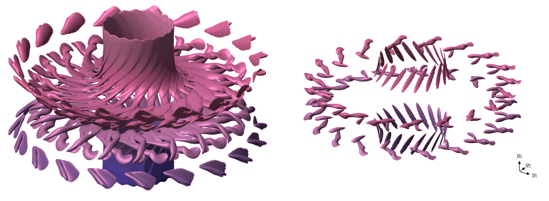
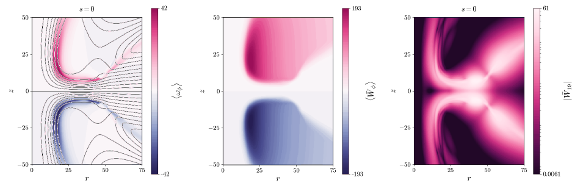
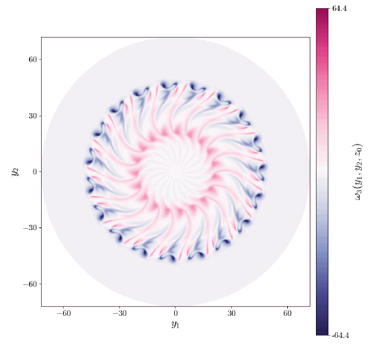
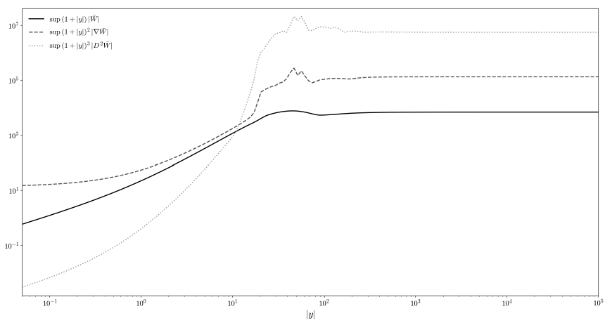

<!-- passage:front -->
<header class="front">
<!-- /passage:front -->

# Finite-time blow-up for the Navier–Stokes equations

<!-- passage:sec-finite-time-blow-up-for-the-navier-stokes-equations -->

<ul class="authors">
<li>Levent Alpöge</li>
<li>Tristan Buckmaster</li>
</ul>

</header>

<!-- source-page: 1 -->

<section class="abstract">

We prove that there exist smooth, compactly supported, divergence-free initial data on $\mathbb R^3$, and smooth divergence-free initial data on the torus $\mathbb T^3$, for which the solutions of the three-dimensional Navier–Stokes equations without force blow up in finite time. This disproves the statements (A) and (B) of the Millennium Prize problem as formulated by Fefferman, and hence proves the statements (C) and (D). These solutions converge in self-similar variables to a backward discretely self-similar solution and blow up at its rate, which is $(T-t)^{-1/4}$ in $\dot H^1$. The discretely self-similar solution is obtained from a certificate: an approximate solution that satisfies explicit inequalities. The certificate will be released soon; its hash is `3f7a335b84b6c7631742cacc5343dfcd11cf72f5221ff79b2b9268790b4b22c5`.

</section>
<!-- /passage:sec-finite-time-blow-up-for-the-navier-stokes-equations -->

## Contents

<!-- passage:sec-contents -->

|  |  |
| --- | --- |
| 1. Introduction | 1 |
| 2. Outline of the proof | 10 |
| 3. Preliminaries | 12 |
| 4. The equation linearized about $u^*$ | 16 |
| 5. Blow-up on $\mathbb R^3$ | 22 |
| 6. Blow-up on the torus | 24 |
| 7. From a certificate to a profile | 29 |
| Appendix A. Proofs of the lemmas of Sections 2 and 3 | 47 |
| Appendix B. Certificates in the formalization | 49 |
| Appendix C. The computation of the approximate profile | 70 |
| Acknowledgments | 75 |
| References | 75 |
<!-- /passage:sec-contents -->

## 1 Introduction

<!-- passage:sec-1 -->

We consider the incompressible Navier–Stokes equations in $\mathbb R^3$ without external force, $$\begin{equation}
\partial_t u+(u\cdot\nabla)u=\Delta u-\nabla p,\qquad \operatorname{div}u=0.\tag{1.1}
\end{equation}$$ Here $u$ is the velocity, $p$ is the pressure, and the viscosity is normalized to one: if $(u,p)$ solves (1.1), then $(\nu\,u(\nu t,x),\nu^2 p(\nu t,x))$ solves the equations with viscosity $\nu>0$, so that the results of this paper hold, after this change of variables, for every viscosity. Whether smooth solutions of (1.1) with finite energy, or smooth solutions on the torus $\mathbb T^3=\mathbb R^3/\mathbb Z^3$, can develop singularities in finite time is the regularity problem for the Navier–Stokes equations \[[53](#cite-ref53)\].

Leray \[[70](#cite-ref70), §20\] proposed to look for singular solutions of (1.1) among the backward self-similar ones, $u(t,x)=(T-t)^{-1/2}\,U(x/\sqrt{T-t})$. Nečas, Růžička and Šverák \[[76](#cite-ref76)\] and Tsai \[[86](#cite-ref86)\] proved that there is no such solution other than zero, under natural integrability conditions on the profile $U$. The next candidate is a solution that is invariant under the scaling of the equations for one scaling factor only, possibly after a rotation: a discretely self-similar <!-- source-page: 2 --> solution. Whether a nonzero solution of this kind exists backward in time, with the bound $|u(t,x)|\le C\,(|x|+\sqrt{T-t})^{-1}$, is the subject of \[[13](#cite-ref13), Open Problem 5.1\].

In this paper we prove that smooth solutions of (1.1) can blow up in finite time: there exist smooth, compactly supported, divergence-free data on $\mathbb R^3$, and smooth divergence-free data on $\mathbb T^3$, whose solutions are smooth up to a finite time, at which they blow up. In the formulation of the regularity problem by Fefferman \[[53](#cite-ref53)\], this disproves his statements (A) and (B) and hence proves his statements (C) and (D). The proof has two parts. The first is Theorem 1.1: one smooth discretely self-similar solution of the kind above implies this blow-up. Its proof shows that such a solution is stable in $\dot H^1$ up to finitely many directions, whatever the spectrum of its linearization is. The second is Theorem 7.1: such a solution exists near an approximate one that satisfies explicit inequalities, which we call a certificate.

### 1.1 Main results

Let $S>0$, and let $R\in O(3)$ be a linear isometry of $\mathbb R^3$. A *profile* with period $S$ and isometry $R$ is a pair $(W,q)$ of smooth functions $W:\mathbb R\times\mathbb R^3\to\mathbb R^3$, not identically zero, and $q:\mathbb R\times\mathbb R^3\to\mathbb R$ such that, on $\mathbb R\times\mathbb R^3$, $$\begin{equation}
\begin{gathered}
\partial_s W+\tfrac12 W+\tfrac12(y\cdot\nabla)W-\Delta W+(W\cdot\nabla)W+\nabla q=0,\qquad \operatorname{div}W=0,\\
W(s+S,y)=R\,W(s,R^{-1}y),
\end{gathered}\tag{1.2}
\end{equation}$$ and, for a constant $C_W$ and all $(s,y)\in\mathbb R\times\mathbb R^3$, $$\begin{equation}
|W(s,y)|\le C_W(1+|y|)^{-1},\qquad |\nabla W(s,y)|\le C_W(1+|y|)^{-2}.\tag{1.3}
\end{equation}$$ The variables $s$ and $y$ are the self-similar time and position. For $T>0$ we write $$\begin{equation}
u_T^*(t,x)=(T-t)^{-1/2}\,W\!\left(\log\frac{T}{T-t},\frac{x}{\sqrt{T-t}}\right)\qquad(t<T,\ x\in\mathbb R^3),\tag{1.4}
\end{equation}$$ so that $y=x/\sqrt{T-t}$ and $s=\log(T/(T-t))$. The first two equations of (1.2) say that $u_T^*$, with the pressure $(T-t)^{-1}\,q(s,y)$, solves (1.1) on $(-\infty,T)\times\mathbb R^3$, and the third says that $u_T^*$ is discretely self-similar up to the isometry $R$: with $\lambda=e^{-S}$, $$\begin{equation}
u_T^*\bigl(T-\lambda(T-t),x\bigr)=\lambda^{-1/2}R\,u_T^*\bigl(t,\lambda^{-1/2}R^{-1}x\bigr)\qquad(t<T,\ x\in\mathbb R^3).\tag{1.5}
\end{equation}$$ In the variables $(t,x)$, which we call Eulerian, the bounds (1.3) read $$
|u_T^*(t,x)|\le\frac{C_W}{|x|+\sqrt{T-t}},\qquad |\nabla u_T^*(t,x)|\le\frac{C_W}{\bigl(|x|+\sqrt{T-t}\bigr)^2}.
$$ In the terminology of Bradshaw and Tsai \[[13](#cite-ref13)\], $u_T^*$ is a backward discretely self-similar solution when $R=I$ and a backward rotated discretely self-similar solution when $R$ is a rotation; when $R$ is not a rotation, $R^2$ is a rotation, and $u_T^*$ is of this kind for the period $2S$. The first of the two bounds is the bound of a Type I singularity at the point $(T,0)$, and the second follows from it (Remark 1.2).

Let $0<T\le\infty$. A *smooth solution* of (1.1) on $[0,T)\times\mathbb R^3$ with datum $u_0$ is a pair $(u,p)$ of functions that are smooth on $[0,T)\times\mathbb R^3$, up to the boundary, and satisfy (1.1) there, with $u(0,\cdot)=u_0$; we also call the velocity $u$ a smooth solution. For $T<\infty$ the smooth solutions on $[0,T]\times\mathbb R^3$ are defined in the same way. We write $u(t)=u(t,\cdot)$, and we say that $u$ has *finite energy* if $\|u(t)\|_{L^2}$ is bounded in $t$. We call a function on $\mathbb R^3$ periodic if it has period $1$ in each coordinate, and we identify the functions on $\mathbb T^3$ with the periodic functions on $\mathbb R^3$. Thus a smooth solution on $[0,T)\times\mathbb T^3$, or on $[0,T]\times\mathbb T^3$, is a smooth solution on $[0,T)\times\mathbb R^3$, or on $[0,T]\times\mathbb R^3$, for which $u(t)$ and $p(t)$ are periodic. We write $B_r$ for the open ball of radius $r$ about the origin of $\mathbb R^3$ and $\|u\|_{H^1(\mathbb T^3)}=\|u\|_{H^1([0,1]^3)}$ for the norm of $H^1$ on the torus. Our main result is the following theorem. <!-- source-page: 3 -->

**Theorem 1.1.** Let $S>0$, and let $R$ be a linear isometry of $\mathbb R^3$, that is, a rotation or a rotation composed with a reflection. Suppose that there exists a profile $(W,q)$ with period $S$ and isometry $R$, and let $u_T^*$ be the field (1.4). Then there exist a divergence-free $u_0\in C_c^\infty(\mathbb R^3;\mathbb R^3)$ and a smooth solution $u$ of (1.1) on $[0,1)\times\mathbb R^3$ with datum $u_0$ and finite energy which blows up at time $1$: there exist $\kappa\in(0,\tfrac14)$ and constants $0<c\le C$ such that $$\begin{equation}
\left.\begin{gathered}
c\,(1-t)^{-\frac14}\le\|\nabla u(t)\|_{L^2}\le C\,(1-t)^{-\frac14},\\
\|\nabla(u(t)-u_1^*(t))\|_{L^2}\le C\,(1-t)^{\kappa-\frac14}
\end{gathered}\quad\right.\qquad(0\le t<1).\tag{1.6}
\end{equation}$$ Moreover, there exist $T\in(0,1]$, a divergence-free datum in $C^\infty(\mathbb T^3;\mathbb R^3)$ and a smooth solution $u_{\mathrm{per}}$ of (1.1) on $[0,T)\times\mathbb T^3$ with this datum which blows up at time $T$ at the same rate: $$\begin{equation}
\left.\begin{gathered}
c\,(T-t)^{-\frac14}\le\|u_{\mathrm{per}}(t)\|_{H^1(\mathbb T^3)}\le C\,(T-t)^{-\frac14},\\
\|u_{\mathrm{per}}(t)-u_T^*(t)\|_{H^1(B_{1/16})}\le C\,(T-t)^{\kappa-\frac14}
\end{gathered}\quad\right.\qquad(0\le t<T).\tag{1.7}
\end{equation}$$

The rate $(T-t)^{-1/4}$ is that of $u_T^*$: we have $\|\nabla u_T^*(t)\|_{L^2}=(T-t)^{-1/4}\,\|\nabla W(s,\cdot)\|_{L^2}$, and $\|\nabla W(s,\cdot)\|_{L^2}$ is bounded above and below, uniformly in $s$ (Lemma 4.2). This is also the rate of the lower bound of Leray \[[70](#cite-ref70), §21\] for $\|\nabla u(t)\|_{L^2}$ when a solution becomes singular at time $T$. In self-similar variables, $u(t,x)=(1-t)^{-1/2}\,U(s,y)$, the second bound of (1.6) reads $\|\nabla(U(s,\cdot)-W(s,\cdot))\|_{L^2}\le C\,e^{-\kappa s}$, so that $u$ converges to the profile. By (1.7) the same holds for $u_{\mathrm{per}}$ on the ball $B_{1/16}$, which in self-similar variables exhausts $\mathbb R^3$. The time $T$ and the radius $\frac1{16}$ come from the dilation of a torus of large period $L$ to $\mathbb T^3$, with $T=L^{-2}$ (Subsection 1.3).

These properties are not special to the datum $u_0$ that we construct. There exist $\varepsilon_0>0$ and a finite-dimensional space $E$ of smooth, compactly supported, divergence-free fields such that every divergence-free $w_0\in C_c^\infty(\mathbb R^3;\mathbb R^3)$ with $\|\nabla(w_0-W(0,\cdot))\|_{L^2}\le\varepsilon_0$ becomes, after the addition of an element of $E$, the datum of a smooth solution of finite energy on $[0,1)\times\mathbb R^3$ which satisfies (1.6) (Proposition 2.1 and Lemma 2.3); the datum $u_0$ is of this form. In this sense the blow-up is stable in finite codimension.

**Remark 1.2.** The bound on $\nabla W$ in (1.3) is a consequence of the bound on $W$ and of the first two equations of (1.2), with a constant that depends only on $C_W$, and so is the bound $|\nabla^2 W(s,y)|\le C\,(1+|y|)^{-3}$. This follows, as in \[[79](#cite-ref79), Lemma 9.2 and Corollary 9.3\], from the interior estimate for bounded smooth solutions of the Navier–Stokes equations \[[79](#cite-ref79), Lemma 9.1\], which requires no bound on the pressure, applied, for $t<T$ and $x\in\mathbb R^3$, on the backward parabolic cylinder of radius $r=\frac12\max\{|x|,\sqrt{T-t}\}$ about the point $(t,x)$, on which the field (1.4) is bounded by $C_W/r$. Thus the hypothesis of Theorem 1.1 is that of a nonzero smooth solution of (1.2) with the first bound of (1.3).

Theorem 1.1 assumes a profile. In Section 7 we obtain one from a certificate. A certificate, defined in Subsection 7.3, consists of a family of approximate profiles with their periods, and of further fields and numbers. The approximate profiles are approximate solutions of the first two equations of (1.2), periodic in $s$, and depend on finitely many parameters. The conditions of a certificate are of two kinds. Some are estimates that are to hold for every perturbation of the approximate profiles, among them an a priori estimate for the linearized equation. The others are explicit inequalities between norms of these fields and between these numbers, of the kind that a computation with rigorous bounds for its errors can verify. We prove that a certificate gives a profile whose isometry is the identity, close to one of the approximate profiles, with its period and with the symmetries that the certificate prescribes for these profiles (Theorem 7.1), and hence, by Theorem 1.1, blow-up from smooth, compactly supported data on $\mathbb R^3$ and from <!-- source-page: 4 -->

*Figure 1.* The computed approximate profile $\bar W$ at $s=0$: the surfaces $|\operatorname{curl}\bar W|=50$ (left) and $|\operatorname{curl}\bar W|=85$ (right) in the self-similar variable $y$, coloured by the height $y_3$. The two levels are about $0.30$ and $0.51$ of the largest value of $|\operatorname{curl}\bar W|$.

smooth data on $\mathbb T^3$ (Corollary 7.2). The certificate from which we obtain the profile is not printed in this paper: it will be released soon, and its hash is `3f7a335b84b6c7631742cacc5343dfcd11cf72f5221ff79b2b9268790b4b22c5`. It consists of data of the form described in Appendix B.1 that satisfy the conditions of Appendix B. These are conditions on finitely many functions and numbers, from which the estimates for every perturbation are derived in that appendix; two steps of the derivation are proved in the formalization (Subsection 1.5) and not in this paper. That the certificate satisfies the conditions is verified by a rigorous computation, involving interval arithmetic, which is not part of the formalization. The interval arithmetic has 128 bits of precision and uses the Arb library \[[66](#cite-ref66)\], through FLINT.

The approximate profiles of this certificate are formed from one field and from further fields computed from it. This field was found by a numerical computation in floating-point arithmetic: Newton’s method on an adaptive discretization, started from a state that was reached by continuation; we describe the computation in Appendix C. Figure 1 shows this field, which we denote by $\bar W$. It is not axisymmetric. It is invariant under the rotation by $2\pi/19$ about the $y_3$ axis and under the rotation by $\pi$ about the $y_1$ axis; it is periodic in $s$, with the computed period $\bar S\approx0.36$; and an advance of $s$ by $\bar S/2$ rotates it by the angle $\pi/19$ about the $y_3$ axis. The norm of its gradient in $L^2$ is of order $10^4$ at every time. The certificate prescribes these symmetries, so that the profile $W$ that Theorem 7.1 gives for it has them as well (Remark 7.3): it is a profile with the isometry $I$ and a period $S$, and also with the rotation by $\pi/19$ about the $y_3$ axis and the period $S/2$. In the terminology recalled above, its field $u_T^*$ is thus both a backward discretely self-similar and a backward rotated discretely self-similar solution. By (7.38) and the conditions of Appendix B it differs from one of the approximate profiles of the certificate by less than $0.017$ in $\dot H^1$ at every time.

In the certificate the symmetries restrict the perturbations for which the estimates are required (Section 7). Classes of fields with a discrete rotational symmetry have been used for the Euler equations. Elgindi and Jeong \[[49](#cite-ref49)\] proved that the two-dimensional Euler equations have a unique global solution with bounded vorticity for every bounded initial vorticity, without decay at infinity, that is invariant under the rotation by $2\pi/m$ for some $m\ge3$, and in \[[50](#cite-ref50)\] they proved the formation of a singularity in finite time for the three-dimensional Euler equations <!-- source-page: 5 --> on $\mathbb R^3$ in the class of the fields with octahedral symmetry, for data with bounded, piecewise smooth vorticity. Problem 6 of the survey of Drivas and Elgindi \[[45](#cite-ref45)\] asks whether a scale-invariant solution of the Euler equations in a symmetry class that is admissible in their sense can develop a singularity in finite time. The rotating solutions of the surface quasi-geostrophic equation of \[[25](#cite-ref25)\] (see Subsection 1.2) have a 3-fold symmetry.

### 1.2 Background

The self-similar solutions of Leray are the solutions of the first two equations of (1.2) that do not depend on $s$. Nečas, Růžička and Šverák \[[76](#cite-ref76)\] proved that the only such solution with $W\in L^3(\mathbb R^3)$ is zero, and Tsai \[[86](#cite-ref86), Theorems 1 and 2\] proved the same for $W\in L^p(\mathbb R^3)$, $3<p<\infty$, and for the self-similar solutions that satisfy local energy estimates. In particular a profile depends on $s$, since its slices lie in $L^6(\mathbb R^3)$. For discretely self-similar solutions, Open Problem 5.1 of \[[13](#cite-ref13)\] asks whether a backward solution with the Type I bound, rotated or not, remains bounded up to time $T$; by its self-similarity, a solution that remains bounded is zero, and by Remark 1.2 a smooth solution that is not zero is the field (1.4) of a profile. When $R=I$, Chae and Wolf \[[26](#cite-ref26), Theorems 1.1 and 1.3\] proved that the Type I bound holds for every smooth backward discretely self-similar solution that is continuous in time with values in $L^p(\mathbb R^3)$ for some $p\in[3,\infty)$, and that a smooth solution with this bound is zero if its scaling factor $e^{S/2}$ is close enough to $1$: the period $S$ of a profile with $R=I$ is bounded below by a positive number that depends only on $C_W$. Pineau and Vicol \[[79](#cite-ref79), Theorems 1.6 and 1.7\] gave a quantitative proof and extended the statement to rotations $R$ by an angle at most $cS$, for a constant $c>0$ that depends only on $C_W$. Nonzero solutions with the Type I bound that are self-similar up to a rotation at a constant angular speed in $s$ would give profiles for every period; the question of their existence goes back to Perelman, as recorded by Bradshaw and Tsai \[[13](#cite-ref13), Open Problem 5.2\], and they are excluded for small and for large angular speeds \[[79](#cite-ref79), Theorem 1.4\]. Forward in time, self-similar and discretely self-similar solutions do exist \[[64](#cite-ref64), [87](#cite-ref87), [12](#cite-ref12), [27](#cite-ref27)\], also up to a rotation \[[13](#cite-ref13)\].

By the first bound of (1.3), $u_T^*(t)$ is bounded in weak $L^3(\mathbb R^3)$, uniformly in $t$, and this gives no bound in $L^3(\mathbb R^3)$; for solutions that are bounded in $L^3(\mathbb R^3)$, singularities are excluded by the theorem of Escauriaza, Seregin and Šverák \[[52](#cite-ref52)\]. Singularities of Type I are excluded for axisymmetric solutions \[[28](#cite-ref28), [29](#cite-ref29), [69](#cite-ref69), [81](#cite-ref81)\]. Albritton and Barker \[[1](#cite-ref1)\] proved that a suitable weak solution with a Type I singular point exists if and only if there is a nontrivial mild bounded ancient solution, in the sense of \[[69](#cite-ref69)\], with Type I decay. By \[[1](#cite-ref1), Remark 4.3\], a nontrivial mild ancient solution that is bounded in weak $L^3(\mathbb R^3)$ along a sequence of times, as the field of a profile is, gives a singular weak Leray–Hopf solution of the equations with a force. Theorem 1.1 assumes a discretely self-similar solution and concludes blow-up without force, from smooth, compactly supported data on $\mathbb R^3$ and from smooth data on the torus.

For other equations, blow-up near a self-similar profile has been proved for sets of data of finite codimension: the linearization about the profile in self-similar variables has finitely many unstable directions, which are controlled through the choice of the data. Merle, Raphaël, Rodnianski and Szeftel \[[75](#cite-ref75)\] proved in this way the implosion of solutions of the compressible Euler and Navier–Stokes equations from smooth spherically symmetric data, near the smooth self-similar profiles of the Euler equations that they constructed in \[[74](#cite-ref74)\]. Buckmaster, Cao-Labora and Gómez-Serrano \[[16](#cite-ref16)\] constructed smooth self-similar imploding solutions of the isentropic compressible Euler equations in three dimensions for every adiabatic exponent larger than $1$ and proved, for the exponent $7/5$, the implosion of solutions of the compressible Navier–Stokes equations for a set of finite codimension of smooth radially symmetric data whose density is bounded away from zero and constant at infinity. Cao-Labora, Gómez-Serrano, Shi and Staffilani \[[24](#cite-ref24)\] removed the assumption of symmetry, for both systems, on $\mathbb R^3$ and on the <!-- source-page: 6 --> torus. Chen, Cialdea, Shkoller and Vicol \[[31](#cite-ref31)\] proved that the vorticity of smooth solutions of the two-dimensional compressible Euler equations can blow up, through an axisymmetric implosion that is stable in finite codimension in its radial part and for an open set of swirl velocities; see \[[30](#cite-ref30)\] for every dimension $d\ge3$, and \[[36](#cite-ref36)\] for a family of smooth non-isentropic implosions of the compressible Euler equations whose ground state is stable without symmetry up to finitely many conditions on the data. Buckmaster and Iyer \[[19](#cite-ref19)\] constructed shocks for the two-dimensional compressible Euler equations that converge in self-similar variables to an unstable self-similar solution of the Burgers equation, and showed that this behavior is stable modulo a two-dimensional subspace.

For the incompressible Euler equations on $\mathbb R^3$, Elgindi \[[47](#cite-ref47)\] constructed self-similar solutions of class $C^{1,\alpha}$, for some $\alpha>0$, that blow up in finite time, and Elgindi, Ghoul and Masmoudi \[[48](#cite-ref48), Theorem 2\] proved that this blow-up is stable in a class of axisymmetric perturbations, up to one condition on the perturbation, which gives blow-up from data of finite energy. For the nonlinear heat equation in one space dimension, Bricmont and Kupiainen \[[15](#cite-ref15), Theorems 1 and 2\] constructed solutions that blow up with a prescribed profile by fixing finitely many parameters of the data, one for each unstable direction of the profile as a fixed point of a renormalization map, and for the Navier–Stokes equations with complex-valued solutions, Li and Sinai \[[71](#cite-ref71)\] proved blow-up in finite time for suitable values of the parameters in ten-parameter families of data. For the energy supercritical heat equation, Collot, Raphaël and Szeftel \[[38](#cite-ref38), Theorem 1.2\] proved that there is a Lipschitz manifold of finite codimension of data without symmetry whose solutions blow up near a self-similar profile, up to scaling and translation; these data are the profile, cut off at a large radius, plus a small perturbation.

For wave equations, Donninger and Schörkhuber \[[43](#cite-ref43)\] proved the stability of a self-similar blow-up by the Lyapunov–Perron method, following the work of Donninger on wave maps \[[42](#cite-ref42)\]: the data are modified along the unstable direction, which there comes from the translations in time, and the modification is undone at the end by a shift of the blow-up time. This is the method that we use, except that we keep the modification of the data. Glogić, Hilditch and Wallauch \[[57](#cite-ref57)\] constructed discretely self-similar blow-up solutions of a wave maps type equation and proved their stability in finite codimension.

Non-unique solutions of the Navier–Stokes equations have been produced by several methods. One is convex integration: Buckmaster and Vicol \[[20](#cite-ref20)\] proved that weak solutions with finite kinetic energy are not unique; see also \[[18](#cite-ref18)\] and the survey \[[21](#cite-ref21)\]. Another is that of Coiculescu and Palasek \[[37](#cite-ref37)\], who constructed, for the equations on the torus, data in $BMO^{-1}$ with two distinct global solutions, both smooth at positive times, by a mechanism proposed for a dyadic model of the equations. A third is based, like the proofs of blow-up recalled above, on the linearization about a self-similar solution in self-similar variables. Jia and Šverák \[[65](#cite-ref65)\] proved that Leray–Hopf solutions are not unique if the linearization about a forward self-similar solution satisfies a spectral condition. After the work of Vishik on the two-dimensional Euler equations \[[91](#cite-ref91), [92](#cite-ref92), [4](#cite-ref4)\], Albritton, Brué and Colombo \[[2](#cite-ref2)\] proved the non-uniqueness of Leray–Hopf solutions with a force, and Buckmaster, Coiculescu and Li \[[17](#cite-ref17)\] proved it without force, around a forward discretely self-similar solution whose linearization has a growing Floquet mode. In these works an unstable direction of the linearized flow is followed forward in time, and the solutions separate. Here we follow the stable directions toward the blow-up time, and the solution converges to the profile.

Several results in fluid mechanics have computer-assisted proofs, in which an analytic argument reduces the statement to finitely many conditions and a computation with rigorous bounds for its errors verifies them; see the survey \[[58](#cite-ref58)\]. Chen and Hou proved in this way the blow-up of the two-dimensional Boussinesq and the three-dimensional axisymmetric Euler <!-- source-page: 7 --> equations from smooth data in a domain with boundary \[[32](#cite-ref32), [33](#cite-ref33)\], following their proofs with Huang of the finite-time blow-up, from smooth data, of the De Gregorio and Hou–Luo models of the three-dimensional Euler equations \[[34](#cite-ref34), [35](#cite-ref35)\]; the smooth imploding profiles of \[[16](#cite-ref16)\] are constructed with the help of a computer, and the global rotating solutions of the surface quasi-geostrophic equation of Castro, Córdoba and Gómez-Serrano \[[25](#cite-ref25)\] rest on a computer-assisted proof that the kernel of a linearized operator is one-dimensional. Time-periodic solutions of the Navier–Stokes equations with a time-independent force have been constructed in this way on the torus \[[90](#cite-ref90)\] and in a square \[[9](#cite-ref9)\], and so have discretely self-similar solutions of the Einstein–scalar field system \[[80](#cite-ref80)\] and of the defocusing nonlinear wave equation \[[22](#cite-ref22)\]. Such proofs start from approximate solutions computed numerically. Approximate self-similar solutions of the Euler equations and of related models have also been found by neural networks \[[93](#cite-ref93), [94](#cite-ref94)\]. For the Navier–Stokes equations, Guillod and Šverák \[[59](#cite-ref59)\] computed forward self-similar solutions for axisymmetric scale-invariant data and found a symmetry-breaking bifurcation at large data, and Ionescu, Jia and Palasek \[[63](#cite-ref63)\] constructed numerically unstable forward self-similar solutions in the axisymmetric class without swirl; Hou \[[61](#cite-ref61)\] presented numerical evidence of potentially singular behavior of axisymmetric solutions with smooth data of finite energy. We compare the construction of Section 7 with those of \[[90](#cite-ref90), [9](#cite-ref9), [80](#cite-ref80), [22](#cite-ref22)\] in Subsection 7.4.

Theorem 1.1 concerns the equations with zero force. With a force that is uniformly of class $C^{1,\alpha}$, the construction of Elgindi gives the blow-up of solutions of the Euler equations of finite energy \[[47](#cite-ref47), Remark 1.4\], and Córdoba and Martínez-Zoroa proved singularity formation for the Euler equations with a force that is uniformly of class $C^{1,1/2-\varepsilon}$ \[[39](#cite-ref39)\] and for the incompressible porous media equation with a source that is smooth in space \[[40](#cite-ref40)\]. Singularity formation was proved for the incompressible porous media, Boussinesq and Euler equations with forces that are smooth in space and time up to the singular time in \[[7](#cite-ref7), [5](#cite-ref5), [6](#cite-ref6)\], and for the Euler equations without force, from smooth periodic data, in \[[8](#cite-ref8)\].

### 1.3 Ideas of the proof

The field (1.4) of a profile is a smooth solution of (1.1), and we construct the solutions of Theorem 1.1 as perturbations of it. We find the perturbation by a contraction argument for the integral formulation of (1.1), which the field $u_1^*$ satisfies on $[0,1)$ (Proposition 4.1). We work in the space $\dot H^1_{\mathrm{div}}(\mathbb R^3)$ of the divergence-free fields in $L^6(\mathbb R^3)$ with square integrable gradient, with the norm $\|u\|_{\dot H^1}=\|\nabla u\|_{L^2}$: by (1.3) the gradient of $W(s,\cdot)$ is square integrable, uniformly in $s$, whereas $W(s,\cdot)$ itself need not be. On the torus we use the corresponding space of periodic fields of mean zero (Subsections 2.1 and 3.6). By the classical local theory of the equations in $H^1$, a solution of the integral formulation in one of these spaces whose datum is smooth and compactly supported, or smooth on the torus, is a smooth solution (Lemma 2.3).

We write $u^*=u_1^*$. In the self-similar variables with blow-up time $1$, in which $u(t,x)=(1-t)^{-1/2}\,U(s,y)$, the equations (1.1) are the first two equations of (1.2) for $U$ and a pressure. The profile $W$ is a solution of these that is periodic up to $R$, and we look for solutions $U$ with $U(s)-W(s)\to0$ as $s\to\infty$.

The norm of $\dot H^1$ is subcritical: the scaling $f\mapsto\sqrt\mu\,f(\sqrt\mu\,\cdot)$ of the equations multiplies it by $\mu^{1/4}$. In self-similar variables the linear flow without the terms that come from $W$ is the heat flow up to time $1-e^{-s}$ followed by this scaling with $\mu=e^{-s}$, and therefore its norm on $\dot H^1$ is at most $e^{-s/4}$. The flow linearized about $W$ over one period, followed by the action of $R^{-1}$ on fields, is the monodromy operator $\mathcal M$. It differs from the corresponding free flow by a compact operator. Hence its essential spectral radius is at most $e^{-S/4}<1$, and for a suitable $\Theta\in(e^{-S/4},1)$ the spectrum of $\mathcal M$ outside the disc of radius $\Theta$ consists of finitely many eigenvalues of finite multiplicity. For a self-similar solution forward in time this is the <!-- source-page: 8 --> argument of Jia and Šverák \[[65](#cite-ref65), Lemma 2.7\]; for a solution that is periodic in self-similar time it is used in \[[17](#cite-ref17), Section 19\], with the same bound for the essential spectral radius.

We assume nothing about these eigenvalues. In the program of \[[65](#cite-ref65)\] for non-uniqueness an unstable eigenvalue is the hypothesis, and in \[[17](#cite-ref17)\] the main difficulty is to construct a solution that has one. For blow-up it suffices that the eigenvalues outside the disc are finitely many: each of them, whatever its modulus, is removed by a correction of the datum in a finite-dimensional space. More precisely, let $\kappa\in(0,\tfrac14)$ be defined by $\Theta=e^{-\kappa S}$. We solve the equation linearized about $u^*$ in the space of the perturbations $v$ with $$
\sup_{0\le t<1}\,(1-t)^{\frac14-\kappa}\,\|v(t)\|_{\dot H^1}<\infty,
$$ which are those of size $e^{-\kappa s}$ in self-similar variables, and we leave the datum of $v$ free in a finite-dimensional space $E$, a complement of the invariant subspace of $\mathcal M$ on which its powers decay faster than $\Theta^n$. A Lyapunov–Perron argument over the periods of $u^*$ gives a bounded right inverse of this linear problem (Section 4). Since the smooth, compactly supported, divergence-free fields are dense in $\dot H^1_{\mathrm{div}}(\mathbb R^3)$, we can choose $E$ among them, and we need not know the regularity or the decay of the eigenfunctions of $\mathcal M$. A contraction then gives, for every $w_0$ in a ball of $\dot H^1_{\mathrm{div}}(\mathbb R^3)$ about $u^*(0)=W(0,\cdot)$, an element $\gamma$ of $E$ and a solution $u$ on $[0,1)$ with datum $w_0+\gamma$ such that $u-u^*$ lies in this space. We modulate neither the blow-up time, nor the location of the blow-up, nor the phase of $u^*$ in its period.

For $w_0$ we take the field $u^*(0)$, cut off far from the origin. The cutoff is applied to a vector potential, so that the field remains divergence-free: for $0\le t<1$ and a radius $r>0$ we let $\bar u(t)=\operatorname{curl}\bigl(\eta(\cdot/r)\,A(t)\bigr)$, where $A(t)$ is the vector potential of $u^*(t)$ given in (5.1) and $\eta$ is a smooth cutoff that equals $1$ on $B_{1/2}$ and vanishes outside $B_1$. The field $\bar u(t)$ equals $u^*(t)$ on $B_{r/2}$ and vanishes outside $B_r$, and by (1.3) its distance from $u^*(t)$ in $\dot H^1$ is at most a constant multiple of $r^{-1/2}$, uniformly in $t$ (Lemma 5.1). On $\mathbb R^3$ we take $w_0=\bar u(0)$, for a large radius $r$. Thus on $\mathbb R^3$ only the datum is cut off; the solution $u^*$ itself, which need not have finite energy, is not. In \[[17](#cite-ref17), Section 19\] the datum is truncated in the same way, through the same potential. Jia and Šverák \[[65](#cite-ref65), Section 5\], for the Navier–Stokes equations forward in time, and Elgindi, Ghoul and Masmoudi \[[48](#cite-ref48), Subsection 2.6\], for the Euler equations, pass likewise from self-similar solutions of infinite energy to data of finite energy, by a cutoff at a large radius which changes the datum little in the norm in which the solution is perturbed.

On $\mathbb T^3$ we construct the solution for a small blow-up time $T$. By the scaling of the equations this is the same as a large period at the blow-up time $1$: if $u$ solves the equations on $[0,1)\times\mathbb R^3/L\mathbb Z^3$, then $L\,u(L^2 t,Lx)$ solves them on $[0,L^{-2})\times\mathbb T^3$. We therefore keep the solution $u^*$ and the blow-up time $1$, and we take the period $L=T^{-1/2}$ large. The solution $u^*$ is not periodic, so that on the torus there is no exact solution about which to linearize, and no monodromy operator. We cut the field $u^*$ off at the radius $r=L/8$ and extend it periodically: the approximate solution is $u^{\mathrm a}(t)=\sum_{j\in\mathbb Z^3}\bar u(t,\cdot-Lj)$, where $\bar u(t)$ is the cutoff field above for this radius, which equals $u^*(t)$ on $B_{L/16}$ and vanishes outside $B_{L/8}$. On divergences the heat flow composed with the Leray projection is the convolution with a kernel that decays like $|x|^{-4}$, uniformly in time. The nonlinear term is a divergence, and so is the datum, since a divergence-free field $f$ is the divergence of $x\otimes f$. Hence the flows of the datum and of the nonlinear term on $\mathbb R^3$ differ from those of their periodic extensions on the torus, on a period cell, by quantities of order $L^{-1/2}$ and $L^{-5/2}$ in $\dot H^1$ (Lemma 6.1), and with the bound for the cutoff the error by which $u^{\mathrm a}$ fails to be a solution is of order $L^{-1/2}$ (Lemma 6.2). For the linearized problem we use that $\bar u(t)$ vanishes outside $B_{L/8}$, so that in the equation linearized about $u^{\mathrm a}$ the term that comes from $u^{\mathrm a}$ involves the perturbation only through its restriction <!-- source-page: 9 --> to this ball. We can therefore solve the linearized equation on $\mathbb R^3$, with the right inverse of the equation linearized about $u^*$, and return to the torus; the map so obtained inverts the equation linearized about $u^{\mathrm a}$ up to an error of order $L^{-1/2}$. A Neumann series removes this error when $L$ is large. The same contraction as on $\mathbb R^3$ then gives a solution $u$ on the torus of period $L$, and $u_{\mathrm{per}}(t,x)=L\,u(L^2 t,Lx)$ is the solution of Theorem 1.1.

Albritton, Brué and Colombo \[[3](#cite-ref3), Theorem 1.1\] glued the construction of \[[2](#cite-ref2)\] into the torus, where it gives non-unique Leray–Hopf solutions with a force, and Tao \[[84](#cite-ref84), proof of Theorem 12.2\] embeds a solution on $\mathbb R^3$, cut off outside a ball, in a torus of large period, with a force that is defined so that the cut-off field is a solution. Here the error of the cutoff is removed by the contraction, and the equations on the torus hold without force.

In the proof of Theorem 7.1 we correct an approximate profile to an exact one. Since the period of a profile is not known in advance, we rescale the self-similar time, so that the period becomes a coefficient of the equation. The equation linearized about a time-periodic solution need not be invertible: it has, for instance, the derivative of the solution in time in its kernel. We therefore add to the first equation of (1.2) a force term with finitely many unknown coefficients and impose as many linear constraints on the solution. With the Fredholm alternative, the a priori estimate of a certificate gives a bounded inverse of the linearized problem with constraints. The approximate profiles depend on as many parameters as the force term has coefficients, and the remaining conditions bound these coefficients so sharply that the Schauder–Tychonoff fixed point theorem, applied to the parameters and to the quadratic term together, gives a value of the parameters and a solution close to the approximate profile for which the force term vanishes. We then show that this solution is smooth (Proposition 7.11), and since its isometry is the identity, the theorem of Chae and Wolf recalled in Subsection 1.2 gives the Type I bound.

### 1.4 Organization and conventions

In Section 2 we reduce Theorem 1.1 to Propositions 2.1 and 2.2, on $\mathbb R^3$ and on the torus, and to Lemma 2.3 on smooth data. Section 3 contains the properties of the heat flow and of the bilinear term that the rest of the paper uses; most of its proofs, and that of Lemma 2.3, are in Appendix A. In Section 4 we construct the right inverse of the equation linearized about $u^*$ and prove the lemma by which a contraction corrects an approximate solution. In Section 5 we prove Proposition 2.1, and in Section 6 Proposition 2.2. In Section 7, which can be read after Section 3, we define a certificate and prove Theorem 7.1. In Appendix B we describe the form that the formalization prescribes for the data of a certificate, and we derive the estimates that a certificate assumes for every perturbation from conditions on finitely many functions and numbers, attached to data of this form. In Appendix C we describe the numerical computation of the field from which the approximate profiles of the certificate of Subsection 1.1 are formed, and of further fields of this certificate.

From Section 2 on, the solutions that we construct blow up at time $1$, except for the solution on $\mathbb T^3$, which is a dilation of one of them. The letters $s$ and $y$ are reserved for the self-similar variables. We write $\bar B_r$ for the closure of the ball $B_r$. For a field $f$ on $\mathbb R^3$ we write $|\nabla f|^2=\sum_i|\partial_i f|^2$, and similarly for derivatives of higher order. The Fourier transform is $\hat f(\xi)=\int_{\mathbb R^3}e^{-2\pi i x\cdot\xi}\,f(x)\,dx$, with inverse $\mathcal F^{-1}$, and the Fourier coefficients of a periodic function are $\hat f(k)=\int_{[0,1]^3}e^{-2\pi i k\cdot x}\,f(x)\,dx$, $k\in\mathbb Z^3$. The Leray projection $\mathbb P$ multiplies $\hat f(\xi)$, and on the torus $\hat f(k)$, by the matrix $\mathbb P_\xi=I-|\xi|^{-2}\,\xi\otimes\xi$, where $\mathbb P_0=I$, so that on the torus it keeps the mean.

### 1.5 Formalization

Theorems 1.1 and 7.1 have been formalized in the Lean 4 proof assistant \[[41](#cite-ref41)\], using its mathematical library Mathlib \[[73](#cite-ref73)\], in the form in which an earlier version of this paper stated them. The formal Theorem 1.1 has no rate: for every positive viscosity <!-- source-page: 10 --> it gives a smooth, compactly supported, divergence-free datum on $\mathbb R^3$ from which no smooth solution of bounded energy exists for all time, and a smooth, periodic, divergence-free datum from which no smooth solution with periodic velocity exists for all time. The formal Theorem 7.1 obtains from a certificate a weak solution of the equation of a profile. For another recent use of Lean in fluid mechanics, the verification of a certified computation of water waves, see \[[82](#cite-ref82)\].

The formalization also derives the conclusion of the formal Theorem 1.1, on $\mathbb R^3$ and on $\mathbb T^3$, from conditions on finitely many functions and numbers, which do not include the estimates that a certificate assumes for every perturbation. We describe these conditions in Appendix B. The formalization contains no data: that the certificate of Subsection 1.1 satisfies them is verified by a rigorous computation, involving interval arithmetic, which is not part of the formalization.

### 1.6 AI statement

We used Anthropic models (Claude) throughout this work, and no others. The work builds on unreleased work of the authors on computer-assisted proofs, in particular concerning the non-uniqueness of Leray–Hopf solutions in the style of Jia and Šverák \[[65](#cite-ref65)\] and blow-up for fluid equations with boundary. It builds also on numerical work of the authors on finding self-similar profiles, on our earlier papers on singularity formation, and on our unreleased drafts on the forced hypodissipative Navier–Stokes equations and the forced Navier–Stokes equations. The idea of pursuing discretely self-similar solutions came from the paper of the second author with Coiculescu and Li on non-uniqueness \[[17](#cite-ref17)\]. The agents were given a curated dossier of potential leads and then guidance after our strictly-uncontaminated experiment producing unforced Euler and forced Navier–Stokes blow-up from our forced Euler and forced hypodissipative Navier–Stokes manuscripts. A simpler mechanism sufficed to produce unforced hyperdissipative Navier–Stokes blow-up, i.e. for $\nu\cdot(-\Delta)^{\frac{501}{500}}$, and then a heavier computation produced this profile. We used the enslopification skills of Scott Armstrong \[[10](#cite-ref10)\] to create a draft from an initial Lean proof (Subsection 1.5); the draft followed that proof step by step. We then rewrote it with Claude under our direction, citing standard results in place of proofs and simplifying the argument over successive revisions, so that the proof given here no longer follows the Lean proof.
<!-- /passage:sec-1 -->

## 2 Outline of the proof

<!-- passage:sec-2 -->

### 2.1 The space $X$ and the notion of solution

We write $C_{c,\mathrm{div}}^\infty$ for the space of smooth, compactly supported, divergence-free fields $\varphi:\mathbb R^3\to\mathbb R^3$, and $X=\dot H^1_{\mathrm{div}}(\mathbb R^3)$ for the space of the divergence-free fields $u\in L^6(\mathbb R^3;\mathbb R^3)$ with $\nabla u\in L^2$, with the norm $\|u\|_{\dot H^1}=\|\nabla u\|_{L^2}$. For $t>0$ and a field $u$ in $L^p(\mathbb R^3;\mathbb R^3)$, $1\le p\le\infty$, let $$\begin{equation}
e^{t\Delta}u=(4\pi t)^{-3/2}e^{-|\cdot|^2/(4t)}*u,\tag{2.1}
\end{equation}$$ and $e^{0\Delta}u=u$. For $\tau>0$ and a field $f$ that is the sum of a field in $L^1(\mathbb R^3;\mathbb R^3)$ and a field in $L^2(\mathbb R^3;\mathbb R^3)$ let $$\begin{equation}
e^{\tau\Delta}\mathbb P f=\mathcal F^{-1}\bigl[e^{-4\pi^2\tau|\xi|^2}\,\mathbb P_\xi\hat f\bigr],\tag{2.2}
\end{equation}$$ and for $u,v\in X$ let $$\begin{equation}
K(\tau)(u,v)=-\tfrac12\,e^{\tau\Delta}\mathbb P\bigl[(u\cdot\nabla)v+(v\cdot\nabla)u\bigr].\tag{2.3}
\end{equation}$$ By Hölder’s inequality $(u\cdot\nabla)v\in L^{3/2}\subset L^1+L^2$, so that (2.3) is defined. The map $K(\tau)$ is bilinear and symmetric, it maps $X\times X$ into $X$ (Lemma 3.1), and $K(\tau)(u,u)=-e^{\tau\Delta}\mathbb P[(u\cdot\nabla)u]$. <!-- source-page: 11 -->

Let $a<b$. For a continuous map $u:[a,b)\to X$, Duhamel’s formula for (1.1) on $[a,b)$ is $$\begin{equation}
u(t)=e^{(t-a)\Delta}u(a)+\int_a^t K(t-t')(u(t'),u(t'))\,dt'\qquad(a\le t<b),\tag{2.4}
\end{equation}$$ where the integral converges in $X$ (Lemma 3.3), and $u$ is a *mild solution* on $[a,b)$ if it satisfies (2.4); mild solutions on $[a,b]$ are defined in the same way. From now on a solution with values in $X$ is a mild solution, unless we say that it is smooth. The identity (2.4) is the integral formulation of the Navier–Stokes equations of Kato and Fujita \[[68](#cite-ref68), (III), p. 245\]; for the equations in the whole space see \[[67](#cite-ref67), (INT) and (2.2)\]. On the torus the space $\dot H^1_{\mathrm{div}}(\mathbb T^3)$ of the periodic divergence-free fields of mean zero, the bilinear term $K_{\mathbb T}$ and the mild solutions in this space are defined in the same way in Subsection 3.6.

### 2.2 Blow-up on $\mathbb R^3$ and on the torus

On $\mathbb R^3$ we prove the following proposition.

**Proposition 2.1.** Let $(W,q)$ be a profile, and let $u_1^*$ be the field (1.4) with $T=1$. Then there exist $\kappa\in(0,\tfrac14)$, constants $0<c\le C$ and $\varepsilon_0>0$, and a finite-dimensional subspace $E$ of $C_{c,\mathrm{div}}^\infty$ with the following property. For every $w_0\in X$ with $\|w_0-W(0,\cdot)\|_{\dot H^1}\le\varepsilon_0$ there exist $\gamma\in E$ and a solution $u$ on $[0,1)$ with $u(0)=w_0+\gamma$ such that, for $0\le t<1$, $$\begin{equation}
c\,(1-t)^{-\frac14}\le\|u(t)\|_{\dot H^1}\le C\,(1-t)^{-\frac14},\qquad \|u(t)-u_1^*(t)\|_{\dot H^1}\le C\,(1-t)^{\kappa-\frac14}.\tag{2.5}
\end{equation}$$ Moreover, there is a field $w_0\in C_{c,\mathrm{div}}^\infty$ with $\|w_0-W(0,\cdot)\|_{\dot H^1}\le\varepsilon_0$.

The proof is in Sections 4 and 5; the field $w_0$ of the last assertion is $W(0,\cdot)$ cut off at a large radius (Lemma 5.1).

On the torus we prove the following proposition, at a small blow-up time $T$.

**Proposition 2.2.** Let $(W,q)$ be a profile. Then there exist $T\in(0,1]$, $\kappa\in(0,\tfrac14)$, constants $0<c\le C$, a divergence-free $u_0\in C^\infty(\mathbb T^3;\mathbb R^3)$ and a solution $u$ in $\dot H^1_{\mathrm{div}}(\mathbb T^3)$ on $[0,T)$ with $u(0)=u_0$ such that, for $0\le t<T$, $$\begin{equation}
c\,(T-t)^{-\frac14}\le\|u(t)\|_{H^1(\mathbb T^3)}\le C\,(T-t)^{-\frac14},\quad \|u(t)-u_T^*(t)\|_{H^1(B_{1/16})}\le C\,(T-t)^{\kappa-\frac14},\tag{2.6}
\end{equation}$$ where $u_T^*$ is the field (1.4).

The proof is in Section 6.

### 2.3 Proof of Theorem 1.1

Proposition 2.1, for a field $w_0\in C_{c,\mathrm{div}}^\infty$, and Proposition 2.2 give mild solutions with smooth data, and it remains to show that these are smooth solutions of (1.1). We say that a mild solution $u$ is a smooth solution if the fields $u(t)$ are the values at time $t$ of a smooth solution with datum $u(0)$.

**Lemma 2.3.** Let $0<T<\infty$, and let $u$ be a mild solution on $[0,T)$ with $u(0)\in C_{c,\mathrm{div}}^\infty$. Then $u$ is a smooth solution of (1.1) on $[0,T)\times\mathbb R^3$, and $$
\|u(t)\|_{L^2}\le\|u(0)\|_{L^2}\qquad(0\le t<T).
$$ Moreover, every mild solution in $\dot H^1_{\mathrm{div}}(\mathbb T^3)$ on $[0,T)$ whose datum is smooth is a smooth solution of (1.1) on $[0,T)\times\mathbb T^3$.

We prove the lemma in Appendix A.2.

*Proof of Theorem 1.1.* Let $(W,q)$ be a profile, and let $\kappa$, $c$, $C$, $\varepsilon_0$ and $E$ be given by Proposition 2.1. By its last assertion there is a field $w_0\in C_{c,\mathrm{div}}^\infty$ with $\|w_0-W(0,\cdot)\|_{\dot H^1}\le\varepsilon_0$, and for this field the proposition gives $\gamma\in E$ and a solution $u$ on $[0,1)$ with $u(0)=w_0+\gamma$ which satisfies (2.5). The datum $u_0=w_0+\gamma$ belongs to $C_{c,\mathrm{div}}^\infty$, because $E\subset C_{c,\mathrm{div}}^\infty$. By Lemma 2.3, <!-- source-page: 12 --> $u$ is a smooth solution of (1.1) on $[0,1)\times\mathbb R^3$ with datum $u_0$, and it has finite energy. Since $\|u(t)\|_{\dot H^1}=\|\nabla u(t)\|_{L^2}$, the bounds (2.5) are (1.6).

On the torus, let $T$ and the solution on $[0,T)$ be given by Proposition 2.2; we denote this solution by $u_{\mathrm{per}}$. Its datum is smooth, so that, by Lemma 2.3, $u_{\mathrm{per}}$ is a smooth solution of (1.1) on $[0,T)\times\mathbb T^3$, and (2.6) is (1.7).

Finally, since $1-t\le1$ and $T-t\le1$, the bounds (1.6) and (1.7) hold with the smaller of the two exponents $\kappa$ and of the two constants $c$ and with the larger of the two constants $C$. $\square$

The same argument, for an arbitrary field $w_0\in C_{c,\mathrm{div}}^\infty$ with $\|w_0-W(0,\cdot)\|_{\dot H^1}\le\varepsilon_0$, gives the stability in finite codimension stated after Theorem 1.1.
<!-- /passage:sec-2 -->

## 3 Preliminaries

<!-- passage:sec-3 -->

In this section we collect the properties of the heat flow and of the bilinear term $K$ that are used below. Lemma 3.1 is classical; we prove Lemma 3.2 here and Lemmas 3.3–3.7 in Appendix A.1. Here and below the symbol $\lesssim$ denotes an inequality that holds up to a constant factor. In this section and in Appendix A the constant is absolute, unless we say what it depends on.

### 3.1 The space $X$

The fields $u\in L^6(\mathbb R^3;\mathbb R^3)$ with $\nabla u\in L^2$ form the completion of $C_c^\infty(\mathbb R^3;\mathbb R^3)$ in the norm $\|\nabla u\|_{L^2}$, and the Sobolev inequality $$\begin{equation}
\|u\|_{L^6}\lesssim\|\nabla u\|_{L^2}\tag{3.1}
\end{equation}$$ holds for them \[[56](#cite-ref56), Theorem II.7.5 and (II.7.14), with $\Omega=\mathbb R^3$ and $q=2$\]. Thus $X$, the subspace of those with $\operatorname{div}u=0$, is a real Hilbert space. The space $C_{c,\mathrm{div}}^\infty$ is dense in $X$ \[[60](#cite-ref60), Theorem 8\]; see also \[[56](#cite-ref56), Theorem III.5.1\].

For every $u\in X$ the Fourier transform $\hat u$ is a locally integrable function, and by Plancherel’s identity, for $j=1,2,3$ and almost every $\xi$, $$\begin{equation}
\widehat{\partial_j u}(\xi)=2\pi i\xi_j\,\hat u(\xi),\quad \xi\cdot\hat u(\xi)=0,\quad \|u\|_{\dot H^1}^2=\int 4\pi^2|\xi|^2|\hat u(\xi)|^2\,d\xi.\tag{3.2}
\end{equation}$$ The heat flow (2.1) maps $X$ into itself, and on $X$ it is the Fourier multiplier $e^{-4\pi^2t|\xi|^2}$: for $u\in X$ and $t,t'\ge0$, $$\begin{equation}
\widehat{e^{t\Delta}u}=e^{-4\pi^2t|\xi|^2}\hat u,\qquad e^{(t+t')\Delta}u=e^{t\Delta}e^{t'\Delta}u,\qquad \|e^{t\Delta}u\|_{\dot H^1}\le\|u\|_{\dot H^1},\tag{3.3}
\end{equation}$$ and the map $t\mapsto e^{t\Delta}u$ is continuous from $[0,\infty)$ to $X$.

For $\mu>0$, $R\in O(3)$ and any field $u$ on $\mathbb R^3$ let $$\begin{equation}
D_\mu u(x)=\sqrt\mu\,u(\sqrt\mu\,x),\qquad \rho_R u(x)=R\,u(R^{-1}x).\tag{3.4}
\end{equation}$$ These are the dilations in the scaling of the Navier–Stokes equations and the action of the isometries; both map $X$ into itself. A change of variables gives, for $u\in X$, $t\ge0$ and $\mu,\mu'>0$, $$\begin{equation}
\|D_\mu u\|_{\dot H^1}=\mu^{1/4}\,\|u\|_{\dot H^1},\qquad D_{\mu\mu'}u=D_\mu D_{\mu'}u,\qquad D_\mu e^{\mu t\Delta}u=e^{t\Delta}D_\mu u,\tag{3.5}
\end{equation}$$ and the map $(\mu,u)\mapsto D_\mu u$ is continuous from $(0,\infty)\times X$ to $X$. Finally, for $R\in O(3)$ the operator $\rho_R$ is an isometry of $X$ onto $X$ which commutes with $e^{t\Delta}$ and with $D_\mu$. <!-- source-page: 13 -->

### 3.2 The bilinear term

**Lemma 3.1.** There exists a constant $C$ such that for all $\tau>0$ and $f\in L^{3/2}(\mathbb R^3;\mathbb R^3)$ the field $e^{\tau\Delta}\mathbb P f$ belongs to $X$ and $$\begin{equation}
\|e^{\tau\Delta}\mathbb P f\|_{\dot H^1}\le C\,\tau^{-3/4}\,\|f\|_{L^{3/2}}.\tag{3.6}
\end{equation}$$ Moreover $e^{t\Delta}e^{\tau\Delta}\mathbb P f=e^{(t+\tau)\Delta}\mathbb P f$ for $t\ge0$, and $\tau\mapsto e^{\tau\Delta}\mathbb P f$ is continuous from $(0,\infty)$ to $X$. In particular, there exists a constant $C_K$ such that for all $\tau>0$ and $u,v\in X$ the field $K(\tau)(u,v)$ belongs to $X$ and $$\begin{equation}
\|K(\tau)(u,v)\|_{\dot H^1}\le C_K\,\tau^{-3/4}\,\|u\|_{\dot H^1}\,\|v\|_{\dot H^1}.\tag{3.7}
\end{equation}$$

The bound (3.6) follows from the estimates of Kato \[[67](#cite-ref67), (2.3) and (2.3$'$)\] for the heat flow on the divergence-free fields of $L^p$ and from the boundedness of $\mathbb P$ on $L^p$ for $1<p<\infty$ \[[67](#cite-ref67), p. 473\], and (3.7) follows from it by Hölder’s inequality and (3.1). The semigroup identity is read off the Fourier transforms, and with it the continuity in $\tau$ follows from that of the heat flow on $X$.

The semigroup identity and the invariance of the Navier–Stokes equations under their scaling and under linear isometries give three identities for $K$: for all $u,v\in X$, $t\ge0$, $\tau,\mu>0$ and $R\in O(3)$, $$\begin{equation}
\begin{gathered}
e^{t\Delta}K(\tau)(u,v)=K(t+\tau)(u,v),\qquad \mu\,D_\mu K(\mu\tau)(u,v)=K(\tau)(D_\mu u,D_\mu v),\\
\rho_R K(\tau)(u,v)=K(\tau)(\rho_R u,\rho_R v).
\end{gathered}\tag{3.8}
\end{equation}$$ The last two follow by a change of variables in (2.2) and (2.3), since $\mathbb P_\xi$ is homogeneous of degree zero in $\xi$ and $\mathbb P_{R\xi}R=R\,\mathbb P_\xi$.

On divergences the operator $e^{\tau\Delta}\mathbb P$ is the convolution with an integrable kernel; we use this in Sections 6 and 7. For $\tau>0$ let $O_\tau$ be the kernel of $e^{\tau\Delta}\mathbb P$ on $\mathbb R^3$, that is, the function on $\mathbb R^3$ with values in the real $3\times3$ matrices whose Fourier transform is $e^{-4\pi^2\tau|\xi|^2}\,\mathbb P_\xi$. This is the Oseen tensor \[[78](#cite-ref78), §5, (11)\], the fundamental solution of the non-stationary Stokes system; see also \[[83](#cite-ref83), (40)\]. It is a smooth function, and for every integer $l\ge0$ there is a constant $C$ such that $$\begin{equation}
|\nabla^l O_\tau(x)|\le C\,\bigl(|x|+\sqrt\tau\bigr)^{-3-l}\qquad(x\in\mathbb R^3,\ \tau>0),\tag{3.9}
\end{equation}$$ by an estimate of Leray \[[70](#cite-ref70), §12, (2.10)\], which is proved in \[[83](#cite-ref83), (44)\]; see also \[[87](#cite-ref87), (2.4)\] and, for $l\le1$, \[[69](#cite-ref69), (3.6) and (3.7)\]. Since $O_\tau(x)=\tau^{-3/2}\,O_1(x/\sqrt\tau)$, we have $\|\nabla O_\tau\|_{L^p}=\tau^{-2+\frac3{2p}}\,\|\nabla O_1\|_{L^p}$ for $1\le p\le\infty$, and these norms are finite by the bound for $l=1$. For a field $F$ on $\mathbb R^3$ with values in the $3\times3$ matrices we write $|F|^2=\sum_{j,m}F_{jm}^2$ and $$
(\operatorname{div}F)_j=\sum_{m=1}^3\partial_m F_{jm},\qquad (\nabla O_\tau*F)_i=\sum_{j,m=1}^3\partial_m(O_\tau)_{ij}*F_{jm},
$$ and for fields $u$ and $v$ with values in $\mathbb R^3$ we write $u\otimes v$ for the matrix field with the entries $(u\otimes v)_{jm}=u_j v_m$, so that $(u\cdot\nabla)v=\operatorname{div}(v\otimes u)$ if $u$ is divergence-free. With these conventions, $$\begin{equation}
\begin{aligned}
e^{\tau\Delta}\mathbb P\operatorname{div}F&=\nabla O_\tau*F&&\bigl(F\in W^{1,1}(\mathbb R^3;\mathbb R^{3\times3})\bigr),\\
K(\tau)(u,v)&=-\tfrac12\,\nabla O_\tau*\bigl(u\otimes v+v\otimes u\bigr)&&(u,v\in X).
\end{aligned}\tag{3.10}
\end{equation}$$ The first identity holds because $\nabla O_\tau$ is integrable, by (3.9), and the two sides have the same Fourier transform, by (2.2). The second is the first with $F=u\otimes v+v\otimes u$ for $u,v\in C_{c,\mathrm{div}}^\infty$, and it holds for all $u,v\in X$ by density, since both sides are continuous from $X\times X$ to $L^6$, by (3.7), Young’s inequality and (3.1). <!-- source-page: 14 -->

### 3.3 Compactness

The next lemma is the property of $K$ that makes the monodromy operator of Subsection 4.3 a compact perturbation of a contraction.

**Lemma 3.2.** For every $u\in X$ and every $\tau>0$ the operator $$
v\mapsto K(\tau)(u,v)
$$ on $X$ is compact.

*Proof.* Let $\tau>0$. By (3.7) the operator $K(\tau)(u,\cdot)$ depends continuously on $u\in X$ in the operator norm, and $C_{c,\mathrm{div}}^\infty$ is dense in $X$. It therefore suffices to prove that $\|K(\tau)(\varphi,v_k)\|_{\dot H^1}\to0$ for every $\varphi\in C_{c,\mathrm{div}}^\infty$ and every sequence $(v_k)$ that converges weakly to $0$ in $X$.

Let $B$ be a ball that contains the support of $\varphi$. For $v\in X$ the matrix field $F_v=\varphi\otimes v+v\otimes\varphi$ vanishes outside $B$, and $\operatorname{div}F_v=(v\cdot\nabla)\varphi+(\varphi\cdot\nabla)v$, because $v$ and $\varphi$ are divergence-free; thus $K(\tau)(\varphi,v)=-\tfrac12\,e^{\tau\Delta}\mathbb P\operatorname{div}F_v$. Since $|\widehat{\operatorname{div}F_v}(\xi)|\le2\pi|\xi|\,|\hat F_v(\xi)|$ and $16\pi^4|\xi|^4e^{-8\pi^2\tau|\xi|^2}\le\tau^{-2}$, the definition (2.2), the last identity of (3.2) and Plancherel’s identity give $$
\|K(\tau)(\varphi,v)\|_{\dot H^1}^2=\frac14\int 4\pi^2|\xi|^2e^{-8\pi^2\tau|\xi|^2}\bigl|\mathbb P_\xi\widehat{\operatorname{div}F_v}(\xi)\bigr|^2\,d\xi\le\frac{\|F_v\|_{L^2}^2}{4\,\tau^2}\le\frac{\|\varphi\|_{L^\infty}^2\|v\|_{L^2(B)}^2}{\tau^2}.
$$ Let $v_k\to0$ weakly in $X$. By (3.1) the restriction to $B$ is a bounded linear map from $X$ to $H^1(B)$, so that the restrictions of the fields $v_k$ converge weakly to $0$ in $H^1(B)$, and by Rellich’s theorem \[[14](#cite-ref14), Theorem 9.16\] they converge to $0$ in $L^2(B)$. Hence $\|K(\tau)(\varphi,v_k)\|_{\dot H^1}\to0$. $\square$

### 3.4 An abstract setting

The lemmas of this subsection, and Lemmas 4.7 and 4.8 of Section 4, use only a few properties of the heat flow and of the bilinear term. We state these lemmas for a real Banach space $\mathcal X$ with linear operators $e^{t\Delta}$, $t\ge0$, and symmetric bilinear maps $K(\tau)$, $\tau>0$, on $\mathcal X$ such that the maps $t\mapsto e^{t\Delta}\chi$ and $\tau\mapsto K(\tau)(u,v)$ are continuous on $[0,\infty)$ and on $(0,\infty)$, for all $\chi,u,v\in\mathcal X$, and such that, for some constant $C_K$, $$\begin{equation}
e^{0\Delta}=I,\qquad e^{(t+t')\Delta}=e^{t\Delta}e^{t'\Delta},\qquad \|e^{t\Delta}\chi\|_{\mathcal X}\le\|\chi\|_{\mathcal X}\qquad(t,t'\ge0,\ \chi\in\mathcal X),\tag{3.11}
\end{equation}$$ $$\begin{equation}
\begin{aligned}
e^{t\Delta}K(\tau)(u,v)&=K(t+\tau)(u,v)&&(t\ge0,\ \tau>0,\ u,v\in\mathcal X),\\
\|K(\tau)(u,v)\|_{\mathcal X}&\le C_K\,\tau^{-3/4}\,\|u\|_{\mathcal X}\,\|v\|_{\mathcal X}&&(\tau>0,\ u,v\in\mathcal X).
\end{aligned}\tag{3.12}
\end{equation}$$ On $X$ these properties hold by Subsection 3.1, Lemma 3.1 and (3.8), and on the spaces $\dot H^1_{\mathrm{div}}(\mathbb T_L^3)$, $L>0$, of Subsection 3.6 by Lemma 3.7. Mild solutions in $\mathcal X$ are defined by (2.4), with these operators, and the integrals of maps with values in $\mathcal X$ are Bochner integrals.

**Lemma 3.3.** Let $a\le b$, and let $u,v:[a,b]\to\mathcal X$ be continuous. Then for every $t\in[a,b]$ the map $t'\mapsto K(t-t')(u(t'),v(t'))$ is integrable on $[a,t]$, and the map $$
t\mapsto\int_a^t K(t-t')(u(t'),v(t'))\,dt'
$$ is continuous on $[a,b]$.

The next lemma solves the equation linearized about a continuous map $f$, with a source $g$, on an interval of any length; in Section 4 the map $f$ is $u^*$.

**Lemma 3.4.** Let $a\le b$, and let $f:[a,b]\to\mathcal X$ be continuous. For every continuous $g:[a,b]\to\mathcal X$ there is exactly one continuous $h:[a,b]\to\mathcal X$ with $$
h(t)=2\int_a^t K(t-t')(f(t'),h(t'))\,dt'+g(t)\qquad(a\le t\le b).
$$ The map $g\mapsto h$ is linear, and it is bounded for the supremum norm.

<!-- source-page: 15 --> The next lemma passes from the initial time $a$ to a later time $m$, and it gives the uniqueness of solutions.

**Lemma 3.5.** Let $a<b$, and let $f,h,u:[a,b]\to\mathcal X$ be continuous with $u(t)=e^{(t-a)\Delta}u(a)+\int_a^t K(t-t')(f(t'),h(t'))\,dt'$ for $a\le t\le b$. Then $$\begin{equation}
u(t)=e^{(t-m)\Delta}u(m)+\int_m^t K(t-t')(f(t'),h(t'))\,dt'\qquad(a\le m\le t\le b).\tag{3.13}
\end{equation}$$ Moreover, two solutions on $[a,b]$ with the same value at $a$ are equal.

By (3.13) with $f=h=u$, a solution on $[a,b]$ is a solution on $[m,b]$ for $a\le m<b$.

### 3.5 Solutions in the sense of distributions

Furioli, Lemarié-Rieusset and Terraneo \[[55](#cite-ref55), Proposition 1\] proved that the Navier–Stokes equations in the sense of distributions, with a pressure, are equivalent to their integral formulation for all fields that are square integrable in time with values in the uniformly locally square integrable fields that vanish at infinity. Dubois \[[46](#cite-ref46), Theorem 1\] proved that, for such fields, both are equivalent to formulations without a pressure, in which the equations are tested against divergence-free fields. The next lemma follows from the theorem of Dubois.

**Lemma 3.6.** Let $a<b$, and let $u:[a,b]\to X$ be continuous. Suppose that for every $\psi\in C_{c,\mathrm{div}}^\infty$ the function $t\mapsto\int_{\mathbb R^3}u(t)\cdot\psi\,dx$ is continuously differentiable on $[a,b]$, with $$\begin{equation}
\frac{d}{dt}\int_{\mathbb R^3}u(t)\cdot\psi\,dx=\int_{\mathbb R^3}\bigl[u(t)\cdot\Delta\psi+\bigl(u(t)\otimes u(t)\bigr):\nabla\psi\bigr]\,dx\qquad(a\le t\le b),\tag{3.14}
\end{equation}$$ where $(f\otimes g):\nabla h=\sum_{i,j}f_i g_j\,\partial_i h_j$ for fields $f$, $g$ and $h$ on $\mathbb R^3$. Then $u$ is a mild solution on $[a,b]$.

### 3.6 The heat flow and the bilinear term on the torus

In Section 6 the solution on $\mathbb T^3$ is obtained by a dilation from a solution on a torus of large period, and we therefore consider the tori of every period. For $L>0$ let $\mathbb T_L^3=\mathbb R^3/L\mathbb Z^3$ and $Q_L=[-\tfrac L2,\tfrac L2)^3$, so that $\mathbb T^3=\mathbb T_1^3$. We call a function on $\mathbb R^3$ $L$-periodic if it has period $L$ in each coordinate, we identify the functions on $\mathbb T_L^3$ with the $L$-periodic functions on $\mathbb R^3$, and we write $L^p(\mathbb T_L^3)$ for the space of the $L$-periodic functions or fields $f$ with $\|f\|_{L^p(Q_L)}<\infty$. The Fourier coefficients of such an $f$ are $\hat f(k)=L^{-3}\int_{Q_L}e^{-2\pi i k\cdot x}\,f(x)\,dx$, $k\in L^{-1}\mathbb Z^3$. The space $\dot H^1_{\mathrm{div}}(\mathbb T_L^3)$ consists of the $L$-periodic divergence-free fields $u\in H^1_{\mathrm{loc}}(\mathbb R^3;\mathbb R^3)$ with $\int_{Q_L}u\,dx=0$. It is a real Hilbert space with the norm $$\begin{equation}
\|u\|_{\dot H^1(\mathbb T_L^3)}^2=\int_{Q_L}|\nabla u|^2\,dx=L^3\sum_{k\in L^{-1}\mathbb Z^3}4\pi^2|k|^2|\hat u(k)|^2.\tag{3.15}
\end{equation}$$ The coefficient $\hat u(0)$ vanishes, and $|k|\ge1$ for the other $k\in\mathbb Z^3$, so that for $L=1$ this norm is equivalent to the norm of $H^1(\mathbb T^3)$, in which Theorem 1.1 and the local theory of \[[84](#cite-ref84), Section 5\] are stated: $$\begin{equation}
\|u\|_{\dot H^1(\mathbb T^3)}\le\|u\|_{H^1(\mathbb T^3)}\lesssim\|u\|_{\dot H^1(\mathbb T^3)}\qquad\bigl(u\in\dot H^1_{\mathrm{div}}(\mathbb T^3)\bigr).\tag{3.16}
\end{equation}$$ On $\dot H^1_{\mathrm{div}}(\mathbb T_L^3)$ the operator $e^{t\Delta}$, $t\ge0$, multiplies $\hat u(k)$ by $e^{-4\pi^2t|k|^2}$. For $\tau>0$ and $f\in L^1(\mathbb T_L^3)$, $e^{\tau\Delta}\mathbb P f$ is the $L$-periodic field with the Fourier coefficients $e^{-4\pi^2\tau|k|^2}\,\mathbb P_k\hat f(k)$, and for $u,v\in\dot H^1_{\mathrm{div}}(\mathbb T_L^3)$ $$\begin{equation}
K_{\mathbb T}(\tau)(u,v)=-\tfrac12\,e^{\tau\Delta}\mathbb P\bigl[(u\cdot\nabla)v+(v\cdot\nabla)u\bigr].\tag{3.17}
\end{equation}$$ <!-- source-page: 16 --> Mild solutions in $\dot H^1_{\mathrm{div}}(\mathbb T_L^3)$ on $[a,b)$ and on $[a,b]$ are defined by (2.4), with this $e^{t\Delta}$ and with $K_{\mathbb T}$ in place of $K$. We do not show the period in the notation $e^{t\Delta}$, $\mathbb P$ and $K_{\mathbb T}$.

The heat flow on $\dot H^1_{\mathrm{div}}(\mathbb T_L^3)$ has the properties (3.11), and $t\mapsto e^{t\Delta}u$ is continuous on $[0,\infty)$. As on $\mathbb R^3$, the bound of the bilinear term rests on the Sobolev inequality $$\begin{equation}
\|u\|_{L^6(Q_L)}\lesssim\|u\|_{\dot H^1(\mathbb T_L^3)}\qquad\bigl(L>0,\ u\in\dot H^1_{\mathrm{div}}(\mathbb T_L^3)\bigr),\tag{3.18}
\end{equation}$$ with a constant that does not depend on $L$, and on the smoothing of $e^{\tau\Delta}\mathbb P$ from $L^{3/2}$ to $\dot H^1$. For $L=1$ the inequality (3.18) is the Sobolev inequality of the torus for functions of mean zero \[[11](#cite-ref11), Proposition 1.1\], and the general case follows by scaling. The next lemma is Lemma 3.1 on the torus, for fields of mean zero; we prove it by duality from (3.18).

**Lemma 3.7.** There exists a constant $C$ such that for all $L>0$ and $\tau>0$ and every $f\in L^{3/2}(\mathbb T_L^3)$ with $\int_{Q_L}f\,dx=0$ the field $e^{\tau\Delta}\mathbb P f$ belongs to $\dot H^1_{\mathrm{div}}(\mathbb T_L^3)$ and $$\begin{equation}
\|e^{\tau\Delta}\mathbb P f\|_{\dot H^1(\mathbb T_L^3)}\le C\,\tau^{-3/4}\,\|f\|_{L^{3/2}(Q_L)}.\tag{3.19}
\end{equation}$$ Moreover $e^{t\Delta}e^{\tau\Delta}\mathbb P f=e^{(t+\tau)\Delta}\mathbb P f$ for $t\ge0$, and $\tau\mapsto e^{\tau\Delta}\mathbb P f$ is continuous from $(0,\infty)$ to $\dot H^1_{\mathrm{div}}(\mathbb T_L^3)$. In particular, there exists a constant $C_{\mathbb T}$ such that for all $L>0$, $\tau>0$ and $u,v\in\dot H^1_{\mathrm{div}}(\mathbb T_L^3)$ the field $(u\cdot\nabla)v+(v\cdot\nabla)u$ belongs to $L^{3/2}(\mathbb T_L^3)$ and has mean zero, the field $K_{\mathbb T}(\tau)(u,v)$ belongs to $\dot H^1_{\mathrm{div}}(\mathbb T_L^3)$, and $$\begin{equation}
\|K_{\mathbb T}(\tau)(u,v)\|_{\dot H^1(\mathbb T_L^3)}\le C_{\mathbb T}\,\tau^{-3/4}\,\|u\|_{\dot H^1(\mathbb T_L^3)}\,\|v\|_{\dot H^1(\mathbb T_L^3)}.\tag{3.20}
\end{equation}$$ Thus on each of the spaces $\dot H^1_{\mathrm{div}}(\mathbb T_L^3)$ the operators $e^{t\Delta}$ and the maps $K_{\mathbb T}(\tau)$ have the properties required in Subsection 3.4, with the constant $C_{\mathbb T}$, which does not depend on $L$, in place of $C_K$.

The dilations carry these objects from one period to another. Let $L,\mu>0$. The operator $D_\mu$ of (3.4) maps $\dot H^1_{\mathrm{div}}(\mathbb T_L^3)$ onto $\dot H^1_{\mathrm{div}}(\mathbb T_{L/\sqrt\mu}^3)$, and for $u,v\in\dot H^1_{\mathrm{div}}(\mathbb T_L^3)$, $t\ge0$ and $\tau>0$ $$\begin{equation}
\begin{gathered}
\|D_\mu u\|_{\dot H^1(\mathbb T_{L/\sqrt\mu}^3)}=\mu^{1/4}\,\|u\|_{\dot H^1(\mathbb T_L^3)},\qquad D_\mu e^{\mu t\Delta}u=e^{t\Delta}D_\mu u,\\
\mu\,D_\mu K_{\mathbb T}(\mu\tau)(u,v)=K_{\mathbb T}(\tau)(D_\mu u,D_\mu v).
\end{gathered}\tag{3.21}
\end{equation}$$ These identities are proved as (3.5) and the second identity of (3.8), with Fourier series in place of the Fourier transform.
<!-- /passage:sec-3 -->

## 4 The equation linearized about $u^*$

<!-- passage:sec-4 -->

In this section we construct a bounded right inverse of the equation linearized about the field $u^*$ of a profile (Proposition 4.3), and we prove that a contraction corrects an approximate solution once such a right inverse exists (Lemma 4.8).

Throughout this section $(W,q)$ is a profile with period $S$ and isometry $R$, $C_W$ is the constant of (1.3), $\lambda=e^{-S}$, and $u^*=u_1^*$ is the field (1.4) with $T=1$. In the proofs of this section the constants in $\lesssim$ depend only on the profile, unless we say otherwise. In particular they do not depend on the time $t$ or on the index $n$ of a period.

### 4.1 The field $u^*$

In the notation (3.4) the field (1.4) of the profile is $u_T^*(t)=D_{1/(T-t)}W(s,\cdot)$ with $s=\log(T/(T-t))$. The field $u^*$ is a smooth function of $(t,x)\in(-\infty,1)\times\mathbb R^3$, divergence-free in $x$, and by (1.3) $$\begin{equation}
|u^*(t,x)|\le\frac{C_W}{\sqrt{1-t}+|x|}\le\frac{C_W}{|x|},\qquad |\nabla u^*(t,x)|\le\frac{C_W}{\bigl(\sqrt{1-t}+|x|\bigr)^2}\le\frac{C_W}{|x|^2}.\tag{4.1}
\end{equation}$$ <!-- source-page: 17 --> For fixed $t<1$ the functions $(\sqrt{1-t}+|x|)^{-1}$ and $(\sqrt{1-t}+|x|)^{-2}$ of $x$ belong to $L^6(\mathbb R^3)$ and to $L^2(\mathbb R^3)$, so that $u^*(t)$ belongs to $X$.

**Proposition 4.1.** Let $(W,q)$ be a profile with period $S$ and isometry $R$, and let $\lambda=e^{-S}$. Then the field $u^*=u_1^*$ of (1.4), restricted to $[0,1)$, is a continuous map from $[0,1)$ to $X$, not identically zero, which is a mild solution on $[0,1)$ and satisfies $$\begin{equation}
u^*\bigl(1-\lambda(1-t)\bigr)=\rho_R\,D_{1/\lambda}\,u^*(t)\qquad(0\le t<1).\tag{4.2}
\end{equation}$$

*Proof.* Let $u=u_1^*$ and $p(t,x)=(1-t)^{-1}\,q(s,y)$, where $s=-\log(1-t)$ and $y=x/\sqrt{1-t}$. By the first two equations of (1.2), the functions $u$ and $p$ are smooth and satisfy (1.1) on $(-\infty,1)\times\mathbb R^3$. Let $0<b<1$. By (4.1), $|\nabla u|$ is bounded on $[0,b]\times\mathbb R^3$ by $C_W\,(\sqrt{1-b}+|x|)^{-2}$, a function in $L^2(\mathbb R^3)$ that does not depend on $t$, so that the map $t\mapsto u(t)$ is continuous from $[0,b]$ to $X$, by dominated convergence. Multiplying the first equation of (1.1) by a field $\psi\in C_{c,\mathrm{div}}^\infty$ and integrating by parts, we obtain (3.14) on $[0,b]$, and by Lemma 3.6 $u$ is a mild solution on $[0,b]$. Since $b<1$ is arbitrary, $u^*$ is a continuous map from $[0,1)$ to $X$ which is a mild solution on $[0,1)$. In the notation (3.4) the relation (1.5) with $T=1$ is (4.2). Finally, if $u^*$ vanished on $[0,1)$, then $W(s,\cdot)$ would vanish for every $s\ge0$, and hence for every $s\in\mathbb R$, by the last equation of (1.2); but a profile is not identically zero. $\square$

In (4.2) the time $1-\lambda(1-t)$ is the time $t$ advanced by the period $S$ in the self-similar time $s=-\log(1-t)$. We write $t_n=1-\lambda^n$ for $n\ge0$, so that the intervals $[t_n,t_{n+1}]$ are the periods of $u^*$. The next lemma expresses $u^*$ on each period through its restriction to the first, and it gives the rate of $u^*$.

**Lemma 4.2.** For $n\ge0$ and $0\le\sigma<1$, $$\begin{equation}
u^*(t_n+\lambda^n\sigma)=\rho_R^n\,D_{\lambda^{-n}}\,u^*(\sigma).\tag{4.3}
\end{equation}$$ There exist constants $0<c_*\le C$ such that $$\begin{equation}
c_*\,(1-t)^{-1/4}\le\|u^*(t)\|_{\dot H^1}\le C\,(1-t)^{-1/4}\qquad(0\le t<1).\tag{4.4}
\end{equation}$$

*Proof.* For $t=t_n+\lambda^n\sigma$ we have $1-\lambda(1-t)=t_{n+1}+\lambda^{n+1}\sigma$, so that (4.2) reads $u^*(t_{n+1}+\lambda^{n+1}\sigma)=\rho_R\,D_{1/\lambda}\,u^*(t_n+\lambda^n\sigma)$. Since $\rho_R$ commutes with the dilations, (4.3) follows by induction on $n$.

Every $t\in[0,1)$ is $t_n+\lambda^n\sigma$ for some $n\ge0$ and $\sigma\in[0,t_1)$. Then $\lambda^{n+1}<1-t\le\lambda^n$, and $\|u^*(t)\|_{\dot H^1}=\lambda^{-n/4}\,\|u^*(\sigma)\|_{\dot H^1}$ by (4.3) and (3.5). Hence (4.4) holds with $$
C=\max_{[0,t_1]}\|u^*\|_{\dot H^1},\qquad c_*=\lambda^{1/4}\min_{[0,t_1]}\|u^*\|_{\dot H^1},
$$ provided that $u^*$ vanishes at no time. This is the case: if $u^*(a)=0$ for some $a\in[0,1)$, then $u^*=0$ on $[a,1)$, by the uniqueness in Lemma 3.5 on the intervals $[a,b]$, $a<b<1$, and hence $u^*=0$ on $[0,1)$, by (4.3); but $u^*$ is not identically zero (Proposition 4.1). $\square$

### 4.2 The linearized equation

Let $0\le\kappa<\tfrac14$. For a Banach space $\mathcal X$, $C_\kappa([0,1);\mathcal X)$ is the space of continuous maps $v:[0,1)\to\mathcal X$ with $$\begin{equation}
\|v\|_\kappa=\sup_{0\le t<1}\,(1-t)^{\frac14-\kappa}\,\|v(t)\|_{\mathcal X}<\infty.\tag{4.5}
\end{equation}$$ Since $1-t\le1$, we have $\|v\|_0\le\|v\|_\kappa\le\sup_{0\le t<1}\|v(t)\|_{\mathcal X}$. For continuous $f,g:[0,1)\to X$ the map $\mathcal B(f,g)$ from $[0,1)$ to $X$ is $$\begin{equation}
\mathcal B(f,g)(t)=\int_0^t K(t-t')(f(t'),g(t'))\,dt'.\tag{4.6}
\end{equation}$$ <!-- source-page: 18 --> For $\chi\in X$ we write $e^{t\Delta}\chi$ also for the map $t\mapsto e^{t\Delta}\chi$, in the norms $\|\cdot\|_\kappa$ and in identities between maps. In the setting of Subsection 3.4 the same notation is used with $\mathcal X$ in place of $X$.

In the norm (4.5) the factor $(1-t)^{1/4}$ is the inverse of the rate (4.4) of $u^*$, and the other factor is $e^{\kappa s}$ in the self-similar time $s=-\log(1-t)$: up to a constant, a map in $C_\kappa([0,1);X)$ is smaller than $u^*$ by the factor $e^{-\kappa s}$. For a continuous $u:[0,1)\to X$ the equation (2.4) on $[0,1)$ reads $u=e^{t\Delta}u(0)+\mathcal B(u,u)$. Since $u^*$ satisfies it and $\mathcal B$ is symmetric, $u^*+v$ satisfies it, for a continuous $v:[0,1)\to X$, if and only if $$\begin{equation}
v=e^{t\Delta}v(0)+2\,\mathcal B(u^*,v)+\mathcal B(v,v).\tag{4.7}
\end{equation}$$ We construct a right inverse of the linear part of (4.7) in these spaces, for a suitable $\kappa>0$, period by period: by (4.3), for a source $g$ the linearized equation for $v$ becomes a recursion for the rescaled values of $v-g$ at the times $t_n$, driven by the monodromy operator of Subsection 4.3. We solve the recursion forwards on an invariant subspace on which the powers of this operator decay faster than $\lambda^{\kappa n}$, and backwards from $n=\infty$ on a complementary invariant subspace of finite dimension, which determines the component of the datum $\gamma$ in that subspace.

**Proposition 4.3.** There exist $\kappa\in(0,\tfrac14)$, a finite-dimensional subspace $E$ of $C_{c,\mathrm{div}}^\infty$, a constant $C_{\mathcal R}$ and a linear map $\mathcal R:g\mapsto(\gamma,v)$ from $C_\kappa([0,1);X)$ to $E\times C_\kappa([0,1);X)$ with $$\begin{equation}
\begin{gathered}
v(t)-2\,\mathcal B(u^*,v)(t)-e^{t\Delta}\gamma=g(t)\qquad(0\le t<1),\\
\max\{\|\gamma\|_{\dot H^1},\|v\|_\kappa\}\le C_{\mathcal R}\,\|g\|_\kappa.
\end{gathered}\tag{4.8}
\end{equation}$$

### 4.3 The monodromy operator

For continuous maps on $[0,t_1]$ we keep the notation $\mathcal B(f,g)$ of (4.6). By Lemma 3.4 with $f=u^*$, for every continuous $g:[0,t_1]\to X$ there is exactly one continuous $h:[0,t_1]\to X$ with $$
h=2\,\mathcal B(u^*,h)+g\qquad\text{on }[0,t_1];
$$ we write $h=\mathcal U g$. The operator $\mathcal U$ is linear and bounded for the supremum norm on $[0,t_1]$, and we denote its norm by $\|\mathcal U\|$. For $\chi\in X$ let $h_\chi=\mathcal U(e^{t\Delta}\chi)$, the solution of the equation linearized about $u^*$ with the datum $\chi$: $$\begin{equation}
h_\chi(t)=e^{t\Delta}\chi+2\int_0^t K(t-t')\bigl(u^*(t'),h_\chi(t')\bigr)\,dt'\qquad(0\le t\le t_1).\tag{4.9}
\end{equation}$$ We define the *monodromy operator* by $$\begin{equation}
\mathcal M\chi=\rho_R^{-1}\,D_\lambda\,h_\chi(t_1)\qquad(\chi\in X).\tag{4.10}
\end{equation}$$ It is a bounded linear operator on $X$, because $\|e^{t\Delta}\chi\|_{\dot H^1}\le\|\chi\|_{\dot H^1}$ and $\mathcal U$ is bounded; in self-similar variables it is the linearized flow over one period, followed by $\rho_R^{-1}$.

**Lemma 4.4.** The operator $\mathcal M-\rho_R^{-1}D_\lambda e^{t_1\Delta}$ on $X$ is compact, and $$
\|\rho_R^{-1}D_\lambda e^{t_1\Delta}\|\le\lambda^{1/4}=e^{-S/4}.
$$

*Proof.* The bound holds because $\rho_R^{-1}$ is an isometry, $\|D_\lambda\chi\|_{\dot H^1}=\lambda^{1/4}\|\chi\|_{\dot H^1}$ and $\|e^{t_1\Delta}\chi\|_{\dot H^1}\le\|\chi\|_{\dot H^1}$, by (3.5) and (3.3). By (4.9) at time $t_1$ and by (4.10), $$
\mathcal M\chi-\rho_R^{-1}D_\lambda e^{t_1\Delta}\chi=2\,\rho_R^{-1}D_\lambda\int_0^{t_1}K(t_1-t')\bigl(u^*(t'),h_\chi(t')\bigr)\,dt'\qquad(\chi\in X).
$$ As in the proof of Lemma 3.2, it suffices to prove that the integral tends to $0$ in $X$ along every sequence $\chi=\chi_k$ that converges weakly to $0$ in $X$. For each $t'\in[0,t_1]$ the map $\chi\mapsto h_\chi(t')$ is linear and bounded, with norm at most $\|\mathcal U\|$, so that $h_{\chi_k}(t')\to0$ weakly. For $t'<t_1$ the <!-- source-page: 19 --> operator $K(t_1-t')(u^*(t'),\cdot)$ is compact (Lemma 3.2), so that the integrand tends to $0$ in $X$ at every $t'<t_1$. By (3.7) its norm is at most $C_K\,(t_1-t')^{-3/4}\,\max_{[0,t_1]}\|u^*\|_{\dot H^1}\,\|\mathcal U\|\,\sup_k\|\chi_k\|_{\dot H^1}$, which is integrable on $[0,t_1]$, and the integral tends to $0$ by dominated convergence. $\square$

We use Lemma 4.4 in the following form.

**Lemma 4.5.** There exist a number $\Theta\in(e^{-S/4},1)$ and a bounded projection $P_{\mathrm u}$ of finite rank on $X$ that commutes with $\mathcal M$, such that the restriction $\mathcal M_{\mathrm u}$ of $\mathcal M$ to $\operatorname{ran}P_{\mathrm u}$ is invertible and $$\begin{equation}
\sum_{n\ge0}\Theta^{-n}\,\|\mathcal M^n(I-P_{\mathrm u})\|+\sum_{n\ge0}\Theta^n\,\|\mathcal M_{\mathrm u}^{-n}P_{\mathrm u}\|<\infty,\tag{4.11}
\end{equation}$$ where the norms are operator norms on $X$.

*Proof.* We consider $\mathcal M$ and $\rho_R^{-1}D_\lambda e^{t_1\Delta}$ on the complexification of $X$, where they have the same norms and their difference is compact. By Lemma 4.4 the essential spectral radius of $\mathcal M$ is that of $\rho_R^{-1}D_\lambda e^{t_1\Delta}$, hence at most $e^{-S/4}$, and therefore every point of the spectrum of $\mathcal M$ of modulus larger than $e^{-S/4}$ is a pole of the resolvent of finite algebraic multiplicity \[[51](#cite-ref51), Chapter IV, Paragraph 1.20 and (1.16)\]. Poles are isolated, so that only finitely many points of the spectrum lie in $\{|z|\ge r\}$ for each $r>e^{-S/4}$, and we can fix $\Theta\in(e^{-S/4},1)$ such that the circle $|z|=\Theta$ does not meet the spectrum.

Let $P$ be the Riesz projection of $\mathcal M$ for the part of its spectrum in $\{|z|>\Theta\}$ \[[51](#cite-ref51), Chapter IV, (1.6)–(1.8)\]. It commutes with $\mathcal M$, it has finite rank \[[51](#cite-ref51), Chapter IV, Paragraph 1.17\], and it maps $X$ into $X$, because $\mathcal M$ is a real operator and $I-P$ is the integral of $(2\pi i)^{-1}\,(z-\mathcal M)^{-1}$ over the circle $|z|=\Theta$; let $P_{\mathrm u}$ be the restriction of $P$ to $X$. The spectra of the restrictions of $\mathcal M$ to $\operatorname{ran}(I-P)$ and to $\operatorname{ran}P$ are the parts of the spectrum of $\mathcal M$ in $\{|z|<\Theta\}$ and in $\{|z|>\Theta\}$. Hence the first restriction has spectral radius less than $\Theta$, and the second is invertible, with an inverse of spectral radius less than $\Theta^{-1}$; in particular $\mathcal M_{\mathrm u}$ is invertible. By the spectral radius formula the two series of (4.11) converge. $\square$

### 4.4 Proof of Proposition 4.3

In this subsection $\Theta$, $P_{\mathrm u}$ and $\mathcal M_{\mathrm u}$ are those of Lemma 4.5, and $\kappa$ is defined by $\lambda^\kappa=\Theta$; then $0<\kappa<\tfrac14$, because $\lambda^{1/4}<\Theta<1$. The next lemma restricts the linearized equation with a source to the intervals $[t_n,t_{n+1}]$ and rescales each of them to $[0,t_1]$.

**Lemma 4.6.** Let $g\in C_\kappa([0,1);X)$ and $\chi\in X$, and let $v:[0,1)\to X$ be the continuous map with $$\begin{equation}
v(t)=e^{t\Delta}\chi+2\,\mathcal B(u^*,v)(t)+g(t)\qquad(0\le t<1).\tag{4.12}
\end{equation}$$ For $n\ge0$ and $0\le\sigma\le t_1$ put $$\begin{equation}
\begin{gathered}
v_n(\sigma)=\rho_R^{-n}\,D_{\lambda^n}\,v(t_n+\lambda^n\sigma),\qquad g_n(\sigma)=\rho_R^{-n}\,D_{\lambda^n}\,g(t_n+\lambda^n\sigma),\\
\chi_n=v_n(0)-g_n(0),\qquad f_n=\rho_R^{-1}D_\lambda\,\bigl(\mathcal U g_n-g_n\bigr)(t_1).
\end{gathered}\tag{4.13}
\end{equation}$$ Then $\chi_0=\chi$, and for every $n\ge0$ $$\begin{equation}
v_n=h_{\chi_n}+\mathcal U g_n,\qquad \chi_{n+1}=\mathcal M\chi_n+f_n,\tag{4.14}
\end{equation}$$ $$\begin{equation}
\max_{[0,t_1]}\|g_n\|_{\dot H^1}+\|f_n\|_{\dot H^1}\le C\,\Theta^n\,\|g\|_\kappa,\tag{4.15}
\end{equation}$$ with a constant $C$ that does not depend on $n$, $g$ and $\chi$. The sequence $(f_n)$ depends linearly on $g$, and it does not depend on $\chi$.

<!-- source-page: 20 -->

*Proof.* By Lemma 3.4 on the intervals $[0,b]$, $b<1$, with $f=u^*$, there is exactly one continuous $v:[0,1)\to X$ that satisfies (4.12). The map $v-g$ has the value $\chi$ at time $0$, so that $\chi_0=\chi$. By (4.12) and by (3.13), applied on the same intervals with $u=v-g$, $f=2u^*$ and $h=v$, $$
(v-g)(t)=e^{(t-t_n)\Delta}(v-g)(t_n)+2\int_{t_n}^t K(t-t')(u^*(t'),v(t'))\,dt'\qquad(t_n\le t<1).
$$ We apply $\rho_R^{-n}D_{\lambda^n}$ to this identity at time $t=t_n+\lambda^n\sigma$. On the left we obtain $v_n(\sigma)-g_n(\sigma)$. In the first term on the right, $\rho_R^{-n}D_{\lambda^n}e^{\lambda^n\sigma\Delta}=e^{\sigma\Delta}\rho_R^{-n}D_{\lambda^n}$, by (3.5) and since $\rho_R$ commutes with the heat flow and with the dilations; thus this term becomes $e^{\sigma\Delta}\chi_n$. In the integral we substitute $t'=t_n+\lambda^n\sigma'$. By the last two identities of (3.8) and by (4.3), in the form $\rho_R^{-n}D_{\lambda^n}u^*(t_n+\lambda^n\sigma')=u^*(\sigma')$, $$
\lambda^n\rho_R^{-n}D_{\lambda^n}K\bigl(\lambda^n(\sigma-\sigma')\bigr)\bigl(u^*(t'),v(t')\bigr)=K(\sigma-\sigma')\bigl(u^*(\sigma'),v_n(\sigma')\bigr)\qquad(0\le\sigma'<\sigma),
$$ so that the integral becomes $\mathcal B(u^*,v_n)(\sigma)$. Therefore $$
v_n=e^{t\Delta}\chi_n+2\mathcal B(u^*,v_n)+g_n\quad\text{on }[0,t_1],\qquad\text{that is,}\qquad v_n=\mathcal U(e^{t\Delta}\chi_n+g_n)=h_{\chi_n}+\mathcal Ug_n.
$$ Since $t_n+\lambda^nt_1=t_{n+1}$, we have $v_{n+1}(0)=\rho_R^{-1}D_\lambda v_n(t_1)$ and $g_{n+1}(0)=\rho_R^{-1}D_\lambda g_n(t_1)$, so that $$
\chi_{n+1}=\rho_R^{-1}D_\lambda(h_{\chi_n}+\mathcal Ug_n-g_n)(t_1)=\mathcal M\chi_n+f_n,
$$ by (4.10) and the definition (4.13) of $f_n$.

For $t=t_n+\lambda^n\sigma$ with $0\le\sigma\le t_1$ we have $1-t\ge\lambda^{n+1}$, and therefore $$
\|g_n(\sigma)\|_{\dot H^1}=\lambda^{n/4}\|g(t)\|_{\dot H^1}\le\lambda^{n/4}\lambda^{(n+1)(\kappa-\frac14)}\|g\|_\kappa=\lambda^{\kappa-\frac14}\Theta^n\|g\|_\kappa.
$$ This bounds the first term of (4.15). By the definition of $f_n$ the second term is at most $\lambda^{1/4}(1+\|\mathcal U\|)$ times the first, because $\rho_R^{-1}D_\lambda$ multiplies the norm of $X$ by $\lambda^{1/4}$. $\square$

*Proof of Proposition 4.3.* We first fix $E$. Since $C^\infty_{c,\mathrm{div}}$ is dense in $X$ (Subsection 3.1) and $\operatorname{ran}P_{\mathrm u}$ has finite dimension, $P_{\mathrm u}$ maps $C^\infty_{c,\mathrm{div}}$ onto $\operatorname{ran}P_{\mathrm u}$. We choose fields of $C^\infty_{c,\mathrm{div}}$ that $P_{\mathrm u}$ maps to the elements of a basis of $\operatorname{ran}P_{\mathrm u}$, and we let $E$ be their linear span. Then $P_{\mathrm u}$ maps $E$ isomorphically onto $\operatorname{ran}P_{\mathrm u}$, so that $\|\gamma\|_{\dot H^1}\lesssim\|P_{\mathrm u}\gamma\|_{\dot H^1}$ for $\gamma\in E$. The numbers $\Theta$ and $\kappa$, the projection $P_{\mathrm u}$ and the space $E$ are chosen once, and the constants in $\lesssim$ depend on them.

Let $g\in C_\kappa([0,1);X)$, and let $(f_n)$ be the sequence of Lemma 4.6, which does not depend on the datum $\chi$. As in the Lyapunov–Perron method, we choose the datum so that the solution of the recursion in (4.14) decays like $\Theta^n$. By (4.15) the norm of $\mathcal M_{\mathrm u}^{-(m+1)}P_{\mathrm u}f_m$ is at most a constant multiple of $\Theta^{m+1}\|\mathcal M_{\mathrm u}^{-(m+1)}P_{\mathrm u}\|\,\|g\|_\kappa$, and by (4.11) these numbers have a finite sum over $m$. Hence there is exactly one $\gamma\in E$ with $$
P_{\mathrm u}\gamma=-\sum_{m\ge0}\mathcal M_{\mathrm u}^{-(m+1)}P_{\mathrm u}f_m,\qquad\text{and}\qquad\|\gamma\|_{\dot H^1}\lesssim\|g\|_\kappa.
$$ We take $\chi=\gamma$ in Lemma 4.6. Since $P_{\mathrm u}$ commutes with $\mathcal M$, the recursion gives, by induction on $n$, $$
P_{\mathrm u}\chi_n=-\sum_{m\ge n}\mathcal M_{\mathrm u}^{-(m-n+1)}P_{\mathrm u}f_m,\qquad
(I-P_{\mathrm u})\chi_n=\mathcal M^n(I-P_{\mathrm u})\gamma+\sum_{m<n}\mathcal M^{n-1-m}(I-P_{\mathrm u})f_m.
$$ <!-- source-page: 21 --> We bound the terms of the two sums by (4.15), with $m=n-1+j$ in the first sum and $m=n-1-j$ in the second: $$
\begin{aligned}
\|P_{\mathrm u}\chi_n\|_{\dot H^1}&\lesssim\Theta^{n-1}\|g\|_\kappa\sum_{j\ge1}\Theta^j\|\mathcal M_{\mathrm u}^{-j}P_{\mathrm u}\|,\\
\|(I-P_{\mathrm u})\chi_n\|_{\dot H^1}&\lesssim\|\mathcal M^n(I-P_{\mathrm u})\|\,\|\gamma\|_{\dot H^1}+\Theta^{n-1}\|g\|_\kappa\sum_{0\le j<n}\Theta^{-j}\|\mathcal M^j(I-P_{\mathrm u})\|.
\end{aligned}
$$ By (4.11) the two sums are bounded and $\|\mathcal M^n(I-P_{\mathrm u})\|\lesssim\Theta^n$. Thus $\|\chi_n\|_{\dot H^1}\lesssim\Theta^n\|g\|_\kappa$ for every $n\ge0$.

We return to $v$. By the first identity of (4.14), by (4.15) and by the bound for $\chi_n$, $$
\max_{[0,t_1]}\|v_n\|_{\dot H^1}\le\|\mathcal U\|\left(\|\chi_n\|_{\dot H^1}+\max_{[0,t_1]}\|g_n\|_{\dot H^1}\right)\lesssim\Theta^n\|g\|_\kappa\qquad(n\ge0).
$$ For $t=t_n+\lambda^n\sigma$ with $0\le\sigma\le t_1$ we have $1-t\le\lambda^n$ and $\lambda^{-n/4}\Theta^n=\lambda^{n(\kappa-\frac14)}$, hence $$
\|v(t)\|_{\dot H^1}=\lambda^{-n/4}\|v_n(\sigma)\|_{\dot H^1}\lesssim\lambda^{n(\kappa-\frac14)}\|g\|_\kappa\le(1-t)^{\kappa-\frac14}\|g\|_\kappa.
$$ Thus $v\in C_\kappa([0,1);X)$ with $\|v\|_\kappa\lesssim\|g\|_\kappa$, and (4.12) with $\chi=\gamma$ is the equation of (4.8). The map $\mathcal R:g\mapsto(\gamma,v)$ is linear, because $\gamma$ depends linearly on $(f_n)$ and the solution of (4.12) is unique. $\square$

### 4.5 Correction of an approximate solution

We now pass to the nonlinear equation (4.7) and to its analogue for an approximate solution. We state the lemmas of this subsection in the setting of Subsection 3.4, because Section 6 applies them on the torus.

Let $0<\kappa<\frac14$. For a continuous map $u^{\mathrm a}:[0,1)\to\mathcal X$, a vector space $E$ and a linear map $J:E\to\mathcal X$ we write $$\begin{equation}
\begin{aligned}
F^{\mathrm a}(t)&=u^{\mathrm a}(t)-e^{t\Delta}u^{\mathrm a}(0)-\mathcal B(u^{\mathrm a},u^{\mathrm a})(t),\\
\mathcal L(\gamma,v)(t)&=v(t)-2\mathcal B(u^{\mathrm a},v)(t)-e^{t\Delta}J\gamma
\end{aligned}
\qquad(0\le t<1)\tag{4.16}
\end{equation}$$ for $\gamma\in E$ and $v\in C_\kappa([0,1);\mathcal X)$. The map $F^{\mathrm a}$ is the *residual* of $u^{\mathrm a}$: it vanishes if and only if $u^{\mathrm a}$ is a solution on $[0,1)$. Let $\chi\in\mathcal X$, and let $u=u^{\mathrm a}+v$. Since $\mathcal B$ is bilinear and symmetric, the definitions (4.16) give $$
u-e^{t\Delta}(u^{\mathrm a}(0)+\chi+J\gamma)-\mathcal B(u,u)=F^{\mathrm a}+\mathcal L(\gamma,v)-e^{t\Delta}\chi-\mathcal B(v,v).
$$ Thus $u$ is a solution on $[0,1)$ with the datum $u^{\mathrm a}(0)+\chi+J\gamma$ if and only if $$\begin{equation}
\mathcal L(\gamma,v)=e^{t\Delta}\chi-F^{\mathrm a}+\mathcal B(v,v).\tag{4.17}
\end{equation}$$ Here $\chi$ is a given change of the datum, and $\gamma$ is a correction of the datum which is to be found together with $v$. For $u^{\mathrm a}=u^*$ and the inclusion $J$ of the space $E$ of Proposition 4.3 in $X$, the equation (4.17) is (4.7) with $v(0)=\chi+\gamma$.

We solve (4.17) by a contraction, given a right inverse of $\mathcal L$. The next lemma bounds the terms $\mathcal B(v,v)$ and $e^{t\Delta}\chi$ of its right-hand side in the norms (4.5). The bounds for $\mathcal B$ rest on one estimate: for $0\le t<1$ the substitution $t-t'=(1-t)\theta$ gives $$\begin{equation}
\int_0^t(t-t')^{-3/4}(1-t')^{\kappa-\frac12}\,dt'=(1-t)^{\kappa-\frac14}\int_0^{t/(1-t)}\theta^{-3/4}(1+\theta)^{\kappa-\frac12}\,d\theta\le C(1-t)^{\kappa-\frac14},\tag{4.18}
\end{equation}$$ where $C$ is the integral of $\theta^{-3/4}(1+\theta)^{\kappa-\frac12}$ over $(0,\infty)$, which is finite because $\kappa<\frac14$. <!-- source-page: 22 -->

**Lemma 4.7.** Let $0<\kappa<\frac14$. There exists a constant $C$, which depends only on $\kappa$ and on the constant $C_K$ of (3.12), such that for all $v,v'\in C_\kappa([0,1);\mathcal X)$, all $\chi\in\mathcal X$, all $g\in C_0([0,1);\mathcal X)$ and every bounded continuous $f:[0,1)\to\mathcal X$ the maps $\mathcal B(v,v')$ and $\mathcal B(f,g)$ are continuous on $[0,1)$ and $$\begin{equation}
\|\mathcal B(v,v')\|_\kappa\le C\,\|v\|_\kappa\,\|v'\|_\kappa,\tag{4.19}
\end{equation}$$ $$\begin{equation}
\|e^{t\Delta}\chi\|_\kappa\le\|\chi\|_{\mathcal X},\tag{4.20}
\end{equation}$$ $$\begin{equation}
\|\mathcal B(f,g)\|_\kappa\le C\sup_{0\le t<1}\|f(t)\|_{\mathcal X}\,\|g\|_0.\tag{4.21}
\end{equation}$$

*Proof.* The maps $\mathcal B(v,v')$ and $\mathcal B(f,g)$ are continuous on $[0,1)$ by Lemma 3.3, applied on $[0,b]$ for every $b<1$. Let $0\le t'<t<1$. By (3.12) the norm of $K(t-t')$ is at most $C_K(t-t')^{-3/4}$, and by (4.5) $$
\|v(t')\|_{\mathcal X}\,\|v'(t')\|_{\mathcal X}\le\|v\|_\kappa\,\|v'\|_\kappa(1-t')^{2\kappa-\frac12},\qquad\|g(t')\|_{\mathcal X}\le\|g\|_0(1-t')^{-\frac14}.
$$ Since $0<1-t'\le1$ and $0<\kappa<\frac14$, both powers of $1-t'$ are at most $(1-t')^{\kappa-\frac12}$. Hence (4.18) gives (4.19) and (4.21), with $C_K$ times the constant of (4.18). Finally (4.20) follows from the last bound of (3.11). $\square$

**Lemma 4.8.** Let $0<\kappa<\frac14$. There exists $\varepsilon_1>0$, which depends only on $\kappa$ and on the constant $C_K$ of (3.12), with the following property. Let $u^{\mathrm a}:[0,1)\to\mathcal X$ be continuous, let $E$ be a vector space and $J:E\to\mathcal X$ a linear map, and let $F^{\mathrm a}$ and $\mathcal L$ be as in (4.16). Suppose that $F^{\mathrm a}\in C_\kappa([0,1);\mathcal X)$ and that there are a constant $C_{\mathcal R}$ and a linear map $\mathcal R:g\mapsto(\gamma,v)$ from $C_\kappa([0,1);\mathcal X)$ to $E\times C_\kappa([0,1);\mathcal X)$ such that $$\begin{equation}
\mathcal L(\gamma,v)=g,\qquad\|v\|_\kappa\le C_{\mathcal R}\|g\|_\kappa\qquad\bigl(g\in C_\kappa([0,1);\mathcal X)\bigr).\tag{4.22}
\end{equation}$$ Let $\chi\in\mathcal X$ be such that $$\begin{equation}
C_{\mathcal R}^2\|e^{t\Delta}\chi-F^{\mathrm a}\|_\kappa\le\varepsilon_1.\tag{4.23}
\end{equation}$$ Then there are $\gamma\in E$ and $v\in C_\kappa([0,1);\mathcal X)$ which satisfy (4.17) and $$\begin{equation}
\|v\|_\kappa\le2\,C_{\mathcal R}\|e^{t\Delta}\chi-F^{\mathrm a}\|_\kappa.\tag{4.24}
\end{equation}$$ In particular $u^{\mathrm a}+v$ is a solution on $[0,1)$ with the value $u^{\mathrm a}(0)+\chi+J\gamma$ at time $0$.

*Proof.* Let $C$ be the constant of Lemma 4.7, and let $\varepsilon_1=(8C)^{-1}$. By (4.20), $e^{t\Delta}\chi\in C_\kappa([0,1);\mathcal X)$. Let $\delta=2\,C_{\mathcal R}\|e^{t\Delta}\chi-F^{\mathrm a}\|_\kappa$, so that $2C\,C_{\mathcal R}\delta\le\frac12$ by (4.23). For $v'$ in the closed ball of radius $\delta$ of $C_\kappa([0,1);\mathcal X)$ let $\Phi(v')$ be the second component of $$
\mathcal R\bigl[e^{t\Delta}\chi-F^{\mathrm a}+\mathcal B(v',v')\bigr].
$$ By (4.22) and (4.19), $$
\|\Phi(v')\|_\kappa\le C_{\mathcal R}\|e^{t\Delta}\chi-F^{\mathrm a}\|_\kappa+C\,C_{\mathcal R}\delta^2\le\frac\delta2+\frac\delta4,
$$ and since $\mathcal R$ is linear and $\mathcal B(v',v')-\mathcal B(v'',v'')=\mathcal B(v'-v'',v')+\mathcal B(v'',v'-v'')$, the map $\Phi$ is Lipschitz on the ball with constant $2C\,C_{\mathcal R}\delta\le\frac12$. By the contraction principle $\Phi$ has a fixed point $v$ in the ball, and (4.24) holds. Let $\gamma$ be the first component of $\mathcal R[e^{t\Delta}\chi-F^{\mathrm a}+\mathcal B(v,v)]$, whose second component is $v$. Then $(\gamma,v)$ satisfies (4.17), by (4.22), and the last assertion follows from the equivalence stated before (4.17). $\square$
<!-- /passage:sec-4 -->

## 5 Blow-up on $\mathbb R^3$

<!-- passage:sec-5 -->

In this section we prove Proposition 2.1. We keep the notation of Section 4. <!-- source-page: 23 -->

### 5.1 The cutoff

We cut the field $u^*(t)$ off at a radius $r$ through a vector potential, so that it remains divergence-free. We fix a function $\eta\in C^\infty(\mathbb R^3)$ with $0\le\eta\le1$, $\eta=1$ on $B_{1/2}$ and $\eta=0$ outside $B_1$, and for $r>0$ and $0\le t<1$ we let $$\begin{equation}
A(t,x)=\int_0^1\sigma\,u^*(t,\sigma x)\times x\,d\sigma,\qquad\bar u(t)=\operatorname{curl}\bigl(\eta(\cdot/r)\,A(t)\bigr).\tag{5.1}
\end{equation}$$ We do not show the radius $r$ in the notation $\bar u$; it is fixed wherever the field is used.

**Lemma 5.1.** There exists a constant $C$ such that for every $r>0$ the field $\bar u$ of (5.1) is smooth on $[0,1)\times\mathbb R^3$, and for $0\le t<1$ the field $\bar u(t)$ belongs to $C^\infty_{c,\mathrm{div}}$, equals $u^*(t)$ on $B_{r/2}$, vanishes outside $B_r$, and satisfies $$\begin{equation}
\|\bar u(t)-u^*(t)\|_{\dot H^1}\le C\,r^{-1/2},\qquad\|\bar u(t)\|_{L^2(\mathbb R^3)}\le C\,r^{1/2}.\tag{5.2}
\end{equation}$$

*Proof.* In this proof the constants in $\lesssim$ do not depend on $r$ and $t$. Let $r>0$ and $0\le t<1$. The integrand in (5.1) is smooth in $(\sigma,t,x)$, so that $A$ and $\bar u$ are smooth on $[0,1)\times\mathbb R^3$. Since $u^*(t)$ is divergence-free, $$
\operatorname{curl}_x[\sigma\,u^*(t,\sigma x)\times x]=\partial_\sigma[\sigma^2\,u^*(t,\sigma x)],
$$ so that $\operatorname{curl}A(t)=u^*(t)$ and $$
\bar u(t)=\eta(\cdot/r)\,u^*(t)+r^{-1}(\nabla\eta)(\cdot/r)\times A(t).
$$ Thus $\bar u(t)$, which is divergence-free as a curl, equals $u^*(t)$ on $B_{r/2}$, where $\eta(\cdot/r)=1$, and vanishes outside $B_r$; in particular it belongs to $C^\infty_{c,\mathrm{div}}$.

By (4.1), in the form $|u^*(t,x)|\le C_W\,|x|^{-1}$ and $|\nabla u^*(t,x)|\le C_W\,|x|^{-2}$ at the points $\sigma x$, differentiation under the integral gives $$
|A(t,x)|\le C_W,\qquad|\nabla A(t,x)|\lesssim|x|^{-1}\qquad(x\ne0).
$$ The field $\bar u(t)-u^*(t)=(\eta(\cdot/r)-1)\,u^*(t)+r^{-1}(\nabla\eta)(\cdot/r)\times A(t)$ vanishes on $B_{r/2}$ and equals $-u^*(t)$ outside $B_r$. By the product rule and these bounds, its gradient is at most a constant multiple of $r^{-2}$ for $\frac r2\le|x|\le r$, and at most $C_W\,|x|^{-2}$ for $|x|\ge r$. Hence $$
\|\bar u(t)-u^*(t)\|_{\dot H^1}^2\lesssim r^{-4}r^3+\int_{|x|\ge r}\frac{dx}{|x|^4}\lesssim r^{-1}.
$$ By the same bounds $|\bar u(t,x)|\lesssim|x|^{-1}$ for $|x|\le r$, so that $\|\bar u(t)\|_{L^2}^2\lesssim\int_{|x|\le r}|x|^{-2}\,dx\lesssim r$. This is (5.2). $\square$

### 5.2 Proof of Proposition 2.1

Let $\kappa$, $E$, $C_{\mathcal R}$ and $\mathcal R$ be given by Proposition 4.3, let $c_*$ be the constant of Lemma 4.2, and let $\varepsilon_1$ be the number of Lemma 4.8 on $X$ for this $\kappa$. We fix $\varepsilon_0>0$ with $$
C_{\mathcal R}^2\,\varepsilon_0\le\varepsilon_1,\qquad4\,C_{\mathcal R}\,\varepsilon_0\le c_*.
$$ Let $w_0\in X$ with $\|w_0-W(0,\cdot)\|_{\dot H^1}\le\varepsilon_0$, and let $\chi=w_0-u^*(0)$. Then $\|\chi\|_{\dot H^1}\le\varepsilon_0$, because $u^*(0)=W(0,\cdot)$ by (1.4). We apply Lemma 4.8 with $\mathcal X=X$ and $u^{\mathrm a}=u^*$, with the space $E$ and the inclusion $J$ of $E$ in $X$, and with the map $\mathcal R$ and the constant $C_{\mathcal R}$ of Proposition 4.3. Here $F^{\mathrm a}=0$, because $u^*$ is a solution (Proposition 4.1), and (4.22) is (4.8). By (4.20), $\|e^{t\Delta}\chi\|_\kappa\le\|\chi\|_{\dot H^1}$, so that (4.23) holds, by the first condition on $\varepsilon_0$. The lemma gives $\gamma\in E$ and $v\in C_\kappa([0,1);X)$ such that $u=u^*+v$ is a solution on $[0,1)$ with $u(0)=u^*(0)+\chi+\gamma=w_0+\gamma$, and by (4.24) and the second condition on $\varepsilon_0$, $$
\|u(t)-u^*(t)\|_{\dot H^1}=\|v(t)\|_{\dot H^1}\le2\,C_{\mathcal R}\,\varepsilon_0(1-t)^{\kappa-\frac14}\le\tfrac12\,c_*(1-t)^{\kappa-\frac14}\qquad(0\le t<1).
$$ <!-- source-page: 24 --> This bound and (4.4) give (2.5), with $c=\frac12c_*$ and with a constant $C$ that does not depend on $w_0$.

It remains to find a field $w_0$ of this kind in $C^\infty_{c,\mathrm{div}}$. By Lemma 5.1, whose constant does not depend on the radius, we can fix a radius $r$ so large that the field $\bar u(0)$ of (5.1), for this radius and $t=0$, satisfies $\|\bar u(0)-u^*(0)\|_{\dot H^1}\le\varepsilon_0$; this field belongs to $C^\infty_{c,\mathrm{div}}$. $\square$
<!-- /passage:sec-5 -->

## 6 Blow-up on the torus

<!-- passage:sec-6 -->

In this section we prove Proposition 2.2. We keep the notation of Section 4; $c_*$ is the constant of (4.4), and $\kappa$, $E$ and the map $\mathcal R$ are those of Proposition 4.3. The period $L$ of the torus is a number with $L\ge1$, and we use the notation of Subsection 3.6.

We look for a solution in $\dot H^1_{\mathrm{div}}(\mathbb T_L^3)$ on $[0,1)$ of the form $$
u=u^{\mathrm a}+z,\qquad u(0)=u^{\mathrm a}(0)+\Pi_L\gamma,
$$ where $\Pi_L$ is the periodization of Subsection 6.1, the approximate solution $u^{\mathrm a}$ is the periodization of the field $u^*$ cut off at the radius $L/8$ (Subsection 6.2), $\gamma$ belongs to $E$, and $z$ belongs to the weighted space $C_\kappa([0,1);\dot H^1_{\mathrm{div}}(\mathbb T_L^3))$ of (4.5). We obtain it from Lemma 4.8 on this space, with the bounds of Lemmas 6.2 and 6.3, when $L$ is large, and a dilation then gives the solution on $\mathbb T^3$.

In this section the constants in $\lesssim$ depend only on the objects fixed above and on the cutoff $\eta$ of Subsection 5.1. In particular they do not depend on $L$ or on the time $t$.

### 6.1 Comparison of the heat flows on $\mathbb T_L^3$ and $\mathbb R^3$

For a field $f$ on $\mathbb R^3$ that vanishes almost everywhere outside $\bar B_{L/8}$ let $$
\Pi_L f=\sum_{j\in\mathbb Z^3}f(\cdot-Lj)
$$ be its periodization; we use the same notation for matrix fields. The terms of the sum vanish outside the pairwise disjoint balls $Lj+\bar B_{L/8}$, so that $\Pi_Lf=f$ on $Q_L$ and $\|\Pi_Lf\|_{L^p(Q_L)}=\|f\|_{L^p(\mathbb R^3)}$, and for $f\in L^1$ the Fourier coefficients of $\Pi_Lf$ are the numbers $L^{-3}\hat f(k)$, $k\in L^{-1}\mathbb Z^3$, where $\hat f$ is the Fourier transform of $f$. Let $f\in C^\infty_{c,\mathrm{div}}$ vanish outside $\bar B_{L/8}$. Then $f$ is the divergence of the matrix field $x\otimes f$ with the entries $x_jf_m$, because $\sum_m\partial_m(x_jf_m)=f_j+x_j\operatorname{div}f$, and hence its integral vanishes. Thus $\Pi_Lf$, which is smooth, $L$-periodic and divergence-free, has mean zero, and $$\begin{equation}
\Pi_Lf\in\dot H^1_{\mathrm{div}}(\mathbb T_L^3),\qquad\|\Pi_Lf\|_{\dot H^1(\mathbb T_L^3)}=\|f\|_{\dot H^1}.\tag{6.1}
\end{equation}$$ Let $F\in W^{1,1}(\mathbb R^3;\mathbb R^{3\times3})$ be a matrix field that vanishes almost everywhere outside $\bar B_{L/8}$, and let $\operatorname{div}F$ be its divergence as in Subsection 3.2. The $L$-periodic field $\operatorname{div}\Pi_LF=\Pi_L\operatorname{div}F$ is integrable on $Q_L$, and we compare the field $e^{t\Delta}\mathbb P\operatorname{div}\Pi_LF$ of Subsection 3.6 with the field $e^{t\Delta}\mathbb P\operatorname{div}F$ of (2.2).

**Lemma 6.1.** There exists a constant $C$ such that for every $L\ge1$, every $t>0$ and every $F\in W^{1,1}(\mathbb R^3;\mathbb R^{3\times3})$ that vanishes almost everywhere outside $\bar B_{L/8}$, the field $g=e^{t\Delta}\mathbb P\operatorname{div}\Pi_LF-e^{t\Delta}\mathbb P\operatorname{div}F$ satisfies $$\begin{equation}
\|\nabla g\|_{L^2(Q_L)}+\|g\|_{L^6(Q_L)}\le C\,L^{-7/2}\|F\|_{L^1(\mathbb R^3)}.\tag{6.2}
\end{equation}$$

*Proof.* In this proof the constants in $\lesssim$ are absolute. Let $h=\nabla O_t*F$, so that $h=e^{t\Delta}\mathbb P\operatorname{div}F$ by (3.10). By (3.9) with $l=1$ and $l=2$, the first and second derivatives of $O_t$ are bounded and integrable, and $$
|\nabla O_t(w)|\lesssim|w|^{-4},\qquad|\nabla^2O_t(w)|\lesssim|w|^{-5}\qquad(w\ne0,\ t>0).
$$ <!-- source-page: 25 --> In particular $h$ is integrable and continuously differentiable, with $\partial_ih=\partial_i\nabla O_t*F$.

Let $x\in\mathbb R^3$ with $\max_i|x_i|<\frac L2$, let $x'\in\bar B_{L/8}$ and $j\in\mathbb Z^3\setminus\{0\}$. With $|j|_\infty=\max_i|j_i|$ we have $|x-x'-Lj|\ge L\,|j|_\infty-\frac58L\ge\frac38L\,|j|_\infty$, and since $F$ vanishes almost everywhere outside $\bar B_{L/8}$, we obtain $$
|h(x-Lj)|\lesssim\bigl(L\,|j|_\infty\bigr)^{-4}\|F\|_{L^1},\qquad|\nabla h(x-Lj)|\lesssim\bigl(L\,|j|_\infty\bigr)^{-5}\|F\|_{L^1}.
$$ Since at most a constant multiple of $n^2$ points $j\in\mathbb Z^3$ have $|j|_\infty=n$, the series $g_0=\sum_{j\ne0}h(\cdot-Lj)$ converges uniformly, together with its first derivatives, on the open cube $\max_i|x_i|<\frac L2$, and there $$
|g_0|\lesssim L^{-4}\|F\|_{L^1},\qquad|\nabla g_0|\lesssim L^{-5}\|F\|_{L^1}.
$$ It remains to compare $g$ with $g_0$. The periodization $\sum_{j\in\mathbb Z^3}h(\cdot-Lj)$ of the integrable field $h$ has the Fourier coefficients $L^{-3}\hat h(k)$, $k\in L^{-1}\mathbb Z^3$, where $\hat h(k)=e^{-4\pi^2t|k|^2}\,\mathbb P_k\,\widehat{\operatorname{div}F}(k)$ (Subsection 3.2). These are the Fourier coefficients of $e^{t\Delta}\mathbb P\operatorname{div}\Pi_LF$, because those of $\operatorname{div}\Pi_LF=\Pi_L\operatorname{div}F$ are $L^{-3}\,\widehat{\operatorname{div}F}(k)$ (Subsection 3.6). Hence $e^{t\Delta}\mathbb P\operatorname{div}\Pi_LF=h+g_0$, that is, $g=g_0$ and $\nabla g=\nabla g_0$, almost everywhere on the cube. Since the cube has volume $L^3$, the bounds for $g_0$ give $$
\|g\|_{L^6(Q_L)}\lesssim L^{1/2}L^{-4}\|F\|_{L^1},\qquad\|\nabla g\|_{L^2(Q_L)}\lesssim L^{3/2}L^{-5}\|F\|_{L^1},
$$ which is (6.2). $\square$

The heat flows of a divergence-free field and of its periodization are of this form. Indeed, let $f\in C^\infty_{c,\mathrm{div}}$ vanish outside $\bar B_{L/8}$, so that $f=\operatorname{div}(x\otimes f)$. Since $\mathbb P_\xi\hat f(\xi)=\hat f(\xi)$ for every $\xi$, we have $e^{t\Delta}\mathbb Pf=e^{t\Delta}f$ and $e^{t\Delta}\mathbb P\Pi_Lf=e^{t\Delta}\Pi_Lf$, the heat flows of $f$ in $X$ and of $\Pi_Lf$ in $\dot H^1_{\mathrm{div}}(\mathbb T_L^3)$. Since $|x\otimes f|\le\frac L8|f|$, the bound (6.2) for $F=x\otimes f$ gives $$\begin{equation}
\|\nabla(e^{t\Delta}\Pi_Lf-e^{t\Delta}f)\|_{L^2(Q_L)}+\|e^{t\Delta}\Pi_Lf-e^{t\Delta}f\|_{L^6(Q_L)}\lesssim L^{-5/2}\|f\|_{L^1(\mathbb R^3)}\qquad(t>0).\tag{6.3}
\end{equation}$$

### 6.2 The approximate solution

Let $\bar u$ be the field (5.1) for the radius $r=L/8$. By Lemma 5.1, $\bar u$ is smooth on $[0,1)\times\mathbb R^3$, and the field $\bar u(t)$ belongs to $C^\infty_{c,\mathrm{div}}$, equals $u^*(t)$ on $B_{L/16}$, vanishes outside $\bar B_{L/8}$, and satisfies $$\begin{equation}
\|\bar u(t)-u^*(t)\|_{\dot H^1}\lesssim L^{-1/2},\qquad\|\bar u(t)\|_{L^2(\mathbb R^3)}\lesssim L^{1/2}\qquad(0\le t<1).\tag{6.4}
\end{equation}$$ Since $\bar u$ is smooth and the fields $\bar u(t)$ vanish outside one ball, the map $t\mapsto\bar u(t)$ is continuous from $[0,1)$ to $X$. The approximate solution is the periodization of this field, $$
u^{\mathrm a}(t)=\Pi_L\bar u(t)\qquad(0\le t<1).
$$ By (6.1) it is a continuous map from $[0,1)$ to $\dot H^1_{\mathrm{div}}(\mathbb T_L^3)$. We denote by $F^{\mathrm a}$ its residual (4.16) in this space, and by $\mathcal B_{\mathbb T}$ the integral (4.6) on the torus, with $K_{\mathbb T}$ in place of $K$.

**Lemma 6.2.** There exists a constant $C$ such that for every $L\ge1$ the maps $u^{\mathrm a}$ and $F^{\mathrm a}$ satisfy $$\begin{equation}
\bigl(c_*-C\,L^{-1/2}\bigr)(1-t)^{-1/4}\le\|u^{\mathrm a}(t)\|_{\dot H^1(\mathbb T_L^3)}=\|\bar u(t)\|_{\dot H^1}\le C\,(1-t)^{-1/4}\qquad(0\le t<1),\tag{6.5}
\end{equation}$$ and $F^{\mathrm a}\in C_\kappa([0,1);\dot H^1_{\mathrm{div}}(\mathbb T_L^3))$ with $\|F^{\mathrm a}\|_\kappa\le C\,L^{-1/2}$.

*Proof.* The equality in (6.5) is (6.1), and the two bounds follow from the bounds (4.4) for $u^*$ and from the first bound of (6.4), because $L^{-1/2}\le1\le(1-t)^{-1/4}$. In particular $\|\bar u\|_0\lesssim1$ and $\|u^*\|_0\lesssim1$. <!-- source-page: 26 --> We next bound the residual of $\bar u$ on $\mathbb R^3$, the map $\bar F=\bar u-e^{t\Delta}\bar u(0)-\mathcal B(\bar u,\bar u)$ from $[0,1)$ to $X$. Since $u^*=e^{t\Delta}u^*(0)+\mathcal B(u^*,u^*)$ and $\mathcal B$ is bilinear, $$
\bar F=(\bar u-u^*)-e^{t\Delta}\bigl(\bar u(0)-u^*(0)\bigr)-\mathcal B(\bar u-u^*,\bar u)-\mathcal B(u^*,\bar u-u^*).
$$ By (6.4) the continuous map $\bar u-u^*$ is bounded by a constant multiple of $L^{-1/2}$, in the supremum norm and hence in the norm $\|\cdot\|_\kappa$. The second term is bounded by (4.20), and the last two by (4.21), applied to this bounded map and to the maps $\bar u$ and $u^*$ of $C_0([0,1);X)$, since $\mathcal B$ is symmetric. Hence $$
\|\bar F\|_\kappa\lesssim L^{-1/2}\bigl(1+\|\bar u\|_0+\|u^*\|_0\bigr)\lesssim L^{-1/2}.
$$ It remains to pass to the torus. Since $\bar u(t')$ is divergence-free, $(\bar u(t')\cdot\nabla)\bar u(t')=\operatorname{div}\bigl(\bar u(t')\otimes\bar u(t')\bigr)$, and $(\Pi_L\bar u\cdot\nabla)\Pi_L\bar u=\Pi_L[(\bar u\cdot\nabla)\bar u]$. Hence the definitions (2.3) and (3.17) give $$
\begin{aligned}
\bar F(t)&=\bar u(t)-e^{t\Delta}\bar u(0)+\int_0^t e^{(t-t')\Delta}\mathbb P\operatorname{div}\bigl(\bar u(t')\otimes\bar u(t')\bigr)\,dt',\\
F^{\mathrm a}(t)&=\Pi_L\bar u(t)-e^{t\Delta}\Pi_L\bar u(0)+\int_0^t e^{(t-t')\Delta}\mathbb P\operatorname{div}\Pi_L\bigl(\bar u(t')\otimes\bar u(t')\bigr)\,dt'.
\end{aligned}
$$ Both residuals vanish at $t=0$; let $0<t<1$. On $Q_L$ the first terms agree. The field $\bar u(0)$ and the matrix fields $\bar u(t')\otimes\bar u(t')$ are smooth and vanish outside $\bar B_{L/8}$. We apply (6.3) to the second terms, and Lemma 6.1 to the third terms under the integrals: $$
\|\nabla\bigl(F^{\mathrm a}(t)-\bar F(t)\bigr)\|_{L^2(Q_L)}\lesssim L^{-5/2}\|\bar u(0)\|_{L^1}+L^{-7/2}\int_0^t\|\bar u(t')\|_{L^2}^2\,dt'\lesssim L^{-1/2}.
$$ Here we used (6.4): the norm of $\bar u(0)$ in $L^1$ is at most $|B_{L/8}|^{1/2}\|\bar u(0)\|_{L^2}\lesssim L^2$, and the norm of $\bar u(t')\otimes\bar u(t')$ in $L^1$ is $\|\bar u(t')\|_{L^2}^2\lesssim L$, so that the two terms are at most constant multiples of $L^{-1/2}$ and of $L^{-5/2}$. Since $\|F^{\mathrm a}(t)\|_{\dot H^1(\mathbb T_L^3)}=\|\nabla F^{\mathrm a}(t)\|_{L^2(Q_L)}$, we conclude that $$
\|F^{\mathrm a}(t)\|_{\dot H^1(\mathbb T_L^3)}\le\|\bar F(t)\|_{\dot H^1}+\|\nabla\bigl(F^{\mathrm a}(t)-\bar F(t)\bigr)\|_{L^2(Q_L)}\lesssim(1-t)^{\kappa-\frac14}L^{-1/2}+L^{-1/2},
$$ and hence that $\|F^{\mathrm a}\|_\kappa\lesssim L^{-1/2}$. Finally $F^{\mathrm a}$ takes its values in $\dot H^1_{\mathrm{div}}(\mathbb T_L^3)$ and is continuous on $[0,1)$, by Lemmas 3.7 and 3.3. $\square$

### 6.3 An approximate right inverse

On the torus the datum of the perturbation is corrected by the periodizations of the fields of $E$. The elements of this finite-dimensional subspace of $C^\infty_{c,\mathrm{div}}$ vanish outside one ball $\bar B_{r_E}$, and $\|\gamma\|_{L^1}\lesssim\|\gamma\|_{\dot H^1}$ for $\gamma\in E$. In the rest of this section $L\ge\max\{1,8\,r_E\}$, so that $\Pi_L\gamma$ is defined for $\gamma\in E$ and $\|\Pi_L\gamma\|_{\dot H^1(\mathbb T_L^3)}=\|\gamma\|_{\dot H^1}$, by (6.1). Let $\mathcal L$ be the operator of (4.16) on $\dot H^1_{\mathrm{div}}(\mathbb T_L^3)$ for the approximate solution $u^{\mathrm a}$, the space $E$ and the linear map $J:\gamma\mapsto\Pi_L\gamma$, that is, $$\begin{equation}
\mathcal L(\gamma,z)=z-2\mathcal B_{\mathbb T}(u^{\mathrm a},z)-e^{t\Delta}\Pi_L\gamma.\tag{6.6}
\end{equation}$$ From the right inverse $\mathcal R$ on $\mathbb R^3$ we construct a linear map $g\mapsto(\gamma,z)$ with $\mathcal L(\gamma,z)=g$ up to an error of order $L^{-1/2}$.

Let $B=B_{L/8}$. On $H^1(B)$ we use the norm $\|v\|_B=\|\nabla v\|_{L^2(B)}+\|v\|_{L^6(B)}$, which is equivalent to the usual one and for which the constants below do not depend on $L$; the spaces $C_\kappa([0,1);H^1(B))$ are taken with it. For a field $v$ in $X$ or in $\dot H^1_{\mathrm{div}}(\mathbb T_L^3)$ we write $v|_B$ for its restriction to $B$, and for a map $v$ with values in one of these spaces, $v|_B$ is the map $t\mapsto v(t)|_B$. By (3.1) and (3.18), and since $B\subset Q_L$, $$\begin{equation}
\|v|_B\|_B\lesssim\|v\|_{\dot H^1}\quad(v\in X),\qquad\|v|_B\|_B\lesssim\|v\|_{\dot H^1(\mathbb T_L^3)}\quad\bigl(v\in\dot H^1_{\mathrm{div}}(\mathbb T_L^3)\bigr).\tag{6.7}
\end{equation}$$ <!-- source-page: 27 --> Thus the restriction to $B$ of a continuous map from $[0,1)$ to one of these spaces is a continuous map from $[0,1)$ to $H^1(B)$, and its values are divergence-free.

Let $\zeta:[0,1)\to H^1(B)$ be continuous, with $\operatorname{div}\zeta(t)=0$ for $0\le t<1$. For $0\le t<1$ let $f_\zeta(t)$ be the field on $\mathbb R^3$ that equals $(\bar u(t)\cdot\nabla)\zeta(t)+(\zeta(t)\cdot\nabla)\bar u(t)$ on $B$ and vanishes outside $B$, and let $F_\zeta(t)$ be the matrix field on $\mathbb R^3$ that equals $\zeta(t)\otimes\bar u(t)+\bar u(t)\otimes\zeta(t)$ on $B$ and vanishes outside $B$. Since $\bar u(t)$ is smooth and vanishes outside $\bar B$, the field $F_\zeta(t)$ is the same expression with an extension of $\zeta(t)$ in $H^1(\mathbb R^3)$ in place of $\zeta(t)$. Hence it belongs to $W^{1,1}(\mathbb R^3;\mathbb R^{3\times3})$, and $\operatorname{div}F_\zeta(t)=f_\zeta(t)$, because $\bar u(t)$ and $\zeta(t)$ are divergence-free; in particular the integral of $f_\zeta(t)$ over $\mathbb R^3$ vanishes. By Hölder’s inequality, by (3.1) and by (6.5), $$\begin{equation}
\|f_\zeta(t)\|_{L^{3/2}}\le\|\bar u(t)\|_{L^6}\|\nabla\zeta(t)\|_{L^2(B)}+\|\zeta(t)\|_{L^6(B)}\|\nabla\bar u(t)\|_{L^2}\lesssim(1-t)^{-1/4}\|\zeta(t)\|_B,\tag{6.8}
\end{equation}$$ and $f_\zeta$ is continuous from $[0,1)$ to $L^{3/2}(\mathbb R^3)$. Let $$
(\mathcal A\zeta)(t)=-\int_0^t e^{(t-t')\Delta}\mathbb P\,f_\zeta(t')\,dt',\qquad(\mathcal A_{\mathbb T}\zeta)(t)=-\int_0^t e^{(t-t')\Delta}\mathbb P\,\Pi_Lf_\zeta(t')\,dt'.
$$ By Lemmas 3.1 and 3.7 the two integrands are continuous in $t'$ and in $t$, with values in $X$ and in $\dot H^1_{\mathrm{div}}(\mathbb T_L^3)$, the latter because $\Pi_Lf_\zeta(t')$ has mean zero, and with norms at most a constant multiple of $(t-t')^{-3/4}\|f_\zeta(t')\|_{L^{3/2}}$. Hence the integrals converge and are continuous in $t$, as in the proof of Lemma 3.3 (Appendix A.1). Since $\bar u(t)$ vanishes outside $\bar B$, the definitions (2.3) and (3.17) give, for continuous $v:[0,1)\to X$ and $z:[0,1)\to\dot H^1_{\mathrm{div}}(\mathbb T_L^3)$, $$\begin{equation}
2\mathcal B(\bar u,v)=\mathcal A(v|_B),\qquad2\mathcal B_{\mathbb T}(u^{\mathrm a},z)=\mathcal A_{\mathbb T}(z|_B).\tag{6.9}
\end{equation}$$ If moreover $\zeta\in C_\kappa([0,1);H^1(B))$, then (6.8) and (4.18) give $$
\|(\mathcal A\zeta)(t)\|_{\dot H^1}\lesssim\|\zeta\|_\kappa\int_0^t(t-t')^{-3/4}(1-t')^{\kappa-\frac12}\,dt'\lesssim(1-t)^{\kappa-\frac14}\|\zeta\|_\kappa,
$$ and the same bound holds for $(\mathcal A_{\mathbb T}\zeta)(t)$ in $\dot H^1_{\mathrm{div}}(\mathbb T_L^3)$, that is, $$\begin{equation}
\|\mathcal A\zeta\|_\kappa\lesssim\|\zeta\|_\kappa,\qquad\|\mathcal A_{\mathbb T}\zeta\|_\kappa\lesssim\|\zeta\|_\kappa.\tag{6.10}
\end{equation}$$ Moreover, on the ball $B$ the two integrals are close to each other. By (6.4) and by Hölder’s inequality on $B$, whose volume is at most $L^3$, $$
\|F_\zeta(t)\|_{L^1}\le2\,\|\bar u(t)\|_{L^2}\,\|\zeta(t)\|_{L^2(B)}\lesssim L^{1/2}L\,\|\zeta(t)\|_{L^6(B)}\le L^{3/2}\|\zeta(t)\|_B,
$$ and (6.2) under the integrals gives, since $B\subset Q_L$, $$
\|\bigl((\mathcal A_{\mathbb T}\zeta)(t)-(\mathcal A\zeta)(t)\bigr)|_B\|_B\lesssim L^{-7/2}\int_0^t\|F_\zeta(t')\|_{L^1}\,dt'\lesssim L^{-2}\|\zeta\|_\kappa\int_0^1(1-t')^{\kappa-\frac14}\,dt'\lesssim L^{-2}\|\zeta\|_\kappa.
$$ Hence $$\begin{equation}
\|(\mathcal A_{\mathbb T}\zeta-\mathcal A\zeta)|_B\|_\kappa\lesssim L^{-2}\|\zeta\|_\kappa.\tag{6.11}
\end{equation}$$ Let $g\in C_\kappa([0,1);\dot H^1_{\mathrm{div}}(\mathbb T_L^3))$. We apply the right inverse $\mathcal R$ of Proposition 4.3 to $\mathcal A(g|_B)$, and we define $z$ with the operator $\mathcal A_{\mathbb T}$ of the torus: $$\begin{equation}
(\gamma,v)=\mathcal R\bigl(\mathcal A(g|_B)\bigr),\qquad\zeta=(g+v)|_B,\qquad z=g+\mathcal A_{\mathbb T}\zeta+e^{t\Delta}\Pi_L\gamma.\tag{6.12}
\end{equation}$$ By (6.9) and the definition of $z$, $$\begin{equation}
\mathcal L(\gamma,z)-g=\mathcal A_{\mathbb T}\bigl(\zeta-z|_B\bigr),\tag{6.13}
\end{equation}$$ <!-- source-page: 28 --> so that we would have $\mathcal L(\gamma,z)=g$ if $\zeta$ were the restriction of $z$ to $B$. The equation (4.8) for $(\gamma,v)$ reads $v=\mathcal A(g|_B)+2\mathcal B(u^*,v)+e^{t\Delta}\gamma$, and $2\mathcal B(u^*,v)=\mathcal A(v|_B)-2\mathcal B(\bar u-u^*,v)$, by (6.9), so that $$\begin{equation}
v=\mathcal A\zeta+e^{t\Delta}\gamma-2\mathcal B(\bar u-u^*,v).\tag{6.14}
\end{equation}$$

**Lemma 6.3.** There exists a constant $C$ such that for every $L\ge\max\{1,8\,r_E\}$ the map $g\mapsto(\gamma,z)$ defined by (6.12) is linear from $C_\kappa([0,1);\dot H^1_{\mathrm{div}}(\mathbb T_L^3))$ to $E\times C_\kappa([0,1);\dot H^1_{\mathrm{div}}(\mathbb T_L^3))$, and $$\begin{equation}
\max\{\|\gamma\|_{\dot H^1},\|z\|_\kappa\}\le C\,\|g\|_\kappa,\qquad\|\mathcal L(\gamma,z)-g\|_\kappa\le C\,L^{-1/2}\|g\|_\kappa,\tag{6.15}
\end{equation}$$ where $\mathcal L$ is the operator (6.6).

*Proof.* The map is linear, because $\mathcal R$, $\mathcal A$ and $\mathcal A_{\mathbb T}$ are. Let $g\in C_\kappa([0,1);\dot H^1_{\mathrm{div}}(\mathbb T_L^3))$, and let $\gamma$, $v$, $\zeta$ and $z$ be given by (6.12). By (6.7) and (6.10), $\mathcal A(g|_B)$ belongs to $C_\kappa([0,1);X)$, with norm at most a constant multiple of $\|g\|_\kappa$. By Proposition 4.3 and by (6.7) we then have $$
\max\{\|\gamma\|_{\dot H^1},\|v\|_\kappa\}\lesssim\|g\|_\kappa,\qquad\|\zeta\|_\kappa\lesssim\|g\|_\kappa,
$$ and by (6.10), (4.20) and (6.1), $$
\|z\|_\kappa\le\|g\|_\kappa+\|\mathcal A_{\mathbb T}\zeta\|_\kappa+\|\Pi_L\gamma\|_{\dot H^1(\mathbb T_L^3)}\lesssim\|g\|_\kappa.
$$ This is the first bound of (6.15).

By (6.13) and (6.10) it remains to bound $\zeta-z|_B$. Since $\zeta-z|_B=(v-\mathcal A_{\mathbb T}\zeta-e^{t\Delta}\Pi_L\gamma)|_B$, by the definitions of $\zeta$ and $z$, the identity (6.14) gives $$
\zeta-z|_B=(\mathcal A\zeta-\mathcal A_{\mathbb T}\zeta)|_B+(e^{t\Delta}\gamma-e^{t\Delta}\Pi_L\gamma)|_B-2\mathcal B(\bar u-u^*,v)|_B.
$$ By (6.11) the first term has norm at most a constant multiple of $L^{-2}\|\zeta\|_\kappa$ in $C_\kappa([0,1);H^1(B))$. By (6.3) for $f=\gamma$, the second has norm $\|\cdot\|_B$ at most a constant multiple of $L^{-5/2}\|\gamma\|_{L^1}\lesssim L^{-5/2}\|\gamma\|_{\dot H^1}$ at every time $t\in(0,1)$, and it vanishes at $t=0$. By (6.7), by (4.21) with the bounded map $\bar u-u^*$ and by (6.4), the third has norm at most a constant multiple of $L^{-1/2}\|v\|_0\le L^{-1/2}\|v\|_\kappa$. With the bounds of the first paragraph and $L\ge1$, $$
\|\zeta-z|_B\|_\kappa\lesssim L^{-1/2}\|g\|_\kappa,
$$ which gives the second bound of (6.15). $\square$

### 6.4 Proof of Proposition 2.2

Let $C_1$ and $C_2$ be the constants of Lemmas 6.2 and 6.3, and let $\varepsilon_1$ be the number of Lemma 4.8 for the spaces $\dot H^1_{\mathrm{div}}(\mathbb T_L^3)$. It is one number for all $L$, because it depends only on $\kappa$ and on the constant of (3.12), which is $C_{\mathbb T}$ on each of these spaces (Lemma 3.7). We fix $L\ge\max\{1,8\,r_E\}$ so large that $$\begin{equation}
C_2L^{-1/2}\le\tfrac12,\qquad4\,C_1C_2^2L^{-1/2}\le\varepsilon_1,\qquad C_1(1+4\,C_2)\,L^{-1/2}\le\tfrac12\,c_*.\tag{6.16}
\end{equation}$$ Let $\mathcal L$ be the operator (6.6), and let $\mathcal R^{\mathrm a}:g\mapsto(\gamma,z)$ be the map (6.12). By the second bound of (6.15) and the first condition of (6.16), the operator $I-\mathcal L\mathcal R^{\mathrm a}$ on $C_\kappa([0,1);\dot H^1_{\mathrm{div}}(\mathbb T_L^3))$ has norm at most $\frac12$, so that $$
\mathcal R_{\mathbb T}=\mathcal R^{\mathrm a}\sum_{n\ge0}(I-\mathcal L\mathcal R^{\mathrm a})^n
$$ is a linear map $g\mapsto(\gamma,z)$ from this space to $E\times C_\kappa([0,1);\dot H^1_{\mathrm{div}}(\mathbb T_L^3))$ with $\mathcal L(\gamma,z)=g$ and $\|z\|_\kappa\le2\,C_2\,\|g\|_\kappa$, by the first bound of (6.15). Thus the hypothesis (4.22) of Lemma 4.8 holds on $\dot H^1_{\mathrm{div}}(\mathbb T_L^3)$ for $u^{\mathrm a}$, $E$ and $J$, with the map $\mathcal R_{\mathbb T}$ and the constant $2\,C_2$. Since $\|F^{\mathrm a}\|_\kappa\le C_1L^{-1/2}$, by Lemma 6.2, the second condition of (6.16) gives the smallness condition (4.23) <!-- source-page: 29 --> with $\chi=0$ and with the constant $2\,C_2$ in the place of $C_{\mathcal R}$. The lemma gives $\gamma\in E$ and $z\in C_\kappa([0,1);\dot H^1_{\mathrm{div}}(\mathbb T_L^3))$ such that $u=u^{\mathrm a}+z$ is a solution in $\dot H^1_{\mathrm{div}}(\mathbb T_L^3)$ on $[0,1)$ with $$\begin{equation}
u(0)=u^{\mathrm a}(0)+\Pi_L\gamma=\Pi_L\bigl(\bar u(0)+\gamma\bigr),\qquad\|z\|_\kappa\le4\,C_2\,\|F^{\mathrm a}\|_\kappa\le4\,C_1C_2L^{-1/2},\tag{6.17}
\end{equation}$$ the first bound by (4.24).

This solution satisfies $$\begin{equation}
\tfrac12\,c_*(1-t)^{-1/4}\le\|u(t)\|_{\dot H^1(\mathbb T_L^3)}\lesssim(1-t)^{-1/4}\qquad(0\le t<1).\tag{6.18}
\end{equation}$$ Indeed, $\|z(t)\|_{\dot H^1(\mathbb T_L^3)}\le(1-t)^{\kappa-\frac14}\|z\|_\kappa\le(1-t)^{-1/4}\|z\|_\kappa$, so that (6.18) follows from (6.5), from the bound of (6.17) and from the third condition of (6.16).

We now pass to the torus $\mathbb T^3$. Let $$
T=L^{-2},\qquad u_{\mathrm{per}}(t)=D_{L^2}\,u(L^2t)\qquad(0\le t<T),
$$ so that $0<T\le1$ and $u_{\mathrm{per}}(t,x)=L\,u(L^2t,Lx)$. By (3.21) with $\mu=L^2$, the operator $D_{L^2}$ maps $\dot H^1_{\mathrm{div}}(\mathbb T_L^3)$ onto $\dot H^1_{\mathrm{div}}(\mathbb T^3)$ and multiplies the norm by $L^{1/2}$, so that $u_{\mathrm{per}}$ is a continuous map from $[0,T)$ to $\dot H^1_{\mathrm{div}}(\mathbb T^3)$. Applying $D_{L^2}$ to the identity (2.4) for $u$ at the time $L^2t$, we see from the second and the third identity of (3.21) that $u_{\mathrm{per}}$ is a solution in $\dot H^1_{\mathrm{div}}(\mathbb T^3)$ on $[0,T)$. Its datum $u_0=D_{L^2}\Pi_L(\bar u(0)+\gamma)$ is the periodization, with period $1$, of the field $D_{L^2}(\bar u(0)+\gamma)$ of $C^\infty_{c,\mathrm{div}}$, which vanishes outside $\bar B_{1/8}$; hence $u_0$ is smooth, periodic and divergence-free.

It remains to deduce the bounds (2.6). Since $$
\|u_{\mathrm{per}}(t)\|_{\dot H^1(\mathbb T^3)}=L^{1/2}\|u(L^2t)\|_{\dot H^1(\mathbb T_L^3)},\qquad L^{1/2}(1-L^2t)^{-1/4}=(T-t)^{-1/4},
$$ the bounds (6.18) and the equivalence (3.16) of the norms give the first bound, with $c=\frac12c_*$. For the second, $D_{L^2}\,u^*(L^2t)=u_T^*(t)$, by (3.5) and the formula for $u_T^*$ in Subsection 4.1, because $L^2/(1-L^2t)=1/(T-t)$ and $-\log(1-L^2t)=\log(T/(T-t))$. On the ball $B_{L/16}$, which lies in $Q_L$, we have $u^{\mathrm a}=\bar u=u^*$, and hence $u-u^*=z$. Since $D_{L^2}f=L\,f(L\,\cdot)$, the fields $u_{\mathrm{per}}(t)-u_T^*(t)$ and $D_{L^2}\,z(L^2t)$ therefore agree on $B_{1/16}$. The second of them belongs to $\dot H^1_{\mathrm{div}}(\mathbb T^3)$, and $B_{1/16}$ lies in the period cell $Q_1$. By (3.16) and the first identity of (3.21) we obtain, for $0\le t<T$, $$
\begin{aligned}
\|u_{\mathrm{per}}(t)-u_T^*(t)\|_{H^1(B_{1/16})}&\le\|D_{L^2}\,z(L^2t)\|_{H^1(\mathbb T^3)}\lesssim L^{1/2}\|z(L^2t)\|_{\dot H^1(\mathbb T_L^3)}\\
&\le L^{1/2}(1-L^2t)^{\kappa-\frac14}\|z\|_\kappa=T^{-\kappa}(T-t)^{\kappa-\frac14}\|z\|_\kappa.
\end{aligned}
$$ Thus Proposition 2.2 holds with this $T$, the datum $u_0$ and the solution $u_{\mathrm{per}}$. $\square$
<!-- /passage:sec-6 -->

## 7 From a certificate to a profile

<!-- passage:sec-7 -->

Theorem 1.1 assumes that a profile exists. In this section we define a certificate (Subsections 7.1 to 7.3) and prove that it gives a profile whose isometry is the identity (Theorem 7.1), so that the conclusions of Theorem 1.1 hold on $\mathbb R^3$ and on the torus (Corollary 7.2). The proof is the argument described at the end of Subsection 1.3, in which we correct an approximate profile to an exact one.

The constants of a certificate are explicit, so that a computation can verify the conditions that are inequalities between numbers and norms of given fields \[[58](#cite-ref58), Section 1.1\]. The estimates (7.18), (7.19), (7.22), (7.32) and (7.33), which are to hold for every perturbation, are assumed in this section; in Appendix B they are derived for data of a prescribed form. <!-- source-page: 30 -->

### 7.1 The equation in rescaled time

Let $S>0$. A field $W$ of the self-similar variables $(s,y)$ has period $S$ in $s$ if and only if the field $\mathcal W(\theta,y)=W(S\theta,y)$ has period $1$ in $\theta$, and in the variables $(\theta,y)$ the first equation of (1.2) reads $$\begin{equation}
\mathcal T_S\mathcal W+(\mathcal W\cdot\nabla)\mathcal W+\nabla q=0,\qquad\mathcal T_S=\tfrac1S\partial_\theta+\tfrac12+\tfrac12\,y\cdot\nabla-\Delta.\tag{7.1}
\end{equation}$$ Throughout this section the time variable is $\theta=s/S$. The fields of the variables $(\theta,y)$ that we consider are defined on $\mathbb R\times\mathbb R^3$ and, with the exception of test fields, have period $1$ in $\theta$. We write $F(\theta)=F(\theta,\cdot)$, and we apply $\mathcal T_S$ and the derivatives in $y$ in the sense of distributions on $\mathbb R\times\mathbb R^3$. Let $\mathcal H$ be the Hilbert space of the measurable fields $F:\mathbb R\times\mathbb R^3\to\mathbb R^3$ of period $1$ in $\theta$ that are square integrable on $(0,1)\times\mathbb R^3$, with $$
\langle F,G\rangle_{\mathcal H}=\int_0^1\int_{\mathbb R^3}F\cdot G\,dy\,d\theta,\qquad\|F\|_{\mathcal H}=\langle F,F\rangle_{\mathcal H}^{1/2};
$$ we use the same notation for fields with values in the $3\times3$ matrices, with $F\cdot G=\sum_{j,k}F_{jk}G_{jk}$. Let $\mathcal H_{\mathrm{div}}$ be the closed subspace of the divergence-free fields in $\mathcal H$, and let $\mathbb P$ be the orthogonal projection of $\mathcal H$ onto $\mathcal H_{\mathrm{div}}$. This is the Leray projection applied at each time: for almost every $\theta$ it applies to $F(\theta)$ the multiplier $\mathbb P_\xi$ of (2.2).

The equation (7.1) is tested against divergence-free fields, so that it determines its terms only up to gradients. For $F$ and $G$ in $L^1_{\mathrm{loc}}(\mathbb R\times\mathbb R^3;\mathbb R^3)$ we say that $F$ and $G$ are *equal modulo gradients*, and write $F\simeq G$, if $$\begin{equation}
\int_{\mathbb R}\int_{\mathbb R^3}(F-G)\cdot\varphi\,dy\,d\theta=0\qquad\text{for every divergence-free }\varphi\in C_c^\infty(\mathbb R\times\mathbb R^3;\mathbb R^3).\tag{7.2}
\end{equation}$$ We say that a field $\mathcal W$ *solves (7.1) modulo gradients* if $\mathcal T_S\mathcal W+(\mathcal W\cdot\nabla)\mathcal W\simeq0$. For $F$ and $G$ in $\mathcal H$ we have $F\simeq G$ if and only if $\mathbb PF=\mathbb PG$. Indeed, the integral in (7.2) is the inner product in $\mathcal H$ of $F-G$ with the field $\sum_{k\in\mathbb Z}\varphi(\theta+k,y)$, which belongs to $\mathcal H_{\mathrm{div}}$, and the fields of this form are dense in $\mathcal H_{\mathrm{div}}$: by a partition of unity in $\theta$, among them are the products $$\begin{equation}
a(\theta)\,\psi(y),\qquad a\in C^\infty(\mathbb R)\text{ of period }1,\qquad\psi\in C^\infty_{c,\mathrm{div}},\tag{7.3}
\end{equation}$$ and the finite sums of these products are dense in $\mathcal H_{\mathrm{div}}$, because $C^\infty_{c,\mathrm{div}}$ is dense in the divergence-free fields of $H^1(\mathbb R^3)$ \[[60](#cite-ref60), Theorem 8\], and hence in those of $L^2(\mathbb R^3)$.

The perturbations of the approximate profile lie in the following set. For $S>0$ let $\mathcal D_S$ be the set of the fields $v\in L^2_{\mathrm{loc}}(\mathbb R;X)$ of period $1$ in $\theta$ such that $$\begin{equation}
\Delta v\in\mathcal H\qquad\text{and}\qquad\mathcal T_Sv\in\mathcal H.\tag{7.4}
\end{equation}$$ The second condition says that $\frac1S\partial_\theta v+\frac12v+\frac12(y\cdot\nabla)v$ is square integrable over a period. Only this combination is: for $v\in\mathcal D_S$ neither $\partial_\theta v$ nor $(y\cdot\nabla)v$ need belong to $\mathcal H$. By Lemma 7.4 below, $\mathcal T_S$ maps $\mathcal D_S$ into $\mathcal H_{\mathrm{div}}$, and every $v\in\mathcal D_S$ is, after a modification on a set of times of measure zero, a continuous map from $\mathbb R$ to $X$; we always take this representative.

A certificate may have symmetries. Let $\Gamma$ be a set of pairs $(R,\theta_0)$ of an isometry $R\in O(3)$ and a number $\theta_0\in\mathbb R$; it may be empty. A field $F$ on $\mathbb R\times\mathbb R^3$ with values in $\mathbb R^3$ is *$\Gamma$-invariant* if $$\begin{equation}
F(\theta+\theta_0,y)=R\,F(\theta,R^{-1}y)\qquad\text{for almost every }(\theta,y)\in\mathbb R\times\mathbb R^3\tag{7.5}
\end{equation}$$ and every $(R,\theta_0)\in\Gamma$, that is, if $F(\theta+\theta_0)=\rho_RF(\theta)$ for almost every $\theta$, with the action $\rho_R$ of (3.4). We write $\mathcal H_{\mathrm{div}}^\Gamma$ and $\mathcal D_S^\Gamma$ for the sets of the $\Gamma$-invariant elements of $\mathcal H_{\mathrm{div}}$ and of $\mathcal D_S$, and we let $$\begin{equation}
m=2\text{ if }(R,\tfrac12)\in\Gamma\text{ for some }R\in O(3),\qquad m=1\text{ otherwise.}\tag{7.6}
\end{equation}$$ <!-- source-page: 31 --> The number $m$ enters the conditions (7.26) and (7.27): when $m=2$, the norm $\|v(\theta)\|_{\dot H^1}$ of a field $v\in\mathcal D_S^\Gamma$ has period $\frac12$. For $R\in O(3)$ and $\theta_0\in\mathbb R$ let $(\rho_{R,\theta_0}F)(\theta,y)=R\,F(\theta-\theta_0,R^{-1}y)$, so that $F$ is $\Gamma$-invariant if and only if $\rho_{R,\theta_0}F=F$ for every $(R,\theta_0)\in\Gamma$. The map $\rho_{R,\theta_0}$ is an isometry of $\mathcal H$ onto itself; it commutes with $\mathbb P$ and with $\mathcal T_S$, preserves the relation $\simeq$, and satisfies $\rho_{R,\theta_0}[(F\cdot\nabla)G]=(\rho_{R,\theta_0}F\cdot\nabla)\rho_{R,\theta_0}G$. Hence the $\Gamma$-invariant fields form a closed subspace of $\mathcal H$, and $\mathcal H_{\mathrm{div}}^\Gamma$ is a closed subspace of $\mathcal H_{\mathrm{div}}$; the projection $\mathbb P$ maps $\Gamma$-invariant fields in $\mathcal H$ to $\Gamma$-invariant fields, and $(F\cdot\nabla)G$ is $\Gamma$-invariant if $F$ and $G$ are.

### 7.2 The approximate profiles and the problem for a perturbation

Let $n\ge0$ be an integer, and let $\mathcal K$ be a compact convex subset of $\mathbb R^n$, the set of the parameters; its shape matters only in the last step of the proof, and it is specified in (7.29) below. For $\alpha\in\mathcal K$ we are given a period $S(\alpha)$ and a field $W_\alpha^{\mathrm a}:\mathbb R\times\mathbb R^3\to\mathbb R^3$, the *approximate profile*. The function $S$ is continuous on $\mathcal K$, and $0<S(\alpha)\le S_{\max}$ for a number $S_{\max}$. The derivatives $\partial_\theta W_\alpha^{\mathrm a}$ and $\nabla W_\alpha^{\mathrm a}$ exist, and $W_\alpha^{\mathrm a}(\theta,y)$, $\partial_\theta W_\alpha^{\mathrm a}(\theta,y)$ and $\nabla W_\alpha^{\mathrm a}(\theta,y)$ are continuous functions of $(\alpha,\theta,y)\in\mathcal K\times\mathbb R\times\mathbb R^3$. For every $\alpha\in\mathcal K$ the field $W_\alpha^{\mathrm a}$ has period $1$ in $\theta$ and is divergence-free, its second derivatives in $y$, in the sense of distributions on $\mathbb R\times\mathbb R^3$, are locally integrable functions, and $$\begin{equation}
W_\alpha^{\mathrm a}(\theta+\theta_0,y)=R\,W_\alpha^{\mathrm a}(\theta,R^{-1}y)\qquad\text{for all }(\theta,y)\in\mathbb R\times\mathbb R^3\text{ and }(R,\theta_0)\in\Gamma.\tag{7.7}
\end{equation}$$ Moreover $W_\alpha^{\mathrm a}$ satisfies the bounds (1.3) of a profile, with a constant $C_{\mathrm a}$ in place of $C_W$ which does not depend on $\alpha$: for all $(\theta,y)\in\mathbb R\times\mathbb R^3$, $$\begin{equation}
|W_\alpha^{\mathrm a}(\theta,y)|\le C_{\mathrm a}\,(1+|y|)^{-1},\qquad|\nabla W_\alpha^{\mathrm a}(\theta,y)|\le C_{\mathrm a}\,(1+|y|)^{-2}.\tag{7.8}
\end{equation}$$ The force that we add to the equation (7.1) is a combination of $\Gamma$-invariant fields $b_1,\ldots,b_n\in\mathcal H$, the *forcing fields*, and $b_*\ge0$ is a number such that $$\begin{equation}
\sum_{i=1}^n\|b_i\|_{\mathcal H}^2\le b_*^2.\tag{7.9}
\end{equation}$$ We are given a continuous map $\beta^{\mathrm a}:\mathcal K\to\mathbb R^n$ and, for every $\alpha\in\mathcal K$, a field $F_\alpha^{\mathrm a}\in\mathcal H$, the *residual* of $W_\alpha^{\mathrm a}$, such that $$\begin{equation}
\mathcal T_{S(\alpha)}W_\alpha^{\mathrm a}+(W_\alpha^{\mathrm a}\cdot\nabla)W_\alpha^{\mathrm a}+\sum_{i=1}^n\beta_i^{\mathrm a}(\alpha)\,b_i\simeq F_\alpha^{\mathrm a}.\tag{7.10}
\end{equation}$$ Thus $W_\alpha^{\mathrm a}$ solves the equation (7.1) with the period $S(\alpha)$ and with the force $-\sum_i\beta_i^{\mathrm a}(\alpha)\,b_i$, up to the residual and up to a gradient. The left-hand side of (7.10) is locally integrable, by the conditions on $W_\alpha^{\mathrm a}$, but it need not be square integrable: the residual is a field of $\mathcal H$ that is equal to it modulo gradients, and the bounds (7.23) below are bounds for this field, not for its Leray projection. Nothing is assumed of the dependence of $F_\alpha^{\mathrm a}$ on $\alpha$, and $F_\alpha^{\mathrm a}$ need not be $\Gamma$-invariant.

The equation linearized about a time-periodic solution need not be invertible; this is why the equation has a force, whose coefficients are unknowns, and why we impose as many linear constraints on the perturbation. Let $\Xi_1,\ldots,\Xi_n\in\mathcal H$ be fields with values in the $3\times3$ matrices, and for a field $v$ of period $1$ in $\theta$ with $\nabla v\in\mathcal H$, where $(\nabla v)_{jk}=\partial_jv_k$, let $$\begin{equation}
\ell_i(v)=\langle\nabla v,\Xi_i\rangle_{\mathcal H}\quad(1\le i\le n),\qquad\ell(v)=(\ell_1(v),\ldots,\ell_n(v))\in\mathbb R^n.\tag{7.11}
\end{equation}$$ Let $\bar\ell:\mathcal K\to\mathbb R^n$ be continuous. For $\alpha\in\mathcal K$ we look for a field $v\in\mathcal D_{S(\alpha)}^\Gamma$ and a vector $\beta\in\mathbb R^n$ such that $$\begin{equation}
\mathcal T_{S(\alpha)}v+\mathcal C_\alpha v+(v\cdot\nabla)v+\sum_{i=1}^n\beta_i\,b_i\simeq-F_\alpha^{\mathrm a},\qquad\ell(v)=\bar\ell(\alpha),\tag{7.12}
\end{equation}$$ <!-- source-page: 32 --> where $$\begin{equation}
\mathcal C_\alpha v=(W_\alpha^{\mathrm a}\cdot\nabla)v+(v\cdot\nabla)W_\alpha^{\mathrm a}\tag{7.13}
\end{equation}$$ collects the terms of the linearized equation that come from the approximate profile; the fields $\mathcal C_\alpha v$ and $(v\cdot\nabla)v$ belong to $\mathcal H$ (Lemmas 7.7 and 7.6). By (7.10), the first relation of (7.12) says that $\mathcal W=W_\alpha^{\mathrm a}+v$ solves the equation with the force $-\sum_i(\beta_i^{\mathrm a}(\alpha)+\beta_i)\,b_i$, that is, $$
\mathcal T_{S(\alpha)}\mathcal W+(\mathcal W\cdot\nabla)\mathcal W+\sum_{i=1}^n\bigl(\beta_i^{\mathrm a}(\alpha)+\beta_i\bigr)\,b_i\simeq0,
$$ so that $\mathcal W$ solves (7.1) modulo gradients if $\beta^{\mathrm a}(\alpha)+\beta=0$.

### 7.3 The conditions of a certificate

We now state the conditions under which, for some $\alpha\in\mathcal K$, the problem (7.12) has a solution for which the force vanishes. Each of them is required for every $\alpha\in\mathcal K$, with constants that do not depend on $\alpha$, apart from the bounds $\delta(\alpha)$ and $\delta_0(\alpha)$ of the residual.

Perturbations are measured with a weight. Let $w:\mathbb R^3\to\mathbb R$ be a bounded measurable function with $w\ge w_*$ for a number $w_*>0$, and let $\omega>0$. For a field $u\in X$ with $\Delta u\in L^2$, for $v\in\mathcal D_S$ and for $\beta\in\mathbb R^n$ we write $$\begin{equation}
\begin{gathered}
|u|_w^2=\int_{\mathbb R^3}\bigl(|\Delta u|^2+w\,|\nabla u|^2\bigr)\,dy,\qquad\|v\|_w^2=\int_0^1|v(\theta)|_w^2\,d\theta,\\
\|(v,\beta)\|_{w,\omega}^2=\|v\|_w^2+\omega^2|\beta|^2,
\end{gathered}\tag{7.14}
\end{equation}$$ where $|\beta|$ is the Euclidean norm, and we let $$\begin{equation}
c_w=(4\pi\sqrt{w_*})^{-1/2},\tag{7.15}
\end{equation}$$ which is the constant of the inequality $\|u\|_{L^\infty}\le c_w\,|u|_w$ (Lemma 7.6).

The first condition is an a priori estimate for the linearization of (7.12). It is assumed for a second family of fields, the *reference profiles*, which may be simpler than the approximate profiles and are close to them by (7.19) below. For every $\alpha\in\mathcal K$ let $W_\alpha^{\mathrm r}:\mathbb R\times\mathbb R^3\to\mathbb R^3$ be of class $C^1$, with period $1$ in $\theta$, and for $v\in\mathcal D_{S(\alpha)}$ let $$\begin{equation}
\mathcal C_\alpha^{\mathrm r}v=(W_\alpha^{\mathrm r}\cdot\nabla)v+(v\cdot\nabla)W_\alpha^{\mathrm r},\tag{7.16}
\end{equation}$$ a locally integrable field. The right-hand side of the linearized equation is measured in $\mathcal H$, and separately in finitely many directions, so that the constant of the estimate may be larger on finitely many components of the right-hand side than on the others. Let $N\ge0$ be an integer, let $c_0\ge0$, and let $e_1,\ldots,e_N\in\mathcal H$ be pairwise orthogonal fields with $\|e_k\|_{\mathcal H}\le c_0$; for $F\in\mathcal H$ we write $$\begin{equation}
[F]=\left(\sum_{k=1}^N\langle F,e_k\rangle_{\mathcal H}^2\right)^{1/2},\qquad\text{so that}\qquad[F]\le c_0\,\|F\|_{\mathcal H}\tag{7.17}
\end{equation}$$ by Bessel’s inequality. Let $c_1\ge0$ and $c_2\in\mathbb R$. We assume that $$\begin{equation}
\|(v,\beta)\|_{w,\omega}\le c_1\,\|F\|_{\mathcal H}+[F]+c_2\,|\ell(v)|\tag{7.18}
\end{equation}$$ for every $v\in\mathcal D_{S(\alpha)}^\Gamma$, every $\beta\in\mathbb R^n$ and every $F\in\mathcal H$ with $F\simeq\mathcal T_{S(\alpha)}v+\mathcal C_\alpha^{\mathrm r}v+\sum_i\beta_i\,b_i$. Here, and in (7.33) below, the field $F$ need not be divergence-free, and the norm and the seminorm are those of $F$ and not of $\mathbb PF$. Let $c_{\mathrm r}\ge0$ and $c_L>0$. We assume that the reference profile is close to the approximate profile: for every $v\in\mathcal D_{S(\alpha)}^\Gamma$, the field $\mathcal C_\alpha v-\mathcal C_\alpha^{\mathrm r}v$ belongs to $\mathcal H$ and $$\begin{equation}
\|\bigl((W_\alpha^{\mathrm a}-W_\alpha^{\mathrm r})\cdot\nabla\bigr)v+(v\cdot\nabla)(W_\alpha^{\mathrm a}-W_\alpha^{\mathrm r})\|_{\mathcal H}\le c_{\mathrm r}\,\|v\|_w.\tag{7.19}
\end{equation}$$ <!-- source-page: 33 --> With $$\begin{equation}
\vartheta=(c_1+c_0)\,c_{\mathrm r}\tag{7.20}
\end{equation}$$ we assume, moreover, that $$\begin{equation}
\vartheta<1,\qquad c_1+c_0\le(1-\vartheta)\,c_L.\tag{7.21}
\end{equation}$$ By (7.19) and the first of these inequalities, the estimate (7.18) holds with $\mathcal C_\alpha$ in place of $\mathcal C_\alpha^{\mathrm r}$ and with its left-hand side multiplied by $1-\vartheta$; by the second, it then gives $\|(v,\beta)\|_{w,\omega}\le c_L\,\|F\|_{\mathcal H}$ when $\ell(v)=0$. The reader may at first take $W_\alpha^{\mathrm r}=W_\alpha^{\mathrm a}$, $c_{\mathrm r}=0$, $N=0$ and $\omega=1$; then $\vartheta=0$, the seminorm vanishes, and (7.18) is an a priori estimate for the equation linearized about $W_\alpha^{\mathrm a}$.

The norm $\|\cdot\|_w$ controls the mean of $\|v(\theta)\|_{\dot H^1}^2$ over a period, and the bound for the quadratic term of (7.12) (Lemma 7.6) uses its supremum. For this we assume a lower bound for a quadratic form at each time, with a number $c_3\ge0$: $$\begin{equation}
\int_{\mathbb R^3}\bigl(|\Delta u|^2+\tfrac14\,|\nabla u|^2\bigr)\,dy-\int_{\mathbb R^3}\bigl[(W_\alpha^{\mathrm a}(\theta)\cdot\nabla)u+(u\cdot\nabla)W_\alpha^{\mathrm a}(\theta)\bigr]\cdot\Delta u\,dy\ge-c_3\,|u|_w^2\tag{7.22}
\end{equation}$$ for every $\theta\in\mathbb R$ and every $u\in X$ with $\Delta u\in L^2$ and $\rho_Ru=u$ for all $(R,0)\in\Gamma$. By the energy identity (7.42) below, for a solution $v$ of the linearized equation the derivative of $\frac1{2S(\alpha)}\|v(\theta)\|_{\dot H^1}^2$ is minus the left-hand side of (7.22) with $u=v(\theta)$, up to the pairing of the right-hand side and of the force with $\Delta v(\theta)$, so that (7.22) limits the growth of $\|v(\theta)\|_{\dot H^1}$ over a period, and over half a period when $m=2$ (Proposition 7.9).

The solution of (7.12) is found among the pairs $(v,\beta)$ with $\|(v,\beta)\|_{w,\omega}\le2\varepsilon$ and $\sup_\theta\|v(\theta)\|_{\dot H^1}\le M$, for two numbers $\varepsilon\ge0$ and $M>0$. Let $\delta$ and $\delta_0$ be real functions on $\mathcal K$, and let $\delta_{\max}$ be a real number. We assume that the residual and the prescribed values of the constraints are small compared with $\varepsilon$: $$\begin{equation}
\|F_\alpha^{\mathrm a}\|_{\mathcal H}\le\delta(\alpha)\le\delta_{\max},\qquad[F_\alpha^{\mathrm a}]\le\delta_0(\alpha),\tag{7.23}
\end{equation}$$ $$\begin{equation}
c_1\,\delta(\alpha)+\delta_0(\alpha)+c_2\,|\bar\ell(\alpha)|\le(1-\vartheta)\,\varepsilon.\tag{7.24}
\end{equation}$$ For a pair of this set the quadratic term has norm at most $2\,c_w\,\varepsilon\,M$ in $\mathcal H$ (Lemma 7.6), and the solution of the linearized problem with a $\Gamma$-invariant field of this size in place of the quadratic term will again belong to the set. We assume that, with the numbers $m$ of (7.6) and $c_w$ of (7.15), $$\begin{equation}
2\,c_L\,c_w\,M<1,\tag{7.25}
\end{equation}$$ $$\begin{equation}
4\,\varepsilon^2\left[\frac1{w_*}+\frac{2S_{\max}}m\left(c_3+\frac{b_*}\omega+\frac1{c_L}\right)\right]\le M^2,\tag{7.26}
\end{equation}$$ $$\begin{equation}
4\,\varepsilon^2\left[\frac1{w_*}+\frac{2S_{\max}}m c_3\right]+\frac{4S_{\max}}m\,\varepsilon\left[\delta_{\max}+2\,c_w\,\varepsilon\,M+\frac{2\,b_*}\omega\,\varepsilon\right]\le M^2.\tag{7.27}
\end{equation}$$ The conditions (7.24) and (7.25) give the first of the two bounds for this solution and (7.27) gives the second. The condition (7.26) is not used in the proof below. Finally, we assume that a perturbation of this size is smaller than the approximate profile, so that the solution is not zero: $$\begin{equation}
4\,\varepsilon^2<w_*\,\|\nabla W_\alpha^{\mathrm a}\|_{\mathcal H}^2.\tag{7.28}
\end{equation}$$ The remaining conditions are used to find a parameter at which the force vanishes. Let $\mathcal J$ be a subset of $\{1,\ldots,n\}$, and let $\varrho_j\ge0$ for $j\in\mathcal J$, $\varrho_*\ge0$, and $d_j\in\mathbb R\setminus\{0\}$ for $1\le j\le n$. The parameter set is $$\begin{equation}
\mathcal K=\left\{\alpha\in\mathbb R^n:|\alpha_j|\le\varrho_j\text{ for }j\in\mathcal J,\quad\sum_{j\notin\mathcal J}d_j^2\alpha_j^2\le\varrho_*^2\right\},\tag{7.29}
\end{equation}$$ <!-- source-page: 34 --> a compact convex set that contains the origin. Let $V$ be an invertible real $n\times n$ matrix, with the columns $V_1,\ldots,V_n\in\mathbb R^n$. In the last step of the proof we associate with $\alpha\in\mathcal K$ and $\beta\in\mathbb R^n$ the vector $\alpha'\in\mathbb R^n$ with the coordinates $$\begin{equation}
\alpha_j'=\alpha_j-d_j^{-1}\,V_j\cdot\bigl(\beta^{\mathrm a}(\alpha)+\beta\bigr)\qquad(1\le j\le n).\tag{7.30}
\end{equation}$$ If $\alpha'=\alpha$, then $V_j\cdot(\beta^{\mathrm a}(\alpha)+\beta)=0$ for every $j$, and $\beta^{\mathrm a}(\alpha)+\beta=0$, because $V$ is invertible. The map $\alpha\mapsto\alpha'$ is a step of a simplified Newton method for the equation $\beta^{\mathrm a}(\alpha)+\beta=0$, with the matrix whose rows are $d_j^{-1}V_j$ in place of the inverse of the derivative in $\alpha$. The conditions below ensure that $\alpha'\in\mathcal K$ whenever $(v,\beta)$ is a solution of (7.12) at $\alpha$ with the two bounds above, that is, by (7.29), that the numbers $V_j\cdot(\beta^{\mathrm a}(\alpha)+\beta)-d_j\alpha_j=-d_j\alpha_j'$ are at most $|d_j|\,\varrho_j$ in absolute value for $j\in\mathcal J$ and that the sum of their squares over $j\notin\mathcal J$ is at most $\varrho_*^2$. The coordinates in $\mathcal J$ and the others enter differently: in the first we control the force one coordinate at a time, by pairing the equation (7.12) with a field, and in the others together, through the bound $\omega\,|\beta|\le2\varepsilon$.

For $j\in\mathcal J$ and $\alpha\in\mathcal K$ let $\psi_{\alpha,j}\in\mathcal H$, and for every $\alpha\in\mathcal K$ let $Y(\alpha)$ be a real $n\times n$ matrix; nothing is assumed of the dependence of $\psi_{\alpha,j}$ and of $Y(\alpha)$ on $\alpha$. We write $$\begin{equation}
\langle b,\psi_{\alpha,j}\rangle_{\mathcal H}=\bigl(\langle b_1,\psi_{\alpha,j}\rangle_{\mathcal H},\ldots,\langle b_n,\psi_{\alpha,j}\rangle_{\mathcal H}\bigr)\in\mathbb R^n.\tag{7.31}
\end{equation}$$ Let $a_j\ge0$, $\tilde a_j\ge0$ and $o_j\in\mathbb R$ for $j\in\mathcal J$. We assume that, for every $j\in\mathcal J$ and every $v\in\mathcal D_{S(\alpha)}^\Gamma$, $$\begin{equation}
|\langle(v\cdot\nabla)v,\psi_{\alpha,j}\rangle_{\mathcal H}|\le\tilde a_j\,\|v\|_w^2\tag{7.32}
\end{equation}$$ and, for every $F\in\mathcal H$ with $F\simeq\mathcal T_{S(\alpha)}v+\mathcal C_\alpha v$, $$\begin{equation}
\left|\langle F,\psi_{\alpha,j}\rangle_{\mathcal H}-\bigl(Y(\alpha)\,\ell(v)\bigr)_j\right|\le a_j\,\|v\|_w,\tag{7.33}
\end{equation}$$ and that, for every $j\in\mathcal J$, $$\begin{equation}
\left|V_j\cdot\beta^{\mathrm a}(\alpha)-\langle F_\alpha^{\mathrm a},\psi_{\alpha,j}\rangle_{\mathcal H}-\bigl(Y(\alpha)\,\bar\ell(\alpha)\bigr)_j-d_j\alpha_j\right|\le o_j,\tag{7.34}
\end{equation}$$ $$\begin{equation}
\tilde a_j\,(2\varepsilon)^2+2\,\varepsilon\left(a_j^2+\frac{|\langle b,\psi_{\alpha,j}\rangle_{\mathcal H}-V_j|^2}{\omega^2}\right)^{1/2}+o_j\le|d_j|\,\varrho_j.\tag{7.35}
\end{equation}$$ The condition (7.33) requires that $\psi_{\alpha,j}$ be an approximate solution of the adjoint of the linearized problem; it includes the case $v=0$, in which it says that $\langle F,\psi_{\alpha,j}\rangle_{\mathcal H}=0$ for every $F\in\mathcal H$ with $F\simeq0$, that is, that $\psi_{\alpha,j}\in\mathcal H_{\mathrm{div}}$. For a solution $(v,\beta)$ of (7.12), the pairing of (7.12) with $\psi_{\alpha,j}$ then gives $$
\beta\cdot\langle b,\psi_{\alpha,j}\rangle_{\mathcal H}=-\langle F_\alpha^{\mathrm a},\psi_{\alpha,j}\rangle_{\mathcal H}-\bigl(Y(\alpha)\,\bar\ell(\alpha)\bigr)_j
$$ up to an error of at most $a_j\,\|v\|_w+\tilde a_j\,\|v\|_w^2$, by (7.33) and (7.32). The left-hand side is $V_j\cdot\beta$ up to the term $\beta\cdot(\langle b,\psi_{\alpha,j}\rangle_{\mathcal H}-V_j)$, which is small when the column $V_j$ is close to the vector (7.31). Hence the number bounded in (7.34) is $V_j\cdot(\beta^{\mathrm a}(\alpha)+\beta)-d_j\alpha_j$ up to these two errors, and the left-hand side of (7.35) is the sum of $o_j$ and of a bound for them when $\|(v,\beta)\|_{w,\omega}\le2\varepsilon$. For the coordinates outside $\mathcal J$ let $a_*\ge0$ and $o_*\in\mathbb R$; we assume that $$\begin{equation}
\sum_{j\notin\mathcal J}(V_j\cdot\beta)^2\le a_*^2\,|\beta|^2\quad\text{for every }\beta\in\mathbb R^n,\qquad\left(\sum_{j\notin\mathcal J}\bigl(V_j\cdot\beta^{\mathrm a}(\alpha)-d_j\alpha_j\bigr)^2\right)^{1/2}\le o_*,\tag{7.36}
\end{equation}$$ $$\begin{equation}
\frac{2\,\varepsilon\,a_*}\omega+o_*\le\varrho_*.\tag{7.37}
\end{equation}$$ A *certificate* consists of the set $\Gamma$ and of the objects introduced in this subsection and in Subsection 7.2, with the properties stated there, such that the following hold for every $\alpha\in\mathcal K$: the a priori estimate (7.18) with (7.19) and (7.21); the lower bound (7.22); the bounds (7.23), <!-- source-page: 35 --> (7.24) and (7.28) for the residual and the approximate profile; the inequalities (7.25) to (7.27) for $\varepsilon$ and $M$; and the conditions (7.32) to (7.37) on the parameter. The integers $n$ and $N$ may be zero, and the set $\mathcal K$ may have empty interior. The definition does not prescribe the form in which the fields of a certificate are given; the form that the formalization prescribes for them is described in Appendix B.1.

### 7.4 The theorem and related constructions

**Theorem 7.1.** Suppose that a certificate is given. Then there exist $\alpha\in\mathcal K$ and a profile $(W,q)$ with period $S=S(\alpha)$ and isometry $I$, in the sense of (1.2) and (1.3), such that the field $v(\theta,y)=W(S\theta,y)-W_\alpha^{\mathrm a}(\theta,y)$ belongs to $\mathcal D_S^\Gamma$ and satisfies $$\begin{equation}
\|v\|_w^2+\omega^2\,|\beta^{\mathrm a}(\alpha)|^2\le4\,\varepsilon^2,\qquad\sup_{\theta\in\mathbb R}\|v(\theta)\|_{\dot H^1}\le M,\qquad\ell(v)=\bar\ell(\alpha).\tag{7.38}
\end{equation}$$ Moreover, $$\begin{equation}
W(s+\theta_0S,y)=R\,W(s,R^{-1}y)\qquad\text{for all }(s,y)\in\mathbb R\times\mathbb R^3\text{ and every }(R,\theta_0)\in\Gamma.\tag{7.39}
\end{equation}$$

**Corollary 7.2.** If there exists a certificate, then the conclusions of Theorem 1.1 hold, on $\mathbb R^3$ and on $\mathbb T^3$, with the profile $(W,q)$ of Theorem 7.1, the period $S(\alpha)$ and the isometry $I$.

**Remark 7.3.** For $(R,\theta_0)\in\Gamma$ with $\theta_0>0$, the relation (7.39) is the last equation of (1.2) with the period $\theta_0S$ and the isometry $R$, and neither the other equations of (1.2) nor the bounds (1.3) involve the period or the isometry. Hence the profile $(W,q)$ of Theorem 7.1 is also a profile with period $\theta_0S$ and isometry $R$; in particular, when $m=2$, with period $S/2$ and isometry $R$ for every $R$ such that $(R,\frac12)\in\Gamma$.

The computer-assisted constructions of time-periodic solutions of the Navier–Stokes equations with a time-independent force \[[90](#cite-ref90), Section 2\], \[[9](#cite-ref9), Section 2\] and of discretely self-similar solutions \[[80](#cite-ref80)\], \[[22](#cite-ref22), Section 1.3.1\] rescale the time, so that the period, or the frequency, becomes a coefficient of the equation, and impose a condition that removes the translations in time; see also the framework of \[[54](#cite-ref54), Section 3.3\], in which the frequency is an unknown and a phase condition is imposed. In these works the period is found together with the solution, by a fixed point argument around an approximate solution computed numerically, and symmetries reduce the problem, as the set $\Gamma$ does here: a group of sixteen elements in \[[90](#cite-ref90)\], a change of sign after half a period in \[[22](#cite-ref22)\]; for the certificate of Subsection 1.1, a rotation by $\pi/19$ about an axis after half a period and a rotation by $\pi$ about a perpendicular axis (Subsection B.1, with $\varkappa=19$). Here the constraints play the role of the condition on the translations, and the parameter, of which the period $S(\alpha)$ is a given function, is found together with the solution by the Schauder–Tychonoff fixed point theorem (Proposition 7.10).

A force in a fixed finite span, with as many linear constraints, is used in \[[89](#cite-ref89)\] for patterns of the Swift–Hohenberg equation on a two-dimensional torus. There the force lies in the span of the derivatives of an approximate solution in the directions of translation, and its coefficients are shown to vanish by pairing the equation with the derivatives of the solution: by the invariance of the energy under translations, this gives a linear system for the coefficients \[[89](#cite-ref89), Theorem 2.6\], whose matrix is then verified to be invertible. Here the pairing with the fields $\psi_{\alpha,j}$ only bounds the coefficients of the force, as stated after (7.30). In the certificate of Subsection 1.1 only one of the forcing fields accounts for the translations in time; the others were computed as directions in which the inverse of the linearized operator is largest (Subsection C.4). In the construction by Donninger and Schörkhuber \[[44](#cite-ref44), Section 2.3\] of a self-similar blow-up solution of the cubic Schrödinger equation, where there is one parameter, the parameter is found after the solution: a term in the direction of a fixed function is added to a formal inverse of the linearized operator, <!-- source-page: 36 --> the modified equation is solved by a contraction for every small value of the parameter, and the coefficient of the added term vanishes at some value, by the intermediate value theorem.

Bounds for the inverse of a linearized operator, of which the a priori estimate (7.18) is an instance, are obtained by computer for stationary problems in several ways: by a decomposition into a coercive part and a compact part approximated by an operator of finite rank, as in \[[62](#cite-ref62), Section 3\] for the Navier–Stokes equations in forward self-similar variables on $\mathbb R^3$, where the strategy of Chen and Hou \[[32](#cite-ref32)\] is followed; by enclosures of eigenvalues, as in \[[95](#cite-ref95), Chapter 3\] for the stationary Navier–Stokes equations on an unbounded strip with an obstacle; and by an approximate inverse built from Fourier series on a box \[[23](#cite-ref23)\].

The rest of this section contains the proof of Theorem 7.1; a certificate is fixed throughout. The constants of the certificate are written out in every estimate that leads to one of its conditions. The other constants, denoted by $C$ or implied by the symbol $\lesssim$, depend only on $C_{\mathrm a}$, unless we say otherwise, and they enter none of the conditions.

### 7.5 The free equation

In Eulerian variables the term $(y\cdot\nabla)v$ of $\mathcal T_Sv$ is absent. For $S>0$ and a locally integrable field $v$ on $\mathbb R\times\mathbb R^3$ let $$\begin{equation}
t=1-e^{-S\theta},\qquad x=e^{-S\theta/2}\,y,\qquad u(t,x)=e^{S\theta/2}\,v(\theta,y).\tag{7.40}
\end{equation}$$ These are the Eulerian variables of (1.4) with $T=1$, for the self-similar time $s=S\theta$ and with $v$ in place of $W$; thus $(t,x)$ ranges over $(-\infty,1)\times\mathbb R^3$, and $u(t)=D_{1/(1-t)}\,v(\theta)$ with the scaling $D_\mu$ of (3.4). By the chain rule, $$\begin{equation}
\partial_tu(t,x)-\Delta u(t,x)=e^{3S\theta/2}\,\mathcal T_Sv(\theta,y),\qquad\Delta u(t,x)=e^{3S\theta/2}\,\Delta v(\theta,y)\tag{7.41}
\end{equation}$$ in the sense of distributions on $(-\infty,1)\times\mathbb R^3$. Thus $\mathcal T_S$ becomes the heat operator, and the identity (7.42) becomes the energy identity for the heat equation.

**Lemma 7.4.** Let $S>0$ and $v\in\mathcal D_S$. Then $\mathcal T_Sv\in\mathcal H_{\mathrm{div}}$. After a modification on a set of times of measure zero, $v$ is a continuous map from $\mathbb R$ to $X$ of period $1$, the function $\theta\mapsto\|v(\theta)\|_{\dot H^1}^2$ is locally absolutely continuous, and for almost every $\theta$ $$\begin{equation}
\frac1{2S}\frac d{d\theta}\|v(\theta)\|_{\dot H^1}^2+\|\Delta v(\theta)\|_{L^2}^2+\tfrac14\,\|v(\theta)\|_{\dot H^1}^2=-\int_{\mathbb R^3}\mathcal T_Sv(\theta)\cdot\Delta v(\theta)\,dy.\tag{7.42}
\end{equation}$$ In particular, $$\begin{equation}
\|\Delta v\|_{\mathcal H}^2+\tfrac14\,\|\nabla v\|_{\mathcal H}^2=-\langle\mathcal T_Sv,\Delta v\rangle_{\mathcal H}\le\|\mathcal T_Sv\|_{\mathcal H}^2.\tag{7.43}
\end{equation}$$

*Proof.* The field $\mathcal T_Sv$ belongs to $\mathcal H$, by (7.4), and it is divergence-free, because $\operatorname{div}v=0$ and $\operatorname{div}[(y\cdot\nabla)v]=(y\cdot\nabla)\operatorname{div}v+\operatorname{div}v$.

Let $u$ be the field (7.40). Since $dx=e^{-3S\theta/2}\,dy$, it follows from (7.40) and (7.41) that for almost every $\theta$ $$\begin{equation}
\begin{gathered}
\|\nabla u(t)\|_{L^2}^2=e^{S\theta/2}\,\|\nabla v(\theta)\|_{L^2}^2,\\
\int_{\mathbb R^3}\partial_tu(t)\cdot\Delta u(t)\,dx=e^{3S\theta/2}\int_{\mathbb R^3}\bigl(\mathcal T_Sv(\theta)+\Delta v(\theta)\bigr)\cdot\Delta v(\theta)\,dy.
\end{gathered}\tag{7.44}
\end{equation}$$ In particular $u\in L^2_{\mathrm{loc}}((-\infty,1);X)$, and $\partial_tu$ and $\Delta u$ belong to $L^2_{\mathrm{loc}}((-\infty,1);L^2(\mathbb R^3;\mathbb R^3))$.

We claim that, after a modification on a set of times of measure zero, $u$ is a continuous map from $(-\infty,1)$ to $X$, and $$\begin{equation}
\|\nabla u(b)\|_{L^2}^2-\|\nabla u(a)\|_{L^2}^2=-2\int_a^b\int_{\mathbb R^3}\partial_tu\cdot\Delta u\,dx\,dt\qquad(a<b<1).\tag{7.45}
\end{equation}$$ This follows from the lemma of Lions and Magenes \[[72](#cite-ref72), (1.12) and (1.13)\], \[[85](#cite-ref85), Chapter III, Lemma 1.2\], applied to $\nabla u$ on $(a,b)$: by (3.2) and Plancherel’s identity, <!-- source-page: 37 --> $\|\nabla^2u(t)\|_{L^2}=\|\Delta u(t)\|_{L^2}$, so that $\nabla u\in L^2((a,b);H^1(\mathbb R^3))$ and $\partial_t\nabla u\in L^2((a,b);H^{-1}(\mathbb R^3))$, and the pairing of $\partial_t\nabla u(t)$ with $\nabla u(t)$ is $-\int_{\mathbb R^3}\partial_tu(t)\cdot\Delta u(t)\,dx$. The continuous representative of $\nabla u$ takes its values in the gradients of fields in $X$, which form a closed subspace of $L^2(\mathbb R^3)$.

We return to $v$. By (7.40), $v(\theta)=D_{e^{-S\theta}}\,u(1-e^{-S\theta})$, and the map $(\mu,u)\mapsto D_\mu u$ is continuous from $(0,\infty)\times X$ to $X$ (Subsection 3.1). The continuous representative of $u$ therefore gives a representative of $v$ that is continuous from $\mathbb R$ to $X$, and it has period $1$ because $v(\theta+1)=v(\theta)$ for almost every $\theta$. By (7.44) and (7.45), the function $\|v(\theta)\|_{\dot H^1}^2=e^{-S\theta/2}\,\|\nabla u(1-e^{-S\theta})\|_{L^2}^2$ is locally absolutely continuous, and for almost every $\theta$ $$
\frac d{d\theta}\|v(\theta)\|_{\dot H^1}^2=-\frac S2\|v(\theta)\|_{\dot H^1}^2-2S\int_{\mathbb R^3}\bigl(\mathcal T_Sv(\theta)+\Delta v(\theta)\bigr)\cdot\Delta v(\theta)\,dy.
$$ This is (7.42); the term $\frac14\,\|v(\theta)\|_{\dot H^1}^2$ comes from the scaling. Finally we integrate (7.42) over a period. The integral of the first term is zero, and we obtain the equality in (7.43). By the Cauchy–Schwarz inequality it implies $\|\Delta v\|_{\mathcal H}\le\|\mathcal T_Sv\|_{\mathcal H}$, and the inequality in (7.43) follows. $\square$

We now invert $\mathcal T_S$. A solution of period $1$ exists for every right-hand side because the free flow in self-similar variables, $s\mapsto D_{e^{-s}}\,e^{(1-e^{-s})\Delta}$, contracts the norm of $X$ by the factor $e^{-s/4}$, by (3.3) and (3.5).

**Proposition 7.5.** Let $S>0$. The operator $\mathcal T_S$ is a bijection of $\mathcal D_S$ onto $\mathcal H_{\mathrm{div}}$, and of $\mathcal D_S^\Gamma$ onto $\mathcal H_{\mathrm{div}}^\Gamma$. Moreover, if $S_k\to S$ in $(0,\infty)$ and $f_k\to f$ weakly in $\mathcal H_{\mathrm{div}}$, then $v_k=\mathcal T_{S_k}^{-1}f_k$ and $v=\mathcal T_S^{-1}f$ satisfy $\nabla v_k\to\nabla v$ and $\Delta v_k\to\Delta v$ weakly in $\mathcal H$, and $v_k\to v$ in $L^2((0,1)\times B_r)$ for every $r>0$.

*Proof.* If $v\in\mathcal D_S$ and $\mathcal T_Sv=0$, then $\nabla v=0$ by (7.43), and $v=0$ by the Sobolev inequality (3.1). Thus $\mathcal T_S$ is injective.

We next show that the range of $\mathcal T_S$ contains the products (7.3). Let $\psi\in C^\infty_{c,\mathrm{div}}$, and for $s\ge0$ let $$
U(s)=D_{e^{-s}}\,e^{(1-e^{-s})\Delta}\,\psi,\qquad\text{that is,}\qquad U(s,y)=e^{-s/2}\,\bigl(e^{(1-e^{-s})\Delta}\,\psi\bigr)(e^{-s/2}\,y).
$$ This is a smooth divergence-free field on $[0,\infty)\times\mathbb R^3$ with $U(0)=\psi$. In the variables (7.40), with $S=1$ and with $(s,U)$ in place of $(\theta,v)$, it is the solution $e^{t\Delta}\psi$ of the heat equation on $[0,1)\times\mathbb R^3$, so that the chain rule (7.41) gives $$\begin{equation}
\partial_sU+\tfrac12\,U+\tfrac12\,(y\cdot\nabla)U-\Delta U=0.\tag{7.46}
\end{equation}$$ The heat flow does not increase the norms of the gradient and of the Laplacian in $L^2$, and $D_\mu$ multiplies them by $\mu^{1/4}$ and by $\mu^{3/4}$. Hence $$\begin{equation}
\|\nabla U(s)\|_{L^2}\le e^{-s/4}\,\|\nabla\psi\|_{L^2},\qquad\|\Delta U(s)\|_{L^2}\le e^{-3s/4}\,\|\Delta\psi\|_{L^2},\tag{7.47}
\end{equation}$$ and $U$ and its derivatives in $y$ are bounded on $[0,\infty)\times\mathbb R^3$ by multiples of $e^{-s/2}$, because the derivatives of $e^{t\Delta}\psi$ are bounded on $[0,1]\times\mathbb R^3$. Let $a\in C^\infty(\mathbb R)$ have period $1$, and let $$
v(\theta)=\int_0^\infty a(\theta-\tfrac sS)\,U(s)\,ds.
$$ Then $v$ is a smooth divergence-free field on $\mathbb R\times\mathbb R^3$ of period $1$ in $\theta$, and by (7.47) it is a continuous map from $\mathbb R$ to $X$ with $\Delta v$ continuous from $\mathbb R$ to $L^2$. We differentiate under the <!-- source-page: 38 --> integral and integrate by parts in $s$, with (7.46): $$
\begin{aligned}
\tfrac1S\partial_\theta v(\theta)&=-\int_0^\infty\frac d{ds}\bigl[a(\theta-\tfrac sS)\bigr]\,U(s)\,ds=a(\theta)\,\psi+\int_0^\infty a(\theta-\tfrac sS)\,\partial_sU(s)\,ds\\
&=a(\theta)\,\psi-\tfrac12\,v(\theta)-\tfrac12\,(y\cdot\nabla)v(\theta)+\Delta v(\theta).
\end{aligned}
$$ Hence $\mathcal T_Sv$ is the product $a(\theta)\,\psi(y)$, and $v\in\mathcal D_S$. The range of $\mathcal T_S$ therefore contains the finite sums of the products (7.3), which are dense in $\mathcal H_{\mathrm{div}}$ (Subsection 7.1). Let now $f\in\mathcal H_{\mathrm{div}}$, and let $v_k\in\mathcal D_S$ with $\mathcal T_Sv_k\to f$ in $\mathcal H$. By (7.43), applied to $v_k-v_l$, the sequences $(\nabla v_k)$ and $(\Delta v_k)$ converge in $\mathcal H$. Hence $(v_k)$ converges in $L^2_{\mathrm{loc}}(\mathbb R;X)$ to a field $v$ of period $1$ with $\Delta v\in\mathcal H$, and $\mathcal T_Sv_k\to\mathcal T_Sv$ in the sense of distributions. Therefore $\mathcal T_Sv=f$, so that $v\in\mathcal D_S$, and $\mathcal T_S$ is a bijection of $\mathcal D_S$ onto $\mathcal H_{\mathrm{div}}$.

Let $(R,\theta_0)\in\Gamma$. The map $\rho_{R,\theta_0}$ of Subsection 7.1 maps $\mathcal D_S$ onto itself and commutes with $\mathcal T_S$. Hence $\mathcal T_S$ maps $\mathcal D_S^\Gamma$ into $\mathcal H_{\mathrm{div}}^\Gamma$. Conversely, if $f\in\mathcal H_{\mathrm{div}}^\Gamma$ and $v=\mathcal T_S^{-1}f$, then $\mathcal T_S\rho_{R,\theta_0}v=\rho_{R,\theta_0}f=f$, so that $\rho_{R,\theta_0}v=v$ by the injectivity; thus $v\in\mathcal D_S^\Gamma$.

It remains to prove the last assertion. Let $S_k\to S$ in $(0,\infty)$ and $f_k\to f$ weakly in $\mathcal H_{\mathrm{div}}$, so that the sequence $(f_k)$ is bounded. By (7.43) and (3.1), the sequences $(\nabla v_k)$ and $(\Delta v_k)$ are bounded in $\mathcal H$, and $(v_k)$ is bounded in $L^2((0,1);L^6(\mathbb R^3))$. Let $r>0$. On $(0,1)\times B_r$ we have $|(y\cdot\nabla)v_k|\le r\,|\nabla v_k|$, and therefore $$
\partial_\theta v_k=S_k\bigl(f_k+\Delta v_k-\tfrac12\,v_k-\tfrac12\,(y\cdot\nabla)v_k\bigr)
$$ is bounded in $L^2((0,1)\times B_r)$. Thus $(v_k)$ is bounded in $H^1((0,1)\times B_r)$. Since $r$ is arbitrary and the fields $v_k$ have period $1$ in $\theta$, the sequence is bounded in $H^1$ of every ball of $\mathbb R\times\mathbb R^3$, and by Rellich’s theorem \[[14](#cite-ref14), Theorem 9.16\] it is precompact in $L^2$ of every such ball, hence in $L^2((0,1)\times B_r)$ for every $r>0$. Let $\tilde v$ be the weak limit in $L^2((0,1);X)$ of a subsequence of $(v_k)$ along which $\Delta v_k$ converges weakly in $\mathcal H$. Along this subsequence $\nabla v_k\to\nabla\tilde v$ and $\Delta v_k\to\Delta\tilde v$ weakly in $\mathcal H$, and the equations $\mathcal T_{S_k}v_k=f_k$ give $\mathcal T_S\tilde v=f$ in the limit, in the sense of distributions. Hence $\tilde v\in\mathcal D_S$, and $\tilde v=v$ by the injectivity. Since the limit does not depend on the subsequence, $\nabla v_k\to\nabla v$ and $\Delta v_k\to\Delta v$ weakly for the whole sequence, and by the precompactness $v_k\to v$ in $L^2((0,1)\times B_r)$ for every $r>0$. $\square$

### 7.6 The quadratic term and the terms from the approximate profile

**Lemma 7.6.** Let $u\in X$ with $\Delta u\in L^2$. Then $$\begin{equation}
\|u\|_{L^\infty}^2\le c_w^2\int_{\mathbb R^3}\bigl(|\Delta u|^2+w_*\,|\nabla u|^2\bigr)\,dy.\tag{7.48}
\end{equation}$$ Consequently, for $S>0$ and $v\in\mathcal D_S$ the field $(v\cdot\nabla)v$ belongs to $\mathcal H$ and, with the norm $\|v\|_w$ of (7.14), $$\begin{equation}
\|(v\cdot\nabla)v\|_{\mathcal H}\le c_w\,\|v\|_w\sup_{\theta\in\mathbb R}\|v(\theta)\|_{\dot H^1}.\tag{7.49}
\end{equation}$$

*Proof.* The field $u$ belongs to the completion of $C_c^\infty(\mathbb R^3;\mathbb R^3)$ in the norm $\|\nabla u\|_{L^2}$ (Subsection 3.1), and its Laplacian is square integrable; these are the hypotheses of the inequality of Xie for the domain $\mathbb R^3$ \[[96](#cite-ref96), p. 1185\], \[[97](#cite-ref97), Theorem 1\], which holds for vector fields as well \[[97](#cite-ref97), Section 2\]. By this inequality and the arithmetic–geometric mean inequality, $$
\|u\|_{L^\infty}^2\le\frac1{2\pi}\,\|\nabla u\|_{L^2}\,\|\Delta u\|_{L^2}\le\frac1{4\pi\sqrt{w_*}}\bigl(\|\Delta u\|_{L^2}^2+w_*\,\|\nabla u\|_{L^2}^2\bigr),
$$ which is (7.48), by (7.15). <!-- source-page: 39 --> Let now $S>0$ and $v\in\mathcal D_S$. By Lemma 7.4, $v$ is continuous and periodic with values in $X$, so that the supremum in (7.49) is finite. For almost every $\theta$ the field $v(\theta)$ satisfies the hypotheses of the first part, and $w\ge w_*$; hence $\|v(\theta)\|_{L^\infty}\le c_w\,|v(\theta)|_w$ by (7.48). Since $|(v\cdot\nabla)v|\le|v|\,|\nabla v|$, $$
\|(v\cdot\nabla)v\|_{\mathcal H}^2\le\int_0^1\|v(\theta)\|_{L^\infty}^2\,\|v(\theta)\|_{\dot H^1}^2\,d\theta\le c_w^2\,\|v\|_w^2\sup_{\theta\in\mathbb R}\|v(\theta)\|_{\dot H^1}^2.
$$ $\square$

**Lemma 7.7.** Let $\alpha\in\mathcal K$ and $S=S(\alpha)$. There exists a constant $C$, which depends only on $C_{\mathrm a}$, such that for every $v\in L^2_{\mathrm{loc}}(\mathbb R;X)$ of period $1$ in $\theta$ the field $\mathcal C_\alpha v$ of (7.13) belongs to $\mathcal H$ and $\|\mathcal C_\alpha v\|_{\mathcal H}\le C\,\|\nabla v\|_{\mathcal H}$. If $v$ is $\Gamma$-invariant, so is $\mathcal C_\alpha v$. The operator $\mathcal C_\alpha\mathcal T_S^{-1}$ from $\mathcal H_{\mathrm{div}}$ to $\mathcal H$ is compact.

*Proof.* By (7.8), $$\begin{equation}
|\mathcal C_\alpha v|\le C_{\mathrm a}\,\bigl((1+|y|)^{-1}|\nabla v|+(1+|y|)^{-2}|v|\bigr).\tag{7.50}
\end{equation}$$ The function $(1+|y|)^{-2}$ belongs to $L^3(\mathbb R^3)$. By Hölder’s inequality and the Sobolev inequality (3.1), for every $r\ge0$ and almost every $\theta$, $$\begin{equation}
\|\mathcal C_\alpha v(\theta)\|_{L^2(\mathbb R^3\setminus B_r)}\lesssim\left((1+r)^{-1}+\|(1+|y|)^{-2}\|_{L^3(\mathbb R^3\setminus B_r)}\right)\|v(\theta)\|_{\dot H^1}.\tag{7.51}
\end{equation}$$ With $r=0$ this is the bound $\|\mathcal C_\alpha v\|_{\mathcal H}\le C\,\|\nabla v\|_{\mathcal H}$. If $v$ is $\Gamma$-invariant, then so is $\mathcal C_\alpha v$, by (7.7) and the properties of the maps $\rho_{R,\theta_0}$ stated in Subsection 7.1.

For the compactness, let $f_k\to0$ weakly in $\mathcal H_{\mathrm{div}}$ and $v_k=\mathcal T_S^{-1}f_k$. It suffices to prove that $\mathcal C_\alpha v_k\to0$ in $\mathcal H$. By (7.43) the sequences $(\nabla v_k)$ and $(\Delta v_k)$ are bounded in $\mathcal H$, and by Proposition 7.5 with $S_k=S$ we have $v_k\to0$ in $L^2((0,1)\times B_r)$ for every $r>0$. Let $r>0$, and let $\phi\in C_c^\infty(B_{2r})$ be equal to $1$ on $B_r$. Integrating by parts against $\phi^2v_k(\theta)$, which belongs to $H^1(\mathbb R^3;\mathbb R^3)$ for almost every $\theta$, and then over $\theta\in(0,1)$, we get $$
\begin{aligned}
\int_0^1\int_{\mathbb R^3}\phi^2\,|\nabla v_k|^2\,dy\,d\theta&=-\int_0^1\int_{\mathbb R^3}\bigl(\phi^2\,v_k\cdot\Delta v_k+2\,\phi\,(\nabla\phi\cdot\nabla)v_k\cdot v_k\bigr)\,dy\,d\theta\\
&\lesssim\|v_k\|_{L^2((0,1)\times B_{2r})}\bigl(\|\Delta v_k\|_{\mathcal H}+\|\nabla v_k\|_{\mathcal H}\bigr),
\end{aligned}
$$ with a constant that depends only on $\phi$, so that $\nabla v_k\to0$ in $L^2((0,1)\times B_r)$ as well. By (7.50) the norm of $\mathcal C_\alpha v_k$ in $L^2((0,1)\times B_r)$ therefore tends to zero as $k\to\infty$, for every $r$, and by (7.51) its norm in $L^2((0,1)\times(\mathbb R^3\setminus B_r))$ is at most $\sup_k\|\nabla v_k\|_{\mathcal H}$ times a number that tends to zero as $r\to\infty$. Hence $\mathcal C_\alpha v_k\to0$ in $\mathcal H$. $\square$

### 7.7 The linearized problem

The first step is to pass from the reference profile to the approximate profile in the estimate (7.18). Let $\alpha\in\mathcal K$, $v\in\mathcal D_{S(\alpha)}^\Gamma$ and $\beta\in\mathbb R^n$, and let $F\in\mathcal H$ with $F\simeq\mathcal T_{S(\alpha)}v+\mathcal C_\alpha v+\sum_i\beta_i\,b_i$. Then $$\begin{equation}
(1-\vartheta)\,\|(v,\beta)\|_{w,\omega}\le c_1\,\|F\|_{\mathcal H}+[F]+c_2\,|\ell(v)|.\tag{7.52}
\end{equation}$$ Indeed, by (7.13) and (7.16) the field $G=\mathcal C_\alpha v-\mathcal C_\alpha^{\mathrm r}v$ is the field on the left-hand side of (7.19), so that it belongs to $\mathcal H$, with $\|G\|_{\mathcal H}\le c_{\mathrm r}\,\|v\|_w$, and $F-G\simeq\mathcal T_{S(\alpha)}v+\mathcal C_\alpha^{\mathrm r}v+\sum_i\beta_i\,b_i$. We apply (7.18) to the field $F-G$. Since $c_1\ge0$, since $[\cdot]$ is a seminorm, and since $[G]\le c_0\,\|G\|_{\mathcal H}$ by (7.17), we obtain $$
\|(v,\beta)\|_{w,\omega}\le c_1\,\|F-G\|_{\mathcal H}+[F-G]+c_2\,|\ell(v)|\le c_1\,\|F\|_{\mathcal H}+[F]+c_2\,|\ell(v)|+(c_1+c_0)\,c_{\mathrm r}\,\|v\|_w.
$$ By (7.20) the last term is $\vartheta\,\|v\|_w\le\vartheta\,\|(v,\beta)\|_{w,\omega}$, and (7.52) follows.

<!-- source-page: 40 -->

**Proposition 7.8.** Let $\alpha\in\mathcal K$ and $S=S(\alpha)$. The map $$\begin{equation}
 (v,\beta)\mapsto\Bigl(\mathbb P\Bigl(\mathcal T_Sv+\mathcal C_\alpha v+\sum_{i=1}^n\beta_i b_i\Bigr),\,\ell(v)\Bigr)
 \tag{7.53}
\end{equation}$$ is a bijection of $\mathcal D_S^\Gamma\times\mathbb R^n$ onto $\mathcal H_{\mathrm{div}}^\Gamma\times\mathbb R^n$. In particular, for every $F\in\mathcal H$ with $\mathbb PF\in\mathcal H_{\mathrm{div}}^\Gamma$ and every prescribed value of $\ell(v)$ in $\mathbb R^n$ there is exactly one pair $(v,\beta)\in\mathcal D_S^\Gamma\times\mathbb R^n$ with $\mathcal T_Sv+\mathcal C_\alpha v+\sum_i\beta_i b_i\simeq F$ and with this value of $\ell(v)$.

*Proof.* For fields in $\mathcal H$ the relation $\simeq$ is the equality of the Leray projections (Subsection 7.1), so that the second assertion follows from the first. Let $(v,\beta)\in\mathcal D_S^\Gamma\times\mathbb R^n$. The field $\mathcal T_Sv+\mathcal C_\alpha v+\sum_i\beta_i b_i$ belongs to $\mathcal H$, by Lemma 7.7, and $\mathcal T_Sv\in\mathcal H_{\mathrm{div}}^\Gamma$, by Proposition 7.5. Hence the first component of (7.53) is $$\begin{equation}
 \mathcal T_Sv+\mathbb P\mathcal C_\alpha v+\sum_{i=1}^n\beta_i\mathbb Pb_i,
 \tag{7.54}
\end{equation}$$ and it belongs to $\mathcal H_{\mathrm{div}}^\Gamma$, because $\mathcal C_\alpha v$ and the fields $b_i$ are $\Gamma$-invariant and $\mathbb P$ maps $\Gamma$-invariant fields to $\Gamma$-invariant fields.

If the map (7.53) vanishes at $(v,\beta)$, then $\mathcal T_Sv+\mathcal C_\alpha v+\sum_i\beta_i b_i\simeq0$ and $\ell(v)=0$, and (7.52) with $F=0$ gives $(1-\vartheta)\,\|(v,\beta)\|_{w,\omega}\leq0$. Since $\vartheta<1$, $w\geq w_*>0$ and $\omega>0$, we get $\nabla v=0$ and $\beta=0$, and then $v=0$ by (3.1). Thus the map, which is linear, is injective.

To prove that it is onto we take $f=\mathcal T_Sv$ as the unknown in place of $v$, which is possible by Proposition 7.5. On the Hilbert space $\mathcal H_{\mathrm{div}}^\Gamma\times\mathbb R^n$ let $$
 \mathcal Q(f,\beta)=\Bigl(\mathbb P\mathcal C_\alpha\mathcal T_S^{-1}f+\sum_{i=1}^n\beta_i\mathbb Pb_i,\,\ell(\mathcal T_S^{-1}f)-\beta\Bigr).
$$ By (7.54), $I+\mathcal Q$ is the composition of the map (7.53) with the bijection $(f,\beta)\mapsto(\mathcal T_S^{-1}f,\beta)$ of $\mathcal H_{\mathrm{div}}^\Gamma\times\mathbb R^n$ onto $\mathcal D_S^\Gamma\times\mathbb R^n$. The operator $\mathbb P\mathcal C_\alpha\mathcal T_S^{-1}$ is compact, by Lemma 7.7, and the other terms of $\mathcal Q$ have finite rank and are bounded, since $|\ell_i(\mathcal T_S^{-1}f)|\leq\|\Xi_i\|_{\mathcal H}\|\nabla\mathcal T_S^{-1}f\|_{\mathcal H}\leq2\|\Xi_i\|_{\mathcal H}\|f\|_{\mathcal H}$ by (7.11) and (7.43). Thus $\mathcal Q$ is compact, and $I+\mathcal Q$ is injective by what we have proved. By the Fredholm alternative \[[14](#cite-ref14), Theorem 6.6(c)\] it is onto. $\square$

**Proposition 7.9.** Let $\alpha\in\mathcal K$, $v\in\mathcal D_{S(\alpha)}^\Gamma$ and $\beta\in\mathbb R^n$, and let $F\in\mathcal H$ with $F\simeq\mathcal T_{S(\alpha)}v+\mathcal C_\alpha v+\sum_i\beta_i b_i$. Then $$\begin{equation}
 \sup_{\theta\in\mathbb R}\|v(\theta)\|_{\dot H^1}^2\leq\Bigl(\frac1{w_*}+\frac{2S(\alpha)}m\,c_3\Bigr)\|v\|_w^2+\frac{2S(\alpha)}m\bigl(\|F\|_{\mathcal H}+b_*|\beta|\bigr)\|v\|_w.
 \tag{7.55}
\end{equation}$$

*Proof.* Let $S=S(\alpha)$ and $\mathcal E(\theta)=\|v(\theta)\|_{\dot H^1}^2$. By Lemma 7.4, $\mathcal E$ is continuous, of period 1, and locally absolutely continuous. Since $\mathcal T_Sv$ belongs to $\mathcal H_{\mathrm{div}}$ (Lemma 7.4), we have $\mathcal T_Sv=\mathbb P(F-\mathcal C_\alpha v-\sum_i\beta_i b_i)$, as in the proof of Proposition 7.8. The projection $\mathbb P$ acts at each time, and for almost every $\theta$ the field $\Delta v(\theta)$ is square integrable and divergence-free. Hence $\mathbb P$ can be omitted in the pairing with $\Delta v(\theta)$, and (7.42) gives, for almost every $\theta$, $$
 \frac1{2S}\mathcal E'=-\int_{\mathbb R^3}F\cdot\Delta v\,dy+\sum_{i=1}^n\beta_i\int_{\mathbb R^3}b_i\cdot\Delta v\,dy-\Bigl[\|\Delta v\|_{L^2}^2+\tfrac14\mathcal E-\int_{\mathbb R^3}\mathcal C_\alpha v\cdot\Delta v\,dy\Bigr],
$$ where all fields are taken at time $\theta$. The term in brackets is the left-hand side of (7.22) with $u=v(\theta)$. This $u$ is admissible in (7.22): for almost every $\theta$ it belongs to $X$ and $\Delta u\in L^2$, and <!-- source-page: 41 --> for every $(R,0)\in\Gamma$ the identity $\rho_Rv(\theta)=v(\theta)$ holds for almost every $\theta$, by the $\Gamma$-invariance of $v$, and therefore for every $\theta$, by the continuity of $v$. By (7.22), for almost every $\theta$, $$
 \frac1{2S}\mathcal E'(\theta)\leq\Lambda(\theta),\qquad
 \Lambda(\theta)=\Bigl(\|F(\theta)\|_{L^2}+\Bigl\|\sum_{i=1}^n\beta_i b_i(\theta)\Bigr\|_{L^2}\Bigr)\|\Delta v(\theta)\|_{L^2}+c_3|v(\theta)|_w^2.
$$ The function $\Lambda$ is nonnegative, since $c_3\geq0$, and has period 1. By the Cauchy–Schwarz inequality, by (7.9) and since $\|\Delta v\|_{\mathcal H}\leq\|v\|_w$, $$\begin{equation}
 \int_0^1\Lambda\,d\theta\leq\bigl(\|F\|_{\mathcal H}+b_*|\beta|\bigr)\|v\|_w+c_3\|v\|_w^2.
 \tag{7.56}
\end{equation}$$ Let $\theta_1$ be a point at which $\mathcal E$ attains its minimum. Then $$
 \mathcal E(\theta_1)\leq\int_0^1\mathcal E\,d\theta=\|\nabla v\|_{\mathcal H}^2\leq\frac1{w_*}\|v\|_w^2,
$$ because $w\geq w_*$. The function $\mathcal E$ has period $\frac1m$: if $m=2$, there is $R\in O(3)$ with $(R,\tfrac12)\in\Gamma$, so that $v(\theta+\tfrac12)=\rho_Rv(\theta)$ for almost every $\theta$, and hence for every $\theta$, and $\rho_R$ preserves the norm of $X$. For $\theta\in[\theta_1,\theta_1+\frac1m]$ we therefore have $$
 m\bigl(\mathcal E(\theta)-\mathcal E(\theta_1)\bigr)=\sum_{k=0}^{m-1}\Bigl[\mathcal E\bigl(\theta+\tfrac km\bigr)-\mathcal E\bigl(\theta_1+\tfrac km\bigr)\Bigr]\leq2S\sum_{k=0}^{m-1}\int_{\theta_1+k/m}^{\theta+k/m}\Lambda\,d\theta'\leq2S\int_0^1\Lambda\,d\theta',
$$ because the intervals of integration do not overlap and are contained in $[\theta_1,\theta_1+1]$. Since every value of $\mathcal E$ is attained on $[\theta_1,\theta_1+\frac1m]$, it follows that $$
 \sup_{\theta\in\mathbb R}\mathcal E(\theta)\leq\frac1{w_*}\|v\|_w^2+\frac{2S}m\int_0^1\Lambda\,d\theta,
$$ and (7.55) follows from (7.56). $\square$

### 7.8 The nonlinear problem and the choice of the parameter

We look for a parameter $\alpha\in\mathcal K$ and a solution $(v,\beta)$ of (7.12) at $\alpha$ with $\beta^{\mathrm a}(\alpha)+\beta=0$. The quadratic term is the only nonlinear term of (7.12), and we take it as the unknown: for $\alpha\in\mathcal K$ and a field $g\in\mathcal H$ we consider the linearized problem $$\begin{equation}
 \mathcal T_{S(\alpha)}v+\mathcal C_\alpha v+\sum_{i=1}^n\beta_i b_i\simeq-F_\alpha^{\mathrm a}-g,\qquad\ell(v)=\bar\ell(\alpha),
 \tag{7.57}
\end{equation}$$ for a pair $(v,\beta)\in\mathcal D_{S(\alpha)}^\Gamma\times\mathbb R^n$, so that such a pair solves (7.12) at $\alpha$ if and only if it solves (7.57) with $g=(v\cdot\nabla)v$.

The residual enters (7.57) through two consequences of the relation (7.10): $$\begin{equation}
 \mathbb PF_\alpha^{\mathrm a}\in\mathcal H_{\mathrm{div}}^\Gamma\quad(\alpha\in\mathcal K),\qquad
 \alpha\mapsto\int_{\mathbb R}\int_{\mathbb R^3}F_\alpha^{\mathrm a}\cdot\varphi\,dy\,d\theta\text{ is continuous on }\mathcal K,
 \tag{7.58}
\end{equation}$$ the second for every divergence-free $\varphi\in C_c^\infty(\mathbb R\times\mathbb R^3;\mathbb R^3)$. To prove the first, let $(R,\theta_0)\in\Gamma$. The left-hand side of (7.10) is invariant under $\rho_{R,\theta_0}$, by (7.7), which holds at every point, and because the fields $b_i$ are $\Gamma$-invariant. Since $\rho_{R,\theta_0}$ preserves the relation $\simeq$, it follows that $\rho_{R,\theta_0}F_\alpha^{\mathrm a}\simeq F_\alpha^{\mathrm a}$. Both fields belong to $\mathcal H$, so that $\rho_{R,\theta_0}\mathbb PF_\alpha^{\mathrm a}=\mathbb P\rho_{R,\theta_0}F_\alpha^{\mathrm a}=\mathbb PF_\alpha^{\mathrm a}$. For the continuity we replace $F_\alpha^{\mathrm a}$ by the left-hand side of (7.10) in the pairing with $\varphi$, and we integrate by parts in the term that contains $\Delta W_\alpha^{\mathrm a}$. The pairing then involves only the functions $W_\alpha^{\mathrm a}$, $\partial_\theta W_\alpha^{\mathrm a}$ and $\nabla W_\alpha^{\mathrm a}$ on the support of $\varphi$, the numbers $1/S(\alpha)$ and $\beta_i^{\mathrm a}(\alpha)$, and the integrals of $b_i\cdot\varphi$. These functions are continuous on the product of $\mathcal K$ with the support of $\varphi$, which is compact, and $S>0$ and $\beta^{\mathrm a}$ are continuous on $\mathcal K$. Hence the pairing is a continuous function of $\alpha$.

<!-- source-page: 42 --> We find the parameter and the field $g$ together, by the Schauder–Tychonoff fixed point theorem for a map of the pairs $(\alpha,g)$: its second component is the quadratic term $(v\cdot\nabla)v$ of the solution $(v,\beta)$ of (7.57), and its first is the point of $\mathcal K$ nearest to the vector $\alpha'$ of (7.30) formed with this $\beta$.

**Proposition 7.10.** There exist $\alpha\in\mathcal K$ and a pair $(v,\beta)\in\mathcal D_{S(\alpha)}^\Gamma\times\mathbb R^n$ which solves (7.12) at $\alpha$ and satisfies $$\begin{equation}
 \|(v,\beta)\|_{w,\omega}\leq2\varepsilon,\qquad\sup_{\theta\in\mathbb R}\|v(\theta)\|_{\dot H^1}\leq M
 \tag{7.59}
\end{equation}$$ and $$\begin{equation}
 \beta^{\mathrm a}(\alpha)+\beta=0.
 \tag{7.60}
\end{equation}$$

*Proof.* Let $\mathcal Z$ be the set of $\Gamma$-invariant fields $g\in\mathcal H$ with $\|g\|_{\mathcal H}\leq2c_w\varepsilon M$. Let $\alpha\in\mathcal K$, $S=S(\alpha)$ and $g\in\mathcal Z$. The field $F=-F_\alpha^{\mathrm a}-g$ belongs to $\mathcal H$, and $\mathbb PF\in\mathcal H_{\mathrm{div}}^\Gamma$, by (7.58) and because $\mathbb P$ preserves $\Gamma$-invariance (Subsection 7.1). By Proposition 7.8 there is exactly one pair $(v,\beta)$ in $\mathcal D_S^\Gamma\times\mathbb R^n$ which satisfies (7.57); we call it the solution at $(\alpha,g)$.

We first show that the solution at $(\alpha,g)$ satisfies the bounds (7.59) and that its quadratic term $(v\cdot\nabla)v$ belongs to $\mathcal Z$. By (7.23) and (7.17), $$
 \|F\|_{\mathcal H}\leq\delta(\alpha)+2c_w\varepsilon M,\qquad[F]\leq\delta_0(\alpha)+2c_0c_w\varepsilon M.
$$ By (7.52), then (7.24) and the second condition of (7.21), $$
 \begin{aligned}
 (1-\vartheta)\,\|(v,\beta)\|_{w,\omega}&\leq c_1\delta(\alpha)+\delta_0(\alpha)+c_2|\bar\ell(\alpha)|+2(c_1+c_0)c_w\varepsilon M\\
 &\leq(1-\vartheta)\varepsilon+2(1-\vartheta)c_Lc_w\varepsilon M.
 \end{aligned}
$$ We divide by $1-\vartheta>0$ and use (7.25): $$
 \|(v,\beta)\|_{w,\omega}\leq\varepsilon(1+2c_Lc_wM)\leq2\varepsilon.
$$ In particular $\|v\|_w\leq2\varepsilon$ and $|\beta|\leq2\varepsilon/\omega$. Moreover $\|F\|_{\mathcal H}\leq\delta_{\max}+2c_w\varepsilon M$, by (7.23), and $S\leq S_{\max}$. With these bounds, the right-hand side of (7.55) is at most the left-hand side of (7.27), so that $\sup_\theta\|v(\theta)\|_{\dot H^1}\leq M$. These are the bounds (7.59). With them, Lemma 7.6 gives $\|(v\cdot\nabla)v\|_{\mathcal H}\leq2c_w\varepsilon M$, and $(v\cdot\nabla)v$ is $\Gamma$-invariant, because $v$ is. Thus $(v\cdot\nabla)v\in\mathcal Z$.

Let $\mathcal N$ be the nearest-point projection of $\mathbb R^n$ onto the closed convex set $\mathcal K$, for the Euclidean norm; it is continuous, and it is the identity on $\mathcal K$ \[[14](#cite-ref14), Theorem 5.2 and Proposition 5.3\]. For $\alpha\in\mathcal K$ and $g\in\mathcal Z$ let $$
 \mathcal G(\alpha,g)=\bigl(\mathcal N(\alpha'),\,(v\cdot\nabla)v\bigr),
$$ where $(v,\beta)$ is the solution at $(\alpha,g)$ and $\alpha'$ is the vector (7.30) formed with this $\beta$. By what we have proved, $\mathcal G$ maps $\mathcal K\times\mathcal Z$ into itself.

We claim that $\mathcal G$ has a fixed point. The set $\mathcal Z$ is a closed ball of the closed subspace of $\Gamma$-invariant fields in $\mathcal H$. Hence it is convex and compact for the weak topology of $\mathcal H$, and on $\mathcal Z$ this topology is metrizable, because $\mathcal H$ is separable \[[14](#cite-ref14), Corollary 3.22 and Theorem 3.29\]. Thus $\mathcal K\times\mathcal Z$ is a compact convex subset of the locally convex space $\mathbb R^n\times\mathcal H$, in which $\mathcal H$ carries its weak topology, and by the Schauder–Tychonoff fixed point theorem \[[88](#cite-ref88), §2\] every continuous map of such a set into itself has a fixed point. Since the topology of $\mathcal K\times\mathcal Z$ is metrizable, and since $\beta^{\mathrm a}$ and $\mathcal N$ are continuous, it remains to prove the following. Let $(\alpha_k,g_k)$ and $(\alpha,g)$ be points of $\mathcal K\times\mathcal Z$ such that $\alpha_k\to\alpha$ and $g_k\to g$ weakly in $\mathcal H$, and let $(v_k,\beta_k)$ and $(v,\beta)$ be the solutions at $(\alpha_k,g_k)$ and at $(\alpha,g)$. Then $\beta_k\to\beta$ in $\mathbb R^n$ and $(v_k\cdot\nabla)v_k\to(v\cdot\nabla)v$ weakly in $\mathcal H$.

<!-- source-page: 43 --> It suffices to find, in every subsequence, a further subsequence along which these two limits hold. Let $S_k=S(\alpha_k)$, $S=S(\alpha)$ and $f_k=\mathcal T_{S_k}v_k$. Since $f_k$ belongs to $\mathcal H_{\mathrm{div}}$ (Lemma 7.4), the first relation of (7.57) at $(\alpha_k,g_k)$ says that $$
 f_k=-\mathbb P\Bigl(F_{\alpha_k}^{\mathrm a}+g_k+\mathcal C_{\alpha_k}v_k+\sum_{i=1}^n\beta_{k,i}b_i\Bigr).
$$ The four fields in the parentheses are bounded in $\mathcal H$, uniformly in $k$: the first by (7.23), the second because $g_k\in\mathcal Z$, and the last two by Lemma 7.7, whose constant does not depend on $\alpha$, by (7.9) and by the bounds (7.59) for the pairs $(v_k,\beta_k)$, since $\|\nabla v_k\|_{\mathcal H}\leq w_*^{-1/2}\|v_k\|_w$. Hence the sequence $(f_k)$ is bounded in $\mathcal H$, and every subsequence has a further subsequence along which $f_k\to f$ weakly in $\mathcal H_{\mathrm{div}}$ and $\beta_k\to\tilde\beta$ in $\mathbb R^n$. The fields $f_k$ belong to $\mathcal H_{\mathrm{div}}^\Gamma$, which is a closed subspace, hence weakly closed, so that $f\in\mathcal H_{\mathrm{div}}^\Gamma$ and $\tilde v=\mathcal T_S^{-1}f$ belongs to $\mathcal D_S^\Gamma$ (Proposition 7.5). Since $S$ is continuous, $S_k\to S>0$, and Proposition 7.5 gives, along this subsequence, $\nabla v_k\to\nabla\tilde v$ weakly in $\mathcal H$ and $v_k\to\tilde v$ in $L^2((0,1)\times B_r)$ for every $r>0$, hence, by the periodicity, in $L^2$ on every bounded subset of $\mathbb R\times\mathbb R^3$.

We show that $(\tilde v,\tilde\beta)=(v,\beta)$. Let $\varphi\in C_c^\infty(\mathbb R\times\mathbb R^3;\mathbb R^3)$ be divergence-free. By (7.57) at $(\alpha_k,g_k)$, $$
 \int_{\mathbb R}\int_{\mathbb R^3}\Bigl[f_k+(W_{\alpha_k}^{\mathrm a}\cdot\nabla)v_k+(v_k\cdot\nabla)W_{\alpha_k}^{\mathrm a}+\sum_{i=1}^n\beta_{k,i}b_i+F_{\alpha_k}^{\mathrm a}+g_k\Bigr]\cdot\varphi\,dy\,d\theta=0,
$$ and we pass to the limit in each term. The first and the last converge to the same integrals with $f$ and with $g$, by the weak convergence in $\mathcal H$. The fields $W_{\alpha_k}^{\mathrm a}$ and $\nabla W_{\alpha_k}^{\mathrm a}$ converge to $W_\alpha^{\mathrm a}$ and $\nabla W_\alpha^{\mathrm a}$ uniformly on the support of $\varphi$, because they are continuous functions of $(\alpha,\theta,y)$; with the weak convergence of $\nabla v_k$ and the convergence of $v_k$ in $L^2$ on the support of $\varphi$, this gives the limit of the second and of the third term. The fourth converges because $\beta_k\to\tilde\beta$, and the fifth by (7.58). Since $f=\mathcal T_S\tilde v$, the limit is the first relation of (7.57) at $(\alpha,g)$, for the pair $(\tilde v,\tilde\beta)$. For the constraints, $\ell(v_k)=\bar\ell(\alpha_k)\to\bar\ell(\alpha)$, because $\bar\ell$ is continuous, and $\ell(v_k)\to\ell(\tilde v)$ by the weak convergence of $\nabla v_k$; hence $\ell(\tilde v)=\bar\ell(\alpha)$. By the uniqueness in Proposition 7.8, $(\tilde v,\tilde\beta)=(v,\beta)$. Thus $\beta_k\to\beta$ along the subsequence. Finally, let $\varphi\in C_c^\infty(\mathbb R\times\mathbb R^3;\mathbb R^3)$, divergence-free or not. The integral of $(v_k\cdot\nabla)v_k\cdot\varphi$ converges to that of $(v\cdot\nabla)v\cdot\varphi$, because $v_k\to v$ in $L^2$ on the support of $\varphi$ and $\nabla v_k\to\nabla v$ weakly in $\mathcal H$. These integrals are the inner products in $\mathcal H$ of $(v_k\cdot\nabla)v_k$ and of $(v\cdot\nabla)v$ with the field $\sum_{l\in\mathbb Z}\varphi(\theta+l,y)$, and the fields of this form are dense in $\mathcal H$, as in Subsection 7.1. Since the fields $(v_k\cdot\nabla)v_k$ belong to $\mathcal Z$, they are bounded in $\mathcal H$. Hence $(v_k\cdot\nabla)v_k\to(v\cdot\nabla)v$ weakly in $\mathcal H$ along the subsequence, and $\mathcal G$ is continuous.

Let now $(\alpha,g)$ be a fixed point of $\mathcal G$, and let $(v,\beta)$ be the solution at $(\alpha,g)$. Then $g=(v\cdot\nabla)v$, so that the pair $(v,\beta)$, which belongs to $\mathcal D_{S(\alpha)}^\Gamma\times\mathbb R^n$, solves (7.12) at $\alpha$, and it satisfies (7.59), as we have shown.

It remains to prove (7.60). Let $\alpha'$ be the vector (7.30), so that $\alpha=\mathcal N(\alpha')$. We claim that the conditions (7.32) to (7.37) give $$\begin{equation}
 \begin{aligned}
 |V_j\cdot(\beta^{\mathrm a}(\alpha)+\beta)-d_j\alpha_j|&\leq|d_j|\,\varrho_j\qquad\text{for }j\in\mathcal J,\\
 \sum_{j\notin\mathcal J}\bigl(V_j\cdot(\beta^{\mathrm a}(\alpha)+\beta)-d_j\alpha_j\bigr)^2&\leq\varrho_*^2.
 \end{aligned}
 \tag{7.61}
\end{equation}$$ Since $d_j\alpha'_j=-(V_j\cdot(\beta^{\mathrm a}(\alpha)+\beta)-d_j\alpha_j)$ and $d_j\ne0$ for every $j$, these bounds say, by (7.29), that $\alpha'\in\mathcal K$. Then $\alpha=\mathcal N(\alpha')=\alpha'$, so that $V_j\cdot(\beta^{\mathrm a}(\alpha)+\beta)=0$ for every $j$, and (7.60) follows because $V$ is invertible.

<!-- source-page: 44 --> To prove (7.61), let $j\in\mathcal J$. The field $$
 F'=-F_\alpha^{\mathrm a}-(v\cdot\nabla)v-\sum_{i=1}^n\beta_i b_i
$$ belongs to $\mathcal H$, by Lemma 7.6, and $F'\simeq\mathcal T_{S(\alpha)}v+\mathcal C_\alpha v$ by (7.12). We apply (7.33) to $F'$. Since $\ell(v)=\bar\ell(\alpha)$, and with the notation (7.31), $$
 \bigl|\langle F_\alpha^{\mathrm a},\psi_{\alpha,j}\rangle_{\mathcal H}+\langle(v\cdot\nabla)v,\psi_{\alpha,j}\rangle_{\mathcal H}+\beta\cdot\langle b,\psi_{\alpha,j}\rangle_{\mathcal H}+\bigl(Y(\alpha)\,\bar\ell(\alpha)\bigr)_j\bigr|\leq a_j\,\|v\|_w.
$$ We write $\beta\cdot\langle b,\psi_{\alpha,j}\rangle_{\mathcal H}=V_j\cdot\beta+\beta\cdot(\langle b,\psi_{\alpha,j}\rangle_{\mathcal H}-V_j)$ and bound the quadratic term by (7.32). By the Cauchy–Schwarz inequality, in $\mathbb R^n$ and then in $\mathbb R^2$, and by (7.59), $$
 \begin{aligned}
 \bigl|V_j\cdot\beta+\langle F_\alpha^{\mathrm a},\psi_{\alpha,j}\rangle_{\mathcal H}+\bigl(Y(\alpha)\,\bar\ell(\alpha)\bigr)_j\bigr|
 &\leq a_j\,\|v\|_w+\frac{|\langle b,\psi_{\alpha,j}\rangle_{\mathcal H}-V_j|}{\omega}\,\omega\,|\beta|+\tilde a_j\,\|v\|_w^2\\
 &\leq\Bigl(a_j^2+\frac{|\langle b,\psi_{\alpha,j}\rangle_{\mathcal H}-V_j|^2}{\omega^2}\Bigr)^{1/2}\|(v,\beta)\|_{w,\omega}+\tilde a_j\,\|v\|_w^2\\
 &\leq2\varepsilon\Bigl(a_j^2+\frac{|\langle b,\psi_{\alpha,j}\rangle_{\mathcal H}-V_j|^2}{\omega^2}\Bigr)^{1/2}+\tilde a_j\,(2\varepsilon)^2.
 \end{aligned}
$$ Now $$
 \begin{aligned}
 V_j\cdot(\beta^{\mathrm a}(\alpha)+\beta)-d_j\alpha_j
 &=\Bigl[V_j\cdot\beta^{\mathrm a}(\alpha)-\langle F_\alpha^{\mathrm a},\psi_{\alpha,j}\rangle_{\mathcal H}-\bigl(Y(\alpha)\,\bar\ell(\alpha)\bigr)_j-d_j\alpha_j\Bigr]\\
 &\quad+\Bigl[V_j\cdot\beta+\langle F_\alpha^{\mathrm a},\psi_{\alpha,j}\rangle_{\mathcal H}+\bigl(Y(\alpha)\,\bar\ell(\alpha)\bigr)_j\Bigr].
 \end{aligned}
$$ The first bracket is at most $o_j$ in absolute value, by (7.34), and the second was just estimated. The sum of the two bounds is the left-hand side of (7.35). This proves the first part of (7.61).

For the coordinates outside $\mathcal J$ we write $V_j\cdot(\beta^{\mathrm a}(\alpha)+\beta)-d_j\alpha_j=V_j\cdot\beta+(V_j\cdot\beta^{\mathrm a}(\alpha)-d_j\alpha_j)$. By the triangle inequality for the Euclidean norm, by (7.36), by the bound $\omega\,|\beta|\leq2\varepsilon$ of (7.59), and by (7.37), $$
 \Bigl(\sum_{j\notin\mathcal J}\bigl(V_j\cdot(\beta^{\mathrm a}(\alpha)+\beta)-d_j\alpha_j\bigr)^2\Bigr)^{1/2}\leq a_*\,|\beta|+o_*\leq\frac{2\varepsilon\,a_*}{\omega}+o_*\leq\varrho_*.
$$ $\square$

### 7.9 Proof of Theorem 7.1

Theorem 7.1 follows from Proposition 7.10 and from the next proposition, which we prove in Subsection 7.10.

**Proposition 7.11.** Let $S>0$, and let $\mathcal W:\mathbb R\times\mathbb R^3\to\mathbb R^3$ be a field such that the map $\theta\mapsto\mathcal W(\theta)$ is continuous from $\mathbb R$ to $X$, has period 1 and is not identically zero. Suppose that every term of $\mathcal T_S\mathcal W+(\mathcal W\cdot\nabla)\mathcal W$ is a locally integrable function on $\mathbb R\times\mathbb R^3$, with $\mathcal T_S$ as in (7.1), and that $$
 \mathcal T_S\mathcal W+(\mathcal W\cdot\nabla)\mathcal W\simeq0
$$ in the sense of (7.2). Then there exist smooth functions $W:\mathbb R\times\mathbb R^3\to\mathbb R^3$ and $q:\mathbb R\times\mathbb R^3\to\mathbb R$ such that $(W,q)$ is a profile with period $S$ and isometry $I$ and $$\begin{equation}
 W(s,\cdot)=\mathcal W\bigl(\tfrac sS\bigr)\qquad\text{in }X\quad\text{for every }s\in\mathbb R.
 \tag{7.62}
\end{equation}$$

*Proof of Theorem 7.1.* Let $\alpha$ and $(v,\beta)$ be as in Proposition 7.10, and let $S=S(\alpha)$ and $\mathcal W=W_\alpha^{\mathrm a}+v$. We first show that $\mathcal W$ satisfies the hypotheses of Proposition 7.11. By Lemma 7.4, $v$ is a continuous map from $\mathbb R$ to $X$ of period 1. So is $\theta\mapsto W_\alpha^{\mathrm a}(\theta)$, by (7.8), the continuity of $\nabla W_\alpha^{\mathrm a}$ and dominated convergence. Hence $\theta\mapsto\mathcal W(\theta)$ is a continuous map from $\mathbb R$ to $X$ of period 1.

By (7.60), the relation displayed after (7.13) reads $\mathcal T_S\mathcal W+(\mathcal W\cdot\nabla)\mathcal W\simeq0$, that is, $\mathcal W$ solves (7.1) modulo gradients. Every term of $\mathcal T_S\mathcal W+(\mathcal W\cdot\nabla)\mathcal W$ is a locally integrable function; <!-- source-page: 45 --> for $\partial_\theta v$ this follows from (7.4), since $v$ and $(y\cdot\nabla)v$ are locally square integrable. Finally, $\mathcal W$ is not identically zero. Otherwise $\nabla W_\alpha^{\mathrm a}=-\nabla v$, and by the first bound of (7.59), since $w\geq w_*$, $$
 w_*\,\|\nabla W_\alpha^{\mathrm a}\|_{\mathcal H}^2=w_*\,\|\nabla v\|_{\mathcal H}^2\leq\|v\|_w^2\leq4\varepsilon^2,
$$ which contradicts (7.28).

By Proposition 7.11 there is a profile $(W,q)$ with period $S$ and isometry $I$ which satisfies (7.62), that is, $W(S\theta,\cdot)=\mathcal W(\theta)$ in $X$ for every $\theta\in\mathbb R$. Thus $W(S\theta,\cdot)-W_\alpha^{\mathrm a}(\theta)=v(\theta)$ in $X$ for every $\theta$: the field $v$ of the statement is the field $v\in\mathcal D_S^\Gamma$ of Proposition 7.10. The first two relations of (7.38) are therefore the bounds (7.59) with $\beta=-\beta^{\mathrm a}(\alpha)$, and the third is the second relation of (7.12).

It remains to prove (7.39). Let $(R,\theta_0)\in\Gamma$. By (7.7), $W_\alpha^{\mathrm a}(\theta+\theta_0)=\rho_RW_\alpha^{\mathrm a}(\theta)$ for every $\theta$. Since $v$ is $\Gamma$-invariant, $v(\theta+\theta_0)=\rho_Rv(\theta)$ for almost every $\theta$, by (7.5), and then for every $\theta$, because both sides are continuous with values in $X$. Hence $\mathcal W(\theta+\theta_0)=\rho_R\mathcal W(\theta)$ for every $\theta$, that is, $W(s+\theta_0S,\cdot)=\rho_RW(s,\cdot)$ in $X$ for every $s\in\mathbb R$. Since $W$ is continuous, the two sides are equal at every point, which is (7.39). $\square$

### 7.10 Proof of Proposition 7.11

Let $S$ and $\mathcal W$ be as in the proposition, and let $u$ be the field (7.40) with $\mathcal W$ in place of $v$: for $t<1$ we have $u(t)=D_{1/(1-t)}\mathcal W(\theta)$ with $\theta=-\frac1S\log(1-t)$. By the continuity of the scaling (Subsection 3.1), $u$ is a continuous map from $(-\infty,1)$ to $X$. By a change of variables and by (3.1), $$\begin{equation}
 \sup_{t<1}(1-t)^{1/4}\|u(t)\|_{L^6}=\sup_{\theta\in\mathbb R}\|\mathcal W(\theta)\|_{L^6}<\infty,
 \tag{7.63}
\end{equation}$$ because $\mathcal W$ is continuous and periodic. In this subsection the constants implied by the symbol $\lesssim$ depend only on the number (7.63).

We first show that $u$ is a mild solution on $[a,b]$ whenever $a<b<1$. Since every term of $\mathcal T_S\mathcal W+(\mathcal W\cdot\nabla)\mathcal W$ is a locally integrable function, so are $\partial_tu$, $\Delta u$ and $(u\cdot\nabla)u$ on $(-\infty,1)\times\mathbb R^3$, by the chain rule (7.41) and because $(u\cdot\nabla)u(t,x)=e^{3S\theta/2}(\mathcal W\cdot\nabla)\mathcal W(\theta,y)$. Let $\phi\in C_c^\infty((-\infty,1))$ and $\psi\in C_{c,\mathrm{div}}^\infty$. The field $(\theta,y)\mapsto e^{-S\theta}\phi(t)\,\psi(x)$ is divergence-free and belongs to $C_c^\infty(\mathbb R\times\mathbb R^3;\mathbb R^3)$, and $dx\,dt=S\,e^{-5S\theta/2}\,dy\,d\theta$. Since $\mathcal T_S\mathcal W+(\mathcal W\cdot\nabla)\mathcal W\simeq0$, it follows that $$
 \begin{aligned}
 &\int_{-\infty}^1\phi(t)\int_{\mathbb R^3}\bigl[\partial_tu-\Delta u+(u\cdot\nabla)u\bigr]\cdot\psi\,dx\,dt\\
 &\qquad=S\int_{\mathbb R}\int_{\mathbb R^3}\bigl[\mathcal T_S\mathcal W+(\mathcal W\cdot\nabla)\mathcal W\bigr](\theta,y)\cdot e^{-S\theta}\phi(t)\,\psi(x)\,dy\,d\theta=0.
 \end{aligned}
$$ Since $u(t)$ is divergence-free, an integration by parts on the left-hand side gives $$
 \int_{-\infty}^1\phi'(t)\int_{\mathbb R^3}u(t)\cdot\psi\,dx\,dt=-\int_{-\infty}^1\phi(t)\int_{\mathbb R^3}\Bigl[u(t)\cdot\Delta\psi+\bigl(u(t)\otimes u(t)\bigr):\nabla\psi\Bigr]\,dx\,dt.
$$ The inner integral on the right-hand side is the right-hand side of (3.14). Both inner integrals are continuous functions of $t$, because $u$ is continuous with values in $X$ and hence, by (3.1), in $L^6$. Since $\phi$ is arbitrary, the function $t\mapsto\int_{\mathbb R^3}u(t)\cdot\psi\,dx$ has a continuous derivative in the sense of distributions on $(-\infty,1)$. It is therefore continuously differentiable, and (3.14) holds for every $t<1$. By Lemma 3.6, this proves the claim.

Next we show that $u$ is bounded before time 1. By (2.4) and the second identity of (3.10), in which $O_\tau$ is the kernel of $e^{\tau\Delta}\mathbb P$, for all $a<t<1$ $$\begin{equation}
 u(t)=e^{(t-a)\Delta}u(a)-\int_a^t\nabla O_{t-t'}*(u(t')\otimes u(t'))\,dt',
 \tag{7.64}
\end{equation}$$ <!-- source-page: 46 --> where the integral converges in $X$, and therefore in $L^6$. Let $t<1$ and $a=t-(1-t)$, so that $t-a=1-t$ and $1-t\leq1-t'\leq2(1-t)$ for $a\leq t'\leq t$; thus $\|u(t')\|_{L^6}\lesssim(1-t)^{-1/4}$ for these $t'$, by (7.63). By (2.1) the heat flow at time $\tau$ is the convolution with a function whose norm in $L^{12/11}$ is a constant multiple of $\tau^{-1/8}$, and $\|\nabla O_\tau\|_{L^{4/3}}\lesssim\tau^{-7/8}$, by (3.9). Young’s inequality and Minkowski’s inequality give $$
 \|u(t)\|_{L^{12}}\lesssim(1-t)^{-1/8}\|u(a)\|_{L^6}+\int_a^t(t-t')^{-7/8}\|u(t')\|_{L^6}^2\,dt'\lesssim(1-t)^{-3/8}.
$$ We repeat the argument with this bound, which holds for every $t<1$, in place of (7.63) and with $\|\nabla O_\tau\|_{L^{6/5}}\lesssim\tau^{-3/4}$, again by (3.9): $$\begin{equation}
 \|u(t)\|_{L^\infty}\lesssim(1-t)^{-1/8}\|u(a)\|_{L^{12}}+\int_a^t(t-t')^{-3/4}\|u(t')\|_{L^{12}}^2\,dt'\lesssim(1-t)^{-1/2}.
 \tag{7.65}
\end{equation}$$ In particular $u$ is bounded on $(-\infty,b]\times\mathbb R^3$ for every $b<1$.

We now prove that $u$ is smooth. Let $a<b<1$. By (7.65), $u$ is a bounded measurable function on $[a,b]\times\mathbb R^3$, and $\|\nabla O_\tau\|_{L^1}\lesssim\tau^{-1/2}$, by (3.9). Hence, for every $t\in(a,b]$, the integral in (7.64) converges absolutely at every point of $\mathbb R^3$, and by Fubini’s theorem (7.64) holds almost everywhere on $\mathbb R^3$ with the integral taken at each point. With the time 0 in place of $a$, this is the formula \[[69](#cite-ref69), (3.5)\] for the solution of the Stokes system with the datum $u(a)$ and the right-hand side $-\sum_m\partial_m(u_m\,u)$: the kernel of that formula is the derivative $\partial_m$ of the kernel of $e^{\tau\Delta}\mathbb P$, that is, $\partial_m(O_\tau)_{ij}$. Thus the bounded function $(t,x)\mapsto u(a+t,x)$ on $(0,b-a)\times\mathbb R^3$ is a mild solution of the Cauchy problem for (1.1) with the bounded datum $u(a)$, in the sense of \[[69](#cite-ref69), Section 4\], and by \[[69](#cite-ref69), Proposition 4.1\], for all integers $k,l\geq0$ the function $(t-a)^{k/2+l}\,\nabla_x^k\partial_t^l u$ is bounded on $(a,b)\times\mathbb R^3$, where the derivatives are taken in the sense of distributions. Since $a<b<1$ are arbitrary, $u$ is equal almost everywhere on $(-\infty,1)\times\mathbb R^3$ to a smooth function, all derivatives of which are bounded on $[a,b]\times\mathbb R^3$ whenever $a<b<1$. For every $t<1$ the value of this function at time $t$ is the element $u(t)$ of $X$: this holds for almost every $t$, and both depend continuously on $t$. From now on $u$ denotes this smooth function.

We turn to the pressure. Let $G=\partial_tu-\Delta u+(u\cdot\nabla)u$, a smooth field on $(-\infty,1)\times\mathbb R^3$. Since $u$ is smooth, the identity (3.14) gives $\int_{\mathbb R^3}G(t)\cdot\psi\,dx=0$ for every $t<1$ and every $\psi\in C_{c,\mathrm{div}}^\infty$, so that $\operatorname{curl}G(t)=0$ and $G=-\nabla p$ with $$
 p(t,x)=-\int_0^1G(t,\sigma x)\cdot x\,d\sigma,
$$ a smooth function on $(-\infty,1)\times\mathbb R^3$. Thus the smooth functions $u$ and $p$ satisfy (1.1) on $(-\infty,1)\times\mathbb R^3$.

Since $\mathcal W$ has period 1, the second identity of (3.5) gives $u(1-e^{-S}(1-t))=D_{e^S}u(t)$ for $t<1$, which is the relation (1.5) with $T=1$, $R=I$ and $\lambda=e^{-S}$. Both sides are continuous functions on $\mathbb R^3$, and with $1+e^St$ in place of $t$ we obtain $$
 u(1+t,x)=e^{S/2}\,u\bigl(1+e^St,e^{S/2}x\bigr)\qquad(t<0,\ x\in\mathbb R^3).
$$ Thus the function $(x,t)\mapsto u(1+t,x)$ on $\mathbb R^3\times(-\infty,0)$ is discretely self-similar with the factor $e^{S/2}>1$, in the sense of \[[26](#cite-ref26), (1.2)\]. Moreover it is smooth, it is continuous in $t$ with values in $L^6(\mathbb R^3)$, by (3.1), and it solves (1.1) with the pressure $(x,t)\mapsto p(1+t,x)$. These are the hypotheses of \[[26](#cite-ref26), Theorem 1.1\], with the exponent 6, and the theorem gives a constant $C$ such that $$\begin{equation}
 |u(t,x)|\leq\frac{C}{\sqrt{1-t}+|x|}\qquad(t<1,\ x\in\mathbb R^3).
 \tag{7.66}
\end{equation}$$

<!-- source-page: 47 --> It remains to return to the self-similar variables. For $(s,y)\in\mathbb R\times\mathbb R^3$ let $$
 W(s,y)=e^{-s/2}\,u\bigl(1-e^{-s},e^{-s/2}y\bigr),\qquad q(s,y)=e^{-s}\,p\bigl(1-e^{-s},e^{-s/2}y\bigr).
$$ These functions are smooth, and $W(s,\cdot)=D_{e^{-s}}u(1-e^{-s})=\mathcal W(s/S)$ for every $s$, which is (7.62). In particular $W$ is not identically zero, and $W(s+S,\cdot)=W(s,\cdot)$ in $X$ for every $s$, hence at every point, because $W$ is continuous; this is the third equation of (1.2) with $R=I$. The variables $(s,y)$ and $(t,x)$ are related as in (7.40) with $S=1$, and by the chain rule (7.41) the equations (1.1) for $(u,p)$ are the first two equations of (1.2) for $(W,q)$. Finally, with $t=1-e^{-s}$ and $x=e^{-s/2}y$ the bound (7.66) reads $|W(s,y)|\leq C\,(1+|y|)^{-1}$ for all $(s,y)\in\mathbb R\times\mathbb R^3$, which is the first bound of (1.3). By Remark 1.2, the second bound follows from the first and from the first two equations of (1.2), with a constant that depends only on $C$. Thus $(W,q)$ is a profile with period $S$ and isometry $I$. $\square$
<!-- /passage:sec-7 -->

## Appendix A Proofs of the lemmas of Sections 2 and 3

<!-- passage:sec-appendix-a -->

### A.1 Proofs of the lemmas of Section 3

*Proof of Lemma 3.3.* Since $K(\tau)$ is bilinear and continuous in $\tau$, the bound of (3.12) shows that the map $(\tau,\chi,\chi')\mapsto K(\tau)(\chi,\chi')$ is continuous on $(0,\infty)\times\mathcal X\times\mathcal X$. Hence the integrand is continuous in $t'\in[a,t)$, with norm at most $C_K\,(t-t')^{-3/4}\max_{[a,b]}\|u\|_{\mathcal X}\,\max_{[a,b]}\|v\|_{\mathcal X}$, and it is integrable. After the substitution $\tau=t-t'$ the continuity of the integral in $t$ follows by dominated convergence. $\square$

*Proof of Lemma 3.4.* For $\beta>0$ we give the space of continuous maps $h:[a,b]\to\mathcal X$ the norm $\max_{a\leq t\leq b}e^{-\beta(t-a)}\|h(t)\|_{\mathcal X}$, which is equivalent to the supremum norm. By Lemma 3.3 the integral term of the equation of the lemma defines a linear map of this space into itself, and since $e^{-\beta(t-a)}=e^{-\beta(t-t')}e^{-\beta(t'-a)}$, the bound of (3.12) shows that the norm of this map is at most $$
 2C_K\max_{[a,b]}\|f\|_{\mathcal X}\int_0^\infty\tau^{-3/4}e^{-\beta\tau}\,d\tau,
$$ where the integral is a constant multiple of $\beta^{-1/4}$. For $\beta$ large the map is a contraction, which gives the lemma. $\square$

*Proof of Lemma 3.5.* We apply the bounded operator $e^{(t-m)\Delta}$ to the identity for $u$ at time $m$. By (3.11) and the first identity of (3.12), $$
 e^{(t-m)\Delta}u(m)=e^{(t-a)\Delta}u(a)+\int_a^m K(t-t')(f(t'),h(t'))\,dt',
$$ and subtracting this from the identity at time $t$ gives (3.13). For the uniqueness, let $u$ and $v$ be two solutions on $[a,b]$ with $u(a)=v(a)$. Since $K$ is bilinear and symmetric, the difference $u-v$ satisfies the equation of Lemma 3.4 with $\frac12(u+v)$ in place of $f$ and with $g=0$, and hence $u=v$. $\square$

*Proof of Lemma 3.6.* Translating the time, we may assume that $a=0$. Let $E_2$ be the space of \[[46](#cite-ref46)\], the closure of the Schwartz functions on $\mathbb R^3$ in the norm $\sup_{x\in\mathbb R^3}\|f\|_{L^2(x+B_1)}$. Since $\|f\|_{L^2(x+B_1)}\lesssim\|f\|_{L^6}$ and $C_c^\infty(\mathbb R^3)$ is dense in $L^6(\mathbb R^3)$, this space contains $L^6(\mathbb R^3)$, and by (3.1) $u$ is a continuous map from $[0,b]$ to $E_2$. Let $0<m<b$, and let $\varphi$ be a smooth, compactly supported field on $[0,m]\times\mathbb R^3$ that is divergence-free at each time. Since $u$ is continuous with <!-- source-page: 48 --> values in $L^6$, the hypothesis (3.14) for the fields $\psi=\varphi(t)$ and the product rule show that the function $t\mapsto\int u(t)\cdot\varphi(t)\,dx$ is continuously differentiable on $[0,m]$, with the derivative $$
 \int_{\mathbb R^3}\Bigl[u\cdot\bigl(\partial_t\varphi+\Delta\varphi\bigr)+\bigl(u\otimes u\bigr):\nabla\varphi\Bigr]\,dx.
$$ Integrating from 0 to $m$, we obtain the identity of the formulation (NSW) of \[[46](#cite-ref46)\] at the time $m$, with the datum $u(0)$; the fields $\varphi$ above are the test fields of that formulation. Thus $u$ is a solution of (NSW) on $(0,b)$, and by \[[46](#cite-ref46), Theorem 1\] there is a tempered distribution $v_0$ such that $$
 u(t)=e^{t\Delta}v_0-\int_0^t e^{(t-t')\Delta}\mathbb P\operatorname{div}\bigl(u(t')\otimes u(t')\bigr)\,dt'\qquad(0\leq t<b)
$$ in $\mathcal S'(\mathbb R^3)$. At $t=0$ this gives $v_0=u(0)$. The field $\operatorname{div}(u(t')\otimes u(t'))=(u(t')\cdot\nabla)u(t')$ belongs to $L^{3/2}$, so that the integrand is $-K(t-t')(u(t'),u(t'))$, by (2.2) and (2.3), and since the Schwartz fields are continuous linear functionals on $X$, by (3.1), the integral is that of (2.4). Thus (2.4) holds for $0\leq t<b$, and it holds at $t=b$ because both of its sides are continuous on $[0,b]$ with values in $X$ (Subsection 3.1 and Lemma 3.3). $\square$

*Proof of Lemma 3.7.* Let $L>0$ and $\tau>0$, let $f\in L^{3/2}(\mathbb T_L^3)$ have mean zero, and let $z=e^{\tau\Delta}\mathbb Pf$. Since $|\hat z(k)|\leq e^{-4\pi^2\tau|k|^2}L^{-3}\|f\|_{L^1(Q_L)}$, the field $z$ is smooth; it is real and divergence-free, and it has mean zero. Thus $z$ belongs to $\dot H_{\mathrm{div}}^1(\mathbb T_L^3)$, and so does the field $\Psi=-\Delta e^{\tau\Delta}z$, whose Fourier coefficients are $4\pi^2|k|^2e^{-4\pi^2\tau|k|^2}\hat z(k)$. Since $\mathbb P_k$ is a real symmetric matrix and $\mathbb P_k\hat z(k)=\hat z(k)$, Parseval’s identity and (3.15) give $$
 \int_{Q_L}\Psi\cdot f\,dx=L^3\sum_k4\pi^2|k|^2e^{-4\pi^2\tau|k|^2}\hat z(k)\cdot\overline{\hat f(k)}=L^3\sum_k4\pi^2|k|^2|\hat z(k)|^2=\|z\|_{\dot H^1(\mathbb T_L^3)}^2.
$$ Since $4\pi^2|k|^2\leq\tau^{-1}e^{4\pi^2\tau|k|^2}$, the norms of $\Psi$ in $L^2(Q_L)$ and in $\dot H^1(\mathbb T_L^3)$ are at most $\tau^{-1/2}$ and $\tau^{-1}$ times $\|z\|_{\dot H^1(\mathbb T_L^3)}$. By Hölder’s inequality and (3.18) for $\Psi$, $$
 \|z\|_{\dot H^1(\mathbb T_L^3)}^2\leq\|f\|_{L^{3/2}(Q_L)}\|\Psi\|_{L^2(Q_L)}^{1/2}\|\Psi\|_{L^6(Q_L)}^{1/2}\lesssim\tau^{-3/4}\|f\|_{L^{3/2}(Q_L)}\|z\|_{\dot H^1(\mathbb T_L^3)},
$$ which gives (3.19). The identity $e^{t\Delta}e^{\tau\Delta}\mathbb Pf=e^{(t+\tau)\Delta}\mathbb Pf$ holds coefficient by coefficient, and with it the continuity in $\tau$ follows from that of the heat flow on $\dot H_{\mathrm{div}}^1(\mathbb T_L^3)$.

Let $u,v\in\dot H_{\mathrm{div}}^1(\mathbb T_L^3)$. By Hölder’s inequality and (3.18), $$
 \|(u\cdot\nabla)v\|_{L^{3/2}(Q_L)}\leq\|u\|_{L^6(Q_L)}\|\nabla v\|_{L^2(Q_L)}\lesssim\|u\|_{\dot H^1(\mathbb T_L^3)}\|v\|_{\dot H^1(\mathbb T_L^3)},
$$ and the same holds with $u$ and $v$ exchanged. The field $(u\cdot\nabla)v=\operatorname{div}(v\otimes u)$ has mean zero, and so has $(v\cdot\nabla)u$. The first part of the lemma, for $f=(u\cdot\nabla)v+(v\cdot\nabla)u$, therefore gives (3.20). $\square$

### A.2 Proof of Lemma 2.3

We deduce the lemma from the local theory in $H^1$, in the form given by Tao \[[84](#cite-ref84), Section 5\], which concerns solutions in a smaller class. An $H^1$ mild solution on $[0,b]$ in the sense of \[[84](#cite-ref84), p. 31\], without force and with a divergence-free datum $u_0\in H^1(\mathbb R^3)$, is a divergence-free field $\tilde u\in L^\infty([0,b];H^1(\mathbb R^3))\cap L^2([0,b];H^2(\mathbb R^3))$ which satisfies the integral equation \[[84](#cite-ref84), (11)\] with the datum $u_0$; its pressure $\tilde p$ is determined by $\tilde u(t)$ at each time $t$, through the formula \[[84](#cite-ref84), (9)\]. The periodic $H^1$ mild solutions of \[[84](#cite-ref84), p. 29\] are defined in the same way on the torus. We show that such a solution with the datum $u(0)$ coincides with $u$ as long as it exists, and that its norm in $H^1$ remains bounded. By the alternative of \[[84](#cite-ref84)\] between existence and blow-up in $H^1$, it then exists on $[0,b]$ for every $b<T$, and $u$ has the smoothness that \[[84](#cite-ref84)\] proves in this class.

<!-- source-page: 49 -->

*Proof of Lemma 2.3.* Let $u$ be as in the first assertion, let $u_0=u(0)$ and $0<b<T$, and let $\tilde u$ be an $H^1$ mild solution on an interval $[0,b']$, $0<b'\leq b$, with datum $u_0$. By \[[84](#cite-ref84), Theorem 5.4(i)\] it is a continuous map from $[0,b']$ to $H^1(\mathbb R^3)$, and since its values are divergence-free and $H^1(\mathbb R^3)\subset L^6(\mathbb R^3)$, it is a continuous map from $[0,b']$ to $X$. Since $\operatorname{div}\tilde u=0$, the integrand of \[[84](#cite-ref84), (11)\] is $K(t-t')(\tilde u(t'),\tilde u(t'))$, so that the integral converges in $X$ as well, to the same field, and is continuous in $t$ with values in $X$, by Lemma 3.3. Both sides of the equation are therefore continuous in $t$ with values in $X$, so that it holds at every time. Thus $\tilde u$ is a mild solution on $[0,b']$, and $\tilde u=u$ on $[0,b']$, by Lemma 3.5. Moreover, $u_0$ is a Schwartz field. Hence $\tilde u$ and $\tilde p$ are smooth on $[0,b']\times\mathbb R^3$, and all their derivatives in $t$ and $x$ are bounded on $[0,b']$ with values in $L^2(\mathbb R^3)$ \[[84](#cite-ref84), Theorem 5.4(iv)\]. The formula \[[84](#cite-ref84), (10)\] is the integral form of (1.1), so that $(\tilde u,\tilde p)$ is a smooth solution of (1.1) on $[0,b']\times\mathbb R^3$ with datum $u_0$. By these bounds we may multiply (1.1) by $\tilde u$ and integrate by parts over $\mathbb R^3$, which gives $\frac d{dt}\|\tilde u(t)\|_{L^2}^2=-2\|\nabla\tilde u(t)\|_{L^2}^2\leq0$. Hence $\|\tilde u(t)\|_{L^2}\leq\|u_0\|_{L^2}$ and, since $\tilde u=u$ on $[0,b']$, $$
 \|\tilde u(t)\|_{H^1}\leq\|u_0\|_{L^2}+\max_{[0,b]}\|u\|_{\dot H^1}\qquad(0\leq t\leq b').
$$ By \[[84](#cite-ref84), Corollary 5.8\], either there is an $H^1$ mild solution on $[0,b]$ with datum $u_0$, or there are $T_*\in(0,b]$ and a map $\tilde u$ from $[0,T_*)$ to $H^1(\mathbb R^3)$ with $\|\tilde u(t)\|_{H^1}\to\infty$ as $t\to T_*$, whose restriction to $[0,b']$ is an $H^1$ mild solution with datum $u_0$ for every $b'<T_*$. The second case does not occur, because the bound above holds on $[0,b']$ for every $b'<T_*$. Hence there is an $H^1$ mild solution on $[0,b]$ with datum $u_0$. As we have shown, it is the restriction of $u$ to $[0,b]$, it is a smooth solution of (1.1) on $[0,b]\times\mathbb R^3$, and its norm in $L^2$ does not exceed that of $u_0$. Since $b<T$ is arbitrary, this proves the first assertion.

Now let $u$ be as in the second assertion, with the smooth datum $u_0$, and let $0<b<T$. The argument is the same, with the periodic $H^1$ mild solutions, whose velocity and pressure are periodic, with $K_{\mathbb T}$ in place of $K$, and with \[[84](#cite-ref84), Theorem 5.1(i) and (iv) and Corollary 5.2\] in place of \[[84](#cite-ref84), Theorem 5.4(i) and (iv) and Corollary 5.8\]. The datum has mean zero, as the theory on the torus requires \[[84](#cite-ref84), Theorem 5.1\]. A periodic $H^1$ mild solution with this datum is a continuous map into $H^1(\mathbb T^3)$ \[[84](#cite-ref84), Theorem 5.1(i)\] whose values are divergence-free and have mean zero \[[84](#cite-ref84), (39)\], and hence a continuous map into $\dot H_{\mathrm{div}}^1(\mathbb T^3)$, and Lemmas 3.3 and 3.5 apply in this space by Lemma 3.7. The second case of \[[84](#cite-ref84), Corollary 5.2\] does not occur: in that case $\tilde u=u$ on $[0,T_*)$, and $\|u(t)\|_{H^1(\mathbb T^3)}\lesssim\max_{[0,b]}\|u\|_{\dot H^1(\mathbb T^3)}$ for $0\leq t<T_*$, by (3.16). Hence the restriction of $u$ to $[0,b]$ is a smooth solution of (1.1) on $[0,b]\times\mathbb T^3$, and since $b<T$ is arbitrary, this proves the second assertion. $\square$
<!-- /passage:sec-appendix-a -->

## Appendix B Certificates in the formalization

<!-- passage:sec-appendix-b -->

In this appendix we describe the form that the formalization (Subsection 1.5) prescribes for the data of a certificate, and we derive, from conditions on finitely many functions and numbers attached to data of this form, the estimates (7.18), (7.19) and (7.22) and the bounds (7.32) to (7.34). The result is Proposition B.14: data of this form that satisfy these conditions are a certificate in the sense of Section 7. We prove it here except for two statements, whose proofs are in the formalization and which we only describe: Proposition B.1, the inequality for a multiplier with which the a priori estimate (7.18) begins (Subsection B.2), and Proposition B.4, the inequalities for the cells of a mesh of the meridian plane, from which the rest of this estimate is assembled along a tree of matrices (Subsection B.3). In the formalization the two are stated for larger classes of perturbations and of right-hand sides. By the conditions of this appendix we mean those of Subsections B.1 to B.4 together with the further ones that are named after <!-- source-page: 50 --> Proposition B.14; together they are the hypothesis of the formal statement. The radial phase of Subsection B.1 and the weights of Subsection B.2 are explained in Appendix C.

### B.1 The form of the data of a certificate

In the formalization the fields of a certificate are of two kinds. The approximate profiles, the reference profile, the forcing fields and the adjoint fields are finite sums of harmonics in $\theta$ and in the angle about the $y_3$ axis, with coefficients formed from piecewise polynomials and from a real function of the radius, the radial phase. The fields $\Xi_i$ of the constraints and the fields $e_k$ are given by polynomials in cylindrical coordinates on finitely many cells of the meridian plane. The weight of (7.14) is constant: $w\equiv w_*=\frac{39}{50}$.

We begin with the symmetries. We write $y=(y_1,y_2,y_3)$, we let $r=(y_1^2+y_2^2)^{1/2}$ and $z=y_3$, we let $\phi$ be the angle with $y_1+iy_2=re^{i\phi}$, and we let $\mathbf e_r=(\cos\phi,\sin\phi,0)$, $\mathbf e_\phi=(-\sin\phi,\cos\phi,0)$ and $\mathbf e_z=(0,0,1)$. For an angle $\phi_0$ we write $R_{\phi_0}$ for the rotation by $\phi_0$ about the $y_3$ axis, and we write $R_*$ for the rotation by $\pi$ about the $y_1$ axis, $R_*y=(y_1,-y_2,-y_3)$. Let $\varkappa\geq3$ be an integer. The set $\Gamma$ contains the two pairs $$\begin{equation}
 \bigl(R_{\pi/\varkappa},\tfrac12\bigr)\qquad\text{and}\qquad(R_*,0),
 \tag{B.1}
\end{equation}$$ and each of its elements is of the form $(R_{\phi_0},\theta_0)$ or $(R_{\phi_0}R_*,\theta_0)$, where the angle $\phi_0\geq0$ is an integer multiple of $\pi/\varkappa$ and $\theta_0-\frac{\varkappa\phi_0}{2\pi}\in\mathbb Z$. Hence $m=2$ in (7.6). The harmonics are indexed by $\iota=(\iota_1,\iota_2)\in\mathbb Z^2$: $$\begin{equation}
 E_\iota(\theta,\phi)=\exp\bigl(i\,[\,2\pi(2\iota_2-\iota_1)\,\theta+\varkappa\,\iota_1\,\phi\,]\bigr).
 \tag{B.2}
\end{equation}$$ These are the functions $e^{i(2\pi j\theta+j'\phi)}$ with integers $j$ and $j'$ such that $\varkappa$ divides $j'$ and $j-j'/\varkappa$ is even, that is, those which do not change when $\theta$ increases by $\frac12$ and $\phi$ by $\pi/\varkappa$. Thus a field whose components in the frame $(\mathbf e_r,\mathbf e_\phi,\mathbf e_z)$ are combinations of the functions $E_\iota$ with coefficients that depend only on $(r,z)$ satisfies (7.5) for the first pair of (B.1). We let $\iota^\flat=(-\iota_1,\iota_2-\iota_1)$, so that $E_{\iota^\flat}(\theta,\phi)=E_\iota(\theta,-\phi)$.

The fields of the first kind are written in the variables $$\begin{equation}
 \sigma=\frac{|y|}{|y|+\mathsf L}\in[0,1),\qquad\eta=\frac{y_3}{|y|}\in[-1,1]
 \tag{B.3}
\end{equation}$$ and $\phi$, where $\mathsf L>0$ is a length, and with the unit vector $y/|y|$ and the vectors $$\begin{equation}
 \mathbf p=\Bigl(\frac{\eta\,y_1}{|y|},\frac{\eta\,y_2}{|y|},-(1-\eta^2)\Bigr),\qquad
 \mathbf a=\Bigl(-\frac{y_2}{|y|},\frac{y_1}{|y|},0\Bigr),
 \tag{B.4}
\end{equation}$$ which are the unit vectors of the spherical coordinates in the directions of the polar angle and of $\phi$, multiplied by $(1-\eta^2)^{1/2}$. The variable $\sigma$ compactifies the radius, and $|y|\,\partial_{|y|}=\sigma(1-\sigma)\,\partial_\sigma$. Let $f$ be a real function of class $C^3$ on a neighborhood of $[0,\infty)$ such that $\rho f'(\rho)$, $\rho^2f''(\rho)$ and $\rho^3f'''(\rho)$ are bounded for $\rho\geq0$, for instance a multiple of $\log(1+\rho)$; we call it the radial phase. For $\iota\in\mathbb Z^2$, an integer $l$ and a function $\mathsf u$ of $(\sigma,\eta)$ let $$\begin{equation}
 E_{\iota,l}(\theta,y)=E_\iota(\theta,\phi)\,e^{ilf(|y|^2)},\qquad
 \mathcal V_l\mathsf u=\sigma(1-\sigma)\,\partial_\sigma\mathsf u+2i\,l\,|y|^2f'(|y|^2)\,\mathsf u,
 \tag{B.5}
\end{equation}$$ so that $|y|\,\partial_{|y|}(e^{ilf(|y|^2)}\mathsf u)=e^{ilf(|y|^2)}\mathcal V_l\mathsf u$. A field of the first kind is a field of the form $$\begin{equation}
 \operatorname{Re}\sum_{(\iota,l)\in\mathcal A}E_{\iota,l}(\theta,y)\,\Bigl[\mathsf u_0\,\frac y{|y|}+\mathsf u_1\,\mathbf p+\mathsf u_2\,\mathbf a\Bigr],
 \tag{B.6}
\end{equation}$$ where $\mathcal A$ is a finite subset of $\mathbb Z^2\times\mathbb Z$ and $\mathsf u_0,\mathsf u_1,\mathsf u_2$ are functions of $(\sigma,\eta)$ which depend on $(\iota,l)$ and are formed as follows from two piecewise polynomials, in such a way that every term of <!-- source-page: 51 --> the sum is divergence-free. If $\iota_1\ne0$, then, with integers $h_0\geq2$ and $h\geq1$ and piecewise polynomials $\mathsf A$ and $\mathsf B$, $$\begin{equation}
 \begin{gathered}
 \mathsf u_0=\sigma^{h_0}(1-\sigma)^h(1-\eta^2)^2\mathsf A,\qquad
 \mathsf u_1=\sigma^{h_0}(1-\sigma)^h(1-\eta^2)^2\mathsf B,\\
 \mathsf u_2=\frac{i}{\varkappa\,\iota_1}\Bigl[(\mathcal V_l+2)\,\mathsf u_0-\partial_\eta\bigl((1-\eta^2)\,\mathsf u_1\bigr)\Bigr].
 \end{gathered}
 \tag{B.7}
\end{equation}$$ If $\iota_1=0$, then, with an integer $h\geq1$, a number $\gamma\in\mathbb C$, piecewise polynomials $\mathsf S$ and $\mathsf T$, and with $\Psi=\gamma\,\mathsf g(\sigma)\,\eta+\mathsf S$, $$\begin{equation}
 \mathsf u_0=-\sigma(1-\sigma)^h\,\partial_\eta\bigl((1-\eta^2)\,\Psi\bigr),\quad
 \mathsf u_1=-(\mathcal V_l+2)\bigl(\sigma(1-\sigma)^h\,\Psi\bigr),\quad
 \mathsf u_2=\sigma(1-\sigma)^h\,\mathsf T,
 \tag{B.8}
\end{equation}$$ so that $\Psi$ plays the part of a stream function and $\mathsf T$ that of a swirl. Here $\mathsf g$ is a real function on $[0,1]$ with $\mathsf g(0)=1$ which is a polynomial on an interval $[0,\sigma_{\mathsf g}]$ and constant on $[\sigma_{\mathsf g},1]$, of class $C^2$. In both cases the divergence of the term $(\iota,l)$ of (B.6) is $|y|^{-1}E_{\iota,l}$ times $(\mathcal V_l+2)\,\mathsf u_0-\partial_\eta((1-\eta^2)\,\mathsf u_1)+i\,\varkappa\,\iota_1\,\mathsf u_2$, which vanishes identically. We call the set $\mathcal A$, the function $\mathsf g$ and, for each $(\iota,l)\in\mathcal A$, the exponents, the number $\gamma$ and the piecewise polynomials the *data* of the field (B.6); with the length $\mathsf L$ and the radial phase $f$ they determine it.

The piecewise polynomials are polynomials in $(\sigma,\eta)$ with complex coefficients on the rectangles of a product of a partition of $[0,1]$ and a partition of $[-1,1]$; each has its own partitions. Across the lines of the partitions they are joined to a prescribed order: the derivatives in $\sigma$ up to the order 2 and in $\eta$ up to the order 1 are continuous for $\mathsf A$, up to the orders 1 and 2 for $\mathsf B$, 2 and 2 for $\mathsf S$, and 1 and 1 for $\mathsf T$, so that every component in (B.7) and (B.8) is continuously differentiable, and $\mathsf S$ and $\mathsf T$ vanish at $\sigma=0$. The field (B.6) is then of class $C^1$ on $\mathbb R\times\mathbb R^3$ and has period 1 in $\theta$; its second derivatives are bounded functions, which are the classical derivatives away from the spheres and the cones about the $y_3$ axis that correspond to the points of the partitions and away from the sphere $\sigma=\sigma_{\mathsf g}$. The set $\mathcal A$ contains $(-\iota,-l)$ with $(\iota,l)$, with the complex conjugate data, so that the terms of (B.6) come in conjugate pairs; and it contains $(\iota^\flat,l)$ with $(\iota,l)$, with $\mathsf A(\sigma,-\eta)$ and $-\mathsf B(\sigma,-\eta)$ in place of $\mathsf A(\sigma,\eta)$ and $\mathsf B(\sigma,\eta)$, while $\mathsf S$ and $\mathsf T$ are odd in $\eta$. With these relations the field is invariant under the second pair of (B.1), and it is invariant under the first because its harmonics are those of (B.2). It is therefore $\Gamma$-invariant, since every element of $\Gamma$ is composed of powers of these two pairs and of a translation of $\theta$ by an integer.

The behaviour at the axis, at the origin and at infinity is prescribed by explicit factors. For $\iota_1\ne0$ the factor $(1-\eta^2)^2=(r/|y|)^4$ makes each component vanish on the axis, and $\sigma^{h_0}$ with $h_0\geq2$ makes it vanish to second order at the origin. For $\iota_1=0$ the vectors $\mathbf p$ and $\mathbf a$ of (B.4) vanish on the axis, and at the origin only the term with $\gamma$ contributes to the gradient, by the linear field $-(\gamma/\mathsf L)\,E_{\iota,l}(\theta,0)\,(y_1,y_2,-2y_3)$. The factor $(1-\sigma)^h=(\mathsf L/(|y|+\mathsf L))^h$ gives the decay: with the conditions on $f$, if $h\geq h_*$ in every term, then the field (B.6) and its derivative in $\theta$ are bounded by a constant multiple of $(1+|y|)^{-h_*}$, and its first and second derivatives in $y$ by constant multiples of $(1+|y|)^{-h_*-1}$ and $(1+|y|)^{-h_*-2}$. For $h_*=1$ these contain the bounds (7.8).

The approximate profile depends on the parameter linearly through the coefficients and, in addition, through the radial phase. Let $\mathsf k\in\mathbb R^n$, and let $\chi$ be a piecewise polynomial function on $[0,1]$ of class $C^2$ such that $\chi=0$ on $[0,\sigma_\chi]$, for a point $\sigma_\chi\in(0,1)$ of its partition, and $\chi=1$ near 1. Then $$\begin{equation}
 W_\alpha^{\mathrm a}=W_\alpha^0+\sum_{i=1}^n\alpha_i\,W_\alpha^i,\qquad
 f_\alpha=f+(\mathsf k\cdot\alpha)\,f_*,\qquad
 f_*(|y|^2)=\int_0^{|y|}\chi\Bigl(\frac\rho{\rho+\mathsf L}\Bigr)\frac{d\rho}\rho,
 \tag{B.9}
\end{equation}$$ <!-- source-page: 52 --> where $W_\alpha^0,\ldots,W_\alpha^n$ are fields of the form (B.6) with one length $\mathsf L$, with the radial phase $f_\alpha$ in place of $f$, and with data that do not depend on $\alpha$; each of them has its own set $\mathcal A$, partitions and function $\mathsf g$. The function $f_*$ vanishes for $|y|\leq r_\chi=\mathsf L\sigma_\chi/(1-\sigma_\chi)$ and differs from $\log|y|$ by a constant for large $|y|$. Thus $W_\alpha^{\mathrm a}$ is an affine function of $\alpha$, with fixed fields, in the ball $|y|\leq r_\chi$. Outside this ball the parameter also enters through the radial phase: it adds $l\,(\mathsf k\cdot\alpha)\,f_*(|y|^2)$ to the phase of the term $(\iota,l)$ and $i\,l\,(\mathsf k\cdot\alpha)\,\chi(\sigma)$ to the operator $\mathcal V_l$ of (B.5). The field $W_\alpha^{\mathrm a}(\theta,y)$ is of class $C^1$ in $(\alpha,\theta,y)$, and the bounds (7.8) hold with one constant for all $\alpha\in\mathcal K$. The period and the coefficients of the force are given by $1/S(\alpha)=1/S(0)+\varsigma\cdot\alpha$ and $\beta^{\mathrm a}(\alpha)=\beta^0+\sum_i\alpha_i\,\beta^i$, with $\varsigma\in\mathbb R^n$ and $\beta^0,\ldots,\beta^n\in\mathbb R^n$. The residual $F_\alpha^{\mathrm a}$ is the left-hand side of (7.10), computed pointwise with the second derivatives above, plus the gradient of $q_\alpha-\frac12|W_\alpha^{\mathrm a}|^2$, where $q_\alpha=q^0+\sum_i\alpha_i\,q^i$. Each $q^i$ is the real part of a finite sum of terms $E_{\iota,l}\,\sigma^{h_0}(1-\sigma)^h(1-\eta^2)^{h'}\mathsf P$, with the functions $E_{\iota,l}$ of (B.5) for the phase $f_\alpha$ and with continuous piecewise polynomials $\mathsf P$. The exponents are integers $h_0\geq0$ and $h\geq2$, and $h'\geq1$ if $\iota_1\ne0$, $h'=0$ if $\iota_1=0$. If $h_0=0$, then at $\sigma=0$ the function $\mathsf P$ vanishes if $\iota_1\ne0$ and is constant if $\iota_1=0$. The terms come with those of $(-\iota,-l)$, with the complex conjugate data, and of $(\iota^\flat,l)$, with $\mathsf P(\sigma,-\eta)$ in place of $\mathsf P(\sigma,\eta)$. With these exponents the functions $q^i$ are continuous and Lipschitz on bounded sets, so that their gradients are bounded on bounded sets and vanish modulo gradients; hence $F_\alpha^{\mathrm a}$ is locally bounded and satisfies (7.10).

The reference profile does not depend on $\alpha$: $W_\alpha^{\mathrm r}=W^{\mathrm r}$ for every $\alpha\in\mathcal K$, where $W^{\mathrm r}$ is one field of the form (B.6), with a length, a radial phase and data of its own and with the integer $\varkappa$ of (B.1). Its piecewise polynomials are given in a basis of Hermite type: in each variable and on each interval of the partition, by their derivatives up to an order $D-1$ at the two ends and by finitely many further coefficients, where the integer $D$ exceeds by at least one the order to which they are joined. The forcing fields are also of the first kind: $b_i$ is a field of the form (B.6), with a length $\mathsf L_i$ and a radial phase of its own, with $\gamma=0$ and with piecewise polynomials that vanish for $\sigma\geq\sigma_i$, for a point $\sigma_i<1$ of their partitions. Thus $b_i$ is of class $C^1$, divergence-free and $\Gamma$-invariant, and it vanishes for $|y|\geq\mathsf L_i\sigma_i/(1-\sigma_i)$. The adjoint fields do not depend on $\alpha$ either: for $j\in\mathcal J$ and every $\alpha\in\mathcal K$ the field $\psi_{\alpha,j}$ is one field $\psi_j$ of the form (B.6), with one length, one radial phase and one function $\mathsf g$ for all $j$ and with $h\geq3$ in every term. Nor do the rows of the matrix $Y(\alpha)$ with index in $\mathcal J$, which alone enter the conditions of a certificate, depend on $\alpha$; we write $Y_{jl}$ for their entries.

The fields of the constraints and the fields $e_k$ are given on cells. A cell is a rectangle $\mathsf Q=[r_1,r_2]\times[z_1,z_2]$ with $0\leq r_1<r_2$ and $0\leq z_1<z_2$ in the variables $(r,z)$; it stands for the set of the points $y$ with $(r,|y_3|)\in\mathsf Q$, which contains its mirror image in the plane $y_3=0$. We are given finitely many cells with disjoint interiors, which cover a square $[0,r_*]^2$ such that every forcing field vanishes for $|y|\geq r_*$. On each cell $\mathsf Q$, and for each $\iota$ in a finite set which contains $-\iota$ and $\iota^\flat$ with $\iota$, the field $\Xi_i$ is given by polynomials $\Xi_{i,ab}^{\mathsf Q,\iota}$ in $(r,z)$, where $a,b\in\{r,\phi,z\}$, with $\Xi_{i,ab}^{\mathsf Q,-\iota}=\overline{\Xi_{i,ab}^{\mathsf Q,\iota}}$: for a field $v$ as in (7.11), $$\begin{equation}
 \ell_i(v)=\int_0^1\int_{\mathbb R^3}\sum_{\mathsf Q}\mathbf1_{\mathsf Q}(r,|y_3|)\sum_\iota\sum_{a,b}\operatorname{Re}\bigl[E_\iota(\theta,\phi)\,\Xi_{i,ab}^{\mathsf Q,\iota}(r,z)\bigr]\,\mathbf e_b\cdot(\mathbf e_a\cdot\nabla)v\,dy\,d\theta,
 \tag{B.10}
\end{equation}$$ where, for $z<0$, the polynomial is replaced by $\Xi_{i,ab}^{\mathsf Q,\iota^\flat}(r,-z)$, with the opposite sign if exactly one of the indices $a$ and $b$ is $r$. Thus $\Xi_i$ is bounded and vanishes outside the cells. The prescribed value of the constraints on the perturbation is $\bar\ell\equiv0$, so that the field $v$ of Theorem 7.1 satisfies $\ell(v)=0$. When $\mathcal J$ is not empty, the fields $\Xi_i$ come with compactly supported vector fields $\Phi_1,\ldots,\Phi_n$, which belong to $\mathcal H$ with their gradients and whose components in the frame $(\mathbf e_r,\mathbf e_\phi,\mathbf e_z)$ are finite sums of harmonics of the form (B.2), with an integer of their own in <!-- source-page: 53 --> place of $\varkappa$, times $r$ times piecewise polynomials in $(r,z)$ of the Hermite type above, and with a number $c_\Xi\geq0$ such that $\|\sum_i x_i\,(\Xi_i-\nabla\Phi_i)\|_{\mathcal H}\leq c_\Xi\,|x|$ for every $x\in\mathbb R^n$. Up to this error, which enters the numbers $a_j$, the constraint $\ell_i(v)$ is therefore the pairing $\langle\nabla v,\nabla\Phi_i\rangle_{\mathcal H}$ of $v$ with a fixed compactly supported field.

The fields $e_k$ are obtained by orthogonalization from fields with one harmonic in one cell. For each cell $\mathsf Q$ and each $\iota$ in a finite set, we are given finitely many triples $\varphi=(\varphi_r,\varphi_\phi,\varphi_z)$ of polynomials in $(r,z)$, with real coefficients if $\iota=0$, which satisfy $r\,\partial_r\varphi_r+\varphi_r+i\,\varkappa\,\iota_1\,\varphi_\phi+r\,\partial_z\varphi_z=0$, the equation of a divergence-free field with the harmonic $E_\iota$, and $\varphi_r=\varphi_\phi=0$ on the axis if the cell meets it. For each cell and each $\iota$ the Hermitian matrix of the integrals $\int_{\mathsf Q}\varphi\cdot\overline{\varphi'}\,r\,dr\,dz$, where $\varphi$ and $\varphi'$ run through the triples, is positive definite. Each triple gives the fields which vanish at the points with $(r,|y_3|)\notin\mathsf Q$ and are equal, at the other points, to the real part and, if $\iota\ne0$, to the imaginary part of $E_\iota\,(\varphi_r\,\mathbf e_r+\varphi_\phi\,\mathbf e_\phi+\varphi_z\,\mathbf e_z)$ where $z\geq0$, and of $E_{\iota^\flat}\,(\varphi_r\,\mathbf e_r-\varphi_\phi\,\mathbf e_\phi-\varphi_z\,\mathbf e_z)$, with the polynomials taken at the point $(r,-z)$, where $z<0$. Let $\tilde e_1,\ldots,\tilde e_N$ be these fields, for one $\iota$ of each pair $\pm\iota$, and let $G$ be their Gram matrix in $\mathcal H$, which is then positive definite. Then $$\begin{equation}
 e_k=\tau_k^{1/2}\sum_{k'=1}^N\bigl(G^{-1/2}\bigr)_{kk'}\,\tilde e_{k'},
 \tag{B.11}
\end{equation}$$ where $\tau_k>0$ depends only on the cell and on the harmonic of $\tilde e_k$, and $\frac3{50}\,\tau_k\leq400\,(1+2^{-18})$. The fields $e_k$ are pairwise orthogonal, with $\|e_k\|_{\mathcal H}^2=\tau_k$.

### B.2 The multiplier inequality

The a priori estimate (7.18) is obtained with a multiplier, which acts on the modes of a perturbation: the pairing of the linearized equation with the multiplier is bounded from below by the integral of a quadratic form of the modes (Proposition B.1), and a lower bound for this integral then gives (7.18) (Lemma B.2). For a field $v$ and $\iota\in\mathbb Z^2$ let $$\begin{equation}
 \hat v_\iota(\theta,y)=\frac1{2\pi}\int_0^1\int_0^{2\pi}\overline{E_\iota(\theta',\phi')}\,R_{-\phi'}\,v(\theta+\theta',R_{\phi'}y)\,d\phi'\,d\theta'
 \tag{B.12}
\end{equation}$$ be the mode of $v$ with the harmonic $E_\iota$, in the frame that turns with the angle; in a $\Gamma$-invariant field only these modes occur. A change of variables in (B.12) gives, for all $\theta_0$ and $\phi_0$, $$\begin{equation}
 \hat v_\iota(\theta+\theta_0,R_{\phi_0}y)=E_\iota(\theta_0,\phi_0)\,R_{\phi_0}\,\hat v_\iota(\theta,y),
 \tag{B.13}
\end{equation}$$ so that the Euclidean norms of $\hat v_\iota$, of its curl and of their derivatives in $y$ depend only on $r$ and $y_3$.

The estimate has weights. The harmonics (B.2) are divided into finitely many classes, and to the class of $\iota$ belong two functions $\mathsf D_\iota$ and $\mathsf Z_\iota$ on $\mathbb R^3$, which are also those of the class of $-\iota$. There are two finite sets of indices, $\mathcal P_\lambda$ and $\mathcal P_\mu$. To an index $p$ of either set belong a set $\mathcal N_p$ of harmonics, disjoint from $-\mathcal N_p$, a rate of rotation $\nu_p(\alpha)\in\mathbb R$, a weight, which we write $\lambda_p\geq0$ if $p\in\mathcal P_\lambda$ and $\mu_p\geq0$ if $p\in\mathcal P_\mu$, a function which is to bound $|W^{\mathrm r}+\frac12y-\nu_p\,\mathbf e_z\times y|$ and which we call the transport bound of $p$, finitely many positive auxiliary functions and, if $p\in\mathcal P_\mu$, a positive number; and there is a constant $c_\mu\in(0,1)$. All these functions are invariant under the rotations about the $y_3$ axis and are given in the variables (B.3), with a length of their own and separately for $y_3\geq0$ and $y_3<0$: $\mathsf D_\iota$ and $\mathsf Z_\iota$ are piecewise polynomials in $(\sigma,|\eta|)$ of class $C^2$, constant near the origin, with $\mathsf D_\iota\geq0$; $\lambda_p$ is $1-\sigma$ times a continuous piecewise polynomial which is constant at $\sigma=0$, and $\mu_p$ is $(1-\sigma)^2$ times one; the auxiliary functions are integer powers of $1-\sigma$ times functions that are constant on the rectangles of a partition. Of all this only the rates $\nu_p(\alpha)$ depend on $\alpha$. No set $\mathcal N_p$ contains a harmonic $\iota$ with $|\iota_2|\leq j_*$ <!-- source-page: 54 --> and $|\iota_2-\iota_1|\leq j_*$, where $j_*$ is an integer such that every harmonic of every forcing field is in this range.

Let $\operatorname{sgn}_p(\iota)=1$ if $\iota\in\mathcal N_p$, $\operatorname{sgn}_p(\iota)=-1$ if $-\iota\in\mathcal N_p$, and $\operatorname{sgn}_p(\iota)=0$ otherwise. For $v\in\mathcal D_{S(\alpha)}^\Gamma$ the multiplier is the field $\mathsf Mv\in\mathcal H_{\mathrm{div}}$ with $$\begin{equation}
 \begin{aligned}
 \langle\mathsf Mv,v'\rangle_{\mathcal H}
 &=\langle-\Delta v,v'\rangle_{\mathcal H}+\sum_\iota\int_0^1\int_{\mathbb R^3}\operatorname{Re}\Bigl[i\sum_{p\in\mathcal P_\lambda}\operatorname{sgn}_p(\iota)\,\lambda_p\,\operatorname{curl}\hat v_\iota\cdot\overline{\operatorname{curl}\hat v'_\iota}\\
 &\qquad\qquad+i\sum_{p\in\mathcal P_\mu}\operatorname{sgn}_p(\iota)\,\mu_p\,\hat v_\iota\cdot\overline{\hat v'_\iota}\Bigr]\,dy\,d\theta
 \end{aligned}
 \tag{B.14}
\end{equation}$$ for every smooth divergence-free field $v'$ of period 1 in $\theta$ which vanishes for large $|y|$. Thus $\mathsf Mv$ is $-\Delta v$ plus, harmonic by harmonic, the divergence-free part of two skew terms: one of second order in $v$, formed with the curl, and one of order zero. There is at most one such field, because the fields $v'$ of this kind, among them the products (7.3), span a dense subspace of $\mathcal H_{\mathrm{div}}$. Let $$\begin{equation}
 \Omega_p(\iota)=\frac{2\pi(2\iota_2-\iota_1)}{S(\alpha)}+\nu_p(\alpha)\,\varkappa\,\iota_1
 \tag{B.15}
\end{equation}$$ be the frequency of the harmonic $\iota$ in the frame that rotates at the rate $\nu_p$ about the axis, and let $$
 \|v\|_\mu^2=\sum_{p\in\mathcal P_\mu}\sum_\iota\int_0^1\int_{\mathbb R^3}|\operatorname{sgn}_p(\iota)|\,|\Omega_p(\iota)|\,\mu_p\,|\hat v_\iota|^2\,dy\,d\theta.
$$ The quadratic form of the modes is formed with bounds for the reference profile. We are given a finite set of harmonics, which contains 0, contains $-\iota'$ with $\iota'$, and contains the harmonics of $W^{\mathrm r}$; for each of them four functions, which are to bound the modes with this harmonic of $W^{\mathrm r}$, $\nabla W^{\mathrm r}$, $\operatorname{curl}W^{\mathrm r}$ and $\nabla\operatorname{curl}W^{\mathrm r}$; and two functions, which are to bound $|\operatorname{curl}W^{\mathrm r}|$ and the operator norm of $\nabla\operatorname{curl}W^{\mathrm r}$. In the variables (B.3) these bounds and the transport bounds are powers of $\sigma$ times powers of $1-\sigma$ times functions that are constant on rectangles. For $\iota\in\mathbb Z^2$ let $$\begin{equation}
 \mathcal I_\iota=\mathsf I_{2,\iota}|\nabla^2\hat v_\iota|^2+\mathsf I'_{2,\iota}|\nabla\operatorname{curl}\hat v_\iota|^2+\mathsf I'_{1,\iota}|\operatorname{curl}\hat v_\iota|^2+\mathsf I_{1,\iota}|\nabla\hat v_\iota|^2+\mathsf I_{0,\iota}|\hat v_\iota|^2,
 \tag{B.16}
\end{equation}$$ where the index is the order of the derivative of the mode and the prime marks a term with the curl. The five coefficients are explicit functions of $y$, formed from the weights and the bounds; we do not write them out in full. Without the terms of the indices $p$ they are $\mathsf I_{2,\iota}=\mathsf D_\iota-\frac3{50}$, $\mathsf I'_{2,\iota}=1-\mathsf D_\iota$, $\mathsf I'_{1,\iota}=\frac14-\mathsf Z_\iota$, $\mathsf I_{1,\iota}=\mathsf Z_\iota-|\nabla^2\mathsf D_\iota|_{\mathrm{op}}-\frac3{50}\,w$ and $\mathsf I_{0,\iota}=-|\nabla^2\mathsf Z_\iota|_{\mathrm{op}}$, where $|A|_{\mathrm{op}}$ is the operator norm of a matrix $A$: the functions $\mathsf D_\iota$ and $\mathsf Z_\iota$ replace a part of $|\nabla\operatorname{curl}\hat v_\iota|^2$ by $|\nabla^2\hat v_\iota|^2$ and a part of $|\operatorname{curl}\hat v_\iota|^2$ by $|\nabla\hat v_\iota|^2$. Each $p$ with $\operatorname{sgn}_p(\iota)\ne0$ adds $\lambda_p\,|\Omega_p(\iota)|$ to $\mathsf I'_{1,\iota}$, or $(1-c_\mu)\,\mu_p\,|\Omega_p(\iota)|$ to $\mathsf I_{0,\iota}$. Each $p$ also subtracts error terms, from the four coefficients other than $\mathsf I_{2,\iota}$ if $p\in\mathcal P_\lambda$ and from $\mathsf I_{1,\iota}$ and $\mathsf I_{0,\iota}$ if $p\in\mathcal P_\mu$, at the harmonics of $\pm\mathcal N_p$ and at those which a harmonic of the given set joins to them; they are explicit expressions in the weight and its gradient, in $|\nu_p|$, in the transport bound and the bounds for the reference profile, and in the auxiliary functions and numbers. The conditions include a symmetry: under the maps $\iota\mapsto\iota^\flat$ and $y\mapsto R_*y$, with a permutation of each of the sets $\mathcal P_\lambda$ and $\mathcal P_\mu$ which carries $\mathcal N_p$ to $\{\iota^\flat:\iota\in\mathcal N_p\}$ and $\nu_p$ to $-\nu_p$, the functions $\mathsf D_\iota$ and $\mathsf Z_\iota$, the weights, the transport bounds, the bounds for the reference profile and the auxiliary functions and numbers are unchanged. It leaves $\operatorname{sgn}_p(\iota)$ and $\Omega_p(\iota)$ unchanged, and with the expressions of the coefficients it gives that $$\begin{equation}
 \text{the coefficients of }\mathcal I_{\iota^\flat}\text{ at }R_*y\text{ are those of }\mathcal I_\iota\text{ at }y.
 \tag{B.17}
\end{equation}$$

<!-- source-page: 55 --> The stretching term is $$\begin{equation}
 J=-\operatorname{curl}v\cdot\mathbb S\operatorname{curl}v+\bigl((v\cdot\nabla)\operatorname{curl}W^{\mathrm r}\bigr)\cdot\operatorname{curl}v+\frac12\sum_{k=1}^3\nabla(\operatorname{curl}W^{\mathrm r})_k\cdot\bigl(v\times\partial_kv\bigr),
 \tag{B.18}
\end{equation}$$ where $\mathbb S$ is the symmetric part of $\nabla W^{\mathrm r}$ and $(\operatorname{curl}W^{\mathrm r})_k$ is the $k$th component of $\operatorname{curl}W^{\mathrm r}$. The terms (B.16) and $J$ have no sign. We let $\mathcal I^+$ and $\mathcal I^-$, in $[0,\infty]$, be the integrals over $(0,1)\times\mathbb R^3$ of the sum of the positive parts and of the sum of the negative parts of the terms $\mathcal I_\iota$, $\iota\in\mathbb Z^2$, and of $J$, and when $\mathcal I^-<\infty$ we write $\int_0^1\int_{\mathbb R^3}(\sum_\iota\mathcal I_\iota+J)\,dy\,d\theta$ for $\mathcal I^+-\mathcal I^-$.

For $\alpha\in\mathcal K$ the weights are *admissible* at $\alpha$ if, besides conditions of regularity and decay that their form ensures, the transport bounds and the bounds for the reference profile hold at every time and at every point, the frequency (B.15) is bounded below by a positive constant on $\mathcal N_p$ for every $p$, the coefficient $\mathsf I'_{2,\iota}$ is nonnegative for every $\iota$, and, with three given numbers $\mathsf n_\lambda$, $\mathsf n_{\nabla\lambda}$ and $\mathsf n_\mu\geq0$, $$\begin{equation}
 \begin{gathered}
 \sum_{p\in\mathcal P_\lambda}\lambda_p\leq\mathsf n_\lambda,\qquad
 \sum_{p\in\mathcal P_\lambda}|\nabla\lambda_p|\leq\mathsf n_{\nabla\lambda},\\
 \Bigl(\sum_{p\in\mathcal P_\mu}|\operatorname{sgn}_p(\iota)|\,\mu_p\Bigr)^2\leq\mathsf n_\mu\sum_{p\in\mathcal P_\mu}|\operatorname{sgn}_p(\iota)|\,|\Omega_p(\iota)|\,\mu_p
 \end{gathered}
 \tag{B.19}
\end{equation}$$ at every point and for every $\iota$. The weights are required to be admissible at every $\alpha\in\mathcal K$, with the same three numbers.

**Proposition B.1.** For data of the form of Subsection B.1 and weights of the form above, let $\alpha\in\mathcal K$, and let the weights be admissible at $\alpha$. Let $v\in\mathcal D_{S(\alpha)}^\Gamma$, $\beta\in\mathbb R^n$ and $F\in\mathcal H$ be such that $F\simeq\mathcal T_{S(\alpha)}v+\mathcal C_\alpha^{\mathrm r}v+\sum_i\beta_i b_i$. Then $\|v\|_\mu<\infty$, the field $\mathsf Mv\in\mathcal H_{\mathrm{div}}$ of (B.14) exists, and $$
 \|\mathsf Mv\|_{\mathcal H}\leq c_{\mathsf M}\,\Bigl(\tfrac3{50}\,\|v\|_w^2+c_\mu\,\|v\|_\mu^2\Bigr)^{1/2},\qquad
 c_{\mathsf M}^2=\tfrac{50}3\,\bigl(1+\mathsf n_\lambda+\mathsf n_{\nabla\lambda}/\sqrt{w_*}\bigr)^2+\mathsf n_\mu/c_\mu.
$$ If, moreover, $\mathcal I^-<\infty$, then $\mathcal I^+<\infty$ and $$\begin{equation}
 \langle F,\mathsf Mv\rangle_{\mathcal H}-\tfrac3{50}\,\|v\|_w^2-c_\mu\,\|v\|_\mu^2-\sum_i\beta_i\,\langle b_i,\mathsf Mv\rangle_{\mathcal H}\geq\int_0^1\int_{\mathbb R^3}\Bigl(\sum_\iota\mathcal I_\iota+J\Bigr)\,dy\,d\theta.
 \tag{B.20}
\end{equation}$$

The proof of Proposition B.1 is in the formalization (Subsection 1.5); it consists of the following steps, in which $S=S(\alpha)$. The right-hand side of (B.14) is a linear functional of $v'$ which, by an integration by parts, by (B.19) and by Parseval’s identity for the modes, is bounded by $(1+\mathsf n_\lambda)\,\|\Delta v\|_{\mathcal H}+\mathsf n_{\nabla\lambda}\,\|\nabla v\|_{\mathcal H}+\mathsf n_\mu^{1/2}\,\|v\|_\mu$ times $\|v'\|_{\mathcal H}$; the field $\mathsf Mv$ represents it. Since $\mathsf Mv$ is divergence-free, the field $F-\sum_i\beta_i b_i$ may be replaced by $\mathcal T_Sv+\mathcal C_\alpha^{\mathrm r}v$. For the part $-\Delta v$ of the multiplier, (7.43) and an integration by parts in the terms with $W^{\mathrm r}$ give, for smooth perturbations, $$
 \langle\mathcal T_Sv+\mathcal C_\alpha^{\mathrm r}v,-\Delta v\rangle_{\mathcal H}=\int_0^1\int_{\mathbb R^3}\bigl(|\nabla\operatorname{curl}v|^2+\tfrac14\,|\operatorname{curl}v|^2+J\bigr)\,dy\,d\theta.
$$ For a divergence-free field $u$ the integral of $\mathsf Z_\iota\,(|\nabla u|^2-|\operatorname{curl}u|^2)$ is that of the second derivative of $\mathsf Z_\iota$ applied to $(u,u)$, and likewise for $\mathsf D_\iota$; for the mode $\hat v_\iota$ with $\mathsf Z_\iota$, and for its derivatives with $\mathsf D_\iota$, this gives the coefficients without the terms of the indices $p$. The skew terms of the multiplier are paired with the same equation, with its curl for $p\in\mathcal P_\lambda$, in which no pressure appears, and with its Leray projection for $p\in\mathcal P_\mu$. In the frame that rotates at the rate $\nu_p$ the term $\frac1S\,\partial_\theta$ of $\mathcal T_S$ multiplies the mode with the harmonic $E_\iota$ by $i\,\Omega_p(\iota)$, which gives the terms with $|\Omega_p(\iota)|$; those of $\mathcal P_\mu$ sum to $\|v\|_\mu^2$, of which the fraction $c_\mu$ is kept in (B.20). The other terms are bounded in absolute value by products of the modes: the transport by $W^{\mathrm r}+\frac12y-\nu_p\,\mathbf e_z\times y$, <!-- source-page: 56 --> the terms with the derivatives of $W^{\mathrm r}$, in which a harmonic of $W^{\mathrm r}$ joins a harmonic of $\mathcal N_p$ to another harmonic, the rotation at the rate $\nu_p$, and the Laplacian, from which the gradient of the weight remains. The lower bound so obtained extends to every $v\in\mathcal D_S^\Gamma$ by approximation. Young’s inequality, with parameters formed from the auxiliary functions and numbers, then divides each product between two coefficients, which gives the error terms and (B.20).

By the condition on $j_*$ the modes of $b_i$ vanish for every $\iota$ with $\operatorname{sgn}_p(\iota)\ne0$ for some $p$, so that the forcing fields are paired with the multiplier only through $-\Delta v$. What remains is an inequality for every perturbation in which the weights enter only through the coefficients of the form (B.16): for $v$, $\beta$ and $F$ as in Proposition B.1, $\mathcal I^-<\infty$ and $$\begin{equation}
 \int_0^1\int_{\mathbb R^3}\Bigl(\sum_\iota\mathcal I_\iota+J\Bigr)\,dy\,d\theta\geq\tfrac3{50}\,\omega^2|\beta|^2-\sum_i\beta_i\,\langle b_i,\mathsf Mv\rangle_{\mathcal H}-\tfrac3{50}\,[F]^2-1000\,|\ell(v)|^2.
 \tag{B.21}
\end{equation}$$ It is obtained in Subsection B.3. Let $c_1$, $c_2$ and $c_0$ be numbers such that $$\begin{equation}
 \Bigl(\tfrac{50}3\Bigr)^{1/2}c_{\mathsf M}\leq c_1,\qquad
 \Bigl(1000\cdot\tfrac{50}3\Bigr)^{1/2}\leq c_2,\qquad
 \tfrac{50}3\cdot400\,(1+2^{-18})\leq c_0^2.
 \tag{B.22}
\end{equation}$$ By the third inequality and the bound for the weights $\tau_k$ of (B.11), $\|e_k\|_{\mathcal H}\leq c_0$, as (7.17) requires.

**Lemma B.2.** Let $\alpha$, $v$, $\beta$ and $F$ be as in Proposition B.1, and suppose that $\mathcal I^-<\infty$ and that (B.21) holds. Then (7.18) holds for $v$, $\beta$ and $F$, with these numbers $c_1$ and $c_2$.

*Proof.* By Proposition B.1, $\|v\|_\mu$ and $\mathcal I^+$ are finite and (B.20) holds. We add (B.20) and (B.21). The integral of $\sum_\iota\mathcal I_\iota+J$, which is a real number, and the pairings with the forcing fields cancel, and with the notation (7.14) we obtain $$
 P^2\leq\langle F,\mathsf Mv\rangle_{\mathcal H}+Q^2,\qquad
 P^2=\tfrac3{50}\,\|(v,\beta)\|_{w,\omega}^2+c_\mu\,\|v\|_\mu^2,\qquad
 Q^2=\tfrac3{50}\,[F]^2+1000\,|\ell(v)|^2,
$$ with $P\geq0$ and $Q\geq0$. By the bound for $\mathsf Mv$ of Proposition B.1, in which $\frac3{50}\,\|v\|_w^2+c_\mu\,\|v\|_\mu^2\leq P^2$, we have $\langle F,\mathsf Mv\rangle_{\mathcal H}\leq a\,P$ with $a=c_{\mathsf M}\|F\|_{\mathcal H}$. Thus $P^2\leq a\,P+Q^2$, that is, $(P-\frac12a)^2\leq Q^2+\frac14a^2\leq(Q+\frac12a)^2$, and therefore $$
 P\leq a+Q\leq c_{\mathsf M}\|F\|_{\mathcal H}+\bigl(\tfrac3{50}\bigr)^{1/2}[F]+1000^{1/2}|\ell(v)|.
$$ Since $\bigl(\frac3{50}\bigr)^{1/2}\|(v,\beta)\|_{w,\omega}\leq P$, division by $\bigl(\frac3{50}\bigr)^{1/2}$ gives (7.18) with $\bigl(\frac{50}3\bigr)^{1/2}c_{\mathsf M}$ in place of $c_1$ and $\bigl(1000\cdot\frac{50}3\bigr)^{1/2}$ in place of $c_2$, and hence with the numbers $c_1$ and $c_2$ of (B.22). $\square$

Since $c_{\mathsf M}$ does not depend on $\alpha$, the same numbers $c_1$ and $c_2$ can be taken for every $\alpha\in\mathcal K$, as a certificate requires.

### B.3 The cells, their complement and the tree

The remaining conditions for the a priori estimate give (B.21). Throughout this subsection $\alpha\in\mathcal K$, and $v$, $\beta$ and $F$ are as in (7.18). The left-hand side of (B.21) is first written on the quarter plane $\{r>0,z>0\}$, which is then divided into the cells of Subsection B.1 and their complement. By (B.13), and since the coefficients of $\mathcal I_\iota$ are invariant under the rotations about the $y_3$ axis, $\mathcal I_\iota$ is a function of $(r,z)$ with $r>0$ and $z=y_3\in\mathbb R$; on the quarter plane we take it, and the modes, at $\theta=0$ and at the point $(r,0,z)$. Let $\bar J(r,z)$ be the mean of $J(\theta,R_\phi(r,0,z))$ over $\theta\in(0,1)$ and $\phi\in(0,2\pi)$.

**Lemma B.3.** Suppose that the symmetry (B.17) holds and that $\mathcal I^-<\infty$. Then $$\begin{equation}
 \int_0^1\int_{\mathbb R^3}\Bigl(\sum_\iota\mathcal I_\iota+J\Bigr)\,dy\,d\theta=4\pi\int_0^\infty\int_0^\infty\Bigl(\sum_\iota\mathcal I_\iota+\bar J\Bigr)\,r\,dr\,dz,
 \tag{B.23}
\end{equation}$$ <!-- source-page: 57 --> and the negative parts of the terms on the right have, in sum, a finite integral. So do the positive parts, if $\mathcal I^+<\infty$.

*Proof.* In cylindrical coordinates the integral of $\mathcal I_\iota$ over $(0,1)\times\mathbb R^3$ is $2\pi$ times its integral over $\{r>0,z\in\mathbb R\}$ with the weight $r$, and that of $J$ is $2\pi$ times that of $\bar J$. The pair $(R_*,0)$ belongs to $\Gamma$, and $R_\phi R_*=R_*R_{-\phi}$. With the substitution $\phi'\mapsto-\phi'$ in (B.12) and the relation $E_\iota(\theta,-\phi)=E_{\iota^\flat}(\theta,\phi)$ this gives $$\begin{equation}
 \hat v_\iota(\theta,R_*y)=R_*\,\hat v_{\iota^\flat}(\theta,y).
 \tag{B.24}
\end{equation}$$ With (B.17) it follows that $\mathcal I_\iota(r,-z)=\mathcal I_{\iota^\flat}(r,z)$, and since the map $\iota\mapsto\iota^\flat$ is its own inverse, the sum over $\iota$ of the integrals of $\mathcal I_\iota$ over $\{z<0\}$ is the sum of those over $\{z>0\}$. The term $J$ is formed from $v$ and $W^{\mathrm r}$, which are invariant under $(R_*,0)$, by the gradient, the curl, and the scalar and the vector product, which commute with the rotation $R_*$. Hence $J(\theta,R_*y)=J(\theta,y)$ and $\bar J(r,-z)=\bar J(r,z)$. All this holds for the positive and for the negative parts of the terms, with the means of the positive and of the negative part of $J$. $\square$

The stretching term is bounded from below mode by mode. Let $\mathbb V=\nabla\operatorname{curl}W^{\mathrm r}$, and for $(\mathbf G,\mathbf v)\in\mathbb C^{3\times3}\times\mathbb C^3$, which stands for the gradient and the value of a mode at a point, let $$\begin{equation}
 \mathcal L(\mathbf G,\mathbf v)=\mathsf s_1\,|\operatorname{curl}\mathbf G|^2+\sqrt{\tfrac72}\,\mathsf s_2\,|\mathbf G|\,|\mathbf v|+\tfrac12\sqrt{\tfrac72}\,\mathsf s_3\,(\mathsf h\,|\mathbf G|^2+|\mathbf v|^2/\mathsf h).
 \tag{B.25}
\end{equation}$$ Here $\operatorname{curl}\mathbf G$ is the vector $(\mathbf G_{23}-\mathbf G_{32},\mathbf G_{31}-\mathbf G_{13},\mathbf G_{12}-\mathbf G_{21})$, which is the curl of the mode when $\mathbf G$ is its gradient, and $\mathsf s_1$, $\mathsf s_2$, $\mathsf s_3$ and $\mathsf h>0$ are functions of $(r,z)$, given on each cell and on the complement of the cells: at every point, for all times and angles, $\mathsf s_1$ is an upper bound for the quadratic form of $\mathbb S$, $\mathsf s_2$ for the operator norm of the mean $\bar{\mathbb V}$ of $\mathbb V$ over time and angle, taken in the frame $(\mathbf e_r,\mathbf e_\phi,\mathbf e_z)$, and $\mathsf s_3$ for the operator norm of $\mathbb V-\bar{\mathbb V}$ in this frame. Thus $\mathsf s_2$ and $\mathsf s_3$ are nonnegative, and so is $\mathsf s_1$, because the trace of $\mathbb S$ vanishes.

Each cell $\mathsf Q$ has three finite sets of harmonics, each of which contains $-\iota$ with $\iota$: the harmonics that are *resolved* in $\mathsf Q$; among them the harmonics of the triples $\varphi$ of Subsection B.1 on $\mathsf Q$; and a set of harmonics with $\iota_1\ne0$, disjoint from the resolved ones, which we call *eliminated*. On a cell that meets the axis only harmonics with $\iota_1=0$ are resolved. Each resolved harmonic of a cell has two degrees $\mathsf d_0\geq1$ and $\mathsf d\geq\mathsf d_0+2$, with $\mathsf d_0\geq2$ if it is the harmonic of a triple $\varphi$ on $\mathsf Q$, and the polynomials $\varphi_r$, $\varphi_\phi$, $\varphi_z$ of such a triple have degrees at most $(\mathsf d_0,\mathsf d_0-1)$, $(\mathsf d_0,\mathsf d_0)$ and $(\mathsf d_0-1,\mathsf d_0)$ in $(r,z)$.

Each cell has polynomial models of $W^{\mathrm r}$, of $\operatorname{curl}W^{\mathrm r}$, of $\mathbb S$ and of $\mathbb V$, given as $\Xi_i$ is in (B.10), with numbers that bound their errors, and there is a number approximating $1/S(\alpha)$, with a bound for its distance from $1/S(\alpha)$ on $\mathcal K$.

For each resolved harmonic the cell has finitely many unknowns, linear functionals of one mode of a perturbation and of its pressure in the cell: the coefficients of its gradient and of its components in products of orthonormal polynomials of degree at most $\mathsf d$ and $\mathsf d-1$ in each variable, moments of its traces and of the pressure on the sides, and values at corners. To these are added $\beta\in\mathbb R^n$, a vector $\zeta\in\mathbb R^n$ and finitely many further unknowns. The unknowns of all the cells are expressed through two finite sets of real unknowns, the global unknowns, by a matrix $\mathsf X_{\mathsf Q}$ for each cell. Those of the first set are determined by a perturbation and include $\beta$; those of the second set, which we call *free*, include the $\zeta_i$. We write $x_{\mathrm g}=(x_{\mathrm p},x_{\mathrm f})$ for a real vector of global unknowns, with $x_{\mathrm p}$ in the first set and $x_{\mathrm f}$ in the second. The matrices $\mathsf X_{\mathsf Q}$ are formed by relations that hold for every perturbation, such as the continuity of a trace across a side, the symmetry at the plane $z=0$, or the divergence equation on a side. The vectors of unknowns of a cell are complex, and $\langle\mathsf Ax,x\rangle$ denotes the real part of the form of a matrix $\mathsf A$ on a vector $x$.

<!-- source-page: 58 --> A cell has a matrix $\mathsf A_{\mathsf Q}$ on its unknowns and, for each resolved harmonic, two numbers $\underline{\mathsf I}_2>0$ and $\underline{\mathsf I}'_2\geq0$ and a bounded measurable field $A^{\mathsf Q,\iota}(r,z)$ of Hermitian $12\times12$ matrices, which act on the pairs $(\mathbf G,\mathbf v)$. On the cell, $\mathsf I_{2,\iota}\geq\underline{\mathsf I}_2$ and $\mathsf I'_{2,\iota}\geq\underline{\mathsf I}'_2$. The form of $A^{\mathsf Q,\iota}(r,z)$ on a pair $(\mathbf G,\mathbf v)$ is at most the sum of the other three terms of $\mathcal I_\iota$ minus a form with constant coefficients, which bounds the errors of the polynomial models; and, up to forms whose coefficients are constants or constants divided by $r$, it is at least $\mathcal L(\mathbf G,\mathbf v)$. The matrix $\mathsf A_{\mathsf Q}$ enters through one comparison with explicit forms: for every vector $x=\mathsf X_{\mathsf Q}x_{\mathrm g}$, $$\begin{equation}
 \langle(\mathsf A_{\mathsf Q}-\mathsf E_{\mathsf Q})\,x,x\rangle\leq\langle(\mathsf P_{\mathsf Q}+\mathsf B_{\mathsf Q}-\mathsf T_{\mathsf Q})\,x,x\rangle+\mathsf b_{\mathsf Q}(x)+\mathsf e_{\mathsf Q}(x).
 \tag{B.26}
\end{equation}$$ Here $\mathsf E_{\mathsf Q}$ is formed from $\underline{\mathsf I}_2$, $\underline{\mathsf I}'_2$ and the integrals of $A^{\mathsf Q,\iota}$ against the polynomials of the cell; $\mathsf P_{\mathsf Q}$ is at most the form that $J$ induces on the polynomials of the resolved modes through the models of $\mathbb S$ and of $\mathbb V$, minus terms for the harmonics that are not resolved; $\mathsf B_{\mathsf Q}$ is at most the pairing of the gradients of the resolved modes with the harmonics of $\nabla b_i$, with the weights $\beta_i$, and of $\Xi_i$, with the weights $2\zeta_i$; $\mathsf T_{\mathsf Q}$ is an explicit form on the coefficients of highest degree of the gradient; and the forms $\mathsf b_{\mathsf Q}$ and $\mathsf e_{\mathsf Q}$ come from the eliminated harmonics, which have no unknowns, and from the pairings of the right-hand side with the fields of the triples $\varphi$. The component of a resolved mode that is orthogonal to the polynomials of degree at most $\mathsf d$ is controlled by $\underline{\mathsf I}_2$: the terms that it has to absorb are at most $$\begin{equation}
 \underline{\mathsf I}_2\Bigl[r_1\min\bigl(\Lambda^r_{\mathsf d+1},\Lambda^z_{\mathsf d+1}\bigr)+\frac{(|\varkappa\,\iota_1|-2)_+^2}{r_2}\Bigr],
 \tag{B.27}
\end{equation}$$ with 1 in place of the factor $r_1$ if $r_1=0$. Here $\Lambda_j^r=j(j+1)\,(2/(r_2-r_1))^2$, or $j(j+2)\,(2/r_2)^2$ on a cell that meets the axis, and $\Lambda_j^z=j(j+1)\,(2/(z_2-z_1))^2$ are the eigenvalues of the Legendre and of the Jacobi $(0,1)$ operators on the intervals of the cell \[[77](#cite-ref77), Tables 18.3.1 and 18.8.1\]. For each harmonic that it does not resolve, a cell has a constant $\mathsf c^*\geq\sqrt{7/2}$ and three bounded measurable functions $\mathsf a'_1$, $\mathsf a_1$ and $\mathsf a_0$ of $(r,z)$; the complement of the cells has one such constant and three such functions for all harmonics, and there the three functions are nonnegative. In a cell that does not resolve $\iota$, and on the complement of the cells, we let $$\begin{equation}
 \mathcal I_\iota^\circ=\mathcal I_\iota-\mathcal L^\circ(\nabla\hat v_\iota,\hat v_\iota)-\mathsf a'_1\,|\operatorname{curl}\hat v_\iota|^2-\mathsf a_1\,|\nabla\hat v_\iota|^2-\mathsf a_0\,|\hat v_\iota|^2,
 \tag{B.28}
\end{equation}$$ where $\mathcal L^\circ$ is (B.25) with $\mathsf c^*$ in place of $\sqrt{7/2}$.

Near the plane $y_3=0$ there may be finitely many rectangles $\Pi=[r_1,r_2]\times[0,z_2]$ with $r_1>0$ in the union of the cells. Each has a harmonic $\iota$ which is resolved in the cells along a segment of the plane $z=0$, while neither $\iota^\flat$ nor $-\iota^\flat$ is resolved or eliminated in any cell, and a matrix $\mathsf C_\Pi$ on unknowns of the cells, which are moments on segments of the plane of the component of the mode $\hat v_\iota$ along $\mathbf e_z$; we write $\mathsf X_\Pi x_{\mathrm g}$ for the vector of the entries of the vectors $\mathsf X_{\mathsf Q}x_{\mathrm g}$ at these unknowns. The conditions on a rectangle are a bound, by a positive definite matrix, for a weighted Dirichlet integral over $\Pi$ of the combinations of finitely many given functions, which vanish on the three other sides of $\Pi$ and whose traces on the plane, multiplied by $r$, are combinations of the polynomials of the moments, and a comparison of $\mathsf C_\Pi$ with the inverse of this matrix.

A harmonic that is not resolved in a cell, and every harmonic on the complement of the cells, is subject to a condition on scalars at every point, which bears on the form (B.28). For each cell and each harmonic that is not resolved in it, and for each harmonic on the complement of the cells, we are given finitely many regions of the quarter plane, each with a set of harmonics, possibly infinite, which contains the harmonic for which the region is given, with a number $k_0$ such that $|\varkappa\iota_1|\geq k_0$ on this set, with lower bounds $\underline{\mathsf I}_2$, $\underline{\mathsf I}'_2$, $\underline{\mathsf I}'_1$, $\underline{\mathsf I}_1$ and $\underline{\mathsf I}_0$ for the five coefficients of $\mathcal I_\iota$ which hold on the region for all the harmonics of the set, and with a function $\mathsf t\geq0$ or, if the region reaches infinity, with the four numbers of (B.30). The regions of a cell and a <!-- source-page: 59 --> harmonic cover the cell; those of a harmonic on the complement lie in the complement, cover it and overlap only in sets of measure zero. On a region, with the constant $\mathsf c^*$ and the three functions of the cell and the harmonic for which it is given, or of the complement, let $$
 \mathsf f_2=\underline{\mathsf I}_2,\quad
 \mathsf f'_2=\underline{\mathsf I}'_2,\quad
 \mathsf f'_1=\underline{\mathsf I}'_1-\mathsf s_1-\mathsf a'_1,\quad
 \mathsf f_1=\underline{\mathsf I}_1-\tfrac12\mathsf c^*\mathsf s_3\,\mathsf h-\mathsf a_1,\quad
 \mathsf f_0=\underline{\mathsf I}_0-\frac{\mathsf c^*\mathsf s_3}{2\,\mathsf h}-\mathsf a_0,\quad
 \mathsf f_{01}=\mathsf c^*\mathsf s_2,
$$ and $$
 \mathsf f_1^*=\mathsf f_1+2\min\bigl(\mathsf f'_1+\mathsf f'_2\,(k_0-1)_+^2/r^2,\,0\bigr)+\mathsf f_2\,(k_0-2)_+^2/r^2,\qquad
 \mathsf f_0^*=\mathsf f_0+\mathsf t\,(k_0-1)_+^2/r^2.
$$ The condition is that, at every point of the region, $$\begin{equation}
 \mathsf f_2\geq0,\qquad0\leq\mathsf t\leq\mathsf f_1^*,\qquad\mathsf f_0^*\geq0,\qquad\mathsf f_{01}^2\leq4\,(\mathsf f_1^*-\mathsf t)\,\mathsf f_0^*.
 \tag{B.29}
\end{equation}$$ Some of the regions on the complement of the cells reach infinity: they are sets on which $|(r,z)|$ exceeds a radius, which may depend on the direction, or, for harmonics with $\iota_1=0$, sets $\{r>a\text{ or }z>a\}$ with a given number $a>0$. On these the condition is not pointwise. We require $\mathsf f_2\geq0$, $\mathsf f_1^*\geq\mathsf f_1^\infty$, $|(r,z)|^2\max(-\mathsf f_0,0)\leq\mathsf f_0^\infty$ and $|(r,z)|\,\mathsf f_{01}\leq\mathsf f_{01}^\infty$, with numbers such that $$\begin{equation}
 \frac{\mathsf f_0^\infty}{\Lambda_0}+\frac{\mathsf f_{01}^\infty}{\sqrt{\Lambda_0}}\leq\mathsf f_1^\infty,\qquad
 0<\Lambda_0\leq\tfrac14+(k_0-1)_+^2\quad\text{or}\quad0<\Lambda_0\leq2\quad\text{respectively},
 \tag{B.30}
\end{equation}$$ and the form is integrated over the region $Z$, with the inequality $$\begin{equation}
 \Lambda_0\int_Z\frac{|\hat v_\iota|^2}{|(r,z)|^2}\,r\,dr\,dz\leq\int_Z|\nabla\hat v_\iota|^2\,r\,dr\,dz.
 \tag{B.31}
\end{equation}$$

**Proposition B.4.** Suppose that the data satisfy the conditions of this appendix. Then $\mathcal I^-<\infty$, and at almost every point of the complement of the cells in the quarter plane $$\begin{equation}
 \bar J\geq-\sum_\iota\mathcal L(\nabla\hat v_\iota,\hat v_\iota),
 \tag{B.32}
\end{equation}$$ where the sum is over the harmonics (B.2). If, moreover, $\mathcal I^+<\infty$, then there is a vector $x_{\mathrm p}$ of unknowns of the first set, which contains $\beta$ and is zero if $v$, $\beta$ and $F$ are zero, with the following properties. For every $x_{\mathrm f}$, with $x_{\mathrm g}=(x_{\mathrm p},x_{\mathrm f})$ and with the entries $\zeta_i$ of $x_{\mathrm f}$, there are real numbers $\mathsf r_{\mathsf Q,0},\ldots,\mathsf r_{\mathsf Q,3}$ such that, for every cell $\mathsf Q$, $$\begin{equation}
 \langle\mathsf A_{\mathsf Q}\mathsf X_{\mathsf Q}x_{\mathrm g},\mathsf X_{\mathsf Q}x_{\mathrm g}\rangle+\mathsf r_{\mathsf Q,0}+\sum_\iota\int_{\mathsf Q}\mathcal I_\iota^\circ\,r\,dr\,dz\leq\int_{\mathsf Q}\Bigl(\sum_\iota\mathcal I_\iota+\bar J\Bigr)\,r\,dr\,dz+\mathsf r_{\mathsf Q,1}+\mathsf r_{\mathsf Q,2}+\mathsf r_{\mathsf Q,3}|\beta|^2,
 \tag{B.33}
\end{equation}$$ where the sum on the left is over the harmonics that are not resolved in $\mathsf Q$ and converges absolutely, and $$\begin{equation}
 \begin{aligned}
 &\sum_{\mathsf Q}\bigl(\mathsf r_{\mathsf Q,1}+\mathsf r_{\mathsf Q,2}+\mathsf r_{\mathsf Q,3}\,|\beta|^2-\mathsf r_{\mathsf Q,0}\bigr)+2\sum_\Pi\langle\mathsf C_\Pi\mathsf X_\Pi x_{\mathrm g},\mathsf X_\Pi x_{\mathrm g}\rangle\\
 &\qquad\leq\frac1{4\pi}\Bigl(\tfrac3{50}\,[F]^2+\sum_i\beta_i\,\langle b_i,\mathsf Mv\rangle_{\mathcal H}+2\,\zeta\cdot\ell(v)\Bigr)+\mathsf n_b\,|\beta|^2,
 \end{aligned}
 \tag{B.34}
\end{equation}$$ where the second sum is over the rectangles and $\mathsf n_b$ is a given number. Finally, for every region $Z=\{r>a\text{ or }z>a\}$ and every harmonic $\iota$ of its set, the inequality (B.31) holds with $\Lambda_0=2$.

The proof of Proposition B.4 is in the formalization (Subsection 1.5); we describe what it consists of. The finiteness of $\mathcal I^-$ follows from lower bounds for the coefficients of $\mathcal I_\iota$, which are among the conditions, and, for $J$, from the bounds for the derivatives of $W^{\mathrm r}$, with Hardy’s inequality. For (B.32), the functions $v$ and $\nabla v$ are expanded at each point $(r,z)$ in the time and the angle; their coefficients are the modes, and by Parseval’s identity the mean of a product is a sum over the harmonics. The first term of (B.18) is at least $-\mathsf s_1\,|\operatorname{curl}v|^2$. The other two are

<!-- source-page: 60 --> a bilinear form in $v$ and $\nabla v$ which, with a matrix of trace zero in the place of $\mathbb V$, is in absolute value at most $\sqrt{7/2}$ times the operator norm of the matrix times $|v|\,|\nabla v|$; this is applied to $\bar{\mathbb V}$ mode by mode and to $\mathbb V-\bar{\mathbb V}$ at each time and angle, with Young’s inequality.

In a cell, the vector $\mathsf X_{\mathsf Q}x_{\mathrm g}$ consists, up to a vector on which the form of $\mathsf A_{\mathsf Q}$ does not depend, of the values of the unknowns for the modes of $v$ and for the pressure that the equation determines, with the free unknowns of $x_{\mathrm f}$. A resolved mode is the sum of the polynomial whose coefficients are unknowns and of a remainder orthogonal to the polynomials. By the first bound for $A^{{\mathsf Q},\iota}$, the integral of the term $\mathcal I_\iota$ of a resolved harmonic is at least that of the form of $A^{{\mathsf Q},\iota}$ on the mode plus $\underline{\mathsf I}_2$ and $\underline{\mathsf I}'_2$ times the parts of the integrals of $|\nabla^2\hat v_\iota|^2$ and $|\nabla\operatorname{curl}\hat v_\iota|^2$ that the unknowns do not determine. In the expansion of $\bar J$ a harmonic of $\mathbb S$ or of $\mathbb V$ couples two modes whose harmonics differ by it. The couplings between the polynomials of resolved modes are computed with the polynomial models. An eliminated mode is removed pointwise, through its angular derivative, which requires $\iota_1\ne0$. All other couplings are bounded, as in (B.32), by the expressions (B.25) for the remainders and for the modes that are not resolved, which the second bound for $A^{{\mathsf Q},\iota}$ and the differences $\mathcal I_\iota-\mathcal I_\iota^\circ$ absorb. The pairings of $F$ with the fields of the triples $\varphi$ are computed from the equation by an integration by parts over the cell; $\mathsf r_{{\mathsf Q},1}$ is a form of these pairings, whose sum over the cells is $\frac{3}{50}[F]^2/4\pi$, and $\mathsf r_{{\mathsf Q},2}$ is the pairing over ${\mathsf Q}$ of the gradients of the modes with the harmonics of $\nabla b_i$ and of $\Xi_i$, up to errors bounded by $\mathsf r_{{\mathsf Q},3}|\beta|^2$, by $\mathsf n_b|\beta|^2$ and by a part of $\mathsf r_{{\mathsf Q},0}$. The remainders are absorbed by $\underline{\mathsf I}_2$ and $\underline{\mathsf I}'_2$ times the parts of the two integrals that the unknowns do not determine, by means of (B.27), and by $\mathsf T_{\mathsf Q}$, and the comparison (B.26) then gives (B.33). The other part of $\mathsf r_{{\mathsf Q},0}$ belongs to the rectangles: the mode $\hat v_{\iota^\flat}$ is divergence-free, and its component along $\mathbf e_z$ on the plane $z=0$ is minus that of $\hat v_\iota$, by (B.24), so that an integration by parts over $\Pi$ and the conditions on the rectangle bound the form of $2\,\mathsf C_\Pi$ on the moments of this trace by the integral over $\Pi$ of $|\hat v_{\iota^\flat}|^2+|\hat v_{-\iota^\flat}|^2$ times a function which is part of the function $\mathsf a_0$ of these harmonics. The inequality (B.34) follows by adding over the cells.

The last assertion is obtained, for each component of a mode with $\iota_1=0$, by completing a square with the function $r/|y|^2$, for the components along $\mathbf e_r$ and $\mathbf e_\phi$, which vanish on the axis, or $z/|y|^2$, for the component along $\mathbf e_z$, which vanishes on the plane $z=0$ by (B.24), and by integrating over the region.

**Lemma B.5.** Let $u=\hat v_\iota$ and $k=\varkappa\iota_1$. At almost every point of the quarter plane, $$\begin{equation}
\begin{gathered}
|\operatorname{curl}u|^2\le2\,|\nabla u|^2,\qquad (|k|-1)_+\,|u|\le r\,|\nabla u|,\\
(|k|-2)_+\,|\nabla u|\le r\,|\nabla^2u|,\quad (|k|-1)_+\,|\operatorname{curl}u|\le r\,|\nabla\operatorname{curl}u|.
\end{gathered}\tag{B.35}
\end{equation}$$ Let the weights be admissible, and let a region be one of those given for $\iota$, on the complement of the cells or in a cell ${\mathsf Q}$ that does not resolve $\iota$. Then, at almost every point of the region, and of ${\mathsf Q}$ in the second case, at which $\mathsf f_2\ge0$, $$\begin{equation}
\mathcal I_\iota^\circ\ge\mathsf f_1^*\,|\nabla u|^2+\mathsf f_0\,|u|^2-\mathsf f_{01}\,|\nabla u|\,|u|.\tag{B.36}
\end{equation}$$ In particular $\mathcal I_\iota^\circ\ge0$ almost everywhere on the region, and in ${\mathsf Q}$ in the second case, if (B.29) holds on the region.

*Proof.* The first inequality of (B.35) holds because the components of the curl are the differences $\partial_ju_l-\partial_lu_j$. The derivative of (B.13) with respect to $\phi_0$ at $\phi_0=0$ is $r\,(\mathbf e_\phi\cdot\nabla)u=ik\,u+\mathbf e_z\times u$, which gives the second. In the same way the relation $\nabla u(R_\phi y)=e^{ik\phi}R_\phi\,\nabla u(y)\,R_{-\phi}$ gives that $r\,(\mathbf e_\phi\cdot\nabla)\nabla u-ik\,\nabla u$ is the commutator of $\nabla u$ and of the matrix of the cross product with $\mathbf e_z$, whose norm is at most $2\,|\nabla u|$; this gives the third inequality. The fourth is the second for $\operatorname{curl}u$, since $\operatorname{curl}u(R_\phi y)=e^{ik\phi}R_\phi\operatorname{curl}u(y)$. <!-- source-page: 61 -->

Let now the region and the point be as in the statement. There $\mathcal I_\iota^\circ$ is formed with the constant $\mathsf c^*$ and the three functions with which the numbers $\mathsf f$ of the region are formed. The coefficients of $\mathcal I_\iota$ are at least the lower bounds of the region, because $\iota$ belongs to its set, and $\mathsf I'_{2,\iota}\ge0$, because the weights are admissible. Since $|k|\ge k_0$, the last inequality of (B.35) shows that the term of $|\nabla\operatorname{curl}u|^2$ in $\mathcal I_\iota$ is at least $\mathsf f'_2\,(k_0-1)_+^2\,r^{-2}\,|\operatorname{curl}u|^2$, whatever the sign of $\mathsf f'_2$ is. Hence $$
\mathcal I_\iota^\circ\ge\mathsf f_2\,|\nabla^2u|^2+\bigl(\mathsf f'_1+\mathsf f'_2\,(k_0-1)_+^2\,r^{-2}\bigr)|\operatorname{curl}u|^2+\mathsf f_1\,|\nabla u|^2+\mathsf f_0\,|u|^2-\mathsf f_{01}\,|\nabla u|\,|u|.
$$ By the first inequality of (B.35) the second term on the right is at least $2\min\bigl(\mathsf f'_1+\mathsf f'_2\,(k_0-1)_+^2\,r^{-2},0\bigr)|\nabla u|^2$, and by the third, since $\mathsf f_2\ge0$, the first is at least $\mathsf f_2\,(k_0-2)_+^2\,r^{-2}\,|\nabla u|^2$. This is (B.36). If (B.29) holds, then $\mathsf t\,|\nabla u|^2\ge\mathsf t\,(k_0-1)_+^2\,r^{-2}\,|u|^2$ by the second inequality, so that $\mathcal I_\iota^\circ\ge(\mathsf f_1^*-\mathsf t)\,|\nabla u|^2+\mathsf f_0^*\,|u|^2-\mathsf f_{01}\,|\nabla u|\,|u|$, a quadratic form with nonnegative coefficients of the squares and a nonpositive discriminant. $\square$

**Lemma B.6.** Let $Z$ be a region on which $|(r,z)|$ exceeds a radius that depends on the direction, with a number $\Lambda_0$ as in (B.30), and let $\iota$ belong to its set of harmonics. Then (B.31) holds. Let now $Z$ be a region that reaches infinity, given for $\iota$, for which (B.31) holds. If the weights are admissible and the conditions on $Z$ hold, then the negative part of $\mathcal I_\iota^\circ$ is integrable over $Z$ with the weight $r$, and $\int_Z\mathcal I_\iota^\circ\,r\,dr\,dz\ge0$.

*Proof.* We write $u=\hat v_\iota$, $k=\varkappa\iota_1$ and $\rho=|(r,z)|=|y|$. The real and the imaginary part of $u$ belong to the completion of $C_c^\infty(\mathbb R^3;\mathbb R^3)$ in the norm $\|\nabla\,\cdot\,\|_{L^2}$, because $v(\theta)\in X$ and (B.12) is a mean of rotated fields, and the integrals in (B.31) are those over the set of the points $y$ with $y_3>0$ and $(r,y_3)\in Z$, divided by $2\pi$. Let $U\in C_c^\infty(\mathbb R^3;\mathbb C)$. On a ray from the origin, on which $Z$ is the interval $\rho>a$, $$\begin{equation}
\int_a^\infty|U|^2\,d\rho=-a\,|U(a)|^2-2\operatorname{Re}\int_a^\infty\rho\,\bar U\,\partial_\rho U\,d\rho,\quad\text{so that}\quad
\int_a^\infty|U|^2\,d\rho\le4\int_a^\infty|\partial_\rho U|^2\rho^2\,d\rho\tag{B.37}
\end{equation}$$ by the Cauchy–Schwarz inequality. An integration over the rays, the density of $C_c^\infty$ and Fatou’s lemma give $\frac14\int_Z|u|^2\rho^{-2}\,r\,dr\,dz\le\int_Z|\partial_\rho u|^2\,r\,dr\,dz$. By the proof of Lemma B.5, $(|k|-1)_+\,|u|\le r\,|(\mathbf e_\phi\cdot\nabla)u|$, and $r\le\rho$. Since the radial direction and $\mathbf e_\phi$ are orthogonal, $|\partial_\rho u|^2+|(\mathbf e_\phi\cdot\nabla)u|^2\le|\nabla u|^2$. This gives (B.31) with $\frac14+(|k|-1)_+^2\ge\Lambda_0$ in the place of $\Lambda_0$.

For the last assertion, $\mathsf f_{01}^\infty\ge0$ and $\mathsf f_0^\infty\ge0$, and by (B.36), the conditions on $Z$ and Young’s inequality, $$
\mathcal I_\iota^\circ\ge\mathsf f_1^\infty\,|\nabla u|^2-\mathsf f_0^\infty\frac{|u|^2}{\rho^2}-\mathsf f_{01}^\infty\frac{|\nabla u|\,|u|}{\rho}\ge\Bigl(\mathsf f_1^\infty-\frac{\mathsf f_{01}^\infty}{2\sqrt{\Lambda_0}}\Bigr)|\nabla u|^2-\Bigl(\mathsf f_0^\infty+\frac{\sqrt{\Lambda_0}\,\mathsf f_{01}^\infty}{2}\Bigr)\frac{|u|^2}{\rho^2}.
$$ Both functions on the right are integrable over $Z$ with the weight $r$, and by (B.31) the integral of the right-hand side is at least $\bigl(\mathsf f_1^\infty-\mathsf f_{01}^\infty/\sqrt{\Lambda_0}-\mathsf f_0^\infty/\Lambda_0\bigr)\int_Z|\nabla u|^2\,r\,dr\,dz$, which is nonnegative by (B.30). $\square$

The matrices are assembled along a tree. We are given a real matrix $\mathsf A_0$ on the global unknowns and a finite rooted tree with, at each node $\xi$, a set $\mathcal U_\xi$ of global unknowns, the pivots of the node, positive numbers $\underline{\mathsf p}_{\xi,j}$, $j\in\mathcal U_\xi$, and finitely many real vectors of global unknowns, which are the columns of a matrix $\mathsf Y_\xi$. To the nodes are attached matrices on the global unknowns, which enter only through their forms on real vectors: the matrix $\mathsf A_0$; the blocks into which the matrix $\mathsf A_{\mathsf Q}$ of each cell is divided by a partition of the unknowns of the cell, carried to the global unknowns by $\mathsf X_{\mathsf Q}$, two blocks that are symmetric to each other being attached to the same node; twice the matrices $\mathsf C_\Pi$ of the rectangles, carried by $\mathsf X_\Pi$; and finitely <!-- source-page: 62 --> many matrices which are attached twice with opposite signs. Let $\mathsf N_\xi$ be the sum of the matrices attached to the node $\xi$, and let $\mathsf N=\sum_\xi\mathsf N_\xi$, so that $$\begin{equation}
\langle\mathsf N\,x,x\rangle=\langle\mathsf A_0\,x,x\rangle+\sum_{\mathsf Q}\langle\mathsf A_{\mathsf Q}\mathsf X_{\mathsf Q}x,\mathsf X_{\mathsf Q}x\rangle+2\sum_\Pi\langle\mathsf C_\Pi\mathsf X_\Pi x,\mathsf X_\Pi x\rangle\tag{B.38}
\end{equation}$$ for every real vector $x$ of global unknowns.

The conditions at the nodes require that there exist matrices $\mathsf V_\xi$ on the global unknowns, one for each node, with the following properties. At a node $\xi$ we are given symmetric matrices $\mathsf H_\xi$ and $\mathsf K_\xi$; symmetric matrices $\mathsf H'_\xi$ and $\mathsf K'_\xi$ with nonnegative entries, which bound errors; a real matrix $\mathsf Y'_\xi$; and, for each global unknown $j$, numbers $\mathsf p_j$, $\mathsf m_j$ and $\mathsf w_j>0$, which depend on the node. For a real vector $x$ let $|x|$ be the vector of the absolute values of its entries. For every $x$, $$\begin{equation}
\begin{aligned}
\langle\mathsf H_\xi x,x\rangle&\le\langle\mathsf N_\xi x,x\rangle+\sum_{\xi'}\langle\mathsf V_{\xi'}x,x\rangle+\langle\mathsf H'_\xi\,|x|,|x|\rangle,\\
\langle\mathsf V_\xi x,x\rangle&\le\langle\mathsf K_\xi x,x\rangle-\sum_{j\notin\mathcal U_\xi}\mathsf m_j\,x_j^2+\langle\mathsf K'_\xi\,|x|,|x|\rangle,
\end{aligned}\tag{B.39}
\end{equation}$$ where $\xi'$ runs through the children of $\xi$; for every unknown $i$, $$\begin{equation}
\mathsf w_i\sum_j\frac1{\mathsf w_j}\Bigl(\bigl|\bigl(\mathsf H_\xi-\operatorname{diag}_{\mathcal U_\xi}(\mathsf p)-\mathsf Y'_\xi\mathsf Y'^{\mathsf T}_\xi+\mathsf Y_\xi\mathsf Y_\xi^{\mathsf T}-\mathsf K_\xi\bigr)_{ij}\bigr|+(\mathsf H'_\xi)_{ij}+(\mathsf K'_\xi)_{ij}\Bigr)\le\mathsf m_i,\tag{B.40}
\end{equation}$$ where $\operatorname{diag}_{\mathcal U_\xi}(\mathsf p)$ is the diagonal matrix with the entries $\mathsf p_j$ for $j\in\mathcal U_\xi$ and $0$ for the other unknowns; and $\underline{\mathsf p}_{\xi,j}\le\mathsf p_j-\mathsf m_j$ for $j\in\mathcal U_\xi$.

At a node the conditions may instead be imposed in complex coordinates $\mathsf z=\mathsf X_\xi x$, each of which is the sum of an unknown $x_j$ and of $i$ times a real multiple of an unknown $x_{j'}$, where either term may be absent. The matrices $\mathsf H_\xi$, $\mathsf K_\xi$, $\mathsf H'_\xi$ and $\mathsf K'_\xi$ then act on the coordinates, with $\mathsf H_\xi$ and $\mathsf K_\xi$ Hermitian, the numbers $\mathsf p$, $\mathsf m$ and $\mathsf w$ belong to the coordinates, and some of the coordinates are pivots. With a number $t_\xi\ge0$ and with the vector $|\mathsf z|$ of the moduli of the coordinates, the conditions (B.39) become $$
\begin{aligned}
t_\xi\,\langle\mathsf H_\xi \mathsf z,\mathsf z\rangle&\le\langle\mathsf N_\xi x,x\rangle+\sum_{\xi'}\langle\mathsf V_{\xi'}x,x\rangle+t_\xi\,\langle\mathsf H'_\xi\,|\mathsf z|,|\mathsf z|\rangle,\\
\langle\mathsf V_\xi x,x\rangle&\le t_\xi\Bigl(\langle\mathsf K_\xi \mathsf z,\mathsf z\rangle-\sum_l\mathsf m_l\,|\mathsf z_l|^2+\langle\mathsf K'_\xi\,|\mathsf z|,|\mathsf z|\rangle\Bigr),
\end{aligned}
$$ where the sum is over the coordinates that are not pivots. In (B.40) the pivot coordinates take the place of $\mathcal U_\xi$, the matrix $\mathsf Y'_\xi$ and a matrix in the place of $\mathsf Y_\xi$ are complex, and the transposes and the absolute values become adjoints and moduli. In a pivot coordinate the multiple is $\pm1$, and $j\ne j'$ if both terms are present; the set $\mathcal U_\xi$ consists of the unknowns that occur in the pivot coordinates, with $\underline{\mathsf p}_{\xi,j}\le t_\xi\sum_l(\mathsf p_l-\mathsf m_l)$, the sum being over the pivot coordinates $\mathsf z_l$ in which $x_j$ occurs; and the real and the imaginary parts of the vectors $\sqrt{t_\xi}\mathsf X_\xi^*\mathsf y$, where $\mathsf y$ runs through the columns of the complex matrix, are distinct columns of $\mathsf Y_\xi$. Finally, the matrix $\mathsf V_\xi$ of the root is nonnegative, every global unknown, of either set, is a pivot of some node, and the number of the columns of all the matrices $\mathsf Y_\xi$ is at most the number of the free unknowns.

**Lemma B.7.** Suppose that the conditions on the tree hold. Then, for every real vector $x$ of global unknowns, $$\begin{equation}
\langle\mathsf N\,x,x\rangle\ge\sum_\xi\Bigl(\sum_{j\in\mathcal U_\xi}\underline{\mathsf p}_{\xi,j}\,x_j^2-|\mathsf Y_\xi^{\mathsf T}x|^2\Bigr).\tag{B.41}
\end{equation}$$ <!-- source-page: 63 --> In particular $\langle\mathsf N\,x,x\rangle>0$ for every $x\ne0$ that is orthogonal to the columns of all the matrices $\mathsf Y_\xi$.

*Proof.* We fix a node $\xi$ and omit the index $\xi$ of its data. Let $B$ be the symmetric matrix whose entries stand between the bars in (B.40), so that $\langle\mathsf Hx,x\rangle=\langle Bx,x\rangle+\sum_{j\in\mathcal U}\mathsf p_j\,x_j^2+|\mathsf Y'^{\mathsf T}x|^2-|\mathsf Y^{\mathsf T}x|^2+\langle\mathsf Kx,x\rangle$. Since $2\,|x_i|\,|x_j|\le\frac{\mathsf w_i}{\mathsf w_j}\,x_i^2+\frac{\mathsf w_j}{\mathsf w_i}\,x_j^2$ and the matrices $B$, $\mathsf H'$ and $\mathsf K'$ are symmetric, (B.40) gives $$
-\langle Bx,x\rangle+\langle(\mathsf H'+\mathsf K')|x|,|x|\rangle\le\sum_{i,j}\bigl(|B_{ij}|+\mathsf H'_{ij}+\mathsf K'_{ij}\bigr)\frac{\mathsf w_i}{\mathsf w_j}\,x_i^2\le\sum_i\mathsf m_i\,x_i^2.
$$ With the two lines of (B.39) and the bound for the numbers $\underline{\mathsf p}_{\xi,j}$ this gives $$\begin{equation}
\langle\mathsf N_\xi x,x\rangle+\sum_{\xi'}\langle\mathsf V_{\xi'}x,x\rangle\ge\langle\mathsf V_\xi x,x\rangle+\sum_{j\in\mathcal U_\xi}\underline{\mathsf p}_{\xi,j}\,x_j^2-|\mathsf Y_\xi^{\mathsf T}x|^2.\tag{B.42}
\end{equation}$$ At a node with complex coordinates the same computation for the Hermitian forms at $\mathsf z=\mathsf X_\xi x$, multiplied by $t_\xi$, gives (B.42) again: for a pivot coordinate, $|\mathsf z_l|^2$ is the sum of the squares of the unknowns that occur in it, so that the sum of $t_\xi\,(\mathsf p_l-\mathsf m_l)\,|\mathsf z_l|^2$ over the pivot coordinates is at least $\sum_{j\in\mathcal U_\xi}\underline{\mathsf p}_{\xi,j}\,x_j^2$; and $t_\xi\,|\mathsf y^*\mathsf z|^2$ is the sum of the squares of the products of $x$ with the real and the imaginary part of $\sqrt{t_\xi}\mathsf X_\xi^*\mathsf y$, which are columns of $\mathsf Y_\xi$. We add (B.42) over the nodes. Every node other than the root is a child of exactly one node, so that its matrix $\mathsf V_\xi$ occurs once on each side, and that of the root, which occurs on the right only, is nonnegative. This gives (B.41). If $x$ is orthogonal to all the columns, the right-hand side of (B.41) is $\sum_j\bigl(\sum_\xi\underline{\mathsf p}_{\xi,j}\bigr)x_j^2$, where the inner sum is over the nodes of which $j$ is a pivot; it is positive for $x\ne0$. $\square$

The last condition is a bound for $\mathsf A_0$: for every real vector $x_{\mathrm g}$ of global unknowns, with its entries $\beta$ and $\zeta$ and with the number $\mathsf n_b$ of (B.34), $$\begin{equation}
\langle\mathsf A_0\,x_{\mathrm g},x_{\mathrm g}\rangle\le-\Bigl(\frac{3\,\omega^2}{50\cdot4\pi}+\mathsf n_b\Bigr)|\beta|^2-\frac{|\zeta|^2}{4\pi\cdot1000}.\tag{B.43}
\end{equation}$$ The number $\mathsf n_b$ is bounded from below: it is at least a sum over the cells of given nonnegative numbers and of the integrals over the cell, with given positive weights, of the squares of the errors made when $\nabla b_i$ is replaced on some harmonics by simpler functions.

**Proposition B.8.** Suppose that the data satisfy the conditions of this appendix. Then, for every $\alpha\in\mathcal K$ and all $v$, $\beta$ and $F$ as in (7.18), we have $\mathcal I^-<\infty$, and (B.21) holds.

*Proof.* By Proposition B.4, $\mathcal I^-<\infty$. If $\mathcal I^+=\infty$, the left-hand side of (B.21) is $+\infty$, and there is nothing to prove. Let $\mathcal I^+<\infty$; then all the integrals below converge absolutely, by Lemma B.3. Let $x_{\mathrm p}$ be as in Proposition B.4, let $x_{\mathrm f}$ be arbitrary, and let $x_{\mathrm g}=(x_{\mathrm p},x_{\mathrm f})$. In a cell, $\mathcal I_\iota^\circ\ge0$ almost everywhere for every harmonic that is not resolved, by Lemma B.5, since the regions of the cell and the harmonic cover the cell; hence the sum on the left of (B.33) is nonnegative. On the complement of the cells let $\mathcal L_\iota=\mathcal L(\nabla\hat v_\iota,\hat v_\iota)$. Then $\mathcal L_\iota\ge0$ and $\mathcal I_\iota-\mathcal L_\iota\ge\mathcal I_\iota^\circ$, because $\mathsf s_1$, $\mathsf s_2$ and $\mathsf s_3$ are nonnegative, $\mathsf c^*\ge\sqrt{7/2}$, and the functions $\mathsf a'_1$, $\mathsf a_1$ and $\mathsf a_0$ are nonnegative there. By Lemmas B.5 and B.6, and by the last assertion of Proposition B.4 for the regions $\{r>a\text{ or }z>a\}$, the integral of $\mathcal I_\iota^\circ$ over each region given for $\iota$ is nonnegative, and so are its integral over the complement, in which these regions lie and which they cover without overlap, and that of $\mathcal I_\iota-\mathcal L_\iota$. The sum over $\iota$ of the integrals of the functions $|\mathcal I_\iota|$ is finite; hence so is that of the functions $\mathcal L_\iota$, and by (B.32) the integral of $\sum_\iota\mathcal I_\iota+\bar J$ over the complement is at least the sum over $\iota$ of the integrals of $\mathcal I_\iota-\mathcal L_\iota$, which is nonnegative. We now add the inequalities (B.33) of the cells, the inequality (B.34), the integral over the complement, <!-- source-page: 64 --> and (B.43). The numbers $\mathsf r_{{\mathsf Q},0},\ldots,\mathsf r_{{\mathsf Q},3}$ and the terms with $\mathsf n_b$ cancel, and by (B.38) and (B.23) we obtain $$\begin{equation}
\begin{aligned}
4\pi\,\langle\mathsf N\,x_{\mathrm g},x_{\mathrm g}\rangle\le{}&\int_0^1\int_{\mathbb R^3}\Bigl(\sum_\iota\mathcal I_\iota+J\Bigr)\,dy\,d\theta-\tfrac3{50}\,\omega^2|\beta|^2+\sum_i\beta_i\,\langle b_i,\mathsf Mv\rangle_{\mathcal H}+\tfrac3{50}\,[F]^2\\
&+2\,\zeta\cdot\ell(v)-\frac{|\zeta|^2}{1000}.
\end{aligned}\tag{B.44}
\end{equation}$$ Since $2\,\zeta\cdot\ell(v)-|\zeta|^2/1000\le1000\,|\ell(v)|^2$, the right-hand side of (B.44) is at most the difference of the two sides of (B.21), for every $x_{\mathrm f}$. It remains to find one $x_{\mathrm f}$ for which $\langle\mathsf N\,x_{\mathrm g},x_{\mathrm g}\rangle\ge0$.

Let $\mathcal Y^\perp$ be the space of the real vectors of global unknowns that are orthogonal to the columns of all the matrices $\mathsf Y_\xi$. For $v=0$, $\beta=0$ and $F=0$ we have $x_{\mathrm p}=0$, and the right-hand side of (B.44) is $-|\zeta|^2/1000$; hence $\langle\mathsf N\,x,x\rangle\le0$ for every vector $x=(0,x_{\mathrm f})$. By Lemma B.7, $\langle\mathsf N\,x,x\rangle>0$ for every $x\ne0$ in $\mathcal Y^\perp$. Therefore $\mathcal Y^\perp$ contains no vector $(0,x_{\mathrm f})$ other than zero. The codimension of $\mathcal Y^\perp$ is at most the number of the columns, which is at most the dimension of the space of the vectors $(0,x_{\mathrm f})$, so that the two spaces together span the space of all vectors of global unknowns. Returning to $v$, $\beta$ and $F$, we write $(x_{\mathrm p},0)$ as the sum of an element of $\mathcal Y^\perp$ and of a vector $(0,-x_{\mathrm f})$. Then $(x_{\mathrm p},x_{\mathrm f})\in\mathcal Y^\perp$, and $\langle\mathsf N\,x_{\mathrm g},x_{\mathrm g}\rangle\ge0$ for this $x_{\mathrm f}$. $\square$

### B.4 The other conditions and the statement

The other estimates that a certificate assumes for every perturbation follow from bounds for finitely many norms and pairings of the given fields. Their proofs use the Sobolev inequality (3.1) with a constant, $$\begin{equation}
\|u\|_{L^6}\le\tfrac2{\sqrt3}\,\|\nabla u\|_{L^2}\qquad\text{for }u\in X,\tag{B.45}
\end{equation}$$ which is \[[56](#cite-ref56), (II.3.11)\] for scalar functions and follows for fields from $\|u\|_{L^6}^2=\||u|^2\|_{L^3}\le\sum_i\|u_i\|_{L^6}^2$, and the following consequences of $w\ge w_*$ and of (7.48): for $u\in X$ with $\Delta u\in L^2$, $$\begin{equation}
\begin{gathered}
\sqrt{w_*}\,\|\nabla u\|_{L^2}\le|u|_w,\qquad\|\Delta u\|_{L^2}\le|u|_w,\\
2\sqrt{w_*}\,\|\nabla u\|_{L^2}\,\|\Delta u\|_{L^2}\le|u|_w^2,\qquad\|u\|_{L^\infty}\le c_w\,|u|_w.
\end{gathered}\tag{B.46}
\end{equation}$$

**Lemma B.9.** Let $W_0^{\mathrm a}$ be the approximate profile for $\alpha=0$, which is the field $W_0^0$ of (B.9). Let $\mathsf n_0^\infty$, $\mathsf n_0^{(2)}$, $\mathsf n_1^\infty$, $\mathsf n_1^{(3)}$, $\mathsf n_{\mathrm r}^{(3)}$ and $\mathsf s_-\ge0$ be numbers such that, for every $\alpha\in\mathcal K$, $$\begin{equation}
\begin{aligned}
\mathsf n_0^\infty&\ge\sup|W_0^{\mathrm a}-W^{\mathrm r}|,&\quad\mathsf n_0^{(2)}&\ge\sup_\theta\bigl\||\nabla(W_0^{\mathrm a}-W^{\mathrm r})(\theta)|_{\mathrm{op}}\bigr\|_{L^2},\\
\mathsf n_1^\infty&\ge\sup|W_\alpha^{\mathrm a}-W_0^{\mathrm a}|,&\mathsf n_1^{(3)}&\ge\sup_\theta\bigl\||\nabla(W_\alpha^{\mathrm a}-W_0^{\mathrm a})(\theta)|_{\mathrm{op}}\bigr\|_{L^3},\\
\mathsf n_{\mathrm r}^{(3)}&\ge\sup_\theta\bigl\||\nabla W^{\mathrm r}(\theta)|_{\mathrm{op}}\bigr\|_{L^3},&\mathbb S(\theta,y)&\ge-\mathsf s_-\,I\quad\text{for all }(\theta,y),
\end{aligned}\tag{B.47}
\end{equation}$$ where the suprema without an index are over $\mathbb R\times\mathbb R^3$ and the last inequality is between quadratic forms, and let $c_{\mathrm r}$, $c'_3$ and $c''_3$ be numbers such that $$\begin{equation}
\begin{gathered}
c_w\,\mathsf n_0^{(2)}+\frac{\mathsf n_0^\infty}{\sqrt{w_*}}+\frac2{\sqrt3}\frac{\mathsf n_1^{(3)}}{\sqrt{w_*}}+\frac{\mathsf n_1^\infty}{\sqrt{w_*}}\le c_{\mathrm r},\qquad
\frac{\mathsf s_-}{w_*}+\frac2{\sqrt3}\frac{\mathsf n_{\mathrm r}^{(3)}}{2\sqrt{w_*}}\le c'_3,\\
c_w\,\mathsf n_0^{(2)}+\frac{\mathsf n_0^\infty}{2\sqrt{w_*}}+\frac2{\sqrt3}\frac{\mathsf n_1^{(3)}}{2\sqrt{w_*}}+\frac{\mathsf n_1^\infty}{2\sqrt{w_*}}\le c''_3.
\end{gathered}\tag{B.48}
\end{equation}$$ Then, for every $\alpha\in\mathcal K$, the bound (7.19) holds for every $v\in\mathcal D_{S(\alpha)}$, and the lower bound (7.22) holds, for every $\theta\in\mathbb R$ and every $u\in X$ with $\Delta u\in L^2$, with every number $c_3\ge c'_3+c''_3$.

<!-- source-page: 65 -->

*Proof.* Let $\alpha\in\mathcal K$, and let $Z_0=W_0^{\mathrm a}-W^{\mathrm r}$ and $Z_1=W_\alpha^{\mathrm a}-W_0^{\mathrm a}$, so that $W_\alpha^{\mathrm a}-W^{\mathrm r}=Z_0+Z_1$. Let $\theta\in\mathbb R$ and $u\in X$ with $\Delta u\in L^2$; all fields are taken at the time $\theta$. For a field $a$ of class $C^1$ we have $|(a\cdot\nabla)u|\le|a|\,|\nabla u|$ and $|(u\cdot\nabla)a|\le|\nabla a|_{\mathrm{op}}\,|u|$ at every point. Hence, by (B.47), by Hölder’s inequality with (B.45), and by the last inequality of (B.46), $$\begin{equation}
\begin{aligned}
\|((Z_0+Z_1)\cdot\nabla)u\|_{L^2}&\le(\mathsf n_0^\infty+\mathsf n_1^\infty)\,\|\nabla u\|_{L^2},\\
\|(u\cdot\nabla)Z_0\|_{L^2}&\le\mathsf n_0^{(2)}\,\|u\|_{L^\infty}\le c_w\,\mathsf n_0^{(2)}\,|u|_w,\\
\|(u\cdot\nabla)Z_1\|_{L^2}&\le\mathsf n_1^{(3)}\,\|u\|_{L^6}\le\tfrac2{\sqrt3}\,\mathsf n_1^{(3)}\,\|\nabla u\|_{L^2}.
\end{aligned}\tag{B.49}
\end{equation}$$ By the first inequality of (B.46) and the first of (B.48), the sum of the three right-hand sides is at most $c_{\mathrm r}\,|u|_w$. For $v\in\mathcal D_{S(\alpha)}$ and almost every $\theta$ this applies to $u=v(\theta)$, and the field on the left-hand side of (7.19) is $((Z_0+Z_1)\cdot\nabla)v+(v\cdot\nabla)Z_0+(v\cdot\nabla)Z_1$; squaring and integrating over $(0,1)$, we obtain that it belongs to $\mathcal H$ and satisfies (7.19).

The lower bound (7.22) is obtained through the reference profile. Let $W=W^{\mathrm r}(\theta)$, which is of class $C^1$, divergence-free, and bounded with its gradient (Subsection B.1). By (3.2) and Plancherel’s identity the second derivatives of $u$ are square integrable. We fix $i$ and let $g=\nabla u_i$; then $g$ and $W\cdot g$ belong to $H^1(\mathbb R^3)$, and $\partial_kg_j=\partial_jg_k$. Hence $$
-\int_{\mathbb R^3}(W\cdot\nabla)u_i\,\Delta u_i\,dy=\int_{\mathbb R^3}\nabla(W\cdot g)\cdot g\,dy=\int_{\mathbb R^3}\sum_{j,k}\partial_kW_j\,g_j\,g_k\,dy+\frac12\int_{\mathbb R^3}W\cdot\nabla|g|^2\,dy.
$$ The last integral vanishes, because $\operatorname{div}W=0$, $W$ is bounded and $|g|^2\in W^{1,1}(\mathbb R^3)$, and the integrand of the first is $g\cdot\mathbb S(\theta)\,g\ge-\mathsf s_-\,|g|^2$. We sum over $i$ and bound the other term of the linearization by Hölder’s inequality with (B.45): $$
-\int_{\mathbb R^3}(W\cdot\nabla)u\cdot\Delta u\,dy\ge-\mathsf s_-\,\|\nabla u\|_{L^2}^2,\qquad
\left|\int_{\mathbb R^3}(u\cdot\nabla)W\cdot\Delta u\,dy\right|\le\tfrac2{\sqrt3}\,\mathsf n_{\mathrm r}^{(3)}\,\|\nabla u\|_{L^2}\,\|\Delta u\|_{L^2}.
$$ Since $\int(|\Delta u|^2+\tfrac14|\nabla u|^2)\,dy\ge0$, the first and the third inequality of (B.46) and the second of (B.48) give that the left-hand side of (7.22) with $W^{\mathrm r}$ in place of $W_\alpha^{\mathrm a}$ is at least $-c'_3\,|u|_w^2$. The difference of the two left-hand sides is $-\int[((Z_0+Z_1)\cdot\nabla)u+(u\cdot\nabla)Z_0+(u\cdot\nabla)Z_1]\cdot\Delta u\,dy$. By (B.49) and the Cauchy–Schwarz inequality its absolute value is at most $$
\Bigl(\mathsf n_0^\infty+\mathsf n_1^\infty+\tfrac2{\sqrt3}\,\mathsf n_1^{(3)}\Bigr)\|\nabla u\|_{L^2}\,\|\Delta u\|_{L^2}+c_w\,\mathsf n_0^{(2)}\,|u|_w\,\|\Delta u\|_{L^2}\le c''_3\,|u|_w^2,
$$ by the second and the third inequality of (B.46) and the third of (B.48). Thus (7.22) holds with $c_3=c'_3+c''_3$, and hence with every larger number. $\square$

The bounds (7.32) to (7.34) for the pairings with the adjoint fields are obtained for each $j\in\mathcal J$ separately. For (7.32) one norm of $\psi_j$, in $L^3$ or in $L^2$, suffices.

**Lemma B.10.** Let $j\in\mathcal J$ and $\mathsf n_\psi\ge0$. Suppose that $\mathsf n_\psi\ge\sup_\theta\|\psi_j(\theta)\|_{L^3}$ and $\frac2{\sqrt3\,w_*}\,\mathsf n_\psi\le\tilde a_j$, or that $\mathsf n_\psi\ge\sup_\theta\|\psi_j(\theta)\|_{L^2}$ and $\frac{c_w}{\sqrt{w_*}}\,\mathsf n_\psi\le\tilde a_j$. Then (7.32) holds for every $\alpha\in\mathcal K$ and every $v\in\mathcal D_{S(\alpha)}$.

*Proof.* For almost every $\theta$ the integral of $|(v\cdot\nabla)v\cdot\psi_j|$ over $\mathbb R^3$ is at most $\|v(\theta)\|_{L^6}\,\|\nabla v(\theta)\|_{L^2}\,\mathsf n_\psi$ in the first case and $\|v(\theta)\|_{L^\infty}\,\|\nabla v(\theta)\|_{L^2}\,\mathsf n_\psi$ in the second. By (B.45) and (B.46) this is at most $\frac2{\sqrt3\,w_*}\,\mathsf n_\psi\,|v(\theta)|_w^2$ or $\frac{c_w}{\sqrt{w_*}}\,\mathsf n_\psi\,|v(\theta)|_w^2$ respectively, hence at most $\tilde a_j\,|v(\theta)|_w^2$, and an integration over $(0,1)$ gives (7.32). $\square$

For the number $a_j$ several fields are measured by their pairings with the perturbations. Here and in the rest of this subsection $\iint$ denotes the integral over $(0,1)\times\mathbb R^3$ with respect to $dy\,d\theta$. We say that a measurable field $\mathsf R$ on $\mathbb R\times\mathbb R^3$ of period $1$ in $\theta$ has the *dual bound* $\mathsf n$ if $\mathsf R=\mathsf R'+\mathsf R''$ <!-- source-page: 66 --> and there are numbers $\mathsf n',\mathsf n''\ge0$ with $\mathsf n'+\mathsf n''\le\mathsf n$ such that $2\,\||y|\,\mathsf R'\|_{\mathcal H}\le\mathsf n'$ and $\mathsf R''$ is of the following kind: each of the components $\mathsf R''_1+i\,\mathsf R''_2$, $\mathsf R''_1-i\,\mathsf R''_2$ and $\mathsf R''_3$ is a finite sum of terms $e^{2\pi i k'\theta}g(y)$, where $k'$ is an integer and $g$ is a measurable function with an azimuthal wave number $k$, that is, $g(R_{\phi_0}y)=e^{ik\phi_0}g(y)$ for every angle $\phi_0$, with distinct pairs $(k',k)$ in each component, and the sum of the numbers $(|k|+\tfrac12)^{-2}\int_{\mathbb R^3}|y|^2\,|g|^2\,dy$ over all the terms, those of the first two components counted with the factor $\tfrac12$, is at most $\mathsf n''^2$.

**Lemma B.11.** Let $\mathsf R$ have the dual bound $\mathsf n$, and let $v\in L^2_{\mathrm{loc}}(\mathbb R;X)$ have period $1$ in $\theta$. Then $v\cdot\mathsf R$ is integrable on $(0,1)\times\mathbb R^3$, and $\bigl|\iint v\cdot\mathsf R\bigr|\le\mathsf n\,\|\nabla v\|_{\mathcal H}$.

*Proof.* For $U\in C_c^\infty(\mathbb R^3;\mathbb C)$ the inequality (B.37) with $a=0$, integrated over the rays from the origin, gives $\tfrac14\int_{\mathbb R^3}|U|^2\,|y|^{-2}\,dy\le\int_{\mathbb R^3}|\partial_\rho U|^2\,dy$, where $\partial_\rho$ is the derivative along the rays. This contains Hardy’s inequality $\int_{\mathbb R^3}|U|^2\,|y|^{-2}\,dy\le4\int_{\mathbb R^3}|\nabla U|^2\,dy$ \[[70](#cite-ref70), (1.14)\], and by density both hold for every $U\in L^6(\mathbb R^3;\mathbb C)$ with $\nabla U\in L^2$. Let $\mathsf R=\mathsf R'+\mathsf R''$ as in the definition. The fields $|y|\,\mathsf R'$ and $|y|\,\mathsf R''$ belong to $\mathcal H$, so that $v\cdot\mathsf R$ is integrable and $|\iint v\cdot\mathsf R'|\le\||y|^{-1}v\|_{\mathcal H}\,\||y|\,\mathsf R'\|_{\mathcal H}\le\mathsf n'\,\|\nabla v\|_{\mathcal H}$. For the pairing with $\mathsf R''$ we use that a function $U\in L^6(\mathbb R^3;\mathbb C)$ with $\nabla U\in L^2$ and with an azimuthal wave number $k$ satisfies $$\begin{equation}
\bigl(|k|+\tfrac12\bigr)^2\int_{\mathbb R^3}\frac{|U|^2}{|y|^2}\,dy\le\int_{\mathbb R^3}|\nabla U|^2\,dy.\tag{B.50}
\end{equation}$$ For $k=0$ this is Hardy’s inequality. Let $k\ne0$, and let first $U$ be smooth with compact support. The relation $U(R_{\phi_0}y)=e^{ik\phi_0}U(y)$ shows that $U$ vanishes on the $y_3$ axis, and its derivative in $\phi_0$ is $r\,\mathbf e_\phi\cdot\nabla U=ik\,U$. In the variables $\rho=|y|$, $\eta=y_3/|y|$ and $\phi$ we have $r^2=\rho^2(1-\eta^2)$, $dy=\rho^2\,d\rho\,d\eta\,d\phi$ and $|\nabla U|^2=|\partial_\rho U|^2+\rho^{-2}(1-\eta^2)\,|\partial_\eta U|^2+k^2\,r^{-2}\,|U|^2$. On each half circle on which $\rho$ and $\phi$ are constant, an integration by parts, in which $U$ vanishes at both ends, gives $$
\int_{-1}^1\Bigl((1-\eta^2)\,|\partial_\eta U|^2+\frac{k^2\,|U|^2}{1-\eta^2}\Bigr)\,d\eta-\bigl(k^2+|k|\bigr)\int_{-1}^1|U|^2\,d\eta=\int_{-1}^1(1-\eta^2)\left|\partial_\eta U+\frac{|k|\,\eta}{1-\eta^2}\,U\right|^2\,d\eta\ge0.
$$ Integrated over $\rho$ and $\phi$, this is $\int_{\mathbb R^3}(|\nabla U|^2-|\partial_\rho U|^2)\,dy\ge(k^2+|k|)\int_{\mathbb R^3}|U|^2\,|y|^{-2}\,dy$, and with the inequality for $\partial_\rho U$ it gives (B.50), since $\tfrac14+k^2+|k|=(|k|+\tfrac12)^2$. A function $U$ as in the statement is the limit, in the norm $\|\nabla\,\cdot\,\|_{L^2}$, of smooth functions $U_n$ with compact support, and hence of their means $\frac1{2\pi}\int_0^{2\pi}e^{-ik\phi'}U_n(R_{\phi'}y)\,d\phi'$, which have the wave number $k$; by Hardy’s inequality, (B.50) passes to the limit. Let now $u$ be one of the functions $v_1+iv_2$, $v_1-iv_2$ and $v_3$, let $\mathsf R''_u$ be the corresponding component of $\mathsf R''$, and for integers $k'$ and $k$ let $$
u_{k',k}(y)=\frac1{2\pi}\int_0^1\int_0^{2\pi}e^{-2\pi ik'\theta-ik\phi'}u(\theta,R_{\phi'}y)\,d\phi'\,d\theta,
$$ which has the wave number $k$. The maps $u\mapsto e^{2\pi ik'\theta}u_{k',k}$ are orthogonal projections, with orthogonal ranges for distinct pairs $(k',k)$, for the inner product $\iint\nabla u\cdot\overline{\nabla\tilde u}$, which the translations in $\theta$ and the rotations about the $y_3$ axis preserve; hence $\sum_{(k',k)}\|\nabla u_{k',k}\|_{L^2(\mathbb R^3)}^2\le\iint|\nabla u|^2$. The pairing of $u$ with a term $e^{2\pi ik'\theta}\,g$ of $\mathsf R''_u$ is $\int_{\mathbb R^3}u_{k',k}\,\bar g\,dy$, by a rotation of the variable $y$, and by (B.50) it is at most $(|k|+\tfrac12)^{-1}\,\|\nabla u_{k',k}\|_{L^2(\mathbb R^3)}\,\||y|\,g\|_{L^2(\mathbb R^3)}$ in absolute value. Since the pairs $(k',k)$ of the terms are distinct, the Cauchy–Schwarz inequality gives $|\iint u\,\overline{\mathsf R''_u}|^2\le(\mathsf n''_u)^2\iint|\nabla u|^2$, where $(\mathsf n''_u)^2$ is the sum of the numbers $(|k|+\tfrac12)^{-2}\int|y|^2\,|g|^2\,dy$ over the terms of $\mathsf R''_u$. Finally $v\cdot\mathsf R''$ is the sum of the three functions $u\,\overline{\mathsf R''_u}$, and $|\nabla v|^2$ that of the three functions $|\nabla u|^2$, in both cases with the factor $\tfrac12$ for the first two, and the Cauchy–Schwarz inequality gives $|\iint v\cdot\mathsf R''|\le\mathsf n''\,\|\nabla v\|_{\mathcal H}$. $\square$

<!-- source-page: 67 --> We fix $j\in\mathcal J$; the numbers and the fields $\mathsf G_j$, $\mathsf U_j$, $\mathsf F_j$ and $q_j$ introduced in this paragraph depend on it. Since $h\ge3$ in every term of $\psi_j$, the fields $\psi_j$ and $\partial_\theta\psi_j$ are bounded by a constant multiple of $(1+|y|)^{-3}$, and $\nabla\psi_j$ and $\nabla^2\psi_j$ by constant multiples of $(1+|y|)^{-4}$ and $(1+|y|)^{-5}$ (Subsection B.1). The constraints are first replaced by divergence-free fields: besides the fields $\Phi_l$ of Subsection B.1 we are given compactly supported fields $\tilde\Phi_1,\ldots,\tilde\Phi_n$ of the form (B.6), each with a length, a radial phase and an integer in place of $\varkappa$ of its own, and numbers with $\|\sum_lY_{jl}(\Phi_l-\tilde\Phi_l)\|_{\mathcal H}\le\mathsf n_\Phi$ and $(\sum_lY_{jl}^2)^{1/2}\le\mathsf n_Y$. We are given two vector fields $\mathsf G_j$ and $\mathsf U_j$, a field $\mathsf F_j$ of matrices and a scalar $q_j$, all of a form similar to (B.6) with piecewise polynomials of the Hermite type, which we do not write out. It gives that $\mathsf G_j$ and $\mathsf U_j$ are of class $C^1$, that at each time the Laplacians $\Delta\mathsf G_j$ and $\Delta\mathsf U_j$, the divergence $\operatorname{div}\mathsf F_j^{\mathsf T}$ of the transpose of $\mathsf F_j$ and the gradient $\nabla q_j$, in the sense of distributions on $\mathbb R^3$, are functions, and that, for a constant $C$, $$\begin{equation}
\begin{gathered}
|\mathsf G_j|+|\nabla\mathsf U_j|+|\mathsf F_j|+|q_j|\le C\,(1+|y|)^{-2},\qquad |\nabla\mathsf G_j|\le C\,(1+|y|)^{-3},\\
|\Delta\mathsf G_j|+|\Delta\mathsf U_j|+|\operatorname{div}\mathsf F_j^{\mathsf T}|+|\nabla q_j|\le C\,|y|^{-1}(1+|y|)^{-2}.
\end{gathered}\tag{B.51}
\end{equation}$$ Here the divergence of a field of matrices is that of Subsection 3.2. With the field $W_\alpha^0$ of (B.9) and the components $\psi_{j,k}$ of $\psi_j$, let $$\begin{equation}
\begin{aligned}
\mathsf R_{j,\alpha}={}&-\frac1{S(0)}\,\partial_\theta\psi_j-\psi_j-\tfrac12(y\cdot\nabla)\psi_j-\Delta\psi_j-(W_\alpha^0\cdot\nabla)\psi_j+\sum_{k=1}^3\psi_{j,k}\,\nabla W_{\alpha,k}^0\\
&+\sum_{l=1}^nY_{jl}\,\Delta\tilde\Phi_l+\nabla q_j+\Delta\mathsf G_j+w_*\,\Delta\mathsf U_j-\operatorname{div}\mathsf F_j^{\mathsf T}
\end{aligned}\tag{B.52}
\end{equation}$$ for $\alpha\in\mathcal K$. Its first line is the formal adjoint, applied to $\psi_j$, of the operator $v\mapsto\mathcal T_{S(0)}v+(W_\alpha^0\cdot\nabla)v+(v\cdot\nabla)W_\alpha^0$. Thus $\mathsf R_{j,\alpha}$ measures by how much $\psi_j$ fails to solve the adjoint equation about $W_\alpha^0$ with the period $S(0)$ and the right-hand side $-\sum_lY_{jl}\,\Delta\tilde\Phi_l$, up to a gradient and up to the fields $\mathsf G_j$, $\mathsf U_j$ and $\mathsf F_j$, which are paired with $\Delta v$ and $\nabla v$. Let $\mathsf R_{j,\alpha}$ have the dual bound $\mathsf n_{\mathsf R}$ for every $\alpha\in\mathcal K$, let $\mathsf n_{\mathsf G}\ge\|\mathsf G_j\|_{\mathcal H}$, $\mathsf n_{\mathsf U}\ge\|\nabla\mathsf U_j\|_{\mathcal H}$ and $\mathsf n_{\mathsf F}\ge\|\mathsf F_j\|_{\mathcal H}$, let $\bar\varrho_i$ be numbers that bound $|\alpha_i|$ on $\mathcal K$ and $\varpi_i>0$ given numbers, and let $\mathsf n_{\mathrm v}\ge\|(\sum_i\varpi_i\,|W_\alpha^i|^2)^{1/2}\psi_j\|_{\mathcal H}$ for every $\alpha\in\mathcal K$ and $\mathsf n_{\mathrm d}\ge(\sum_i\varpi_i\,\mathsf n_i^2)^{1/2}$, where the field $\sum_k\psi_{j,k}\,\nabla W_{\alpha,k}^i$ has the dual bound $\mathsf n_i$ for every $\alpha\in\mathcal K$, and let $\partial_\theta\psi_j$ have the dual bound $\mathsf n_\theta$.

**Lemma B.12.** Let $j\in\mathcal J$, and let the fields and the numbers above be given. Then, for every $\alpha\in\mathcal K$, every $v\in\mathcal D_{S(\alpha)}$ and every $F\in\mathcal H$ with $F\simeq\mathcal T_{S(\alpha)}v+\mathcal C_\alpha v$, the bound (7.33) holds with every number $a_j$ such that $$\begin{equation}
\begin{aligned}
&\Bigl(\mathsf n_{\mathsf G}^2+\frac{(w_*\,\mathsf n_{\mathsf U}+\mathsf n_{\mathsf F}+\mathsf n_{\mathsf R})^2}{w_*}\Bigr)^{1/2}+\frac1{\sqrt{w_*}}\Bigl[\Bigl(\sum_i\frac{\bar\varrho_i^2}{\varpi_i}\Bigr)^{1/2}(\mathsf n_{\mathrm v}+\mathsf n_{\mathrm d})+\Bigl(\sum_i|\varsigma_i|\,\bar\varrho_i\Bigr)\mathsf n_\theta\Bigr]\\
&\qquad+\mathsf n_\Phi+\frac{\mathsf n_Y\,c_\Xi}{\sqrt{w_*}}\le a_j.
\end{aligned}\tag{B.53}
\end{equation}$$

*Proof.* Let $\alpha\in\mathcal K$ and $S=S(\alpha)$, let $v$ and $F$ be as in the statement, and write $\psi$ for $\psi_j$ and $\mathsf R$ for $\mathsf R_{j,\alpha}$. The field $\psi$ is divergence-free and belongs to $\mathcal H$. The fields $\mathcal T_Sv$ and $\mathcal C_\alpha v$ belong to $\mathcal H$ (Lemmas 7.4 and 7.7), and for fields of $\mathcal H$ the relation $\simeq$ is the equality of the Leray projections (Subsection 7.1). Hence $\langle F,\psi\rangle_{\mathcal H}=\langle\mathcal T_Sv,\psi\rangle_{\mathcal H}+\langle\mathcal C_\alpha v,\psi\rangle_{\mathcal H}$, and we move the operators to $\psi$. First, $$\begin{equation}
\langle\mathcal T_Sv,\psi\rangle_{\mathcal H}=\iint\Bigl[v\cdot\Bigl(-\frac1S\,\partial_\theta\psi-\psi-\tfrac12(y\cdot\nabla)\psi\Bigr)+\nabla v\cdot\nabla\psi\Bigr],\tag{B.54}
\end{equation}$$ <!-- source-page: 68 --> in which $-\psi-\tfrac12(y\cdot\nabla)\psi$ is the transpose of $\tfrac12+\tfrac12y\cdot\nabla$. This is the definition of $\mathcal T_Sv$ in the sense of distributions, applied to $\psi$ times a cut-off in $y$, which is then removed: by the decay of $\psi$ and (B.45), the functions $|v|\,(|\psi|+|\partial_\theta\psi|+|y|\,|\nabla\psi|)$ and $|\nabla v|\,(|\psi|+|\nabla\psi|)$ are integrable on $(0,1)\times\mathbb R^3$. Secondly, for almost every $\theta$ and every field $A\in L^2(\mathbb R^3)$ of matrices with $\operatorname{div}A^{\mathsf T}\in L^{6/5}(\mathbb R^3)$, $$\begin{equation}
\int_{\mathbb R^3}v(\theta)\cdot\operatorname{div}A^{\mathsf T}\,dy=-\int_{\mathbb R^3}\nabla v(\theta)\cdot A\,dy,\tag{B.55}
\end{equation}$$ by the density of $C_c^\infty(\mathbb R^3;\mathbb R^3)$ in $X$ for the norm $\|\nabla u\|_{L^2}$ (Subsection 3.1) and by (3.1). By the decay of $\psi$ and (B.51), (B.55) applies to $\nabla\psi$, $\nabla\tilde\Phi_l$, $\nabla\mathsf G_j$, $\nabla\mathsf U_j$ and $\mathsf F_j$; to $q_j$ times the identity matrix, for which its right-hand side vanishes; and to the matrix with the entries $W_{\alpha,i}^0\,\psi_k$, for which it reads $\int v\cdot(W_\alpha^0\cdot\nabla)\psi\,dy=-\int(W_\alpha^0\cdot\nabla)v\cdot\psi\,dy$. Moreover $\int\nabla v(\theta)\cdot\nabla G\,dy=-\int\Delta v(\theta)\cdot G\,dy$ for every $G\in H^1(\mathbb R^3;\mathbb R^3)$; we use this for $\mathsf G_j$ and for $\Phi_l-\tilde\Phi_l$.

We write $\mathcal C_\alpha v$ with $W_\alpha^{\mathrm a}=W_\alpha^0+\sum_i\alpha_iW_\alpha^i$, and we use that $(v\cdot\nabla)W\cdot\psi=v\cdot\sum_k\psi_k\,\nabla W_k$ for a field $W$ of class $C^1$ and that $\frac1S=\frac1{S(0)}+\varsigma\cdot\alpha$. With (B.54) and (B.55) this expresses $\langle F,\psi\rangle_{\mathcal H}$ as the pairing of $v$ with the first line of (B.52) plus the second line of (B.56) below. Substituting for the first line of (B.52), applying (B.55) to the other matrices, and subtracting $(Y(\alpha)\,\ell(v))_j=\sum_lY_{jl}\,\langle\nabla v,\Xi_l\rangle_{\mathcal H}$, we obtain $$\begin{equation}
\begin{aligned}
\langle F,\psi\rangle_{\mathcal H}-\bigl(Y(\alpha)\ell(v)\bigr)_j={}&\iint v\cdot\mathsf R-\langle\Delta v,\mathsf G_j\rangle_{\mathcal H}+\langle\nabla v,w_*\,\nabla\mathsf U_j-\mathsf F_j\rangle_{\mathcal H}\\
&+\sum_i\alpha_i\Bigl[\langle(W_\alpha^i\cdot\nabla)v,\psi\rangle_{\mathcal H}+\iint v\cdot\sum_k\psi_k\,\nabla W_{\alpha,k}^i\Bigr]-(\varsigma\cdot\alpha)\iint v\cdot\partial_\theta\psi\\
&+\Bigl\langle\Delta v,\sum_lY_{jl}\,(\Phi_l-\tilde\Phi_l)\Bigr\rangle_{\mathcal H}-\Bigl\langle\nabla v,\sum_lY_{jl}\,(\Xi_l-\nabla\Phi_l)\Bigr\rangle_{\mathcal H}.
\end{aligned}\tag{B.56}
\end{equation}$$ The three lines on the right are bounded by the three terms of (B.53), each multiplied by $\|v\|_w$. By Lemma B.11, the first line is at most $\mathsf n_{\mathsf G}\,\|\Delta v\|_{\mathcal H}+(w_*\,\mathsf n_{\mathsf U}+\mathsf n_{\mathsf F}+\mathsf n_{\mathsf R})\,\|\nabla v\|_{\mathcal H}$ in absolute value, which is at most the first term of (B.53) times $(\|\Delta v\|_{\mathcal H}^2+w_*\,\|\nabla v\|_{\mathcal H}^2)^{1/2}\le\|v\|_w$. In the second line, $|\sum_i\alpha_iW_\alpha^i|\le(\sum_i\bar\varrho_i^2/\varpi_i)^{1/2}(\sum_i\varpi_i\,|W_\alpha^i|^2)^{1/2}$, so that the sum of the first pairings is at most $(\sum_i\bar\varrho_i^2/\varpi_i)^{1/2}\,\mathsf n_{\mathrm v}\,\|\nabla v\|_{\mathcal H}$; by Lemma B.11 the sum of the second ones is at most $\sum_i\bar\varrho_i\,\mathsf n_i\,\|\nabla v\|_{\mathcal H}\le(\sum_i\bar\varrho_i^2/\varpi_i)^{1/2}\,\mathsf n_{\mathrm d}\,\|\nabla v\|_{\mathcal H}$, and the last term is at most $(\sum_i|\varsigma_i|\,\bar\varrho_i)\,\mathsf n_\theta\,\|\nabla v\|_{\mathcal H}$. The third line is at most $\mathsf n_\Phi\,\|\Delta v\|_{\mathcal H}+\mathsf n_Y\,c_\Xi\,\|\nabla v\|_{\mathcal H}$, by the bound for the fields $\Xi_i-\nabla\Phi_i$ of Subsection B.1. Since $\|\Delta v\|_{\mathcal H}\le\|v\|_w$ and $\sqrt{w_*}\,\|\nabla v\|_{\mathcal H}\le\|v\|_w$, this gives (7.33). $\square$

The number $o_j$ is obtained from an expansion in the ball $B_{r_\chi}=\{|y|<r_\chi\}$. For $0\le i\le n$ let $W_0^i$ be the field $W_\alpha^i$ of (B.9) for $\alpha=0$, and let the function $q^i$ of Subsection B.1 be taken with the radial phase $f$. With the second derivatives of Subsection B.1, let $$\begin{equation}
\begin{aligned}
F^{(0)}={}&\tfrac1{S(0)}\,\partial_\theta W_0^0+\tfrac12W_0^0+\tfrac12(y\cdot\nabla)W_0^0-\Delta W_0^0+(W_0^0\cdot\nabla)W_0^0\\
&+\textstyle\sum_l\beta_l^0\,b_l+\nabla\bigl(q^0-\tfrac12|W_0^0|^2\bigr),\\
F^{(i)}={}&\tfrac1{S(0)}\,\partial_\theta W_0^i+\varsigma_i\,\partial_\theta W_0^0+\tfrac12W_0^i+\tfrac12(y\cdot\nabla)W_0^i-\Delta W_0^i+(W_0^0\cdot\nabla)W_0^i+(W_0^i\cdot\nabla)W_0^0\\
&+\textstyle\sum_l\beta_l^i\,b_l+\nabla\bigl(q^i-W_0^0\cdot W_0^i\bigr),\\
F^{(ii)}={}&\varsigma_i\,\partial_\theta W_0^i+(W_0^i\cdot\nabla)W_0^i-\tfrac12\nabla|W_0^i|^2,\\
F^{(ii')}={}&\varsigma_i\,\partial_\theta W_0^{i'}+\varsigma_{i'}\,\partial_\theta W_0^i+(W_0^i\cdot\nabla)W_0^{i'}+(W_0^{i'}\cdot\nabla)W_0^i-\nabla\bigl(W_0^i\cdot W_0^{i'}\bigr)
\end{aligned}\tag{B.57}
\end{equation}$$ <!-- source-page: 69 --> for $1\le i<i'\le n$, where $\beta_l^i$ are the components of the vector $\beta^i$, and let $\langle F,G\rangle_\chi$ be the integral of $F\cdot G$ over $(0,1)\times B_{r_\chi}$.

**Lemma B.13.** Let $j\in\mathcal J$. Let $\mathsf C_j^0$, $\mathsf C_{ji}^1$, $\mathsf C_{jii'}^2$ and $\tilde{\mathsf C}_j^0$, $\tilde{\mathsf C}_{ji}^1$, $\tilde{\mathsf C}_{jii'}^2$ be numbers such that, for $1\le i\le i'\le n$, $$\begin{equation}
\begin{gathered}
\bigl|\mathsf C_j^0-V_j\cdot\beta^0+\langle F^{(0)},\psi_j\rangle_\chi\bigr|\le\tilde{\mathsf C}_j^0,\qquad
\bigl|\mathsf C_{ji}^1-V_j\cdot\beta^i+\langle F^{(i)},\psi_j\rangle_\chi\bigr|\le\tilde{\mathsf C}_{ji}^1,\\
\bigl|\mathsf C_{jii'}^2+\langle F^{(ii')},\psi_j\rangle_\chi\bigr|\le\tilde{\mathsf C}_{jii'}^2,
\end{gathered}\tag{B.58}
\end{equation}$$ let $\mathsf n_F^{\mathrm{out}}\ge\|F_\alpha^{\mathrm a}\mathbf1_{|y|>r_\chi}\|_{\mathcal H}$ for every $\alpha\in\mathcal K$ and $\mathsf n_j^{\mathrm{out}}\ge\|\psi_j\mathbf1_{|y|>r_\chi}\|_{\mathcal H}$, and let $$\begin{equation}
\begin{aligned}
o_j={}&|\mathsf C_j^0|+\tilde{\mathsf C}_j^0+\bigl(|\mathsf C_{jj}^1-d_j|+\tilde{\mathsf C}_{jj}^1\bigr)\hat\varrho_j+\sum_{i\ne j}\bigl(|\mathsf C_{ji}^1|+\tilde{\mathsf C}_{ji}^1\bigr)\hat\varrho_i\\
&+\sum_{i\le i'}\bigl(|\mathsf C_{jii'}^2|+\tilde{\mathsf C}_{jii'}^2\bigr)\hat\varrho_i\,\hat\varrho_{i'}+\mathsf n_F^{\mathrm{out}}\,\mathsf n_j^{\mathrm{out}},
\end{aligned}\tag{B.59}
\end{equation}$$ with $\hat\varrho_i=\varrho_i$ for $i\in\mathcal J$ and $\hat\varrho_i=\varrho_*/|d_i|$ otherwise. Then (7.34) holds for every $\alpha\in\mathcal K$.

*Proof.* Let $\alpha\in\mathcal K$. Since $f_*$ vanishes for $|y|\le r_\chi$, the radial phase $f_\alpha(|y|^2)$ coincides in $B_{r_\chi}$ with $f(|y|^2)$, with all its derivatives. The fields $W_\alpha^i$ and the functions $q^i$ depend on the phase only through the factors $E_{\iota,l}$ and the operators $\mathcal V_l$ of (B.5); hence in $\mathbb R\times B_{r_\chi}$ they coincide, with their derivatives, with $W_0^i$ and with the functions $q^i$ for the phase $f$. In the formula for $F_\alpha^{\mathrm a}$ of Subsection B.1 we substitute $W_\alpha^{\mathrm a}=W_0^0+\sum_i\alpha_iW_0^i$, $q_\alpha=q^0+\sum_i\alpha_iq^i$, $1/S(\alpha)=1/S(0)+\varsigma\cdot\alpha$ and $\beta^{\mathrm a}(\alpha)=\beta^0+\sum_i\alpha_i\beta^i$, and we collect the powers of $\alpha$: almost everywhere in $\mathbb R\times B_{r_\chi}$, $$
F_\alpha^{\mathrm a}=F^{(0)}+\sum_i\alpha_i\,F^{(i)}+\sum_{i\le i'}\alpha_i\,\alpha_{i'}\,F^{(ii')}.
$$ The fields (B.57) are bounded on $(0,1)\times B_{r_\chi}$ (Subsection B.1), and $$
\begin{aligned}
V_j\cdot\beta^{\mathrm a}(\alpha)-\langle F_\alpha^{\mathrm a},\psi_j\rangle_{\mathcal H}-d_j\,\alpha_j={}&\bigl[V_j\cdot\beta^0-\langle F^{(0)},\psi_j\rangle_\chi\bigr]+\sum_i\alpha_i\bigl[V_j\cdot\beta^i-\langle F^{(i)},\psi_j\rangle_\chi\bigr]-d_j\,\alpha_j\\
&-\sum_{i\le i'}\alpha_i\,\alpha_{i'}\,\langle F^{(ii')},\psi_j\rangle_\chi-\bigl\langle F_\alpha^{\mathrm a}\mathbf1_{|y|>r_\chi},\psi_j\mathbf1_{|y|>r_\chi}\bigr\rangle_{\mathcal H}.
\end{aligned}
$$ By (B.58) the first bracket is at most $|\mathsf C_j^0|+\tilde{\mathsf C}_j^0$ in absolute value, the coefficient of $\alpha_i$ is at most $|\mathsf C_{ji}^1|+\tilde{\mathsf C}_{ji}^1$ for $i\ne j$ and, with the term $-d_j\,\alpha_j$, at most $|\mathsf C_{jj}^1-d_j|+\tilde{\mathsf C}_{jj}^1$ for $i=j$, and the coefficient of $\alpha_i\,\alpha_{i'}$ is at most $|\mathsf C_{jii'}^2|+\tilde{\mathsf C}_{jii'}^2$. The last term is at most $\mathsf n_F^{\mathrm{out}}\,\mathsf n_j^{\mathrm{out}}$. Finally $|\alpha_i|\le\hat\varrho_i$, by (7.29): for $i\notin\mathcal J$ because $d_i^2\alpha_i^2\le\varrho_*^2$. Hence the left-hand side is at most the number $o_j$ of (B.59) in absolute value. Since $\bar\ell\equiv0$, this is (7.34). $\square$

The other conditions of a certificate are required as they stand: the bounds (7.23) for the field $F_\alpha^{\mathrm a}$ of Subsection B.1, which are bounds for the integral over a period and over $\mathbb R^3$ of an explicit function and for $N$ pairings of it; the bound (7.9); the bounds $0<S(\alpha)\le S_{\max}$; the invertibility of $V$; the conditions that Subsections 7.2 and 7.3 impose on the signs of the numbers of a certificate, among them $\omega>0$, $M>0$ and $d_j\ne0$; and the inequalities (7.21), (7.24) with $\bar\ell=0$, (7.25) to (7.28), (7.35), (7.36) and (7.37).

**Proposition B.14.** Let data of the form of Subsection B.1 be given, with the weights, bounds, matrices and numbers of Subsections B.2 to B.4, and suppose that they satisfy the conditions of this appendix. Then the set $\Gamma$, the set $\mathcal K$ of (7.29), the periods $S(\alpha)$, the fields $W_\alpha^{\mathrm a}$, $W^{\mathrm r}$, $b_i$, $F_\alpha^{\mathrm a}$, $\Xi_i$, $e_k$ and $\psi_j$, the maps $\beta^{\mathrm a}$ and $\bar\ell\equiv0$, the weight $w\equiv w_*$, the matrices $V$ and $Y$, and the numbers of the conditions are a certificate in the sense of Section 7.

<!-- source-page: 70 -->

*Proof.* The form gives the properties that Subsections 7.2 and 7.3 require of these objects (Subsection B.1); the field $F_\alpha^{\mathrm a}$ belongs to $\mathcal H$ by (7.23), and $\|e_k\|_{\mathcal H}\le c_0$ by the third inequality of (B.22). It remains to verify the conditions listed at the end of Subsection 7.3. Let $\alpha\in\mathcal K$. By Proposition B.8, $\mathcal I^-<\infty$ and (B.21) holds for all $v$, $\beta$ and $F$ as in (7.18); since the weights are admissible at $\alpha$, Lemma B.2 gives the a priori estimate (7.18), with the numbers $c_1$ and $c_2$ of (B.22). Lemma B.9 gives (7.19) and (7.22), and Lemmas B.10, B.12 and B.13 give (7.32), (7.33) and (7.34); these lemmas hold for all of $\mathcal D_{S(\alpha)}$, which contains $\mathcal D_{S(\alpha)}^\Gamma$. The other conditions are required as they stand. $\square$

By Theorem 7.1 and Corollary 7.2, data as in Proposition B.14 therefore give a profile, and the conclusions of Theorem 1.1 on $\mathbb R^3$ and on $\mathbb T^3$. The certificate that will be released consists of data of the form of Subsection B.1 that satisfy the conditions of this appendix.

The conditions that we have not written out are of the same kinds as those above. Besides the expressions of the coefficients of (B.16) and lower bounds for them, they concern the normalization of the pressure in the cells, under which the matrix of a cell is invariant when a constant is added to its pressure; the rules by which the unknowns of the cells are expressed through the global ones; the parts of $W^{\mathrm r}$ and of its derivatives that the polynomial models leave out, and the groups of harmonics that they couple; the bounds for the errors that are absorbed in each cell; the rectangles near the plane $y_3=0$; and the symmetry of these data under $\iota\mapsto-\iota$. Apart from inequalities between finitely many numbers, the conditions comprise identities between polynomials, bounds for given functions at every point of a cell or of a region, uniformly in time and angle, bounds for integrals over a period and $\mathbb R^3$, and comparisons of matrices.

The conditions fix few constants: the weight $w_*=\frac{39}{50}$, the numbers $\frac3{50}$, $1000$ and $400\,(1+2^{-18})$ of (B.21) and (B.22), and the constants $\sqrt{7/2}$ and $\sqrt{9/2}$ of the bounds for the stretching term, the second of which takes the place of the first for the polynomial model of $\mathbb V$, whose trace need not vanish. By (B.22), data that satisfy the conditions have $c_1\ge\frac{50}3$, $c_0>81.64$ and $c_2>129$; hence $c_L>98.3$ by (7.21), $M<0.01695$ by (7.25) and $\varepsilon<0.0075$ by (7.27). All other numbers are data.
<!-- /passage:sec-appendix-b -->

## Appendix C The computation of the approximate profile

<!-- passage:sec-appendix-c -->

In this appendix we describe how the field from which the approximate profiles of the certificate of Subsection 1.1 are formed was found, and how further fields of this certificate were computed from it, and we show this field (Figures 1 to 4).

### C.1 The approximate profile

We write $\bar W$ for the computed approximate profile, as a field of the self-similar variables $(s,y)$, and $\bar S$ for its period in $s$. In the variable $\theta=s/\bar S$ it is a field of the form (B.6) of Subsection B.1, and the approximate profiles of the certificate are formed from it: in a ball about the origin they are the affine combinations of $\bar W$ with the fields of Subsection C.4, as in (B.9).

For this certificate the integer $\varkappa$ of (B.1) is $19$. The field $\bar W$ is a sum of harmonics (B.2) with this integer, and its terms satisfy the relations of Subsection B.1. Hence $\bar W$ is invariant under the rotation by $2\pi/19$ about the $y_3$ axis and under the rotation $R_*$ by $\pi$ about the $y_1$ axis, and an advance of $s$ by half the period rotates it by the angle $\pi/19$: $$
\bar W\bigl(s+\tfrac12\bar S,y\bigr)=R_{\pi/19}\,\bar W\bigl(s,R_{\pi/19}^{-1}\,y\bigr)\qquad(s\in\mathbb R,\ y\in\mathbb R^3).
$$ The harmonics $E_\iota$ with $\iota_2=0$ depend on $\theta$ and $\phi$ only through $\phi-2\pi\theta/19$, and those with $\iota_1=\iota_2$ only through $\phi+2\pi\theta/19$. Thus $\bar W$ contains two patterns that turn about the $y_3$ axis in opposite senses, each by the angle $2\pi/19$ in one period; the rotation $R_*$ exchanges them, <!-- source-page: 71 -->

*Figure 2.* The computed approximate profile $\bar W$ at $s=0$ in the meridional half plane, in the coordinates $r=(y_1^2+y_2^2)^{1/2}$ and $z=y_3$; angle brackets denote the mean over the angle $\phi$. Left: the azimuthal vorticity of the mean of $\bar W$, with level lines of its stream function. Middle: the azimuthal component of the mean. Right: the modulus of the harmonic $e^{19i\phi}$ of $\bar W$, on a logarithmic scale over four decades.

and every other harmonic is the product of a harmonic of the first pattern and of one of the second. The computed period is $\bar S\approx0.36$.

Figures 1, 2 and 3 show $\bar W$ at $s=0$. Its vorticity is concentrated in a column about the $y_3$ axis and, on either side of the plane $y_3=0$, in a layer that leaves the column and is divided into nineteen spiral arms (Figure 1). The mean of $\bar W$ over the angle $\phi$ is an axisymmetric field with swirl. Its azimuthal component has opposite signs on the two sides of the plane $y_3=0$, as the invariance under $R_*$ requires. Its azimuthal vorticity is concentrated in a thin layer, which runs along the plane at a distance from it and then turns into the direction of the axis, where it encloses the column, and the level lines of its stream function follow this layer (Figure 2, left and middle). The part of $\bar W$ that depends on $\phi$ is of the same order of magnitude as the mean. Its first harmonics, $e^{\pm19i\phi}$, are largest near the plane, about the outer end of the layer (Figure 2, right), and in a horizontal plane through the layer the vertical component of the vorticity forms nineteen spiral arms, which end in nineteen vortices (Figure 3). The mean over $\phi$ has period $\bar S/2$ in $s$, by the symmetry.

By the symmetry the norm $\|\nabla\bar W(s)\|_{L^2}$ has period $\bar S/2$, and in the computation it varies over a period by less than a thousandth of its value. Figure 4 shows how $\bar W$ is distributed in $|y|$. At the origin $\bar W$ vanishes, and its gradient there is a multiple, which depends on $s$, of the gradient of the field $(y_1,y_2,-2y_3)$ (Subsection B.1). The weighted suprema of $\bar W$ and of its first and second derivatives that are shown there are largest for $|y|$ between $10$ and $100$, and for larger $|y|$ they are nearly constant. The bounds (7.8) hold for $\bar W$ by its form; in the computation the constant that they require is of order $10^5$.

Thus the computed field decays like $|y|^{-1}$, and the radial phase of Subsection B.1 is made for such a far field. In $\bar W$ the radial phase is $$
f(\rho)=\frac{2\pi}{\bar S}\log\Bigl(1+\frac\rho{r_c^2}\Bigr),
$$ <!-- source-page: 72 -->

*Figure 3.* The vertical component $\omega_3$ of $\operatorname{curl}\bar W$ at $s=0$ in the plane $y_3=z_0=6.5$, which cuts the layer of vorticity above the plane $y_3=0$.

*Figure 4.* The decay of the computed approximate profile: the suprema over the angles and over a period of $(1+|y|)\,|\bar W|$ (solid), $(1+|y|)^2\,|\nabla\bar W|$ (dashed) and $(1+|y|)^3\,|\nabla^2\bar W|$ (dotted), as functions of $|y|$, on logarithmic scales.

with a radius $r_c>0$, and the term with the harmonic $E_\iota$ has $l=\iota_1-2\iota_2$, the opposite of the frequency of $E_\iota$ in $\theta$. The functions (B.5) are then $$
E_{\iota,l}(\theta,y)=e^{19i\iota_1\phi}\exp\Bigl(\frac{2\pi il}{\bar S}\Bigl[\log\Bigl(1+\frac{|y|^2}{r_c^2}\Bigr)-s\Bigr]\Bigr),\qquad s=\bar S\theta,
$$ <!-- source-page: 73 --> and for large $|y|$ the bracket is $2\log|y|-s$ up to a constant and a term of order $|y|^{-2}$. In the Eulerian variables of (1.4) we have $2\log|y|-s=2\log|x|-\log T$. Hence a field of the form (B.6) with these functions $E_{\iota,l}$, whose coefficients are asymptotic, for large $|y|$, to functions of the angles divided by $|y|$, corresponds through (1.4) to a field that has a limit as $t\to T$ at every $x\ne0$. Without the radial phase the coefficients of such a field would oscillate in $\log|y|$, with frequencies proportional to $l$, in every ring of the partition out to infinity.

### C.2 The discretization and Newton’s method

The computation uses the first two equations of (1.2) in the form $$\begin{equation}
\partial_sW+\tfrac12W+\tfrac12(y\cdot\nabla)W+\operatorname{curl}W\times W+\operatorname{curl}\operatorname{curl}W+\nabla H=0,\qquad\operatorname{div}W=0,\tag{C.1}
\end{equation}$$ where $H=q+\tfrac12|W|^2$. The unknown field is of the form (B.6), with $\varkappa=19$, with the radial phase above and with the exponents $h_0=2$ and $h=1$. Thus the unknowns are the coefficients of the piecewise polynomials $\mathsf A$, $\mathsf B$, $\mathsf S$ and $\mathsf T$ of (B.7) and (B.8) and the numbers $\gamma$, for finitely many harmonics, and the period. All the harmonics share one partition of the variables $(\sigma,\eta)$ of (B.3), into rings in the radius, the last of which reaches infinity, and into intervals of $\eta\ge0$; the half space $y_3<0$ is given by the relations of Subsection B.1 under $R_*$, which become conditions at $\eta=0$. On each rectangle of the partition each harmonic has degrees of its own in $\sigma$ and in $\eta$, or is absent, and the basis functions are joined across the rectangles to the orders that Subsection B.1 prescribes. With this form the divergence vanishes identically, the behaviour at the axis, at the origin and at infinity is that of the factors in (B.7) and (B.8), and the symmetries hold.

The equation is imposed in a weak form. We integrate (C.1) over a period and over $\mathbb R^3$ against fields of the same form on the same partition, with the exponent $h=3$ in place of $h=1$. These test fields are divergence-free, so that the term $\nabla H$ drops out, and there are as many of them as there are unknown coefficients. The products of harmonics in $\operatorname{curl}W\times W$ are formed on a grid in the two angles on which the harmonics depend, the integrals over each rectangle are computed by Gauss quadrature, and one further equation fixes the translation of the field in $s$; it is the equation that belongs to the unknown period. A computed field is judged by its residual: the left-hand side of (C.1) without $\nabla H$, computed pointwise from the representation on a set of harmonics larger than that of the field, after subtraction of a gradient fitted to it by least squares, and measured in the space $\mathcal H$ of Subsection 7.1. This number approximates the norm in $\mathcal H$ of the left-hand side of (C.1) for the best choice of $H$, and it steers the computation. The bounds (7.23) for the residuals (7.10) of a certificate are among the conditions that the rigorous computation verifies.

The discrete equations are solved by Newton’s method. The derivative of the equations with respect to the coefficients is the weak form of the linearized operator $$\begin{equation}
v\mapsto\partial_sv+\tfrac12v+\tfrac12(y\cdot\nabla)v+\operatorname{curl}W\times v+\operatorname{curl}v\times W+\operatorname{curl}\operatorname{curl}v\tag{C.2}
\end{equation}$$ at the current field $W$; its matrix is not formed, only applied to vectors. The linear system, bordered by the derivative with respect to the period and by the equation that fixes the translation in $s$, is solved by the flexible GMRES method. The preconditioner is a product of block solves, where a block is the linearized operator restricted to a group of neighbouring harmonics, in some blocks also to low degrees, and is factored by nested dissection over the rectangles of the partition. Newton’s iteration is stopped after at most five steps.

### C.3 Continuation and refinement

Newton’s method starts from a field that was reached by continuation, in other discretizations than that of Subsection C.2: finite differences, and <!-- source-page: 74 --> then spectral elements. The continuation takes place in the family of equations $$
\partial_sU+(1-g)\,U+g\,(y\cdot\nabla)U+(U\cdot\nabla)U+\nabla\pi=\nu\,\Delta U+F,\qquad\operatorname{div}U=0,
$$ with a scaling parameter $g$, a viscosity $\nu>0$ and a force $F$; the first two equations of (1.2) are the case $g=\tfrac12$, $\nu=1$, $F=0$. It begins with an axisymmetric steady state for $g$ near $0.502$ and a small force, computed from a field whose swirl changes sign across the plane $y_3=0$ and which is composed of a layer of fluid that flows inward along the plane, a column, and a jet along the axis. On this layer we superpose waves of finite amplitude, with azimuthal wave numbers from $14$ to $20$, whose dependence on time is a rigid rotation about the axis, and we bring the force to zero, together with a damping term that this step introduces. We then pass to the half space $y_3>0$, with one family of waves and with the azimuthal wave number as a real parameter. Without force the states so computed form two-parameter families, on which $g$ is a function of the parameters; on the first of these $g>\tfrac12$ everywhere, and the value $g=\tfrac12$ is reached on a second one. At $g=\tfrac12$ we superpose such a state and its image under $R_*$, which turns in the opposite sense, and we replace the condition at the plane $y_3=0$ by the exact one. Finally, through several refinements of the discretization, in which the viscosity takes the place of $g$ as an unknown, the wave number is brought to the integer $19$, and the result is projected onto a space of the form of Subsection C.2.

From this starting field the approximate profile is computed in nine successive discretizations of the form of Subsection C.2, each of which starts from the field of the one before, transferred to the new degrees. In the first three the viscosity is an unknown beside the period, and a normalization of the mean swirl is imposed: for the equations themselves, the solutions for different viscosities are dilations of one another, and the normalization selects one of them. The viscosity is then brought to one along this family. In the fourth discretization the viscosity is one and the period is an unknown; the period found there is $\bar S$, and it is kept in the five discretizations that follow. The ninth field is $\bar W$.

Between two discretizations the degrees are changed harmonic by harmonic and rectangle by rectangle, by one of two rules. In the first, the contribution of each harmonic on each rectangle to the residual, and the rate at which its coefficients decay with the degree, decide whether its degrees are raised or lowered, and harmonics are added on the rectangles on which the residual lies outside those that are present. In the second, the degrees are predicted from the decay of the coefficients alone, each weighted by estimates of the local rates of the terms of the equation. Far from the origin, where the radial phase has removed the oscillation of the spiral arms, the degrees in the radius are tied to the frequencies in $\log|y|$ that remain, and the degrees in $\eta$ are the same in all rings.

### C.4 Further fields of the certificate

The forcing fields $b_i$ and the fields $\Xi_i$ of the constraints (7.11) are computed from the equation linearized about a field of the sequence of Subsection C.3. On a space of perturbations coarser than that of the field, we solve the equation with the operator (C.2) for a given right-hand side, bordered as in Newton’s method by the derivative with respect to the period and by a condition that removes the translation in $s$. Perturbations are measured in a norm of the form of (7.14) with a constant weight $w>0$, and right-hand sides in $\mathcal H$. A block Lanczos iteration gives the right-hand sides for which the solution is largest relative to the right-hand side, with their solutions. Finitely many of these pairs are kept, and to them is added the pair that accounts for the translations in time: the left null vector of the bordered system and the derivative of the field in $s$. For each pair, the forcing field $b_i$ is obtained from the right-hand side, and the constraint from the solution $v_i$, <!-- source-page: 75 --> through the field $w\,v_i-\Delta v_i$: for a divergence-free field $v$, $$
\bigl\langle\nabla v,\nabla(w\,v_i-\Delta v_i)\bigr\rangle_{\mathcal H}=\langle\Delta v,\Delta v_i\rangle_{\mathcal H}+w\,\langle\nabla v,\nabla v_i\rangle_{\mathcal H}
$$ is the inner product of $v$ and $v_i$ that belongs to this norm. Both fields are cut off in the radius and smoothed, in such a way that they remain divergence-free and keep the symmetries. The fields $\Phi_i$ and $\Xi_i$ of Subsection B.1 are then produced on a mesh of cells of the meridian plane, obtained by repeated division of a cell into four: $\Phi_i$ is, up to a normalization, $r$ times a spline fitted by least squares, whose coefficients are integer multiples of a power of $2$, and $\Xi_i$ is a polynomial on each cell, with rounded coefficients, which approximates $\nabla\Phi_i$. This is why $\Xi_i$ is not a gradient, and why Subsection B.1 has the number $c_\Xi$.

The fields $W^i$ of (B.9), $1\le i\le n$, with the vectors $\beta^i$ and the numbers $\varsigma_i$ of Subsection B.1, are computed approximate solutions of the linearized equation in which a combination of the forcing fields and a change of the period are unknowns and the values of the constraints are prescribed: with the field $F^{(i)}$ of (B.57), they solve approximately the equation $F^{(i)}\simeq0$. A change of the period changes the radial phase, which is tied to the period. In these fields the change is made only outside a ball, which is the origin of the function $f_*$ of (B.9), so that inside the ball the approximate profiles are affine in the parameter. The adjoint fields $\psi_j$ are computed approximate solutions of the adjoint of the linearized equation whose right-hand sides are combinations of the fields that represent the constraints, as (7.33) requires, with prescribed pairings with the forcing fields, which (7.35) compares with the columns of the matrix $V$; they are sought with the exponent $h=3$.

The weights $\lambda_p$ and $\mu_p$ of the multiplier (B.14) act on the harmonics outside the range $|\iota_2|\le j_*$, $|\iota_2-\iota_1|\le j_*$. In the computation the rates of rotation $\nu_p$ are, up to the sign, the angular velocity $2\pi/(19\,\bar S)$ of the two patterns of Subsection C.1. In the frame that turns with the first pattern the frequency (B.15) of the harmonic $\iota$ is $4\pi\iota_2/\bar S$, and in the frame that turns with the second it is $-4\pi(\iota_1-\iota_2)/\bar S$: outside the range each harmonic has, in one of the two frames, a frequency of modulus larger than $4\pi j_*/\bar S$. The multiplier turns this frequency into positive terms, proportional to $\lambda_p\,|\Omega_p(\iota)|$ and to $\mu_p\,|\Omega_p(\iota)|$, in the coefficients of (B.16). Among the errors that these terms have to absorb is the transport by $W^{\mathrm r}+\tfrac12y-\nu_p\,\mathbf e_z\times y$, the velocity relative to this frame; if this error alone is taken into account, without the derivatives of the weight, the best weight at a point is proportional to the frequency divided by the square of this speed. The weights are splines in the variables (B.3), and their coefficients are found by a numerical optimization, which maximizes the smallest, over the cells and over the classes of harmonics, of the differences between the two sides of the inequalities in which the weights enter, each suitably normalized.
<!-- /passage:sec-appendix-c -->

## Acknowledgments

<!-- passage:sec-acknowledgments -->

T. B. acknowledges support from the National Science Foundation under grants DMS-2243205 and DMS-2244879 and from the Simons Foundation through its Wave Turbulence collaboration. We thank Scott Armstrong for his enslopification skills \[[10](#cite-ref10)\], with which a draft of this paper was created from an initial Lean proof. We thank Anthropic for supporting the collaboration from which this paper grew.
<!-- /passage:sec-acknowledgments -->

## References

<!-- passage:sec-references -->

\[1\] D. Albritton and T. Barker, On local Type I singularities of the Navier–Stokes equations and Liouville theorems, *J. Math. Fluid Mech.* **21** (2019), article 43. [doi:10.1007/s00021-019-0448-z](https://doi.org/10.1007/s00021-019-0448-z).

\[2\] D. Albritton, E. Brué and M. Colombo, Non-uniqueness of Leray solutions of the forced Navier–Stokes equations, *Ann. of Math. (2)* **196** (2022), 415–455. [doi:10.4007/annals.2022.196.1.3](https://doi.org/10.4007/annals.2022.196.1.3). <!-- source-page: 76 -->

\[3\] D. Albritton, E. Brué and M. Colombo, Gluing non-unique Navier–Stokes solutions, *Ann. PDE* **9** (2023), article 17. [doi:10.1007/s40818-023-00155-8](https://doi.org/10.1007/s40818-023-00155-8).

\[4\] D. Albritton, E. Brué, M. Colombo, C. De Lellis, V. Giri, M. Janisch and H. Kwon, *Instability and Non-uniqueness for the 2D Euler Equations, after M. Vishik*, Annals of Mathematics Studies **219**, Princeton University Press, Princeton, NJ, 2024. [doi:10.1515/9780691257846](https://doi.org/10.1515/9780691257846).

\[5\] L. Alpöge and T. Buckmaster, *Blowup for the Boussinesq Equations with Smooth Forcing*, manuscript (2026). [Author manuscript](https://cims.nyu.edu/~tristanb/boussinesq.pdf).

\[6\] L. Alpöge and T. Buckmaster, *Blowup for the Euler Equations with Smooth Forcing*, manuscript (2026). [Author manuscript](https://cims.nyu.edu/~tristanb/euler.pdf).

\[7\] L. Alpöge, T. Buckmaster and M. P. Coiculescu, Extending the Córdoba–Martínez-Zoroa IPM blow-up to uniformly space-time smooth forcing, [arXiv:2609.16470](https://arxiv.org/abs/2609.16470) (2026).

\[8\] L. Alpöge, T. Buckmaster and M. P. Coiculescu, *Finite-Time Singularity Formation for the 3-D Euler Equations*, manuscript (2026).

\[9\] G. Arioli and H. Koch, A Hopf bifurcation in the planar Navier–Stokes equations, *J. Math. Fluid Mech.* **23** (2021), article 70. [doi:10.1007/s00021-021-00592-0](https://doi.org/10.1007/s00021-021-00592-0).

\[10\] S. Armstrong, *enslopification: agent skills that turn a completed Lean formalization into a proof written in natural language* (2026). [GitHub repository](https://github.com/scottnarmstrong/enslopification).

\[11\] Á. Bényi and T. Oh, The Sobolev inequality on the torus revisited, *Publ. Math. Debrecen* **83** (2013), 359–374. [doi:10.5486/PMD.2013.5529](https://doi.org/10.5486/PMD.2013.5529).

\[12\] Z. Bradshaw and T.-P. Tsai, Forward discretely self-similar solutions of the Navier–Stokes equations II, *Ann. Henri Poincaré* **18** (2017), 1095–1119. [doi:10.1007/s00023-016-0519-0](https://doi.org/10.1007/s00023-016-0519-0).

\[13\] Z. Bradshaw and T.-P. Tsai, Rotationally corrected scaling invariant solutions to the Navier–Stokes equations, *Comm. Partial Differential Equations* **42** (2017), 1065–1087. [doi:10.1080/03605302.2017.1323922](https://doi.org/10.1080/03605302.2017.1323922).

\[14\] H. Brezis, *Functional Analysis, Sobolev Spaces and Partial Differential Equations*, Universitext, Springer, New York, 2011. [doi:10.1007/978-0-387-70914-7](https://doi.org/10.1007/978-0-387-70914-7).

\[15\] J. Bricmont and A. Kupiainen, Universality in blow-up for nonlinear heat equations, *Nonlinearity* **7** (1994), 539–575. [doi:10.1088/0951-7715/7/2/011](https://doi.org/10.1088/0951-7715/7/2/011).

\[16\] T. Buckmaster, G. Cao-Labora and J. Gómez-Serrano, Smooth imploding solutions for 3D compressible fluids, *Forum Math. Pi* **13** (2025), article e6. [doi:10.1017/fmp.2024.12](https://doi.org/10.1017/fmp.2024.12).

\[17\] T. Buckmaster, M. P. Coiculescu and C. Li, Non-uniqueness of Leray–Hopf solutions to the unforced three-dimensional Navier–Stokes equations, [Hexagon, version 1](https://hexagonmath.org/2611.00143v1) (2026).

\[18\] T. Buckmaster, M. Colombo and V. Vicol, Wild solutions of the Navier–Stokes equations whose singular sets in time have Hausdorff dimension strictly less than 1, *J. Eur. Math. Soc.* **24** (2022), 3333–3378. [doi:10.4171/JEMS/1162](https://doi.org/10.4171/JEMS/1162).

\[19\] T. Buckmaster and S. Iyer, Formation of unstable shocks for 2D isentropic compressible Euler, *Comm. Math. Phys.* **389** (2022), 197–271. [doi:10.1007/s00220-021-04271-z](https://doi.org/10.1007/s00220-021-04271-z).

\[20\] T. Buckmaster and V. Vicol, Nonuniqueness of weak solutions to the Navier–Stokes equation, *Ann. of Math. (2)* **189** (2019), 101–144. [doi:10.4007/annals.2019.189.1.3](https://doi.org/10.4007/annals.2019.189.1.3).

\[21\] T. Buckmaster and V. Vicol, Convex integration constructions in hydrodynamics, *Bull. Amer. Math. Soc. (N.S.)* **58** (2021), 1–44. [doi:10.1090/bull/1713](https://doi.org/10.1090/bull/1713).

\[22\] M. Cadiot, A. D. Ionescu and S. Palasek, Finite-time blow-up for the real-valued defocusing energy-supercritical NLW, [arXiv:2610.06678v3](https://arxiv.org/abs/2610.06678v3) (2026).

\[23\] M. Cadiot, J.-P. Lessard and J.-C. Nave, Rigorous computation of solutions of semilinear PDEs on unbounded domains via spectral methods, *SIAM J. Appl. Dyn. Syst.* **23** (2024), 1966–2017. [doi:10.1137/23M1607507](https://doi.org/10.1137/23M1607507).

\[24\] G. Cao-Labora, J. Gómez-Serrano, J. Shi and G. Staffilani, Non-radial implosion for compressible Euler and Navier–Stokes in $\mathbb T^3$ and $\mathbb R^3$, *Camb. J. Math.* **13** (2025), 753–885. [doi:10.4310/cjm.260107044458](https://doi.org/10.4310/cjm.260107044458).

\[25\] A. Castro, D. Córdoba and J. Gómez-Serrano, *Global Smooth Solutions for the Inviscid SQG Equation*, Mem. Amer. Math. Soc. **266**, no. 1292, American Mathematical Society, Providence, RI, 2020. [doi:10.1090/memo/1292](https://doi.org/10.1090/memo/1292).

\[26\] D. Chae and J. Wolf, Removing discretely self-similar singularities for the 3D Navier–Stokes equations, *Comm. Partial Differential Equations* **42** (2017), 1359–1374. [doi:10.1080/03605302.2017.1358275](https://doi.org/10.1080/03605302.2017.1358275).

\[27\] D. Chae and J. Wolf, Existence of discretely self-similar solutions to the Navier–Stokes equations for initial value in $L^2_{\mathrm{loc}}(\mathbb R^3)$, *Ann. Inst. H. Poincaré Anal. Non Linéaire* **35** (2018), 1019–1039. [doi:10.1016/j.anihpc.2017.10.001](https://doi.org/10.1016/j.anihpc.2017.10.001). <!-- source-page: 77 -->

\[28\] C.-C. Chen, R. M. Strain, T.-P. Tsai and H.-T. Yau, Lower bounds on the blow-up rate of the axisymmetric Navier–Stokes equations II, *Comm. Partial Differential Equations* **34** (2009), 203–232. [doi:10.1080/03605300902793956](https://doi.org/10.1080/03605300902793956).

\[29\] C.-C. Chen, R. M. Strain, H.-T. Yau and T.-P. Tsai, Lower bound on the blow-up rate of the axisymmetric Navier–Stokes equations, *Int. Math. Res. Not. IMRN* (2008), article rnn016. [doi:10.1093/imrn/rnn016](https://doi.org/10.1093/imrn/rnn016).

\[30\] J. Chen, Vorticity blowup in compressible Euler equations in $\mathbb R^d$, $d\ge3$, *Ann. PDE* **11** (2025), article 21. [doi:10.1007/s40818-025-00210-6](https://doi.org/10.1007/s40818-025-00210-6).

\[31\] J. Chen, G. Cialdea, S. Shkoller and V. Vicol, Vorticity blowup in 2D compressible Euler equations, *Duke Math. J.* **175** (2026), 2331–2423. [doi:10.1215/00127094-2025-0061](https://doi.org/10.1215/00127094-2025-0061).

\[32\] J. Chen and T. Y. Hou, Stable nearly self-similar blowup of the 2D Boussinesq and 3D Euler equations with smooth data I: Analysis, [arXiv:2210.07191](https://arxiv.org/abs/2210.07191) (2022).

\[33\] J. Chen and T. Y. Hou, Stable nearly self-similar blowup of the 2D Boussinesq and 3D Euler equations with smooth data II: Rigorous numerics, *Multiscale Model. Simul.* **23** (2025), 25–130. [doi:10.1137/23M1580395](https://doi.org/10.1137/23M1580395).

\[34\] J. Chen, T. Y. Hou and D. Huang, On the finite time blowup of the De Gregorio model for the 3D Euler equations, *Comm. Pure Appl. Math.* **74** (2021), 1282–1350. [doi:10.1002/cpa.21991](https://doi.org/10.1002/cpa.21991).

\[35\] J. Chen, T. Y. Hou and D. Huang, Asymptotically self-similar blowup of the Hou–Luo model for the 3D Euler equations, *Ann. PDE* **8** (2022), article 24. [doi:10.1007/s40818-022-00140-7](https://doi.org/10.1007/s40818-022-00140-7).

\[36\] J. Chen, S. Shkoller and V. Vicol, Smooth and stable Euler implosions, [arXiv:2605.00808](https://arxiv.org/abs/2605.00808) (2026).

\[37\] M. P. Coiculescu and S. Palasek, Non-uniqueness of smooth solutions of the Navier–Stokes equations from critical data, *Invent. Math.* **244** (2026), 165–219. [doi:10.1007/s00222-025-01396-z](https://doi.org/10.1007/s00222-025-01396-z).

\[38\] C. Collot, P. Raphaël and J. Szeftel, *On the Stability of Type I Blow Up for the Energy Super Critical Heat Equation*, Mem. Amer. Math. Soc. **260**, no. 1255, American Mathematical Society, Providence, RI, 2019. [doi:10.1090/memo/1255](https://doi.org/10.1090/memo/1255).

\[39\] D. Córdoba and L. Martínez-Zoroa, Blow-up for the incompressible 3D-Euler equations with uniform $C^{1,1/2-\varepsilon}\cap L^2$ force, [arXiv:2309.08495](https://arxiv.org/abs/2309.08495) (2023).

\[40\] D. Córdoba and L. Martínez-Zoroa, Finite time singularities of smooth solutions for the 2D incompressible porous media (IPM) equation with a smooth source, [arXiv:2410.22920](https://arxiv.org/abs/2410.22920) (2024).

\[41\] L. de Moura and S. Ullrich, The Lean 4 theorem prover and programming language, in *Automated Deduction – CADE 28*, Lecture Notes in Computer Science **12699**, Springer, Cham, 2021, 625–635. [doi:10.1007/978-3-030-79876-5_37](https://doi.org/10.1007/978-3-030-79876-5_37).

\[42\] R. Donninger, On stable self-similar blowup for equivariant wave maps, *Comm. Pure Appl. Math.* **64** (2011), 1095–1147. [doi:10.1002/cpa.20366](https://doi.org/10.1002/cpa.20366).

\[43\] R. Donninger and B. Schörkhuber, Stable self-similar blow up for energy subcritical wave equations, *Dyn. Partial Differ. Equ.* **9** (2012), 63–87. [doi:10.4310/DPDE.2012.v9.n1.a3](https://doi.org/10.4310/DPDE.2012.v9.n1.a3).

\[44\] R. Donninger and B. Schörkhuber, Self-similar blowup for the cubic Schrödinger equation, *Comm. Pure Appl. Math.* **79** (2026), 1831–1918. [doi:10.1002/cpa.70042](https://doi.org/10.1002/cpa.70042).

\[45\] T. D. Drivas and T. M. Elgindi, Singularity formation in the incompressible Euler equation in finite and infinite time, *EMS Surv. Math. Sci.* **10** (2023), 1–100. [doi:10.4171/emss/66](https://doi.org/10.4171/emss/66).

\[46\] S. Dubois, What is a solution to the Navier–Stokes equations? *C. R. Math. Acad. Sci. Paris* **335** (2002), 27–32. [doi:10.1016/S1631-073X(02)02419-6](https://doi.org/10.1016/S1631-073X(02)02419-6).

\[47\] T. M. Elgindi, Finite-time singularity formation for $C^{1,\alpha}$ solutions to the incompressible Euler equations on $\mathbb R^3$, *Ann. of Math. (2)* **194** (2021), 647–727. [doi:10.4007/annals.2021.194.3.2](https://doi.org/10.4007/annals.2021.194.3.2).

\[48\] T. M. Elgindi, T.-E. Ghoul and N. Masmoudi, On the stability of self-similar blow-up for $C^{1,\alpha}$ solutions to the incompressible Euler equations on $\mathbb R^3$, *Camb. J. Math.* **9** (2021), 1035–1075. [doi:10.4310/cjm.2021.v9.n4.a4](https://doi.org/10.4310/cjm.2021.v9.n4.a4).

\[49\] T. M. Elgindi and I.-J. Jeong, Symmetries and critical phenomena in fluids, *Comm. Pure Appl. Math.* **73** (2020), 257–316. [doi:10.1002/cpa.21829](https://doi.org/10.1002/cpa.21829).

\[50\] T. M. Elgindi and I.-J. Jeong, The incompressible Euler equations under octahedral symmetry: singularity formation in a fundamental domain, *Adv. Math.* **393** (2021), article 108091.

\[51\] K.-J. Engel and R. Nagel, *One-Parameter Semigroups for Linear Evolution Equations*, Graduate Texts in Mathematics **194**, Springer-Verlag, New York, 2000. [doi:10.1007/b97696](https://doi.org/10.1007/b97696).

\[52\] L. Escauriaza, G. A. Seregin and V. Šverák, $L_{3,\infty}$-solutions of Navier–Stokes equations and backward uniqueness, *Uspekhi Mat. Nauk* **58** (2003), no. 2, 3–44; English translation in *Russian Math. Surveys* **58** (2003), 211–250. [doi:10.1070/RM2003v058n02ABEH000609](https://doi.org/10.1070/RM2003v058n02ABEH000609).

\[53\] C. L. Fefferman, Existence and smoothness of the Navier–Stokes equation, in *The Millennium Prize Problems*, J. Carlson, A. Jaffe and A. Wiles (eds.), Clay Mathematics Institute and American Mathematical Society, Providence, RI, 2006, 57–67. [Clay Mathematics Institute](https://www.claymath.org/wp-content/uploads/2022/06/navierstokes.pdf). <!-- source-page: 78 -->

\[54\] J.-L. Figueras, M. Gameiro, J.-P. Lessard and R. de la Llave, A framework for the numerical computation and a posteriori verification of invariant objects of evolution equations, *SIAM J. Appl. Dyn. Syst.* **16** (2017), 1070–1088. [doi:10.1137/16M1073777](https://doi.org/10.1137/16M1073777).

\[55\] G. Furioli, P. G. Lemarié-Rieusset and E. Terraneo, Unicité dans $L^3(\mathbb R^3)$ et d’autres espaces fonctionnels limites pour Navier–Stokes, *Rev. Mat. Iberoam.* **16** (2000), 605–667. [doi:10.4171/RMI/286](https://doi.org/10.4171/RMI/286).

\[56\] G. P. Galdi, *An Introduction to the Mathematical Theory of the Navier–Stokes Equations. Steady-State Problems*, 2nd ed., Springer Monographs in Mathematics, Springer, New York, 2011. [doi:10.1007/978-0-387-09620-9](https://doi.org/10.1007/978-0-387-09620-9).

\[57\] I. Glogić, D. Hilditch and D. Wallauch, Existence and stability of discretely self-similar blowup for a wave maps type equation, [arXiv:2512.16623](https://arxiv.org/abs/2512.16623) (2025).

\[58\] J. Gómez-Serrano, Computer-assisted proofs in PDE: a survey, *SeMA J.* **76** (2019), 459–484. [doi:10.1007/s40324-019-00186-x](https://doi.org/10.1007/s40324-019-00186-x).

\[59\] J. Guillod and V. Šverák, Numerical investigations of non-uniqueness for the Navier–Stokes initial value problem in borderline spaces, *J. Math. Fluid Mech.* **25** (2023), article 46. [doi:10.1007/s00021-023-00789-5](https://doi.org/10.1007/s00021-023-00789-5).

\[60\] J. G. Heywood, On uniqueness questions in the theory of viscous flow, *Acta Math.* **136** (1976), 61–102. [doi:10.1007/BF02392043](https://doi.org/10.1007/BF02392043).

\[61\] T. Y. Hou, Potentially singular behavior of the 3D Navier–Stokes equations, *Found. Comput. Math.* **23** (2023), 2251–2299. [doi:10.1007/s10208-022-09578-4](https://doi.org/10.1007/s10208-022-09578-4).

\[62\] T. Hou, Y. Wang and C. Yang, Nonuniqueness of Leray–Hopf solutions to the unforced incompressible 3D Navier–Stokes equation, [arXiv:2509.25116v2](https://arxiv.org/abs/2509.25116v2) (2025).

\[63\] A. D. Ionescu, H. Jia and S. Palasek, On the non-uniqueness of solutions of the axi-symmetric swirl-free Navier–Stokes equations, I, [arXiv:2606.07501](https://arxiv.org/abs/2606.07501) (2026).

\[64\] H. Jia and V. Šverák, Local-in-space estimates near initial time for weak solutions of the Navier–Stokes equations and forward self-similar solutions, *Invent. Math.* **196** (2014), 233–265. [doi:10.1007/s00222-013-0468-x](https://doi.org/10.1007/s00222-013-0468-x).

\[65\] H. Jia and V. Šverák, Are the incompressible 3d Navier–Stokes equations locally ill-posed in the natural energy space? *J. Funct. Anal.* **268** (2015), 3734–3766. [doi:10.1016/j.jfa.2015.04.006](https://doi.org/10.1016/j.jfa.2015.04.006).

\[66\] F. Johansson, Arb: efficient arbitrary-precision midpoint-radius interval arithmetic, *IEEE Trans. Comput.* **66** (2017), 1281–1292. [doi:10.1109/TC.2017.2690633](https://doi.org/10.1109/TC.2017.2690633).

\[67\] T. Kato, Strong $L^p$-solutions of the Navier–Stokes equation in $\mathbb R^m$, with applications to weak solutions, *Math. Z.* **187** (1984), 471–480. [doi:10.1007/BF01174182](https://doi.org/10.1007/BF01174182).

\[68\] T. Kato and H. Fujita, On the nonstationary Navier–Stokes system, *Rend. Sem. Mat. Univ. Padova* **32** (1962), 243–260. [Numdam](https://www.numdam.org/item/RSMUP_1962__32__243_0/).

\[69\] G. Koch, N. Nadirashvili, G. A. Seregin and V. Šverák, Liouville theorems for the Navier–Stokes equations and applications, *Acta Math.* **203** (2009), 83–105. [doi:10.1007/s11511-009-0039-6](https://doi.org/10.1007/s11511-009-0039-6).

\[70\] J. Leray, Sur le mouvement d’un liquide visqueux emplissant l’espace, *Acta Math.* **63** (1934), 193–248. [doi:10.1007/BF02547354](https://doi.org/10.1007/BF02547354).

\[71\] D. Li and Ya. G. Sinai, Blow ups of complex solutions of the 3D Navier–Stokes system and renormalization group method, *J. Eur. Math. Soc.* **10** (2008), 267–313. [doi:10.4171/JEMS/111](https://doi.org/10.4171/JEMS/111).

\[72\] J.-L. Lions, Some aspects of the theory of linear evolution equations, in *Boundary Value Problems for Linear Evolution Partial Differential Equations*, H. G. Garnir (ed.), NATO Advanced Study Institutes Series C **29**, D. Reidel, Dordrecht, 1977, 175–238. [doi:10.1007/978-94-010-1205-8_4](https://doi.org/10.1007/978-94-010-1205-8_4).

\[73\] The mathlib Community, The Lean mathematical library, in *Proceedings of the 9th ACM SIGPLAN International Conference on Certified Programs and Proofs (CPP 2020)*, ACM, 2020, 367–381. [doi:10.1145/3372885.3373824](https://doi.org/10.1145/3372885.3373824).

\[74\] F. Merle, P. Raphaël, I. Rodnianski and J. Szeftel, On the implosion of a compressible fluid I: smooth self-similar inviscid profiles, *Ann. of Math. (2)* **196** (2022), 567–778. [doi:10.4007/annals.2022.196.2.3](https://doi.org/10.4007/annals.2022.196.2.3).

\[75\] F. Merle, P. Raphaël, I. Rodnianski and J. Szeftel, On the implosion of a compressible fluid II: singularity formation, *Ann. of Math. (2)* **196** (2022), 779–889. [doi:10.4007/annals.2022.196.2.4](https://doi.org/10.4007/annals.2022.196.2.4).

\[76\] J. Nečas, M. Růžička and V. Šverák, On Leray’s self-similar solutions of the Navier–Stokes equations, *Acta Math.* **176** (1996), 283–294. [doi:10.1007/BF02551584](https://doi.org/10.1007/BF02551584).

\[77\] F. W. J. Olver, A. B. Olde Daalhuis, D. W. Lozier, B. I. Schneider, R. F. Boisvert, C. W. Clark, B. R. Miller, B. V. Saunders, H. S. Cohl and M. A. McClain (eds.), *NIST Digital Library of Mathematical Functions*, Release 1.2.8 of 2026-09-15. [https://dlmf.nist.gov/](https://dlmf.nist.gov/).

\[78\] C. W. Oseen, *Neuere Methoden und Ergebnisse in der Hydrodynamik*, Mathematik und ihre Anwendungen in Monographien und Lehrbüchern **1**, Akademische Verlagsgesellschaft, Leipzig, 1927. <!-- source-page: 79 -->

\[79\] B. Pineau and V. Vicol, On rotated backwards self-similar solutions of the incompressible 3D Navier–Stokes equations, [arXiv:2607.09619v2](https://arxiv.org/abs/2607.09619v2) (2026).

\[80\] M. Reiterer and E. Trubowitz, Choptuik’s critical spacetime exists, *Comm. Math. Phys.* **368** (2019), 143–186. [doi:10.1007/s00220-019-03413-8](https://doi.org/10.1007/s00220-019-03413-8).

\[81\] G. Seregin and V. Šverák, On type I singularities of the local axi-symmetric solutions of the Navier–Stokes equations, *Comm. Partial Differential Equations* **34** (2009), 171–201. [doi:10.1080/03605300802683687](https://doi.org/10.1080/03605300802683687).

\[82\] M. Shavit, Y. Wang and T. Buckmaster, Rigorously certified neural-network computation of nonlinear water waves at near-machine precision, [arXiv:2611.07395v1](https://arxiv.org/abs/2611.07395v1) (2026).

\[83\] V. A. Solonnikov, Estimates for solutions of a non-stationary linearized system of Navier–Stokes equations, *Trudy Mat. Inst. Steklov.* **70** (1964), 213–317 (in Russian); English translation in *Amer. Math. Soc. Transl. (2)* **75** (1968), 1–116. [doi:10.1090/trans2/075/01](https://doi.org/10.1090/trans2/075/01).

\[84\] T. Tao, Localisation and compactness properties of the Navier–Stokes global regularity problem, *Anal. PDE* **6** (2013), 25–107. [doi:10.2140/apde.2013.6.25](https://doi.org/10.2140/apde.2013.6.25).

\[85\] R. Temam, *Navier–Stokes Equations. Theory and Numerical Analysis*, AMS Chelsea Publishing, Providence, RI, 2001. [doi:10.1090/chel/343](https://doi.org/10.1090/chel/343).

\[86\] T.-P. Tsai, On Leray’s self-similar solutions of the Navier–Stokes equations satisfying local energy estimates, *Arch. Rational Mech. Anal.* **143** (1998), 29–51. [doi:10.1007/s002050050099](https://doi.org/10.1007/s002050050099).

\[87\] T.-P. Tsai, Forward discretely self-similar solutions of the Navier–Stokes equations, *Comm. Math. Phys.* **328** (2014), 29–44. [doi:10.1007/s00220-014-1984-2](https://doi.org/10.1007/s00220-014-1984-2).

\[88\] A. Tychonoff, Ein Fixpunktsatz, *Math. Ann.* **111** (1935), 767–776. [doi:10.1007/BF01472256](https://doi.org/10.1007/BF01472256).

\[89\] J. B. van den Berg and D. Blanco, Stability of patterns in variational systems with continuous symmetries: a computer-assisted approach, [arXiv:2611.12826v1](https://arxiv.org/abs/2611.12826v1) (2026).

\[90\] J. B. van den Berg, M. Breden, J.-P. Lessard and L. van Veen, Spontaneous periodic orbits in the Navier–Stokes flow, *J. Nonlinear Sci.* **31** (2021), article 41. [doi:10.1007/s00332-021-09695-4](https://doi.org/10.1007/s00332-021-09695-4).

\[91\] M. Vishik, Instability and non-uniqueness in the Cauchy problem for the Euler equations of an ideal incompressible fluid. Part I, [arXiv:1805.09426](https://arxiv.org/abs/1805.09426) (2018).

\[92\] M. Vishik, Instability and non-uniqueness in the Cauchy problem for the Euler equations of an ideal incompressible fluid. Part II, [arXiv:1805.09440](https://arxiv.org/abs/1805.09440) (2018).

\[93\] Y. Wang, M. Bennani, J. Martens, S. Racanière, S. Blackwell, A. Matthews, S. Nikolov, G. Cao-Labora, D. S. Park, M. Arjovsky, D. Worrall, C. Qin, F. Alet, B. Kozlovskii, N. Tomašev, A. Davies, P. Kohli, T. Buckmaster, B. Georgiev, J. Gómez-Serrano, R. Jiang and C.-Y. Lai, Discovery of unstable singularities, [arXiv:2509.14185](https://arxiv.org/abs/2509.14185) (2025).

\[94\] Y. Wang, C.-Y. Lai, J. Gómez-Serrano and T. Buckmaster, Asymptotic self-similar blow-up profile for three-dimensional axisymmetric Euler equations using neural networks, *Phys. Rev. Lett.* **130** (2023), article 244002. [doi:10.1103/PhysRevLett.130.244002](https://doi.org/10.1103/PhysRevLett.130.244002).

\[95\] J. M. Wunderlich, *Computer-assisted Existence Proofs for Navier–Stokes Equations on an Unbounded Strip with Obstacle*, doctoral dissertation, Karlsruher Institut für Technologie, 2022. [doi:10.5445/IR/1000150609](https://doi.org/10.5445/IR/1000150609).

\[96\] W. Xie, A sharp pointwise bound for functions with $L^2$-Laplacians and zero boundary values on arbitrary three-dimensional domains, *Indiana Univ. Math. J.* **40** (1991), 1185–1192. [doi:10.1512/iumj.1991.40.40052](https://doi.org/10.1512/iumj.1991.40.40052).

\[97\] W. Xie, A sharp pointwise bound for functions with $L^2$-Laplacians on arbitrary domains and its applications, *Bull. Amer. Math. Soc. (N.S.)* **26** (1992), 294–298. [doi:10.1090/S0273-0979-1992-00279-3](https://doi.org/10.1090/S0273-0979-1992-00279-3).
<!-- /passage:sec-references -->

