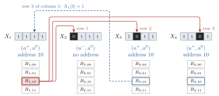
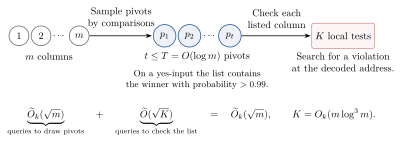

<!-- passage:front -->
# How many bits must an algorithm read?

*OpenAI’s nearly quartic separation between randomized and quantum queries*

Written by AI systems under the direction of Will Cook · November 2026

**About this paper.** AI systems wrote this paper, its two companion texts and the Lean development, under the direction of Will Cook. No human expert has reviewed them, and no person has checked that the Lean statements say what OpenAI's paper says; AI agents made that comparison. The separation theorem, its construction and its proof are OpenAI's ([OpenAI 2026](#cite-OpenAI2026)).

OpenAI recently constructed total Boolean functions whose bounded-error randomized query complexity is almost the fourth power of their quantum query complexity ([OpenAI 2026](#cite-OpenAI2026), Theorem 1.1). Since Aaronson, Ben-David, Kothari, Rao and Tal had shown that the fourth power is always enough ([Aaronson et al. 2021](#cite-ABKRT2020)), this settles the largest possible gap between the two measures up to the $o(1)$ in the exponent. In this exposition we develop OpenAI's construction and both of its query bounds from a four-column table, working each new idea out on small numbers before stating it in general. We assume finite-dimensional linear algebra, conditional probability and asymptotic notation, and no prior knowledge of quantum algorithms. Sections 1–8 form one continuous argument; the appendices hold the longer calculations and the answers to the exercises. The [expert companion](/library/quartic/) gives a shorter route for specialists, and the [full proof reconstruction](/library/quartic/reconstruction/) contains every supporting proof.
<!-- /passage:front -->

# 1. Reading bits one at a time

<!-- passage:sec-1 -->

Does any column in this table have a one in every row?

|       | Column 1 | Column 2 | Column 3 | Column 4 |
|:------|:--------:|:--------:|:--------:|:--------:|
| Row 1 | 1 | 0 | 1 | 1 |
| Row 2 | 1 | 1 | 0 | 1 |
| Row 3 | 1 | 1 | 1 | 0 |
| Row 4 | 0 | 1 | 1 | 1 |

Read down column 1. Its first three numbers are ones, but the number in row 4 is zero. Columns 2, 3 and 4 also contain zeros, in rows 1, 2 and 3 respectively, so the answer is no. Now change the zero in row 4 of column 1 to a one. Column 1 has four ones, and the answer changes to yes.

Cover all sixteen numbers. You may name a row and a column and uncover the number written there. Each number is a *bit*, either zero or one, and reading the bit in one square of your choice costs one *query*. If you ask for row 2 of column 3, you get zero on either table, and you can cross out column 3. If you ask for row 4 of column 1, you get zero on the original table and one on the changed table, so one query in that square distinguishes the two tables. We think of the table as a memory that can only be read one bit at a time, and we count nothing except the reads ([de Wolf 2026](#cite-deWolf2026), sec. 2.4; [Buhrman and de Wolf 2002](#cite-BuhrmanDeWolf2002), sec. 3).

What if we move the zeros around before covering the numbers? Put a single zero in each column, choosing its row uniformly at random and independently in each column, and fill every other square with a one. Make a copy of the table, choose one of the four columns uniformly at random, and change its zero to a one in the copy. Suppose you read the four numbers across the top row of each table. You get different answers on the two tables precisely when the changed zero was in the top row, which happens with probability $1/4$. Reading the top two rows costs eight queries per table and raises the probability to $1/2$.

On a table with $m$ rows and $m$ columns, reading the first $h$ rows costs $mh$ queries and detects the change with probability $h/m$. Here we chose all the rows in advance. In Section 7 the algorithm may use every bit it has already read to choose its next square, and we will see that this does not help it much.
<!-- /passage:sec-1 -->

## 1.1 Quantum queries

<!-- passage:sec-1.1 -->

A quantum algorithm also reads the input through queries, but it may ask about many positions at once. We use only the following rules, all of which are standard ([de Wolf 2026](#cite-deWolf2026), sec. 1.2 and 2.4; [Buhrman and de Wolf 2002](#cite-BuhrmanDeWolf2002), sec. 3.3).

1. The *state* of the algorithm is a unit vector, one coordinate for each possible value of its registers. A coordinate is called an *amplitude*. Amplitudes may be complex numbers in general; every state in this paper has real amplitudes.
2. *Measuring* the state returns one register value, with probability equal to the square of its amplitude. Two states that differ only by an overall sign therefore give the same probabilities.
3. Between queries the algorithm may apply any length-preserving linear map that does not depend on the input. Such maps are free: we count only queries.
4. A query acts on all positions at once: the amplitude attached to position $j$ is multiplied by $(-1)^{x_j}$, where $x_j$ is the bit stored there. Section 5 shows how an ordinary bit query does this.

Here is the smallest example. Take two squares in column 1, row 1 and row 4, and write $x_1$ and $x_2$ for the bits stored there. We want to know whether these two bits agree. Prepare the unit vector $(1,1)/\sqrt 2$, whose first amplitude belongs to row 1 and second to row 4. One quantum query turns it into
$$
       \frac{1}{\sqrt2}\bigl((-1)^{x_1},(-1)^{x_2}\bigr).
$$
On the printed table the bits are $(1,0)$, so the vector is $(-1,1)/\sqrt2$, on the line through $(1,-1)$. After the change the bits are $(1,1)$, so it is $(-1,-1)/\sqrt2$, on the line through $(1,1)$. In fact every unequal pair gives the first line and every equal pair gives the second; the overall sign differs between $(0,0)$ and $(1,1)$, but by rule 2 it has no effect on a measurement. The two lines are perpendicular, so measuring in these two directions tells us with certainty, after one query, whether the bits agree. A classical algorithm that reads one of the two bits learns nothing about whether they agree: on uniformly random bits its answer is right with probability $1/2$, so even allowing error $1/3$ it needs both reads.

This example is exact. In the rest of the paper both kinds of algorithm may err, with probability at most $1/3$ on each input, and repetition reduces the error further at a small cost in queries.
<!-- /passage:sec-1.1 -->

## 1.2 How far apart can the two costs be?

<!-- passage:sec-1.2 -->

Let $f$ be a yes-or-no question about a string of bits. We call $f$ *total* if every string of the specified length has an answer. Write $R(f)$ for the least number of queries sufficient for a randomized classical algorithm to answer $f$ correctly with probability at least $2/3$ on every string. That number limits the queries on every run, including runs on which the algorithm errs. Define $Q(f)$ by the same requirements for a quantum algorithm. Computation between queries is free in both models.

For the question "does any of these $n$ bits equal one?" a classical algorithm needs about $n$ queries, while Grover's search algorithm needs only about $\sqrt n$ ([Grover 1996](#cite-Grover1996); [Boyer et al. 1998](#cite-BBHT1998)). Thus $R$ can be the square of $Q$. For almost twenty years this was the largest known gap for total functions, and the table below records how the exponent has grown since. Aaronson, Ben-David, Kothari, Rao and Tal showed that the fourth power is an upper bound for every total function, building on Huang's proof of the sensitivity conjecture, and they conjectured that the cube is the true answer ([Aaronson et al. 2021](#cite-ABKRT2020), Conjecture 2; [Huang 2019](#cite-Huang2019)).

| Best total-function separation | Construction |
|:--|:--|
| $R\approx Q^2$ | Search for a one; Grover ([1996](#cite-Grover1996)) |
| $R\approx Q^{5/2}$ | Ben-David ([2015](#cite-BenDavid2015)); cheat sheets, Aaronson, Ben-David and Kothari ([2016](#cite-ABK2016)) |
| $R\ge Q^{8/3-o(1)}$ | Tal ([2020](#cite-Tal2020)) |
| $R\ge Q^{3-o(1)}$ | Bansal and Sinha ([2021](#cite-BansalSinha2021)); independently Sherstov, Storozhenko and Wu ([2023](#cite-SSW2023)) |
| $R\ge Q^{4-o(1)}$ | OpenAI ([2026](#cite-OpenAI2026)) |
| Upper bound $R=O(Q^4)$ for all total $f$ | Aaronson, Ben-David, Kothari, Rao and Tal ([2021](#cite-ABKRT2020)) |

OpenAI proved that the cube is not enough: for each power $\alpha<4$, the ratio of $R(f)$ to $(1+Q(f))^\alpha$ can be arbitrarily large ([OpenAI 2026](#cite-OpenAI2026), Theorem 1.1). Aaronson, Ben-David and Kothari call the infimum of the powers $\alpha$ for which $R(f)=O(Q(f)^\alpha)$ holds for all total $f$ the *critical exponent* of $R$ relative to $Q$ ([Aaronson et al. 2016](#cite-ABK2016), sec. 2). OpenAI's theorem and the upper bound together show that it is exactly four. This is what *nearly quartic* means here.
<!-- /passage:sec-1.2 -->

## 1.3 Where a fourth power could come from

<!-- passage:sec-1.3 -->

OpenAI's functions have a parameter $m$, the number of columns in a board like the one above, and a fixed integer $k\ge2$. Ignoring factors of $\log m$, the quantum algorithm uses about $\sqrt m$ queries, while every randomized algorithm needs about
$$
\underbrace{m}_{\text{possible winning columns}}\times\underbrace{m^{1-1/k}}_{\text{reads to learn one hidden address}}=m^{2-1/k}.
$$
As $k$ grows, $m^{2-1/k}$ approaches $m^2=(\sqrt m)^4$. The rest of the paper has to answer three questions.

1. Why must a classical algorithm pay for addressing many possible columns, about $m$ of them, each at a cost of about $m^{1-1/k}$? (Section 7.)
2. How can quantum comparisons pick out a few candidate columns with only about $\sqrt m$ queries? (Sections 3 and 4.)
3. How can a candidate's certificate be checked without destroying this advantage? (Sections 5 and 6.)

Two deep results enter from outside, and we state rather than prove them.

| Ingredient | Treatment here |
|:--|:--|
| The total function and its winning condition | Defined and explained (Section 2) |
| Comparisons and the weighted tournament | Developed in full (Sections 3–4) |
| The quantum address decoder | Worked on examples (Section 5) |
| Exact certification by local tests | Explained (Section 6, Appendix A.4) |
| The adaptive classical reduction | Developed in full (Section 7, Appendix B) |
| Classical hardness of the address question | Imported from Bansal and Sinha ([2021](#cite-BansalSinha2021)) |
| The universal upper bound $R=O(Q^4)$ | Imported from Aaronson, Ben-David, Kothari, Rao and Tal ([2021](#cite-ABKRT2020)) |
<!-- /passage:sec-1.3 -->

# 2. The enlarged board

<!-- passage:sec-2 -->

Return to the table after we changed column 1. Someone who wants to show you that columns 2, 3 and 4 each contain a zero can tell you exactly where to look: for column 2 read row 1, for column 3 read row 2, and for column 4 read row 3. In OpenAI's construction these row numbers are written beside column 1, as further bits of the input. Whoever filled in the input was free to give the wrong rows, so the row numbers are evidence to be checked. They are not trusted advice from outside.

This changes the question. We are now building a *new* total Boolean function, whose input consists of the table together with extra bits, and whose answer depends on all of them. That is allowed: a separation theorem asks only that *some* total function have the stated query complexities. Both kinds of algorithm receive the same enlarged input, and the difficulty for each is to find and check the relevant bits.
<!-- /passage:sec-2 -->

## 2.1 Pointers and addresses

<!-- passage:sec-2.1 -->

Suppose column 1 has the row numbers $1,2,3$ written beside it, one for each of columns 2, 3 and 4 in that order. Take the middle number, $2$. It tells us to look in row 2 of column 3, where the bit is $0$. The stored number $2$ is called a *pointer*. A row number between $1$ and $m$ occupies $\ell=\log_2m$ bits, so following a pointer costs $\ell+1$ queries: $\ell$ to read the row number and one to read the bit it names. On the four-row table this is $3$ queries.

In the full construction each column has many lists of pointers, stored in separate *cells*. Which cell counts is decided by the answers to some further yes-or-no questions about strings of bits stored in the same column. If the first answer is one and the second is zero, the relevant cell is the one labelled $10$, and this label is the column's *address*. Figure 1 draws the four bits of each column horizontally, in row order, and writes $B_{1,10}$ for the cell labelled $10$ in column 1.

An address question has a prescribed answer only on some bit strings, called its *promise*. Figure 1 uses three strings, $a^+, a^0, a^-$. The answer is one for $a^+$ and zero for $a^0$; the third string, $a^-$, lies outside the promise and has no prescribed answer. Thus the pair $(a^+,a^0)$ in column 1 gives address $10$, while the pair $(a^-,a^0)$ in column 2 gives no address at all. Section 5 writes out the eight bits in each string and computes the answers.

**The pictures are smaller than the real construction.** Our boards use two address questions per column, so each column has $2^2=4$ cells. In OpenAI's family a column has $r=20\log_2m$ address questions and hence $2^r=m^{20}$ cells, and each address question is a string of $km$ bits. All the rules below are the same; Section 5.4 explains why so many questions are needed. The whole input then has $n=O_k(m^{22}(\log m)^3)$ bits ([Appendix A.4](#exact-certification)). The number $m$ counts columns, and both query bounds concern this same $n$-bit input.
<!-- /passage:sec-2.1 -->

## 2.2 The function, in one place

<!-- passage:sec-2.2 -->

We use *column string* for the $m$ bits $X_i$ of column $i$ and *column* for everything stored in column $i$. The table below separates what the input stores from what an algorithm can only compute from it.

| Stored in column $i$ | Size | Role |
|:--|:--|:--|
| Column string $X_i$ | $m$ bits | Must be all ones for $i$ to win |
| Address inputs $A_{i,1},\ldots,A_{i,r}$ | $r$ strings of $km$ bits | Their answers name the relevant cell |
| Cells $B_{i,s}$, one for each $s\in\{0,1\}^r$ | $(m-1)\ell$ pointer bits and $rS$ transcript bits each | Proposed evidence: pointers and proposed calculation steps |

| Computed, never stored | Defined when |
|:--|:--|
| The true address $s_i=(P(A_{i,1}),\ldots,P(A_{i,r}))$ | Every $A_{i,h}$ lies in the promise |
| An estimated address | Produced by an algorithm, possibly wrong |
| Whether a transcript is correct | Always |
| Whether column $i$ wins | Always |

Here $P(U)$ denotes the prescribed answer of the address question on a promised string $U$, and $S$ is the number of gates in a fixed circuit for $P$, described in Section 6. A diagram may write a true address above a cell, but that label is our knowledge; an algorithm has to obtain it.

To obtain a yes answer on the enlarged board, we need a column whose evidence is complete and correct. We call column $i$ a *winning column* if all four of the following hold.

1. Its column string is all ones.
2. Every address input $A_{i,h}$ lies in the promise, so the true address $s_i$ is defined.
3. The cell $B_{i,s_i}$ contains the correct output bit of every gate of the circuit, for each address input.
4. For every other column $j$, the pointer for $j$ stored in $B_{i,s_i}$ names a row where $X_j$ has a zero.

The answer on the board is one if some column wins and zero otherwise. The contents of the cell $B_{i,s_i}$ are called the column's *certificate*. There can be at most one winning column: if two column strings consisted entirely of ones, neither could contain the zero that the other's certificate must point to. This uniqueness is a consequence of the definition. Nothing about the input is assumed.

**From a partial question to a total function.** The address question has answers only on its promise, yet the board has an answer on every input. Three different things are going on, and it helps to keep them apart.

- *The promise of the address question* is the set of strings on which a decoder for that question must answer correctly. Outside the promise the decoder may return anything, and Section 5 shows that it does return some digit.
- *Condition 2 of the definition* refers to the promise, so a column with an off-promise address input cannot win. This is part of the definition of the total function. It restricts no input.
- *The hard inputs of Section 7* are drawn with every address input in the promise. That is a property of one probability distribution chosen for a proof.
<!-- /passage:sec-2.2 -->

# 3. Comparing two columns

<!-- passage:sec-3 -->

**What can we learn by following two pointers?** Compare column 1 with column 3 in Figure 1. In cell $10$ of column 1, read the row number stored for column 3. It is $2$, and row 2 of column 3 contains zero. Now read the row number stored for column 1 in *any* cell of column 3. Whatever row number we find there for column 1, the bit we read in column 1 will be one. In this comparison we return the number of the column that supplied the pointer to a zero, namely 1.

For any two columns we use the same rule. Follow one pointer in each direction. If exactly one of the two bits read is zero, return the number of the column in which that pointer was stored. If both bits are zero or both are one, return the smaller column number. We always run the comparison with the two column numbers in increasing order, so comparing $i$ with $j$ and comparing $j$ with $i$ are the same procedure. Comparing a column with itself returns "discard" without reading any pointer. Whenever we use the correct cell of a winning column, the comparison returns its column number, even if the cell we chose in the other column was wrong, and even if the other column has no address at all. In other words, only the winner's own address needs to be estimated correctly.

Could we declare a column the winner just because every comparison returns its number? In cell $10$ of column 1, change the pointer for column 2 from $1$ to $2$. Now we read row 2 of column 2, which contains one. We also read one in column 1, so the tie rule still returns 1. The comparisons with columns 3 and 4 give the same answers as before. Yet column 1's certificate now contains an incorrect pointer, and since the other three columns each contain a zero, the board's answer is no. The column strings and the comparison outcomes are unchanged, but the value of the function has changed. We can use comparisons to draw up a short list of columns, but we must still check the certificate of each column on the list.

**Question 6.** Suppose column $i$ wins and column $j$ has an address input outside the promise, so its estimated address is meaningless. Why does a comparison of $i$ and $j$ still return $i$ whenever the address of $i$ is estimated correctly? ([Answer](#answer-6).)

<!-- /passage:sec-3 -->

## 3.1 Why plain quantum search is too expensive

<!-- passage:sec-3.1 -->

One way to find the winner would be to search over all $m$ columns with Grover's algorithm, using "column $i$ wins" as the test. Checking that a given column wins means checking its $m$ string bits, its $m-1$ pointers and its transcripts. Section 6 shows that this takes about $\sqrt m$ queries, up to logarithmic factors. Inside a quantum search over $m$ columns, each test is run on the order of $\sqrt m$ times, so the total cost would be about
$$
\underbrace{\sqrt m}_{\text{search over columns}}\times\underbrace{\sqrt m}_{\text{check one column}}=m.
$$
The classical cost we are aiming for is about $m^{2-1/k}$, which is less than $m^2$. A quantum algorithm with $m$ queries would therefore give a separation with exponent below two.

OpenAI's algorithm avoids paying for a full check inside the search. It uses comparisons, each costing only a few queries, to produce a short list, and it checks only the columns on the list.

Ignoring logarithmic factors and keeping $k$ fixed, the costs are
$$
\begin{array}{ll}
\text{compare two columns} & \approx 1,\\
\text{produce a list of } O(\log m) \text{ candidates from comparisons} & \approx \sqrt m,\\
\text{check one listed candidate} & \approx \sqrt m,\\
\text{check every listed candidate} & \approx \sqrt m.
\end{array}
$$

The two expensive tasks happen one after the other, so their costs add. We need to identify a few plausible columns using operations much cheaper than a full check.
<!-- /passage:sec-3.1 -->

## 3.2 Comparisons need not be consistent

<!-- passage:sec-3.2 -->

**Which columns should go on the list?** Draw an arrow from $i$ to $j$ if comparing those columns returns $i$. In Figure 2, the pointer from column 2 to column 3 names row 2, where the bit is zero. The return pointer also names row 2, but in column 2 the bit in that row is one. Hence the arrow from 2 to 3. Comparing 3 with 4 returns 3, and comparing 4 with 2 returns 4. These three arrows form a cycle, so we cannot sort the columns in an order that agrees with every comparison. Quantum minimum finding needs such an order ([Dürr and Høyer 1996](#cite-DH1996)), so it does not apply directly.

Choose one column uniformly at random and put its number on the list. Call this choice the *pivot*. For the next round keep only the other columns whose comparison with the pivot returns their own number. Take column 2 as the pivot. The arrows into 2 come from 1 and 4, so columns 1 and 4 remain. If we had picked 1, no column would remain, and the winning column would already be on the list. For pivots $1,2,3,4$ the numbers of columns left are $0,2,2,2$, with mean $(0+2+2+2)/4=3/2$.

Now take $m$ columns and suppose each pair has a fixed comparison result. If comparing $i$ and $j$ returns $i$, then $i$ remains when $j$ is the pivot, but $j$ drops out when $i$ is the pivot. This pair therefore contributes exactly one to the total number retained, summed over all pivots. There are $m(m-1)/2$ pairs and $m$ equally likely pivots, so on average $(m-1)/2$ columns remain: the list of survivors halves in expectation, whatever the comparisons are. In the quantum algorithm, however, two estimates of the same address can select different cells. What becomes of this count when a second comparison between the same two columns can return a different number?

<!-- /passage:sec-3.2 -->

# 4. A tournament with probabilistic comparisons

<!-- passage:sec-4 -->

Compare columns $2$ and $3$ twice on the same board. For some choices of pointers the first comparison might return $2$ and the second $3$. The bits on the board are fixed; what can differ between comparisons is the estimated address used to select a cell in each column. Write $a_{ij}$ for the probability that a fresh comparison of $i$ with $j$ returns $i$. The tournament uses only the following properties of the comparisons, which Section 5 will supply.

1. A comparison of two different columns returns one of them, and the procedure is the same in either order, so $a_{ij}+a_{ji}=1$ for $i\ne j$. A self-comparison discards, so $a_{ii}=0$.
2. If column $i^\star$ wins, then $a_{i^\star j}\ge1-\varepsilon$ for every $j\ne i^\star$.
3. For two columns that do not win, $a_{ij}$ may be any number in $[0,1]$, with no consistency between different pairs.
4. Fresh comparisons are independent of each other.

Property 3 is what rules out a simpler approach. A comparison with a fixed bias away from $1/2$ could be repeated and decided by majority vote, but here a losing pair may have $a_{ij}=1/2$ exactly, so repetition gives no reliable answer, and there need not be any underlying order to recover.
<!-- /passage:sec-4 -->

## 4.1 Weights

<!-- passage:sec-4.1 -->

Suppose the first pivot is column $2$ and a fresh comparison of columns $3$ and $2$ returns $3$ with probability $1/2$. Give column $3$ a *weight* of $1/2$. Suppose the next pivot is $4$ and a fresh comparison of $3$ with $4$ also returns $3$ with probability $1/2$. The chance of obtaining $3$ in *both* comparisons is $1/2\times1/2=1/4$, since the comparisons are independent, so the new weight of column $3$ is $1/4$. In general, the weight of a column is the probability that it would be kept after fresh comparisons with every pivot already listed. With fixed comparison results the weight is one for each column still kept and zero for each column discarded. After pivots $\rho_1,\ldots,\rho_n$ the weight of column $i$ and the total weight are
$$
w_i=\prod_{h=1}^{n}a_{i\rho_h},\qquad W=w_1+\cdots+w_m.
$$

**The algorithm never computes the weights.** Computing even one weight would require estimating comparison probabilities. The weights describe the probabilities of the following sampling procedure, and we use them only to analyse it. Draw a column number uniformly. Compare the drawn column afresh with every listed pivot, and accept the draw if every comparison returns the drawn number. A drawn pivot is discarded, because its self-comparison returns "discard". With column 2 the only pivot so far, each column has probability $1/4$ of being drawn, and the probability of drawing *and* accepting column 3 is $1/4\times1/2$.

| Column $i$ | Keep $i$ once drawn | Draw and keep $i$ |
|:----------:|:----------------:|:-------------------:|
| $1$ | $1$   | $1/4$  |
| $2$ | $0$   | $0$    |
| $3$ | $1/2$ | $1/8$  |
| $4$ | $1/4$ | $1/16$ |

The probabilities in the last column add to $7/16$, the probability of accepting a draw. Given that the draw was accepted, it was column $3$ with probability $(1/8)/(7/16)=2/7$, and the conditional probabilities for columns $1,2,3,4$ are $4/7,0,2/7,1/7$. With $m$ columns, the probability of drawing $i$ and accepting it is $w_i/m$ and the probability of accepting at all is $W/m$. So when $W>0$, an accepted draw is column $i$ with probability
$$
\Pr[\,i\mid\text{accepted}\,]=\frac{w_i}{W}.
\tag{4.1}
$$
When we append pivot $p$, keeping column $i$ in future requires one more comparison against $p$, so its new weight is $w_ia_{ip}$.
<!-- /passage:sec-4.1 -->

## 4.2 Three claims

<!-- passage:sec-4.2 -->

The tournament repeatedly draws the next pivot from the law (4.1). Its analysis consists of three claims.

**Claim 1. The expected total weight at least halves at every step.**

Fix the list so far. What is the expected total weight after choosing one more pivot when $W>0$? If the next pivot is $2$, an event of probability $w_2/W$, the new weight of column $3$ is $w_3a_{32}$. If the next pivot is $3$, an event of probability $w_3/W$, the new weight of column $2$ is $w_2a_{23}$. Multiplying each new weight by the probability of its pivot and adding gives
$$
\frac{w_2}{W}\,w_3a_{32}+\frac{w_3}{W}\,w_2a_{23}
=\frac{w_2w_3}{W}\,(a_{32}+a_{23})=\frac{w_2w_3}{W},
$$
because the comparison of $2$ and $3$ always returns one of them. The two unknown probabilities have cancelled. This is what forces the sampling rule. If pivot $j$ were drawn with probability $q_j$, the pair would contribute $w_3q_2a_{32}+w_2q_3a_{23}$, and for this to be the same whatever the bias of the pair we need $w_3q_2=w_2q_3$; drawing each pivot with probability proportional to its weight achieves this for every pair at once. Adding the products for all pairs, each pair counted once, gives
$$
\mathbb E[\,W_{\rm next}\mid w\,]
=\sum_p\frac{w_p}{W}\sum_i w_i a_{ip}
=\frac{\sum_{i<p}w_iw_p}{W}
=\frac{W^2-\sum_iw_i^2}{2W}.
\tag{4.2}
$$
The square of $w_1+\cdots+w_m$ counts every product of distinct weights twice and each square once. With four initial weights of one, the expected total is $(16-4)/8=3/2$, as for the fixed comparisons in Section 3. A second way to see the pairing: draw two pivots independently from the weights; the ordered pairs $(i,p)$ and $(p,i)$ are equally likely, and their comparison probabilities sum to one ([Ambainis et al. 2026](#cite-AIK2026v3), sec. 4 and 6.1).

When $W>0$, the sum of squares is nonnegative, so the expected total weight after the next pivot is at most $W/2$. Stop if $W=0$. The expected total weight starts at $m$, so after $T$ pivots it is at most $m/2^T$.

**Claim 2. An unlisted winner keeps most of its weight.** If column $i^\star$ wins, each comparison with it returns $i^\star$ with probability at least $1-\varepsilon$. While $i^\star$ is not yet on a list of at most $T$ pivots, its weight is therefore at least $(1-\varepsilon)^T\ge1-T\varepsilon$.

**Claim 3. After $T$ steps the winner is on the list with high probability.** Take $T=\lceil\log_2(1000m)\rceil$ and $\varepsilon=1/(1000T)$. The expected total weight after $T$ steps is at most $1/1000$, while an unlisted winning column would have weight greater than $1/2$. If the winner were missing with probability $d$, its weight alone would contribute at least $d/2$ to the expectation, so $d\le1/500$. These constants are chosen for simplicity: taking $T=\log_2m+c$ with a sufficiently large constant $c$ and $\varepsilon<1/(2T)$ gives a small constant error by the same argument. Other columns on the list may be losers, and we will check each listed column separately.

Claim 2 does a second job. While the winner is unlisted, $W>1/2$, so a draw is accepted with probability $W/m>1/(2m)$. The next section uses exactly this lower bound to keep the cost of sampling down. After the winner is listed, later behaviour of the sampler cannot remove it from the list.
<!-- /passage:sec-4.2 -->

## 4.3 Sampling the next pivot

<!-- passage:sec-4.3 -->

One draw is accepted with probability $q=W/m$, which can be as small as about $1/m$. Repeating independent draws until one is accepted would cost on the order of $m$ draws. A quantum algorithm can raise the acceptance probability to a constant with about $\sqrt m$ draws, using *amplitude amplification*, a generalization of Grover's search ([Brassard et al. 2002](#cite-BHMT2002)). Our use of it has an unusual requirement. Ordinary search is satisfied with *some* accepted column, but Claim 1 is a statement about drawing from the law (4.1). The amplified procedure must therefore return an accepted column with exactly the conditional probabilities $w_i/W$.

Assign one amplitude to each column number. For four columns, $(1/2,1/2,1/2,1/2)$ gives amplitude $1/2$ to each, and measuring returns each number with probability $1/4$. A *superposition* of column numbers is a linear combination of their basis vectors; the basis vector for column $2$ is $(0,1,0,0)$. A quantum operation acts linearly, so it suffices to specify its output on each basis vector.

Start with equal amplitudes on all $m$ column numbers. For each number $i$, compute fresh comparisons with all listed pivots, keeping every comparison's intermediate results in fresh registers. Compute one more bit, the *acceptance flag*, which is one exactly when every comparison returns $i$. Call this whole preparation $A$. Because the comparisons for column $i$ use separate fresh registers, their joint success probability is the product $w_i$, and the probability of measuring both number $i$ and flag one is $w_i/m$, summed over all intermediate results. We have not measured anything yet.

Suppose the fixed comparisons of Figure 2 give us the pivot list $2,4$. The acceptance flag is one only for column $1$. In column order the four amplitudes are $(1/2,1/2,1/2,1/2)$, with each column's comparison results and flag recorded in its own registers. Apply the following two operations before measuring.

1. Reverse the sign of each amplitude whose flag is one. The four amplitudes become $(-1/2,1/2,1/2,1/2)$.
2. Reflect the vector about the line through the prepared vector. For four equal starting amplitudes this replaces each current amplitude $x$ by $2\bar x-x$, where $\bar x$ is the mean of the four current amplitudes. That mean is $1/4$. The amplitude for column $1$ becomes $1/2-(-1/2)=1$, and the amplitude for each of columns $2,3,4$ becomes $1/2-1/2=0$.

Measuring now gives column $1$ with certainty. To implement the second reflection, undo $A$, reflect about the starting state in which all registers are zero, and apply $A$ again; keeping the intermediate comparison results is what makes $A$ reversible ([Brassard et al. 2002](#cite-BHMT2002), Lemma 1; [de Wolf 2026](#cite-deWolf2026), secs. 7.1–7.3).

For arbitrary weights, split the prepared vector into two orthogonal parts: one holds all amplitudes whose flag is one, the other all amplitudes whose flag is zero. Their squared lengths are the acceptance probability $q$ and the rejection probability $1-q$. When $0<q<1$, divide each part by its length to get unit vectors $g$ for acceptance and $b$ for rejection, so that the prepared state is $\sqrt q\,g+\sqrt{1-q}\,b$. Both operations act within the plane of $g$ and $b$ (Figure 3). After either operation, all amplitudes with flag one are still proportional to their original amplitudes, with one common multiplier. So conditional on measuring flag one, column $i$ still has probability $w_i/W$, which is the law (4.1). The algorithm stores the measured column number and prepares fresh registers at the next stage.

Each pair of reflections adds $2\theta$ to the angle, so after $u$ pairs the probability of measuring flag one is $\sin^2((2u+1)\theta)$. For small $q$, $\theta$ is approximately $\sqrt q$ radians, and the number of pairs needed to approach angle $\pi/2$ is of order $1/\sqrt q$. More pairs can overshoot: in the four-column example $\theta=\pi/6$, the first pair gives probability one, and the second gives $\sin^2(5\pi/6)=1/4$. When $q=0$ the flag is always zero, and when $q=1$ the prepared state already has flag one.

The algorithm does not know $q$, so it chooses the number of reflection pairs at random, sometimes using none. The [schedule in Appendix A.2](#amplification-schedule) uses $O(\sqrt m\log(1/\varepsilon))$ calls to $A$ or its inverse on every board, and when $q\ge1/(2m)$ the probability that it never sees flag one is at most $\varepsilon$ ([Boyer et al. 1998](#cite-BBHT1998), Lemma 2). At the first flag one, the algorithm appends the measured column number, whose conditional law is (4.1) for every choice of the number of pairs.

Stop when the schedule fails to obtain an accepted number, or when the list reaches length $T$. While the winner is missing, $q>1/(2m)$ by Claim 2, so whenever the schedule succeeds its number can serve as the draw of the ideal procedure. The chance of stopping on failure before listing the winner is at most $T\varepsilon$ over the $T$ stages, so the winner is omitted with probability at most $1/500+T\varepsilon$. Each preparation compares with at most $T$ pivots, so the whole list uses $O(T^2\sqrt m\log(1/\varepsilon))$ comparisons and reversed comparisons.

**Question 2 (conditional sampling and overshoot).** On the board with fixed arrows, suppose the first two pivots were $2,4$. Calculate the chance of sampling column $1$ after one amplification iteration, then after two. For the separate example in Section 4.1 the weights after pivot $2$ are $(1,0,1/2,1/4)$. Suppose the next pivot is $4$, and that the probabilities of keeping columns $1,2,3,4$ in a comparison with $4$ are $(1,3/4,1/2,0)$. For each column, find the probability of drawing it and keeping it after both comparisons. Among accepted draws, what fraction have each number? ([Answer](#answer-2).)

<!-- /passage:sec-4.3 -->

# 5. Computing an address

<!-- passage:sec-5 -->

The comparisons of Section 3 need a way to estimate a column's address. The address questions must do three jobs at once.

| Property of the address question $P$ | What it buys |
|:--|:--|
| A quantum algorithm answers it on the promise with $O_k(\log(1/\eta))$ queries and error $\eta$ | Cheap address estimates, hence cheap comparisons |
| Every randomized algorithm needs about $m^{1-1/k}$ queries on the promise | A hidden address that is expensive to learn classically |
| An exact circuit with $O_k(m\log^2m)$ gates decides whether a string is in the promise and, if so, its answer | Certificates that local tests can check (Section 6) |

The third property is easy to overlook. A promise problem with a large quantum advantage is not enough by itself: if checking its answer required a very large circuit, the certificate check would cost too much. OpenAI takes $P$ to be the $k$-block *Forrelation* problem of Aaronson and Ambainis ([Aaronson and Ambainis 2018](#cite-AA2018)), whose classical hardness, the second property, was proved by Bansal and Sinha ([Bansal and Sinha 2021](#cite-BansalSinha2021)). We now work the quantum side out on eight-bit strings.
<!-- /passage:sec-5 -->

## 5.1 The signed quantity

<!-- passage:sec-5.1 -->

In Figure 1, column $1$ has two address inputs, each a string of eight bits split into two blocks of four. The prescribed answer for $0111\;\;1000$ is one and the prescribed answer for $0100\;\;1000$ is zero, so the address is $10$. Here is how to calculate these digits.

Both strings have second block $1000$. Replace each zero in a block by $+1$ and each one by $-1$; this gives the sign vector $z_2=(-1,1,1,1)$. A query to a bit and a query to its sign read the same stored bit. Compare $z_2$ with each of the four fixed rows of signs below. Where two signs agree their product is $+1$, and where they disagree it is $-1$, so the dot product of a row with $z_2$ counts agreements minus disagreements.

| Row label | Signs in the row | Agreements | Disagreements | Dot product with $z_2$ |
| :--- | :--- | ---: | ---: | ---: |
| $00$ | $(1,1,1,1)$ | 3 | 1 | $2$ |
| $01$ | $(1,-1,1,-1)$ | 1 | 3 | $-2$ |
| $10$ | $(1,1,-1,-1)$ | 1 | 3 | $-2$ |
| $11$ | $(1,-1,-1,1)$ | 1 | 3 | $-2$ |

Divide each row of signs by two to form a matrix $H$; for example its row labelled $01$ is $(1,-1,1,-1)/2$. Each row has length one, and any two different rows agree in two signs and disagree in two, so their dot product is zero. Multiplying by $H$ therefore preserves length. This is the *normalized Walsh transform*, and $Hz_2$ is the column of dot products divided by two, $(1,-1,-1,-1)$.

Let $z_1$ be the sign vector of the first block, and define $\Phi=(z_1/2)\mathbin{\cdot}(Hz_2/2)$, the dot product of two unit vectors. The signs from $0111$ give $z_1=(1,-1,-1,-1)=Hz_2$, hence $\Phi=(1+1+1+1)/4=1$. The signs from $0100$ give $z_1=(1,-1,1,1)$ and $\Phi=(1+1-1-1)/4=0$. The signs from $1000$ give $z_1=-Hz_2$ and $\Phi=-1$. In general $\Phi$ measures how well the first block is aligned with the Walsh transform of the second ([Aaronson and Ambainis 2018](#cite-AA2018), sec. 1.1.1 and 3.2).

For two blocks, set $\delta=2^{-10}$. The prescribed digit is one when $\Phi\ge\delta$ and zero when $|\Phi|\le\delta/2$; every other value of $\Phi$ lies outside the promise (Figure 4). The promise is one-sided: a value $\Phi\le-\delta$ is as far from zero as $\Phi\ge\delta$, yet it lies outside the promise.

| Eight input bits | Signed quantity $\Phi$ | Prescribed address digit |
| :--- | ---: | :--- |
| $a^+=0111\;\;1000$ | $1$ | $1$ |
| $a^0=0100\;\;1000$ | $0$ | $0$ |
| $a^-=1000\;\;1000$ | $-1$ | undefined |

![The promise on the signed quantity $\Phi\in[-1,1]$, not to scale: the digit is zero on $[-\delta/2,\delta/2]$ and one on $[\delta,1]$, and every other value is outside the promise. The three example strings sit at $\Phi=-1,0,1$.](figures/fig7_promise.svg)
<!-- /passage:sec-5.1 -->

## 5.2 Reading the signs with quantum queries

<!-- passage:sec-5.2 -->

**How a query supplies the signs.** A bit query takes a position $j$ and an answer bit $b$. If the bit $x_j$ stored at $j$ is zero, the query leaves $b$ unchanged; if $x_j$ is one, it exchanges the answer-bit values $0$ and $1$. Starting with $b=0$ would give $x_j$ as the answer bit. Instead prepare the answer bit with amplitude $1/\sqrt2$ for zero and $-1/\sqrt2$ for one. Exchanging these two amplitudes negates the answer vector, so after the query the answer vector is $(-1)^{x_j}$ times the original. In a superposition of positions the same answer vector factors out, leaving the amplitude at each position $j$ multiplied by $(-1)^{x_j}$. This is rule 4 of Section 1.1 ([de Wolf 2026](#cite-deWolf2026), sec. 2.4).

For $a^+$, label the four positions within either block by $00,01,10,11$, and start with equal position amplitudes $u=(1,1,1,1)/2$. Query the signs in the second block, multiply the amplitude vector by $H$, then query the signs in the first block:
$$
\tfrac12(1,1,1,1)
\ \longmapsto\ \tfrac12(-1,1,1,1)
\ \longmapsto\ \tfrac12(1,-1,-1,-1)
\ \longmapsto\ \tfrac12(1,1,1,1).
$$
Apply $H$ a second time and measure the position label. Row $00$ of $H$ is $u$, so the amplitude for outcome $00$ is half the sum of the four amplitudes just before this last multiplication. For $a^+$ that sum is two, the amplitude for $00$ is one, and the measurement gives $00$ with certainty. In general the amplitudes just before the last multiplication are the coordinates of $Hz_2/2$ multiplied by the signs in $z_1$, and half their sum is $\Phi$. Hence the probability of measuring position $00$ is $\Phi^2$. The multiplications by $H$ cost no queries, so one trial uses two queries.

For $a^0$ the measured position can never be $00$. For $a^-$ the amplitude for $00$ is $-1$, so $00$ occurs with certainty, just as for $a^+$: by rule 2 of Section 1.1 the measurement sees $\Phi^2$ and cannot tell the sign. Thus even measuring $00$ with certainty does not show that an address digit is defined. Section 6 returns to this problem.

**Projection check.** Convert each bit of $1111\;\;1000$ to its sign. Calculate $\Phi$, then the probability of measuring the first position after the final Walsh transform. ([Answer](#answer-projection).)

<!-- /passage:sec-5.2 -->

## 5.3 The real decoding problem

<!-- passage:sec-5.3 -->

The extreme examples have $\Phi=\pm1$, so a single trial is decisive. The promise only guarantees $\Phi\ge\delta$ on a one-input, so for two blocks a one-input gives $00$ with probability at least $\delta^2=2^{-20}$, while a zero-input gives it with probability at most $\delta^2/4=2^{-22}$. The decoder therefore repeats the trial independently and returns one when the fraction of trials giving $00$ is at least $\delta^2/2$. With
$$
\rho=\left\lceil16\cdot2^{10k}\ln(1/\eta)\right\rceil
$$
trials the error is at most $\eta$ ([Appendix A.3](#decoder-repetitions)). For fixed $k$ this is $O_k(\log(1/\eta))$ queries, independent of $m$, but the factor $2^{10k}$ shows how strongly the cost depends on $k$. That dependence is harmless here because $k$ is fixed before $m$ grows. On inputs outside the promise the decoder still returns a digit within the same number of queries.
<!-- /passage:sec-5.3 -->

## 5.4 More blocks, and more address questions

<!-- passage:sec-5.4 -->

**From two blocks to $k$ blocks.** At full size an address input has $k$ blocks of $m=4^t$ bits each, $t\ge1$. The $m$ position labels have $2t$ binary digits, and the entry of the Walsh matrix in row $a$ and column $b$ is $H_{ab}=(-1)^{a\cdot b}/\sqrt m$, negative when an odd number of bit positions contain a one in both $a$ and $b$; for $m=4$ this gives the matrix above. Start with position amplitudes $u=(1,\ldots,1)/\sqrt m$, query the blocks in turn from last to first, multiplying by $H$ between queries, and apply $H$ once more at the end. Writing $D_j$ for the diagonal matrix of signs from block $j$, the amplitude of the all-zero position is
$$
\Phi=u^{\mathsf T}D_1H D_2H\cdots H D_k u .
\tag{5.1}
$$
This is the $k$-block *Forrelation* quantity ([Aaronson and Ambainis 2018](#cite-AA2018), sec. 3.2, Figure 1). The promise uses $\delta=2^{-5k}$, and one trial costs $k$ queries. Adding blocks keeps the quantum cost independent of $m$ for fixed $k$, while Bansal and Sinha's classical lower bound grows to about $m^{1-1/k}$; this is what the parameter $k$ is for. The exact circuit grows only by a factor depending on $k$ (Section 6).

**Why the number of address questions is logarithmic.** A column has $r=20\log_2m$ address inputs, giving $2^r=m^{20}$ cells. Two requirements meet here. Section 7 shows that a classical algorithm guessing a whole address succeeds with probability about $(2/3)^r$; with $r$ a multiple of $\log m$ this is an inverse polynomial in $m$, small enough to survive a union bound over all the queries. At the same time $2^r$ stays polynomial in $m$, so the input stays polynomial in size. The constant $20$ is generous slack.

**From digits to a comparison.** Estimate each digit with error $\varepsilon/r$; if all $r$ address inputs lie in the promise, the whole address is wrong with probability at most $\varepsilon$. To compare columns $i$ and $p$, estimate both addresses, read the $\ell$ bits of the pointer for $p$ in the selected cell of $i$, read the string bit it names in column $p$, and do the same in the reverse direction. If $i$ wins and its address is estimated correctly, the comparison returns $i$ whatever happens in column $p$, so $a_{ip}\ge1-\varepsilon$, as Section 4 required. Inside the quantum search, each trial keeps its position label in its own register, and all intermediate values are retained so that the whole comparison can be run backwards. A comparison or its inverse costs $O_k(r\log(r/\varepsilon)+\ell)$ bit queries. Arrays indexed by several partial-function answers come from the cheat sheets of Aaronson, Ben-David and Kothari ([Aaronson et al. 2016](#cite-ABK2016), sec. 3.1), and pointers to zeros come from the pointer functions of Göös, Pitassi and Watson and of Ambainis et al. ([Göös et al. 2018](#cite-GPW2018); [Ambainis et al. 2017](#cite-ABBLSS2017)); OpenAI puts such an array and its pointers in every column ([OpenAI 2026](#cite-OpenAI2026), sec. 2).

<!-- /passage:sec-5.4 -->

# 6. Checking a certificate exactly

<!-- passage:sec-6 -->

The quantum measurement gives the same position label on $a^+$ and $a^-$, although only $a^+$ has prescribed digit one. To check that a digit is defined we compute $\Phi$ exactly. The Walsh sums use only additions and subtractions, and all denominators are known powers of two, so integer comparisons decide both thresholds. We record two output bits. The *domain bit* is one when $\Phi$ satisfies either promise inequality and zero otherwise. The *value bit* is the prescribed digit on the promise and zero outside it. Thus the pair (domain bit, value bit) is $(1,0)$ for $a^0$ and $(0,0)$ for $a^-$.

**Circuits and transcripts.** The exact calculation can be written as a Boolean *circuit*, an ordered list of gates, each taking at most two bits from the input or from earlier gates and computing one output bit. A *transcript* lists a proposed output bit for every gate, in order. To check one gate, read its listed output, and read each of its inputs, either from the address input itself or from the listed output of the earlier gate. If every gate passes this local test, then by induction along the list every listed bit is the true value; if some listed bit is wrong, the first wrong one belongs to a gate whose inputs are all correct, so that gate's test fails.

**A fragment of the real calculation.** The circuit computes the Walsh transform of a block by the fast method: at each stage it replaces pairs of numbers by their sum and difference. For the block $1000$ with signs $z_2=(-1,1,1,1)$, the two stages are
$$
\begin{aligned}
(-1,1,1,1)&\ \longmapsto\ (-1+1,\,-1-1,\,1+1,\,1-1)=(0,-2,2,0)\\
&\ \longmapsto\ (0+2,\,-2+0,\,0-2,\,-2-0)=(2,-2,-2,-2),
\end{aligned}
$$
which is the column of dot products in Section 5.1. Each sum or difference is a small block of gates acting on the binary digits of its two integers, and the transcript records all of their outputs. Suppose a dishonest transcript records $+2$ instead of $-2$ for the second entry after the first stage. The gates computing $-1-1$ read correct inputs, so the first wrong digit is exposed by the local test of the gate that produced it. The same holds for any single altered bit anywhere in the transcript.

**The size of the circuit.** For $k$ blocks of $m$ bits, the circuit performs $k-1$ fast Walsh transforms, each with $\log_2m$ stages of $m$ additions or subtractions, on integers of $O(k\log m)$ bits, together with sign changes and a final comparison with the thresholds. Hence
$$
S=\underbrace{O_k(m\log m)}_{\text{additions}}\times\underbrace{O_k(\log m)}_{\text{gates per addition}}=O_k(m\log^2m),
$$
the third property in Section 5. [Appendix A.4](#exact-certification) gives the exact integer tests.

**The promise matters.** Change the four column strings to $0111,1111,1011,1101$ and give the now all-one column $2$ the address inputs $(a^-,a^0)$, whose exact (domain, value) outputs are $(0,0)$ and $(1,0)$. In every cell of column $2$ store the exact gate outputs for those two inputs and pointers to zeros in columns $1,3,4$. Consider the cell labelled $00$. The two value bits are zero and zero, matching the cell label, but the domain bit for $a^-$ is zero. The all-one column has an undefined first address digit, every other column contains a zero, and the board's answer is no. Condition 2 of Section 2.2 is doing its work.

**Question 1 (promise certification).** For the all-one column $2$ in this example, consider each of the four possible cell labels. For each label, which recorded domain bits are zero and which recorded values differ from the digits of that label? ([Answer](#answer-1).)

For each listed column number, estimate the address afresh. Decode and measure the address $s$, then check the column at that fixed cell. There is one test for a one at each of the $m$ positions of the column string, one test for a zero at each of the $m-1$ pointer destinations, and for each of the $r$ transcripts one test per gate and two tests on the circuit outputs: the domain bit must be one, and the value bit must equal the corresponding digit of $s$. In all there are
$$
K=m+(m-1)+r(S+2)=O_k(m\ell^3)
$$
tests. A pointer test reads $\ell$ pointer bits and one string bit, and every other test reads at most three bits. If at least one test fails, a uniformly chosen test fails with probability at least $1/K$. Applying the search of Section 4.3 to test numbers, with flag one for a failed test, finds a failure with probability at least $1-\varepsilon$ using $O(\sqrt K\log(1/\varepsilon))$ test evaluations. The search is one-sided: if every test passes, the flag is never one, so a correct certificate is never rejected.

Return one for the whole board if at least one listed column shows no failure. On a board with no winning column, every listed column has a failing test at every cell its estimated address can select, so over at most $T$ searches the chance of returning one is at most $T\varepsilon$. On a board with a winning column, the winner is omitted from the list with probability at most $1/500+T\varepsilon$, its address is estimated wrongly during verification with probability at most $\varepsilon$, and if both go well all its tests pass. Both error probabilities are far below $1/3$.

**The quantum cost.** For fixed $k$, building the list costs about $\sqrt m$ comparisons, each costing a power of $\log m$ in bit queries. Checking costs about $\sqrt K\approx\sqrt m$ bit queries per listed column, up to powers of $\log m$, and at most $T=O(\log m)$ columns are listed. Hence $Q(F_{k,m})=\widetilde O_k(\sqrt m)$, where $F_{k,m}$ denotes the Boolean function on these boards and the tilde hides powers of $\log m$. [Appendix A.1](#quantum-query-count) counts the logarithmic factors.
<!-- /passage:sec-6 -->

# 7. Why a classical algorithm needs about $mL$ queries

<!-- passage:sec-7 -->

The quantum algorithm locates and checks a certificate with about $\sqrt m$ queries. We now show that a randomized algorithm needs about $mL$ queries, where $L=\lfloor m^{1-1/k}/(\log_2m)^2\rfloor$ is a little below the classical cost of one address digit. It suffices to describe two random boards, one with answer $0$ and one with answer $1$, and to show that any algorithm with fewer queries rarely behaves differently on them, since an algorithm with error at most $1/3$ must behave differently with probability at least $1/3$. The whole argument is the following bound. For an algorithm with at most $G$ queries,
$$
\Pr[\text{the two runs differ}]
\le
\underbrace{\frac{4G}{m^2}}_{\text{find the erased zero}}
+
\underbrace{\frac{G}{mL}}_{\text{read the planted column heavily}}
+
\underbrace{G\Bigl(\frac23\Bigr)^r}_{\text{guess its address while light}}.
\tag{7.1}
$$

The idea behind the three terms is as follows. The two boards differ in one column, chosen uniformly and independently, and the algorithm does not know which. It can notice the difference by reading the one bit of that column's string that changed, which is the first term. Otherwise it must query a bit in the right cell of that column, and naming the right cell means naming the right address. An algorithm can invest enough reads to understand a few columns' addresses, but each column's address inputs are independent of every other column's, so learning one address says nothing about another. To be confident of reaching the planted cell it would need to invest about $L$ reads in a constant fraction of all $m$ columns. If it invests heavily in few columns, the planted column is unlikely to be one of them, which is the second term. In the remaining columns, a query to the right cell is a lucky guess of the whole address, which is the third term. With $G=\lfloor mL/100\rfloor$ the sum is below $1/3$.
<!-- /passage:sec-7 -->

## 7.1 Two boards

<!-- passage:sec-7.1 -->

How many ordinary queries would it take to find the winning certificate? Return to the table at the start of Section 1. Reading down its columns gives $1110,0111,1011,1101$. Put address strings in the promise beside each column and fill every cell with zeros. This is the upper board in Figure 7; each column contains a zero, so the answer is $0$. Copy the board and change the fourth bit of column $1$ from $0$ to $1$. The answers to the two address questions in that column are $1$ and $0$, so in the cell labelled $10$ write the output of every gate for each of the two address inputs, and write row number $1$ for column $2$, row $2$ for column $3$ and row $3$ for column $4$. Each of these rows contains a zero, and column $1$ now has four ones, so the answer on the copy is $1$.

To build the first board, start with $m$ columns of $m$ ones. In each column independently choose one of its $m$ rows uniformly and replace the one there by a zero. Independently of the zeros, draw each of the $r$ address strings in each column independently from one distribution $\mu$ on promised strings, which Section 7.3 chooses. Set every pointer and transcript bit in every cell to zero; because the cells are blank, querying a cell on the first board reveals nothing about which cell is the right one. Every column string contains a zero, so the answer is $0$. Now draw a column number $I$ uniformly, independently of everything on that board. Copy the board, change the zero in column $I$ to one, and fill the cell at the true address of $I$ with correct gate outputs and with the row number of each other column's zero. The answer on the copy is $1$.

**The two runs agree until a changed bit is read.** Suppose the algorithm uses at most $G$ queries. Use the same random choices of the algorithm on both boards. With these choices fixed, the algorithm is a *decision tree*: each internal node names a bit position, the reply $0$ or $1$ selects one of two edges, and each leaf names an output. Starting from the same node, identical replies lead to the same next node, however the next query depends on the past. So the two runs can produce different outputs only after the run on the first board queries a bit that differs between the boards: the erased zero of column $I$ or a bit of the filled cell. It suffices to bound the probability of these queries on the first board. Some bits of the filled cell may happen to be zero on both boards; counting reads of any bit in that cell only overestimates.
<!-- /passage:sec-7.1 -->

## 7.2 Finding the erased zero

<!-- passage:sec-7.2 -->

Suppose on the upper board of Figure 7 we read row $1$ in each of columns $1,2,3$ and row $3$ in column $4$. In column order the four replies are $1,0,1,0$. If we now choose a column uniformly to change, changing column $2$ or $4$ alters a reply we read, and changing column $1$ or $3$ does not. Two of the four choices select a zero we have read. We can make the same count after *any* sequence of queries, even when each position is chosen from all earlier replies.

**Reading the erased zero.** In our four-column example the queries read two distinct zeros and hence detect the change for two of the four possible choices of $I$. In general, after a complete run on the first board let $Z$ count the columns in which a query read the zero of the column string. Among the $m$ choices for $I$, exactly $Z$ select such a column, so the conditional probability of reading the erased zero is $Z/m$, and averaging over boards gives $\mathbb E[Z]/m$. This step uses that $I$ is independent of everything read on the first board.

Choose a row in advance in each of four columns and read its bit, and let $Z$ count the zeros read. Each read finds a zero with probability $1/4$, so $\mathbb E[Z]=1$, and an independent uniform $I$ selects a discovered zero with probability $\mathbb EZ/4=1/4$. Now choose $I$ uniformly among the columns where a zero was found, falling back to a uniform choice if none was. Each column still has probability $1/4$ of being chosen, yet the chosen zero has been read whenever *any* zero was found, which happens with probability $1-(3/4)^4=175/256$. A uniform marginal is not enough; the averaging above needs independence from the run.

Before any query has found the zero in a column's string, the row of that zero is uniform among the rows whose bits are unread. Moving it between those rows preserves all previous replies, including the replies from the blank cells. If fewer than $m/2$ different rows of the column have been read, at least $m/2$ rows can still contain its zero, so a query at a new row of that column finds the zero with probability at most $2/m$. Summing over at most $G$ queries, these discoveries number at most $2G/m$ in expectation. Every other discovery happens in a column where at least $m/2$ rows have already been read, and at most $G/(m/2)$ columns can have this many reads. Thus $\mathbb E[Z]\le4G/m$, and the probability of reading the erased zero is at most $4G/m^2$, the first term of (7.1).

**Question 3 (independent planting).** In the experiment in the box above, read instead the bits at two fixed distinct rows in each column. What is the probability of reading the zero in column $I$ when $I$ is chosen independently? What is it under the second selection rule? If later queries may depend on earlier replies, which identity still holds for an independent $I$? ([Answer](#answer-3).)

<!-- /passage:sec-7.2 -->

## 7.3 Reaching the filled cell

<!-- passage:sec-7.3 -->

**A query address is already a prediction.** To read a bit of the cell $B_{i,s}$, the algorithm must name $s$ *before* it receives the reply. If $s$ is the true address of column $i$, then at that moment the algorithm has produced all $r$ answers $P(A_{i,1}),\ldots,P(A_{i,r})$, whatever it then reads, and whether or not it computed them. In Figure 7, naming cell $10$ in column $1$ already gives both correct address digits, even if the algorithm merely guessed. The rest of the argument bounds how often an algorithm can make such a prediction.

**Heavy and light columns.** For each column, count the queries made to its $r$ address inputs over the *entire* run on the first board. Call the column *heavy on this run* if the count exceeds $L$, and *light* otherwise. Each heavy column uses more than $L$ of the $G$ queries, so at most $G/L$ columns are heavy, and the independent uniform column $I$ is heavy with probability at most $G/(mL)$, the second term of (7.1). It remains to bound queries to the true cell of a light column.

**Choosing the address strings.** Fix $k\ge2$. For all sufficiently large powers of four $m$ we have
$$
L=\left\lfloor\frac{m^{1-1/k}}{(\log_2 m)^2}\right\rfloor\ge1,
$$
and Bansal and Sinha's theorem gives $R(P)>L$ ([Bansal and Sinha 2021](#cite-BansalSinha2021), Theorem 1.3 and Corollary 1.4) (see [Appendix A.4](#exact-certification)). So every randomized algorithm with at most $L$ queries errs with probability greater than $1/3$ on some promised input. By finite minimax there is a single distribution $\mu$ on promised strings for which every deterministic tree with at most $L$ queries has success probability at most $2/3$; otherwise a random choice of trees would succeed with probability at least $2/3$ on every promised input, contradicting $R(P)>L$ ([Yao 1977](#cite-Yao1977)). We draw each address string independently from $\mu$.

Now fix *in advance* any column $i$ and query number $j\le G$. We build a *predictor* that has query access to $r$ independent strings drawn from $\mu$, playing the role of the address inputs of column $i$, and must output all $r$ answers. It generates every other part of the first board itself, independently, and replays the decision tree's queries before step $j$. Whenever the tree queries a bit of one of the $r$ target strings, the predictor reads that bit, unless this would be its read number $L+1$, in which case it stops and outputs the all-zero word. Every other reply comes from the generated board. At step $j$, if the tree names a bit in some cell $B_{i,s}$, the predictor outputs $s$ without reading anything; it outputs the all-zero word for any other query, or if the tree stops early. [Appendix B.2](#predictor-trace) follows this predictor through a four-query example.

On any run where $i$ is light and the $j$th query is in its true cell, the predictor has reproduced the whole history within its allowance of $L$ reads and outputs the true address. So the probability of these **two events together** is at most the predictor's probability of getting all $r$ answers right. The predictor may also succeed through its default output, which only helps this inequality.

We bound the probability that $i$ is light *and* its true cell is queried. Conditioning on lightness would change the distribution of the target strings. Take AND on the three equally likely promised inputs $01,10,11$. A single query to either bit settles the answer on one input and leaves an even choice on the other two, so the best one-query success is $2/3$. Now read the first bit, return $0$ if it is zero, and otherwise read the second bit and return it. This procedure is always correct, and it stays within one read only on input $01$. Its success *given* that it stays within one read is $1$, but the probability of success *and* staying within one read is $1/3$, below the one-query bound.

By the choice of $\mu$, $L$ reads of one string give the correct answer with probability at most $2/3$. For $r$ independent strings, the chance of getting *all* the answers right is at most $(2/3)^r$ when at most $L$ reads may be made in each string, counting repeated reads. Our predictor makes at most $L$ reads across all the strings, so it meets each separate limit. This multiplication needs a proof, because the predictor can switch between strings in response to earlier bits. The key fact is that for any fixed history of queries and replies, each string is restricted only by its own recorded bits, so the conditional distributions still factor. Reading a bit of one string can improve the best attainable success on that string for one reply, but not on average over the two replies, since taking that very query was already an available strategy. [Appendix B.1](#direct-product-proof) gives the proof ([Shaltiel 2003](#cite-Shaltiel2003); [Drucker 2012](#cite-Drucker2012), sec. 1.3 and Lemmas 3.1–3.2).

The product bound needs a limit on each string. Take two independent copies of AND on two fair bits; one read of a pair gives success at most $3/4$. With one read allowed from each pair, the chance of getting both answers right is at most $(3/4)^2=9/16$. With two reads to spend anywhere, read both bits of the first pair and guess zero for the second; this succeeds with probability $3/4$. The independence must also be joint: if $X,Y$ are independent fair bits and the predictor is told $X\oplus Y$, which is independent of each bit, it can output $(0,X\oplus Y)$ and be right with probability $1/2$, twice the success of a blind guess. In our predictor the generated data are independent of the whole tuple of target strings.

For a fixed column $i$ there are at most $G$ query times $j$, so a true-cell visit while $i$ is light has probability at most $G(2/3)^r$. Averaging over the uniform choice of $I$ gives the same bound, the third term of (7.1). Since $(2/3)^2<1/2$, taking $r=20\log_2m$ makes $(2/3)^r\le m^{-10}$, so this term is at most $Gm^{-10}$.
<!-- /passage:sec-7.3 -->

## 7.4 Putting it together

<!-- passage:sec-7.4 -->

We have covered every way for the two outputs to differ. For each fixed choice of the algorithm's coins:

| Event on the first board | Probability at most |
| --- | --- |
| A query reads the zero of column $I$. | $4G/m^2$ |
| More than $L$ queries read address inputs of column $I$. | $G/(mL)$ |
| At most $L$ such reads occur, and a query visits the true cell of $I$. | $G(2/3)^r$ |

Set $G=\lfloor mL/100\rfloor$. Since $L\le m$, the sum is at most $4/100+1/100+1/(100m^8)<1/3$, and averaging over the coins preserves this. An algorithm with error at most $1/3$ on every board must output $1$ on the second board with probability at least $2/3$ and on the first with probability at most $1/3$, so its two outputs differ with probability at least $1/3$. This contradicts the bound, and therefore
$$
R(F_{k,m})>\left\lfloor\frac{mL}{100}\right\rfloor.
\tag{7.2}
$$
The address length $r$ does not enter this bound beyond making the third term negligible; the scale $mL$ comes from the heavy-column term.
<!-- /passage:sec-7.4 -->

# 8. Why the exponent is four

<!-- passage:sec-8 -->

Could there be a constant $C$ such that $R(f)\le C(1+Q(f))^3$ for every total Boolean function $f$, whatever its input length? Try the boards with $k=3$. Ignoring logarithmic factors for a moment, their quantum cost is at most $\sqrt m$ and their classical cost is at least $m^{5/3}$. Cubing $\sqrt m$ gives $m^{3/2}$, and the ratio $m^{5/3}/m^{3/2}=m^{1/6}$ grows without bound. Restoring the logarithms divides this ratio by at most a fixed power of $\log m$, which still leaves a quantity tending to infinity. So every proposed cubic constant fails on large enough boards: the cubic conjecture already fails at $k=3$, where the separation exponent is $10/3$.

More generally, OpenAI constructs, for every fixed integer $k\ge2$ and all sufficiently large powers of four $m=4^t$, a total Boolean function $F_{k,m}$ with $Q(F_{k,m})=\widetilde O_k(\sqrt m)$ and $R(F_{k,m})=\widetilde\Omega_k(m^{2-1/k})$, using one circuit for both bounds ([OpenAI 2026](#cite-OpenAI2026), Theorem 1.1 and its proof). The quantum bound is Section 6, and the classical bound follows from (7.2), since $mL/100$ is $m^{2-1/k}$ up to a power of $\log m$. Explicit forms, a logarithmic exponent of six and a constant of $1/400$, are worked out in [Appendix A.1](#quantum-query-count) and in the expert companion; they come from this reconstruction rather than from OpenAI's paper, and the exact values play no role in the argument. Both the constant in the quantum bound and the threshold for $m$ may depend on $k$. We choose $k$ first and then increase $m$, so these dependencies stay fixed.

Measured in powers of $\sqrt m$, the classical exponent is $4-2/k$, since $(\sqrt m)^{4-2/k}=m^{2-1/k}$. Given any proposed $0\le\alpha<4$, choose an integer $k\ge2$ with $4-2/k>\alpha$, keep this $k$ fixed and increase $m$. In the ratio of the classical lower bound to the $\alpha$th power of the quantum upper bound the exponent of $m$ is now positive:
$$
\frac{R(F_{k,m})}{(1+Q(F_{k,m}))^\alpha}
\ \ge\ c_{k,\alpha}\,
\frac{m^{2-1/k-\alpha/2}}{(\log_2m)^{2+6\alpha}}
\ \longrightarrow\ \infty,
\tag{8.1}
$$
where $c_{k,\alpha}>0$ does not depend on $m$. Hence for every constant $C$ some total function violates $R(f)\le C(1+Q(f))^\alpha$.

| Fixed $k$ | Classical exponent $2-1/k$ | Separation exponent $4-2/k$ | Powers excluded by this family |
|:--:|:--:|:--:|:--|
| $2$ | $3/2$ | $3$ | every $\alpha<3$ |
| $3$ | $5/3$ | $10/3$ | every $\alpha<10/3$ |
| $4$ | $7/4$ | $7/2$ | every $\alpha<7/2$ |
| $5$ | $9/5$ | $18/5$ | every $\alpha<18/5$ |

The exclusion is strict because of the logarithmic losses: at $\alpha=4-2/k$ itself the power of $m$ in (8.1) is zero and only a power of $\log m$ remains.

**Question 5 (the power $3.5$).** Fix $k=4$. Which powers below four does this family exclude? Give a value of $k$ for which the calculation excludes $R(f)\le C(1+Q(f))^{3.5}$ itself. ([Answer](#answer-5).)

It remains to show that the power four suffices for *every* total Boolean function. Write $D(f)$ for the least worst-case number of queries of a deterministic algorithm that computes $f$ exactly. Aaronson, Ben-David, Kothari, Rao and Tal, building on Huang's sensitivity theorem, proved $D(f)=O(Q(f)^4)$ for total functions ([Aaronson et al. 2021](#cite-ABKRT2020); [Huang 2019](#cite-Huang2019)). A randomized algorithm may simply run the deterministic one, so $R(f)\le D(f)$. Together with the family above, this shows that the critical exponent of $R$ relative to $Q$ is exactly four.

Return to the four-column puzzle. Changing a single zero to one changes the answer, and the algorithm must discover where the change occurred. On the enlarged board, pointers and quantum comparisons let a quantum algorithm find a short list and check the certificates of the listed columns. A classical algorithm must instead find the erased zero or name the hidden certificate address, and hiding that address behind Forrelation makes its cost approach the fourth power of the quantum cost.

**Combined explanation.** Why is an all-one column with a valid certificate likely to be on the quantum list even if some trials produce no new pivot? On the classical side, explain how the proposed position of a cell query gives a prediction on the first board. Use the three terms of (7.1) to bound the probability of different outputs by $4c+c+c/m^8$ when the query budget is at most $c\,mL$. Which part of the proof that the critical exponent is four still needs a theorem about *all* total functions? ([Answer](#answer-combined).)

<!-- /passage:sec-8 -->

# Appendix A. Quantum implementation details

<!-- passage:sec-appendix-a -->

<!-- /passage:sec-appendix-a -->

## A.1 Counting the quantum queries

<!-- passage:sec-appendix-a.1 -->

We count calls to the bit oracle on the longest possible run of the algorithm in Sections 4–6, including all choices of the number of amplification iterations.

To evaluate the local tests on a superposition of test labels, compute each next input position reversibly and retain the earlier replies. To make a read active only on some branches, query $x_j$ into a temporary bit, conditionally copy it to the answer bit, then query $j$ again to clear the temporary bit; this uses two ordinary oracle calls, and on an inactive branch both bits are restored. Padding to a common number of these controlled reads gives a fixed cap even in superposition, and running the computation backwards restores the workspace. The tests therefore cost $O(\ell+1)$ bit queries per evaluation. [The controlled-read construction](https://github.com/wcook04/quartic-query-lean/blob/v1.0.2/docs/reasoning_record.md#AC-coherent) gives the gate sequence.

A comparison uses $O_k(r\log(r/\varepsilon))$ queries for its decoders and $O(\ell+1)$ for its pointers, including the constant overhead of a reversible implementation. Each stage of the tournament uses $O(\sqrt m\log(1/\varepsilon))$ preparations, each preparation makes at most $T$ comparisons, and there are at most $T$ stages, so the tournament makes $O(\sqrt m\,T^2\log(1/\varepsilon))$ comparisons. Verification makes at most $T$ fresh address decodings and, for each candidate, $O(\sqrt K\log(1/\varepsilon))$ test evaluations. Adding the bit queries gives
$$
O_k\!\left(\sqrt m\,T^2\log(1/\varepsilon)
 [r\log(r/\varepsilon)+\ell]
 +T[r\log(r/\varepsilon)+\sqrt K\log(1/\varepsilon)\ell]\right).
$$
The first term counts comparisons and the second verification. Here $r,T,1/\varepsilon=O(\ell)$ and $K=O_k(m\ell^3)$. For simplicity we enlarge the logarithms, bounding $\log(1/\varepsilon)=O(\ell)$, $\log(r/\varepsilon)=O(\ell^2)$ and $\sqrt K=O_k(\sqrt m\,\ell^2)$. This gives $O_k(\sqrt m\,\ell^6)$ for the tournament and $O_k(\sqrt m\,\ell^5)$ for verification ([the explicit count](https://github.com/wcook04/quartic-query-lean/blob/v1.0.2/docs/reasoning_record.md#upper-explicit-log6)), so
$$
Q(F_{k,m})\le C_k\sqrt m\,(\log_2m)^6.
$$
The sixth power is a convenient envelope, and its exact value plays no role. Combined with (7.2), and since for large $m$ rounding down to $L$ keeps at least half the unrounded value, one also gets $R(F_{k,m})\ge m^{2-1/k}/(400(\log_2m)^2)$. These explicit constants come from this reconstruction, not from OpenAI's paper.

<!-- /passage:sec-appendix-a.1 -->

## A.2 The amplification rotation and a finite schedule

<!-- passage:sec-appendix-a.2 -->

For $0<q<1$, write $A|0\rangle=\sin\theta\,g+\cos\theta\,b$ as in Section 4.3, where $A$ prepares the whole state: the column-number register, the comparison registers and the flag. To reflect about $A|0\rangle$, apply $A^{-1}$, reflect about $|0\rangle$, and apply $A$ again; retaining the decoder and pointer registers makes this inverse possible at the same query cost as $A$. In the ordered orthonormal basis $(g,b)$, the sign flip on success and the reflection about $A|0\rangle$ have matrices
$$
S=\begin{pmatrix}-1&0\\0&1\end{pmatrix},\qquad
R_{A0}=\begin{pmatrix}-\cos2\theta&\sin2\theta\\\sin2\theta&\cos2\theta\end{pmatrix},
$$
and their product is the rotation
$$
R_{A0}S=\begin{pmatrix}\cos2\theta&\sin2\theta\\-\sin2\theta&\cos2\theta\end{pmatrix},
$$
which sends $(\sin\theta,\cos\theta)$ to $(\sin3\theta,\cos3\theta)$. This is the rotation formula of Section 4.3. The component along $g$ changes only by a common scalar factor; given a successful measurement, the probabilities of the column numbers are still the squared coordinates in the direction $g$, summed over the other registers.

We need a bound on the number of queries even when $q$ is arbitrarily small, and a bound on failure when $q$ is at least a known threshold $\gamma$. Set $M=\lceil10/\sqrt\gamma\rceil$ and $N=\lceil\ln(1/\eta)/\ln(40/31)\rceil$. In each fresh trial use zero iterations with probability $1/2$, and otherwise choose $u$ uniformly from $0,\ldots,M-1$. Stop at the first acceptance, or after $N$ failures. Each trial uses at most $2M+1$ calls to $A$ or $A^{-1}$, so $N(2M+1)$ is a cap on every input.

To bound the failure probability, first suppose $\gamma\le q\le1/2$. Averaging the rotation formula gives ([Boyer et al. 1998](#cite-BBHT1998), Lemma 2)
$$
\frac1M\sum_{u=0}^{M-1}\sin^2((2u+1)\theta)
=\frac12-\frac{\sin(4M\theta)}{4M\sin(2\theta)}
\ge\frac12-\frac1{4M\sqrt{2\gamma}}\ge\frac9{20},
$$
since $\sin(2\theta)=2\sqrt{q(1-q)}\ge\sqrt{2\gamma}$. So the branch with random iterations alone contributes at least $9/40$ to the acceptance probability of a trial. If $q\ge1/2$, the zero-iteration branch contributes at least $q/2\ge1/4$. In either case, $N$ fresh trials all fail with probability at most $(31/40)^N\le\eta$. Given flag one, the column number has the law (4.1) on every trial, so the first accepted trial has this law too. If $q<\gamma$ the cap still holds, though the acceptance guarantee need not.

<!-- /passage:sec-appendix-a.2 -->

## A.3 Repeating the projection experiment

<!-- passage:sec-appendix-a.3 -->

For any requested error $0<\eta<1/2$, the experiment of Section 5 applies to every $k$. Each of the $k$ blocks supplies its signs in one query, and after the final Walsh matrix the first position is measured with probability $p=\Phi^2$. On the promise, either $p\ge c=\delta^2$ or $p\le c/4$. Start each trial in fresh registers and repeat independently
$$
\rho=\lceil16c^{-1}\ln(1/\eta)\rceil
$$
times. Let $Z$ count how often the measured position is the first one, and return one if $Z\ge\rho c/2$ and zero otherwise. Standard Chernoff bounds give the following.

| Promised case | Wrong decision | Tail bound used |
| --- | --- | --- |
| $p\ge c$ | $Z<\rho c/2$ | At most $\exp(-\rho c/8)$, hence at most $\exp(-\rho c/16)$. |
| $p\le c/4$ | $Z\ge\rho c/2$ | At most $\exp(-\rho c/16)$, by the upper tail at $p=c/4$ and monotonicity. |

Each error is at most $\eta$, and the cap is $k\rho=O_k(\log(1/\eta))$ on every input, where the subscript absorbs $c^{-1}=2^{10k}$. In a coherent comparison the trials run in separate registers on the same fixed input, and the resulting product state has the same joint outcome probabilities as independent measurements.

<!-- /passage:sec-appendix-a.3 -->

## A.4 Exact certification and the input size

<!-- passage:sec-appendix-a.4 -->

The factors $1/\sqrt m$ from the initial and final copies of $u$ and the $k-1$ factors $1/\sqrt m$ from the Walsh matrices give $\Phi=N/2^{t(k+1)}$ for an integer $N$. Since $m=4^t$ and $\sqrt m=2^t$, the test $\Phi\ge2^{-5k}$ is equivalent to $2^{5k}N\ge2^{t(k+1)}$, and the small-value test is $2^{5k+1}|N|\le2^{t(k+1)}$. This is why the construction uses powers of four: the denominators become powers of two and both thresholds become integer comparisons. Words of $O(k\log m)$ bits suffice, including the threshold shifts. The [circuit construction](https://github.com/wcook04/quartic-query-lean/blob/v1.0.2/docs/reasoning_record.md#forr_circuit) gives the arithmetic and the gate count.

**The small circuit.** The [explicit circuit for the four-column board](/library/quartic/reconstruction/#AC-example-tests) has $S=180$ non-input gates, so each candidate has $K=4+3+2(180+2)=371$ tests. (The reconstruction's board uses different address inputs, with $\Phi=\pm1/2$ instead of $\pm1$; the circuit computes the same promise and value on all eight-bit strings, so its counts apply to both examples.) In the circuit's zero-based numbering, write $x,y$ for input bits $6$ and $7$, the last two. Gates $1$ and $2$ compute $u=\neg x$, then $v=u\lor y$. On $a^+$ these two input bits are zero. To test gate $2$, read the recorded outputs $u$ and $v$ from the transcript and read $y$ from the address input itself. If $(u,y,v)=(1,0,0)$, the recorded $v$ is wrong, since $1\lor0=1$. Gate $178$ reports promise membership and gate $179$ the address digit. Every cell holds $6$ pointer bits and $360$ transcript bits, so with four cells in each of four columns the board has $4[4+16+4(6+360)]=5936$ input bits.

**Why the choice of $L$ in Section 7.3 works.** For fixed $k$, Bansal and Sinha's lower bound for this one-sided promise is at least a positive constant depending on $k$ times $m^{1-1/k}/(\log_2(km))^{1-1/k}$ ([2021](#cite-BansalSinha2021), Theorem 1.3 and Corollary 1.4). Dividing by $m^{1-1/k}/(\log_2m)^2$ gives a factor of order $(\log m)^{1+1/k}$, which tends to infinity and absorbs the constant.

**Input length.** A column contains $m$ string bits, $rkm$ address-input bits, and $2^r$ cells, each with $(m-1)\ell$ pointer bits and $rS$ transcript bits. The function therefore has $n=m\bigl[m+rkm+2^r((m-1)\ell+rS)\bigr]$ input bits, which is $O_k(m^{22}(\log m)^3)$ since $2^r=m^{20}$. Both query bounds concern this same $n$-bit function, with $m$ counting its columns.
<!-- /passage:sec-appendix-a.4 -->

# Appendix B. The classical reduction

<!-- passage:sec-appendix-b -->

<!-- /passage:sec-appendix-b -->

## B.1 The separate-cap product bound

<!-- passage:sec-appendix-b.1 -->

Suppose one input $U$ is drawn from a distribution $\mu$, and $\beta$ bounds the probability of computing $P(U)$ with at most $L$ bit queries. Draw $r$ independent inputs $U_1,\ldots,U_r$ from $\mu$. A single algorithm may interleave its reads in any order, but must respect the limit $L$ on each input on every run. We prove that its chance of producing the whole word $(P(U_1),\ldots,P(U_r))$ is at most $\beta^r$. The algorithm may also use random coins and other data drawn jointly independently of the inputs. The separately capped model is due to Shaltiel, and we follow Drucker's conditional-probability argument ([Shaltiel 2003](#cite-Shaltiel2003); [Drucker 2012](#cite-Drucker2012), sec. 1.3 and Lemmas 3.1–3.2).

Start with $P(x,y)=x\mathbin{\rm AND}y$, which equals one only on $11$. Give the four bit pairs equal probability and allow one query. If the first bit is zero, the answer is certainly zero; if it is one, the unread second bit is fair, so either guess succeeds with probability $1/2$. The best success is $(1+1/2)/2=3/4$. With two independent pairs and one read allowed from each, consider the first query, to the first pair. The best success still available for the second pair is $3/4$ in either case. After a zero reply the product of the two best probabilities is $1\cdot(3/4)$, and after a one reply it is $(1/2)(3/4)$. Their average is $9/16=(3/4)^2$.

For general $P$, fix all the coins and other independent data, leaving a deterministic tree. Fix a history $\tau$ of queries and replies with positive probability, and for each input $U_h$ let $E_h(\tau)$ be the set of values consistent with its recorded bits. A tuple in $E_1(\tau)\times\cdots\times E_r(\tau)$ reproduces the first reply, hence the same second query and reply, and so on to the end of $\tau$; conversely every tuple producing that history lies in this product. So conditioning on the history leaves independent inputs with laws $\mu(\cdot\mid E_h(\tau))$.

Write $V_h(\tau)$ for the best success on $U_h$ under this conditional law with its remaining queries, the original $L$ less the number already used on $U_h$. Suppose the next query reads $U_h$. Reading that bit and continuing optimally for each reply $b$ is one permissible strategy before the query, so
$$
\sum_b\Pr(b\mid\tau) V_h(\tau b)\le V_h(\tau).
$$
For every other input, the conditional law and the remaining allowance are the same before and after this query. Multiplying the inequality by the other $V$'s shows that the conditional expected product after one query is at most its current value. The initial product is at most $\beta^r$.

At a leaf the tree outputs a fixed word $s$. By the independence just proved, the conditional probability that $s$ is correct is $\prod_h\Pr(P(U_h)=s_h\mid\tau)$, and each factor is at most $V_h(\tau)$ because guessing $s_h$ is an available strategy. Averaging over leaves (there are at most $rL$ reads per run) and then over the coins and other data proves the bound. Return to [the end of Section 7.3](#light-column-sum).

<!-- /passage:sec-appendix-b.1 -->

## B.2 The predictor on a four-query example

<!-- passage:sec-appendix-b.2 -->

This example shows the bookkeeping of the predictor in Section 7.3: the decision tree's query count and the predictor's count of reads in the target strings advance separately. It says nothing about the hardness of Forrelation. To see both branches with only four input bits, replace Forrelation by parity, $a\oplus b$, which equals one when the two bits differ. The target column is column $2$, whose two address strings are the independent pairs $(a,b)$ and $(c,d)$ of fair bits, so its address is $(a\oplus b,c\oplus d)$. Allow the predictor one read in total from these four bits. It generates all other address strings and row bits itself and fills every cell with zeros. Write $B_{2,s}$ for the cell of column $2$ at label $s$, and $q$ for the predictor's count of target reads.

| Query number | Tree names | Predictor action |
| --- | --- | --- |
| $1$ | Row $1$, column $1$ | Supply the generated bit, $q=0$. |
| $2$ | $a$ | Read it, so $q=1$. |
| $3$, if $a=1$ | Row $2$, column $3$ | Supply the generated bit, $q=1$. |
| $3$, if $a=0$ | $c$ | Stop and output $00$ before reading $c$. |
| $4$, if $a=1$ | First domain bit in $B_{2,10}$ | Output $10$ before this read. |

On the $a=1$ branch, $10$ is correct exactly when $b=0$ and $c=d$, so this branch together with a correct label has probability $(1/2)(1/2)(1/2)=1/8$. On the $a=0$ branch the default $00$ is also correct when $b=0$ and $c=d$, contributing another $1/8$. The predictor therefore succeeds with probability $1/4$, whereas the probability that the tree stays within one target read and queries the true cell at time four is only $1/8$. The difference comes entirely from correct default guesses. For one fair pair, reading either bit leaves its parity uniformly random, so the product bound of Appendix B.1 is $(1/2)^2=1/4$. The [same four-query tree in the reconstruction](/library/quartic/reconstruction/#CL-simulator-example) numbers rows and columns from zero.

**Question 4 (two query counts).** In this example, change the $a=0$ branch so that query three names the first domain bit in $B_{2,00}$, and suppose the tree stops after that read. What is the probability that $a=0$ and this is the true cell? Including the $a=1$ branch, what is the probability that the tree queries the true cell at time three or four and uses at most one target read in the whole run? Repeat the latter calculation if the $a=0$ branch reads $c$ *after* the cell query. ([Answer](#answer-4).)

<!-- /passage:sec-appendix-b.2 -->

# Appendix C. Earlier constructions and related search problems

<!-- passage:sec-appendix-c -->

**Why balanced cheat sheets stop at a cube.** In the cheat-sheet construction ([Aaronson et al. 2016](#cite-ABK2016), sec. 3.1), each of the $n$ input bits of a partial function $g$ is replaced by the answer to its own AND–OR instance on $n^2$ bits, giving $n^3$ bits before certificates are added. In one instance, arrange the bits in $n$ rows of $n$ bits; its answer is $1$ exactly when every row contains a $1$. A $1$ is certified by the position of one $1$ in every row, and a $0$ by one row of zeros, so $n$ bit values suffice to verify each answer once their positions are given. Up to logarithmic factors, the composition and cheat-sheet argument then gives randomized lower bound $R(g)n^2$ and quantum upper bound $n$ when $Q(g)$ is polylogarithmic. Since $R(g)\le n$, this reaches at most a cubic separation. In OpenAI's construction an address input has about $m$ bits while the quantum search costs about $\sqrt m$, so the hardness of the partial function can contribute almost two powers of the quantum cost; the comparisons of Section 4 are what make the square-root search possible.

**Related search problems.** The search of Section 4 differs from quantum minimum finding, which uses an order ([Dürr and Høyer 1996](#cite-DH1996)), and from search with bounded-error tests for fixed Boolean answers ([Høyer et al. 2003](#cite-HMW2003)). Three comparisons can form a directed cycle, and the comparison model allows each of two columns to be returned with probability $1/2$, so declaring one outcome the correct one need not give success above $1/2$.

**Certificate complexity.** For a fixed input, its certificate size is the least number of bit positions one can specify so that every input agreeing there has the same value, and the certificate complexity is the largest such size. One might hope that a function with large certificate complexity automatically has large randomized query complexity. Ben-David and Kothari construct total functions whose randomized query complexity is smaller than their certificate complexity ([Ben-David and Kothari 2026](#cite-BDK2026), secs. 2–3), so the randomized lower bound here needs its own argument.
<!-- /passage:sec-appendix-c -->

# Appendix D. Answers to the exercises

<!-- passage:sec-appendix-d -->

**Projection check.** The Walsh sums for the second sign block are $(2,-2,-2,-2)$, and their dot product with the first sign block $(-1,-1,-1,-1)$ is $4$. So $\Phi=4/8=1/2$ and the probability is $\Phi^2=1/4$.

**[Question 1](#question-1).** All four bits in column $2$ are ones, its three pointers lead to zeros, and its transcripts contain the correct gate outputs. The domain bits are $(0,1)$, so the first membership test fails at all four labels. The recorded value bits are $00$, so each digit $1$ in the label gives one more failure. The failure counts at $00,01,10,11$ are $1,2,2,3$.

**[Question 2](#question-2).** On the fixed-arrow board the weights after pivot $2$ are $(1,0,0,1)$, and the probabilities of keeping each column against $4$ are $(1,0,1,0)$, leaving $(1,0,0,0)$. A single unamplified preparation succeeds with probability $q=1/4$, and every success returns column $1$, so $\theta=\pi/6$. One iteration gives $\sin^2(3\pi/6)=1$ and two give $\sin^2(5\pi/6)=1/4$. In the unequal-weight example the new weights are $(1,0,1/4,0)$. Dividing by four gives the probabilities of drawing and keeping each column, $(1/4,0,1/16,0)$, which add to $5/16$, so the conditional probabilities are $(4/5,0,1/5,0)$.

**[Question 3](#question-3).** Each zero lies in a read position with probability $2/4$. With independent selection, the selected zero was read with probability $\mathbb EZ/4=1/2$. Under the second rule, reading at least one zero suffices, which has probability $1-(1/2)^4=15/16$ because the rows are fixed and the zeros independent. For adaptive queries the identity $\mathbb EZ/4$ still holds for independent $I$: once the run on the first board is fixed, exactly $Z$ of the four choices of $I$ select a discovered zero.

**[Question 4](#question-4).** The label $00$ in the third query is the true address when $a=0,b=0,c=d$, with probability $(1/2)(1/2)(1/2)=1/8$, and if the tree stops then, it used one target read. The other branch gives a true-cell query at time four within the same allowance when $a=1,b=0,c=d$, also with probability $1/8$. The events are disjoint, so their union has probability $1/4$. If $c$ is read afterwards, the $a=0$ branch makes two target reads; the cell query still happened, but the run exceeds the allowance. Only the $a=1$ event counts, with probability $1/8$.

**[Question 5](#question-5).** At $k=4$ the exponent $4-2/k$ is $3.5$, so the ratio (8.1) diverges for every $\alpha<3.5$. At $\alpha=3.5$ the power $2-1/k-\alpha/2$ of $m$ is zero, leaving a reciprocal power of $\log m$. Choosing $k=5$ gives $2-1/5-3.5/2=1/20>0$, which excludes the power $3.5$.

**[Question 6](#question-6).** With the winner's correct cell, its pointer names a zero in the other column. Every pointer in the other direction, from any cell of the other column, names a row of the winner's column string, which is all ones. So exactly one of the two bits read is zero, and the comparison returns the winner. The other column's estimated address only decides which of its cells is read, and every choice reads a one.

**Combined explanation.** When the winner's own address is estimated correctly, its pointer names a zero in the other column, and every pointer in the reverse direction names a one, so the comparison returns the winner. After $T$ pivots other than the winner, its weight is still at least $(1-\varepsilon)^T\ge1-T\varepsilon>1/2$, while the expected total weight of the ideal procedure is at most $m/2^T$; this bounds the probability of missing it. Before it is listed, the sampler's acceptance probability is at least $1/(2m)$ and it fails to find a pivot with probability at most $\varepsilon$ per stage. Once listed, a column cannot be removed. In the classical simulation, stop at the cell query and output its label, or stop earlier with a default if another target read would exceed $L$; a query to the true cell of a light column is then a correct prediction. For $G\le c\,mL$ the three terms of (7.1) are at most $4cL/m$, $c$ and $c\,mL\,m^{-10}$, and since $L\le m$ they sum to at most $4c+c+c/m^8$. The constructed functions exclude every exponent below four, and the universal deterministic bound of Aaronson, Ben-David, Kothari, Rao and Tal gives the inequality at exponent four.
<!-- /passage:sec-appendix-d -->

# Appendix E. What the formal proofs establish

<!-- passage:sec-appendix-e -->

The Boolean query bound uses one property of the quantum sampler: conditional on success, the measured column number has the law (4.1), and the listed candidates are then verified. Lean proves this measured-label law and uses it in the formal proof of the headline theorem. The [full amplification proof](/library/quartic/reconstruction/#upper-returned-register) in the reconstruction proves a stronger statement in ordinary mathematics: it identifies the normalized successful state in a designated output register, including the preparation's original workspace, with records of earlier trials in additional registers. Equality of measured-label laws alone does not identify this state. Lean proves a retained-factor identity when success is specified by a set of basis labels; the full statement for an arbitrary fixed success projector, including identification of the output subsystem after compilation and uncomputation, is not yet fully formalized. The [theorem index](https://github.com/wcook04/quartic-query-lean/blob/v1.0.2/docs/proof_index.md#src-amplification) gives the scope of these results.

The [theorem index](https://github.com/wcook04/quartic-query-lean/blob/v1.0.2/docs/proof_index.md) connects the other statements of this paper to their Lean definitions and proofs. For example, the [winning condition](https://github.com/wcook04/quartic-query-lean/blob/v1.0.2/docs/proof_index.md#def-wins) requires every address input of a winning column to lie in the promise, which is condition 2 of Section 2.2 and excludes column $2$ in the [example of Section 6](#domain-bit-board). The [family theorem](https://github.com/wcook04/quartic-query-lean/blob/v1.0.2/docs/proof_index.md#thm-headline) uses one circuit for both query bounds. The [optimal-exponent theorem](https://github.com/wcook04/quartic-query-lean/blob/v1.0.2/docs/proof_index.md#thm-alpha) combines the constructed family with a formal proof of the universal quartic bound.

For the classical bound, Lean proves that the difference between the probabilities that the algorithm outputs $1$ on the two boards is at most the right side of (7.1). This difference is at most the probability in (7.1) that the two runs differ, and the contradiction in Section 7.4 needs only the difference.
<!-- /passage:sec-appendix-e -->

# References

<!-- passage:sec-references -->

Aaronson, Scott, and Andris Ambainis. 2018. "Forrelation: A Problem That Optimally Separates Quantum from Classical Computing." *SIAM Journal on Computing* 47 (3): 982--1038.

Aaronson, Scott, Shalev Ben-David, and Robin Kothari. 2016. "Separations in Query Complexity Using Cheat Sheets." *Proceedings of the 48th Annual ACM SIGACT Symposium on Theory of Computing*, 863--76.

Aaronson, Scott, Shalev Ben-David, Robin Kothari, Shravas Rao, and Avishay Tal. 2021. "Degree [vs.]{.nocase} Approximate Degree and Quantum Implications of Huang's Sensitivity Theorem." *Proceedings of the 53rd Annual ACM SIGACT Symposium on Theory of Computing*, 1330--42.

Ambainis, Andris, Kaspars Balodis, Aleksandrs Belovs, Troy Lee, Miklos Santha, and Juris Smotrovs. 2017. "Separations in Query Complexity Based on Pointer Functions." *Journal of the ACM* 64 (5): 32:1--24.

Ambainis, Andris, Jānis Iraids, and Martins Kokainis. 2026. *Near-Optimal Separations of Certificate Complexity from Randomized and Quantum Query Complexity*. <https://arxiv.org/abs/2609.11664v3>.

Bansal, Nikhil, and Makrand Sinha. 2021. "$k$-Forrelation Optimally Separates Quantum and Classical Query Complexity." *Proceedings of the 53rd Annual ACM SIGACT Symposium on Theory of Computing*, 1303--16.

Ben-David, Shalev. 2015. *A Super-Grover Separation Between Randomized and Quantum Query Complexities*. <https://arxiv.org/abs/1506.08106>.

Ben-David, Shalev, and Robin Kothari. 2026. *Randomized Query Complexity Can Beat Certificate Complexity*. <https://arxiv.org/abs/2609.15063v1>.

Boyer, Michel, Gilles Brassard, Peter Høyer, and Alain Tapp. 1998. "Tight Bounds on Quantum Searching." *[Fortschritte der Physik]{.nocase}* 46 (4--5): 493--505. [https://doi.org/10.1002/(SICI)1521-3978(199806)46:4/5\<493::AID-PROP493\>3.0.CO;2-P](https://doi.org/10.1002/(SICI)1521-3978(199806)46:4/5<493::AID-PROP493>3.0.CO;2-P).

Brassard, Gilles, Peter Høyer, Michele Mosca, and Alain Tapp. 2002. "Quantum Amplitude Amplification and Estimation." *Quantum Computation and Quantum Information*, Contemporary Mathematics, vol. 305: 53--74.

[Buhrman, Harry, and Ronald de Wolf]{.nocase}. 2002. "Complexity Measures and Decision Tree Complexity: A Survey." *Theoretical Computer Science* 288 (1): 21--43.

[de Wolf, Ronald]{.nocase}. 2026. *Quantum Computing: Lecture Notes*. <https://arxiv.org/abs/1907.09415v6>.

Drucker, Andrew. 2012. "Improved Direct Product Theorems for Randomized Query Complexity." *Computational Complexity* 21 (2): 197--244.

Dürr, Christoph, and Peter Høyer. 1996. *A Quantum Algorithm for Finding the Minimum*. <https://arxiv.org/abs/quant-ph/9607014>.

Göös, Mika, Toniann Pitassi, and Thomas Watson. 2018. "Deterministic Communication [vs.]{.nocase} Partition Number." *SIAM Journal on Computing* 47 (6): 2435--50.

Grover, Lov K. 1996. "A Fast Quantum Mechanical Algorithm for Database Search." *Proceedings of the 28th Annual ACM Symposium on Theory of Computing (STOC)*, 212--19. <https://doi.org/10.1145/237814.237866>.

Høyer, Peter, Michele Mosca, and Ronald de Wolf. 2003. "Quantum Search on Bounded-Error Inputs." *Automata, Languages and Programming (ICALP 2003)*, [Lecture Notes in Computer Science]{.nocase}, vol. 2719: 291--99.

Huang, Hao. 2019. "Induced Subgraphs of Hypercubes and a Proof of the Sensitivity Conjecture." *Annals of Mathematics* 190 (3): 949--55.

OpenAI. 2026. *A Nearly Quartic Separation Between Randomized and Quantum Query Complexity*. Preprint, 5 October 2026. <https://github.com/openai/math/blob/4eaee875/preprints/A-Nearly-Quartic-Separation-Between-Randomized-and-Quantum-Query-Complexity-October-5-2026/quartic-query-separation.pdf>.

Shaltiel, Ronen. 2003. "Towards Proving Strong Direct Product Theorems." *Computational Complexity* 12 (1--2): 1--22.

Sherstov, Alexander A., Andrey A. Storozhenko, and Pei Wu. 2023. "An Optimal Separation of Randomized and Quantum Query Complexity." *SIAM Journal on Computing* 52 (2): 525--67.

Tal, Avishay. 2020. "Towards Optimal Separations Between Quantum and Randomized Query Complexities." *Proceedings of the 61st Annual IEEE Symposium on Foundations of Computer Science*, 228--39.

Yao, Andrew Chi-Chih. 1977. "Probabilistic Computations: Toward a Unified Measure of Complexity." *Proceedings of the 18th Annual Symposium on Foundations of Computer Science (FOCS 1977)*, 222--27.

<!-- lean-links -->
<!-- /lean-links -->
<!-- /passage:sec-references -->

