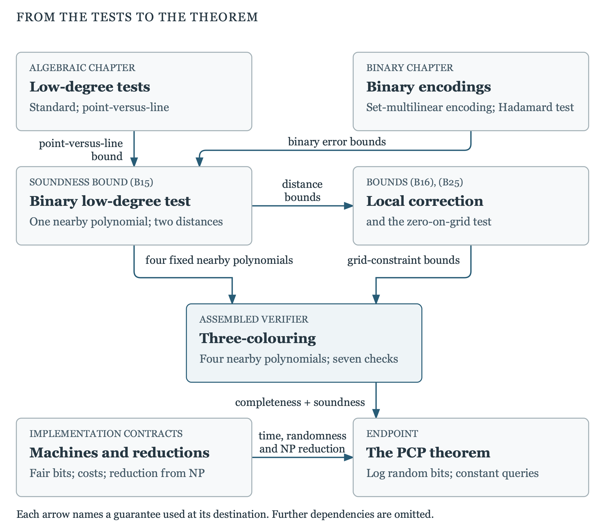

# The algebraic PCP theorem: a detailed account of the Lean proof

*Explanatory reconstruction prepared by Will Cook with AI assistance · 16 November 2026.*

Algebraic construction: Amireddy, Behera, Srinivasan, Sudan and Willumsgaard. Lean formalization: Troy Lee.

<!-- passage:pcp-long-intro-theorem -->
**Abstract.** The PCP theorem [AS98, ALMSS98] states that every language in NP has a polynomial-time verifier using $O(\log n)$ random bits and $O(1)$ proof-bit queries, with perfect completeness and soundness error at most one half. We give a detailed exposition of Troy Lee's Lean formalization of the algebraic construction of Amireddy, Behera, Srinivasan, Sudan and Willumsgaard. Set-multilinear encoding reduces the degree of line polynomials, and low-degree Hadamard encoding permits binary tests. We reconstruct the algebraic estimates and the machine-model arguments establishing the query, randomness and running-time bounds.

## 1. Introduction

Let $\mathcal L$ be a language of finite binary strings. Say that $\mathcal L$ is in NP if there are a polynomial $p_{\rm w}$ and a deterministic polynomial-time Boolean relation $\mathcal R(x,w)$, the witness relation, such that

$$
x\in \mathcal L
\quad\Longleftrightarrow\quad
\exists w\in\{0,1\}^{*},\quad |w|\le p_{\rm w}(|x|)\ \text{and}\ \mathcal R(x,w)=1.
$$

A verifier receives an input $x$ and a random seed, and has query access to a bit string $\pi:\mathbb N\to\{0,1\}$, called the proof. It reads bits of $\pi$, each address possibly depending on the bits already read, and then accepts or rejects.

**Theorem 1.1 (PCP theorem; [AS98], [ALMSS98]).** If $\mathcal L$ is in NP, there exist a single verifier $V$, a polynomial-time implementation of its query protocol, constants $\alpha,\beta,\ell\in\mathbb N$, and a polynomial $p\in\mathbb N[X]$, with the following properties for every input $x$ of length $n$.

1. The verifier draws exactly $r(n)=\alpha\lceil\log_2(n+2)\rceil+\beta$ independent fair bits.
2. On every random seed and every branch of its query protocol, it reads at most $\ell$ bits of the proof, all at addresses less than $p(n)$.
3. Perfect completeness: if $x\in \mathcal L$, there is one proof $\pi$ for which every random seed makes $V$ accept.
4. Soundness error one half: if $x\notin \mathcal L$, then for every proof $\pi$, at most half of the random seeds make $V$ accept.

The implementation, the constants and the polynomial $p$ are fixed for $\mathcal L$ before the input. The proof may depend on the input and is fixed before the random seed is drawn. This gives

$$
\mathrm{NP}\subseteq\mathrm{PCP}(O(\log n),O(1)).
$$

**Theorem 1.2 (reverse inclusion).** If a language has a verifier with a polynomial-time implementation and properties 1 to 4 of Theorem 1.1, for some constants $\alpha,\beta,\ell$ and some polynomial $p$, then it is in NP.

The proof is in Section 3.12. Hence

$$
\mathrm{NP}=\mathrm{PCP}(O(\log n),O(1)).
$$

*Remark (formalization).* Lee bounds every reachable address of the infinite proof by $p(n)$, so only that prefix affects acceptance. His verifier model permits adaptive queries; the verifier constructed here is nonadaptive, as in [[ABSSW26, Definition 2.1]][intro-paper]. Property 1 is an exact randomness formula, where [ABSSW26] states $O(\log n)$; surplus random bits are ignored. NP is defined in the machine model of Section 2.3 and is proved equivalent to the nondeterministic-machine class of ComplexityLib.

Lean: [verifier][intro-verifier], [Theorem 1.1][intro-theorem], [Theorem 1.2][intro-reverse], [reference class NP][intro-reference].
<!-- /passage:pcp-long-intro-theorem -->

The construction and its two encodings are due to Amireddy, Behera, Srinivasan, Sudan and Willumsgaard [ABSSW26]: the set-multilinear encoding lowers the degree of the restriction of a polynomial to a line, and the degree-$r$ Hadamard encoding turns tests on field values into tests on bits. The formalization is Troy Lee's [Lee26]. It adds explicit constants, a weaker field-size hypothesis for the low-degree test of [ABSSW26, Lemma 3.3], a sampler from fair bits, the reduction from an arbitrary NP language and a polynomial-time machine. The classical ingredients are the point-versus-line test [ALMSS98], bivariate agreement [AS98], the linearity test [BLR93, BCHKS96] and the low-degree tests of [RS96], [FS95/13] and [KS08]. Our contribution is the explanation: prose proofs of the statements Lee formalized, in the order of his assembly.

<!-- passage:pcp-long-intro-roadmap -->
In Section 2 we fix notation, the Hadamard encoding and the machine model. In Section 3 we construct the verifier and prove Theorems 1.1 and 1.2 from Lemmas 3.2 to 3.6, which are stated there and proved later. Section 4 contains the field-valued results: the standard low-degree test, local correction, bivariate agreement and the point-versus-line test. In Section 5 we construct the binary tests and prove Lemmas 3.3 to 3.6. Section 6 lists what the formalization proves and where it differs from [ABSSW26].

<!-- /passage:pcp-long-intro-roadmap -->

## 2. Preliminaries

### 2.1 Notation and conventions

<!-- passage:pcp-long-intro-readers -->
The [specialist paper](../short/paper.md) gives the theorem and the main proof structure; the [exposition with worked examples](../expository/main.md) develops the construction through calculations.

Throughout, $F$ is a finite field with $q$ elements. Outside Section 4, $F$ has characteristic two, $q=2^t$, and $\rho:F\to\mathbb F_2^t$ is a fixed $\mathbb F_2$-linear isomorphism. A polynomial is a formal object in $F[X_1,\ldots,X_k]$; over a finite field, distinct polynomials can have the same evaluation function. Degree means total degree unless the degree in each variable is specified, and the zero polynomial satisfies every degree bound. Probabilities are uniform over the displayed finite set. For two functions $f,g$ on the same finite domain, $\Delta(f,g)$ is the fraction of inputs at which they differ, their relative Hamming distance; $f$ is $\delta$-close to $g$ when $\Delta(f,g)\le\delta$.

For $u,v\in F^k$ the line through $u$ with slope $v$ is $z\mapsto u+zv$; $v=0$ is allowed. The pair $(u,v)$ is the index of the line and $u$ its base point.

A grid is a power $H^k$ of a nonempty set $H\subseteq F$; we write $h=|H|$ and $Z_H(T)=\prod_{a\in H}(T-a)$. Two standard facts are proved in Section 4.1.

**Lemma 2.1 (Schwartz–Zippel lemma; [[ABSSW26, Theorem 2.5]][paper]).** A nonzero polynomial of total degree at most $d$ in $k$ variables vanishes at no more than a fraction $d/q$ of the points of $F^k$.

**Lemma 2.2 (low-degree extension; [[ABSSW26, Fact 2.4]][paper]).** Every function $H^k\to F$ is the restriction of exactly one polynomial of degree at most $h-1$ in each variable. This polynomial, the low-degree extension of the function, has total degree at most $k(h-1)$.

For the seven polynomials of Section 3.1 we write $P,Q_P,A_P,B_P,E,M_A,M_B$, as Lee does; [[ABSSW26, Section 7]][paper-pcp] writes $\chi,\chi',\mathsf{Val},\mathsf{Prop},\widehat E,\mathcal M_{\mathsf{Val}},\mathcal M_{\mathsf{Prop}}$.
<!-- /passage:pcp-long-intro-readers -->

### 2.2 Labels and the Hadamard encoding

<!-- passage:pcp-long-hadamard-labels -->

For $r\geq1$, let $\mathcal B_r$ be the vector space of multilinear polynomials over $\mathbb F_2$ in $t$ variables $Z_1,\ldots,Z_t$ of degree at most $r$. A label is an element of $\mathcal B_r$. Labels are evaluated on $\mathbb F_2^t$, where reducing $Z_i^2$ to $Z_i$ preserves evaluations, so monomials are indexed by subsets of coordinates. The degree-$r$ Hadamard encoding [[ABSSW26, Definition 3.5]][paper] of a field element $u$ is the binary word

$$
\mathcal H_r(u)(R)=R(\rho(u)),\qquad R\in\mathcal B_r.
$$

A word is an arbitrary function $\mathcal B_r\to\mathbb F_2$. Labels in $\mathcal B_1$ are affine. Affine labels without constant term are homogeneous; they have the form

$$
L_w(z)=\sum_{i=1}^t w_i z_i,\qquad w\in\mathbb F_2^t.
$$

We identify a label $R$ with the map $u\mapsto R(\rho(u))$ on $F$, so that the homogeneous labels are the $\mathbb F_2$-linear functionals $F\to\mathbb F_2$. For a field-valued function $g$, write $\mathcal H_r(g)(x,R)=\mathcal H_r(g(x))(R)$. For two functions of a point and a label, $\Delta_{\rm full}$ is their distance over all labels in $\mathcal B_r$, and $\Delta_{\rm hom}$ their distance over homogeneous labels only.

**Lemma 2.3 (half-distance identity; [[ABSSW26, Observation 3.8]][paper]).** If $u\neq v$ and $r\geq1$, then

$$
\Delta(\mathcal H_r(u),\mathcal H_r(v))=\frac12.
$$

Exactly half of the homogeneous labels also separate $u$ from $v$. Consequently, for field-valued functions $g,h$ on one domain,

$$
\Delta(\mathcal H_r(g),\mathcal H_r(h))
=\frac12\Delta(g,h),
\tag{B1}
$$

and the same identity holds when distance is measured only on homogeneous labels.

*Proof.* Choose a coordinate on which $\rho(u)$ and $\rho(v)$ differ. Adding that coordinate label pairs every label giving equal evaluations with one giving unequal evaluations, and the pairing preserves the homogeneous labels. Averaging over the point gives (B1). $\square$

Closeness of a word to an encoding over all of $\mathcal B_r$ need not control its error on homogeneous labels, so the soundness statements below give both bounds for one polynomial. When the label domain is $\mathcal B_1$, homogeneous labels occupy half of it, and their error is at most twice the affine-label error. For $r>1$, this restriction gives no dimension-independent proportional bound in terms of the distance over $\mathcal B_r$.

<!-- /passage:pcp-long-hadamard-labels -->

[intro-paper]: https://arxiv.org/abs/2608.17429v2
[intro-verifier]: https://github.com/troyjlee/tcs-formalizations/blob/a0ce13ed0fa264f051c1278e039596ce65557fa4/PCP/Verifier/Definition.lean
[intro-theorem]: https://github.com/troyjlee/tcs-formalizations/blob/a0ce13ed0fa264f051c1278e039596ce65557fa4/PCP/Theorem.lean
[intro-reverse]: https://github.com/troyjlee/tcs-formalizations/blob/a0ce13ed0fa264f051c1278e039596ce65557fa4/PCP/ReverseConcrete.lean
[intro-reference]: https://github.com/troyjlee/tcs-formalizations/blob/a0ce13ed0fa264f051c1278e039596ce65557fa4/PCP/Complexity/ReferenceNPConverse.lean

### 2.3 The machine model

<!-- passage:pcp-long-implementation-contracts -->
Lee's machines are deterministic finite multi-stack machines with fixed public encodings. A verifier step takes an input, a seed and the history of answers, and either returns a verdict or requests the next proof address. The implementation condition identifies the verifier with the query tree obtained by unfolding this step for a bounded number of queries, on both possible answers at every branch; a further request at depth zero becomes rejection. This condition alone does not assert that the step halts within that depth. Polynomial running time is a separate property of the machine.

The transition-level proofs about these machines are not reproduced; Section 3 uses five of their conclusions. The program for the seven-check verifier computes the query list and verdict for every input, seed and answer history, and polynomial bounds on its charged cost, its storage and the repetition protocol give a polynomial-time machine (Section 3.9). A witness checker for an NP language yields a polynomial-time map to graphs (Section 3.10). Randomness of the form in Theorem 1.1 and a polynomial address bound permit polynomial-time checking of every seed against a finite prefix of the proof, and the class defined by witness checkers equals the nondeterministic-machine definition of NP in ComplexityLib (Section 3.12).

Lean: [verifier step][lean-runtime-correct], [cost][lean-runtime-cost], [compilation][lean-runtime], [NP reduction][lean-np-runtime], [finite-witness checker][intro-reverse], [reference machines][intro-reference].
<!-- /passage:pcp-long-implementation-contracts -->

## 3. The three-colourability verifier and the proof of the PCP theorem

<!-- passage:pcp-long-final-target -->
The verifier is that of [[ABSSW26, Section 7]][paper-pcp], with Lee's parameter choices; Sections 3.6 to 3.11 add the sampler from fair bits, the polynomial-time machine and the reduction from NP. Throughout the section, $m$ is the grid dimension, $b$ the radix and $c$ the degree of the set-multilinear encoding, and $D=cb^c$. The letter $Q_*$ denotes a polynomial close to the received difference table, to be compared with $Q_P$.
<!-- /passage:pcp-long-final-target -->

### 3.1 Three-colourability as polynomial equations

<!-- passage:pcp-long-colour-equations -->
Let $F$ contain a primitive cube root of unity $\omega$. The three colours will be

$$
\mathcal C=\{1,\omega,\omega^2\}.
$$

These are distinct, and they are exactly the roots of $Z^3-1$.

**Lemma 3.1 (colour equations).** For two colours $u,v\in\mathcal C$, the equation

$$
(u-v)^3=1
$$

holds exactly when $u\ne v$. Consequently an assignment $f:V(G)\to F$ is a proper three-colouring precisely when

$$
f(v)^3-1=0\quad(v\in V(G)),\qquad
(f(v)-f(w))^3-1=0\quad(vw\in E(G)).
$$

*Proof.* Characteristic two gives

$$
(u-v)^4=u^4-v^4=u-v,
$$

because $u^3=v^3=1$. If $u\ne v$, cancellation of the nonzero factor $u-v$ yields $(u-v)^3=1$. Conversely, $u=v$ would make the left side zero. $\square$

Both families of equations are needed: assigning the four elements of $\mathbb F_4$ to the vertices of $K_4$ satisfies every edge equation, since a nonzero element of $\mathbb F_4$ has cube one, although $K_4$ is not three-colourable.

Lean: [colour algebra][lean-colour-algebra].
<!-- /passage:pcp-long-colour-equations -->

<!-- passage:pcp-long-grid-constraints -->
Choose a nonempty set $H\subseteq F$, of size $h$, and a dimension $m$ with $|V(G)|\le h^m$. Place the vertices in $H^m$ and treat unused grid points as isolated vertices. Extending a colouring to those points preserves three-colourability in both directions.

Let $P$ be the low-degree extension of the colour assignment on $H^m$, and let $E$ be the low-degree extension of the graph's zero-one adjacency function on $H^m\times H^m$ (Lemma 2.2). Writing

$$
d_0=m(h-1),
$$

we have $\deg P\le d_0$ and $\deg E\le2d_0$. Form the difference and constraint polynomials

$$
\begin{aligned}
Q_P(X,Y)&=P(X)-P(Y),\\
A_P(X)&=P(X)^3-1,\\
B_P(X,Y)&=E(X,Y)\bigl(Q_P(X,Y)^3-1\bigr).
\end{aligned}
$$

Their total degrees are at most $d_0,3d_0,5d_0$, respectively. A proper colouring makes $A_P$ vanish on $H^m$ and $B_P$ vanish on $H^{2m}$. Conversely, these two vanishing conditions, together with $Q_P(X,Y)=P(X)-P(Y)$, recover a proper colouring by Lemma 3.1. The factor $E$ is computed from the input adjacency table; at grid points it is one on edges and zero on nonedges.

**Lemma 3.2 (vanishing certificate; [[ABSSW26, Lemma 2.9 and Corollary 2.10]][paper]).** A polynomial $A\in F[X_1,\ldots,X_k]$ vanishes on $H^k$ if and only if $A=\sum_i Z_H(X_i)U_i(X)$ for some polynomials $U_i$. The $U_i$ can be chosen so that the vanishing certificate $M(X,Y)=\sum_iY_iU_i(X)$ has $\deg M\le\deg A$; it satisfies $M(X,0)=0$ and $M(X,Z_H(X_1),\ldots,Z_H(X_k))=A(X)$. Conversely, if any polynomial $M$, linear in $Y$ or not, satisfies these two identities, then $A$ vanishes on $H^k$.

The first assertion is the Combinatorial Nullstellensatz for a grid; the lemma is proved in Section 4.1. Vanishing on $H^k$ thereby becomes two identities that can be tested at random points of $F^k$. Apply it to $A_P$ and $B_P$ to obtain $M_A$ and $M_B$. The degree bound $5d_0$ covers $P$, $Q_P$ and both certificates.

*Remark (formalization).* Lee's implementation flattens the two blocks of vertex coordinates of $B_P$ and $M_B$ into one. This coordinate bijection preserves evaluations, total degree and relative distances.

Lean: [grid construction][lean-colour-grid].
<!-- /passage:pcp-long-grid-constraints -->

### 3.2 The proof tables and the verifier

<!-- passage:pcp-long-eight-tables -->
The proof is the bit string the verifier queries; it consists of eight tables, which [ABSSW26] call proof oracles. Each of the four polynomials $P,M_A,Q_P,M_B$ has a points table and a lines table. For a polynomial $W$ on $F^k$, the honest points table is $\mathcal H_r(W):F^k\times\mathcal B_r\to\mathbb F_2$, with $k$ and $r$ as follows.

| Polynomial | Coordinates $k$ | Honest points table |
| :---------------------------------------------- | :-------------- | :------------------- |
| $P$, the low-degree extension of the colouring | $m$ | $\mathcal H_3(P)$ |
| $M_A$, the vertex vanishing certificate | $2m$ | $\mathcal H_1(M_A)$ |
| $Q_P$, the difference polynomial | $2m$ | $\mathcal H_3(Q_P)$ |
| $M_B$, the edge vanishing certificate | $4m$ | $\mathcal H_1(M_B)$ |

The lines table of $W$ assigns to each pair $(u,v)\in F^k\times F^k$ the restriction $z\mapsto W(u+zv)$; the proof stores it after set-multilinear and Hadamard encoding. The degree of the restriction grows with the graph. The set-multilinear encoding replaces it by a polynomial of degree $c$ in $cb$ variables, obtained by writing each exponent below $b^c$ in base $b$.

**Lemma 3.3 (set-multilinear encoding; [[ABSSW26, Definition 3.1 and Claim 3.2]][paper]).** Let $b\ge1$ and $c\ge0$. There is a linear map $\Psi$ from univariate polynomials of degree less than $b^c$ to polynomials of total degree at most $c$ in $cb$ variables such that $\Psi(p)(\Phi(z))=p(z)$ for every $z\in F$, where $\Phi(z)_{i,k}=z^{kb^i}$ for $0\le i<c$ and $0\le k<b$. For every polynomial $U$ of total degree at most $c$ in these variables, the univariate polynomial $U\circ\Phi$, obtained by substituting $Y^{kb^i}$ for the variable with index $(i,k)$, has degree at most $cb^c$.

The lemma is proved in Section 5.1. An inner point $\xi\in F^{cb}$ is an argument of the set-multilinear encoding; $\Phi(z)$ is the inner point for parameter $z$. An address of a lines table consists of an index $(u,v)\in F^k\times F^k$, an inner point and an affine label. The honest entry at index $(u,v)$ is the function $f'_{u,v}=\mathcal H_1(\Psi(W(u+Yv)))$ on $F^{cb}\times\mathcal B_1$.

*Remark (formalization).* In [[ABSSW26, Section 7]][paper-pcp] the lines tables of $P$ and $Q_P$ have degree-three labels. Lee uses affine labels on every lines table.

The verifier runs seven checks with independent seeds and accepts when all seven accept.

1. Four binary low-degree tests, one on each pair of a points table and its lines table.
2. Two zero-on-grid tests (ZERO in [ABSSW26]), for the vertex constraint $A_P$ on $H^m$ and the edge constraint $B_P$ on $H^{2m}$. Each uses the points table of the corresponding vanishing certificate and the same lines table as that certificate's low-degree test.
3. The difference check, defined below.

Each check draws its seed from its own finite uniform distribution, and the verifier rejects whenever a check does, so the rejection probability of each check is at most that of the verifier. The first two kinds of test are constructed in Sections 5.5 and 5.7, and their guarantees are stated in Section 3.3.

Lean: [proof and verifier][lean-seven-checks].
<!-- /passage:pcp-long-eight-tables -->

<!-- passage:pcp-long-derived-constraints -->
The constraint polynomials $A_P$ and $B_P$ have no tables. A zero-on-grid test obtains the bit $L(A_P(x))$, for a homogeneous label $L$, from the points table of $P$.

**Lemma 3.4 (label composition; [[ABSSW26, Claim 3.7]][paper]).** Let $A\in F[Y]$ have degree at most $r$ and let $L$ be an affine label. There is a label $\Lambda_{A,L}\in\mathcal B_r$ with $L(A(u))=\Lambda_{A,L}(u)$ for every $u\in F$.

The lemma is proved in Section 5.2. Suppose $p(x,\cdot)$ is the received word intended to be $\mathcal H_3(P(x))$. To request the bit $L(P(x)^3-1)$, draw a fresh random label $R$, uniform in $\mathcal B_3$, and return

$$
p(x,R+\Lambda_{Z^3-1,L})+p(x,R),
$$

in $\mathbb F_2$, using two queries. This is a self-corrected read. The edge constraint is read in the same way from the difference table, with the label for $Z\mapsto E(x,y)(Z^3-1)$.

For an exact Hadamard encoding, linearity in the label gives the requested bit for every $R$, even though $Z\mapsto Z^3-1$ is nonlinear in the field value. For a fixed received word, both queried labels are uniform, so the error probability is at most twice the distance of that word from the exact encoding. Each self-corrected read uses a fresh random label, and this error is retained in Lemma 3.6.

The difference check samples $x,y\in F^m$ and a homogeneous label $L$ independently and uniformly. It checks that the difference table agrees with the colour table: the bit of the difference table at $((x,y),L)$ must equal the sum of the bits of the colour table at $(x,L)$ and $(y,L)$.
<!-- /passage:pcp-long-derived-constraints -->

<!-- passage:pcp-long-query-budget -->
The seven query bounds, in the order colour, vertex certificate, difference, edge certificate, vertex zero-on-grid, edge zero-on-grid, and difference check, are

$$
2c+18,\quad2c+14,\quad2c+18,\quad2c+14,
\quad6c+20,\quad6c+20,\quad3.
$$

Their sum is $20c+107$, independent of the graph; it includes both queries of each self-corrected read. Two proofs agreeing on the listed addresses give the same verdict.

Lean: [query list][lean-query-budget].
<!-- /passage:pcp-long-query-budget -->

### 3.3 Guarantees of the tests

<!-- passage:pcp-long-decoding-contract -->
The tests of Section 5 depend on two lists of $c+1$ nodes in $F$. The test nodes $a_i$ serve the standard low-degree test [[ABSSW26, Lemma 3.3]][paper], which accepts a function $f$ when $f(u)=\sum_{i}\eta_i f(u+a_iv)$ at uniform $u,v$, with Lagrange weights $\eta_i$. The correction nodes are the powers $\zeta,\zeta^2,\ldots,\zeta^{c+1}$ of a nonzero $\zeta$. The completeness clauses below need $b\ge1$ and distinct nodes in each list. The soundness clauses assume in addition that $q>2c$ and that the test nodes are the powers $\theta,\ldots,\theta^{c+1}$ of a generator $\theta$ of $F^\times$; then $\zeta=\theta$ is admissible.

The constants in the soundness clauses are

$$
K_c=4(c+2)^2(112(c+2)+60),\quad
J_c=2((c+1)K_c+29),\quad S_c=28+J_c,\quad
C_c=2+2(c+1)K_c.
$$

In Lemma 3.6, $D_1\ge D$ is a common degree bound. In every soundness clause the lines table is arbitrary.

**Lemma 3.5 (binary low-degree test; cf. [[ABSSW26, Theorem 4.1]][paper]).** The test queries a points table $f:F^k\times\mathcal B_r\to\mathbb F_2$ and a lines table, reading at most $2r+2c+12$ bits. If $f=\mathcal H_r(W)$ for a polynomial $W$ of degree less than $b^c$ and the lines table is the honest one for $W$, it accepts on every seed. Conversely, suppose $q\ge10^6D^3$ and the test rejects with probability $\kappa$, where $J_c\kappa\le1/4\,000\,000$. Then one polynomial $W$ of total degree at most $D$ satisfies both $\Delta_{\rm full}(f,\mathcal H_r(W))\le S_c\kappa$ and $\Delta_{\rm hom}(f,\mathcal H_r(W))\le S_c\kappa$. The lemma is proved in Section 5.5, where the soundness bound is (B15).

**Lemma 3.6 (zero-on-grid test; cf. [[ABSSW26, Theorem 6.1]][paper]).** Let $g:F^k\to F$, let $A_x\in F[Y]$ have degree at most $r$ for each $x\in F^k$, and suppose that $A(x)=A_x(g(x))$ is a polynomial of total degree at most $D_1$. The test obtains bits of $A(x)$ by self-corrected reads of a points table $p:F^k\times\mathcal B_r\to\mathbb F_2$, and reads two values of a proposed vanishing certificate through its points and lines tables; it reads at most $6c+20$ bits. If $p=\mathcal H_r(g)$ and the certificate tables are the honest ones for a vanishing certificate of $A$ of degree less than $b^c$, it accepts on every seed. Conversely, let $\varepsilon=\Delta_{\rm full}(p,\mathcal H_r(g))$, let $M$ be a polynomial of degree at most $D_1$ whose encoding $\mathcal H_1(M)$ is within $\delta_M$ of the certificate points table over homogeneous labels, and let $\kappa$ be the rejection probability. If $A$ does not vanish on $H^k$, then $(1-D_1h/q)/2\le(1+2C_c)(\kappa+2\varepsilon)+2\delta_M+D_1/(q-1)$. The lemma is proved in Sections 5.7 and 5.8, where the bound is (B25).

In Section 3.5 the hypothesis that $A$ is a polynomial holds because $A$ is $P^3-1$ or $E\,((P(X)-P(Y))^3-1)$.
<!-- /passage:pcp-long-decoding-contract -->

### 3.4 Perfect completeness

<!-- passage:pcp-long-completeness -->
**Proposition 3.7 (perfect completeness).** Use a radix $b\ge1$, $c+1$ distinct test nodes, and a nonzero correction parameter $\zeta$ whose powers $\zeta,\zeta^2,\ldots,\zeta^{c+1}$ are distinct. Assume

$$
5m(h-1)<b^c,
$$

so that the four polynomials of an honest proof have degree less than $b^c$. If $G$ is three-colourable, some proof is accepted on every seed.

*Proof.* Given a proper colouring, let $P$ be its low-degree extension, form its difference $Q_P$ and choose vanishing certificates $M_A,M_B$ by Lemma 3.2. All four polynomials have degree at most $5m(h-1)$. Encode them and their line restrictions in the eight tables. Every binary low-degree test accepts by Lemma 3.5, and both zero-on-grid tests accept by Lemma 3.6. Finally,

$$
L(Q_P(x,y))=L(P(x))+L(P(y))
$$

for every homogeneous label $L$, so the difference check also accepts. $\square$

Lean: [honest proof][lean-completeness].
<!-- /passage:pcp-long-completeness -->

### 3.5 Soundness

<!-- passage:pcp-long-difference-soundness -->
**Theorem 3.8 (soundness of the seven-check verifier).** Suppose the field and grid satisfy

$$
q\ge10^6D^3,\qquad q\ge100Dh,
\qquad m(h-1)\le D,
$$

with $c,b,h\ge1$, that $F$ contains a primitive cube root of unity, and that the nodes satisfy the soundness conditions of Section 3.3. Then every proof for a graph that is not three-colourable is rejected with probability at least $g_c$, a positive constant depending only on $c$ and defined at the end of the proof.

*Proof.* Let $\kappa$ be the rejection probability of an arbitrary received proof; we show that $\kappa<g_c$ forces three-colourability. Apply Lemma 3.5 to the four received pairs of a points table and a lines table. If

$$
J_c\kappa\le\frac1{4\,000\,000},
$$

there are four polynomials $P,Q_*,M_A,M_B$, each of total degree at most $D$, at distance at most

$$
\varepsilon=S_c\kappa
$$

from the corresponding points tables: over all labels in $\mathcal B_3$ for $P$ and $Q_*$, and over homogeneous labels for all four. We call them the nearby polynomials; the analysis chooses them, and the verifier never computes them.

First identify $Q_*$. Replace the three received bits in the difference check by the bits $L(Q_*(x,y))$, $L(P(x))$ and $L(P(y))$ of the nearby polynomials. The replacement can change the verdict only if one of these three bits differs, an event of probability at most $3\varepsilon$. Hence the check on the exact encodings rejects with probability at most $\kappa+3\varepsilon$.

For a nonzero field element $z$, exactly half of the homogeneous labels satisfy $L(z)=1$ (Lemma 2.3). Therefore the rejection probability on the exact encodings is exactly half the relative distance between the field-valued functions $Q_*(x,y)$ and $P(x)-P(y)$. If these polynomials differed, their difference would be a nonzero polynomial of degree at most $D$, and Lemma 2.1 would give relative distance at least $1-D/q$. It follows that

$$
\kappa+3\varepsilon<\frac{1-D/q}{2}
$$

forces the formal polynomial identity $Q_*(X,Y)=P(X)-P(Y)$.
<!-- /passage:pcp-long-difference-soundness -->

<!-- passage:pcp-long-assembled-zero-soundness -->
Now consider the vertex constraint $A_P=P^3-1$ of the nearby polynomial $P$. Its degree is at most $3D$. For the edge constraint, the adjacency polynomial $E$ has degree at most $2D$; by the identity just proved, the edge constraint

$$
B_P=E\bigl((P(X)-P(Y))^3-1\bigr)
$$

has degree at most $5D$. Both certificates $M_A,M_B$ have degree at most $D$, so the common degree bound $5D$ suffices for the two zero-on-grid tests.

Apply Lemma 3.6 with $D_1=5D$. If either constraint fails to vanish on its grid, then

$$
\frac{1-5Dh/q}{2}
\le
(1+2C_c)(\kappa+2\varepsilon)
+2\varepsilon+\frac{5D}{q-1}.
$$

Here $2\varepsilon$ inside the parentheses is the loss from the self-corrected read; it is multiplied by $1+2C_c$ because it enters through the rejection probability of the test. The other $2\varepsilon$ comes from the two values read from the certificate, and the last term from reading them at a nonzero line parameter (Section 5.6).

Consequently, the strict reverse inequality forces $A_P$ to vanish on $H^m$ and $B_P$ to vanish on $H^{2m}$. By Lemma 3.1, $P|_{H^m}$ is then a proper colouring.
<!-- /passage:pcp-long-assembled-zero-soundness -->

<!-- passage:pcp-long-gap -->
To satisfy the three inequalities simultaneously, define

$$
\begin{aligned}
A_c&=1+2C_c,\\
B_c&=1+3S_c,\\
T_c&=A_c(1+2S_c)+2S_c,\\
g_c&=\min\left\{
\frac{1}{4\,000\,000(J_c+1)},
\frac{1}{16B_c},
\frac{1}{16(T_c+1)}\right\}.
\end{aligned}
$$

All denominators are positive, so $g_c>0$. If $0\le\kappa<g_c$, then $J_c\kappa\le1/4\,000\,000$, $\kappa+3S_c\kappa<1/16$, and $A_c(\kappa+2S_c\kappa)+2S_c\kappa<1/16$. The field bound $q\ge100Dh$, with $D,h\ge1$, gives

$$
\frac Dq\le\frac14,\qquad
\frac{5Dh}{q}\le\frac14,\qquad
\frac{5D}{q-1}\le\frac18.
$$

For the last inequality, $q\ge100D$ implies $q-1\ge40D$. The difference error is below $1/16<3/8$, and the total zero-on-grid error is below $1/16+1/8=3/16<3/8$. Hence rejection below $g_c$ implies colourability. $\square$

Lean: [soundness][lean-soundness], [difference check][lean-difference], [zero-on-grid step][lean-decoded], [constants][lean-budget].
<!-- /passage:pcp-long-gap -->

### 3.6 Parameters

<!-- passage:pcp-long-parameters -->
Lee chooses one explicit parameter family, where [ABSSW26] gives an asymptotic choice. For a graph with $N$ vertices, let $\nu$ be the least integer at least two with

$$
\lceil\log _2N\rceil\le \nu2^\nu.
$$

Use the natural ceiling-log convention at $N=0,1$; the definition still selects $\nu=2$. Put

$$
s=2^\nu,\quad m=b=h=s,\quad c=4,
\quad t=12\nu+32,\quad q=2^t=2^{32}s^{12}.
$$

The field $F$ is $\mathbb F_2[T]$ modulo a computed monic irreducible polynomial of degree $t$, and $\rho$ reads the $t$ coefficients of a residue. Since $t$ is divisible by four, $3\mid q-1$; bounded searches in a fixed numeric order of the field supply a primitive cube root of unity and a generator of $F^{\times}$. The grid $H$ consists of the first $s$ field elements in this order. It need not be a subfield.

**Lemma 3.9 (parameter choice).** For every $N$, these parameters satisfy $h^m\ge N$ and the hypotheses of Proposition 3.7 and Theorem 3.8, and

$$
\nu2^\nu\le4\max\{8,\lceil\log _2N\rceil\}
\le32(\lceil\log _2N\rceil+1).
$$

*Proof.* The grid has $h^m=s^s=2^{\nu2^\nu}\ge N$ points. With $D=4s^4$, the field-size hypothesis of Theorem 3.8 holds because

$$
10^6D^3=64\,000\,000s^{12}\le2^{32}s^{12}=q.
$$

Also $100Dh=400s^5\le q$. Since $s\ge4$,

$$
5s(s-1)<s^4=b^c,
$$

which is the degree condition of Proposition 3.7, and $m(h-1)<s^4\le D$. Since $q>2c$, the powers of the generator serve as both lists of nodes. Thus completeness and soundness hold for the same field, grid, cube root and generator.

By minimality of $\nu$, if $\nu>2$, then

$$
(\nu-1)2^{\nu-1}<\lceil\log _2N\rceil,
\qquad
\nu2^\nu\le4(\nu-1)2^{\nu-1}.
$$

If $\nu=2$, then $\nu2^\nu=8$. Both cases yield the displayed bound. $\square$

Thus a quantity bounded by a fixed multiple of $\nu2^\nu$ is logarithmic in $N$, and one bounded by $2^{O(\nu2^\nu)}$ is polynomial in $N$.

Lean: [parameters][lean-parameters], [choice of $\nu$][lean-choice].
<!-- /passage:pcp-long-parameters -->

### 3.7 Fair random bits and proof length

<!-- passage:pcp-long-fair-bits -->
Each zero-on-grid test reads two values of its certificate along lines, at a line parameter uniform on $F^\times$ (Section 5.6); the seven checks use four such parameters. No fixed number of fair bits samples $F^\times$ uniformly when $q>2$, because $q-1$ is then not a power of two, so Lee's verifier draws all four from $F$. If any is zero, it accepts immediately and makes no queries; otherwise it runs the seven-check verifier.

Conditioned on all four being nonzero, the seed has exactly the original product-uniform distribution. Every other coordinate is unchanged. Therefore

$$
\Pr[\text{new verifier rejects}]
=\left(\frac{q-1}{q}\right)^4
\Pr[\text{original verifier rejects}].
$$

Since $q\ge2$, the factor is at least $1/16$. Perfect completeness survives, and every proof for a graph that is not three-colourable is rejected with probability at least $\delta=g_4/16$.

Every remaining random coordinate is a field vector, a vector of label coefficients or a finite product of such objects. The map $\rho$ and explicit product codecs give a bijection between the seed space and the bit strings of a fixed length, so uniform bit strings induce exactly the required distribution. Likewise, an invertible tagged mixed-radix codec packs the eight tables into one binary string, and the query list is translated through it.

Lean: [whole-field sampling][lean-sampling].
<!-- /passage:pcp-long-fair-bits -->

<!-- passage:pcp-long-resources -->
It remains to count proof bits and random bits. The dimension

$$
\dim\mathcal B_r=\sum_{j=0}^{r}\binom tj
$$

gives $|\mathcal B_r|=2^{\dim\mathcal B_r}$ labels. The lengths of the four points tables are

$$
q^m|\mathcal B_3|,\quad q^{2m}|\mathcal B_1|,\quad q^{2m}|\mathcal B_3|,\quad q^{4m}|\mathcal B_1|.
$$

An address of the lines table of a polynomial on $F^j$ consists of an index in $F^j\times F^j$, an inner point in $F^{cb}$ and an affine label, so that table has length $q^{2j+cb}|\mathcal B_1|$. The lengths of the four lines tables are

$$
q^{2m+cb}|\mathcal B_1|,\quad q^{4m+cb}|\mathcal B_1|,\quad
q^{4m+cb}|\mathcal B_1|,\quad q^{8m+cb}|\mathcal B_1|.
$$

Since $\dim\mathcal B_1\le\dim\mathcal B_3\le(t+1)^3$, the sum of these eight lengths is at most

$$
2^{(8m+cb)t+(t+1)^3+3}.
$$

For $m=b=2^\nu$, $c=4$ and $t=12\nu+32$, the exponent is at most $132\,000\nu2^\nu$. One elementary estimate controls the cubic term: $\nu^2\le4\cdot2^\nu$ for every natural $\nu$, and $12\nu+33\le32\nu$ for $\nu\ge2$. Hence $(t+1)^3\le131\,072\nu2^\nu$; the remaining linear terms fit within the stated bound.

For the seed count, write $u=\binom t2$ and $v=\binom t3$ until the display of $r$. The Hadamard tests of Section 5.3 on affine and on degree-three labels use $3(1+t)$ and $5+5t+3u+2v$ bits. The inner low-degree test of Section 5.4 uses $1+3tcb+2t+3(1+t)=4+3tcb+5t$ bits, including its fair coin and the data sampled for both of its alternatives. Expanding the seven product seeds gives the following counts.

| Check | Power-of-two exponent | Nonzero-field draws |
| :------------------------------ | :---------------------- | --------------------: |
| Colour low-degree | $2tm+4tcb+12t+9+3u+2v$ | $0$ |
| Vertex-certificate low-degree | $4tm+4tcb+10t+7$ | $0$ |
| Difference low-degree | $4tm+4tcb+12t+9+3u+2v$ | $0$ |
| Edge-certificate low-degree | $8tm+4tcb+10t+7$ | $0$ |
| Vertex zero-on-grid | $5tm+8tcb+12t+9+u+v$ | $2$ |
| Edge zero-on-grid | $10tm+8tcb+12t+9+u+v$ | $2$ |
| Difference check | $2tm+t$ | $0$ |

The original seed space therefore has size $(q-1)^4 2^{35tm+32tcb+69t+50+8u+6v}$. Replacing the four nonzero-field draws by whole-field draws adds $4t$ bits. The exact fair-bit seed length is

$$
r=35tm+32tcb+73t+50+8\binom t2+6\binom t3.
$$

This counts every product coordinate, even when a check ignores it or the verifier accepts early on a zero parameter. The same elementary estimates bound $r$ by $10^6\nu2^\nu$. Combining both estimates with $\nu2^\nu\le32(\lceil\log_2N\rceil+1)$, and using $2^{\lceil\log_2N\rceil}\le2\max\{1,N\}$, gives

$$
\begin{aligned}
r(N)&\le32\,000\,000(\lceil\log _2N\rceil+1),\\
\operatorname{proofLength}(N)&\le(4\max\{1,N\})^{4\,224\,000},\\
\#\operatorname{queries}&\le187.
\end{aligned}
$$

Here $\operatorname{proofLength}(N)$ is the length of the packed proof. A graph encoded by an input $x$ has at most $n=|x|$ vertices. The verifier draws

$$
r_0(n)=32\,000\,000\lceil\log _2(n+2)\rceil+32\,000\,000.
$$

fair bits and ignores those beyond the exact seed length $r$. Every shorter bit string has the same number of extensions, so this preserves the acceptance probability. Every address is below the value of the polynomial

$$
p_G(n)=\bigl(4(n+1)\bigr)^{4\,224\,000}.
$$

The nonadaptive list of at most 187 queries is compiled into a decision tree of that depth, whose evaluation equals the verdict of the seven checks for every proof. This is the base verifier.

**Proposition 3.10 (base verifier).** A fixed convention reads every input, well formed or not, as a graph. On an input of length $n$ the base verifier draws exactly $r_0(n)$ fair bits and reads at most 187 proof bits, at addresses below $p_G(n)$. It has perfect completeness, and rejects every proof for a graph that is not three-colourable with probability at least $\delta=g_4/16$.

Lean: [seed length][lean-seed-size], [proof length][lean-resources], [binary verifier][lean-binary], [base verifier][lean-canonical].
<!-- /passage:pcp-long-resources -->

### 3.8 Amplification and explicit constants

<!-- passage:pcp-long-amplification -->
**Lemma 3.11 (amplification).** Let $0<\delta\le1$ and $R=\lceil1/\delta\rceil$. Suppose a verifier rejects every proof for a no-instance with probability at least $\delta$. Run it $R$ times with independent seeds on the same proof, and accept only if every run accepts. Then every proof for a no-instance is accepted with probability at most one half. Perfect completeness and the address bound are unchanged, and the numbers of queries and of random bits are multiplied by $R$.

*Proof.* For a fixed proof with single-run acceptance probability $u$, independence gives acceptance probability $u^R$. For a no-instance, $u\le1-\delta$, so it remains to show $(1-\delta)^R\le1/2$.

We prove by induction that

$$
(1+k\delta)(1-\delta)^k\le1
\quad(k\ge0, 0\le\delta\le1).
$$

The base case is equality. For the induction step,

$$
(1+(k+1)\delta)(1-\delta)
=1+k\delta-(k+1)\delta^2\le1+k\delta;
$$

multiply by the nonnegative factor $(1-\delta)^k$. Since $R\delta\ge1$, division gives

$$
(1-\delta)^R\le\frac1{1+R\delta}\le\frac12.
$$

The remaining assertions are immediate. $\square$

Lean: [repetition bound][lean-repetition-bound], [amplified verifier][lean-amplified].

**Explicit constants.** The amplified verifier applies Lemma 3.11 to the base verifier of Proposition 3.10, with $c=4$. At that value the constants of Sections 3.3 and 3.5 are

| $K_4$ | $J_4$ | $S_4$ | $C_4$ | $T_4$ |
| -----------: | -------------: | -------------: | -------------: | -----------------------: |
| $105408$ | $1054138$ | $1054166$ | $1054082$ | $4444715947277$ |

and exact rational arithmetic gives

$$
g_4=\frac1{71\,115\,455\,156\,448},\qquad
\delta=\frac1{1\,137\,847\,282\,503\,168}.
$$

Thus $R=1/\delta=1\,137\,847\,282\,503\,168$. The base verifier makes at most $20c+107=26+22+26+22+44+44+3=187$ queries, and the amplified verifier at most $187R=212\,777\,441\,828\,092\,416$. The seed length $r$, its bound $r_0(n)$ and the address bound $p_G(n)$ are displayed in Section 3.7.
<!-- /passage:pcp-long-amplification -->

### 3.9 The polynomial-time implementation

<!-- passage:pcp-long-runtime -->
**Proposition 3.12 (polynomial-time implementation).** The amplified verifier has a polynomial-time implementation in the machine model of [Section 2.3](#23-the-machine-model).

*Proof.* Lee writes the verifier in a fixed program language and compiles it to the machines of Section 2.3. It remains to bound the cost of each operation.

Parameter selection is a bounded search for the least admissible $\nu$. Field arithmetic reduces polynomials of degree below $t=12\nu+32$ modulo the irreducible modulus, and inversion uses powering. The modulus, the cube root of unity and the generator of $F^\times$ are found by bounded searches whose ranges are polynomial in $q$, and $q=2^{32}s^{12}$ is polynomially bounded in the input length. With candidate tests and storage included, the charged cost is at most $7\,000\,000(q+1)^7$ for the modulus, $400\,000\,000(q+4)^6$ for each root search and $10^9(q+4)^7$ for the whole field setup. The existence of an irreducible polynomial of each degree is [[Shoup05, Theorem 20.11]][shoup]; Sections 20.2 and 21.1 there analyse irreducibility testing and randomized construction. The deterministic searches and these cost bounds are Lee's.

The adjacency polynomial $E$ is evaluated from the input adjacency matrix by interpolation sums over $H^m\times H^m$, which has polynomial size because $|H^m|=2^{\nu2^\nu}$ and Lemma 3.9 applies. Lagrange weights, the coordinates of $\Phi$ and the labels $\Lambda_{A,L}$ are computed by bounded loops. Addresses are below $p_G(n)$, and the sizes of their stored representations are bounded as well.

The verifier step of the base verifier has two passes: the first constructs the list of queries, and the second evaluates the verdict of the seven checks from the answers. A seed in which one of the four line parameters is zero yields no queries and acceptance. These outputs agree with the mathematical query list and verdict for every input, seed and answer history.

For the cost, polynomial bounds on the setup, on the storage of the generated queries and on the seven checks are substituted into the routines that consume them. If the query storage is bounded by $C_q(n+1)^{d_q}$ and the cost of a check has degree $d_b$ in the size of its input and answer history, the combined bound has exponent at least

$$
\max\{84,d_q,(d_q+1)d_b\}.
$$

Constants are enlarged to absorb the two passes, the fixed overhead of seven checks and the setup. The charged cost is then at most $C(|x|+|r|+|u|+1)^e$ for every seed $r$ and answer history $u$, for constants $C,e$.

The repetition protocol of Lemma 3.11 cuts the random string into $R$ blocks, runs the same verifier step on each, and manages the answer history. Because $R$ is fixed, its loop and storage overhead are polynomial. The compiler and the public input and output codecs preserve the semantics of the verifier step and translate the charged cost into a bound on the number of machine steps. $\square$

Lean: [field setup][lean-field-cost], [verifier step][lean-runtime-correct], [cost][lean-runtime-cost], [runtime][lean-runtime].
<!-- /passage:pcp-long-runtime -->

### 3.10 The reduction from NP to three-colourability

<!-- passage:pcp-long-np-tableau -->
We construct the polynomial-time map $f$ from inputs to encoded graphs of Proposition 3.13, stated at the end of the subsection. Fix an NP language $\mathcal L$, a witness relation $\mathcal R(x,w)$, a witness bound $p_{\rm w}\in\mathbb N[X]$, and a polynomial-time machine checking $\mathcal R$. Then

$$
x\in\mathcal L\iff\exists w\ (|w|\le p_{\rm w}(|x|)\ \text{and}\ \mathcal R(x,w)=1).
$$

Let $T_0$ be the checker's time polynomial. At input length $n$, one bound valid for all permitted witnesses is

$$
T(n)=T_0(n+p_{\rm w}(n)+1).
$$

The $+1$ accounts for the delimiter in the fixed pair encoding. If the machine pushes at most $B$ cells per step, a sufficient stack-space bound is

$$
S(n)=n+p_{\rm w}(n)+1+B T(n).
$$

Represent a computation by $T(n)+1$ rows of bounded configurations, with the witness length and bits included. The constraints enforce the initial row, every adjacent transition and the accepting final row. Halting is padded by the machine's bounded-evaluation convention. Every true computation gives such a tableau within the space bound. Conversely, determinism and the transition constraints force each successive row to be the actual machine configuration, so an accepting tableau gives a witness with $\mathcal R(x,w)=1$. This equivalence holds for all witness lengths from zero through $p_{\rm w}(n)$.

Lean: [tableau][lean-tableau].
<!-- /passage:pcp-long-np-tableau -->

<!-- passage:pcp-long-local-constraints -->
To make the tableau a bounded-arity constraint system, use a finite alphabet fixed by the source machine. Each row has one control-and-prefix variable and one optional-symbol variable for each stack position below $S(n)$. Let $w_0$ be the machine's fixed window size. Link constraints identify the stored prefix with the first $w_0$ cells of every stack.

By the locality theorem for the machine, a successor stack consists of the output produced from this prefix followed by the untouched old suffix starting at position $w_0$. The possible output-prefix lengths are bounded by a machine-fixed number $b_0$. Consequently the new symbol at position $j$ is either a symbol in that computed output prefix, or the old symbol at

$$
w_0+(j-\lambda),
$$

where $\lambda\le b_0$ is the actual output-prefix length. A cell constraint reads the old prefix, the new cell, and the $b_0+1$ candidate old cells corresponding to every possible $\lambda$. The finite transition table selects the correct candidate. This gives fixed arity without placing an entire, input-sized stack in one variable. Positions outside the space bound read a single distinguished blank variable. Consequently, if a row represents a real configuration, its prefix is linked and the cell constraints hold, then the next row represents exactly the successor configuration. The growth bound of the machine ensures that no successor cell is lost at the boundary.

Initial constraints fix the input bits, delimiter and all other stacks. In the next $p_{\rm w}(n)$ positions they permit guessed Boolean symbols or blanks; adjacent constraints require every blank to be followed by a blank. Thus those cells describe exactly a witness of some length from zero through $p_{\rm w}(n)$, without requiring the checker to reject longer words. Final constraints fix the accepting halt configuration. Induction on the rows now reconstructs a real accepting computation from a satisfying assignment. Reading the rows of a real accepting computation supplies the converse.

For $k$ stacks, the number of variables is

$$
v(n)=(T(n)+1)(1+kS(n))+1,
$$

including a blank variable, and the number of constraints is

$$
c(n)=1+(T(n)+1)kw_0+T(n)+T(n)kS(n)
+2(1+kS(n))+p_{\rm w}(n).
$$

Both are polynomials: the terms count the blank test, prefix links, control steps, cell steps, two boundaries and witness-adjacency tests respectively. One degenerate case is fixed by the machine: if the proposed accepting output contains a symbol outside the machine's finite reachable support, the checker can never accept. The reduction then emits a fixed graph that is not three-colourable, so no assumption that acceptance is possible is needed.

Lean: [cell steps][lean-tableau-cells], [cell constraints][lean-cell-constraints], [reduction][lean-np-reduction].
<!-- /passage:pcp-long-local-constraints -->

<!-- passage:pcp-long-clause-reduction -->
A constraint over an alphabet of size $A$ is converted to Boolean constraints by one-hot coding. Each source variable receives $A$ bits, exactly one of which is true; its true index is the encoded symbol. Validity constraints enforce this condition. A relation inspects the relevant one-hot blocks and accepts precisely the tuples accepted by the original finite relation. The alphabet size and local arity are constants fixed by the original machine. Reading the true indices of a satisfying one-hot assignment, and encoding a source assignment, both preserve all constraints.

For a Boolean relation $R_e$ on $k_0$ input bits and each pattern $p\in\{0,1\}^{k_0}$, introduce flags $z_0,\ldots,z_{k_0}$ with

$$
z_0=0,\qquad z_{i+1}=z_i\lor(x_i\mathbin{\mathrm{xor}}p_i),
\qquad R_e(p)\lor z_{k_0}=1.
$$

An OR equation $z=x\lor y$ is enforced by the three clauses

$$
(z\lor\neg x),\qquad(z\lor\neg y),\qquad(\neg z\lor x\lor y),
$$

padding short clauses with false. The flags record whether the actual input differs from the prefix of $p$. Thus the final clause is automatic when $x\ne p$, and when $x=p$ it requires $R_e(x)=1$. This proves both directions of the reduction, with $2^{k_0}(3k_0+2)$ three-literal clauses per relation. Since $k_0$ is fixed by the source machine, this is a constant number per relation.

Lean: [one-hot encoding][lean-one-hot], [clauses][lean-boolean-clauses].
<!-- /passage:pcp-long-clause-reduction -->

<!-- passage:pcp-long-colouring-gadget -->
A three-literal OR clause $a\lor b\lor c$ is equivalent to the existence of a fresh bit $z$ satisfying

$$
\operatorname{NAE}(a,b,z),\qquad
\operatorname{NAE}(\neg z,c,0),
$$

where NAE means that the three values are not all equal. If $a=b=0$, the first clause forces $z=1$, and the second then forces $c=1$. If $a=b=1$, take $z=0$, which makes the second clause automatic. If $a\ne b$, take $z=0$, and both hold. These cases prove equivalence.

To encode NAE by a graph, make a palette triangle with colours $0,1,2$. Each Boolean variable has two adjacent vertices, one for itself and one for its negation; both are joined to palette vertex 2. They must therefore receive complementary colours 0 and 1. Constant literals 0 and 1 use the corresponding palette vertices. For a NAE clause, make a new triangle and join its $i$-th vertex to the vertex for its $i$-th literal. If the three literal colours are equal, every vertex of the new triangle is forbidden that colour, so three distinct colours are impossible. If the literals are not all equal, the triangle can be coloured: for literal colours $(0,0,1)$, use triangle colours $(1,2,0)$; complementing or permuting yields the other cases. A colouring of the whole graph can first be relabelled so the palette has colours 0,1,2, after which it yields a satisfying Boolean assignment.

The graph has one palette triangle, two vertices per Boolean variable and three vertices per NAE clause. Encoding its adjacency matrix therefore has quadratic length in those counts. Composing with the one-hot and fixed-arity constructions gives a polynomial-length graph encoding $f(x)$, with

$$
G_{f(x)}\text{ is three-colourable}\iff x\in\mathcal L.
$$

Lean: [NAE gadget][lean-nae].
<!-- /passage:pcp-long-colouring-gadget -->

<!-- passage:pcp-long-reduction-runtime -->
The reduction program computes $T(n)$, $S(n)$ and the fixed source dimensions, enumerates the tableau variables and relations using arithmetic sum/product indices, emits the fixed-arity clauses and gadgets, and writes the graph's bitstring. The fixed finite alphabet and fixed relation arity make truth-table enumeration constant work per relation up to the machine-dependent factor $2^{k_0}$. Matrix emission is polynomial in the already bounded vertex count.

The cost of the program follows from polynomial preprocessing and a sixth-degree bound in its size and in the numbers of variables and constraints; substituting their polynomial bounds gives a polynomial. The compiler and the fixed public symbol codecs give the corresponding machine, which preprocesses the input of the final verifier.

**Proposition 3.13 (reduction to three-colourability).** For every NP language $\mathcal L$ there are a map $f$ on bit strings, a polynomial $p_f\in\mathbb N[X]$, a program and constants $C,e$, depending only on the witness relation, its length bound and its checker, such that for every input $x$ the program emits $f(x)$ at charged cost at most $C(|x|+1)^e$, the output has length at most $p_f(|x|)$, and $G_{f(x)}$ is three-colourable if and only if $x\in\mathcal L$.

Lean: [reduction program][lean-np-runtime].
<!-- /passage:pcp-long-reduction-runtime -->

### 3.11 Transport through the reduction

<!-- passage:pcp-long-seed-transport -->
*Proof of Theorem 1.1.* By Proposition 3.10 and Lemma 3.11, the amplified verifier for graphs draws exactly $A\lceil\log _2(n+2)\rceil+B$ random bits on inputs of length $n$, for fixed $A,B\in\mathbb N$. Let $f$ and $p_f$ be as in Proposition 3.13, so that $|f(x)|\le p_f(|x|)$. Put $e=\deg p_f$, with degree zero for the zero polynomial. Since the coefficients are nonnegative,

$$
p_f(n)\le p_f(1)(n+2)^e,
\qquad
p_f(n)+2\le(p_f(1)+2)(n+2)^e.
$$

The first inequality follows term by term from $n^i\le(n+2)^e$ for every exponent with nonzero coefficient; the second also uses $(n+2)^e\ge1$. Therefore

$$
\lceil\log _2(p_f(n)+2)\rceil
\le e\lceil\log _2(n+2)\rceil
+\lceil\log _2(p_f(1)+2)\rceil.
$$

Choose

$$
\alpha=Ae,\qquad \beta=A\lceil\log _2(p_f(1)+2)\rceil+B.
$$

These formulas remain valid for constant and zero polynomials, where $\alpha$ can be zero. On input $x$, the verifier computes $f(x)$, runs the amplified verifier for graphs on the initial segment of the random string that it needs, and ignores the rest. All fibres of the prefix map have equal size, so the acceptance probability is unchanged. Addresses are below $p_G(p_f(n))$, because polynomials with natural coefficients are monotone. The number of queries is unchanged.

If $x\in\mathcal L$, the graph $G_{f(x)}$ is three-colourable and has a proof accepted on every seed. If $x\notin\mathcal L$, it is not three-colourable, and every proof is accepted with probability at most $1/2$. The polynomial-time reduction composed with the polynomial-time implementation of Proposition 3.12 is polynomial-time. All constants depend only on the witness relation, its length bound and its checker. $\square$

Lean: [transport][lean-transport], [assembly][lean-assembly], [Theorem 1.1][lean-theorem].
<!-- /passage:pcp-long-seed-transport -->

### 3.12 The reverse inclusion

<!-- passage:pcp-long-converse -->
*Proof of Theorem 1.2.* Suppose a language $\mathcal L$ has a verifier with a polynomial-time implementation and properties 1 to 4 of Theorem 1.1. Take as witness the first $p(n)$ bits of a proof. The witness relation runs the verifier on every random seed and accepts exactly if all runs accept.

The number of seeds satisfies

$$
2^{\alpha\lceil\log _2(n+2)\rceil+\beta}
\le2^\beta\bigl(2(n+2)\bigr)^\alpha.
$$

For each seed, at most $\ell$ answers are requested. Each address is below $p(n)$, and looking up a bit of the witness takes polynomial time even by a linear scan. The implementation of each verifier step is polynomial in the input, random string and bounded answer history. Enumerating all seeds, simulating these runs and accumulating their conjunction therefore takes polynomial time in the machine model of Section 2.3.

If $x\in\mathcal L$, perfect completeness gives a proof accepted on every seed. Truncating it to its first $p(n)$ bits preserves every run because no branch reads another address. Conversely, if a finite witness is accepted on every seed, extend it by zeros to an infinite proof, which is accepted with probability one. If $x\notin\mathcal L$, soundness would make it at most $1/2$, a contradiction. Thus the witness relation characterizes $\mathcal L$. $\square$

Lean: [finite-witness checker][lean-concrete-converse].

*Remark (formalization).* The class defined by witness checkers in Lee's machine model equals the nondeterministic-machine definition of NP in ComplexityLib, by two simulations.

Given a polynomial-time nondeterministic machine, a witness records the sequence of nondeterministic choices, whose length the time bound limits. A deterministic checker follows these choices and checks that the machine has accepted when the list ends; its compiled program has polynomial cost.

Conversely, a witness checker is translated into a nondeterministic machine that computes the bound on the witness length, guesses a witness within it, and runs the checker in polynomial time. An accepting branch exists exactly when an accepted witness does.

Lean: [reference class NP][lean-reference-np].
<!-- /passage:pcp-long-converse -->

[paper-pcp]: https://arxiv.org/html/2608.17429v2#S7
[lean-theorem]: https://github.com/troyjlee/tcs-formalizations/blob/a0ce13ed0fa264f051c1278e039596ce65557fa4/PCP/Theorem.lean#L25
[lean-colour-algebra]: https://github.com/troyjlee/tcs-formalizations/blob/a0ce13ed0fa264f051c1278e039596ce65557fa4/PCP/Algebraic/ThreeColorAlgebra.lean#L94
[lean-colour-grid]: https://github.com/troyjlee/tcs-formalizations/blob/a0ce13ed0fa264f051c1278e039596ce65557fa4/PCP/Algebraic/ThreeColorGrid.lean#L135
[lean-seven-checks]: https://github.com/troyjlee/tcs-formalizations/blob/a0ce13ed0fa264f051c1278e039596ce65557fa4/PCP/Algebraic/ThreeColorVerifier.lean#L37
[lean-query-budget]: https://github.com/troyjlee/tcs-formalizations/blob/a0ce13ed0fa264f051c1278e039596ce65557fa4/PCP/Algebraic/ThreeColorVerifier.lean#L362
[lean-completeness]: https://github.com/troyjlee/tcs-formalizations/blob/a0ce13ed0fa264f051c1278e039596ce65557fa4/PCP/Algebraic/ThreeColorVerifierCompleteness.lean#L101
[lean-soundness]: https://github.com/troyjlee/tcs-formalizations/blob/a0ce13ed0fa264f051c1278e039596ce65557fa4/PCP/Algebraic/ThreeColorVerifierSoundness.lean#L58
[lean-difference]: https://github.com/troyjlee/tcs-formalizations/blob/a0ce13ed0fa264f051c1278e039596ce65557fa4/PCP/Algebraic/BinaryDifferenceConsistency.lean#L297
[lean-decoded]: https://github.com/troyjlee/tcs-formalizations/blob/a0ce13ed0fa264f051c1278e039596ce65557fa4/PCP/Algebraic/ThreeColorDecodedSoundness.lean#L86
[lean-budget]: https://github.com/troyjlee/tcs-formalizations/blob/a0ce13ed0fa264f051c1278e039596ce65557fa4/PCP/Algebraic/ThreeColorSoundnessBudget.lean#L142
[lean-parameters]: https://github.com/troyjlee/tcs-formalizations/blob/a0ce13ed0fa264f051c1278e039596ce65557fa4/PCP/Algebraic/ThreeColorParameters.lean#L168
[lean-choice]: https://github.com/troyjlee/tcs-formalizations/blob/a0ce13ed0fa264f051c1278e039596ce65557fa4/PCP/Algebraic/ThreeColorParameterChoice.lean#L89
[lean-sampling]: https://github.com/troyjlee/tcs-formalizations/blob/a0ce13ed0fa264f051c1278e039596ce65557fa4/PCP/Algebraic/ThreeColorFullFieldSampling.lean#L160
[lean-binary]: https://github.com/troyjlee/tcs-formalizations/blob/a0ce13ed0fa264f051c1278e039596ce65557fa4/PCP/Algebraic/ThreeColorBinaryVerifier.lean#L250
[lean-canonical]: https://github.com/troyjlee/tcs-formalizations/blob/a0ce13ed0fa264f051c1278e039596ce65557fa4/PCP/Algebraic/ThreeColorCanonicalVerifier.lean#L168
[lean-repetition-bound]: https://github.com/troyjlee/tcs-formalizations/blob/a0ce13ed0fa264f051c1278e039596ce65557fa4/PCP/Algebraic/RationalRepetitionBound.lean#L59
[lean-amplified]: https://github.com/troyjlee/tcs-formalizations/blob/a0ce13ed0fa264f051c1278e039596ce65557fa4/PCP/Algebraic/ThreeColorAmplifiedVerifier.lean#L72
[lean-runtime-correct]: https://github.com/troyjlee/tcs-formalizations/blob/a0ce13ed0fa264f051c1278e039596ce65557fa4/PCP/Complexity/ThreeColorBaseCorrect.lean#L14
[lean-runtime-cost]: https://github.com/troyjlee/tcs-formalizations/blob/a0ce13ed0fa264f051c1278e039596ce65557fa4/PCP/Complexity/ThreeColorBasePolynomial.lean#L55
[lean-runtime]: https://github.com/troyjlee/tcs-formalizations/blob/a0ce13ed0fa264f051c1278e039596ce65557fa4/PCP/Complexity/ThreeColorRuntime.lean#L11
[lean-tableau]: https://github.com/troyjlee/tcs-formalizations/blob/a0ce13ed0fa264f051c1278e039596ce65557fa4/PCP/Complexity/NPTableau.lean#L142
[lean-cell-constraints]: https://github.com/troyjlee/tcs-formalizations/blob/a0ce13ed0fa264f051c1278e039596ce65557fa4/PCP/Complexity/NPCellConstraints.lean#L227
[lean-np-reduction]: https://github.com/troyjlee/tcs-formalizations/blob/a0ce13ed0fa264f051c1278e039596ce65557fa4/PCP/Reduction/NPThreeColor.lean#L144
[lean-boolean-clauses]: https://github.com/troyjlee/tcs-formalizations/blob/a0ce13ed0fa264f051c1278e039596ce65557fa4/PCP/Reduction/FiniteBooleanConstraints.lean#L187
[lean-nae]: https://github.com/troyjlee/tcs-formalizations/blob/a0ce13ed0fa264f051c1278e039596ce65557fa4/PCP/Reduction/NAEThreeColor.lean#L241
[lean-np-runtime]: https://github.com/troyjlee/tcs-formalizations/blob/a0ce13ed0fa264f051c1278e039596ce65557fa4/PCP/Reduction/NPThreeColorRuntime.lean#L257
[lean-transport]: https://github.com/troyjlee/tcs-formalizations/blob/a0ce13ed0fa264f051c1278e039596ce65557fa4/PCP/Verifier/ReductionResources.lean#L35
[lean-assembly]: https://github.com/troyjlee/tcs-formalizations/blob/a0ce13ed0fa264f051c1278e039596ce65557fa4/PCP/Algebraic/ThreeColorFinalAssembly.lean#L54
[lean-concrete-converse]: https://github.com/troyjlee/tcs-formalizations/blob/a0ce13ed0fa264f051c1278e039596ce65557fa4/PCP/ReverseConcrete.lean#L33
[lean-reference-np]: https://github.com/troyjlee/tcs-formalizations/blob/a0ce13ed0fa264f051c1278e039596ce65557fa4/PCP/Complexity/ReferenceNPConverse.lean#L39
[lean-seed-size]: https://github.com/troyjlee/tcs-formalizations/blob/a0ce13ed0fa264f051c1278e039596ce65557fa4/PCP/Algebraic/ThreeColorSeedSize.lean#L170
[lean-resources]: https://github.com/troyjlee/tcs-formalizations/blob/a0ce13ed0fa264f051c1278e039596ce65557fa4/PCP/Algebraic/ThreeColorResourceBounds.lean#L44
[lean-field-cost]: https://github.com/troyjlee/tcs-formalizations/blob/a0ce13ed0fa264f051c1278e039596ce65557fa4/PCP/Complexity/ThreeColorFieldSetupCost.lean#L45
[lean-tableau-cells]: https://github.com/troyjlee/tcs-formalizations/blob/a0ce13ed0fa264f051c1278e039596ce65557fa4/PCP/Complexity/TableauCells.lean#L155
[lean-one-hot]: https://github.com/troyjlee/tcs-formalizations/blob/a0ce13ed0fa264f051c1278e039596ce65557fa4/PCP/Reduction/FiniteDomainConstraints.lean#L119

## 4. Algebraic tests and local correction

<!-- passage:pcp-long-algebra-scope -->
A low-degree test shows that a function is close to a polynomial; a local corrector recovers a prescribed value of that polynomial from a function already known to be close to it. This section proves both kinds of statement for field-valued functions, in the forms Lee formalized from [[ABSSW26, Sections 2 and 3]][paper], and proves Lemmas 2.1, 2.2 and 3.2.

In this section $F$ is any finite field with $q$ elements, $V=F^m$ for an arbitrary dimension $m\ge0$, and $s,t$ denote line parameters. Recall that

$$
\Delta(f,g)=\Pr_x[f(x)\ne g(x)].
$$

We use repeatedly that a nonzero polynomial of degree at most $d$ in one variable over an integral domain has at most $d$ roots.

<!-- /passage:pcp-long-algebra-scope -->

### 4.1 The Schwartz–Zippel lemma, low-degree extension and vanishing certificates

<!-- passage:pcp-long-algebra-polynomial-distance -->
*Proof of Lemma 2.1 (Schwartz–Zippel lemma).* The assertion is that if $P\ne0$ has total degree at most $d$, then

$$
\Pr_{x\in F^m}[P(x)=0]\le d/q.
\tag{A1}
$$

Induct on $m$. For $m=0$, a nonzero polynomial is a nonzero constant. In the induction step write

$$
P(X,T)=\sum_{j=0}^r P_j(X)T^j,\qquad P_r\ne0.
$$

The coefficient $P_r$ has total degree at most $d-r$. The induction hypothesis bounds the fraction of $X$ for which it vanishes by $(d-r)/q$. For every other $X$, the specialization in $T$ is nonzero of degree $r$, so at most $r/q$ of its evaluations vanish. The total zero probability is therefore at most $(d-r)/q+r/q=d/q$.

This proves the lemma. $\square$

Thus distinct polynomials of total degree at most $d$ are at distance at least $1-d/q$, and evaluation is injective on them when $d<q$. Two such polynomials cannot both lie at distance less than $r$ from one function when $2r\le1-d/q$: the triangle inequality would make their mutual distance strictly smaller than $1-d/q$. Section 4.6 uses this uniqueness when nearest line polynomials are chosen.

Lean: [Schwartz–Zippel][lean-distance].

<!-- /passage:pcp-long-algebra-polynomial-distance -->

<!-- passage:pcp-long-algebra-grid-interpolation -->
*Proof of Lemma 2.2 (low-degree extension).* For $a\in H$, define the Lagrange basis polynomial

$$
\ell_a(T)=\prod_{b\in H\setminus\{a\}}\frac{T-b}{a-b}.
$$

The denominators are nonzero, and $\ell_a(b)$ is one for $b=a$ and zero for all other $b\in H$. Therefore a function $f:H^m\to F$ has the extension

$$
\widetilde f(X)=\sum_{z\in H^m}f(z)\prod_{i=1}^m\ell_{z_i}(X_i).
\tag{A2}
$$

Its degree in each variable is at most $h-1$, and its total degree is at most $m(h-1)$. It agrees with $f$ because precisely one summand survives at each grid point. For uniqueness, the difference of two such extensions vanishes on $H^m$; regarded as a polynomial in its last variable, it has $h$ roots after every specialization of the others. Its degree is less than $h$, so each coefficient vanishes on $H^{m-1}$; induction makes every coefficient zero. The empty product and the one-point grid give the same assertion when $m=0$. $\square$

Lean: [grid interpolation][lean-interpolation].

<!-- /passage:pcp-long-algebra-grid-interpolation -->

<!-- passage:pcp-long-algebra-grid-vanishing -->
*Proof of Lemma 3.2 (vanishing certificate).* Set

$$
Z_i(X)=\prod_{a\in H}(X_i-a).
$$

Thus $Z_i(X)=Z_H(X_i)$. By the Combinatorial Nullstellensatz [[ABSSW26, Lemma 2.9]][paper], a polynomial $P$ vanishes on $H^m$ if and only if there are polynomials $U_i$ with

$$
P=\sum_{i=1}^m U_i Z_i.
\tag{A3}
$$

Moreover, they can be chosen so that every nonzero $U_i$ satisfies

$$
\deg U_i+h\le\deg P.
\tag{A4}
$$

To see this, divide successively by the monic polynomials $Z_1,\ldots,Z_m$, treating the other variables as coefficients. At the $i$-th step remove every term whose exponent of $X_i$ is at least $h$. Replacing the leading term $X_i^h$ by lower powers never increases total degree. The quotient terms have lost $h$ from their degree, proving (A4). Later divisions do not increase degrees in previously processed variables, since their divisors involve only their own coordinate. The result is $P=\sum U_iZ_i+R$, where $R$ has individual degrees less than $h$. If $P$ vanishes on the grid, so does $R$; uniqueness in (A2) gives $R=0$. The converse follows by evaluation, since every $Z_i$ vanishes there. In dimension zero a vanishing constant is zero and the sum is empty.

Now combine the $U_i$ into one polynomial in two blocks of variables:

$$
M(X,Y)=\sum_i U_i(X)Y_i.
$$

It satisfies the formal identities

$$
M(X,0)=0,\qquad M(X,Z_1(X),\ldots,Z_m(X))=P(X),
\tag{A5}
$$

and $\deg M\le\deg P$, since $h\ge1$ and (A4) gives $\deg U_i+1\le\deg P$. Conversely, if a polynomial $M$, including one nonlinear in $Y$, satisfies (A5), then $P$ vanishes on the grid, since the two substitutions agree at every grid point. This proves Lemma 3.2. $\square$

Nonemptiness of $H$ is needed for the degree bound. On an empty grid of positive dimension, the constant one vanishes vacuously but has no degree-zero certificate whose zero substitution is zero. Finally, substituting the $Z_i$ into an arbitrary polynomial $M$ of degree $D$ gives a polynomial of degree at most $hD$: each substituted variable has degree at most $h$, so the degree of each monomial grows by at most that factor.

Lean: [Nullstellensatz][lean-grid], [certificate][lean-certificate].

<!-- /passage:pcp-long-algebra-grid-vanishing -->

<!-- passage:pcp-long-algebra-line-characterization -->
**Lemma 4.1 (lines determine the degree; cf. [[FS95/13, Lemma 4]][friedl-sudan]).** Suppose $q>2d$, and every function

$$
t\longmapsto f(u+tv),\qquad u,v\in V,
$$

is a polynomial function of degree at most $d$. Then $f$ is a polynomial function of total degree at most $d$.

*Proof.* In this proof $Q$ denotes the interpolant defined below. Induct on the dimension. Choose $d+1$ distinct values $a_0,\ldots,a_d\in F$ for the first coordinate. Each slice $y\mapsto f(a_i,y)$ satisfies the same hypothesis in one dimension less and therefore, by induction, is represented by a total-degree-$d$ polynomial $P_i(y)$. Interpolate the slices:

$$
Q(x,y)=\sum_{i=0}^d\ell_i(x)P_i(y).
$$

This polynomial has total degree at most $2d$. For fixed $y$, both $Q(\cdot,y)$ and the polynomial $x\mapsto f(x,y)$ have degree at most $d$ and agree at $d+1$ nodes, so $Q$ represents $f$ everywhere.

It remains to improve total degree from $2d$ to $d$. For every slope $v$, the polynomial $Q(tv)$ has degree at most $2d<q$ and agrees at all $q$ parameters with a polynomial of degree at most $d$, so the two are identical. Write $Q=\sum_k Q_k$, where $Q_k$ is its homogeneous degree-$k$ part. The coefficient of $t^k$ in $Q(tv)$ is $Q_k(v)$, so $Q_k$ vanishes everywhere for $k>d$. Each such component has degree at most $2d<q$; (A1) forces it to be the zero polynomial. Thus $Q$ has total degree at most $d$. $\square$

In characteristic $p$, the hypothesis of Friedl and Sudan is $q-q/p-1\ge d$; the stronger hypothesis $q>2d$ permits the direct interpolation proof above.

Lean: [line characterization][lean-lines].

<!-- /passage:pcp-long-algebra-line-characterization -->

### 4.2 The standard low-degree test

<!-- passage:pcp-long-algebra-generator-test -->
Let $c\ge0$, assume $q>2c$, and choose a generator $\zeta$ of $F^\times$. The standard low-degree test [[ABSSW26, Fact 2.7 and Lemma 3.3]][paper] uses the nodes and weights

$$
a_i=\zeta^i\quad(1\le i\le c+1),\qquad
w_i=\prod_{\substack{1\le j\le c+1\\j\ne i}}
\frac{-a_j}{a_i-a_j}.
\tag{A6}
$$

These nodes are distinct and nonzero, because $c+1\le q-1$ for $c>0$ and there is only one node for $c=0$. The weights are the Lagrange interpolation coefficients for evaluation at zero; they are nonzero, and $\sum_i w_i=1$.

For a function $f:V\to F$, define

$$
A_f(x,v)=\sum_{i=1}^{c+1}w_i f(x+a_iv).
$$

The test chooses $x,v\in V$ uniformly and accepts if $f(x)=A_f(x,v)$. It makes $c+2$ queries, including the one at $x$; the queried points need not be distinct, for example when $v=0$. Every polynomial of total degree at most $c$ is accepted for every $x,v$: restrict it to the line through $x$ with slope $v$ and apply Lagrange interpolation at zero.

**Lemma 4.2 (exact characterization).** If the test accepts $f$ for every $x,v$, then $f$ is a polynomial function of total degree at most $c$.

*Proof.* First let $V=F$. Interpolate a polynomial $P$ of degree at most $c$ through $f(a_1),\ldots,f(a_{c+1})$, and let $h=f-P$. The constraints are linear, so $h$ satisfies them and vanishes at these nodes. The constraint at $x=0$, $v=1$ gives $h(0)=0$. For $n>c+1$, use $x=0$ and $v=\zeta^{n-(c+1)}$:

$$
0=\sum_{i=1}^{c+1}w_i h\bigl(\zeta^{n-(c+1)+i}\bigr).
$$

All exponents except the last are smaller positive integers. Induction and $w_{c+1}\ne0$ give $h(\zeta^n)=0$. The initial nodes and induction include the exponents $1,\ldots,q-1$, which exhaust $F^\times$. Thus $h=0$.

For a function on $V$, fix a line through $u$ with slope $v$ and apply the same argument to the restriction. Its constraint at parameters $r,s\in F$ is the original constraint at the point $u+rv$ with slope $sv$. Hence the restriction to every line has degree at most $c$, and Lemma 4.1 applies because $q>2c$. The proof covers $c=0$ and every characteristic. $\square$

Lean: [exact characterization][lean-generator].

<!-- /passage:pcp-long-algebra-generator-test -->

<!-- passage:pcp-long-algebra-weighted-plurality -->
**Lemma 4.3 (plurality correction).** Let $a_1,\ldots,a_n\in F^\times$ and $w_1,\ldots,w_n\in F$, and define $A_f$ by the same formula with $n$ terms. The nodes may repeat and the weights may vanish. Set

$$
\delta=\Pr_{x,v}[f(x)\ne A_f(x,v)],\qquad
g(x)=\mathop{\mathrm{plurality}}_v A_f(x,v),
$$

breaking any tie arbitrarily. Then

$$
\Delta(f,g)\le2\delta.
\tag{A7}
$$

If moreover (A10) below holds, then $g(x)=\sum_iw_ig(x+a_iv)$ for all $x,v$.

*Proof.* In this proof $D$ denotes the sum (A8) and $y,z,b$ are points of $V$. For a fixed $x$ with $g(x)\ne f(x)$, the probability of prediction $f(x)$ is at most one half, since the distinct plurality value is at least as frequent. Thus the conditional rejection probability is at least one half. Averaging proves (A7).

We next bound the predictions at each point $x$. Introduce

$$
D(x;y,z,b)=\sum_{i,j}w_iw_j
f(x+a_i y+a_j z+a_i a_j b).
\tag{A8}
$$

For fixed $x,z$, and uniform $y,b\in V$, each pair

$$
(x+a_i y,\ z+a_i b)
$$

is uniform on $V^2$, since multiplication by $a_i\ne0$ is invertible. Except on probability at most $n\delta$, all $n$ corresponding constraints hold. Summing these constraints with weights $w_i$ gives $A_f(x,y)=D(x;y,z,b)$. The expression $D$ is symmetric under exchanging $y,z$, because its double sum can exchange $i,j$. Thus, over independent $y,z,b$, it also equals $A_f(x,z)$ except on probability at most $n\delta$. Consequently

$$
\Pr_{y,z}[A_f(x,y)\ne A_f(x,z)]\le2n\delta.
$$

For any distribution with atom probabilities $p_a$, its plurality error is $1-\max_a p_a\le1-\sum_a p_a^2$, the disagreement probability of two independent samples. Hence

$$
\Pr_v[A_f(x,v)\ne g(x)]\le2n\delta
\quad\text{for every }x.
\tag{A9}
$$

Now fix both $x$ and $v$. With uniform $y,b$, compare the four values

$$
g(x),\quad A_f(x,y),\quad D(x;y,v,b),\quad
\sum_iw_i g(x+a_i v).
$$

The first comparison fails with probability at most $2n\delta$, by (A9). The second fails with probability at most $n\delta$, by the argument just given. For the third, rewrite $D$ as

$$
D(x;y,v,b)=\sum_iw_i A_f(x+a_i v,\ y+a_i b).
$$

For each $i$, the slope $y+a_i b$ is uniform; (A9) and a union bound give failure probability at most $2n^2\delta$. The first and last of the four values do not depend on $y,b$. If

$$
(2n^2+3n)\delta<1,
\tag{A10}
$$

their disagreement probability is less than one, so they are equal. $\square$

Lean: [plurality correction][lean-weighted].

Plurality correction and the double-sampling argument follow Rubinfeld and Sudan [[RS96, Section 4, Theorem 5 and Lemmas 6–8 of the manuscript]][rubinfeld-sudan], which [ABSSW26] cite after their Lemma 3.3 as Theorem 4.1 of the published paper. The pointwise bound (A9) is also [KS08, Lemma 3.1]. [ABSSW26] relate the test to [[KS08, Theorem 2.9]][kaufman-sudan], which assumes a 2-ary independent local formal characterization; for the $k=c+2$ forms $(u,v)\mapsto u$ and $(u,v)\mapsto u+a_iv$ its threshold $1/[(2k+1)(k-1)]$ is $1/(2c^2+7c+5)$, the threshold in (A10) at $n=c+1$.

<!-- /passage:pcp-long-algebra-weighted-plurality -->

<!-- passage:pcp-long-algebra-generator-soundness -->
**Theorem 4.4 (soundness of the standard low-degree test; cf. [[ABSSW26, Lemma 3.3]][paper]).** Suppose $q>2c$. If the standard low-degree test rejects $f$ with probability $\delta<1/[2(c+2)^2]$, then a polynomial of total degree at most $c$ agrees with $f$ outside a set of relative size at most $2\delta$.

*Proof.* Apply Lemma 4.3 to the nodes and weights (A6), with $n=c+1$. The assumed bound

$$
\delta<\frac{1}{2(c+2)^2},
\tag{A11}
$$

implies (A10), since $2(c+1)^2+3(c+1)=2c^2+7c+5<2(c+2)^2$. By Lemma 4.2, $g$ is a polynomial $P$ of total degree at most $c$, and (A7) gives

$$
\Delta(f,P)\le2\delta.
\tag{A12}
$$

This proves the theorem. $\square$

*Remark (formalization).* The proof uses only $q>2c$; [[ABSSW26, Lemma 3.3]][paper] assumes that $q$ exceeds a constant multiple of $c^3$.

Lean: [standard low-degree test][lean-generator].

<!-- /passage:pcp-long-algebra-generator-soundness -->

### 4.3 The version-1 test

<!-- passage:pcp-long-algebra-old-test-counterexample -->
Version 1 of [ABSSW26] used the same identity with unit weights and, as nodes, the powers of an element of order $c+1$ [[ABSSW26v1, Fact 2.7 and Lemma 3.3]][paper-v1]. We call this the version-1 test and show that its soundness lemma fails. Let $q=2^{2k}$ for any $k\ge2$, set $c=2$, and choose $\omega$ of order three in $F^\times$; such an element exists because $3$ divides $q-1$. In any dimension $m\ge1$, put $f(x)=x_1^4$. The version-1 test accepts when

$$
f(u)+\sum_{i=1}^3 f(u+\omega^i v)=0.
$$

The characteristic-two Frobenius identity $(a+b)^4=a^4+b^4$ gives, for every pair $u,v$,

$$
f(u)+\sum_{i=1}^3 f(u+\omega^i v)
=4u_1^4+v_1^4\sum_{i=1}^3\omega^{4i}=0.
$$

Here $4=0$, $\omega^4=\omega$, and $1+\omega+\omega^2=0$. Thus the test accepts with probability one. Now let $P$ be any polynomial of total degree at most two, and fix the coordinates $x_2,\ldots,x_m$. The polynomial

$$
X^4-P(X,x_2,\ldots,x_m)
$$

has degree exactly four, hence at most four roots, so averaging over the fixed coordinates proves $\Delta(f,P)\ge1-4/q$. The same argument excludes polynomials of degree at most two in each variable.

For any proposed absolute constant $C$, choose $k$ large enough that $q>Cc^3=8C$. Then choose $0<\delta<1/[2(c+2)^2]$ with $2\delta<1-4/q$. The function $f$ is accepted for every $u,v$ but violates the conclusion of Lemma 3.3 of version 1 under its condition on the field size. Thus the characterization and the soundness lemma of version 1 fail; this does not construct a proof that deceives the PCP verifier.

In version 2, Fact 2.7 and Lemma 3.3 use a generator of $F^\times$ and the weights (A6), and the acknowledgments thank Troy Lee for pointing out the mistake in Lemma 3.3 of version 1 [[ABSSW26]][paper]. The calculation above is our illustration; it has no Lean counterpart, and we neither attribute this example to Lee nor claim it as new.

<!-- /passage:pcp-long-algebra-old-test-counterexample -->

### 4.4 Local correction

<!-- passage:pcp-long-algebra-standard-correction -->
**Lemma 4.5 (standard local correction; cf. [[ABSSW26, Fact 2.8 and Lemma 3.4]][paper]).** Suppose $P$ has total degree at most $c$, $\Delta(f,P)=\eta$, and $\zeta\in F$ is any element for which the nodes in (A6) are distinct and nonzero. To recover $P(u)$, choose a uniform slope $v\in V$ and return $A_f(u,v)$. Then

$$
\Pr_v[A_f(u,v)\ne P(u)]\le(c+1)\eta
\quad\text{for every }u.
\tag{A13}
$$

*Proof.* If all $c+1$ queried values agree with $P$, interpolation makes the answer $P(u)$. Each point $u+a_i v$ is uniform on $V$, so a union bound gives (A13); it requires no independence among the queried points. $\square$

The corrector makes $c+1$ queries and is exact when $f=P$.

*Remark (formalization).* The lemma needs no bound on $\eta$ and no assumption on the field beyond the existence of the nodes; the source lemma assumes that $q$ exceeds a constant multiple of $c^3$.

Lean: [standard local correction][lean-correction].

<!-- /passage:pcp-long-algebra-standard-correction -->

<!-- passage:pcp-long-algebra-line-table-correction -->
**Lemma 4.6 (local correction with a lines table; cf. [[ABSSW26, Theorem 2.14]][paper]).** Let $P$ have degree at most $d$, let $\Delta(f,P)=\eta$, and fix a point $u\in V$. For each slope $v\in V$, let $T_v\in F[T]$ be any polynomial of degree at most $d$. Choose $v$ uniformly and independently choose $z$ uniformly in $F^\times$. If

$$
T_v(z)=f(u+zv),
$$

output $T_v(0)$; otherwise reject. Then

$$
\Pr[\text{accept and output a value different from }P(u)]
\le\eta+\frac{d}{q-1}.
\tag{A14}
$$

*Proof.* An accepted wrong answer requires either $f\ne P$ at the tested point $u+zv$, or

$$
T_v(0)\ne P(u),\qquad T_v(z)=P(u+zv).
$$

For each nonzero $z$, the tested point is uniform as $v$ varies, so the first event has probability $\eta$. For fixed $v$ in the second event, $T_v(T)-P(u+Tv)$ has nonzero constant coefficient and degree at most $d$, so at most $d$ nonzero parameters are roots. Averaging proves (A14). $\square$

The lemma bounds accepted wrong answers; it does not guarantee frequent acceptance.

*Remark (formalization).* The source theorem gives $2\sqrt\eta+d/(q-1)$ under additional field-size and small-error assumptions; (A14) is sharper.

Lean: [lines-table correction][lean-line-correction].

<!-- /passage:pcp-long-algebra-line-table-correction -->

### 4.5 Bivariate agreement

<!-- passage:pcp-long-algebra-bivariate-statement -->

**Theorem 4.7 (bivariate agreement; cf. [[ALMSS98, Theorem 69]][almss]).** Let $d>0$, $q\ge1000d^3$, and $f:F^2\to F$. For every $y\in F$, let $R_y(X)$ have degree at most $d$; for every $x\in F$, let $C_x(Y)$ have degree at most $d$. Suppose

$$
\Pr_{x,y}[f(x,y)\ne R_y(x)]\le\varepsilon,\qquad
\Pr_{x,y}[f(x,y)\ne C_x(y)]\le\varepsilon,
\qquad\varepsilon\le1/100.
\tag{A15}
$$

Then there exists $P\in F[X,Y]$, of degree at most $d$ in each variable, such that $\Delta(f,P)\le4\varepsilon$.

The polynomials $R_y$ and $C_x$ need not be nearest to the rows and columns of $f$. Degree at most $d$ in each variable allows total degree $2d$, which suffices in Section 4.6. The theorem of Arora, Lund, Motwani, Sudan and Szegedy uses nearest row and column polynomials and unspecified absolute constants. The proof below, which allows arbitrary approximants and gives the numerical bounds in (A15), adapts the construction of [[AS98, §5.2, Lemmas 5.2.2 and 5.2.7 and Corollary 5.2.3]][arora-safra]. In it $E$ and $N$ denote the error locator and the numerator, and $K$ the degree bound (A18).

Lean: [bivariate agreement][lean-bivariate].

<!-- /passage:pcp-long-algebra-bivariate-statement -->

<!-- passage:pcp-long-algebra-column-selection -->
*Proof. Step 1 (column selection).* The mean discrepancy between $R_y(x)$ and $C_x(y)$ is at most $2\varepsilon$. Markov's inequality therefore shows that at most $20\varepsilon\le1/5$ of columns have discrepancy greater than $1/10$. Since $q\ge20d$, choose $10d$ distinct good columns, at positions $a_1,\ldots,a_{10d}$. Write their column polynomials as $C_i(Y)$. Thus

$$
\Pr_y[R_y(a_i)\ne C_i(y)]\le1/10\quad\text{for each }i.
\tag{A16}
$$

Let $e(y)$ count the discrepant entries among these $10d$ columns. Its mean is at most $d$. Since $e(y)$ is an integer, the fraction of rows with $e(y)>2d$ is at most $d/(2d+1)<1/2$. Let $S$ be the rows with $e(y)\le2d$; then $|S|\ge q/2$.

Lean: [column selection][lean-column-selection].

<!-- /passage:pcp-long-algebra-column-selection -->

<!-- passage:pcp-long-algebra-error-locator -->
*Step 2 (error locator).* We seek $d+1$ columns and at least $2q/5$ rows on which the chosen row and column polynomials agree. The columns determine a polynomial of degree at most $d$ in $X$, and agreement on these rows will identify most $R_y$ with its restrictions.

Following [[AS98, Lemma 5.2.5 and its polynomial extension, Lemma 5.2.7]][arora-safra], seek bivariate polynomials $E,N$ satisfying

$$
\deg_X E\le2d,\qquad\deg_X N\le3d,\qquad
N(a_i,Y)=C_i(Y)E(a_i,Y)\quad(1\le i\le10d).
\tag{A17}
$$

There are $n=5d+2$ unknown coefficient polynomials in $Y$: $2d+1$ coefficients for $E$, and $3d+1$ for $N$. The equations form a $10d$-by-$n$ matrix with entries in $F[Y]$, each of degree at most $d$.

For every $y\in S$, this specialized matrix has a nonzero kernel. Indeed, take $E_y(X)$ to be the product of $X-a_i$ over the discrepant positions, and put $N_y=E_yR_y$. The product has at most $2d$ factors and is nonzero. At a discrepant position both sides of (A17) vanish; at every other position $R_y(a_i)=C_i(y)$. Thus every $n$-by-$n$ minor of the matrix vanishes at all $y\in S$. Each such determinant has degree at most $nd=(5d+2)d$. The field bound gives

$$
|S|\ge q/2>(5d+2)d,
$$

so every maximal minor is the zero polynomial.

The following cofactor construction supplies a nonzero polynomial kernel with a degree bound. Choose a largest nonzero $k$-by-$k$ minor. The empty minor has determinant one, so such a $k$ exists, and $k\le n-1$. Append one column outside its columns. Form a vector supported on these $k+1$ columns whose coordinates are the alternating $k$-by-$k$ cofactors. Its coordinate at the appended column is the chosen nonzero determinant. For any row of the original matrix, the row's product with this vector is the determinant obtained by adjoining that row to the chosen $k$ rows. If that row is one of the chosen $k$ rows, the determinant has two equal rows and is zero. Otherwise it is a $(k+1)$-minor and vanishes by maximality. Hence the vector is a nonzero kernel vector. Every coordinate is a determinant with $k$ factors of degree at most $d$, so has degree at most $kd\le(n-1)d$.

Assembling these coordinates as coefficients of $E,N$ proves (A17) with

$$
\deg_Y E,\deg_Y N\le K:=(5d+1)d.
\tag{A18}
$$

Also $E\ne0$. If $E=0$, then $N(a_i,Y)=0$ for $10d>3d$ distinct values $a_i$. Regarded as a polynomial in $X$ of degree at most $3d$ over the integral domain $F[Y]$, $N$ then has too many roots, so $N=0$, contradicting the nonzero kernel vector.

Lean: [polynomial kernel][lean-matrix], [error locator][lean-locator].

<!-- /passage:pcp-long-algebra-error-locator -->

<!-- passage:pcp-long-algebra-clean-rectangle -->
*Step 3 (clean rectangle).* At most $2d$ of the $10d$ selected columns have $E(a_i,Y)=0$ as a polynomial, again by counting roots over $F[Y]$. Choose $d+1$ columns $J$ on which this polynomial is nonzero. For $y\in S$, the polynomial

$$
N(X,y)-E(X,y)R_y(X)
$$

has degree at most $3d$ and vanishes at all uncorrupted selected entries, of which there are at least $8d>3d$. It is therefore identically zero. At any selected $i\in J$, equations (A17) now imply

$$
E(a_i,y)\bigl(C_i(y)-R_y(a_i)\bigr)=0.
$$

Each nonzero polynomial $E(a_i,Y)$ has at most $K$ roots. Removing these roots for all $d+1$ indices in $J$ removes at most $(d+1)K\le q/10$ rows. At least $q/2-q/10=2q/5$ rows remain. Call this set $B$. On the rectangle $J\times B$ the row and column polynomials agree.

Lean: [clean rectangle][lean-rectangle].

<!-- /passage:pcp-long-algebra-clean-rectangle -->

<!-- passage:pcp-long-algebra-coarse-agreement -->
*Step 4 (coarse agreement).* Interpolate the $d+1$ columns in $J$:

$$
P(X,Y)=\sum_{i\in J}\ell_i(X)C_i(Y).
$$

It has individual degrees at most $d$. For every $y\in B$, $P(X,y)$ and $R_y(X)$ agree at all $d+1$ selected positions, so they are equal as polynomials. Consider any of the original $10d$ columns $a_i$. By (A16), at most $q/10$ rows disagree between its column polynomial and the row values. Thus $P(a_i,Y)$ and $C_i(Y)$ agree at at least $|B|-q/10\ge3q/10>d$ positions. Their degree is at most $d$, so they are identical.

If a row polynomial $R_y$ differs from $P(\cdot,y)$, the two agree at at most $d$ of the $10d$ selected points. Since $P(a_i,y)=C_i(y)$ at every selected column, this row has $e(y)\ge9d$. But the mean of $e(y)$ is at most $d$. Hence $R_y\ne P(\cdot,y)$ for at most $1/9$ of the rows, and therefore

$$
\Delta\bigl((x,y)\mapsto R_y(x),P\bigr)\le1/9,
\qquad \Delta(f,P)\le\varepsilon+1/9.
\tag{A19}
$$

Lean: [coarse agreement][lean-coarse].

<!-- /passage:pcp-long-algebra-coarse-agreement -->

<!-- passage:pcp-long-algebra-agreement-boost -->
*Step 5 (sharpening).* To sharpen (A19), put $\tau=d/q$ and, in this step only, $\rho=\Delta(f,P)$. For two finite families of univariate polynomials $A_z,B_z$ of degree at most $d$, let $\gamma_1$ be the fraction of their common indices $z$ for which they differ as polynomials. Their mean evaluation distance is at least $\gamma_1(1-\tau)\ge\gamma_1-\tau$, so

$$
\gamma_1\le \mathbb E_z\Delta(A_z,B_z)+\tau.
\tag{A20}
$$

At any fixed evaluation parameter, the disagreement fraction is at most $\gamma_1$. Apply this to the column polynomials $C_x$ and $P(x,\cdot)$. Their mean evaluation distance is at most $\varepsilon+\rho$, so at every $y$,

$$
\Pr_x[C_x(y)\ne P(x,y)]\le\varepsilon+\rho+\tau.
$$

If $R_y\ne P(\cdot,y)$, polynomial separation gives

$$
\Pr_x[R_y(x)\ne C_x(y)]
\ge1-\tau-(\varepsilon+\rho+\tau).
$$

Since $\rho\le\varepsilon+1/9$, $\varepsilon\le1/100$, and $q\ge20d$, this lower bound is at least $2/3$. The global row/column discrepancy is at most $2\varepsilon$, so $R_y\ne P(\cdot,y)$ for at most a fraction $3\varepsilon$ of the rows. Adding the initial row error gives $\Delta(f,P)\le\varepsilon+3\varepsilon=4\varepsilon$, as asserted. $\square$

Lean: [sharpening][lean-boost].

<!-- /passage:pcp-long-algebra-agreement-boost -->

### 4.6 The point-versus-line test

<!-- passage:pcp-long-algebra-point-line-statement -->
A lines table of degree $d$ assigns a polynomial $T_{u,v}\in F[T]$ of degree at most $d$ to each index $(u,v)\in V\times V$. It need not assign compatible polynomials to different indices of the same line, and the slope $v=0$ is allowed. The point-versus-line test, also called the line-point test, compares $f$ with the table at a random point of a random line; its rejection probability is

$$
\delta=\Pr_{u,v\in V,\ t\in F}
[f(u+tv)\ne T_{u,v}(t)].
\tag{A21}
$$

**Theorem 4.8 (point-versus-line test; cf. [[ALMSS98, Theorem 45]][almss]).** If

$$
q\ge10^6d^3,\qquad\delta\le1/(4\cdot10^6),
\tag{A22}
$$

then there is a polynomial $P$ of total degree at most $d$ with $\Delta(f,P)\le2\delta$, including $d=0$ and $m=0$.

*Remark (formalization).* This is the whole-field test of Arora, Lund, Motwani, Sudan and Szegedy, with explicit sufficient constants. [[ABSSW26, Theorem 2.12]][paper] samples nonzero parameters and concludes distance at most $4\delta$.

Lean: [test][lean-point-test], [soundness][lean-point-soundness].

<!-- /passage:pcp-long-algebra-point-line-statement -->

<!-- passage:pcp-long-algebra-nearest-lines -->
*Proof for $d>0$. Step 1 (plurality correction).* Replace each $T_{u,v}$ by a polynomial $\widetilde T_{u,v}$ of degree at most $d$ nearest to the function $t\mapsto f(u+tv)$, choosing arbitrarily among ties. A nearest polynomial exists because there are finitely many candidates. The replacement can only decrease the rejection probability; denote the new value by $\delta'\le\delta$. For every $x\in V$, define predictions and a corrected function by

$$
\pi_x(v,t)=\widetilde T_{x-tv,v}(t),\qquad
g(x)=\mathop{\mathrm{plurality}}_{v,t}\pi_x(v,t).
\tag{A23}
$$

The change of variables $(x,v,t)\leftrightarrow(u=x-tv,v,t)$ is a bijection. The argument for (A7) therefore gives

$$
\Delta(f,g)\le2\delta'.
\tag{A24}
$$

It remains to show that $g$ is a polynomial of total degree at most $d$.

Lean: [corrected function][lean-point-correction].

<!-- /passage:pcp-long-algebra-nearest-lines -->

<!-- passage:pcp-long-algebra-fixed-parameter -->
*Step 2 (a fixed parameter).* First bound the error at a fixed line parameter $t$. Let

$$
e(u,v)=\Pr_s[f(u+sv)\ne \widetilde T_{u,v}(s)].
$$

Its mean is $\delta'$. Fix $r>0$ with $2r\le1-d/q$. If $e(u,v)<r$, the nearest polynomial is unique, by (A1). Changing the base point of a line from $u$ to $u+(t-s)v$ and shifting its parameter by $t-s$ preserves distances and maps the set of nearest polynomials bijectively. On lines with $e(u,v)<r$, uniqueness therefore maps the chosen nearest polynomial to the chosen one. Thus the error at the fixed parameter $t$ can be compared with the error at a fresh uniform parameter $s$. Over $u,v,s$, the new base point is uniform, so the latter error has mean $\delta'$. Markov's inequality bounds the fraction of exceptional lines with $e(u,v)\ge r$ by $\delta'/r$. Consequently

$$
\Pr_{u,v}[f(u+tv)\ne \widetilde T_{u,v}(t)]\le\delta'+\delta'/r.
$$

When $q\ge3d$, take $r=1/3$ to obtain

$$
\Pr_{u,v}[f(u+tv)\ne \widetilde T_{u,v}(t)]\le4\delta'
\quad\text{for every }t\in F.
\tag{A25}
$$

Lean: [fixed parameter][lean-parameter].

<!-- /passage:pcp-long-algebra-fixed-parameter -->

<!-- passage:pcp-long-algebra-crossing -->
*Step 3 (crossing).* We need a consequence of Theorem 4.7 at one crossing.

**Lemma 4.9 (crossing; cf. [[ALMSS98, Corollary 70]][almss]).** Assume $d>0$ and $q\ge1000d^3$. Suppose a function on $F^2$ has approximating row and column polynomials of degree at most $d$, as in Theorem 4.7, with both errors in (A15) at most $\varepsilon\le1/100$. Suppose also that, at the selected crossing $(x_0,y_0)$, the row of the function is within $\varepsilon$ of the values of the column polynomials along it, and its column is within $\varepsilon$ of the values of the row polynomials. Assume

$$
6\varepsilon+2d/q<1/2.
\tag{A26}
$$

If the selected row and column polynomials are nearest to that row and that column, their values at the crossing agree. The same holds if the selected row polynomial is any polynomial of degree at most $d$ within $\varepsilon$ of its row, the column polynomial still being nearest.

*Proof.* Theorem 4.7 supplies $P$ within $4\varepsilon$ of the function. Each polynomial family is within $5\varepsilon$ of $P$ in mean evaluation distance, so (A20) bounds its transverse distance at every parameter by $5\varepsilon+d/q$. The selected row of the function is within $6\varepsilon+d/q$ of the corresponding row of $P$. Its nearest polynomial is no farther from the row, so it lies within $12\varepsilon+2d/q<1-d/q$ of that row of $P$, by (A26). Two distinct polynomials of degree at most $d$ are at distance at least $1-d/q$, so the two coincide; the same argument applies to the column.

In the variant, the selected row polynomial is within $7\varepsilon+d/q<1-d/q$ of the row of $P$, again by (A26), so the same conclusion holds. Thus four small errors suffice when both polynomials are nearest, and five in the variant. $\square$

Lean: [crossing with a supplied polynomial](https://github.com/troyjlee/tcs-formalizations/blob/a0ce13ed0fa264f051c1278e039596ce65557fa4/PCP/Algebraic/PointLineCrossing.lean#L246), which requires nearestness only at the selected crossing; [all-nearest case][lean-crossing]; [variant][lean-candidate].

<!-- /passage:pcp-long-algebra-crossing -->

<!-- passage:pcp-long-algebra-mixed-plane -->
*Step 4 (consistency at an endpoint).* Fix a point $u\in V$ and a parameter $t\in F$. Choose $0<\varepsilon\le1/100$ satisfying (A26). Choose independent uniform $v,w\in V$ and $s\in F$, and consider the function on $F^2$ given by

$$
M(y,z)=f\bigl(u+yv+(z-s)w\bigr).
\tag{A27}
$$

In this step and the next, $M$ denotes such a function. A row fixes $y$ and varies $z$; a column fixes $z$ and varies $y$. Use the nearest line polynomials

$$
R_y(z)=\widetilde T_{u+yv-sw,w}(z),\qquad
C_z(y)=\widetilde T_{u+(z-s)w,v}(y).
$$

At crossing $(t,s)$, the column prediction is $C_s(t)=\widetilde T_{u,v}(t)$, and the row prediction is

$$
\widetilde T_{u+tv-sw,w}(s)=\pi_{u+tv}(w,s).
$$

The four errors in the hypotheses of Lemma 4.9 are

$$
\begin{aligned}
e_{\rm row}&=\Pr_{y,z}[M(y,z)\ne R_y(z)],&
e_{\rm col}&=\Pr_{y,z}[M(y,z)\ne C_z(y)],\\
e_{\rm cross,row}&=\Pr_z[M(t,z)\ne C_z(t)],&
e_{\rm cross,col}&=\Pr_y[M(y,s)\ne R_y(s)].
\end{aligned}
$$

The last two compare a row or column of $M$ with the polynomials that cross it. Each quantity depends on the sampled $v,w,s$; we bound its mean over those choices. A point $a+zb$ is uniform in $V$ when $b$ is uniform and $z\ne0$. In $e_{\rm row}$, the base point of row $y$ contains $yv$; every $y\ne0$ therefore gives the distribution of the test, while the exceptional row $y=0$ contributes at most $1/q$. In $e_{\rm col}$ the exceptional column is $z=s$, and $e_{\rm cross,col}$ has the same exception $y=0$. These three means are at most $\delta'+1/q$. In $e_{\rm cross,row}$, $z\ne s$ makes the base point uniform, but the line parameter is the fixed $t$; (A25) bounds this contribution by $4\delta'$, and the exceptional column contributes at most $1/q$. Thus all four means are at most $4\delta'+1/q$.

Markov's inequality and a union bound show that the probability one of these four errors exceeds $\varepsilon$ is at most $4(4\delta'+1/q)/\varepsilon$. On the complementary event the two predictions agree by Lemma 4.9. For each $v$, plurality minimizes the probability of disagreeing with the independent prediction $\pi_{u+tv}(w,s)$; comparing it with $\widetilde T_{u,v}(t)$ costs at most a factor two, exactly as in (A7). Hence

$$
\Pr_v[\widetilde T_{u,v}(t)\ne g(u+tv)]\le
\gamma:=\frac{8(4\delta'+1/q)}{\varepsilon}
\quad\text{for every }u,t.
\tag{A28}
$$

Lean: [sampling][lean-mixed], [endpoint consistency][lean-endpoint].

<!-- /passage:pcp-long-algebra-mixed-plane -->

<!-- passage:pcp-long-algebra-ruled-surface -->
*Step 5 (every line of $g$ has degree at most $d$).* In this step $h\in V$ is a slope and $Q$ a univariate polynomial. Fix a line $y\mapsto x+yh$, and choose once and for all a polynomial $Q(y)$ of degree at most $d$ nearest to $g$ on this line. We prove that $Q$ equals $g$ on the whole line. Fix a parameter $y_0$. For independent uniform $v,w\in V$, use

$$
M(y,z)=
\begin{cases}
g(x+yh),&z=0,\\
f\bigl(x+yh+z(v+yw)\bigr),&z\ne0.
\end{cases}
\tag{A29}
$$

The column $z=0$ is $g$ on the fixed line. For each fixed $z\ne0$, the base point $x+zv$ and the slope $h+zw$ are uniform and independent. For fixed $y$, the point $x+yh+z(v+yw)$ is affine in $z$. Give row $y$ the polynomial

$$
R_y(z)=\widetilde T_{x+yh,\,v+yw}(z).
$$

For $z\ne0$, give column $z$ its nearest polynomial

$$
C_z(y)=\widetilde T_{x+zv,\,h+zw}(y),
$$

and put $C_0=Q$. By its choice, $Q$ is nearest to the column $z=0$ of $M$. The row polynomials may cease to be nearest after $f(x+yh)$ is replaced by $g(x+yh)$, so we use the variant in Lemma 4.9.

Put $\eta=\Delta(f,g)\le2\delta'$, and $\mu=4\delta'$, the bound in (A25). The five errors at crossing $(y_0,0)$ have the following mean bounds over $v,w$:

| Error | Mean upper bound |
| :---------------------------------------------------- | --------------------: |
| rows of $M$ against the row polynomials | $\gamma+\eta$ |
| columns of $M$ against the column polynomials | $\delta'+1/q$ |
| row $y_0$ of $M$ against the column polynomials | $\mu+1/q$ |
| column $0$ of $M$ against the row polynomials | $\gamma$ |
| row $y_0$ of $M$ against its own polynomial | $\gamma+\eta$ |

For fixed $y$, $v+yw$ is a uniform slope. Equation (A28) bounds the disagreement of its line polynomial with $g$ at each parameter by $\gamma$; at nonzero parameters the point is uniform, which adds at most $\eta$ for replacing $g$ by $f$. At parameter zero the value of $M$ already is $g$. This proves the first and fifth entries. For a fixed $z\ne0$, the pair $(x+zv,h+zw)$ is uniform on $V^2$, so the mean column error is $\delta'$; the column $z=0$ costs at most $1/q$. For the third entry, the same uniform pair is evaluated at the fixed parameter $y_0$, so (A25) gives $\mu$ away from the column $z=0$. For the fourth entry, apply (A28) with parameter zero at each base point $x+yh$. No independence among the entries of $M$ is used.

Let

$$
B=2(\gamma+\eta)+\delta'+\mu+\gamma+2/q.
\tag{A30}
$$

Markov and the union bound show that one of the five errors exceeds $\varepsilon$ with probability at most $B/\varepsilon$. Otherwise Lemma 4.9 gives $R_{y_0}(0)=Q(y_0)$. Separately, (A28) gives

$$
\Pr[R_{y_0}(0)\ne g(x+y_0h)]\le\gamma.
$$

If $B/\varepsilon+\gamma<1$, some choice of $v,w$ satisfies both equalities. Both $Q(y_0)$ and $g(x+y_0h)$ are independent of $v,w$, so $Q(y_0)=g(x+y_0h)$. This holds for each $y_0$, with the same previously chosen $Q$; hence $g$ has degree at most $d$ on this line. Since the line was arbitrary, Lemma 4.1 makes $g$ a polynomial of total degree at most $d$.

Lean: [sampling][lean-ruled-sampling], [lines of $g$][lean-ruled].

<!-- /passage:pcp-long-algebra-ruled-surface -->

<!-- passage:pcp-long-algebra-point-line-constants -->
*Step 6 (constants).* Since $d>0$, (A22) gives $q\ge10^6$ and $q\ge1000d^3$. Take $\varepsilon=1/100$. Then

$$
\gamma\le0.0016,\qquad
\eta\le0.0000005,\qquad
\mu\le0.000001.
$$

Equation (A30) gives $B\le0.00480425$, and therefore

$$
B/\varepsilon+\gamma\le0.482025<1.
$$

Also $d/q\le10^{-6}$, so (A26) holds and every use of Lemma 4.9 is valid; the bound $q>2d$ needed for Lemma 4.1 holds as well. Thus $g$ is a polynomial $P$ of total degree at most $d$, and (A24) gives $\Delta(f,P)\le2\delta'\le2\delta$. $\square$

Lean: [constants][lean-point-constants].

<!-- /passage:pcp-long-algebra-point-line-constants -->

<!-- passage:pcp-long-algebra-degree-zero -->
*Proof for $d=0$.* This case needs no hypothesis on the field size. Every table polynomial is a constant $b_{u,v}$. Both $f(u+tv)$ and $f(u+(t+1)v)$ disagree with this constant with mean probability $\delta$; translation $t\mapsto t+1$ preserves the sampling distribution. Thus the mean disagreement between these two function values is at most $2\delta$. For every fixed $t$, the map

$$
(u,v)\longmapsto(u+tv,\ u+(t+1)v)
$$

is a bijection of $V^2$, with inverse $v=y-x, u=x-tv$. Therefore two independent uniform values of $f$ disagree with probability at most $2\delta$. Averaging over the second point gives a value $a\in F$ with $\Pr_x[f(x)\ne a]\le2\delta$. The constant polynomial $a$ is the required approximation. The argument is valid in every characteristic and in dimension zero. $\square$

Lean: [degree-zero case][lean-constant].

<!-- /passage:pcp-long-algebra-degree-zero -->

<!-- passage:pcp-long-algebra-source-boundary -->

*Remark (sources).* The proof for $d>0$ follows the sequence of [[ALMSS98, Appendix A]][almss]: plurality correction (Lemma 66), bivariate agreement and crossing (Theorem 69 and Corollary 70), then consistency on randomly sampled surfaces (Lemma 71, Corollary 72 and Lemma 73). Step 2 handles arbitrary choices among tied nearest polynomials, and the variant in Lemma 4.9 handles the modified column $z=0$ in (A29).

<!-- /passage:pcp-long-algebra-source-boundary -->

[paper]: https://arxiv.org/abs/2608.17429v2
[paper-v1]: https://arxiv.org/abs/2608.17429v1
[almss]: https://people.seas.harvard.edu/~madhusudan/papers/1992/almss-journ.pdf
[arora-safra]: https://www.cs.umd.edu/~gasarch/TOPICS/pcp/AS.pdf
[lean-distance]: https://github.com/troyjlee/tcs-formalizations/blob/a0ce13ed0fa264f051c1278e039596ce65557fa4/PCP/Algebraic/PolynomialDistance.lean
[lean-interpolation]: https://github.com/troyjlee/tcs-formalizations/blob/a0ce13ed0fa264f051c1278e039596ce65557fa4/PCP/Algebraic/GridInterpolation.lean
[lean-grid]: https://github.com/troyjlee/tcs-formalizations/blob/a0ce13ed0fa264f051c1278e039596ce65557fa4/PCP/Algebraic/GridVanishing.lean
[lean-certificate]: https://github.com/troyjlee/tcs-formalizations/blob/a0ce13ed0fa264f051c1278e039596ce65557fa4/PCP/Algebraic/VanishingCertificate.lean
[lean-lines]: https://github.com/troyjlee/tcs-formalizations/blob/a0ce13ed0fa264f051c1278e039596ce65557fa4/PCP/Algebraic/PolynomialLineCharacterization.lean
[lean-generator]: https://github.com/troyjlee/tcs-formalizations/blob/a0ce13ed0fa264f051c1278e039596ce65557fa4/PCP/Algebraic/GeneratorLowDegreeTest.lean
[lean-weighted]: https://github.com/troyjlee/tcs-formalizations/blob/a0ce13ed0fa264f051c1278e039596ce65557fa4/PCP/Algebraic/WeightedConstraintSoundness.lean
[lean-correction]: https://github.com/troyjlee/tcs-formalizations/blob/a0ce13ed0fa264f051c1278e039596ce65557fa4/PCP/Algebraic/StandardLocalCorrection.lean
[lean-line-correction]: https://github.com/troyjlee/tcs-formalizations/blob/a0ce13ed0fa264f051c1278e039596ce65557fa4/PCP/Algebraic/LineTableLocalCorrection.lean
[lean-bivariate]: https://github.com/troyjlee/tcs-formalizations/blob/a0ce13ed0fa264f051c1278e039596ce65557fa4/PCP/Algebraic/BivariateAgreement.lean
[lean-column-selection]: https://github.com/troyjlee/tcs-formalizations/blob/a0ce13ed0fa264f051c1278e039596ce65557fa4/PCP/Algebraic/BivariateColumnSelection.lean
[lean-matrix]: https://github.com/troyjlee/tcs-formalizations/blob/a0ce13ed0fa264f051c1278e039596ce65557fa4/PCP/Algebraic/PolynomialMatrixKernel.lean
[lean-locator]: https://github.com/troyjlee/tcs-formalizations/blob/a0ce13ed0fa264f051c1278e039596ce65557fa4/PCP/Algebraic/BerlekampWelchCertificate.lean
[lean-rectangle]: https://github.com/troyjlee/tcs-formalizations/blob/a0ce13ed0fa264f051c1278e039596ce65557fa4/PCP/Algebraic/BivariateCleanRectangle.lean
[lean-coarse]: https://github.com/troyjlee/tcs-formalizations/blob/a0ce13ed0fa264f051c1278e039596ce65557fa4/PCP/Algebraic/BivariateAgreementFromRectangle.lean
[lean-boost]: https://github.com/troyjlee/tcs-formalizations/blob/a0ce13ed0fa264f051c1278e039596ce65557fa4/PCP/Algebraic/BivariateAgreementBoost.lean
[lean-point-test]: https://github.com/troyjlee/tcs-formalizations/blob/a0ce13ed0fa264f051c1278e039596ce65557fa4/PCP/Algebraic/PointLineTest.lean
[lean-point-soundness]: https://github.com/troyjlee/tcs-formalizations/blob/a0ce13ed0fa264f051c1278e039596ce65557fa4/PCP/Algebraic/PointLineSoundness.lean
[lean-point-correction]: https://github.com/troyjlee/tcs-formalizations/blob/a0ce13ed0fa264f051c1278e039596ce65557fa4/PCP/Algebraic/PointLineCorrection.lean
[lean-parameter]: https://github.com/troyjlee/tcs-formalizations/blob/a0ce13ed0fa264f051c1278e039596ce65557fa4/PCP/Algebraic/PointLineParameterError.lean
[lean-crossing]: https://github.com/troyjlee/tcs-formalizations/blob/a0ce13ed0fa264f051c1278e039596ce65557fa4/PCP/Algebraic/BivariateCrossingSoundness.lean
[lean-candidate]: https://github.com/troyjlee/tcs-formalizations/blob/a0ce13ed0fa264f051c1278e039596ce65557fa4/PCP/Algebraic/CandidateCrossing.lean
[lean-mixed]: https://github.com/troyjlee/tcs-formalizations/blob/a0ce13ed0fa264f051c1278e039596ce65557fa4/PCP/Algebraic/MixedPlaneSampling.lean
[lean-endpoint]: https://github.com/troyjlee/tcs-formalizations/blob/a0ce13ed0fa264f051c1278e039596ce65557fa4/PCP/Algebraic/PointLineEndpointConsistency.lean
[lean-ruled-sampling]: https://github.com/troyjlee/tcs-formalizations/blob/a0ce13ed0fa264f051c1278e039596ce65557fa4/PCP/Algebraic/RuledSurfaceSampling.lean
[lean-ruled]: https://github.com/troyjlee/tcs-formalizations/blob/a0ce13ed0fa264f051c1278e039596ce65557fa4/PCP/Algebraic/RuledSurfaceRigidity.lean
[lean-point-constants]: https://github.com/troyjlee/tcs-formalizations/blob/a0ce13ed0fa264f051c1278e039596ce65557fa4/PCP/Algebraic/PointLineConstants.lean
[lean-constant]: https://github.com/troyjlee/tcs-formalizations/blob/a0ce13ed0fa264f051c1278e039596ce65557fa4/PCP/Algebraic/PointLineConstant.lean

## 5. Binary encodings and constant-query tests

<!-- passage:pcp-long-binary-purpose -->

The tests of Section 4 read field elements of $t$ bits each, and the restriction of a polynomial to a line can have degree growing with the input. The set-multilinear encoding and the Hadamard encoding of Section 2.2 yield tests that read a constant number of bits. This section builds the tests of Section 3.3 from them and proves Lemmas 3.3 to 3.6.

The construction is that of [[ABSSW26, Sections 3–6 and Appendices B–D]](https://arxiv.org/abs/2608.17429v2); the constants and sampling distributions are Lee's.

As in Section 2.1, $F$ has characteristic two, $q=2^t$, and

$$
\rho:F\longrightarrow\mathbb F_2^t
$$

is the fixed $\mathbb F_2$-linear isomorphism. The parameters $b,c,r$ are integers with $b\geq1$, $c\geq0$ and $r\geq1$; the verifier takes $c=4$. Points tables are defined on $F^k\times\mathcal B_r$. In every soundness statement the lines table is an arbitrary received table.

<!-- /passage:pcp-long-binary-purpose -->

### 5.1 The set-multilinear encoding

<!-- passage:pcp-long-set-multilinear -->

*Proof of Lemma 3.3.* Let $p(Y)=\sum_{j<b^c}p_jY^j$ be a polynomial over $F$. Write the base-$b$ expansion of $j$ as

$$
j=j_0+j_1b+\cdots+j_{c-1}b^{c-1},\qquad 0\leq j_i<b.
$$

Introduce variables $X_{i,k}$, with $0\leq i<c$ and $0\leq k<b$, and define the set-multilinear encoding [[ABSSW26, Definition 3.1]][paper]

$$
\Psi(p)=\sum_{j<b^c}p_j\prod_{i=0}^{c-1}X_{i,j_i}.
$$

Each monomial uses exactly one variable from each of the $c$ groups, so $\Psi(p)$ has total degree at most $c$. To recover $p$, substitute $Y^{kb^i}$ for $X_{i,k}$: for a polynomial $U$ in these variables, write

$$
(U\circ\Phi)(Y)=U\bigl((Y^{k b^i})_{i,k}\bigr).
$$

For $j<b^c$, this substitution sends the monomial $\prod_iX_{i,j_i}$ to $Y^{\sum_i j_i b^i}=Y^j$. Linearity therefore gives the identity

$$
\Psi(p)\circ\Phi=p\qquad\text{in }F[Y].
$$

Hence $\Psi$ is injective on polynomials of degree strictly below $b^c$. The strict bound matters, because $\Psi$ uses only $c$ digits. Evaluating the identity at $z\in F$ gives

$$
\Psi(p)(\Phi(z))=p(z),
\qquad \Phi(z)_{i,k}=z^{k b^i}.
$$

The identity in $F[Y]$ is stronger than equality of evaluations: when $q<b^c$ the nonzero polynomial $Y^q-Y$ has admissible degree and vanishes at every field element.

In a soundness argument the polynomial near a received lines-table entry can be any polynomial $U$ of total degree at most $c$, not necessarily of the form $\Psi(p)$.

A monomial of $U$ has at most $c$ variable occurrences, counted with multiplicity. Each substituted variable has degree at most $b^c$, so

$$
\deg(U\circ\Phi)\leq c b^c.
$$

This proves Lemma 3.3. $\square$

Lean: [substitution identity](https://github.com/troyjlee/tcs-formalizations/blob/a0ce13ed0fa264f051c1278e039596ce65557fa4/PCP/Algebraic/SetMultilinear.lean#L89), [injectivity](https://github.com/troyjlee/tcs-formalizations/blob/a0ce13ed0fa264f051c1278e039596ce65557fa4/PCP/Algebraic/SetMultilinear.lean#L116), [evaluation](https://github.com/troyjlee/tcs-formalizations/blob/a0ce13ed0fa264f051c1278e039596ce65557fa4/PCP/Algebraic/SetMultilinear.lean#L101), [degree of $U\circ\Phi$](https://github.com/troyjlee/tcs-formalizations/blob/a0ce13ed0fa264f051c1278e039596ce65557fa4/PCP/Algebraic/SetMultilinearDecode.lean#L75).

<!-- /passage:pcp-long-set-multilinear -->

### 5.2 Label composition

<!-- passage:pcp-long-hadamard-composition -->

*Proof of Lemma 3.4.* Let $A(Y)\in F[Y]$ have degree at most $r$, and let $L$ be an affine label. Let $e_1,\ldots,e_t$ be the basis of $F$ that $\rho$ maps to the standard basis, and write $e_ie_j=\sum_k\mu_{ijk}e_k$ with $\mu_{ijk}\in\mathbb F_2$. The $k$-th coordinate of the product of the elements with coordinates $z$ and $z'$ is then $\sum_{i,j}\mu_{ijk}z_iz'_j$. Repeated multiplication gives coordinate polynomials of degree at most $s$ for the $s$-th power. Multiplication by a fixed field coefficient is linear, so every coordinate of $A(\rho^{-1}(z))$ has degree at most $r$. Replacing positive powers of each $z_i$ by $z_i$ preserves evaluations on binary points and cannot increase degree. Composing with $L$ therefore gives a label $\Lambda_{A,L}\in\mathcal B_r$ satisfying

$$
\mathcal H_1(A(u))(L)=\mathcal H_r(u)(\Lambda_{A,L}).
\tag{B2}
$$

This proves Lemma 3.4. $\square$

For $A(Y)=\eta Y$ and a homogeneous label $L$, the composed label is homogeneous. If $\eta\neq0$, multiplication by $\eta$ is a linear bijection of $F$, and its dual permutes the homogeneous labels. A zero coefficient $\eta$ is treated separately: the summand is zero and needs no query. This is the homogeneous scalar case of [[ABSSW26, Claim 3.7]][paper].

Lean: [composition identity](https://github.com/troyjlee/tcs-formalizations/blob/a0ce13ed0fa264f051c1278e039596ce65557fa4/PCP/Algebraic/HadamardComposition.lean), [relabelling by a scalar](https://github.com/troyjlee/tcs-formalizations/blob/a0ce13ed0fa264f051c1278e039596ce65557fa4/PCP/Algebraic/HadamardWeights.lean).

<!-- /passage:pcp-long-hadamard-composition -->

### 5.3 The Hadamard test

<!-- passage:pcp-long-blr-proof -->

The Hadamard test decides whether a word $w:\mathcal B_r\to\mathbb F_2$ is close to an encoding $\mathcal H_r(u)$. Its first part is the BLR linearity test: choose uniform independent labels $x,y$ and check

$$
w(x+y)=w(x)+w(y).
$$

**Theorem 5.1 (BLR linearity test; [[BLR93, Section 4.2]][blr], [[BCHKS96, Theorem 1.2 and Section 2]][bchks]).** Let $w$ be an $\mathbb F_2$-valued function on a finite-dimensional vector space over $\mathbb F_2$. If the test rejects with probability $\epsilon$, some linear functional $\varphi$ satisfies $\Delta(w,\varphi)\leq\epsilon$.

The test is due to Blum, Luby and Rubinfeld; the bound in characteristic two is that of Bellare, Coppersmith, Håstad, Kiwi and Sudan, cited as [[ABSSW26, Theorem B.1]][paper].

*Proof.* Choose coordinates for the space, put $s(x)=(-1)^{w(x)}$, and for a linear functional $a$ put $\chi_a(x)=(-1)^{a(x)}$. A nontrivial character has average zero: translation by a point where it is $-1$ negates its sum. Thus the characters are orthonormal. With

$$
\widehat s(a)=\mathbb E_x s(x)\chi_a(x),
$$

orthogonality gives Fourier inversion and Parseval,

$$
s(x)=\sum_a\widehat s(a)\chi_a(x),\qquad
\sum_a\widehat s(a)^2=\mathbb E_xs(x)^2=1.
$$

Expanding each of the three factors in the acceptance bias and averaging first over $x$ and then over $y$ leaves only terms with the same character in all three positions. Hence

$$
1-2\epsilon
=\mathbb E_{x,y}s(x)s(y)s(x+y)
=\sum_a\widehat s(a)^3
\leq\max_a\widehat s(a)\sum_a\widehat s(a)^2
=\max_a\widehat s(a).
$$

Choose a maximising $a$. Since $\widehat s(a)=1-2\Delta(w,a)$, rearrangement gives the claim, for every value of $\epsilon$. $\square$

Lean: [linearity test](https://github.com/troyjlee/tcs-formalizations/blob/a0ce13ed0fa264f051c1278e039596ce65557fa4/PCP/Algebraic/BLR.lean).

<!-- /passage:pcp-long-blr-proof -->

<!-- passage:pcp-long-hadamard-self-correction -->

A linear functional on $\mathcal B_r$ is evaluation at a point only if it also preserves the unit and products. To test these laws on a word that is merely close to linear, define the self-corrected read of $w$ at a requested label $\Lambda$,

$$
\operatorname{SC}_w(\Lambda;R)=w(\Lambda+R)-w(R),
$$

where $R$ is a fresh random label, uniform on $\mathcal B_r$. This is self-correction in the sense of [[BLR93, Definition 2.5]][blr]. If $\Delta(w,\varphi)\leq\epsilon$ for a linear $\varphi$, both arguments $R$ and $\Lambda+R$ are uniform, for every fixed $\Lambda$. Outside two events of probability at most $\epsilon$ each, the read equals $\varphi(\Lambda)$. Therefore

$$
\Pr_R[\operatorname{SC}_w(\Lambda;R)\neq\varphi(\Lambda)]\leq2\epsilon.
\tag{B3}
$$

The bound remains valid after averaging over any distribution of requested labels chosen independently of $R$.

The Hadamard test samples independent uniform labels $R,R'\in\mathcal B_r$, $L\in\mathcal B_1$, and $P_{j-1}\in\mathcal B_{j-1}$ for each $j=2,\ldots,r$. It checks

$$
\begin{aligned}
w(R+R')&=w(R)+w(R'),\\
\operatorname{SC}_w(1;R)&=1,\\
\operatorname{SC}_w(L;R)&=w(L),\\
\operatorname{SC}_w(LP_{j-1};R)
&=\operatorname{SC}_w(L;R)\operatorname{SC}_w(P_{j-1};R)
\quad(2\leq j\leq r).
\end{aligned}
\tag{B4}
$$

Products of labels are reduced to multilinear form. Answers are reused, so the test makes $2r+4$ queries, ten at $r=3$.

*Remark (formalization).* The test of [[ABSSW26, Lemma 3.10]][paper], there called HadTest, keeps only the last product check and makes eight queries. Lee's test keeps the product checks of lower degree as well. The soundness proof uses only the check of top degree, so the extra checks do not weaken it. The source lemma gives distances $\delta$ and $3\delta$ below a rejection threshold; Corollary 5.3 below gives the factor 28 with no threshold.

<!-- /passage:pcp-long-hadamard-self-correction -->

<!-- passage:pcp-long-hadamard-soundness -->

**Theorem 5.2 (Hadamard test; cf. [[ABSSW26, Lemma 3.10]][paper]).** Suppose the Hadamard test rejects $w$ with probability at most $\epsilon<1/28$. Then there is a field element $u$ with $\Delta(w,\mathcal H_r(u))\le\epsilon$ and, on affine labels, (B6) below.

*Proof.* Each of the checks in (B4) rejects with probability at most $\epsilon$. Theorem 5.1 supplies a linear functional $\varphi$ with $\Delta(w,\varphi)\leq\epsilon$.

If $\varphi(1)\ne1$, the self-corrected read $\operatorname{SC}_w(1;R)$ differs from $\varphi(1)$ or $1$ for every $R$. By (B3) and the unit check, these events have probabilities at most $2\epsilon$ and $\epsilon$, respectively. Their union would give $1\le3\epsilon<1$. Thus $\varphi(1)=1$.

For $r\ge2$, use the product check with $j=r$ and replace its three self-corrected reads by the corresponding values of $\varphi$. The three replacements cost at most $6\epsilon$, and test failure costs at most another $\epsilon$. Thus

$$
\Pr_{L,P}\bigl[\varphi(LP)\neq\varphi(L)\varphi(P)\bigr]
\leq7\epsilon<\frac14,
\tag{B5}
$$

where $L\in\mathcal B_1$ and, in this proof only, $P$ denotes a label in $\mathcal B_{r-1}$. The defect $\varphi(LP)-\varphi(L)\varphi(P)$ is bilinear in $(L,P)$. A nonzero bilinear binary form is nonzero on at least a quarter of its domain: at least half the first arguments induce a nonzero linear functional of the second argument, and every such functional is nonzero on exactly half the second arguments. Inequality (B5) therefore forces the defect to vanish identically.

Set $z_i=\varphi(Z_i)$. For a multilinear monomial, repeatedly separate one variable from the remaining product. The exact product law and $\varphi(1)=1$ give

$$
\varphi\Bigl(\prod_{i\in S}Z_i\Bigr)=\prod_{i\in S}z_i.
$$

Linearity then gives $\varphi(R)=R(z)$ for every label. For $r=1$, unit preservation and linearity already give this conclusion without a product check. Thus $w$ is $\epsilon$-close to the encoding $\mathcal H_r(u)$ of $u=\rho^{-1}(z)$.

For the same $z$, the third check in (B4) compares $w(L)$ with a self-corrected read, which differs from $\varphi(L)$ with probability at most $2\epsilon$ by (B3). A union bound gives

$$
\Delta\bigl(w|_{\mathcal B_1},\mathcal H_1(\rho^{-1}z)\bigr)
\leq3\epsilon.
\tag{B6}
$$

This proves the theorem. $\square$

[ABSSW26] note that the proof of their Lemma 3.10 is analogous to the analysis of the quadratic Hadamard test in [[ALMSS98, Proposition 34]][almss].

Lean: [Hadamard test](https://github.com/troyjlee/tcs-formalizations/blob/a0ce13ed0fa264f051c1278e039596ce65557fa4/PCP/Algebraic/HadamardSoundness.lean), [bilinear forms](https://github.com/troyjlee/tcs-formalizations/blob/a0ce13ed0fa264f051c1278e039596ce65557fa4/PCP/Algebraic/BilinearHadamard.lean).

<!-- /passage:pcp-long-hadamard-soundness -->

<!-- passage:pcp-long-hadamard-row-decoding -->

**Corollary 5.3 (Hadamard test on a points table).** Let $w:F^k\times\mathcal B_r\to\mathbb F_2$, and let $\overline e$ be the rejection probability of the Hadamard test on the word $w(x,\cdot)$, averaged over uniform $x$. Then there is a function $g:F^k\to F$ with

$$
\Delta_{\rm full}(w,\mathcal H_r(g))\leq28\overline e,
\qquad
\Delta_{\rm hom}(w,\mathcal H_r(g))\leq28\overline e.
\tag{B7}
$$

*Proof.* If the word at $x$ is rejected with probability $e<1/28$, let $g(x)$ be the element given by Theorem 5.2. Its distance over $\mathcal B_r$ is at most $e$, and its distance over homogeneous labels is at most $2\cdot3e=6e$. If $e\geq1/28$, choose $g(x)$ arbitrarily; each distance is at most $1\leq28e$. Averaging over $x$ gives (B7). $\square$

Lean: [choice of $g$](https://github.com/troyjlee/tcs-formalizations/blob/a0ce13ed0fa264f051c1278e039596ce65557fa4/PCP/Algebraic/HadamardRowDecoding.lean).

<!-- /passage:pcp-long-hadamard-row-decoding -->

### 5.4 The inner low-degree test

<!-- passage:pcp-long-binary-weighted-test -->

Here $w$ is a table of bits indexed by a point and a label, such as one entry of a lines table. Take a generator $\theta$ of $F^\times$, let $a_i=\theta^{i+1}$ for $0\leq i\leq c$, and assume $q>2c$. These nodes are distinct and nonzero. Their Lagrange weights for evaluation at zero are

$$
\eta_i=\prod_{j\ne i}\frac{-a_j}{a_i-a_j}.
$$

Each weight is nonzero. The standard low-degree test of Section 4.2, with these nodes, accepts a field-valued function $g$ at $(u,v)$ when

$$
g(u)=\sum_{i=0}^c\eta_i g(u+a_i v).
\tag{B8}
$$

The one-bit version of this test samples $u,v$ and a homogeneous label $L$ independently and uniformly, queries $w$ at $(u,L)$ and at $(u+a_iv,\ L\circ(\eta_i\cdot))$ for each $i$, and accepts when the first bit equals the sum of the others. It reads at most $c+2$ bits. On an exact encoding $\mathcal H_r(g)$, Lemma 2.3 shows that it rejects with exactly half the rejection probability of (B8).

In general, suppose $\Delta_{\rm hom}(w,\mathcal H_r(g))=\tau$. For each $i$, the map $L\mapsto L\circ(\eta_i\cdot)$ permutes the homogeneous labels because $\eta_i\ne0$, and the points $u$ and $u+a_iv$ are uniform. Replacing the at most $c+2$ answers by those of $\mathcal H_r(g)$ therefore changes the decision on at most a fraction $(c+2)\tau$ of the seeds. If the one-bit test rejects $w$ with probability $\gamma_2$, then

$$
\Pr[(\mathrm{B8})\text{ fails}]
\leq2\gamma_2+2(c+2)\tau.
\tag{B9}
$$

In the inner low-degree test, a fair coin chooses between the Hadamard test on the word $w(x,\cdot)$ at a uniform point $x$ and the one-bit version of the standard low-degree test.

**Proposition 5.4 (inner low-degree test; cf. [[ABSSW26, Lemma 4.3]][paper]).** Assume $q>2c$ and the nodes above. If the inner low-degree test rejects $w$ with probability $\kappa$, then some polynomial $U$ of total degree at most $c$ satisfies (B11) below. No bound on $\kappa$ is assumed.

*Proof.* Each alternative rejects with probability at most $2\kappa$. Corollary 5.3 gives a function $g$ with $\Delta_{\rm full}(w,\mathcal H_r(g))$ and $\Delta_{\rm hom}(w,\mathcal H_r(g))$ at most $56\kappa$. Inequality (B9) then gives

$$
\Pr[(\mathrm{B8})\text{ fails}]
\leq \bigl(112(c+2)+4\bigr)\kappa.
\tag{B10}
$$

Since $q>2c$ and the nodes are powers of a generator, Theorem 4.4 applies when the rejection probability in (B10) is below its threshold. The sufficient condition used here is

$$
\bigl(112(c+2)+4\bigr)\kappa
\leq\frac{1}{4(c+2)^2},
$$

which is strictly below $1/[2(c+2)^2]$. It gives a polynomial $U$ of total degree at most $c$ with $\Delta(g,U)$ at most twice the right-hand side of (B10). By (B1), $\mathcal H_r(g)$ and $\mathcal H_r(U)$ are at half that distance. The triangle inequality therefore bounds both distances from $w$ to $\mathcal H_r(U)$ by

$$
\bigl(112(c+2)+60\bigr)\kappa.
$$

If the sufficient condition fails, take $U=0$ and bound each distance by one. Both cases are covered by

$$
K_c=4(c+2)^2\bigl(112(c+2)+60\bigr):
\quad
\Delta_{\rm full}(w,\mathcal H_r(U)),\
\Delta_{\rm hom}(w,\mathcal H_r(U))
\leq K_c\kappa.
\tag{B11}
$$

Indeed, in the second case,
$K_c\kappa>[112(c+2)+60]/[112(c+2)+4]>1$.
This proves the proposition. $\square$

*Remark (formalization).* The source test runs both checks; Lee's chooses one by a fair coin.

Lean: [inner low-degree test](https://github.com/troyjlee/tcs-formalizations/blob/a0ce13ed0fa264f051c1278e039596ce65557fa4/PCP/Algebraic/BinaryLocalRowDecoding.lean).

<!-- /passage:pcp-long-binary-weighted-test -->

<!-- passage:pcp-long-binary-inner-correction -->

**Lemma 5.5 (standard local correction on bits; cf. [[ABSSW26, Lemma 3.4]][paper]).** Choose $\zeta\ne0$ so that the correction nodes $\alpha_i=\zeta^{i+1}$, $0\le i\le c$, are distinct. The generator $\theta$ satisfies this condition, but $\zeta$ need not equal $\theta$. Let $\omega_i=\prod_{j\ne i}(-\alpha_j)/(\alpha_i-\alpha_j)$. To recover the bit $L(U(u))$ of a polynomial $U$ of degree at most $c$, the corrector chooses a uniform slope $v$ and returns

$$
\sum_{i=0}^c
w\bigl(u+\alpha_i v,\ L\circ(\omega_i\cdot)\bigr).
\tag{B12}
$$

If $w=\mathcal H_1(U)$ this is exactly $L(U(u))$, by interpolation. If $\Delta_{\rm hom}(w,\mathcal H_1(U))=\tau$, then for every fixed $u$, over uniform $v$ and uniform homogeneous $L$,

$$
\Pr[(\mathrm{B12})\neq L(U(u))]\leq(c+1)\tau.
\tag{B13}
$$

*Proof.* Each queried pair of a point and a label is uniform: $\alpha_i\ne0$ makes $v\mapsto u+\alpha_iv$ bijective, and $\omega_i\ne0$ makes the map of labels bijective. A wrong sum requires at least one wrong answer. $\square$

The bound (B13) averages over both $v$ and $L$; it does not hold for each fixed label of an arbitrary table.

Lean: [correction on bits](https://github.com/troyjlee/tcs-formalizations/blob/a0ce13ed0fa264f051c1278e039596ce65557fa4/PCP/Algebraic/BinaryStandardLocalCorrection.lean).

<!-- /passage:pcp-long-binary-inner-correction -->

### 5.5 The binary low-degree test

<!-- passage:pcp-long-encoded-line-test -->

Let $f:F^k\times\mathcal B_r\to\mathbb F_2$ be a points table, and let the lines table have entries $f'_{u,v}:F^{cb}\times\mathcal B_1\to\mathbb F_2$; for a polynomial $P$ the honest entry is $\mathcal H_1(\Psi(P(u+Yv)))$. Use generator nodes for the inner low-degree test and distinct nonzero correction nodes, as in Section 5.4. The binary low-degree test chooses uniform $u,v\in F^k$ and $z\in F$, a uniform homogeneous label $L$, a slope in $F^{cb}$ for standard local correction, and independent seeds for the two tests below. It

1. runs the Hadamard test on the word $f(u,\cdot)$;
2. runs the inner low-degree test on the entry $f'_{u,v}$;
3. corrects that entry at the inner point $\Phi(z)$, using (B12), and compares the answer with $f(u+zv,L)$.

All three checks must pass. The test makes at most $2r+2c+12$ queries. If $f=\mathcal H_r(P)$ with $\deg P<b^c$ and the lines table is honest, it accepts on every seed: the entry $f'_{u,v}$ encodes a polynomial of degree at most $c$ whose value at $\Phi(z)$ is $P(u+zv)$, by Lemma 3.3.

Lean: [test](https://github.com/troyjlee/tcs-formalizations/blob/a0ce13ed0fa264f051c1278e039596ce65557fa4/PCP/Algebraic/EncodedLineLowDegreeTest.lean).

<!-- /passage:pcp-long-encoded-line-test -->

<!-- passage:pcp-long-encoded-line-soundness -->

*Proof of the soundness clause of Lemma 3.5.* Each of the three checks rejects with probability at most $\kappa$. By Corollary 5.3, choose one function $g:F^k\to F$ with $\Delta_{\rm full}(f,\mathcal H_r(g))$ and $\Delta_{\rm hom}(f,\mathcal H_r(g))$ at most $28\kappa$. Apply Proposition 5.4 to every entry $f'_{u,v}$, obtaining polynomials $U_{u,v}$ of degree at most $c$ whose distance from $f'_{u,v}$ over homogeneous labels is at most $K_c\kappa$ on average over $(u,v)$. Define the line polynomials

$$
T_{u,v}=U_{u,v}\circ\Phi,\qquad
\deg T_{u,v}\leq D:=c b^c.
$$

Three replacements lead from the bit $L(T_{u,v}(z))$ to the bit $L(g(u+zv))$. Replacing $L(T_{u,v}(z))$ by the locally corrected answer costs at most $(c+1)K_c\kappa$ by (B13). The comparison made by the test fails with probability at most $\kappa$. Replacing the received bit $f(u+zv,L)$ by $L(g(u+zv))$ costs at most $28\kappa$.

The last bound uses that $u+zv$ is uniform when $u$ is, even for $z=0$. Combining the three and applying Lemma 2.3 gives

$$
\Pr_{u,v,z}[T_{u,v}(z)\neq g(u+zv)]
\leq J_c\kappa,
\quad J_c=2\bigl((c+1)K_c+29\bigr).
\tag{B14}
$$

Apply Theorem 4.8 with degree $D$, assuming

$$
q\geq10^6D^3,\qquad J_c\kappa\leq\frac1{4\cdot10^6}.
$$

There is then a polynomial $P\in F[X_1,\ldots,X_k]$ of total degree at most $D$ with $\Delta(g,P)\leq2J_c\kappa$. By (B1) the encodings are at half this distance, and the triangle inequality proves

$$
\Delta_{\rm full}(f,\mathcal H_r(P)),\
\Delta_{\rm hom}(f,\mathcal H_r(P))
\leq S_c\kappa,
\qquad S_c=28+J_c.
\tag{B15}
$$

This proves Lemma 3.5. $\square$

*Remark (formalization).* Lee's test samples $z$ from all of $F$, the source test from $F^\times$, and the second distance in (B15) is over homogeneous labels. The source theorem bounds the distance on all affine labels for its test; restricting such a bound to homogeneous labels may double it. The difference check uses the homogeneous bound. For a certificate table, whose label domain is $\mathcal B_1$, the first bound in (B15) is its distance over affine labels.

Lean: [soundness](https://github.com/troyjlee/tcs-formalizations/blob/a0ce13ed0fa264f051c1278e039596ce65557fa4/PCP/Algebraic/EncodedLineLowDegreeSoundness.lean).

<!-- /passage:pcp-long-encoded-line-soundness -->

### 5.6 Local correction with a lines table

<!-- passage:pcp-long-outer-local-corrector -->

Fix a target $a\in F^k$. The local corrector queries a points table $f$ with affine labels and the lines-table entries $f'_{a,v}$ of the lines through $a$. It chooses a uniform slope $v\in F^k$, a uniform parameter $z\in F^\times$, a uniform homogeneous label $L$, a slope in $F^{cb}$ for standard local correction, and an independent seed for the inner low-degree test. It runs the inner low-degree test on $f'_{a,v}$ and rejects if that test fails. Otherwise it corrects the entry at $\Phi(z)$ by (B12) and compares the answer with $f(a+zv,L)$, rejecting if they differ. If both checks pass, it returns the correction at $\Phi(0)$, computed with the same inner slope and label.

The corrector makes at most $3c+9$ queries. On the honest tables of a polynomial $P$ of degree strictly below $b^c$, it returns $L(P(a))$ on every seed. 

Lean: [local corrector](https://github.com/troyjlee/tcs-formalizations/blob/a0ce13ed0fa264f051c1278e039596ce65557fa4/PCP/Algebraic/BinaryLocalCorrection.lean).

<!-- /passage:pcp-long-outer-local-corrector -->

<!-- passage:pcp-long-outer-correction-soundness -->

**Proposition 5.6 (local correction; cf. [[ABSSW26, Theorem 5.1]][paper]).** In this subsection $D$ is any degree bound with $D\geq cb^c$. Let $P$ have total degree at most $D$, and suppose $\Delta_{\rm hom}(f,\mathcal H_1(P))\le\delta$. Assume $q>2c$, generator nodes for the inner low-degree test, and distinct nonzero correction nodes. Let $\kappa_a$ be the probability that the corrector rejects at target $a$. Define

$$
C_c=2+2(c+1)K_c.
$$

Then the probability of rejection or of a returned bit other than $L(P(a))$ is at most

$$
C_c\kappa_a+\delta+\frac{D}{2(q-1)}.
\tag{B16}
$$

*Proof.* For each $v$, let $U_v$ be the polynomial that Proposition 5.4 gives for the entry $f'_{a,v}$, and put $T_v=U_v\circ\Phi$. Since failure of the inner low-degree test forces rejection, the distance of $f'_{a,v}$ from $\mathcal H_1(U_v)$ over homogeneous labels is at most $K_c\kappa_a$ on average over $v$. Let $e=(c+1)K_c\kappa_a$. By (B13), replacing the corrected answers at $\Phi(z)$ and $\Phi(0)$ by $L(T_v(z))$ and $L(T_v(0))$, respectively, costs at most $e$ each. The comparison check then gives

$$
\Pr[L(T_v(z))\neq f(a+zv,L)]\leq e+\kappa_a.
\tag{B17}
$$

If $T_v(0)\neq P(a)$, the polynomial
$T_v(Y)-P(a+Yv)$ is nonzero and has degree at most $D$. It has at most $D$ roots in $F^\times$. Therefore, averaging first over $v,z$ and then over the binary label,

$$
\Pr_{v,L}[L(T_v(0))\neq L(P(a))]
\leq
\Pr_{v,z,L}[L(T_v(z))\neq L(P(a+zv))]
+\frac{D}{2(q-1)}.
\tag{B18}
$$

The factor one half is the homogeneous-label form of (B1). For each fixed nonzero $z$, the map $v\mapsto a+zv$ is a bijection, so replacing the received bit $f(a+zv,L)$ in (B17) by $L(P(a+zv))$ costs at most $\delta$. Combining (B17) and (B18) bounds the probability that $L(T_v(0))\ne L(P(a))$ by $e+\kappa_a+\delta+D/[2(q-1)]$. Replacing $L(T_v(0))$ by the returned correction at $\Phi(0)$ costs another $e$, and rejection costs another $\kappa_a$. This is (B16). $\square$

The proposition gives no bound on $\kappa_a$ itself. If only the distance $\delta$ over all affine labels is known, replace $\delta$ in (B16) by $2\delta$. The bound averages over the label $L$ and gives nothing for a fixed label.

Lean: [soundness](https://github.com/troyjlee/tcs-formalizations/blob/a0ce13ed0fa264f051c1278e039596ce65557fa4/PCP/Algebraic/BinaryLocalCorrectionSoundness.lean).

<!-- /passage:pcp-long-outer-correction-soundness -->

### 5.7 The zero-on-grid test

<!-- passage:pcp-long-zero-certificate -->

In this subsection $D$ is again any degree bound with $D\ge cb^c$. By Lemma 3.2, a polynomial $P$ vanishes on $H^k$ exactly when there is a vanishing certificate $M(X,Y)$, with $k$ coordinates of each kind, such that

$$
M(X,0)=0,\qquad M(X,Z_H(X))=P(X),
\tag{B19}
$$

where $Z_H$ is applied coordinatewise, and $M$ can be chosen with $\deg M\leq\deg P$.

Suppose both $P$ and an arbitrary proposed certificate $M$ have degree at most $D$, but $P$ does not vanish on the grid. At least one residual

$$
M(X,0),\qquad M(X,Z_H(X))-P(X)
$$

is a nonzero polynomial. Their degrees are at most $D$ and $Dh$, respectively. The latter bound uses $h\geq1$. By Lemma 2.1, the test that evaluates both at a uniform point $x$ and requires both values to vanish rejects with probability at least $1-Dh/q$.

Now apply one uniform homogeneous label $L$ to both values. Whenever at least one value is nonzero, the pair of bits is nonzero with probability at least one half, by Lemma 2.3 applied to one nonzero value. Hence this one-bit test on the exact encodings $\mathcal H_1(P)$ and $\mathcal H_1(M)$, which we call the ideal test, rejects with probability at least

$$
\frac{1-Dh/q}{2}.
\tag{B20}
$$

No independence between the two bits is needed.

Lean: [check over the field](https://github.com/troyjlee/tcs-formalizations/blob/a0ce13ed0fa264f051c1278e039596ce65557fa4/PCP/Algebraic/ZeroOnGridCheck.lean).

<!-- /passage:pcp-long-zero-certificate -->

<!-- passage:pcp-long-zero-actual-test -->

The distance of a certificate table from $\mathcal H_1(M)$ is an average over all of $F^{2k}$. Its errors could be concentrated at the points $(x,0)$ and $(x,Z_H(x))$, so direct queries there carry no guarantee. The zero-on-grid test [[ABSSW26, Theorem 6.1]][paper] therefore reads one bit $p(x,L)$ of a points table $p$ for $P$, at uniform $x$ and uniform homogeneous $L$. It then calls the local corrector of Section 5.6 on the certificate tables at the target $(x,0)$ and requires the bit zero, and at the target $(x,Z_H(x))$ and requires the bit $p(x,L)$. It rejects if either call rejects. The two calls share $x$ and $L$ and use independent seeds otherwise. The number of queries is at most

$$
1+2(3c+9)=6c+19.
$$

If $p=\mathcal H_1(P)$, the certificate tables are the honest ones for $M$, $\deg M<b^c$ and (B19) holds, then both calls return the exact bits and the test accepts on every seed.

<!-- /passage:pcp-long-zero-actual-test -->

<!-- passage:pcp-long-zero-soundness -->

**Proposition 5.7 (soundness of the zero-on-grid test).** Let $\delta_P$ and $\delta_M$ bound the distances over homogeneous labels of the received table $p$ from $\mathcal H_1(P)$ and of the received certificate points table from $\mathcal H_1(M)$. Let $\kappa$ be the rejection probability of the test. Assume $q>2c$, generator nodes for the inner low-degree test, and distinct nonzero correction nodes. If $P$ and $M$ have degree at most $D$ and $P$ does not vanish on $H^k$, then (B21) below holds.

*Proof.* Rejection by either call of the corrector implies rejection by the test. The rejection probability of each call, averaged over the sampled $x$, is therefore at most $\kappa$. Applying (B16) at each target and averaging over $x$ bounds the probability that a call rejects or returns a wrong bit by

$$
C_c\kappa+\delta_M+\frac{D}{2(q-1)}.
$$

Run the ideal test and the actual test with the same $x$ and $L$. If their verdicts differ, then either $p(x,L)\ne L(P(x))$ or one of the two calls fails to return the bit of $M$. The union bound, followed by (B20), gives

$$
\frac{1-Dh/q}{2}
\leq (1+2C_c)\kappa+\delta_P+2\delta_M+\frac{D}{q-1}.
\tag{B21}
$$

The denominator $1+2C_c$ is positive, so equivalently

$$
\kappa\geq
\frac{(1-Dh/q)/2-\delta_P-2\delta_M-D/(q-1)}{1+2C_c}.
\tag{B22}
$$

This proves the proposition. $\square$

A negative numerator in (B22) gives no information. For distances over all affine labels, use $2\delta_P+4\delta_M$ in place of $\delta_P+2\delta_M$.

*Remark (formalization).* The bounds make explicit the constant that [ABSSW26, Theorem 6.1] states as $O_c(\cdot)$. Lee's two calls of the corrector use independent seeds; the source test shares one.

Lean: [soundness](https://github.com/troyjlee/tcs-formalizations/blob/a0ce13ed0fa264f051c1278e039596ce65557fa4/PCP/Algebraic/BinaryZeroOnGridSoundness.lean).

<!-- /passage:pcp-long-zero-soundness -->

### 5.8 Self-corrected reads of derived polynomials

<!-- passage:pcp-long-derived-oracle-transfer -->

The verifier applies the zero-on-grid test to polynomials such as $g(x)^3-1$, while the proof contains only a table $w$ intended to be $\mathcal H_r(g)$. Equation (B2) converts the requested bit into the value of the word $w(x,\cdot)$ at one label. A received word may be wrong at exactly that label, so the verifier uses a self-corrected read with a fresh random label $R$, uniform in $\mathcal B_r$:

$$
w(x,\Lambda_{A_x,L}+R)-w(x,R).
\tag{B23}
$$

Here $A_x\in F[Y]$ may depend on the point $x$, with $\deg A_x\leq r$ for every $x$. For a fixed point and a fixed label $L$, (B3) bounds the probability that (B23) differs from $L(A_x(g(x)))$ by twice the distance of the word $w(x,\cdot)$ from $\mathcal H_r(g(x))$. Averaging over uniform $x$ and over any distribution of $L$ chosen independently of $R$ gives an error at most $2\epsilon$, where

$$
\epsilon=\Delta_{\rm full}(w,\mathcal H_r(g)).
$$

The map $L\mapsto\Lambda_{A_x,L}$ need not be a bijection, so the bound remains valid when $A_x$ is zero.

Consider a test that uses the bit (B23), and the same test with (B23) replaced by the exact bit $L(A_x(g(x)))$. Run both with the same point $x$, label $L$ and other seeds. Their decisions can differ only when the two bits differ. Average over the uniform point, the other seeds and the independent fresh random label $R$. Writing $\kappa_{\rm actual}$ and $\kappa_{\rm ideal}$ for the two rejection probabilities gives

$$
\kappa_{\rm ideal}\leq\kappa_{\rm actual}+2\epsilon.
\tag{B24}
$$

The fresh random label remains part of the seed throughout, so the two decisions are compared under the joint distribution of the verifier's randomness.

*Proof of Lemma 3.6.* The test of Lemma 3.6, whose points table $p$ is the table $w$ here, is the zero-on-grid test of Section 5.7 with its read $p(x,L)$ replaced by (B23), which adds one query. Its completeness clause follows from Section 5.7, because on $w=\mathcal H_r(g)$ the read (B23) is exact for every $R$. For soundness, suppose there is a polynomial $P$ of total degree at most $D$ such that $P(x)=A_x(g(x))$ at every point; this is the polynomial $A$ of Lemma 3.6, with $D=D_1\ge cb^c$. That $P$ is a polynomial is a hypothesis: arbitrary dependence of $A_x$ on $x$ does not imply it. Assume also that $P$ does not vanish on $H^k$, that $M$ has degree at most $D$, and the hypotheses of Proposition 5.7. Apply Proposition 5.7 to the ideal test, whose table for $P$ is exactly $\mathcal H_1(P)$, so that $\delta_P=0$. Substituting (B24) into (B21) gives

$$
\frac{1-Dh/q}{2}
\leq
(1+2C_c)\bigl(\kappa_{\rm actual}+2\epsilon\bigr)
+2\delta_M+\frac{D}{q-1}.
\tag{B25}
$$

This proves Lemma 3.6. $\square$

Lean: [self-corrected reads](https://github.com/troyjlee/tcs-formalizations/blob/a0ce13ed0fa264f051c1278e039596ce65557fa4/PCP/Algebraic/HadamardDerivedOracle.lean), [zero-on-grid test](https://github.com/troyjlee/tcs-formalizations/blob/a0ce13ed0fa264f051c1278e039596ce65557fa4/PCP/Algebraic/DerivedZeroOnGridSoundness.lean).

<!-- /passage:pcp-long-derived-oracle-transfer -->

## 6. Formalization and sources

<!-- passage:pcp-long-intro-source-editions -->
**What the Lean development proves.** [Lee's PCP development][formal-source], at the revision linked throughout, proves three final statements: Theorem 1.1 (`np_subset_pcp`), Theorem 1.2 in the machine model of Section 2.3 (`pcp_subset_np_concrete`), and the equivalence of that model's class NP with the nondeterministic-machine class of ComplexityLib (`inNP_iff_mem`). The `Lean:` lines identify the declarations behind each numbered result.

**Differences from [ABSSW26].** The primary paper is [arXiv version 2 of *A Simple Algebraic Proof of the PCP Theorem*][intro-paper], dated 22 October 2026; we have not checked it against a SOSA proceedings edition. Where Lee's statement differs from the paper's, we state Lee's and mark the place with a remark. The point-versus-line test and the binary low-degree test draw the line parameter from all of $F$ (Theorem 4.8, Section 5.5); the verifier draws the four line parameters of the zero-on-grid tests from $F$ and accepts when one is zero (Section 3.7). The standard low-degree test is sound whenever $q>2c$ (Theorem 4.4), standard local correction needs only distinct nonzero nodes (Lemma 4.5), and local correction with a lines table needs no small-error hypothesis (Lemma 4.6). The Hadamard test makes ten queries at $r=3$, and its distance bound holds with the factor 28 at every rejection probability (Section 5.3). Every lines table has affine labels (Section 3.2), the inner low-degree test chooses between its two parts by a fair coin (Section 5.4), the binary low-degree test bounds the distance over homogeneous labels (Section 5.5), and the two corrector calls of a zero-on-grid test use independent seeds (Section 5.7). The constants, the exact randomness formula, the query count and the rejection probability $g_4$ are explicit (Section 3.8). The reduction from NP, the sampler from fair bits and the machine are constructed, where [ABSSW26] cites NP-completeness.

**Credits.** The algebraic construction is due to Amireddy, Behera, Srinivasan, Sudan and Willumsgaard, and its Lean formalization to Troy Lee, who also pointed out the mistake in Lemma 3.3 of version 1 (Section 4.3). Credit for the earlier results belongs to the researchers cited where each is used. Will Cook directed the AI-assisted preparation of this exposition. The explanatory authors claim the presentation only; no endorsement by the original authors is implied.

**What was checked.** The links identify the formal statements being explained. The prose proofs and calculations are reconstructions with no kernel check of their own, and no independent expert has accepted this account.
<!-- /passage:pcp-long-intro-source-editions -->

## References

<!-- passage:pcp-long-references -->
Theorem and section numbers refer to the consulted copies named below.

**[ABSSW26]** Prashanth Amireddy, Amik Raj Behera, Srikanth Srinivasan, Madhu Sudan and Sophus Valentin Willumsgaard. *A Simple Algebraic Proof of the PCP Theorem*. [arXiv:2608.17429v2](https://arxiv.org/abs/2608.17429v2), 22 October 2026.

**[ABSSW26v1]** Prashanth Amireddy, Amik Raj Behera, Srikanth Srinivasan, Madhu Sudan and Sophus Valentin Willumsgaard. *A Simple Algebraic Proof of the PCP Theorem*. [arXiv:2608.17429v1](https://arxiv.org/abs/2608.17429v1), 18 August 2026. Used only for the version-1 test in Fact 2.7 and Lemma 3.3.

**[ALMSS98]** Sanjeev Arora, Carsten Lund, Rajeev Motwani, Madhu Sudan and Mario Szegedy. “Proof Verification and the Hardness of Approximation Problems.” *Journal of the ACM* **45**(3), 501–555, 1998. [DOI: 10.1145/278298.278306](https://doi.org/10.1145/278298.278306). Consulted version: the [author-hosted journal manuscript](https://people.seas.harvard.edu/~madhusudan/papers/1992/almss-journ.pdf), especially Proposition 34, Theorem 45 and Appendix A.

**[AS98]** Sanjeev Arora and Shmuel Safra. “Probabilistic Checking of Proofs: A New Characterization of NP.” *Journal of the ACM* **45**(1), 70–122, 1998. [Journal-format copy](https://www.cs.umd.edu/~gasarch/TOPICS/pcp/AS.pdf). Section 5.2 is the antecedent of the bivariate agreement proof.

**[BCHKS96]** M. Bellare, D. Coppersmith, J. Håstad, M. Kiwi and M. Sudan. “Linearity Testing in Characteristic Two.” *IEEE Transactions on Information Theory* **42**(6), 1781–1795, 1996. [DOI: 10.1109/18.556674](https://doi.org/10.1109/18.556674). Consulted version: the [author manuscript](https://www.csc.kth.se/tcs/projects/publications/bchks.pdf).

**[BLR93]** Manuel Blum, Michael Luby and Ronitt Rubinfeld. “Self-Testing/Correcting with Applications to Numerical Problems.” *Journal of Computer and System Sciences* **47**(3), 549–595, 1993. [DOI: 10.1016/0022-0000(93)90044-W](https://doi.org/10.1016/0022-0000(93)90044-W). Consulted version: the [author-hosted manuscript](https://people.csail.mit.edu/ronitt/papers/selftestcorrect.pdf), Section 4.2.

**[FS95/13]** Katalin Friedl and Madhu Sudan. “Some Improvements to Total Degree Tests.” In *Proceedings of the Third Israel Symposium on Theory of Computing and Systems*, 190–198. IEEE Computer Society, 1995. [DOI: 10.1109/ISTCS.1995.377032](https://doi.org/10.1109/ISTCS.1995.377032). Consulted version: [arXiv:1307.3975v1](https://arxiv.org/abs/1307.3975v1), 15 July 2013, which corrects typographical errors in the conference version. Lemma 4 is cited in Appendix A of [ABSSW26].

**[KS08]** Tali Kaufman and Madhu Sudan. “Algebraic Property Testing: The Role of Invariance.” In *Proceedings of the 40th Annual ACM Symposium on Theory of Computing*, 403–412, 2008. [DOI: 10.1145/1374376.1374434](https://doi.org/10.1145/1374376.1374434). Consulted version: the [conference manuscript](https://people.csail.mit.edu/madhu/papers/2007/apt-conf.pdf), Theorem 2.9 and Lemma 3.1.

**[RS96]** Ronitt Rubinfeld and Madhu Sudan. “Robust Characterizations of Polynomials with Applications to Program Testing.” *SIAM Journal on Computing* **25**(2), 252–271, 1996. [DOI: 10.1137/S0097539793255151](https://doi.org/10.1137/S0097539793255151). Consulted version: the [retained manuscript][rubinfeld-sudan], Section 4, Theorem 5 and Lemmas 6–8, pp. 10–12.

**[Lee26]** Troy Lee. *tcs-formalizations: PCP development*. Lean source, 2026. [Pinned PCP development](https://github.com/troyjlee/tcs-formalizations/tree/a0ce13ed0fa264f051c1278e039596ce65557fa4/PCP).

**[Shoup05]** Victor Shoup. *A Computational Introduction to Number Theory and Algebra*. First edition. Cambridge University Press, 2005. Consulted version: [Version 1 of the author's electronic edition](https://shoup.net/ntb/ntb-v1.pdf), 15 January 2005. Chapters 20–21 are the finite-field background cited in [ABSSW26, Fact 2.3].
<!-- /passage:pcp-long-references -->

[friedl-sudan]: https://arxiv.org/abs/1307.3975v1
[rubinfeld-sudan]: https://www.cs.princeton.edu/courses/archive/spring04/cos598B/bib/RubinfeldS.pdf
[kaufman-sudan]: https://people.csail.mit.edu/madhu/papers/2007/apt-conf.pdf
[blr]: https://people.csail.mit.edu/ronitt/papers/selftestcorrect.pdf
[bchks]: https://www.csc.kth.se/tcs/projects/publications/bchks.pdf
[shoup]: https://shoup.net/ntb/ntb-v1.pdf
[formal-source]: https://github.com/troyjlee/tcs-formalizations/tree/a0ce13ed0fa264f051c1278e039596ce65557fa4/PCP
